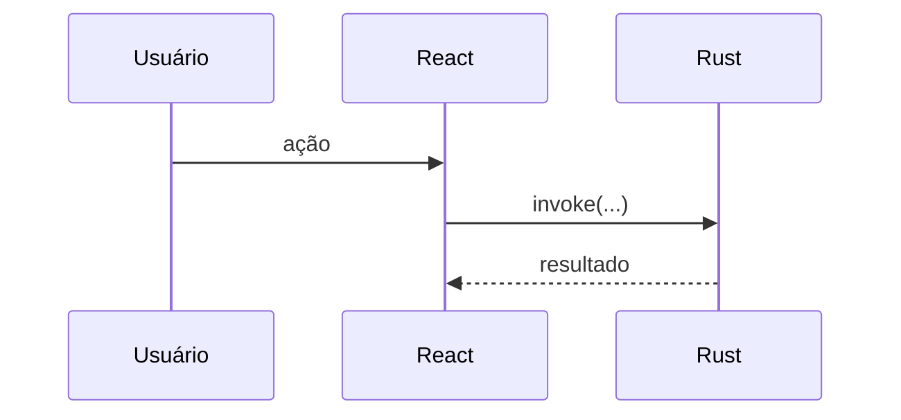

# Feature Specification: <Nome legível>

## Metadata

| Field | Value |
|---|---|
| Feature ID | `feature/<pasta>` |
| Product | JARVIS OS (jvOS) |
| Feature Status | Em desenvolvimento · Implementado · Removido |
| Document Status | <Criada / Reescrita> em AAAA-MM-DD; <N decisões de produto em Open Questions, ou "sem decisões em aberto"> |
| Source Commit | `<hash curto>` (AAAA-MM-DD) |
| Uncommitted Changes | <o que ainda não está em commit, ou "Nenhuma"> |
| Voice Shortcut | `shortcut:<x>` · `window:<x>` · — |
| Assistant Tool | `<tool>` · — |
| Target Platforms | Windows 11 com WebView2; <o que funciona no navegador (modo web) e o que não> |
| Language | PT-BR no conteúdo e nas falas; inglês nos títulos das seções e em Given / When / Then |
| Last Editorial Revision | AAAA-MM-DD |
| Verification Scope | Conferida com o código em AAAA-MM-DD: <arquivos>. <Testes executados ou não> |

<!--
Formato "Feature Specification", inspirado no GitHub Spec Kit com seções de desenho técnico
(ADR-0025). Modelo pronto: .specs/features/reminders/spec.md.
- Títulos das seções, rótulos (Priority, Related Story…) e Given / When / Then em inglês; todo o resto
  em PT-BR. Código em `crases`, rótulos da UI "entre aspas", valores com nome `$assim`.
- IDs: US, RF, RNF, SC, T, AC (critério de aceite), KL (limitação conhecida), OQ (decisão de produto
  em aberto). Um ID é definido uma vez (na tabela ou no título) e nunca é reaproveitado.
- Só fatos do código, dos testes, dos ADRs ou das memórias do projeto. Uma dúvida que o código
  responde vira fato; OQ é só para decisão de produto. Motivo sem registro: "⚠ inferido — confirmar".
- Critérios: binários, com o número real; cubra o caminho feliz, uma falha e um caso de borda.
- Apague as seções e tabelas que não se aplicam (Assistant Tool, Interfaces sem comando, etc.).
-->

Especificação no formato inspirado no GitHub Spec Kit, com seções de desenho técnico ([ADR-0025](../../arch/adr/0025-features-formato-feature-specification.md)). <Quais IDs existem e de onde vieram.> KL-* registra limitações conhecidas; OQ-*, decisões de produto em aberto. Nenhum dos dois acrescenta escopo.

## Overview

<Dois ou três parágrafos curtos: o que a feature faz para o usuário.>

| Input | Expected Behavior | Execution Path |
|---|---|---|
| "<o que o usuário diz ou faz>" | <o que acontece> | <onde roda: local, Rust, Claude Code…> |

## Goals and Success Criteria

### Goals

- <resultado para o usuário>

### Success Criteria

| ID | Criterion | Verification |
|---|---|---|
| SC-001 | <resultado mensurável> | <como conferir> |

## Scope and Non-Goals

### In Scope

- <o que a feature cobre>

### Out of Scope

- <o que ela não faz de propósito; ao menos um item>

## User Stories

### US1 — <Title>

**Priority:** P1.

**User Story:** Como usuário, quero <…> para <…>.

**Why This Priority:** <valor entregue>.

**Independent Test:** `tests/<x>.spec.ts` — "<título do teste>".

**Acceptance Criteria:** AC-001 e AC-002.

## Requirements

### Functional Requirements

| ID | Requirement | Related Stories |
|---|---|---|
| RF-001 | <O sistema DEVE …> | US1 |

### Non-Functional Requirements

| ID | Requirement | Scope |
|---|---|---|
| RNF-001 | <limite, desempenho, offline, privacidade, com o número real> | <onde vale> |

### Operational Constraints

- <limites do código: máximos, debounces, timeouts>

## Acceptance Criteria

### AC-001 — <Title>

**Related Story:** US1.

- **Given** <estado inicial>
- **When** <ação>
- **Then** <resultado observável>.

### AC-002 — <Title>

**Related Story:** US1.

- **Given** <estado de falha: entrada inválida, sem rede, limite>
- **When** <ação>
- **Then** <o que o usuário vê>.

**Coverage Status:** <só quando não há teste: "sem teste automatizado (KL-00x)">.

## Behavior and Flows

<Uma subseção por fluxo, regra ou componente. Para um componente com UI:>

### `<Componente>`

<O que mostra ou faz, em uma frase.>

- **Behavior:** <regras; cite os RF>.
- **Layout:** <o que fica onde; os filhos em `crases`>.
- **Style:** <kit TUI, tokens do tema, tamanhos e fontes>.

### Interaction Flow



### User Feedback

| Moment | Persona Key | Output |
|---|---|---|
| <quando> | `<fala>` | <dock, fala, janela> |

### Voice and Keyboard

- `<id do catálogo>` reconhece "<frase>", "<frase>".
- `<Tecla>`: <ação>.

## Data Model and Persistence

### <Entidade>

```ts
interface <Entidade> {
  <campo>: <tipo>;
}
```

### Storage Rules

| Property | Value |
|---|---|
| State | `$<valor>` |
| Storage | `localStorage` · `settings.json` · arquivo |
| Key | `jarvis.<x>` |
| Write Debounce | <ms> |
| Reader | `<parser>`: <o que descarta> |
| Missing or Invalid Storage | <padrão> |

## Technical Design

### Component Responsibilities

| File or Component | Responsibility |
|---|---|
| `src/...` | … |

### Related Architecture Decisions

- [ADR-00xx — título](../../arch/adr/00xx-....md)

## Interfaces and Contracts

### Tauri Commands

| Command | Input | Output | Notes |
|---|---|---|---|

### Events and Channels

| Event | Payload | Producer → Consumer |
|---|---|---|

### Assistant Tool

| Property | Contract |
|---|---|
| Tool Name | `<tool>` |

## Edge Cases and Error Handling

Cubra ao menos: vazio ou inválido, duplicidade, concorrência e permissões (ou "não se aplica", com o motivo).

| Case | Behavior | Reference |
|---|---|---|
| <situação> | <o que acontece> | <AC, RF, KL ou OQ> |

## Dependencies

### Feature Dependencies

| Dependency | Purpose |
|---|---|
| [<spec>](../<x>/spec.md) | <por quê> |

### Runtime Dependencies

- [<lib>](../../foundation/vendor/<id>/spec.md)
- <WebView2, microfone, rede: qual serviço>

## Test Strategy and Coverage

### Reported Tests

| Test Reference | Coverage | Acceptance Mapping |
|---|---|---|
| `tests/<x>.spec.ts` — "<título>" | <o que confere> | AC-001 |

### Verification Commands

Na raiz do repositório:

```powershell
npx playwright test tests/<x>.spec.ts --project ui -g "<trecho do título>"
```

Em `src-tauri`:

```powershell
cargo test --lib <filtro>
```

### Coverage Gaps

| Gap | Evidence Status | Suggested Verification |
|---|---|---|
| <o que não tem teste> | <sem teste / parcial> | <como conferir> |

## Implementation Plan

**Status Convention:** `[x]` feito · `[ ]` pendente · `[P]` pode rodar em paralelo (arquivos diferentes) · `[USn]` história desta spec. Uma tarefa nova traz Aceite, Arquivos permitidos, Comando de teste e Evidência.

### Phase 1 — Foundation

- [ ] T001 <tarefa>
  - Aceite: AC-001
  - Arquivos permitidos: `src/lib/<x>.ts`
  - Comando de teste: `npx playwright test tests/<x>.spec.ts --project ui`
  - Evidência: <o teste que passa>

## Rollback Plan

1. <o que tirar primeiro>
2. <o que fica órfão e é ignorado sem risco>

## Constitution Compliance

| Principle | Status | Rationale |
|---|---|---|
| P1 — Offline-first | Atendido | <…> |

## Known Limitations

| ID | Limitation | Status |
|---|---|---|
| KL-001 | <lacuna real, com o caminho do código> | <fora do escopo / lacuna de teste / ver OQ-00x> |

## Open Questions

| ID | Question | Evidence and Impact | Suggested Resolution |
|---|---|---|---|
| OQ-001 | <decisão de produto> | <o que o código faz hoje e o efeito> | <caminho sugerido> |

## References

- <versão anterior da spec, ADRs, código conferido>
