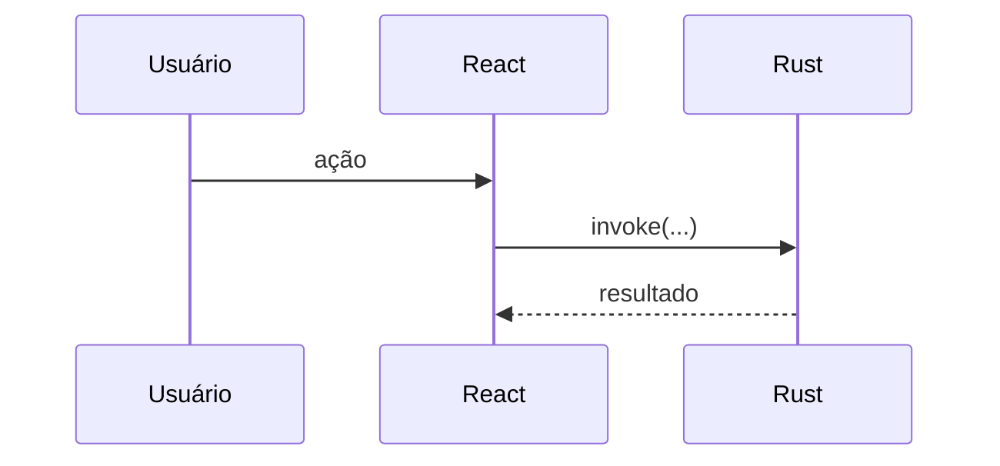

# <Nome legível>

<Uma frase: o que é.>

| | |
|---|---|
| **ID** | `<grupo>/<pasta>` (ex.: `widget/weather`) |
| **Status** | Em desenvolvimento · Implementado · Implementado · não commitado · Removido |
| **Origem** | `<hash curto>` (<data>) — ou "não commitado (27/10)" |
| **Window kind** | `<kind>` em `src/lib/desktop.ts` (só widgets e apps) |
| **Voz** | ids de `src-tauri/voice-commands.json` (ex.: `window:weather`, `shortcut:weather`) |

<!--
Formato SpecLang (GitHub Next) com os IDs e o aceite mantidos: a spec é a fonte da verdade do que o
código faz. Valores com nome `$assim`, código em `crases`, rótulos da UI "entre aspas".
- Cada ID (US, RF, RNF, SC, T) aparece uma vez. Um RF fica no bullet de comportamento onde a regra vive.
- Casos de borda viram "Se …, então …" no componente certo; os transversais ficam em "Casos de borda".
- Layout e Estilo saem do código (classes, kit TUI, tokens). O que não está no código leva o
  marcador "⚠ inferido — confirmar".
- Apague as seções opcionais que não se aplicam: Telas (só apps), Casos de borda, Voz e teclado,
  Restrições, Contratos.
-->

## Visão geral

Um parágrafo: para quem é e por que existe.

## Dados

O estado que o item lê e grava. Cada valor ganha um nome, usado no resto da spec.

- `$<valor>`: <forma>. Fica em `jarvis.<x>` (<debounce>); <o que o parser descarta>. Ver [persistência](../../domain/persistence.md).
- `$<outro>`: <forma>, vindo de `<comando>`. Só em memória.

## Telas

(Só apps.) Uma seção `###` por tela, aba ou modo.

### <Tela>

<O que mostra, em uma frase.>

- **Comportamento:** …
- **Layout:** contém `<Componente>` e `<Outro>`.

## Componentes

Uma seção `###` por componente ou parte do comportamento. Uma feature sem UI usa as partes ("Gravação", "Matcher"…).

### `<Componente>`

<O que mostra ou faz, em uma frase.>

- **Comportamento:**
  - **RF-001**: <regra verificável, com DEVE>.
  - Se <condição>, então <resultado>.
    - <detalhe>
- **Layout:** <o que fica onde; os filhos em `crases`>.
- **Estilo:** <kit TUI, tokens do tema (`hud-amber`), tamanhos e fontes>.

## Casos de borda

- <o que não pertence a um componente só>

## Voz e teclado

- **RF-00x**: Quando o usuário disser "<frase>" (`<id do catálogo>`), <ação>.
- `<Tecla>`: <ação>.

## Restrições

- **RNF-001**: <limite, desempenho, offline, privacidade> (o número real do código).

## Histórias de usuário

### US1 — <título curto> (P1)

<Uma frase do ponto de vista do usuário.>

**Por que P1:** <valor entregue>.
**Teste independente:** <o teste que cobre só esta história>.

**Aceite**

1. **Dado** <estado inicial>, **quando** <ação>, **então** <resultado observável>.
2. **Dado** …, **quando** …, **então** ….

### US2 — <título> (P2)

…

## Critérios de sucesso

- **SC-001**: <resultado mensurável, independente de tecnologia>.

## Fora de escopo e limitações

- <o que o item não faz de propósito>
- <limitações conhecidas; as lacunas abertas ficam em Pendências>

## Código

Duas ou três frases: a abordagem técnica escolhida.

| | |
|---|---|
| **Camadas** | UI React · hook · lib · comando Tauri · módulo Rust |
| **Dependências** | bibliotecas e processos externos relevantes |
| **Testes** | `tests/<x>.spec.ts`, testes Rust `mod tests` |
| **Plataforma** | Windows 11 · WebView2; comportamento fora do Tauri (fake / fallback / indisponível) |

### Arquivos

| Arquivo | Papel |
|---|---|
| `src/components/...` | … |

### Contratos

#### Comandos Tauri

| Comando | Entrada | Saída | Notas |
|---|---|---|---|

#### Eventos e Channels

| Nome | Payload | Emissor → consumidor |
|---|---|---|

#### Ferramentas MCP (JARVIS)

| Tool | O que faz |
|---|---|

### Fluxo

### Constituição

Princípios de [constitution.md](../../arch/constitution.md) que se aplicam, com as exceções explicadas.

- [x] P1 Offline-first: …
- [x] P2 Rust é dono do nativo: …

### Decisões relacionadas

- [ADR-00xx — título](../../arch/adr/00xx-....md)

## Tarefas

Legenda: `[x]` feito · `[ ]` pendente · `[P]` pode rodar em paralelo (arquivos diferentes) · `[USn]` história desta spec.

### Fase 1 — Base

- [x] T001 <tipos / parser / persistência> — `src/lib/<x>.ts`
- [x] T002 [P] <comando Rust> — `src-tauri/src/<x>.rs`

### Fase 2 — US1 <título> (P1)

- [x] T003 [US1] <componente> — `src/components/...`

### Fase N — Testes

- [x] T0xx Playwright `tests/<x>.spec.ts` — "<título do teste>"
- [x] T0xx Rust `src-tauri/src/<x>.rs` — `nome_do_teste`

## Pendências

- [ ] <lacuna real encontrada no código, com o caminho>

> ⚠ inferido — confirmar: use este marcador para qualquer motivo ou intenção que não esteja no código, em commits ou em memórias do projeto.
