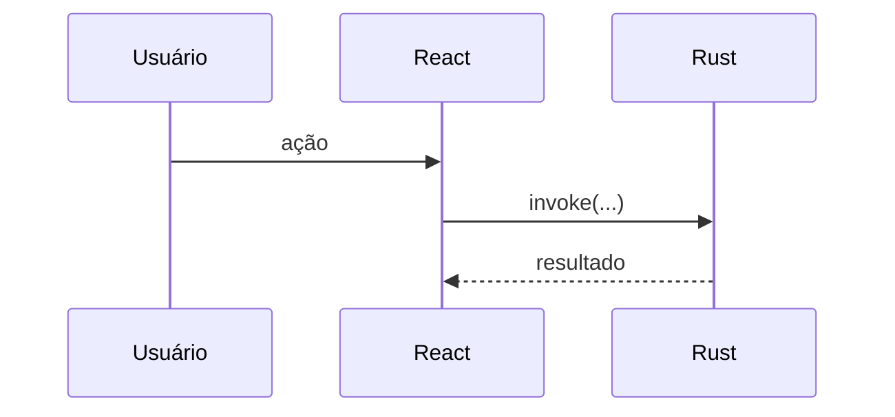

# <Tipo>: <Nome legível>

<Uma frase: o que é.>

| | |
|---|---|
| **ID** | `<grupo>/<pasta>` (ex.: `widget/weather`) |
| **Status** | Em desenvolvimento · Implementado · Implementado · não commitado · Removido |
| **Origem** | `<hash curto>` (<data>) — ou "não commitado (27/10)" |
| **Window kind** | `<kind>` em `src/lib/desktop.ts` (só widgets e apps) |
| **Voz** | ids de `src-tauri/voice-commands.json` (ex.: `window:weather`, `shortcut:weather`) |

<!--
Formato do Feature Spec Generator do spec-coding.dev (https://spec-coding.dev/tools/): Objetivo,
Não-objetivos, Critérios de aceite, Casos de borda, Entregáveis (Output) e Dependências. Entre os casos
de borda e os entregáveis fica o corpo SpecLang (Dados, Telas, Componentes, Voz e teclado, Restrições),
que é a fonte da verdade do que o código faz.
- <Tipo> é Feature, Widget ou App. Valores com nome `$assim`, código em `crases`, rótulos da UI "entre aspas".
- Cada ID (US, RF, RNF, SC, T, Critério) aparece uma vez e nunca é reaproveitado. Um RF fica no bullet de
  comportamento onde a regra vive.
- Critérios de aceite: binários e observáveis, com o número real ("abre em até 2 s", não "é rápido").
  Cubra o caminho feliz, um caminho de falha e um caso de borda. Cada critério vira um caso de teste: a
  história entre parênteses diz qual "Teste independente" o prova. Sem "Quando", o critério descreve um
  estado (Dado → Então).
- Layout e Estilo saem do código (classes, kit TUI, tokens). O que não está no código leva o
  marcador "⚠ inferido — confirmar".
- Apague as seções opcionais que não se aplicam: Telas (só apps), Voz e teclado, Restrições, Contratos.
-->

## Objetivo

Uma ou duas frases: o resultado para o usuário, observável o bastante para alguém conferir sem adivinhar.

## Não-objetivos

- <o que o item não faz de propósito; ao menos um, para o escopo não crescer em silêncio>
- <limitações conhecidas; as lacunas abertas ficam em Pendências>

## Histórias de usuário

### US1 — <título curto> (P1)

<Uma frase do ponto de vista do usuário.>

**Por que P1:** <valor entregue>.
**Teste independente:** <o teste que cobre só esta história>.

**Aceite:** [critérios 1 a 3](#critérios-de-aceite).

### US2 — <título> (P2)

…

## Critérios de aceite

### Critério 1 (US1)

- **Dado** <estado inicial>
- **Quando** <ação>
- **Então** <resultado observável>.

### Critério 2 (US1)

- **Dado** <estado de falha: entrada inválida, falta de rede, limite>
- **Quando** <ação>
- **Então** <o que o usuário vê>.

### Critério 3 (US1)

- **Dado** <caso de borda>
- **Então** <estado observável>.

## Casos de borda

- **Vazio/nulo:** <nada salvo, lista vazia, valor ausente> → <o que acontece>.
- **Duplicidade/idempotência:** <a mesma ação duas vezes, item repetido> → <o que acontece>.
- **Concorrência/corrida:** <duas janelas, eventos fora de ordem, gravação com debounce> → <o que acontece>.
- **Permissões/visibilidade:** <confinamento do JARVIS, microfone, rede, arquivos fora do workspace> → <o que acontece>.
- <o que não pertence a uma categoria só>

## Dados

O estado que o item lê e grava. Cada valor ganha um nome, usado no resto da spec.

- `$<valor>`: <forma>. Fica em `jarvis.<x>` (<debounce>); <o que o parser descarta>. Ver [persistência](../../domain/persistence.md).
- `$<outro>`: <forma>, vindo de `<comando>`. Só em memória.

## Telas

(Só apps.) Uma seção `###` por tela, aba ou modo.

### <Tela>

<O que mostra, em uma frase.>

- **Comportamento:** …
- **Layout:** contém `<Componente>` e `<Outro>`.

## Componentes

Uma seção `###` por componente ou parte do comportamento. Uma feature sem UI usa as partes ("Gravação", "Matcher"…).

### `<Componente>`

<O que mostra ou faz, em uma frase.>

- **Comportamento:**
  - **RF-001**: <regra verificável, com DEVE>.
  - Se <condição>, então <resultado>.
    - <detalhe>
- **Layout:** <o que fica onde; os filhos em `crases`>.
- **Estilo:** <kit TUI, tokens do tema (`hud-amber`), tamanhos e fontes>.

## Voz e teclado

- **RF-00x**: Quando o usuário disser "<frase>" (`<id do catálogo>`), <ação>.
- `<Tecla>`: <ação>.

## Restrições

- **RNF-001**: <limite, desempenho, offline, privacidade> (o número real do código).

## Critérios de sucesso

- **SC-001**: <resultado mensurável, independente de tecnologia>.

## Entregáveis

Duas ou três frases: a abordagem técnica escolhida.

| | |
|---|---|
| **Camadas** | UI React · hook · lib · comando Tauri · módulo Rust |
| **Dependências** | ver [Dependências](#dependências) |
| **Testes** | `tests/<x>.spec.ts`, testes Rust `mod tests` |
| **Plataforma** | Windows 11 · WebView2; comportamento fora do Tauri (fake / fallback / indisponível) |

### Arquivos

| Arquivo | Papel |
|---|---|
| `src/components/...` | … |

### Contratos

#### Comandos Tauri

| Comando | Entrada | Saída | Notas |
|---|---|---|---|

#### Eventos e Channels

| Nome | Payload | Emissor → consumidor |
|---|---|---|

#### Ferramentas MCP (JARVIS)

| Tool | O que faz |
|---|---|

### Fluxo

### Testes

- `npx playwright test tests/<x>.spec.ts --project ui`: <o que prova> (critérios 1 a 3).
- `cargo test --lib <módulo>` (em `src-tauri`): <o que prova>.

### Reversão

- <o que tirar para desfazer o item: registros em `desktop.ts`, catálogo de voz, kinds e comandos no Rust>
- <o que fica para trás e é ignorado sem risco: a chave `jarvis.<x>`, um campo do `settings.json`>

### Constituição

Princípios de [constitution.md](../../arch/constitution.md) que se aplicam, com as exceções explicadas.

- [x] P1 Offline-first: …
- [x] P2 Rust é dono do nativo: …

### Decisões relacionadas

- [ADR-00xx — título](../../arch/adr/00xx-....md)

## Dependências

- **Vendor:** [<lib>](../../foundation/vendor/<id>/spec.md)
- **Specs:** [<outra spec>](../../features/<x>/spec.md) (<por quê>)
- **Sistema:** <WebView2, microfone, rede: qual serviço>

## Tarefas

Regras: cada tarefa é revisável sozinha, não implementa nada fora desta spec e só vira `[x]` com a evidência. Legenda: `[x]` feito · `[ ]` pendente · `[P]` pode rodar em paralelo (arquivos diferentes) · `[USn]` história desta spec.

### Fase 1 — Base

- [ ] T001 <tipos / parser / persistência>
  - Aceite: <critérios N a M, ou a seção da spec>
  - Arquivos permitidos: `src/lib/<x>.ts`
  - Comando de teste: `npx playwright test tests/<x>.spec.ts --project ui`
  - Evidência: <o teste que passa, uma captura ou um log>

### Fase 2 — US1 <título> (P1)

- [ ] T002 [US1] <componente>
  - Aceite: critérios 1 a 3
  - Arquivos permitidos: `src/components/...`
  - Comando de teste: …
  - Evidência: …

## Pendências

- [ ] <lacuna real encontrada no código, com o caminho>

> ⚠ inferido — confirmar: use este marcador para qualquer motivo ou intenção que não esteja no código, em commits ou em memórias do projeto.
