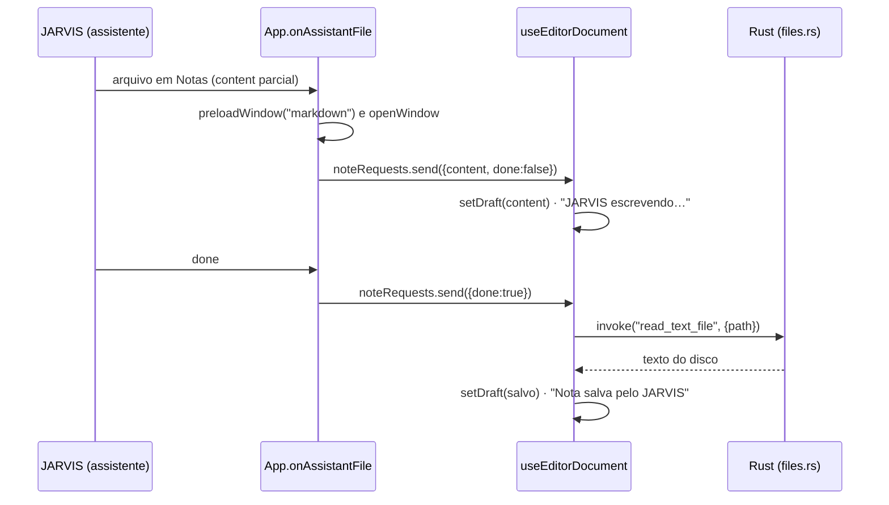

# App: Jarvis Mark

O editor de Markdown do jvOS, com a visualização ao lado, formatação, ditado e arquivos de verdade no app desktop.

| | |
|---|---|
| **ID** | `app/jarvis-mark` |
| **Status** | Implementado |
| **Origem** | `42e671a` (2026-10-23) · evoluída em `750ebd0` (notas escritas pelo JARVIS) |
| **Window kind** | `markdown` em `src/lib/desktop.ts` (880×560, mínimo 480×300) |
| **Voz** | `window:markdown` ("Jarvis Mark", "markdown", "editor de markdown") |

## Objetivo

O Jarvis Mark é o editor de Markdown do jvOS. O usuário escreve com a visualização ao lado, formata com botões ou atalhos e dita texto com o próprio microfone do editor. No app desktop, ele abre e salva arquivos de verdade. No navegador, guarda só o rascunho. O editor também é onde aparecem as notas que o JARVIS escreve em `Documentos\JARVIS\Notas`: o texto chega enquanto é escrito e depois vira o arquivo salvo. O rascunho fica guardado sozinho, e fechar a janela nunca descarta nada.

## Não-objetivos

- Só há um documento por vez; o editor não tem abas.
- O editor não detecta mudanças externas no arquivo aberto (o jv_ide detecta; ver [jv_ide](../jv_ide/spec.md)).
- A gravação não aplica o limite de 2 MB, só a leitura.
- Os comandos de arquivo aceitam qualquer caminho absoluto, sem raiz confinada. Ver [Pendências](#pendências) e [segurança](../../arch/security.md).
- A nota diária do atalho "anota" (`assistant_note`) só abre no editor; o fluxo é de [quick-notes](../../features/quick-notes/spec.md).

## Histórias de usuário

### US1 — Escrever com visualização ao vivo (P1)

Quero escrever Markdown e ver o resultado formatado ao lado enquanto digito.

**Por que P1:** é a função central do editor.
**Teste independente:** `tests/desktop.spec.ts` — "the markdown editor previews what is typed, formats with Ctrl+B and keeps the draft".

**Aceite:** [critérios 1 a 3](#critérios-de-aceite).

### US2 — Formatar pelo teclado ou pela barra (P1)

Quero aplicar negrito, itálico, títulos, listas, link, código e citação sem digitar a sintaxe.

**Por que P1:** é o que diferencia o editor de um campo de texto.
**Teste independente:** mesmo teste de `tests/desktop.spec.ts` (Ctrl+B sobre "item" vira `**item**`).

**Aceite:** [critérios 4 a 5](#critérios-de-aceite).

### US3 — Rascunho que sobrevive (P1)

Quero fechar a janela ou recarregar o app sem perder o que escrevi.

**Por que P1:** o editor promete que fechar nunca descarta nada.
**Teste independente:** o mesmo teste recarrega a página e confere o título e o `●`.

**Aceite:** [critério 6](#critérios-de-aceite).

### US4 — Abrir e salvar arquivos no desktop (P2)

Quero abrir um `.md` do disco, editar e salvar no mesmo lugar ou em outro.

**Por que P2:** só existe no app desktop; no navegador o rascunho já cobre o uso básico.
**Teste independente:** no modo web, o teste confere que "Abrir" está desabilitado e que "Salvar" tem o título "Disponível no app desktop". O fluxo com arquivos reais não tem teste Playwright.

**Aceite:** [critérios 7 a 10, 16 e 17](#critérios-de-aceite).

### US5 — Ver a nota que o JARVIS escreve (P2)

Quero ver no editor a nota que o JARVIS está escrevendo, à medida que ela é escrita.

**Por que P2:** liga o assistente ao editor, mas depende do Claude Code.
**Teste independente:** `tests/assistant.spec.ts` — "a note JARVIS writes opens in Jarvis Mark, its text arriving as it is written".

**Aceite:** [critérios 11 a 13](#critérios-de-aceite).

### US6 — Ditar no cursor (P3)

Quero segurar o microfone do editor, falar e ver o texto inserido onde está o cursor.

**Por que P3:** é um atalho; depende do motor de voz do app desktop.
**Teste independente:** no modo web, o teste só confere que "Ditar (segure para falar)" está desabilitado. A ditação real não tem teste.

**Aceite:** [critérios 14 a 15](#critérios-de-aceite).

## Critérios de aceite

### Critério 1 (US1)

- **Dado** o Jarvis Mark aberto
- **Quando** digito `# Olá JARVIS`, uma linha vazia e `- item`
- **Então** a visualização mostra um título de nível 1 "Olá JARVIS" e um item de lista "item".

### Critério 2 (US1)

- **Dado** texto digitado
- **Quando** olho a barra de status
- **Então** ela mostra "Ln 3", a contagem de palavras, "UTF-8", "Markdown" e o marcador `●` de não salvo.

### Critério 3 (US1)

- **Dado** o editor aberto
- **Quando** clico nos botões de modo ("Só o editor", "Editor e visualização", "Só a visualização") ou aperto Ctrl+P
- **Então** a área alterna entre editor, dividido e só visualização. O modo inicial é dividido.

### Critério 4 (US2)

- **Dado** uma seleção
- **Quando** aperto Ctrl+B
- **Então** ela fica entre `**` e a visualização mostra `<strong>`. Repetir sobre o trecho já marcado remove a marcação.

### Critério 5 (US2)

- **Dado** várias linhas selecionadas
- **Quando** clico em "Lista numerada"
- **Então** cada linha ganha `1. `, `2. `… Clicar de novo, com todas as linhas já prefixadas, remove os prefixos.

### Critério 6 (US3)

- **Dado** texto digitado
- **Quando** a página recarrega
- **Então** o Jarvis Mark reabre com o mesmo texto e continua marcado como não salvo.

### Critério 7 (US4)

- **Dado** o app desktop
- **Quando** clico em "Abrir" ou aperto Ctrl+O
- **Então** abre o diálogo nativo com o filtro "Markdown" (`md`, `markdown`, `txt`), e o arquivo escolhido substitui o rascunho com a mensagem "Aberto <nome>".

### Critério 8 (US4)

- **Dado** um documento sem caminho
- **Quando** aperto Ctrl+S
- **Então** abre o diálogo "Salvar arquivo" sugerindo `sem-titulo.md`. Depois de salvar, a barra mostra "Salvo às HH:MM".

### Critério 9 (US4)

- **Dado** alterações não salvas
- **Quando** peço Novo (Ctrl+N) ou Abrir
- **Então** aparece a barra "Descartar as alterações não salvas?" com "Descartar" e "Cancelar".

### Critério 10 (US4)

- **Dado** um documento com caminho
- **Quando** aperto Ctrl+Shift+S
- **Então** o diálogo de salvar abre mesmo assim (Salvar como).

### Critério 11 (US5)

- **Dado** o JARVIS escrevendo um arquivo em `Documentos\JARVIS\Notas`
- **Quando** o texto chega em partes
- **Então** o Jarvis Mark abre sozinho, o texto cresce aos poucos e a barra mostra "JARVIS escrevendo…".

### Critério 12 (US5)

- **Dado** a escrita concluída
- **Quando** o arquivo está no disco
- **Então** o editor carrega o arquivo salvo, mostra "Nota salva pelo JARVIS · <nome>" e guarda o caminho no rascunho.

### Critério 13 (US5)

- **Dado** alterações não salvas do usuário
- **Quando** chega uma nota do JARVIS
- **Então** o texto do usuário fica intacto e a barra avisa "JARVIS salvou <nome> · salve ou descarte suas alterações para ver". Se for o mesmo arquivo, a palavra é "alterou".

### Critério 14 (US6)

- **Dado** o app desktop
- **Quando** seguro o botão de microfone (clique, Espaço ou Enter)
- **Então** a barra mostra "Ditando… solte para inserir". Ao soltar, mostra "Transcrevendo…".

### Critério 15 (US6)

- **Dado** a transcrição pronta
- **Quando** o texto chega
- **Então** ele entra no cursor, com espaço antes se o caractere anterior não for espaço e um espaço no fim. Se só a visualização estiver na tela, o texto vai para o fim do documento.

### Critério 16 (US4)

- **Dado** o modo navegador (fora do Tauri)
- **Quando** olho "Abrir" e "Salvar" ou aperto Ctrl+S
- **Então** "Abrir" fica desabilitado, "Salvar" tem a dica "Disponível no app desktop" e Ctrl+S mostra "Disponível no app desktop · o rascunho fica guardado".

### Critério 17 (US4)

- **Dado** o app desktop
- **Quando** abro um arquivo com mais de 2 MB, que não é UTF-8 ou que não existe mais
- **Então** a barra de status mostra "Arquivo grande demais (máx. 2 MB)", "O arquivo não é texto UTF-8" ou "Arquivo não encontrado", e o rascunho não muda.

## Casos de borda

- **Vazio/nulo:**
  - Documento sem texto → o placeholder "# Escreva em Markdown…"; sem caminho, a barra mostra "sem título".
  - Diálogo de abrir ou salvar cancelado → nada muda.
  - Campo faltando ou inválido em `jarvis.editor.markdown` → `parseDraft` usa o padrão daquele campo.
  - Pedido parcial do JARVIS sem texto (`content: null`) → ignorado; no navegador, sem disco, o fim da nota usa o último texto recebido.
- **Duplicidade/idempotência:**
  - Ctrl+B, Ctrl+I ou Ctrl+K sobre um trecho já envolvido → a marcação sai; um prefixo de linha já presente em todas as linhas → sai de todas.
  - Ditado com as mesmas palavras do anterior → entra de novo, porque o `id` de $ditado muda a cada ditado.
  - Vários pedidos de nota com a janela fechada → só o último fica guardado até o editor abrir.
  - Salvar de novo no mesmo arquivo → grava `<nome>.tmp` e renomeia por cima, sem deixar o `.tmp`.
- **Concorrência/corrida:**
  - Nota do JARVIS chegando com alterações não salvas do usuário → o texto dele fica intacto e a barra avisa "JARVIS salvou <nome> · salve ou descarte suas alterações para ver" ("alterou", se for o mesmo arquivo).
  - Novo ou Abrir sobre alterações não salvas → a `ConfirmBar` "Descartar as alterações não salvas?".
  - Rascunho grande demais para o localStorage → "Rascunho grande demais para guardar automaticamente".
  - Arquivo aberto alterado fora do editor → não é detectado (ver [Não-objetivos](#não-objetivos)).
- **Permissões/visibilidade:**
  - Caminho relativo → "Caminho inválido"; sem permissão → "Sem permissão para acessar o arquivo".
  - `read_text_file` e `write_text_file` aceitam qualquer caminho absoluto, sem raiz confinada (exceção a P10, em [Pendências](#pendências)); as notas do JARVIS só chegam de `Documentos\JARVIS\Notas`, dentro da pasta a que ele está confinado ([ADR-0007](../../arch/adr/0007-jarvis-confinado-a-documentos.md)).
  - O ditado precisa do microfone e do motor de voz do app desktop; fora do Tauri, ver o item abaixo.
- **Fora do Tauri:** "Abrir" e "Salvar" ficam desabilitados com o título "Disponível no app desktop". Ctrl+S mostra "Disponível no app desktop · o rascunho fica guardado". O botão de ditar fica desabilitado.
- **Arrastar dentro do conteúdo:** não move a janela (`tests/widgets.spec.ts`).

## Dados

- `$documento` (**Rascunho do editor** `EditorDraft`): `{ version: 1, content, path, language, savedContent }`. Fica em `jarvis.editor.markdown` (localStorage), gravado com 400 ms de debounce (`useStoredState`), sem migração. `parseDraft` valida campo a campo e usa o padrão quando algo falta. Ver [persistência](../../domain/persistence.md).
  - **RF-005**: O documento DEVE ser guardado em `jarvis.editor.markdown` a cada mudança (debounce de 400 ms), com conteúdo, caminho e último conteúdo salvo.
  - **RF-006**: O estado "não salvo" DEVE ser a diferença entre o conteúdo e o último conteúdo lido ou gravado em disco.
  - Se o rascunho for grande demais para o localStorage, então a barra de status mostra "Rascunho grande demais para guardar automaticamente".
- `$pedido` (**Pedido de arquivo** `FileRequest`): `{ path, content, done }`, enviado pelo JARVIS via `noteRequests`. Só em memória.
- `$ditado` (**Ditado** `DictationText`): `{ id, text }`. O `id` muda a cada ditado, mesmo quando as palavras se repetem. Vem do `DictationContext`.
- `$modo`: editor, dividido ou visualização. Só em memória; começa em dividido.

Ver [glossário](../../domain/glossary.md).

## Telas

### Editor e visualização

O modo inicial: o editor à esquerda e a visualização à direita.

- **Comportamento:**
  - **RF-002**: O editor DEVE oferecer os modos editor, dividido e visualização. Ctrl+P alterna entre eles em ciclo.
  - O que é digitado aparece formatado na visualização sem ação extra.
- **Layout:** de cima para baixo: a barra de ferramentas, a `ConfirmBar` (quando há uma pergunta), a área de edição em duas colunas iguais (o editor e a visualização) e a `StatusBar`.
- **Estilo:** o editor tem uma borda direita `hud-cyan/10` separando as colunas.

### Só o editor

- **Comportamento:** a visualização some. O botão "Só o editor" fica aceso.
- **Layout:** o editor ocupa a largura toda, entre a barra de ferramentas e a `StatusBar`.

### Só a visualização

- **Comportamento:** o editor some. O botão "Só a visualização" fica aceso. Um ditado vai para o fim do documento.
- **Layout:** a visualização ocupa a largura toda, entre a barra de ferramentas e a `StatusBar`.

## Componentes

### Barra de ferramentas (`Toolbar`, `ToolButton`, `FileButtons`)

Os botões de arquivo, de formatação, de ditado e de modo.

- **Comportamento:**
  - "Novo", "Abrir" e "Salvar" chamam as ações do documento. Fora do app desktop, "Abrir" e "Salvar" ficam desabilitados.
  - **RF-003**: Ctrl+B, Ctrl+I e Ctrl+K DEVEM envolver a seleção em `**`, `_` e `[…](url)`, e desfazer quando ela já estiver envolvida.
    - Os botões "Negrito", "Itálico" e "Link" fazem o mesmo.
  - **RF-004**: Os botões "Título 1", "Título 2", "Lista", "Lista numerada" e "Citação" DEVEM prefixar cada linha selecionada (`# `, `## `, `- `, `n. `, `> `) ou remover o prefixo quando todas as linhas já o tiverem. "Código" envolve em crases.
  - Clicar num botão não tira a seleção do editor, e o foco volta ao editor depois de formatar.
  - Os botões de modo ("Só o editor", "Editor e visualização", "Só a visualização") trocam $modo; o do modo atual fica aceso.
  - Cada botão mostra só o ícone; o rótulo é a dica e o nome acessível. Um botão desabilitado tem a dica "Disponível no app desktop".
- **Layout:** uma linha de 32 px: Novo, Abrir e Salvar; um separador; Negrito, Itálico, Título 1, Título 2, Lista, Lista numerada, Link, Código e Citação; um separador; o microfone (`DictationButton`); um espaço flexível; e os três botões de modo à direita.
- **Estilo:**
  - Fundo `bg-hud-text/[0.04]`. Cada botão tem 28 × 24 px, com ícone lucide de 14 a 15 px em `text-hud-text/60`.
  - Sob o mouse ou com foco, o botão fica em vídeo reverso (`bg-hud-light/85 text-hud-void`). O botão aceso usa `bg-hud-light/80 text-hud-void`. Desabilitado, fica com 30% de opacidade.
  - O separador é uma linha vertical de 16 px em `bg-hud-cyan/15`.

### `ConfirmBar`

A pergunta na própria janela quando Novo ou Abrir descartariam alterações.

- **Comportamento:**
  - **RF-007**: Novo e Abrir sobre alterações não salvas DEVEM pedir confirmação na própria janela.
  - Mostre "Descartar as alterações não salvas?" com "Descartar" e "Cancelar". "Descartar" segue com Novo ou Abrir; "Cancelar" só fecha a barra.
- **Layout:** uma faixa logo abaixo da barra de ferramentas: a pergunta à esquerda e os dois botões à direita.
- **Estilo:**
  - Borda inferior `hud-alert/25`, fundo `bg-hud-alert/[0.06]` e texto `text-xs` em `text-hud-text`.
  - Os botões têm 10 px em caixa alta com espaçamento largo e cantos arredondados: "Descartar" com borda `hud-alert/40` e texto `text-hud-alert`; "Cancelar" com borda `hud-cyan/20` e texto `text-hud-text/80`.

### Editor (`CodeMirror`)

O campo de texto, com a linguagem Markdown.

- **Comportamento:**
  - Use o wrapper CodeMirror compartilhado (`editorBasics`: números de linha, histórico, colchetes, busca e tema HUD) com a linguagem Markdown e realce dos blocos de código via `@codemirror/language-data`.
  - Quebre as linhas longas. Sem texto, mostre o placeholder "# Escreva em Markdown…".
  - Informe a posição do cursor e o tamanho da seleção à `StatusBar`.
  - "/" dentro do editor é só um caractere e não abre a busca (`tests/search.spec.ts`).
- **Layout:** ocupa a coluna da esquerda no modo dividido, ou a área toda em "Só o editor".
- **Estilo:** `hudTheme`: fundo transparente, fonte `--font-mono` de 13 px e cores só das variáveis `--color-hud-*`. O texto é selecionável.

### Visualização

O Markdown renderizado ao lado.

- **Comportamento:**
  - **RF-001**: O editor DEVE renderizar Markdown com GFM (tabelas, riscado, listas de tarefas) na visualização, com o estilo HUD.
  - Os links abrem fora (`target="_blank"`).
- **Layout:** a coluna da direita no modo dividido, ou a área toda em "Só a visualização", com rolagem própria (`hud-scroll`) e respiro de 20 px nas laterais.
- **Estilo:**
  - Texto `text-sm` `text-hud-text`, selecionável. Os estilos são de `MARKDOWN_COMPONENTS`, os mesmos das lições do jv_lab.
  - Títulos em `text-hud-light` (o h1 em `text-xl` com borda inferior `hud-cyan/15`); links em `text-hud-cyan` sublinhados; marcadores de lista e caixas de tarefa em `hud-cyan`.
  - Citação com borda esquerda `hud-cyan/40`, em itálico e `text-hud-text/75`. Código em linha com fundo `bg-hud-cyan/10` e texto `text-hud-holo`; blocos de código com fundo `bg-black/25` e borda `hud-cyan/12`.
  - Tabelas com bordas `hud-cyan/15` e cabeçalho em `bg-hud-cyan/[0.06]` `text-hud-light`. Texto riscado em `text-hud-text/50`.

### `StatusBar`

A linha de status no estilo tmux/lualine: o selo, o arquivo e os detalhes à direita.

- **Comportamento:**
  - Mostre o nome do arquivo (ou "sem título") e `●` quando houver alterações não salvas.
  - À direita, mostre "Ln N, Col N", "N sel" (só com seleção), "N palavras", "UTF-8", "Markdown" e "arquivo" ou "rascunho". No navegador, é sempre "rascunho".
  - Uma mensagem (do documento ou do ditado) toma o lugar dos detalhes.
  - **RF-012**: As mensagens da barra de status DEVEM sumir depois de 4 s.
- **Layout:** uma linha de 24 px: o selo "MD" colado à esquerda, o nome do arquivo, um espaço flexível e os detalhes (ou a mensagem).
- **Estilo:**
  - Fundo `bg-hud-text/[0.06]`, `font-mono` 10 px em caixa alta com espaçamento largo, `text-hud-text/60`; o texto é selecionável.
  - O selo fica em `bg-hud-light/80 font-semibold text-hud-void`. O nome fica em `text-hud-text/85`, e o `●` em `text-hud-light`.
  - Uma mensagem fica em `text-hud-light/80`, e um erro em `text-hud-alert/90`.

### `DictationButton`

O microfone do próprio editor: segura para falar, solta para inserir no cursor.

- **Comportamento:**
  - **RF-011**: O microfone do editor DEVE gravar enquanto está pressionado, via `voice_dictate`. O texto vem do evento `voice:dictation` com `target: "editor"`.
  - Segure pelo clique (com captura do ponteiro), por Espaço ou por Enter. Soltar, perder a captura ou perder o foco termina a gravação.
  - Pressionar não tira a seleção do editor, para o texto entrar onde estava o cursor.
  - Enquanto grava, a barra de status mostra "Ditando… solte para inserir"; depois, "Transcrevendo…".
  - Quando chega um $ditado novo, insira o texto no cursor, com espaço antes se o caractere anterior não for espaço e um espaço no fim. Se só a visualização estiver na tela, o texto vai para o fim do documento.
  - Fora do app desktop, o botão fica desabilitado com a dica "Disponível no app desktop". O fluxo do ditado é de [dictation](../../features/dictation/spec.md).
- **Layout:** um botão quadrado de 28 px na barra de ferramentas, com o ícone `Mic` de 14 px e, enquanto grava, um ponto no canto superior direito.
- **Estilo:**
  - Em repouso, `text-hud-text/60`, com fundo `hud-cyan/10` sob o mouse. Cantos arredondados (`rounded-lg`).
  - Gravando: fundo `bg-hud-alert/15`, ícone `text-hud-alert` e o ponto `bg-hud-alert` pulsando, com brilho.
  - Transcrevendo: fundo `bg-hud-cyan/[0.12]` e ícone `text-hud-light`.
  - Desabilitado: 30% de opacidade.

### Documento (`useEditorDocument`)

O rascunho, o estado "não salvo" e as operações de arquivo.

- **Comportamento:**
  - Novo esvazia o documento. Abrir mostra o diálogo nativo com o filtro "Markdown" (`md`, `markdown`, `txt`), e o arquivo escolhido substitui o rascunho com a mensagem "Aberto <nome>".
  - Salvar grava no caminho do documento; sem caminho, abre o diálogo "Salvar arquivo" sugerindo `sem-titulo.md`. Salvar como sempre abre o diálogo. Depois de salvar, a barra mostra "Salvo às HH:MM".
  - Se o diálogo for cancelado, então nada muda.
  - Fora do app desktop, Ctrl+S mostra "Disponível no app desktop · o rascunho fica guardado".
  - Os erros de leitura e gravação aparecem na barra de status.

### Arquivos no Rust (`files.rs`)

A leitura e a gravação de texto no disco.

- **Comportamento:**
  - **RF-009**: A leitura e a gravação DEVEM passar pelos comandos `read_text_file` e `write_text_file`, só com caminhos absolutos, em UTF-8 e com leitura limitada a 2 MB. A gravação é atômica.
    - A gravação escreve em `<nome>.tmp` e renomeia por cima.
  - Se o arquivo passar de 2 MB, então responda "Arquivo grande demais (máx. 2 MB)". Se não for UTF-8: "O arquivo não é texto UTF-8". Se não existir: "Arquivo não encontrado". Sem permissão: "Sem permissão para acessar o arquivo".
  - Se o caminho for relativo, então recuse com "Caminho inválido".

### Notas do JARVIS (`noteRequests`)

A nota que o JARVIS escreve em `Documentos\JARVIS\Notas`, aparecendo no editor enquanto é escrita.

- **Comportamento:**
  - **RF-010**: Pedidos de `noteRequests` DEVEM aparecer no editor (texto parcial e depois o arquivo salvo) sem nunca sobrescrever alterações não salvas.
  - Quando o JARVIS escreve um arquivo em `Notas`, o `App` pré-carrega e abre a janela e manda o texto parcial. O editor mostra o texto e "JARVIS escrevendo…".
  - Quando a escrita termina, leia o arquivo do disco, mostre "Nota salva pelo JARVIS · <nome>" e guarde o caminho no rascunho.
  - Se o usuário tiver alterações não salvas, então o texto dele fica intacto e a barra avisa "JARVIS salvou <nome> · salve ou descarte suas alterações para ver" ("alterou", se for o mesmo arquivo).
  - Se a janela estiver fechada, então o pedido fica guardado (só o último) até o editor abrir e pegá-lo.
  - Se for no navegador, então, sem disco, o editor usa o último texto recebido como conteúdo salvo.

## Voz e teclado

- **RF-008**: Ctrl+N, Ctrl+O, Ctrl+S e Ctrl+Shift+S DEVEM executar Novo, Abrir, Salvar e Salvar como.
- Voz `window:markdown` ("Jarvis Mark", "markdown", "editor de markdown"): abre/fecha a janela.
- Busca: "markdown", "md", "editor", "texto", "notas", "documento", "ditado" encontram o Jarvis Mark (`WINDOW_KEYWORDS`).
- `Ctrl+N` / `Ctrl+O`: Novo / Abrir (com confirmação se não salvo).
- `Ctrl+S` / `Ctrl+Shift+S`: Salvar / Salvar como.
- `Ctrl+B` / `Ctrl+I` / `Ctrl+K`: Negrito `**` / itálico `_` / link `[…](url)`.
- `Ctrl+P`: alterna editor → dividido → visualização.
- Segurar o microfone (ponteiro, Espaço ou Enter): ditado no cursor.

## Restrições

- **RNF-001**: O editor carrega sob demanda, como chunk separado (ver [janelas](../../features/desktop-windows/spec.md)).
- **RNF-002**: Leitura limitada a 2 MB (`MAX_BYTES` em `src-tauri/src/files.rs`).
- **RNF-003**: A ditação roda offline no motor de voz local (ver [motor de voz](../../features/voice-engine/spec.md)).

## Critérios de sucesso

- **SC-001**: O que é digitado aparece formatado na visualização sem ação extra.
- **SC-002**: Depois de recarregar o app, o texto e o estado "não salvo" voltam iguais.
- **SC-003**: Uma nota do JARVIS aparece crescendo no editor antes de estar completa e termina com o caminho do arquivo guardado.

## Entregáveis

Um componente React (`MarkdownEditor`) junta o wrapper CodeMirror compartilhado, com a linguagem Markdown e realce de blocos de código via `@codemirror/language-data`, e a visualização do `react-markdown` + `remark-gfm`. O hook `useEditorDocument` cuida do documento: rascunho em localStorage, estado "não salvo", diálogos nativos (`@tauri-apps/plugin-dialog`) e os pedidos do JARVIS. Os arquivos passam por dois comandos Rust finos (`read_text_file`, `write_text_file`). A ditação usa o motor de voz Rust por meio de um contexto React fornecido pelo `App`.

| | |
|---|---|
| **Camadas** | UI React (`MarkdownEditor`, `editorChrome`) · hook `useEditorDocument` · libs `files`, `dictation`, `requests` · comandos `read_text_file`, `write_text_file`, `voice_dictate` · módulo `src-tauri/src/files.rs` |
| **Dependências** | ver [Dependências](#dependências) |
| **Testes** | `tests/desktop.spec.ts`, `tests/assistant.spec.ts`, `tests/search.spec.ts`, `tests/widgets.spec.ts`; Rust `mod tests` em `src-tauri/src/files.rs` |
| **Plataforma** | Windows 11 · WebView2. Fora do Tauri, `canUseFiles = isTauri()` é falso: Abrir e Salvar ficam desabilitados com "Disponível no app desktop", e o ditado fica indisponível (`available: false`) |

### Arquivos

| Arquivo | Papel |
|---|---|
| `src/components/desktop/apps/MarkdownEditor.tsx` | Barra de ferramentas, atalhos, modos de visualização, `wrapSelection`/`prefixLines`, inserção do ditado e `DictationButton` |
| `src/components/desktop/apps/editorChrome.tsx` | `ToolButton`, `FileButtons` (Novo/Abrir/Salvar), `ConfirmBar`, `StatusBar`, `StatusItem` |
| `src/components/desktop/apps/markdownComponents.tsx` | `MARKDOWN_COMPONENTS`: estilos HUD do Markdown (também usados pelo jv_lab) |
| `src/components/desktop/apps/CodeMirror.tsx` | Wrapper CodeMirror compartilhado (`editorBasics`: gutter, histórico, colchetes, busca, tema HUD) |
| `src/hooks/useEditorDocument.ts` | Rascunho `jarvis.editor.markdown`, estado "não salvo", Novo/Abrir/Salvar, confirmação, recepção de `noteRequests` |
| `src/lib/files.ts` | `canUseFiles`, `UNAVAILABLE`, `pickAndRead`, `pickAndWrite`, `readText`, `samePath`, `isInside` |
| `src/lib/dictation.ts` | `DictationContext` / `useDictation` (estado `idle`/`listening`/`transcribing`) |
| `src/lib/requests.ts` | `requestChannel` e `noteRequests` |
| `src/App.tsx` | Fornece o `DictationContext` e roteia arquivos do JARVIS (`onAssistantFile`) para `noteRequests` |
| `src/components/desktop/lazyApps.tsx` | `MarkdownEditor` lazy com `preload` |
| `src-tauri/src/files.rs` | `read` (absoluto, ≤ 2 MB, UTF-8) e `write` (temp `.tmp` + `rename`) |
| `src-tauri/src/lib.rs` | `read_text_file`, `write_text_file`, `voice_dictate` |

### Contratos

#### Comandos Tauri

| Comando | Entrada | Saída | Notas |
|---|---|---|---|
| `read_text_file` | `{ path }` | `string` | Absoluto, ≤ 2 MB, UTF-8. Erros em PT-BR: "Caminho inválido", "Arquivo grande demais (máx. 2 MB)", "O arquivo não é texto UTF-8", "Arquivo não encontrado", "Sem permissão para acessar o arquivo" |
| `write_text_file` | `{ path, contents }` | `()` | Absoluto. Grava em `<nome>.tmp` e renomeia por cima |
| `voice_dictate` | `{ down }` | `VoiceStatus` | Grava enquanto `down`. Se o motor está parado, liga só para isso e desliga depois (`set_exit_after_dictation`). Detalhes em [motor de voz](../../features/voice-engine/spec.md) |

#### Eventos e Channels

| Nome | Payload | Emissor → consumidor |
|---|---|---|
| `voice:dictation` | `{ text, pending, target: "editor" \| "assistant" }` | Motor de voz Rust → `useVoiceAssistant` → `DictationContext` (só `target: "editor"`) |
| `noteRequests` (canal em memória) | `FileRequest { path, content, done }` | `App.onAssistantFile` / atalho "anota" → `useEditorDocument` |

### Fluxo

### Testes

- `npx playwright test tests/desktop.spec.ts --project ui -g "markdown editor"`: visualização ao vivo, "Ln 3" e `●`, Ctrl+B, "Abrir"/"Salvar"/ditar indisponíveis no navegador e o rascunho depois de recarregar (critérios 1, 2, 4, 6 e 16, menos o Ctrl+S).
- `npx playwright test tests/assistant.spec.ts --project ui -g "a note JARVIS writes"`: a nota abre o Jarvis Mark, cresce aos poucos, termina com "Nota salva pelo JARVIS" e o caminho no rascunho (critérios 11–12).
- `npx playwright test tests/search.spec.ts --project ui -g "inside a text field just types"`: "/" no editor é só um caractere.
- `npx playwright test tests/widgets.spec.ts --project ui -g "keep the pointer"`: arrastar dentro do conteúdo não move a janela.
- `cargo test --lib files::` (em `src-tauri`): ida e volta com gravação atômica, caminho relativo, limite de 2 MB, UTF-8 e arquivo ausente (RF-009; critério 17 no backend).
- Sem teste automatizado: modos e Ctrl+P, prefixos de linha, arquivos reais pelo diálogo, a `ConfirmBar`, a nota sobre alterações não salvas e o ditado real (critérios 3, 5, 7–10, 13–15).

### Reversão

- Tirar o kind `markdown` de `src/lib/desktop.ts` (`WindowKind`, `WINDOW_KINDS`, `WINDOW_SPECS`), de `WINDOW_KEYWORDS`/`APP_SUBTITLES` em `commands.ts`, o `case "markdown"` de `Desktop.tsx` e o `MarkdownEditor` de `lazyApps.tsx`; `window:markdown` de `src-tauri/voice-commands.json`, `"markdown"` do `WINDOW_KINDS` de `settings.rs` e os asserts de `window("markdown", …)` em `voice/matcher.rs`.
- **Não** é ignorado sem ajuste: `App.tsx` abre `markdown` e manda `noteRequests` em `onAssistantFile` (notas do JARVIS) e no atalho "anota" de [quick-notes](../../features/quick-notes/spec.md); o ditado de [dictation](../../features/dictation/spec.md) (`target: "editor"`) fica sem destino.
- Ficam, porque outros usam: `CodeMirror.tsx` (jv_ide, jv_agent), `markdownComponents.tsx` (jv_lab, histórico do assistente), `editorChrome.tsx` (jv_lab), `src/lib/files.ts` e os comandos `read_text_file`/`write_text_file` (jv_agent, via `src/lib/agents.ts`).
- Fica órfão e é ignorado: `jarvis.editor.markdown` no localStorage, a janela `markdown` em `jarvis.desktop` (`parseDesktop` descarta kinds desconhecidos) e o comando de voz gravado no `settings.json` (descartado ao carregar). As notas em `Documentos\JARVIS\Notas` continuam sendo arquivos do usuário.

### Constituição

- [x] P1 Offline-first — edição, rascunho e ditação (whisper local) funcionam sem rede.
- [x] P2 Rust é dono do nativo — o disco só é acessado por `read_text_file` e `write_text_file`. Os diálogos vêm do plugin oficial `dialog`, e não há plugin `fs`.
- [x] P3 Comandos finos — os dois comandos em `lib.rs` só repassam para `files::read` e `files::write`. Exceção: eles são síncronos e não usam `blocking()`, e os nomes não seguem `<domínio>_<verbo>` (`read_text_file`).
- [x] P4 Contratos espelhados — só trafegam `string`, sem tipo compartilhado.
- [x] P5 Persistência tolerante — `parseDraft` valida campo a campo e usa o padrão quando algo falta.
- [x] P6 Funciona fora do Tauri — caminho 3 (mensagem "Disponível no app desktop"); o rascunho continua funcionando.
- [x] P7 PT-BR para o usuário — rótulos, aria-labels e erros (`files.rs`) em PT-BR.
- [x] P8 Linguagem visual única — tokens `hud-*`, barra de status no estilo tmux/lualine, `MARKDOWN_COMPONENTS` na paleta HUD.
- [x] P9 Desktop leve — app lazy (`lazyApps.tsx`), com preload quando o JARVIS vai escrever uma nota.
- [ ] P10 Segurança por confinamento — **exceção**: `files.rs` aceita qualquer caminho absoluto, sem raiz. Na prática, os caminhos vêm do diálogo nativo ou do JARVIS (já confinado a `Documentos\JARVIS`), mas o comando em si não valida a raiz. Ver [segurança](../../arch/security.md).
- [x] P11 Coberto por teste — Playwright para preview, formatação, rascunho e nota do JARVIS; Rust para ida e volta, caminho relativo, tamanho e UTF-8.

### Decisões relacionadas

- [ADR-0001 — Tauri 2 + Rust como shell desktop](../../arch/adr/0001-tauri-rust-desktop.md)
- [ADR-0002 — STT offline whisper.cpp na CPU](../../arch/adr/0002-stt-whisper-offline-cpu.md)
- [ADR-0007 — JARVIS confinado a Documentos](../../arch/adr/0007-jarvis-confinado-a-documentos.md)
- [ADR-0010 — settings.json vs localStorage](../../arch/adr/0010-persistencia-settings-vs-localstorage.md)
- [ADR-0012 — apps lazy com preload](../../arch/adr/0012-apps-lazy-com-preload.md)
- [ADR-0014 — linguagem visual TUI](../../arch/adr/0014-linguagem-visual-tui.md)

## Dependências

- **Vendor:** [Tauri](../../foundation/vendor/tauri/spec.md) (`@tauri-apps/api` e `@tauri-apps/plugin-dialog`), [React](../../foundation/vendor/react/spec.md), [CodeMirror 6](../../foundation/vendor/codemirror/spec.md) (`@codemirror/lang-markdown`, `@codemirror/language-data`), [Markdown](../../foundation/vendor/markdown/spec.md) (`react-markdown`, `remark-gfm`), [lucide](../../foundation/vendor/lucide/spec.md)
- **Specs:** [desktop-windows](../../features/desktop-windows/spec.md) (janela e app lazy), [voice-commands](../../features/voice-commands/spec.md) (`window:markdown`), [search](../../features/search/spec.md) (palavras de `WINDOW_KEYWORDS`), [dictation](../../features/dictation/spec.md) e [voice-engine](../../features/voice-engine/spec.md) (`voice_dictate` e `voice:dictation`), [assistant](../../features/assistant/spec.md) (notas que o JARVIS escreve em `Notas`), [quick-notes](../../features/quick-notes/spec.md) (a nota do dia do "anota"), [appearance](../../features/appearance/spec.md) (tema HUD e acento TUI do editor)
- **Sistema:** WebView2; os diálogos nativos de abrir e salvar do Windows; o disco (qualquer caminho absoluto escolhido) e `Documentos\JARVIS\Notas`; o microfone, para o ditado. Nenhuma rede.

## Tarefas

Legenda: `[x]` feito · `[ ]` pendente · `[P]` pode rodar em paralelo (arquivos diferentes) · `[USn]` história desta spec. As tarefas foram reconstruídas do código e dos commits `42e671a` e `750ebd0`.

### Fase 1 — Base

- [x] T001 Leitura e gravação de texto: absoluto, ≤ 2 MB, UTF-8, gravação atômica via `.tmp` + `rename` — `src-tauri/src/files.rs`
- [x] T002 Comandos `read_text_file` e `write_text_file` registrados — `src-tauri/src/lib.rs`
- [x] T003 [P] Adaptador de arquivos com diálogo nativo, `canUseFiles` e `UNAVAILABLE` — `src/lib/files.ts`
- [x] T004 [P] Wrapper CodeMirror compartilhado com `editorBasics` e tema HUD — `src/components/desktop/apps/CodeMirror.tsx`
- [x] T005 [P] Peças de chrome: `ToolButton`, `FileButtons`, `ConfirmBar`, `StatusBar` — `src/components/desktop/apps/editorChrome.tsx`

### Fase 2 — US1 Escrever com visualização ao vivo (P1)

- [x] T006 [US1] Editor CodeMirror Markdown + visualização `react-markdown`/`remark-gfm`, modos editor/dividido/visualização — `src/components/desktop/apps/MarkdownEditor.tsx`
- [x] T007 [P] [US1] Estilos HUD do Markdown (`MARKDOWN_COMPONENTS`) — `src/components/desktop/apps/markdownComponents.tsx`
- [x] T008 [US1] Barra de status com Ln/Col, seleção, palavras, UTF-8, Markdown e arquivo/rascunho — `MarkdownEditor.tsx`
- [x] T009 [US1] Janela `markdown` lazy no `Desktop` — `src/components/desktop/lazyApps.tsx`, `src/components/desktop/Desktop.tsx`

### Fase 3 — US2 Formatar pelo teclado ou pela barra (P1)

- [x] T010 [US2] `wrapSelection` (liga/desliga) e `prefixLines` (liga/desliga em todas as linhas) — `MarkdownEditor.tsx`
- [x] T011 [US2] Atalhos Ctrl+B/I/K/P e botões da barra — `MarkdownEditor.tsx`

### Fase 4 — US3 Rascunho que sobrevive (P1)

- [x] T012 [US3] `useEditorDocument` com `jarvis.editor.markdown`, `parseDraft`, `dirty` e aviso de cota — `src/hooks/useEditorDocument.ts`

### Fase 5 — US4 Abrir e salvar arquivos no desktop (P2)

- [x] T013 [US4] Novo/Abrir/Salvar/Salvar como, Ctrl+N/O/S/Shift+S, mensagens por 4 s — `src/hooks/useEditorDocument.ts`
- [x] T014 [US4] Confirmação "Descartar as alterações não salvas?" — `editorChrome.tsx` (`ConfirmBar`)

### Fase 6 — US5 Ver a nota que o JARVIS escreve (P2)

- [x] T015 [US5] `requestChannel` e `noteRequests` — `src/lib/requests.ts`
- [x] T016 [US5] Roteamento dos arquivos do JARVIS em `Notas` para o editor, com preload e abertura da janela — `src/App.tsx` (`onAssistantFile`)
- [x] T017 [US5] Recepção do texto parcial e final sem sobrescrever alterações do usuário — `src/hooks/useEditorDocument.ts` (`receive`)

### Fase 7 — US6 Ditar no cursor (P3)

- [x] T018 [P] [US6] Contexto `DictationContext` — `src/lib/dictation.ts`
- [x] T019 [US6] `holdDictation` e `DictationApi` no `App`; `dictate` em fila com o push-to-talk — `src/App.tsx`, `src/hooks/useVoiceAssistant.ts`
- [x] T020 [US6] `DictationButton` (ponteiro com captura, Espaço/Enter) e inserção no cursor — `MarkdownEditor.tsx`

### Fase 8 — Testes

- [x] T021 Playwright `tests/desktop.spec.ts` — "the markdown editor previews what is typed, formats with Ctrl+B and keeps the draft"
- [x] T022 Playwright `tests/assistant.spec.ts` — "a note JARVIS writes opens in Jarvis Mark, its text arriving as it is written"
- [x] T023 [P] Playwright `tests/search.spec.ts` — "settings and layout actions run from the search; / inside a text field just types"
- [x] T024 [P] Playwright `tests/widgets.spec.ts` — "sliders inside a widget, and the apps' content, keep the pointer"
- [x] T025 Rust `src-tauri/src/files.rs` — `round_trip`
- [x] T026 Rust `src-tauri/src/files.rs` — `rejects_relative_path`
- [x] T027 Rust `src-tauri/src/files.rs` — `rejects_large_file`
- [x] T028 Rust `src-tauri/src/files.rs` — `rejects_non_utf8_and_missing_files`

## Pendências

- [ ] `read_text_file` e `write_text_file` aceitam qualquer caminho absoluto, sem raiz confinada nem bloqueio de nomes de dispositivo (diferente de `workspace/paths.rs`). Ver [segurança](../../arch/security.md) — `src-tauri/src/files.rs`
- [ ] `files::write` não aplica o limite de 2 MB que `files::read` aplica: um arquivo salvo com mais de 2 MB não reabre — `src-tauri/src/files.rs`
