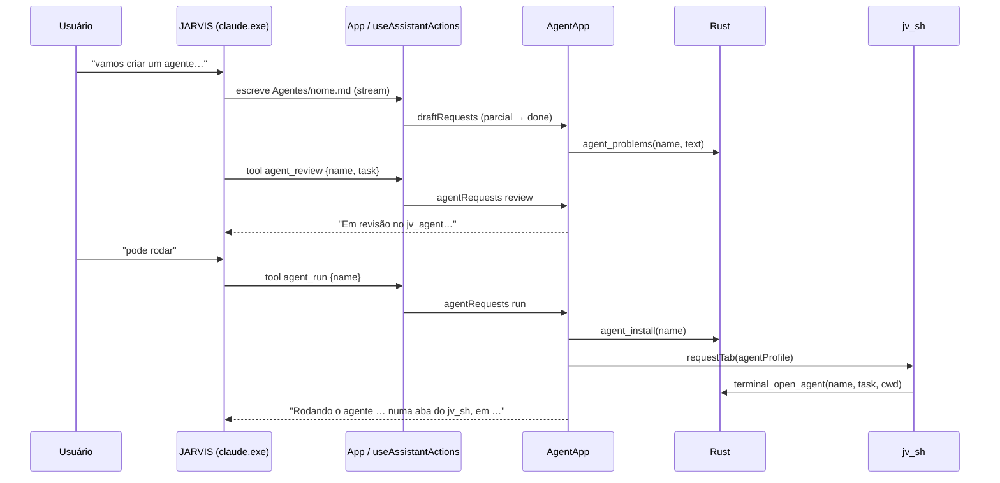

# jv_agent

A oficina onde o usuário cria, por voz e com o JARVIS, subagentes do Claude Code, vê o agente tomar forma como um robô ASCII e o roda uma vez numa aba do jv_sh.

| | |
|---|---|
| **ID** | `app/jv_agent` |
| **Status** | Implementado |
| **Origem** | `750ebd0` (2026-10-27) · evoluída não commitado (figura ASCII, sessão e aba do editor) |
| **Window kind** | `agent` em `src/lib/desktop.ts` (1000×600, mínimo 640×380) |
| **Voz** | `window:agent` ("jv agent", "agentes", "criador de agentes"); a conversa com o JARVIS ("Jarvis, vamos criar um agente") não é um id do catálogo |

## Visão geral

O jv_agent é a oficina onde o usuário cria, por voz e com o JARVIS, subagentes do Claude Code. O JARVIS faz uma entrevista curta e escreve o rascunho em `Documentos\JARVIS\Agentes\<nome>.md`, no formato de subagente (cabeçalho YAML e depois o prompt). A janela mostra esse rascunho como um robô ASCII montado parte por parte, uma barra de 6 etapas, a ficha do agente, um cartão de revisão e, ao lado, a sessão: o que o usuário e o JARVIS disseram, entre os eventos do agente. Depois de revisado e com a confirmação do usuário, o agente é instalado na pasta de subagentes do Claude Code e roda uma vez numa aba do jv_sh, onde o usuário acompanha a execução e aprova as permissões.

## Dados

Nada fica em localStorage. Ver [persistência](../../domain/persistence.md) e [glossário](../../domain/glossary.md).

- `$rascunho`: **Rascunho de agente**, `Documentos\JARVIS\Agentes\<nome>.md` no formato de subagente do Claude Code (`name`, `description`, `tools`, `model`, depois o prompt). As edições do usuário vão para o disco 600 ms depois da última tecla.
- `$instalados`: **Registro de instalados**, `Documentos\JARVIS\Agentes\.instalados.json`, a lista JSON dos nomes que o JARVIS instalou. É gravado a cada instalação; um arquivo ilegível vira a lista vazia.
- `$cópia_instalada`: `~/.claude/agents/<nome>.md` (ou `CLAUDE_CONFIG_DIR\agents`), a cópia do rascunho gravada ao rodar.
- Só na memória da janela:
  - `$ficha`: **Ficha** (`AgentSheet`), `{ name, description, tools, model, prompt }`, cada campo `null` até ser escrito.
  - `$revisão`: **Revisão** (`Review`), `{ name, text, folder, task }`, o texto exatamente como foi mostrado.
  - **Pedido de agente** (`AgentRequest`): `{ kind: "review", name, folder, task } | { kind: "run", name }`, com `reply`.
  - `$eventos`: **Evento de sessão** (`SessionEvent`), `{ at, icon, text }`.
  - `$problemas`: a lista do que impede o agente de rodar.

## Telas

A janela tem duas abas, entre a barra do topo e a barra de status: `[1] oficina` e `[2] <nome>.md`.

### Oficina (aba `[1]`)

O robô, a ficha, as etapas, o cartão de revisão e a lista de agentes à esquerda; a sessão à direita.

- **Comportamento:**
  - É a aba aberta ao abrir a janela.
  - O estado da figura sai do rascunho: `empty` sem rascunho, `live` enquanto o JARVIS escreve, `running` rodando ou já rodado com o mesmo texto, `review` em revisão, `problem` com problemas e `draft` nos outros casos. Um rascunho que mudou depois da revisão aparece como "alterado depois da revisão".
- **Layout:**
  - Coluna esquerda de 400 px (no máximo 55% da largura), com rolagem: `AgentFigure` e a ficha lado a lado, a barra de etapas, o cartão de revisão e, no pé (`mt-auto`), a lista "Agentes".
  - À direita, `AgentSession` ocupa o resto.
- **Estilo:** a coluna esquerda tem `p-3`, `gap-3` e borda direita `hud-cyan/15`, com rolagem `hud-scroll`.

### Arquivo (aba `[2]`)

O rascunho como texto, para editar à mão.

- **Comportamento:**
  - Com um rascunho aberto, mostre o `AgentEditor`. Enquanto ele carrega, mostre "Carregando o editor…".
  - Sem rascunho, mostre "Nenhum agente aberto. Clique no núcleo e diga: “Jarvis, vamos criar um agente”."
- **Layout:** o painel `tabpanel` (rótulo `<nome>.md` ou "agente.md") ocupa toda a área entre as barras.
- **Estilo:** as mensagens ficam centralizadas, com `p-6`; a de vazio em `text-hud-text/55` e a de carregamento em `text-hud-text/50`.

## Componentes

### Barra do topo

O prompt do terminal, o aviso de escrita e as abas.

- **Comportamento:**
  - Mostre `jarvis@agente:~/Agentes/<nome>.md` (só `:~/Agentes/` sem rascunho), com o cursor piscando.
  - Enquanto o JARVIS escreve, mostre "● JARVIS escrevendo".
  - As abas "[1] oficina" e "[2] <nome>.md" (ou "agente.md") trocam a visão. O ponteiro ou o foco na aba `[2]` já busca o editor.
- **Layout:** uma linha: o prompt à esquerda, um espaço flexível, o aviso e a `tablist` "Visões do agente" à direita.
- **Estilo:**
  - 7 de altura (`h-7`), `px-3`, borda inferior `hud-cyan/15`, texto em `text-hud-text/70`.
  - "jarvis@agente" em `text-hud-cyan`; o cursor "▌" em `text-hud-light` com `crt-cursor`. O aviso fica em maiúsculas e `text-hud-amber`.
  - A aba atual fica em vídeo reverso (`bg-hud-light/85`, `text-hud-void`); as outras em `text-hud-text/60`, com `text-hud-light` no hover.

### `AgentFigure`

O robô ASCII, montado parte por parte conforme a entrevista preenche o rascunho.

- **Comportamento:**
  - **RF-002**: O robô DEVE acender: antena, cabeça e corpo com `name`; olhos com `description`; braços com `tools`; núcleo com `model`; pernas com o prompt. Um cabeçalho ainda aberto já conta as linhas recebidas.
  - O que ainda não foi escrito fica como um contorno apagado. Os olhos ficam ocos (`○`) até haver descrição e viram `◉` depois.
  - O núcleo mostra o modelo em maiúsculas, centralizado em 7 colunas (como `SONNET`), ou "···" sem modelo.
  - A antena diz o estado: apagada em `empty`, piscando em âmbar em `live`, em alerta em `problem`, âmbar em `review` e pulsando em `running`.
  - Em `live`, os olhos piscam (o robô "olha em volta"). Em `running`, o núcleo pulsa.
  - O leitor de tela ouve "Agente <nome>: n de 6 partes montadas", ou "Agente ainda sem nome".
- **Layout:** `<pre role="img">` de 11 linhas por 17 colunas, à esquerda da ficha.
- **Estilo:**
  - `font-mono` 14 px com `leading-none`, para as linhas de caixa se juntarem; sem seleção de texto.
  - Partes não montadas em `text-hud-text/20`. Partes montadas com `crt-text`: `text-hud-cyan` em `draft`, `live` e `problem`, `text-hud-amber` em `review` e `text-hud-light` em `running`.
  - Antena: `text-hud-text/20` (`empty`), `text-hud-cyan` (`draft`), `crt-cursor text-hud-amber` (`live`), `text-hud-alert` (`problem`), `text-hud-amber` (`review`), `animate-pulse text-hud-light` (`running`).

### Ficha do agente

O nome e os três campos do cabeçalho, ao lado do robô.

- **Comportamento:**
  - Mostre o nome, "faz" (descrição), "usa" (ferramentas ou "todas as ferramentas") e "modelo" (ou "o padrão"). Um campo ainda vazio mostra "—".
  - Se nada estiver aberto, o robô fica apagado (`empty`), e o texto diz "Nenhum agente aberto." e "Clique no núcleo e diga: “Jarvis, vamos criar um agente”. Ele monta o agente aqui, parte por parte."
- **Layout:** o nome, uma linha de "─" com 8 a 24 caracteres (o tamanho do nome) e uma lista de duas colunas (`6ch` e o resto). A descrição ocupa até 3 linhas.
- **Estilo:** o nome fica em 14 px, `text-hud-light` com `crt-text`; a linha em `text-hud-cyan/50`; os rótulos em `text-hud-cyan` e os valores em `text-hud-text/85`. O texto de vazio fica em `text-hud-text/55`.

### Barra de etapas

O progresso da entrevista em seis etapas.

- **Comportamento:**
  - **RF-003**: A barra DEVE ter 6 etapas: "nome", "faz", "usa", "modelo", "prompt", "revisão". A última só fica feita em revisão ou depois de rodar.
  - Mostre a barra (`[■■■■■□]`), "n/6" e "· <estado>": "nenhum agente aberto", "rascunho", "JARVIS escrevendo", "com pendências", "em revisão", "alterado depois da revisão" ou "rodando no jv_sh".
  - Embaixo, a lista "Etapas", com "✓" nas feitas e "·" nas que faltam.
- **Layout:** uma linha com a barra, o contador e o estado; a lista de etapas com quebra de linha embaixo.
- **Estilo:**
  - A barra fica em `text-hud-light`, ou `text-hud-amber` em revisão. O contador usa números tabulares em `text-hud-text/70`.
  - O estado fica em `text-hud-alert` com problemas, `text-hud-amber` em revisão ou escrita e `text-hud-text/60` nos outros casos.
  - A lista fica em 11 px: feitas em `text-hud-light`, as outras em `text-hud-text/35`.

### Cartão de revisão

Onde o agente roda, com qual tarefa, o que falta e o botão "Rodar uma vez".

- **Comportamento:**
  - Só aparece com um rascunho aberto. O `data-state` é `review` em revisão, `changed` se o texto mudou depois da revisão e `draft` nos outros casos.
  - "Pasta de trabalho" começa em `Agentes\<nome>`. "Escolher pasta" abre o diálogo nativo ("Pasta onde o agente vai trabalhar") e fica desabilitado fora do desktop.
  - Editar a pasta ou a "Tarefa da primeira execução" no cartão também atualiza a revisão em curso.
  - **RF-004**: Os problemas DEVEM ser checados 300 ms depois de cada mudança: nome `[a-z0-9][a-z0-9-]{0,63}`, cabeçalho entre `---`, `name` igual ao arquivo, `description` não vazia e prompt não vazio.
    - Cada problema aparece como "⚠ <problema>", por exemplo "⚠ Falta a descrição (description) no cabeçalho".
    - A checagem é `agent_problems` no Rust ou, fora do Tauri, `agentProblems` em TypeScript, com as mesmas mensagens.
  - "Rodar uma vez" só fica habilitado sem problemas, com a pasta preenchida, sem outra execução em curso e sem o JARVIS escrevendo.
    - Enquanto o JARVIS escreve, as edições do usuário não são gravadas, e "Rodar uma vez" fica desabilitado.
  - O clique roda o agente aberto na pasta e com a tarefa do cartão. Ele não exige revisão: o clique do usuário já é a confirmação.
- **Layout:** de cima para baixo: o campo da pasta com o botão da pasta ao lado, a tarefa (3 linhas), a lista de problemas, o botão na largura toda e a nota "Instala como subagente do seu Claude Code e abre uma aba do jv_sh, onde você acompanha e aprova as permissões.".
- **Estilo:**
  - Borda superior `hud-cyan/10`. Os rótulos ficam em `text-hud-text/45`; os campos usam `hud-input` em 11 px.
  - O botão da pasta tem 7 × 7, ícone lucide `FolderOpen` de 14 px e `opacity-35` quando desabilitado.
  - Os problemas ficam em `text-hud-alert`.
  - "Rodar uma vez" tem `rounded-lg`, borda `hud-light/40`, fundo `bg-hud-cyan/10` (`bg-hud-cyan/20` no hover), texto `text-hud-light` em maiúsculas com `tracking-[0.12em]` e o ícone `Play`; desabilitado, `opacity-35`.
  - A nota fica em 10 px, `text-hud-text/40`.

### Lista "Agentes"

Os rascunhos de `Agentes`, para abrir outro.

- **Comportamento:**
  - Liste os nomes de `agent_drafts` em ordem, mais o rascunho aberto, se ele ainda não estiver no disco. Sem nenhum, mostre "Nenhum ainda.".
  - Um clique abre o rascunho. As edições pendentes do anterior são gravadas antes (`flush`).
- **Layout:** no pé da coluna esquerda, o título "Agentes" e os nomes em linha, com quebra.
- **Estilo:** borda superior `hud-cyan/10`. O título fica em 10 px, maiúsculas, `tracking-[0.24em]` e `text-hud-text/45`. O aberto fica em `bg-hud-cyan/15` e `text-hud-light`; os outros em `text-hud-text/75`.

### `AgentSession`

O terminal da sessão: a entrevista e os eventos do agente, com a linha de prompt.

- **Comportamento:**
  - **RF-009**: A sessão DEVE mostrar a conversa e até 100 eventos (`✎`, `✓`, `→`, `⚠`, `▶`, `✗`), em ordem de tempo, rolando para o fim.
    - A conversa vem do assistente (`conversation`) e começa 5 minutos antes de a janela abrir, sem passar de "Nova conversa".
    - Cada pergunta vira `você ›` e cada resposta `jarvis ›`, com horário. Respostas longas são cortadas em 420 caracteres. Um erro aparece como "(<erro>)" e uma resposta interrompida como "(interrompida)".
    - A resposta em curso mostra o texto, a ferramenta em uso ou "pensando", com um spinner.
    - Enquanto o usuário fala, aparece `você › ● ouvindo…` ou "transcrevendo…".
  - Sem nada, mostre "Nada ainda nesta sessão. O que você e o JARVIS disserem sobre o agente aparece aqui."
  - **RF-010**: A linha de prompt DEVE dizer o próximo passo conforme o estado (ver `HINT` em `AgentApp.tsx`).
    - Por exemplo, "diga “Jarvis, vamos criar um agente”" sem rascunho, "diga “pode rodar” ou clique em Rodar uma vez" em revisão e "acompanhe e aprove as permissões no jv_sh" rodando.
- **Layout:** o cabeçalho "Sessão", o `log` "Sessão do agente" com rolagem e a linha de prompt `jarvis@agente:~$ <dica>▌` no pé. Cada linha do log tem três colunas: horário (`5ch`), quem (`8ch`) e o texto.
- **Estilo:**
  - O cabeçalho tem 6 de altura, 10 px, maiúsculas, `tracking-[0.24em]` e `text-hud-text/45`. O log tem texto selecionável.
  - Horário em `text-hud-text/30` com números tabulares; "você ›" em `text-hud-cyan` e "jarvis ›" em `text-hud-light`.
  - Ícones: `✎` e `→` em `text-hud-cyan`, `✓` e `▶` em `text-hud-light`, `⚠` em `text-hud-amber`, `✗` em `text-hud-alert`.
  - Texto: o do usuário em `text-hud-text`, o do JARVIS em `text-hud-text/80` e o dos eventos em `text-hud-text/60`. O spinner (braille, 100 ms) e "● ouvindo…" ficam em `text-hud-amber`.
  - A linha de prompt tem 7 de altura, borda superior `hud-cyan/10` e `text-hud-text/60`, com "jarvis@agente" em `text-hud-cyan` e o cursor `crt-cursor`.

### `AgentEditor`

O CodeMirror Markdown da aba `[2]`.

- **Comportamento:**
  - Mostre o texto do rascunho com quebra de linha. O que o usuário digita muda $rascunho na janela.
  - **RF-008**: Edições à mão DEVEM ir para o disco 600 ms depois da última tecla.
    - A barra de status alterna entre "Salvando…" e "Salvo".
    - Enquanto o JARVIS escreve, nada é gravado.
- **Layout:** ocupa a aba inteira (`h-full`).
- **Estilo:** o `CodeMirror` compartilhado do jvOS, com `hudTheme` e `hudHighlight` (`src/lib/editorTheme.ts`) e a linguagem `@codemirror/lang-markdown`.

### Barra de status

- **Comportamento:**
  - Mostre a última mensagem (por exemplo "Atualizado pelo JARVIS", o caminho da execução ou um erro). Sem mensagem, mostre "Salvo" ou "Salvando…" com um rascunho aberto, ou a pasta `Agentes` sem rascunho.
- **Layout:** uma linha no pé da janela.
- **Estilo:** 6 de altura, borda superior `hud-cyan/15`, 10 px, `text-hud-text/50`; os erros em `text-hud-alert`.

### Recepção do rascunho (`receive`, `draftRequests`)

Como o texto que o JARVIS escreve chega à janela.

- **Comportamento:**
  - **RF-001**: Arquivos `.md` escritos pelo JARVIS em `Documentos\JARVIS\Agentes` DEVEM abrir o jv_agent e aparecer em tempo real (`draftRequests`).
  - Enquanto o texto chega em partes, mostre-o como está (`live`) e registre "✎ JARVIS escrevendo Agentes/<nome>.md" uma vez.
  - Ao fim, releia o arquivo do disco, mostre "Atualizado pelo JARVIS", registre "✓ <nome>.md salvo · n de 5 partes" e atualize a lista "Agentes".
  - Se chegar outro arquivo, grave antes as edições pendentes do rascunho aberto.
  - Se o pedido do JARVIS chegar com a janela fechada, o pedido (`agentRequests` ou `draftRequests`) fica guardado até a janela abrir e pegá-lo. O `App` pré-carrega o app antes de abrir a janela, para a escrita aparecer de imediato.

### Revisão e execução (`handle`, `agent_review` / `agent_run`)

O que a janela faz com os pedidos das ferramentas MCP.

- **Comportamento:**
  - `agent_review { name, folder?, task? }` abre o rascunho, checa os problemas e põe o agente em revisão, com a pasta padrão `Agentes\<nome>`.
    - Se não houver o arquivo, responda "Não achei Agentes/<nome>.md".
    - Com problemas, registre "⚠ revisão: …" e responda `ok: false`, com "O agente ainda tem problemas: …".
    - Sem problemas, registre "→ em revisão · <pasta>" e responda "Em revisão no jv_agent: <nome> — <descrição>. Ferramentas: …. Pasta: …. Tarefa: …. Espere o usuário confirmar antes de agent_run.".
  - **RF-005**: `agent_run` só DEVE rodar o agente em revisão, com o mesmo nome e o mesmo texto mostrados em `agent_review`.
    - Sem revisão do mesmo nome, responda "Mostre o agente com agent_review antes de rodar.".
    - Se o texto mudou, responda "O agente mudou depois da revisão: chame agent_review de novo.".
    - A revisão fica guardada na hora (`reviewNow`), porque o JARVIS pode pedir para rodar antes de a janela renderizar.
  - Ao rodar, registre "▶ claude --agent <nome> “<tarefa>” · <pasta>" e encerre a revisão. Se falhar, registre "✗ <erro>".

### Lançador (`setAgentLauncher`, `launchAgent`)

O caminho do botão e da tool até a aba do jv_sh.

- **Comportamento:**
  - **RF-006**: Rodar DEVE instalar o rascunho em `%USERPROFILE%\.claude\agents` (ou `CLAUDE_CONFIG_DIR\agents`) e abrir uma aba do jv_sh com `claude --agent <nome> "<tarefa>"` na pasta de trabalho.
  - O `App` chama `agent_install` (só no desktop), abre o jv_sh e pede a aba com `requestTab(agentProfile(...))`: perfil `agent:<nome>`, título "Agente <nome>". A resposta é "Rodando o agente <nome> numa aba do jv_sh, em <pasta>".

### Instalação e aba no Rust (`agents.rs`, `terminal_open_agent`)

- **Comportamento:**
  - **RF-007**: A instalação NUNCA DEVE sobrescrever um agente que o JARVIS não instalou. Os instalados ficam em `Agentes\.instalados.json`.
    - Se já existir um agente do usuário com o mesmo nome no Claude Code, a instalação recusa com "Você já tem um agente \"<nome>\" no Claude Code: escolha outro nome". Agentes que o próprio JARVIS instalou são atualizados.
    - `agent_install` checa os problemas de novo antes de instalar.
  - `agent_drafts` lista só os nomes válidos de `Agentes\*.md`.
  - `terminal_open_agent` exige o agente instalado e monta só `claude.exe --agent <nome> [tarefa]`.
    - Se a pasta de trabalho estiver fora de `Agentes`, ela precisa existir. A pasta própria em `Agentes\<nome>` é criada na primeira execução.
    - Se o Claude Code faltar, responda "Claude Code não encontrado". Se o agente não estiver instalado, responda "O agente \"<nome>\" não está instalado".
    - Se a tarefa tiver aspas ou quebras de linha, elas viram espaços (um único argumento de linha de comando).

## Casos de borda

- **Fora do Tauri:** os rascunhos ficam em memória, os problemas são checados em TypeScript, a instalação é pulada e o jv_sh usa o fake `__JARVIS_TERMINAL__`. "Escolher pasta" fica desabilitado.

## Voz e teclado

- Voz `window:agent` ("jv agent", "agentes", "criador de agentes"): abre ou fecha a janela.
- Busca: "agente", "agentes", "agent", "subagente", "claude code", "automacao", "robo", "bot"… encontram o jv_agent (`WINDOW_KEYWORDS`).
- Pergunta ao JARVIS "Jarvis, vamos criar um agente…": a persona conduz a entrevista e escreve em `Agentes`.
- Pergunta ao JARVIS "pode rodar": a persona chama `agent_run`.
- Clique nas abas `[1]` / `[2]`: oficina / editor do arquivo.

## Restrições

- **RNF-001**: O CodeMirror da aba `[2]` é um chunk à parte, buscado quando o ponteiro ou o foco chega à aba, para a oficina abrir na hora.
- **RNF-002**: Nenhum comando arbitrário: o Rust só monta `claude --agent <nome> [tarefa]`, com o nome validado (ver [segurança](../../arch/security.md)).
- Números do código: gravação 600 ms após a última tecla; checagem de problemas após 300 ms; sessão desde 5 min antes de abrir; até 100 eventos; respostas cortadas em 420 caracteres; nome de 1 a 64 caracteres.

## Histórias de usuário

### US1 — Ver o agente sendo escrito pelo JARVIS (P1)

Quero dizer "Jarvis, vamos criar um agente" e ver o agente tomar forma na tela enquanto respondo às perguntas.

**Por que P1:** é a experiência central: criar um agente conversando.
**Teste independente:** `tests/agent.spec.ts` — "JARVIS writes the agent in jv_agent, shows it for review and runs it once in jv_sh".

**Aceite**

1. **Dado** o JARVIS escrevendo um `.md` em `Agentes`, **quando** o texto chega em partes, **então** o jv_agent abre sozinho, mostra "● JARVIS escrevendo", e o robô fica no estado `live` (antena piscando, olhos se mexendo).
2. **Dado** a escrita concluída, **quando** o arquivo está salvo, **então** o robô acende cabeça, corpo e antena (nome), olhos `◉` (descrição), braços (ferramentas), núcleo com o modelo em maiúsculas, como `SONNET` (modelo), e pernas (prompt). A barra mostra `[■■■■■□] 5/6`.
3. **Dado** o rascunho salvo, **então** a ficha mostra o nome, "faz" (descrição), "usa" (ferramentas ou "todas as ferramentas") e "modelo" (ou "o padrão"), e a sessão registra "✓ <nome>.md salvo · n de 5 partes".
4. **Dado** a conversa em andamento, **então** a sessão mostra `você ›` e `jarvis ›` com horário, desde 5 minutos antes de a janela abrir, sem passar de "Nova conversa". Respostas longas são cortadas em 420 caracteres.

### US2 — Revisar e rodar uma vez (P1)

Quero que o JARVIS me mostre o agente para revisão e só o rode depois que eu disser "pode rodar".

**Por que P1:** nenhum agente roda sem revisão e confirmação.
**Teste independente:** o mesmo teste de `tests/agent.spec.ts`.

**Aceite**

1. **Dado** um rascunho sem revisão, **quando** o JARVIS chama `agent_run`, **então** a resposta é `ok: false` ("Mostre o agente com agent_review antes de rodar.").
2. **Dado** um rascunho sem problemas, **quando** o JARVIS chama `agent_review` com a tarefa, **então** o cartão entra em revisão (`data-state="review"`), o robô fica âmbar, a barra mostra 6/6, a pasta de trabalho padrão é `Agentes\<nome>`, e a linha de prompt sugere "diga “pode rodar” ou clique em Rodar uma vez". A resposta ao JARVIS começa com "Em revisão no jv_agent: <nome>" e termina pedindo a confirmação antes de `agent_run`.
3. **Dado** o agente editado à mão depois da revisão, **quando** o JARVIS chama `agent_run`, **então** a resposta é "O agente mudou depois da revisão: chame agent_review de novo.", e o cartão fica `changed`.
4. **Dado** o agente revisado de novo, **quando** o JARVIS chama `agent_run`, **então** o agente é instalado, o jv_sh abre uma aba "Agente <nome>" na pasta escolhida, a resposta é "Rodando o agente <nome> numa aba do jv_sh, em <pasta>", o robô fica `running`, e a sessão registra "▶ claude --agent <nome> “<tarefa>” · <pasta>".

### US3 — Ver o que falta (P1)

Quero saber o que impede o agente de rodar.

**Por que P1:** evita instalar um subagente inválido.
**Teste independente:** `tests/agent.spec.ts` — "what is missing is listed and keeps the agent from running".

**Aceite**

1. **Dado** um rascunho só com `name`, **então** o cartão lista "⚠ Falta a descrição (description) no cabeçalho" e "⚠ Falta o prompt do agente depois do cabeçalho", "Rodar uma vez" fica desabilitado, e o robô fica `problem`, com olhos ocos `○`, sem braços nem pernas e com a antena em alerta.
2. **Dado** problemas no rascunho, **quando** o JARVIS chama `agent_review`, **então** a resposta é `ok: false`, com "O agente ainda tem problemas: …".
3. **Dado** um nome sem arquivo, **quando** o JARVIS chama `agent_review`, **então** a resposta é "Não achei Agentes/<nome>.md".

### US4 — Rodar pelo botão, com pasta e tarefa escolhidas (P2)

Quero escolher onde o agente trabalha e qual é a primeira tarefa, e rodar com um clique.

**Por que P2:** atalho manual ao fluxo por voz.
**Teste independente:** `tests/agent.spec.ts` — "the Rodar button runs the open agent in the folder and with the task chosen there".

**Aceite**

1. **Dado** um rascunho sem problemas, **quando** preencho "Pasta de trabalho" e "Tarefa da primeira execução" e clico em "Rodar uma vez", **então** o jv_sh abre a aba `agent:<nome>` nessa pasta. O botão "Escolher pasta" abre o diálogo nativo (só no desktop).

### US5 — Editar o rascunho à mão (P2)

Quero corrigir o arquivo diretamente, e o JARVIS deve ler minha versão.

**Por que P2:** completa a entrevista quando falar não basta.
**Teste independente:** o primeiro teste de UI abre a aba `[2]`, confere o texto e digita nela.

**Aceite**

1. **Dado** um rascunho aberto, **quando** clico na aba `[2] <nome>.md`, **então** um editor CodeMirror (Markdown) mostra o texto. O que digito vai para o disco depois de 600 ms sem digitar, e a barra inferior alterna entre "Salvando…" e "Salvo".
2. **Dado** a lista "Agentes", **quando** clico num nome, **então** esse rascunho abre, e as edições pendentes do anterior são gravadas antes.

## Critérios de sucesso

- **SC-001**: Do pedido por voz até a aba do jv_sh rodando o agente, o usuário não precisa abrir nenhum arquivo.
- **SC-002**: Nenhum agente roda sem uma revisão do texto exato que vai rodar.
- **SC-003**: Um subagente que o usuário criou fora do JARVIS nunca é sobrescrito.

## Fora de escopo e limitações

- O app não executa o agente sozinho: a execução e as permissões ficam na aba do jv_sh (ver [jv_sh](../jv_sh/spec.md)).
- A entrevista é conduzida pela persona do JARVIS (ver [persona](../../domain/jarvis-persona.md) e [assistente](../../features/assistant/spec.md)), não pelo app.
- Os eventos da sessão vivem só na memória da janela.
- O "Rodar uma vez" do botão não exige revisão prévia: o clique do usuário já é a confirmação.

## Código

O JARVIS (Claude Code, confinado a `Documentos\JARVIS`) escreve o rascunho com suas próprias ferramentas de arquivo. O `App` percebe os arquivos `.md` em `Agentes` e os repassa ao jv_agent pelo canal `draftRequests`. As ferramentas MCP `agent_review` e `agent_run` chegam à janela pelo canal `agentRequests`, via `useAssistantActions`. O `AgentApp` deriva tudo do texto do rascunho: ficha, figura, etapas e problemas. Para rodar, ele chama o lançador registrado pelo `App`, que instala o agente com `agent_install` e pede uma aba ao jv_sh (`requestTab`). A aba abre com `terminal_open_agent`, que só sabe montar `claude --agent <nome> [tarefa]`.

| | |
|---|---|
| **Camadas** | UI React (`AgentApp`, `AgentFigure`, `AgentSession`, `AgentEditor`) · libs `agents.ts`, `agentFigure.ts`, `requests.ts` · `useAssistantActions` · comandos `agent_drafts`, `agent_problems`, `agent_install`, `terminal_open_agent` · módulo `src-tauri/src/agents.rs` |
| **Dependências** | Claude Code (`claude.exe`) instalado; CodeMirror (`@codemirror/lang-markdown`) só na aba `[2]`; jv_sh (`TerminalView`, ConPTY) |
| **Testes** | `tests/agent.spec.ts` (1 teste puro da figura + 3 de UI); Rust `mod tests` em `src-tauri/src/agents.rs` |
| **Plataforma** | Windows 11 · WebView2. Fora do Tauri: rascunhos em memória (`memoryDrafts`), `agentProblems` em TS, sem `agent_install`, jv_sh com o fake `__JARVIS_TERMINAL__`, JARVIS com o fake `__JARVIS_ASSISTANT__` (`files`) |

### Arquivos

| Arquivo | Papel |
|---|---|
| `src/components/desktop/apps/agent/AgentApp.tsx` | Estado do rascunho, revisão, problemas, gravação com debounce, recepção de `draftRequests` e `agentRequests`, abas `[1] oficina` / `[2] <nome>.md`, cartão de revisão, lista "Agentes", barra de status |
| `src/components/desktop/apps/agent/AgentFigure.tsx` | Robô ASCII (`<pre role="img">`) com cor por estado e por parte (`data-state`, `data-lit`) |
| `src/components/desktop/apps/agent/AgentSession.tsx` | Log `você ›` / `jarvis ›` + eventos, spinner da resposta em curso, "● ouvindo…", linha de prompt com a dica |
| `src/components/desktop/apps/agent/AgentEditor.tsx` | CodeMirror Markdown da aba `[2]` (chunk próprio) |
| `src/lib/agentFigure.ts` | `agentSheet` (lê cabeçalho parcial), `litParts`, `figureRows` (17 colunas), `STEPS`, `stepsDone`, `progressBar` |
| `src/lib/agents.ts` | `agentRequests`, `isAgentName`, `agentNameOf`, `frontmatter`, `agentProblems`, `listDrafts`/`readDraft`/`writeDraft`/`rememberDraft`, `agentProfile`, `setAgentLauncher`/`launchAgent` |
| `src/lib/requests.ts` | `draftRequests` (`requestChannel<FileRequest>`) |
| `src/App.tsx` | `onAssistantFile` (Agentes → `draftRequests`, com preload e abertura), `setAgentLauncher` (instala, abre `shell`, `requestTab`), `conversation` para a sessão |
| `src/hooks/useAssistantActions.ts` | `agent_review` / `agent_run` → `openAgents()` + `agentRequests.send` |
| `src/components/desktop/lazyApps.tsx` | `AgentApp` lazy com `preload` (`preloadWindow("agent")`) |
| `src-tauri/src/agents.rs` | `valid_name`, `frontmatter`, `problems`, `user_agents_dir`, `drafts`, `install`/`install_into`, `installed` |
| `src-tauri/src/lib.rs` | `agent_drafts`, `agent_problems`, `agent_install`, `terminal_open_agent` |
| `src-tauri/assistant-persona.md` | Roteiro da entrevista, formato do arquivo, `agent_review` e `agent_run` só após "pode rodar" |

### Contratos

#### Comandos Tauri

| Comando | Entrada | Saída | Notas |
|---|---|---|---|
| `agent_drafts` | — | `string[]` | Nomes válidos de `Agentes\*.md`, em ordem |
| `agent_problems` | `{ name, text }` | `string[]` | Vazio = pronto |
| `agent_install` | `{ name }` | `string` (caminho instalado) | `blocking()`. Checa os problemas de novo; recusa sobrescrever um agente que não está em `.instalados.json` |
| `terminal_open_agent` | `{ name, task, cwd, cols, rows }` | `u32` (id da sessão) | Exige `agents::installed(name)`; cria `cwd` se estiver sob `Agentes`, senão a pasta precisa existir; argv = `claude.exe --agent <nome> [tarefa sem aspas nem quebras]`; perfil `agent:<nome>` / "Agente <nome>". Detalhes do PTY em [jv_sh](../jv_sh/spec.md#código) |

#### Eventos e Channels

| Nome | Payload | Emissor → consumidor |
|---|---|---|
| `draftRequests` (canal em memória) | `FileRequest { path, content, done }` | `App.onAssistantFile` → `AgentApp.receive` |
| `agentRequests` (canal em memória) | `AgentRequest` + `reply(ToolReply)` | `useAssistantActions` (tool MCP) → `AgentApp.handle` |
| `terminal:output` / `terminal:exit` | `{ id, data }` / `{ id, code }` | PTY da aba do agente → jv_sh |

#### Ferramentas MCP (JARVIS)

| Tool | O que faz |
|---|---|
| `agent_review` | `{ name, folder?, task? }`: abre o rascunho no jv_agent, checa os problemas e põe em revisão. Devolve o resumo (descrição, ferramentas, pasta, tarefa) ou os problemas |
| `agent_run` | `{ name }`: roda uma vez o agente em revisão, se o texto não mudou. Instala e abre a aba no jv_sh. Pela persona, só depois de o usuário confirmar explicitamente |

Servidor e ponte: ver [assistant-tools](../../features/assistant-tools/spec.md).

### Fluxo

### Constituição

- [x] P1 Offline-first — a oficina é local; só o Claude Code usa rede, como em todo o assistente.
- [x] P2 Rust é dono do nativo — instalar, listar e abrir o PTY passam por comandos próprios. O rascunho é lido e gravado por `read_text_file`/`write_text_file`.
- [x] P3 Comandos finos — `agent_*` em `lib.rs` repassam para `agents.rs`; `agent_install` usa `blocking()`. `terminal_open_agent` monta o perfil no próprio `lib.rs`.
- [x] P4 Contratos espelhados — `isAgentName` ↔ `agents::valid_name`, `frontmatter` ↔ `agents::frontmatter`, `agentProblems` (navegador) ↔ `agents::problems`, com as mesmas mensagens.
- [x] P5 Persistência tolerante — `.instalados.json` ilegível vira conjunto vazio; arquivos com nome inválido ficam fora de `agent_drafts`.
- [x] P6 Funciona fora do Tauri — caminho 1 (fallback em memória para os rascunhos e a checagem) e caminho 2 (fakes de terminal e assistente).
- [x] P7 PT-BR para o usuário — rótulos, problemas, respostas às tools e eventos em PT-BR.
- [x] P8 Linguagem visual única — estética de terminal (`jarvis@agente:~$`, `[1]`/`[2]`, `crt-text`, `crt-cursor`) e tokens `hud-*` por estado.
- [x] P9 Desktop leve — app lazy com preload (`lazyApps.tsx`); `AgentEditor` em chunk separado.
- [x] P10 Segurança por confinamento — nome validado; nunca sobrescreve agente do usuário; `terminal_open_agent` exige o agente instalado e tira aspas e quebras da tarefa; `agent_run` só depois de `agent_review` com o mesmo texto e da confirmação explícita pedida na persona.
- [x] P11 Coberto por teste — Playwright para figura, fluxo completo, problemas e botão; Rust para nomes, cabeçalho, problemas e instalação.

### Decisões relacionadas

- [ADR-0006 — cérebro = claude.exe local](../../arch/adr/0006-jarvis-via-claude-cli.md)
- [ADR-0007 — JARVIS confinado a Documentos\JARVIS](../../arch/adr/0007-jarvis-confinado-a-documentos.md)
- [ADR-0008 — MCP HTTP in-process](../../arch/adr/0008-mcp-http-in-process.md)
- [ADR-0009 — tipos espelhados TS ↔ Rust](../../arch/adr/0009-tipos-espelhados-ts-rust.md)
- [ADR-0011 — fakes de dev e E2E no modo web](../../arch/adr/0011-fakes-de-dev-e-e2e-modo-web.md)
- [ADR-0012 — apps lazy com preload](../../arch/adr/0012-apps-lazy-com-preload.md)
- [ADR-0014 — linguagem visual TUI](../../arch/adr/0014-linguagem-visual-tui.md)

## Tarefas

Legenda: `[x]` feito · `[ ]` pendente · `[P]` pode rodar em paralelo (arquivos diferentes) · `[USn]` história desta spec. As tarefas foram reconstruídas do código, do commit de origem `750ebd0` e das mudanças não commitadas (`AgentFigure`, `AgentSession`, `AgentEditor`, `agentFigure.ts`).

### Fase 1 — Base

- [x] T001 Regras de nome, leitura do frontmatter, problemas, pasta de subagentes, lista de rascunhos e instalação com `.instalados.json` — `src-tauri/src/agents.rs`
- [x] T002 Comandos `agent_drafts`, `agent_problems`, `agent_install` (`blocking()`) e `terminal_open_agent` — `src-tauri/src/lib.rs`
- [x] T003 [P] Espelho TS: `isAgentName`, `frontmatter`, `agentProblems` (fallback do navegador), rascunhos em memória fora do Tauri — `src/lib/agents.ts`
- [x] T004 [P] Canais `agentRequests` e `draftRequests` — `src/lib/agents.ts`, `src/lib/requests.ts`
- [x] T005 [P] Persona: entrevista, formato do arquivo, `agent_review` e `agent_run` só após "pode rodar" — `src-tauri/assistant-persona.md`

### Fase 2 — US1 Ver o agente sendo escrito pelo JARVIS (P1)

- [x] T006 [US1] Roteamento dos `.md` de `Agentes` para `draftRequests`, com `preloadWindow` antes de `openWindow` — `src/App.tsx` (`onAssistantFile`), `src/components/desktop/lazyApps.tsx`
- [x] T007 [US1] Ficha, partes acesas, 6 etapas e barra `[■■■■■□]` — `src/lib/agentFigure.ts`
- [x] T008 [P] [US1] Robô ASCII com cor por estado e por parte — `src/components/desktop/apps/agent/AgentFigure.tsx`
- [x] T009 [P] [US1] Sessão `você ›` / `jarvis ›` + eventos, spinner e linha de prompt — `src/components/desktop/apps/agent/AgentSession.tsx`
- [x] T010 [US1] `receive`: texto parcial em `live`, texto final do disco, evento "✓ … salvo" — `src/components/desktop/apps/agent/AgentApp.tsx`
- [x] T011 [US1] Conversa do assistente passada à janela (`conversation`) — `src/App.tsx`, `src/components/desktop/Desktop.tsx`

### Fase 3 — US2 Revisar e rodar uma vez (P1)

- [x] T012 [US2] Tools MCP `agent_review` / `agent_run` declaradas — `src-tauri/src/mcp.rs`
- [x] T013 [US2] Execução das tools: `openAgents()` + `agentRequests.send` — `src/hooks/useAssistantActions.ts`
- [x] T014 [US2] `handle`: revisão (pasta padrão `Agentes\<nome>`, resposta-resumo) e execução só do texto revisado (`reviewNow`) — `AgentApp.tsx`
- [x] T015 [US2] Lançador: `agent_install`, `openWindow("shell")`, `requestTab(agentProfile)` — `src/App.tsx` (`setAgentLauncher`), `src/lib/agents.ts`

### Fase 4 — US3 Ver o que falta (P1)

- [x] T016 [US3] Checagem com 300 ms de atraso e lista "⚠" no cartão; "Rodar uma vez" desabilitado — `AgentApp.tsx`

### Fase 5 — US4 Rodar pelo botão (P2)

- [x] T017 [US4] Cartão de revisão com "Pasta de trabalho", "Escolher pasta", "Tarefa da primeira execução" e "Rodar uma vez" — `AgentApp.tsx`

### Fase 6 — US5 Editar o rascunho à mão (P2)

- [x] T018 [US5] Aba `[2]` com CodeMirror lazy, carregada no hover/foco — `src/components/desktop/apps/agent/AgentEditor.tsx`, `AgentApp.tsx`
- [x] T019 [US5] Gravação 600 ms após a edição (nunca durante a escrita do JARVIS), `flush` ao trocar de rascunho, lista "Agentes" — `AgentApp.tsx`

### Fase 7 — Testes

- [x] T020 Playwright `tests/agent.spec.ts` — "the ASCII agent is built part by part from the draft, as JARVIS writes it"
- [x] T021 Playwright `tests/agent.spec.ts` — "JARVIS writes the agent in jv_agent, shows it for review and runs it once in jv_sh"
- [x] T022 Playwright `tests/agent.spec.ts` — "what is missing is listed and keeps the agent from running"
- [x] T023 Playwright `tests/agent.spec.ts` — "the Rodar button runs the open agent in the folder and with the task chosen there"
- [x] T024 Rust `src-tauri/src/agents.rs` — `names_follow_claude_code`
- [x] T025 Rust `src-tauri/src/agents.rs` — `reads_the_frontmatter`
- [x] T026 Rust `src-tauri/src/agents.rs` — `says_what_is_missing`
- [x] T027 Rust `src-tauri/src/agents.rs` — `installs_but_never_replaces_an_agent_of_the_user`

## Pendências

- [ ] A gravação de `Agentes\.instalados.json` ignora erros (`let _ = std::fs::write(...)`). Se ela falhar, o próximo `agent_install` do mesmo agente é recusado como se o agente fosse do usuário — `src-tauri/src/agents.rs` (`install_into`)
