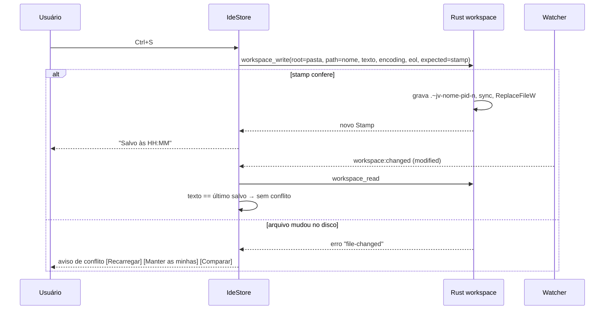
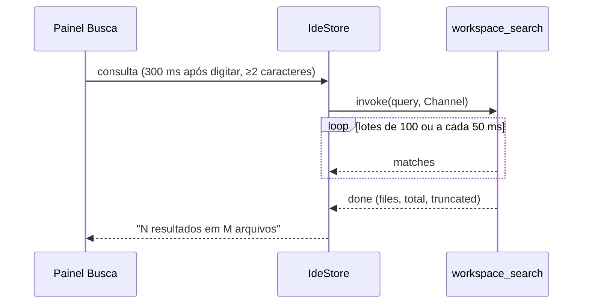

# App: jv_ide

A IDE em modo texto do JARVIS OS, no molde do termide: abre uma pasta do disco e mostra editor, arquivos, Git, outline, busca e terminais em painéis TUI.

| | |
|---|---|
| **ID** | `app/jv_ide` |
| **Status** | Implementado |
| **Origem** | `c4ccc57` (2026-10-26) |
| **Window kind** | `ide` em `src/lib/desktop.ts` (substituiu o antigo `code`, o Jarvis Code) |
| **Voz** | `window:ide` (frases "jv ide", "IDE", "Jarvis Code", "código") |

## Objetivo

O jv_ide é a IDE em modo texto do JARVIS OS, no molde do termide. Ela abre uma pasta do disco como projeto e mostra tudo em painéis TUI: editor com abas, gerenciador de arquivos, Git, outline, busca no projeto e terminais. É para quem programa sem sair do desktop do JARVIS, usando teclado primeiro e mouse quando quiser. O jv_ide nunca estraga o arquivo do usuário: guarda a codificação e o fim de linha de cada um, percebe mudanças feitas por fora, manda exclusões para a Lixeira e guarda rascunhos de tudo que ainda não foi salvo. Ele substituiu o Jarvis Code, e a janela e o rascunho antigos migram sozinhos.

> ⚠ inferido — confirmar: o objetivo de "nunca estragar o arquivo do usuário" resume decisões espalhadas pelo código (temporário + `ReplaceFileW`, `file-changed`, Lixeira, rascunhos). Não há uma frase única do autor dizendo isso.

O chrome da janela (arrastar, redimensionar, snap, maximizar e carregamento lazy) é de [desktop-windows](../../features/desktop-windows/spec.md). O tamanho vem de `WINDOW_SPECS`: 1180×700, mínimo 640×360, grupo `apps`.

## Não-objetivos

- Não há autocompletar nem servidor de linguagem. O editor usa só o básico do CodeMirror: números de linha, histórico, colchetes, busca no arquivo e realce.
- O jv_ide abre um projeto por vez, numa única janela (uma por `WindowKind`).
- No menu Branches, os branches remotos aparecem desativados. Não há `--amend` na UI.
- A raiz da árvore pode subir acima do projeto com "..". Cada chamada `workspace_*` usa como `root` a pasta do próprio arquivo, então o confinamento vale abaixo da pasta que a UI informa.
- UTF-16 sem BOM não é suportado e abre como binário.
- O terminal integrado não muda de pasta quando o projeto muda: o shell em execução fica onde começou.
- As lacunas abertas estão em [Pendências](#pendências).

## Histórias de usuário

### US1 — Abrir uma pasta e navegar pelos arquivos (P1)

Como programador, quero abrir uma pasta e percorrer a árvore pelo teclado ou pelo mouse para chegar ao arquivo certo.

**Por que P1:** sem projeto aberto, nada mais funciona.
**Teste independente:** `tests/ide.spec.ts` — "Ctrl+O opens a folder: the tree in termide's order, the drive on the status bar, the project in the recents" e "the tree goes by keyboard and mouse; / and m stay in the IDE".

**Aceite:** [critérios 1 a 5](#critérios-de-aceite).

### US2 — Editar e salvar sem estragar o arquivo (P1)

Como programador, quero editar em abas e salvar mantendo a codificação, o fim de linha e a indentação de cada arquivo.

**Por que P1:** é a função principal de um editor.
**Teste independente:** "each language gets its highlighter, indentation, line ending and encoding", "saving keeps each file's line endings and encoding", "each tab keeps its own undo history", "binary and huge files are not opened as text" e "tabs cycle and close; with no tab left Ctrl+W closes the window".

**Aceite:** [critérios 6 a 10](#critérios-de-aceite).

### US3 — Não perder trabalho (P1)

Como programador, quero que rascunhos, sessão e mudanças feitas por fora sejam tratados sem que eu perca nada.

**Por que P1:** perder edição é a pior falha de um editor.
**Teste independente:** "the session comes back after a reload: tabs, cursor, folders, panels and unsaved edits", "changes made outside reload clean tabs and raise a conflict on edited ones" e "Jarvis Code's open window and unsaved draft move into jv_ide".

**Aceite:** [critérios 11 a 15](#critérios-de-aceite).

### US4 — Encontrar rápido: paleta e busca no projeto (P2)

Como programador, quero achar arquivos, comandos, linhas, símbolos e texto sem tirar as mãos do teclado.

**Por que P2:** acelera o uso diário, mas o editor funciona sem isso.
**Teste independente:** "Ctrl+P finds files fuzzily and opens at a line; Ctrl+Shift+P runs commands" e "Ctrl+Shift+F searches the project and opens a match where it is".

**Aceite:** [critérios 16 a 20](#critérios-de-aceite).

### US5 — Git sem sair do editor (P2)

Como programador, quero ver o status, preparar, commitar, enviar e navegar no histórico do repositório do projeto.

**Por que P2:** completa o ciclo de trabalho dentro do jv_ide.
**Teste independente:** "git: status, stage, commit, push, log and diff" e "git: revert, stash and switching branches".

**Aceite:** [critérios 21 a 25](#critérios-de-aceite).

### US6 — Outline do arquivo (P2)

Como programador, quero ver os símbolos do arquivo atual, acompanhar o cursor e pular para eles.

**Por que P2:** ajuda a navegar arquivos grandes.
**Teste independente:** "the outline lists the file's symbols, follows the cursor and jumps" e os 16 testes de `tests/outline.spec.ts`.

**Aceite:** [critérios 26 a 28](#critérios-de-aceite).

### US7 — Painéis, layout e terminais (P2)

Como programador, quero fechar, reabrir, focar, redimensionar e ampliar painéis, e ter shells do projeto ao lado do editor.

**Por que P2:** o layout livre e o terminal integrado fazem parte do molde termide.
**Teste independente:** "panels close with [x], come back from Janelas, take Alt+N and resize" e "the terminal panel opens a shell in the project, keeps its keys and never mixes with jv_sh".

**Aceite:** [critérios 29 a 33](#critérios-de-aceite).

### US8 — Gerenciar arquivos na árvore (P2)

Como programador, quero criar, renomear e excluir arquivos e pastas na própria árvore, com segurança.

**Por que P2:** evita sair para o Explorer.
**Teste independente:** "the tree creates, renames and sends files to the Recycle Bin" e "names are edited in place in the tree: Esc, a taken name, clicking away, the menu".

**Aceite:** [critérios 34 a 38](#critérios-de-aceite).

### US9 — Favoritos e projetos recentes (P3)

Como programador, quero marcar arquivos e pastas como favoritos e alternar entre projetos sem perder as abas de cada um.

**Por que P3:** é conveniência.
**Teste independente:** "favourites and recent projects".

**Aceite:** [critérios 39 a 40](#critérios-de-aceite).

## Critérios de aceite

### Critério 1 (US1)

- **Dado** o jv_ide aberto sem projeto
- **Quando** a janela abre
- **Então** aparecem os menus Favoritos, Comandos, Projetos, Janelas e Opções, a linha de sistema (rede, CPU, RAM e hora), os painéis Editor, Arquivos, Git e Outline e a tela de boas-vindas com "Ctrl+O".

### Critério 2 (US1)

- **Dado** o jv_ide
- **Quando** o usuário aperta Ctrl+O e escolhe uma pasta
- **Então** a árvore lista "..", depois as pastas e depois os arquivos, em ordem alfabética. A barra de status mostra a unidade (ex.: "C: 475/487GB (98%)") e o projeto entra em Projetos → Recentes, marcado como atual.

### Critério 3 (US1)

- **Dado** a árvore com o foco (Alt+2)
- **Quando** o usuário digita letras
- **Então** a seleção pula para o próximo nome que começa com elas. Seta → abre a pasta e Enter abre o arquivo numa aba fixa, com o cursor no editor. `/` e `m` não abrem a busca global nem mexem no microfone.

### Critério 4 (US1)

- **Dado** um arquivo aberto num clique simples (aba de prévia, em itálico)
- **Quando** outro arquivo recebe um clique simples
- **Então** ele substitui a prévia. Um duplo clique na aba a fixa.

### Critério 5 (US1)

- **Dado** a árvore na raiz do projeto
- **Quando** o usuário clica em ".."
- **Então** a árvore sobe para a pasta acima, mesmo fora do projeto.

### Critério 6 (US2)

- **Dado** um projeto
- **Quando** o usuário abre `report.py`, `app.tsx`, `server.go`, `build.ps1` ou `latin1.txt`
- **Então** a barra de status mostra a linguagem ("Sintaxe: Python", "TSX", "Go", "PowerShell", "Texto"), a indentação detectada ("Tab: 4", "Tab: 2", "Tab: tab"), o fim de linha ("EOL: CRLF") e a codificação ("Windows-1252").

### Critério 7 (US2)

- **Dado** um arquivo CRLF editado
- **Quando** o usuário aperta Ctrl+S
- **Então** o arquivo volta ao disco só com CRLF, o ponto de "não salvo" some e o status diz "Salvo às HH:MM". Um arquivo Windows-1252 é salvo em `windows1252`.

### Critério 8 (US2)

- **Dado** duas abas editadas
- **Quando** o usuário volta à primeira e aperta Ctrl+Z
- **Então** desfaz só a edição dela, e a outra aba continua com a própria edição.

### Critério 9 (US2)

- **Dado** um PNG ou um arquivo acima de 5 MB
- **Quando** é aberto
- **Então** a aba mostra "arquivo binário (2 KB) — não editável" ou "arquivo grande demais (12.0 MB) — o jv_ide abre até 5 MB", com "Modo: Binário | Edição: Não".

### Critério 10 (US2)

- **Dado** duas abas
- **Quando** o usuário aperta Ctrl+Tab
- **Então** ativa a outra aba. Ctrl+W fecha a aba, e Ctrl+Shift+T reabre a última fechada. Sem nenhuma aba, Ctrl+W segue adiante e fecha a janela.

### Critério 11 (US3)

- **Dado** abas abertas, um cursor na linha 9, uma pasta expandida, o painel Outline fechado e uma edição não salva
- **Quando** a página recarrega
- **Então** voltam as abas, a aba ativa, o cursor ("Pos: 9:1"), a pasta expandida, o layout e o texto não salvo, com o ponto de "sujo".

### Critério 12 (US3)

- **Dado** uma aba limpa
- **Quando** o arquivo muda no disco por fora
- **Então** a aba recarrega o texto sozinha.

### Critério 13 (US3)

- **Dado** uma aba com edições
- **Quando** o arquivo muda por fora
- **Então** aparece o aviso "models.py mudou fora do jv_ide." com [Recarregar], [Manter as minhas] e [Comparar]. [Comparar] abre a aba "models.py (disco ↔ aba)" com "Sintaxe: Diff".

### Critério 14 (US3)

- **Dado** uma aba cujo arquivo foi apagado por fora
- **Quando** a aba aparece
- **Então** o título traz "(excluído)" e o aviso diz "Ctrl+S cria de novo". Ctrl+S recria o arquivo.

### Critério 15 (US3)

- **Dado** um desktop antigo com a janela `code` aberta e o rascunho `jarvis.editor.code` não salvo
- **Quando** o app carrega
- **Então** o jv_ide abre com a aba "sem título 1" contendo o rascunho, e a chave antiga é apagada.

### Critério 16 (US4)

- **Dado** um projeto
- **Quando** o usuário aperta Ctrl+P e digita "rprt"
- **Então** o primeiro resultado é `inventory/report.py`. "models.py:5" abre o arquivo na linha 5.

### Critério 17 (US4)

- **Dado** Ctrl+P sem texto
- **Quando** a paleta abre
- **Então** os arquivos recentes vêm primeiro, marcados "recente". Começar com ">" troca para os comandos, que mostram o atalho (ex.: "Arquivos" com "Ctrl+B").

### Critério 18 (US4)

- **Dado** Ctrl+Shift+P
- **Quando** o usuário escolhe "Ir para linha…" e digita 12
- **Então** o cursor vai para "Pos: 12:1".

### Critério 19 (US4)

- **Dado** Ctrl+Shift+F
- **Quando** o usuário digita "reorder_rows"
- **Então** os resultados chegam agrupados por arquivo ("… resultados em 2 arquivos"). Seta ↓ abre o resultado em prévia, e Enter leva o foco ao editor na posição do resultado.

### Critério 20 (US4)

- **Dado** o botão "Expressão regular" ligado
- **Quando** a consulta é `def \w+\(store`
- **Então** a busca roda como regex.

### Critério 21 (US5)

- **Dado** um projeto num repositório
- **Quando** o painel Git aparece
- **Então** mostra "inventory (main)", os contadores "✱3 ↑8 ↓0" e as seções "Alterações (2)" e "Em stage (1)", agrupadas por pasta.

### Critério 22 (US5)

- **Dado** um arquivo selecionado no painel
- **Quando** o usuário aperta Espaço
- **Então** o arquivo entra no stage (ou sai dele). A árvore pinta o arquivo pela letra do git (`data-git="M"`).

### Critério 23 (US5)

- **Dado** alterações no stage
- **Quando** o usuário clica em [Commit] e escreve a mensagem
- **Então** o status mostra "Commit <hash>", e [Push] zera o ahead.

### Critério 24 (US5)

- **Dado** um repositório
- **Quando** o usuário clica em [Log] ou [Diff]
- **Então** abre a aba somente leitura "git log" ou "diff (tudo)", com "Sintaxe: Diff".

### Critério 25 (US5)

- **Dado** alterações
- **Quando** o usuário guarda e depois aplica um stash, reverte tudo ("[s] só os rastreados") ou troca de branch pelo menu Branches
- **Então** os contadores e o título refletem cada operação.

### Critério 26 (US6)

- **Dado** `report.py` aberto
- **Quando** o Outline atualiza
- **Então** lista "f reorder_rows :9", "f to_csv :18" e "f render :26", sem as variáveis locais.

### Critério 27 (US6)

- **Dado** o Outline
- **Quando** o usuário clica em "render"
- **Então** o cursor vai para "Pos: 26:5" e o símbolo fica aceso como atual.

### Critério 28 (US6)

- **Dado** `models.py`
- **Quando** o Outline atualiza
- **Então** a classe `Store` aparece e o método `total` aparece com o tipo `m`.

### Critério 29 (US7)

- **Dado** o painel Outline
- **Quando** o usuário clica em [x]
- **Então** o painel some. Janelas → Outline (caixa de seleção) traz o painel de volta.

### Critério 30 (US7)

- **Dado** o painel Arquivos
- **Quando** o usuário aperta Ctrl+B
- **Então** o painel fecha, e outro Ctrl+B o reabre. Alt+3 dá o foco ao terceiro painel na ordem de leitura (o Git).

### Critério 31 (US7)

- **Dado** o divisor entre colunas
- **Quando** o usuário arrasta o divisor 160 px
- **Então** o editor fica mais de 140 px mais largo.

### Critério 32 (US7)

- **Dado** um projeto
- **Quando** o usuário aperta Ctrl+`
- **Então** abre o painel "Terminal 1" com o perfil padrão na pasta do projeto, já com o foco. Dentro do terminal, Ctrl+W vai para o shell (apaga uma palavra).

### Critério 33 (US7)

- **Dado** o jv_sh aberto junto
- **Quando** o usuário digita em cada um
- **Então** cada tela mostra só o próprio shell. `exit` com código 0 fecha o painel.

### Critério 34 (US8)

- **Dado** a pasta `inventory` selecionada
- **Quando** o usuário aperta Insert e digita "novo.py"
- **Então** o arquivo é criado e aberto numa aba ativa.

### Critério 35 (US8)

- **Dado** um arquivo selecionado
- **Quando** o usuário aperta F2
- **Então** o nome vira uma caixa na própria linha, selecionada até a extensão. Enter renomeia, e a aba aberta acompanha o novo nome.

### Critério 36 (US8)

- **Dado** a caixa de renomear
- **Quando** o usuário aperta Esc
- **Então** nada muda e o foco volta à árvore. Um nome já usado é recusado com "Já existe um item com esse nome", e a caixa fica aberta. Clicar fora mantém o que foi digitado.

### Critério 37 (US8)

- **Dado** um arquivo selecionado
- **Quando** o usuário aperta Delete e depois "s" em "Mover outro.py para a Lixeira?"
- **Então** o arquivo vai para a Lixeira e a aba aberta fica marcada "(excluído)".

### Critério 38 (US8)

- **Dado** o menu de contexto ou um duplo clique
- **Quando** o usuário escolhe renomear
- **Então** abre a mesma caixa. Numa pasta, o duplo clique desfaz a expansão causada pelo primeiro clique.

### Critério 39 (US9)

- **Dado** a pasta `docs`
- **Quando** o usuário escolhe "Adicionar aos favoritos" no menu de contexto
- **Então** Favoritos (Alt+F) lista "▶ /docs".

### Critério 40 (US9)

- **Dado** abas abertas no projeto A
- **Quando** o usuário abre o projeto B (que não é repositório) e depois volta a A por Projetos → Recentes
- **Então** B abre sem abas, com "Não é um repositório git", e A volta com as abas dele.

## Casos de borda

- **Vazio/nulo:**
  - Sem projeto → boas-vindas no Editor, "Nenhuma pasta aberta." com "[Ctrl+O] abrir pasta" em Arquivos, "abra uma pasta" no Git e na Busca, "abra um arquivo" no Outline; "Salvar como" → "Abra uma pasta (Ctrl+O) para salvar dentro dela".
  - Paleta sem resultado → "nada encontrado"; linha fora da faixa → "Digite um número entre 1 e <total>".
  - Linguagem sem leitor ou documento acima de 2 MB → Outline com "nenhum símbolo".
  - Commit sem nada no stage → "Nenhuma alteração em stage: …"; sem mensagem → "Escreva a mensagem do commit".
  - Push sem upstream: com um remoto → `push -u <remoto> HEAD`; sem remoto → "Nenhum remoto configurado"; com vários → "Este branch não tem upstream".
  - Todos os painéis fechados → "[Restaurar os painéis]"; nenhum perfil de terminal → "Nenhum perfil de terminal encontrado".
  - `jarvis.ide` ou `jarvis.ide.drafts` inválidos → validados campo a campo; um layout inválido vira `DEFAULT_LAYOUT`.
- **Duplicidade/idempotência:**
  - Criar ou renomear para um nome já usado → "Já existe um item com esse nome", e a caixa fica aberta.
  - O nosso próprio save voltando pelo watcher → sem conflito, porque o texto do disco é igual ao último salvo.
  - Migração do Jarvis Code → roda uma vez: só sem `jarvis.ide`, e `jarvis.editor.code` é apagado depois.
  - "Restaurar layout padrão" → os terminais abertos ficam.
- **Concorrência/corrida:**
  - Save sobre uma mudança externa → o Rust responde `file-changed`, a aba vira conflito e o status diz "<arquivo> mudou no disco: recarregue, mantenha as suas ou compare".
  - Mudança externa: aba limpa → recarrega com a mudança mínima; aba suja → conflito; arquivo apagado → "(excluído)". Um rascunho cuja base mudou no disco abre já como conflito.
  - Rajada de mudanças (mais de 500 caminhos ou 2000 eventos) → o lote vira `rescan`, e a árvore e as abas são relidas.
  - Nova busca, [Parar] ou Esc com uma busca em curso → a anterior é cancelada.
  - Operações de git → uma escrita por vez (trava global), botões desativados enquanto uma roda; passou do timeout → "O Git demorou demais e foi interrompido".
  - Item renomeado, movido ou apagado por fora com a caixa de renomear aberta → a caixa fecha.
  - Troca de projeto com um terminal aberto → o shell em execução fica na pasta onde começou.
- **Permissões/visibilidade:**
  - Caminhos da UI relativos ao `root`, sem `..`, `.`, `:`, nomes de dispositivo nem links para fora (RNF-006); a raiz de uma unidade → "Abra uma pasta de projeto, não a raiz da unidade".
  - O `root` é qualquer pasta absoluta que a UI mande, e a árvore sobe acima do projeto com ".." → o confinamento só vale abaixo dessa pasta (ver [Pendências](#pendências) e [security.md](../../arch/security.md)).
  - Arquivo somente leitura → edição desligada e "Arquivo somente leitura" no save.
  - Exclusões e descartes de arquivos novos → Lixeira, nunca definitivo nem `git clean`.
  - Sem `git.exe` → "Git não encontrado — instale o Git for Windows"; rede só em push, pull e fetch pedidos pelo usuário, com `GIT_TERMINAL_PROMPT=0` (RNF-008).
- **Fora do Tauri e sem fake.** O jv_ide mostra "Disponível no app desktop". O painel de terminal também.

## Dados

- `$ide`: o estado do jv_ide em `jarvis.ide`: `{ version: 1, root, recent (≤12), bookmarks (≤50), prefs, layout, sessions: { [root]: { tabs (≤50), active, cursors, expanded (≤200), viewRoot, mru (≤50) } } }`. É gravado com 400 ms de debounce e com flush em `beforeunload`/`pagehide`/desmontagem. Só mantém sessões de projetos ainda nos recentes. `parseIde`, `parsePrefs`, `parseSession` e `parseLayout` validam campo a campo, e um layout inválido vira `DEFAULT_LAYOUT`. Ver [persistence.md](../../domain/persistence.md).
  - **RF-011**: O sistema DEVE guardar por projeto as abas (fixa ou prévia), a aba ativa, os cursores, as pastas expandidas, a raiz da árvore e os arquivos recentes (MRU), além do layout e das opções globais, em `jarvis.ide`.
  - `$sessão` (**Sessão do projeto**): abas, ativa, cursores, pastas expandidas, raiz da árvore e MRU.
  - `$layout` (**Layout**): colunas `c-main`, `c-files` e `c-side`, com painéis empilhados (`editor`, `files`, `git`, `outline`, `search`, `term-N`), foco e zoom.
  - `$prefs`: as opções globais. Opções padrão (`DEFAULT_PREFS`): `wrap` falso, `fontSize` 13 (12–15), `defaultTab` 4 (2/4/8), `showHidden` verdadeiro, `hideIgnored` falso, `effects` verdadeiro, `autoSave` falso, `blockCursor` falso.
- `$rascunhos` (**Rascunho (`Draft`)**): texto não salvo, `base` (mtime em que se apoiou), EOL e codificação. Ficam em `jarvis.ide.drafts` como `{ version: 1, drafts: { [root | "-"]: { [path | "untitled:N"]: { text, base, eol, encoding } } } }`, gravados com 1 s de debounce; 512 KB por rascunho e 2 MB no total. `parseDrafts` valida campo a campo.
  - **RF-010**: O sistema DEVE guardar rascunhos não salvos por projeto em `jarvis.ide.drafts` (untitled em "-") e restaurá-los ao reabrir. Um rascunho cuja base mudou no disco DEVE abrir já como conflito.
  - Se um texto passar de 512 KB, ou o total passar de 2 MB, então ele não vira rascunho, e o status avisa "Rascunho grande demais para guardar automaticamente".
- Migração do Jarvis Code: o rascunho `jarvis.editor.code` é lido uma vez, na primeira execução (sem `jarvis.ide`), e apagado (`takeOldCodeDraft()`). A janela `code` de `jarvis.desktop` migra para `ide` em `parseDesktop` (`RENAMED = { code: "ide" }`).
  - **RF-012**: Na primeira execução, o sistema DEVE migrar o rascunho não salvo de `jarvis.editor.code` para uma aba sem título e apagar a chave. O desktop DEVE migrar a janela `code` para `ide`.
- Só em memória:
  - `$projeto` (**Projeto**): a pasta aberta (`root`), com nome, repositório (raiz + prefixo) e se está sendo vigiada.
  - `$abas` (**Aba (`BufferMeta`)**): de arquivo (`id` = caminho absoluto), sem título (`untitled:N`) ou virtual somente leitura (`virtual:…`: diff, log, comparação). Tem visão (texto, binário, grande, erro), codificação, EOL, indentação, prévia, sujo e estado no disco (`ok`, `changed`, `deleted`).
  - `$stamp` (**Stamp**): tamanho + mtime em ms. É a base da detecção de conflito.
  - **Símbolo**: tipo (`f`, `m`, `c`, `i`, `t`, `v`, `n`, `k`, `h`), nome, linha e profundidade.
  - **GitStatus**: espelho do `git status --porcelain=v2`.

Ver [glossário](../../domain/glossary.md).

## Telas

### Sem projeto

O jv_ide aberto sem pasta: menus, painéis vazios e a boas-vindas no Editor.

- **Comportamento:**
  - **RF-001**: O sistema DEVE abrir uma pasta pelo seletor nativo ("Abrir pasta"), reabrir o último projeto ao montar e manter até 12 projetos recentes.
  - Enquanto o backend carrega, mostre "carregando…".
  - Sem projeto, mostre a boas-vindas no Editor, "Nenhuma pasta aberta." com "[Ctrl+O] abrir pasta" em Arquivos, "abra uma pasta" no Git e "abra um arquivo" no Outline.
  - Se o usuário abrir a raiz de uma unidade (`C:\`) como projeto, então recuse com "Abra uma pasta de projeto, não a raiz da unidade".
- **Layout:** o mesmo arranjo de "Projeto aberto", com a boas-vindas (`Welcome`, de `EditorPanel`) no lugar da `EditorView`.

### Projeto aberto

A pasta aberta em painéis, no arranjo do termide.

- **Comportamento:**
  - Ao abrir um projeto, restaure $sessão dele: abas, aba ativa, cursores, pastas expandidas e raiz da árvore.
  - Ao trocar de projeto por Projetos → Recentes, guarde $sessão do atual e restaure a do outro.
  - Se o projeto não for um repositório, o painel Git mostra "Não é um repositório git".
- **Layout:**
  - De cima para baixo: `MenuBar` (18 px), `PanelLayout`, `Minibuffer` (20 px, só quando há uma pergunta) e `IdeStatusBar` (18 px). A `Palette` flutua por cima de tudo.
  - Arranjo padrão (`DEFAULT_LAYOUT`): a coluna `c-main` (52% da largura) com o Editor; `c-files` (22%) com Arquivos; `c-side` (26%) com o Git (62% da altura) sobre o Outline (38%).
  - A Busca entra em `c-files`, acima de Arquivos (metade da coluna). Um terminal entra em `c-main`, abaixo do Editor (35% da coluna).
- **Estilo:** a raiz é `font-mono` 12 px em `text-hud-text`, com `select-none`; só o editor e as caixas de texto selecionam.

## Componentes

### `IdeApp`

A raiz: escolhe o backend, cria o `IdeStore` e captura os atalhos.

- **Comportamento:**
  - Carregue o `WorkspaceBackend`: os comandos Tauri `workspace_*`/`git_*` ou o fake `__JARVIS_FS__` em DEV. Sem nenhum dos dois, mostre "Disponível no app desktop".
  - Em `beforeunload` e `pagehide`, grave $ide e $rascunhos na hora (`flush`).
  - Releia o uso do disco do projeto a cada 30 s. Com a janela pausada, pare.
  - Capture as teclas antes do CodeMirror, do xterm e da janela (ver [Voz e teclado](#voz-e-teclado)). Um clique em algo que não recebe foco cai na raiz (`tabIndex={-1}`), e os atalhos continuam valendo.
- **Layout:** "carregando…" e "Disponível no app desktop" ficam centralizados na janela.
- **Estilo:** essas mensagens usam `font-mono` `text-xs`, em `text-hud-text/50` e `text-hud-text/55`.

### `MenuBar`

A linha de cima do termide: os menus à esquerda e rede, CPU, RAM e hora à direita.

- **Comportamento:**
  - Mostre os menus "Favoritos", "Comandos", "Projetos", "Janelas" e "Opções". Alt + a primeira letra abre cada um. F10 dá o foco à barra; ← e → trocam de menu, ↓ abre e Esc devolve o foco ao painel em foco.
  - "Favoritos": "Adicionar aos favoritos" (ou "Remover dos favoritos") para o arquivo ativo e a lista. Uma pasta aparece como "▶ /<nome>", com a pasta-mãe ao lado. Sem nenhum, mostre "nenhum favorito ainda".
    - **RF-021**: O sistema DEVE manter favoritos (até 50; arquivo abre, pasta dentro do projeto aparece na árvore, pasta fora abre como projeto).
  - "Comandos": "Paleta de comandos…", "Abrir arquivo…", "Ir para linha…", "Ir para símbolo…", "Buscar no projeto"; "Novo arquivo", "Salvar", "Salvar como…", "Salvar tudo", "Fechar aba", "Reabrir aba fechada", "Recarregar do disco"; a troca de fim de linha, "Salvar em UTF-8", "Linguagem do arquivo…"; e a seção "Git" (commit, push, pull, log, diff de tudo, stash, novo branch). Cada item mostra o atalho ao lado e fica desativado quando não se aplica.
  - "Projetos": "Abrir pasta…", "Fechar projeto", a seção "Recentes" (rádio, com o projeto atual marcado, ou "nenhum projeto ainda"), "Limpar recentes" (só com 2 ou mais), "Mostrar no Explorer", "Copiar caminho do projeto" e "Terminal na raiz do projeto".
  - "Janelas": a seção "Painéis" (Editor, Arquivos, Git, Outline e Busca, como caixas de seleção), a seção "Terminais" ("Terminal" e um "Novo terminal: <perfil>" por perfil, com "padrão" ao lado do padrão), "Próximo painel", "Ampliar o painel em foco" e "Restaurar layout padrão". Abrir "Janelas" carrega os perfis de terminal.
  - "Opções": "Quebrar linhas", "Mostrar arquivos ocultos", "Esconder os ignorados pelo git", "Efeitos TUI no editor", "Cursor em bloco", "Salvar automaticamente"; "Tab padrão" (2, 4 ou 8 espaços) e "Fonte" (12 a 15 px). Tudo vai para $prefs.
  - A linha de sistema lê rede, CPU e RAM (`useSystemStats`) e a hora (`useMinuteClock`), e para com a janela pausada. Sem leitura, CPU e RAM mostram "—".
- **Layout:**
  - Uma linha de 18 px: os cinco menus, um espaço flexível e a leitura `↓<taxa> ↑<taxa>`, "CPU N%", "RAM …" e a hora.
  - A rede só aparece com a janela a partir de 640 px de largura (`@[640px]`).
  - Cada menu abre num `MenuPopup` logo abaixo do botão.
- **Estilo:**
  - Fundo `bg-hud-text/[0.06]`, 12 px. A primeira letra de cada menu é sublinhada (`decoration-hud-text/30`). O menu aberto fica em vídeo reverso (`bg-hud-light/85 text-hud-void`); os outros em `text-hud-text/80`.
  - A leitura fica em 11 px `text-hud-text/70`, com as setas em `text-hud-light` e a hora em `text-hud-light` `font-semibold`.

### `PanelLayout` e `PanelFrame`

As colunas de painéis empilhados, com divisores entre eles, e a moldura "[x] título" de cada painel.

- **Comportamento:**
  - **RF-017**: Os painéis DEVEM poder fechar ([x]), voltar pelo menu Janelas, receber o foco por Alt+1…9 e F6/Shift+F6, ser redimensionados por divisores (mouse ou setas) e ampliados (duplo clique no título). "Restaurar layout padrão" mantém os terminais.
  - A ordem de leitura (Alt+N, F6) é coluna a coluna, de cima para baixo.
  - Um divisor não deixa uma coluna com menos de 140 px nem um painel com menos de 56 px. Com o foco no divisor, as setas o movem em passos de 2%.
  - Um painel ampliado ocupa a área toda, e os outros ficam ocultos.
  - Se todos os painéis forem fechados, mostre "[Restaurar os painéis]".
  - O painel de terminal só carrega o xterm com o primeiro terminal; até lá, mostra "carregando o terminal…".
- **Layout:**
  - Colunas lado a lado, com um divisor vertical de 4 px (`ide-split-col-N`) entre elas; dentro de cada coluna, painéis com um divisor horizontal de 4 px (`ide-split-<coluna>-N`).
  - `PanelFrame`: um cabeçalho de 17 px com a linha da caixa, o botão "[x]", o título, um complemento opcional (contadores, branch) e o resto da linha; abaixo, o conteúdo dentro da caixa.
- **Estilo:**
  - A caixa do painel em foco usa `border-hud-light/70`, e o título dele fica em vídeo reverso (`bg-hud-light/85 font-semibold text-hud-void`). As outras usam `border-hud-cyan/25`, com o título em `text-hud-text/75`.
  - O cabeçalho usa 11 px. O "[x]" fica em `text-hud-text/55` e vira `text-hud-alert` sob o mouse.
  - Os divisores acendem em `bg-hud-light/30` sob o mouse e `bg-hud-light/40` com o foco.

### `EditorPanel`

O painel do editor: abas, aviso de disco, a `EditorView` única e o que aparece no lugar dela.

- **Comportamento:**
  - **RF-004**: Cada aba DEVE ter o próprio `EditorState` (texto, seleção e histórico de desfazer) numa única `EditorView`, trocada por `setState`.
  - O título do painel é a pasta do arquivo ativo; sem aba, é `root` ou "jv_ide".
  - Um clique simples num arquivo abre uma aba de prévia, em itálico, que o próximo clique simples substitui. Um duplo clique na aba a fixa. O botão do meio fecha a aba.
  - Uma aba suja mostra " ●". Uma aba cujo arquivo sumiu aparece riscada, com " (excluído)".
  - O botão "[≡]" abre a lista "Abas abertas", com "Salvar tudo", "Fechar as salvas", "Fechar as outras" e "Reabrir a última fechada". A aba ativa fica sempre visível na faixa.
  - Se a aba ativa estiver em conflito, mostre o aviso "<arquivo> mudou fora do jv_ide." com [Recarregar], [Manter as minhas] e [Comparar]. [Manter as minhas] relê o `Stamp` (`workspace_stat`), e [Comparar] abre uma aba de diff (`unifiedDiff`).
  - Se o arquivo da aba foi excluído, mostre "<arquivo> foi excluído do disco · Ctrl+S cria de novo".
  - Se a aba não for texto, mostre no lugar do editor "arquivo binário (<tamanho>) — não editável", "arquivo grande demais (<tamanho>) — o jv_ide abre até 5 MB", o erro da leitura ou "carregando…".
  - Sem nenhuma aba, mostre a boas-vindas: as dicas `Ctrl+O` "abrir pasta", `Ctrl+P` "abrir arquivo" (só com projeto), `Ctrl+N` "novo arquivo", `Ctrl+Shift+P` "comandos" e ``Ctrl+` `` "terminal". Sem projeto, mostre também "Projetos recentes", com até 9 itens "[N] <caminho>". Cada dica é um botão.
- **Layout:**
  - De cima para baixo: a faixa de abas (18 px: "[≡]" e as abas, com rolagem horizontal sem barra), o aviso de disco (quando há) e a área do editor.
  - Cada aba tem o título e um "×" de fechar à direita.
  - A boas-vindas fica centrada na vertical: a caixa ASCII "jv_ide · JARVIS OS", a coluna de dicas e, embaixo, os projetos recentes.
- **Estilo:**
  - A aba ativa fica em vídeo reverso (`bg-hud-light/85 text-hud-void`); as outras em `text-hud-text/75`, com o "×" só sob o mouse. O " ●" de uma aba inativa fica em `text-hud-light`.
  - "[≡]" em `text-hud-cyan`.
  - O aviso de conflito tem fundo `bg-hud-alert/15` e texto `text-hud-alert`; o de excluído, fundo `bg-hud-alert/10`. Os botões do aviso ficam em `text-hud-text`.
  - As mensagens de binário e grande ficam em `text-hud-text/55`, e o erro em `text-hud-alert`.
  - Na boas-vindas, a caixa ASCII fica em `text-hud-light/80`, e as teclas no estilo de `KeyHint` (`bg-hud-text/12 text-hud-cyan`, em vídeo reverso sob o mouse).

### Linguagem, indentação e tema do editor

Como cada aba ganha realce, indentação e aparência (`languages.ts`, `editorRuntime.ts`, `editorTheme.ts`).

- **Comportamento:**
  - **RF-005**: O sistema DEVE detectar a linguagem nesta ordem: escolha manual, nome do arquivo (`.diff`/`.patch` → Diff), `@codemirror/language-data`, linha `#!`. DEVE detectar a indentação (tabs ou passo de 2, 4 ou 8 nas primeiras 2000 linhas, com fallback no "Tab padrão").
  - Cada aba guarda as próprias extensões em compartments (id, linguagem, indentação, somente leitura e opções).
  - Uma recarga do disco aplica só a diferença mínima (`minimalChange`), para o cursor ficar onde estava.
- **Estilo:**
  - `ideTheme` sobre `hudTheme`, ambos feitos só das variáveis `--color-hud-*`: fundo transparente, fonte `--font-mono` no tamanho de $prefs (13 px por padrão), altura de linha 1,45, cursor `hud-light` de 2 px, linha ativa com 9% de `hud-cyan`, números de linha em `hud-text` a 40% e a barra de rolagem fina em `hud-light`.
  - Sem "Efeitos TUI no editor", o editor perde o `text-shadow`.

### Salvar (`IdeStore`)

Salvar, salvar como, salvar tudo e o salvamento automático.

- **Comportamento:**
  - **RF-008**: O sistema DEVE oferecer "Salvar como" dentro do projeto, "Salvar tudo", "Recarregar do disco", troca de EOL e de codificação, e salvamento automático opcional 1 s após a última edição.
  - Depois de salvar, o status diz "Salvo às HH:MM" e o " ●" some.
  - Se o usuário pedir "Salvar como" sem projeto, então recuse com "Abra uma pasta (Ctrl+O) para salvar dentro dela".
  - Se o usuário fechar uma aba suja, então o minibuffer pergunta "[s] salvar [d] descartar [c] cancelar".
  - Uma aba virtual (diff, log, comparação) não salva.

### Disco no Rust (`workspace`)

A leitura, a gravação e a listagem de arquivos, sempre confinadas ao `root` da chamada.

- **Comportamento:**
  - **RF-006**: O Rust DEVE decodificar UTF-8, UTF-8 com BOM, UTF-16 LE/BE com BOM e Windows-1252, entregar o texto só com "\n" e informar o EOL da maioria e se ele é misto. Ao salvar, DEVE regravar na codificação e no EOL da aba.
  - **RF-007**: O save DEVE ser atômico (arquivo temporário `.~jv-…` na mesma pasta + `ReplaceFileW`, que preserva os atributos) e DEVE recusar com `file-changed` quando o `Stamp` (tamanho + mtime) lido não confere mais.
  - Se o arquivo for UTF-16 sem BOM ou tiver um byte NUL nos primeiros 8 KB, então ele é tratado como binário.
  - Se um caractere não couber em Windows-1252 ao salvar, então o save falha com "Caractere fora do Windows-1252 — salve em UTF-8".
  - Se o arquivo for somente leitura, então a edição fica desligada, e o save falha com "Arquivo somente leitura".
  - Se o fim de linha for misto, então o status mostra `*` depois do EOL (ex.: "LF*"). O save grava um só tipo, o da maioria.
  - Se uma pasta for enorme, então ela lista no máximo 5000 entradas (`truncated`).

### Mudanças externas (`workspace:changed`)

O que acontece com as abas e a árvore quando um arquivo muda fora do jv_ide.

- **Comportamento:**
  - **RF-009**: O sistema DEVE seguir mudanças externas por evento `workspace:changed`. Uma aba limpa recarrega com uma mudança mínima (o cursor fica). Uma aba suja vira conflito com Recarregar, Manter as minhas e Comparar. Um arquivo apagado marca a aba "(excluído)".
  - A cada lote, recarregue as pastas afetadas, as abas e o status do git.
  - Se o save cair em cima de uma mudança externa, então o Rust responde `file-changed`, a aba vira conflito e o status diz "<arquivo> mudou no disco: recarregue, mantenha as suas ou compare".
  - Se o nosso próprio save voltar pelo watcher, então ele não gera conflito, porque o texto do disco é igual ao último salvo.
  - Se vier uma rajada de mudanças (mais de 500 caminhos num lote ou mais de 2000 eventos brutos), então o lote vira `rescan`, e a árvore e as abas são relidas.
  - O watcher ignora os arquivos internos do git (só marcam o repositório) e os próprios temporários `.~jv-`.

### `FileTree`

O gerenciador de arquivos do termide: "..", "▶ /pasta", arquivos, com teclado primeiro, cores do git e nomes editados na linha.

- **Comportamento:**
  - **RF-002**: A árvore DEVE listar as pastas antes dos arquivos, em ordem alfabética sem diferenciar maiúsculas, omitir `.git`, marcar entradas ocultas, ignoradas pelo `.gitignore` e links (↗), e colorir por status git.
  - **RF-003**: A árvore DEVE aceitar setas, PageUp/PageDown, Home/End, Backspace (subir), busca ao digitar (600 ms), Enter (abrir fixo), Espaço (prévia), Ctrl+Enter (abrir a pasta como projeto), Insert/Shift+Insert (novo arquivo/pasta), F2 (renomear), Delete (Lixeira), Ctrl+C/Ctrl+Shift+C (caminho relativo/absoluto) e Shift+F10 ou a tecla Menu (menu de contexto).
  - **RF-020**: Toda exclusão pela UI DEVE ir para a Lixeira, com confirmação no minibuffer.
    - Delete pergunta "Mover <nome> para a Lixeira?" com "[s] sim" e "[n] não".
  - Um clique abre ou fecha uma pasta, sobe com ".." e abre um arquivo em prévia. ".." sobe a árvore para a pasta de cima, mesmo fora do projeto, até a raiz da unidade.
  - Seta → abre a pasta (ou desce para o primeiro filho, se já aberta); seta ← fecha a pasta ou volta para a pasta-mãe.
  - Insert pergunta no minibuffer "Novo arquivo em <pasta>/" (ou "Nova pasta em <pasta>/" com Shift). O arquivo criado abre numa aba ativa.
  - F2, um duplo clique ou "Renomear" trocam o nome por uma caixa na própria linha, selecionada até a extensão. Enter renomeia, e a aba aberta acompanha o novo nome.
    - Se o usuário apertar Esc, então nada muda e o foco volta à árvore.
    - Se o nome já existir, então recuse com "Já existe um item com esse nome", e a caixa fica aberta.
    - Se o usuário clicar fora, então o que foi digitado é usado.
    - Numa pasta, o duplo clique desfaz a expansão causada pelo primeiro clique.
    - Se o item for renomeado, movido ou apagado por fora enquanto a caixa está aberta, então a caixa fecha.
  - O menu de contexto oferece "Abrir", "Novo arquivo…", "Nova pasta…", "Renomear", "Mover para a Lixeira", "Copiar caminho", "Copiar caminho relativo", "Mostrar no Explorer", "Adicionar aos favoritos" (ou "Remover dos favoritos") e, numa pasta, "Abrir como projeto" e "Ver só esta pasta". Cada item mostra a tecla dele.
  - $prefs decide se as entradas ocultas aparecem e se as ignoradas pelo git somem.
  - Uma pasta com alterações recebe a marca `M`. Um conflito (`U`) vence as outras letras.
- **Layout:**
  - Lista virtualizada com linhas de 18 px e 12 linhas extras acima e abaixo da área visível. Cada nível recua 14 px.
  - A primeira linha é "↑ ..", fora da raiz da unidade. Pastas aparecem como "▶ /nome" (fechada), "▼ /nome" (aberta) ou "… /nome" (carregando); arquivos com dois espaços na frente. Links ganham " ↗" e favoritos " ★".
  - Sem projeto e sem raiz, o painel mostra "Nenhuma pasta aberta." e o botão "[Ctrl+O] abrir pasta".
  - O título do painel é a raiz da árvore.
- **Estilo:**
  - A linha selecionada fica em vídeo reverso (`bg-hud-light/85 text-hud-void`) com o painel em foco, e em `bg-hud-light/20` sem ele.
  - Cores do git (`data-git`): `M`, `T` e `R` em `text-hud-amber`; `D` em `text-hud-alert` riscado; `U` em `text-hud-alert`; `A` e `?` em `text-hud-light`; `S` (em stage) em `text-hud-cyan`.
  - Sem marca: pastas em `text-hud-cyan`, arquivos em `text-hud-text/85` e ignorados em `text-hud-text/35`. A ★ fica em `text-hud-amber`.
  - A caixa de renomear tem 16 px de altura, borda `hud-light/70` e fundo `bg-hud-void`.
  - A barra de rolagem é fina, em `hud-light`.

### `GitPanel`

O branch, ahead/behind, as alterações dentro e fora do stage e a fileira de botões do termide.

- **Comportamento:**
  - **RF-015**: O painel Git DEVE mostrar branch, ahead/behind, total de alterações, contagem de stash e operação em andamento. DEVE permitir stage e unstage (arquivo ou tudo), descartar (arquivos novos para a Lixeira), commit, push, pull, fetch, log (200 commits), diff de um arquivo ou de tudo, stash (guardar, aplicar e remover, descartar), troca e criação de branch.
  - Atualize o status quando o painel aparece e quando a janela volta para a frente.
  - Agrupe as alterações em "Alterações (N)" (conflitos, alteradas e novas) e "Em stage (N)", e dentro de cada seção por pasta ("▼ /inventory", "├ models.py").
  - Espaço põe ou tira o arquivo do stage, Enter (ou duplo clique) abre o diff, Delete descarta (só fora do stage), `o` abre o arquivo e Shift+F10 abre o menu do arquivo.
  - Os botões: [Stage tudo], [Unstage tudo], [Reverter tudo], [Log], [Diff], [Push], [Commit] e [Stash (N)]. Enquanto uma operação roda, eles ficam desativados e o nome dela aparece à direita ("<operação>…").
  - "[<repo> ▶]" abre o menu Repositório: "Atualizar", "Fetch", "Pull", "Terminal na raiz do repositório" e "Copiar caminho do repositório". "[<branch> ▶]" abre o menu Branches: os locais (rádio), os remotos (desativados) e "Novo branch…". [Stash] abre "Guardar as alterações…" e, por stash, "Aplicar e remover: <mensagem>" e "Descartar este stash".
  - [Log] e [Diff] abrem as abas somente leitura "git log" e "diff (tudo)", com "Sintaxe: Diff".
  - Se o Git não estiver instalado, então o erro é "Git não encontrado — instale o Git for Windows". Fora de um repositório, o painel mostra "Não é um repositório git".
  - Se não houver nada no stage, então o commit avisa "Nenhuma alteração em stage: use [Stage tudo] ou espaço num arquivo". Sem mensagem, o aviso é "Escreva a mensagem do commit".
  - Se o Git passar do timeout, então o processo é morto com a árvore inteira, e o erro é "O Git demorou demais e foi interrompido".
  - Se o branch não tiver upstream, então com um único remoto o push faz `push -u <remoto> HEAD`. Sem remoto, o erro é "Nenhum remoto configurado". Com vários remotos, "Este branch não tem upstream".
- **Layout:**
  - O título do painel é "<repo> (<branch>)" (ou "detached <head>"), com os contadores "✱N ↑N ↓N" ao lado.
  - Embaixo do título: "[<repo> ▶]", "[<branch> ▶]" e, quando há, "<operação> em andamento".
  - A lista: o cabeçalho de cada seção com uma linha até a borda, as pastas e os arquivos com "├"/"└", o nome (e "← <nome antigo>" num renomeado) e a letra do status à direita.
  - Embaixo, a fileira de botões, que quebra linha quando falta espaço.
- **Estilo:**
  - 12 px com linhas de 18 px. O "✱N" fica em `text-hud-amber`.
  - Cores do status: `M`, `T`, `R` e `C` em `text-hud-amber`; `A` e `?` em `text-hud-light`; `D` e `U` em `text-hud-alert`. As pastas ficam em `text-hud-cyan`; os cabeçalhos em `text-hud-text/55`, com a linha em `bg-hud-cyan/20`.
  - O arquivo selecionado fica em vídeo reverso com o painel em foco, e em `bg-hud-light/20` sem ele.
  - A fileira de botões tem borda superior `hud-cyan/15`. Um botão desativado fica com 40% de opacidade. "em andamento" fica em `text-hud-alert`.

### `OutlinePanel`

Os símbolos do arquivo ativo ("f reorder_rows :9"), com o símbolo do cursor aceso.

- **Comportamento:**
  - **RF-016**: O Outline DEVE ler os símbolos da árvore sintática Lezer (JS/TS/JSX/TSX, Python, Rust, Go, Java, C/C++, PHP, CSS/SCSS/Sass/LESS, Markdown, JSON, YAML) ou, nos modos legados, linha a linha por regex (C#, Kotlin, Ruby, Shell, PowerShell, Lua, Swift, Dart, dialetos SQL, TOML, Dockerfile). DEVE acompanhar o cursor e saltar com Enter ou clique.
  - Releia os símbolos 200 ms depois da última edição. A leitura para em 2000 símbolos, com até 50 ms de parse.
  - Enquanto o Outline não está em foco, a seleção acompanha o símbolo do cursor (o mais interno na linha do cursor ou antes dela).
  - Enter salta e leva o foco ao editor; Espaço salta sem tirar o foco do Outline. Digitar letras pula para o próximo nome que começa com elas (600 ms).
  - Se o documento passar de 2 MB ou a linguagem não tiver leitor, então o Outline fica vazio ("nenhum símbolo"). Sem arquivo de texto, mostra "abra um arquivo".
- **Layout:** o título é "Outline <arquivo>". Cada linha tem o recuo da profundidade com "├ " ou "└ ", a letra do tipo, o nome e ":<linha>" à direita.
- **Estilo:**
  - 12 px com linhas de 18 px. O símbolo aceso fica em `bg-hud-light/15`, e o selecionado (com foco) em vídeo reverso.
  - Cores dos tipos: `f` e `m` em `text-hud-cyan`; `c`, `i`, `t` e `h` em `text-hud-light`; `n` em `text-hud-amber`; `v` e `k` em `text-hud-text/60`. Os traços e a linha ficam esmaecidos (`text-hud-text/35` e `/45`).

### `SearchPanel`

A busca no projeto, com as opções como botões TUI e os resultados agrupados por arquivo.

- **Comportamento:**
  - **RF-014**: A busca no projeto DEVE aceitar texto ou regex, diferenciar maiúsculas, palavra inteira, globs de incluir e excluir separados por vírgula, buscar sozinha após 300 ms a partir de 2 caracteres, transmitir os resultados por `Channel` e poder ser interrompida ([Parar], Esc ou uma nova busca).
  - Enter busca na hora. Ctrl+Shift+F abre a Busca com a seleção do editor (até 200 caracteres, uma linha).
  - Seta ↓ no campo leva à lista e abre o primeiro resultado em prévia. Na lista, as setas abrem cada resultado em prévia; Enter leva o foco ao editor na posição do resultado, e Espaço abre sem tirar o foco. F4 e Shift+F4 andam pelos resultados de qualquer lugar.
  - O resumo diz "buscando… N resultados" enquanto roda e "N resultados em M arquivos" no fim, com " (limite)" quando cortou.
  - Sem projeto, o campo fica desativado com "abra uma pasta".
- **Layout:**
  - O título é "Busca no projeto". Em cima, o prompt `/`, o campo ("texto ou regex") e os botões "[Aa]" (Diferenciar maiúsculas), "[ab]" (Palavra inteira), "[.*]" (Expressão regular) e "[⋯]" (Filtros de arquivos).
  - "[⋯]" mostra os campos "incluir:" (`*.py, src/**`) e "excluir:" (`tests/**`).
  - Depois, a linha de resumo com [Parar] e a lista: cada arquivo com o caminho relativo e "(N)", e embaixo cada linha "<número>:" com o trecho e o termo marcado.
- **Estilo:**
  - O `/` e os caminhos ficam em `text-hud-cyan`. Os campos têm só a borda inferior `hud-cyan/30` (`hud-cyan/20` nos filtros), que vira `hud-light/70` com o foco.
  - Um botão ligado fica em vídeo reverso; desligado, em `text-hud-text/55`.
  - O resumo fica em `text-hud-text/50`, e um erro em `text-hud-alert`.
  - O termo achado fica em `bg-hud-light/30 text-hud-light`; na linha selecionada com foco, em `bg-hud-void text-hud-light`.

### `TerminalPanel`

Um shell na pasta do projeto, como painel.

- **Comportamento:**
  - **RF-018**: O painel de terminal DEVE abrir um perfil do Windows Terminal na pasta do projeto, via o backend do [jv_sh](../../apps/jv_sh/spec.md), e fechar sozinho quando o shell sai com código 0.
  - Use o perfil pedido, ou o padrão, ou o primeiro da lista.
  - A pasta é a do projeto quando o terminal abriu. Trocar de projeto não muda a pasta de um shell em execução.
  - [x] encerra o shell.
  - Se o terminal sair com erro, então o painel fica com "(encerrado)" no título. Sem perfis, mostra "Nenhum perfil de terminal encontrado".
  - Cada terminal recebe só o próprio shell, mesmo com o jv_sh aberto junto.
- **Layout:** o título é "Terminal · <perfil>" (ou "Terminal · <perfil> · <título do shell>"), com a pasta ao lado (até 40 caracteres). O xterm ocupa o painel inteiro.
- **Estilo:** o do `TerminalView` do [jv_sh](../../apps/jv_sh/spec.md). As mensagens ficam em `text-hud-text/50`.

### `Palette`

Ctrl+P e as variantes: uma caixa no topo da IDE, com o modo escolhido pelo primeiro caractere.

- **Comportamento:**
  - **RF-013**: A paleta DEVE ter os modos arquivos (fuzzy, `nome:linha`, recentes primeiro), `>` comandos, `:` linha[:coluna], `@` símbolos e "Linguagem do arquivo", com no máximo 60 resultados.
  - Arquivos: sem texto, os recentes vêm primeiro, marcados "recente". "models.py:5" abre o arquivo na linha 5. Enquanto a lista chega, mostra "lendo os arquivos…".
  - Comandos: só os ativos, com o atalho ao lado.
  - Linha: "Ir para a linha N" (", coluna M"), ou "Digite um número entre 1 e <total>".
  - Símbolos: os do Outline, como "<tipo> <nome>" com ":<linha>".
  - Linguagem: "Texto" e as linguagens de `PICKER`.
  - As letras achadas ficam marcadas. ↑ e ↓ andam (dando a volta), Enter escolhe, Esc fecha e devolve o foco a quem o tinha. Clicar fora fecha.
  - Sem resultado, mostra "nada encontrado".
- **Layout:** uma caixa centrada perto do topo (`top-6`), com até 640 px de largura (90% em janelas menores) e até 70% da altura: o título do modo ("Abrir arquivo", "Comandos", "Ir para linha", "Ir para símbolo", "Linguagem do arquivo"), o campo com a dica do modo e a lista.
- **Estilo:**
  - Borda `hud-light/60`, fundo `bg-hud-panel/95` (sem desfoque) e sombra.
  - O título fica em vídeo reverso (`bg-hud-light/85 font-semibold text-hud-void`), o campo tem borda inferior `hud-cyan/25` e o item escolhido fica em vídeo reverso.
  - As letras achadas ficam em `text-hud-light` (sublinhadas no item escolhido), e o detalhe com 60% de opacidade.

### `Minibuffer`

A linha acima da barra de status onde o jv_ide pergunta coisas, como o minibuffer de um editor.

- **Comportamento:**
  - Pergunte um texto (um nome, a mensagem do commit) ou escolhas por letra ("[s] salvar [d] descartar [c] cancelar").
  - Pegue o teclado no primeiro quadro. Um nome de arquivo vem selecionado até a extensão.
  - Enter confirma e Esc cancela. Numa escolha, a letra escolhe (`[s]`, `[d]`, `[c]`, `[t]`, `[n]`).
  - No fim, devolva o foco a quem o tinha.
- **Layout:** uma linha de 20 px. Texto: o rótulo, o campo e "Enter confirma · Esc cancela" à direita. Escolhas: a pergunta e os botões "[letra] rótulo".
- **Estilo:**
  - Texto: borda superior `hud-light/40`, fundo `bg-hud-light/[0.06]` e rótulo em `text-hud-light`; a dica em `text-hud-text/40`.
  - Escolhas: borda superior `hud-alert/40` e fundo `bg-hud-alert/[0.08]`; as letras em `text-hud-cyan`.

### `IdeStatusBar`

A linha de baixo do termide: "Modo: Texto | Edição: Sim | Sintaxe: Python | Tab: 4 | EOL: LF | Codificação: UTF-8 | Pos: 13:1", o último aviso no meio e a unidade do projeto à direita.

- **Comportamento:**
  - "Modo" é Texto, Binário, Grande, Diff ou Log. "Edição" é "Não" para somente leitura e para o que não é texto.
  - Um clique em "Sintaxe" abre a paleta de linguagem; em "Tab", alterna 2 → 4 → 8 → tab; em "EOL", alterna LF e CRLF; em "Codificação", abre o menu "Salvar como" com as codificações; em "Pos", abre "Ir para linha". Uma aba virtual não troca sintaxe, EOL nem codificação.
  - "Pos" mostra linha:coluna e, com seleção, o tamanho dela entre parênteses.
  - Os avisos ficam visíveis por 4 s.
  - A unidade aparece como "C: 475/487GB (98%)".
- **Layout:** uma linha de 18 px: os sete itens separados por "|", o aviso centralizado no espaço que sobra e a unidade à direita.
- **Estilo:**
  - Fundo `bg-hud-text/[0.06]`, 11 px. O nome do item fica em `text-hud-text/50` e o valor em `text-hud-light`; um item clicável acende em `bg-hud-light/15`.
  - O aviso fica em `text-hud-light/85`, e um erro em `text-hud-alert`.
  - A unidade fica em `text-hud-light/80`, e em `text-hud-alert` a partir de 95% de uso.

## Voz e teclado

- **RF-019**: Os atalhos do jv_ide DEVEM valer antes do CodeMirror, do xterm e da janela. Dentro de um terminal, só os atalhos marcados para terminal valem. O elemento raiz leva `data-plain-keys` para que os atalhos globais sem modificador (`/`, `m`) não disparem.
- Voz `window:ide` ("jv ide", "IDE", "Jarvis Code", "código") + verbo de abrir/fechar: abre ou fecha a janela ([voice-intents](../../domain/voice-intents.md)).
- `Ctrl+O`: Abrir pasta…
- `Ctrl+P`: Abrir arquivo (paleta).
- `Ctrl+Shift+P` · `F1`: Paleta de comandos (vale também no terminal).
- `Ctrl+G`: Ir para linha.
- `Ctrl+Shift+O`: Ir para símbolo.
- `Ctrl+Shift+F`: Buscar no projeto, com a seleção do editor (até 200 caracteres, uma linha).
- `F4` / `Shift+F4`: Próximo / anterior resultado da busca.
- `Ctrl+N`: Novo arquivo (sem título).
- `Ctrl+S` · `Ctrl+Shift+S` · `Ctrl+Alt+S`: Salvar · Salvar como · Salvar tudo.
- `Ctrl+W` · `Ctrl+F4`: Fechar aba (sem aba, Ctrl+W segue para fechar a janela).
- `Ctrl+Shift+T`: Reabrir aba fechada (até 20 guardadas).
- `Ctrl+Tab` / `Ctrl+Shift+Tab` · `Ctrl+PageDown` / `Ctrl+PageUp`: Próxima / anterior aba.
- `Ctrl+B`: Mostrar ou esconder Arquivos.
- `Ctrl+Shift+E`: Mostrar o arquivo na árvore (vale no terminal).
- `Ctrl+Shift+G`: Ir para o Git (vale no terminal).
- ``Ctrl+` `` · ``Ctrl+Shift+` ``: Terminal (abre ou alterna com o editor) · Novo terminal (pela tecla física `Backquote`).
- `F6` / `Shift+F6`: Próximo / anterior painel (vale no terminal).
- `Alt+1…9`: Foco no N-ésimo painel na ordem de leitura.
- `Alt+Z`: Quebrar linhas.
- `Ctrl+=` / `Ctrl++` · `Ctrl+-` · `Ctrl+0`: Fonte maior · menor · padrão (13).
- `F10` · `Alt+F/C/P/J/O`: Foco na barra de menus · abre Favoritos, Comandos, Projetos, Janelas ou Opções (fora do terminal).
- Deixadas de fora de propósito: F5/Ctrl+R (recarregar), F11 (tela cheia), F12, Ctrl+Q e Ctrl+M (JARVIS).
- Painel Git: Setas, Home/End, Espaço (stage), Enter (diff), Delete (descartar), `o` (abrir), Shift+F10.
- Paleta: `>` comandos, `:` linha, `@` símbolo, `nome:linha`.
- Minibuffer: Enter confirma, Esc cancela; escolhas por letra (`[s]`, `[d]`, `[c]`, `[t]`, `[n]`).
- Barra de status: Clique em Sintaxe (linguagem), Tab (alterna 2 → 4 → 8 → tab), EOL (alterna), Codificação (menu) e Pos (ir para linha).

## Restrições

- **RNF-001**: Texto editável até 5 MB (`MAX_TEXT_BYTES`). Acima disso, a aba mostra "grande demais".
- **RNF-002**: O watcher envia um lote após 200 ms sem eventos ou 1 s após o primeiro evento. Acima de 500 caminhos ou 2000 eventos, o lote vira `rescan`.
- **RNF-003**: A busca percorre até 50 000 arquivos, pula arquivos acima de 2 MB, para em 1000 resultados por arquivo e no máximo pedido (padrão 2000 no Rust; o jv_ide pede 5000). Os lotes saem a cada 100 resultados ou 50 ms. Respeita `.gitignore` e pula `.git` e `node_modules`.
- **RNF-004**: O git roda com timeout de 20 s (local), 120 s (commit, que pode rodar hooks) e 180 s (push, pull e fetch). O diff é cortado em 2 MB e o status em 10 000 entradas.
- **RNF-005**: Uma escrita de git por vez (trava global). `status` não reescreve o índice (`GIT_OPTIONAL_LOCKS=0`).
- **RNF-006**: Os caminhos que a UI manda são relativos a um `root` absoluto e não saem dele: nada de `..`, `.`, `:`, partes vazias, caracteres de controle, nomes de dispositivo (CON, NUL, COM1…) nem links que apontem para fora. Ver [security.md](../../arch/security.md).
- **RNF-007**: Debounces da UI: sessão em 400 ms, rascunhos em 1 s, refresh de git em 400 ms, recarga de pastas em 100 ms, Outline em 200 ms e avisos visíveis por 4 s. O uso do disco é relido a cada 30 s, e o poll para com a janela pausada.
- **RNF-008**: Rede só em push, pull e fetch, e só quando o usuário pede. O resto é local.

## Critérios de sucesso

- **SC-001**: Salvar um arquivo nunca muda a codificação nem o fim de linha que ele tinha, salvo quando o usuário pede.
- **SC-002**: Nenhuma edição não salva se perde ao fechar a janela ou recarregar o app (dentro dos limites de rascunho).
- **SC-003**: Uma mudança externa num arquivo aberto aparece na UI em até ~1 s (o limite do lote do watcher).
- **SC-004**: Nenhum arquivo é apagado de forma definitiva pela UI: exclusões e descartes de arquivos novos vão para a Lixeira.
- **SC-005**: Todos os 21 cenários de `tests/ide.spec.ts` e os 16 de `tests/outline.spec.ts` passam no modo web.

## Entregáveis

Uma classe `IdeStore` (fora do React) guarda todo o estado e as ações do jv_ide. Os componentes leem esse estado por `useSyncExternalStore` (`context.ts`). O texto das abas fica fora do estado React: cada aba tem o próprio `EditorState`, e uma única `EditorView` troca de estado ao trocar de aba. Toda a parte nativa passa por um `WorkspaceBackend` com duas implementações: os comandos Tauri `workspace_*` e `git_*` (módulos Rust `workspace` e `git`) ou o fake em memória `__JARVIS_FS__` usado em DEV e nos testes.

| | |
|---|---|
| **Camadas** | UI React (`apps/ide/*`) → `IdeStore` → `src/lib/workspace.ts` / `src/lib/git.ts` → comandos Tauri em `lib.rs` → `src-tauri/src/workspace/*` e `src-tauri/src/git/*` |
| **Dependências** | ver [Dependências](#dependências) |
| **Testes** | `tests/ide.spec.ts` (21), `tests/outline.spec.ts` (16); Rust `mod tests` em `workspace/{mod,paths,text,watch,search}.rs` e `git/{mod,status}.rs` |
| **Plataforma** | Windows 11 · WebView2. Fora do Tauri: fake `window.__JARVIS_FS__` (só DEV; `true` carrega os projetos de demonstração `C:\projetos\…`) ou a mensagem "Disponível no app desktop" |

### Arquivos

| Arquivo | Papel |
|---|---|
| `src/components/desktop/apps/ide/IdeApp.tsx` | Carrega o backend, cria o `IdeStore`, liga o flush em `beforeunload`/`pagehide`, faz o poll do disco (30 s) e captura os atalhos |
| `.../ide/store.ts` | `IdeStore`: projeto, árvore, abas, save/conflito, rascunhos, sessão, layout, terminais, paleta, busca e git |
| `.../ide/types.ts` | `IdeState`, `BufferMeta`, `IdeLayout`, `IdePrefs`, `Prompt`, `ProjectSession`… |
| `.../ide/persist.ts` | `jarvis.ide` / `jarvis.ide.drafts`: parse, limites e migração de `jarvis.editor.code` |
| `.../ide/layout.ts` | Layout padrão, casa de cada painel, abrir/fechar/redimensionar e `parseLayout` |
| `.../ide/commands.ts` | `BINDINGS` (teclas) e `buildCommands` (menus, paleta e atalhos compartilham) |
| `.../ide/context.ts` | `IdeContext`, `useIde`, `useCursor`, `useDocTick` |
| `.../ide/editorRuntime.ts` | Extensões por aba (compartments), `detectIndent`, `minimalChange`, `cursorOf` |
| `.../ide/languages.ts` | `describe()` (manual → nome → shebang), `PICKER`, linguagem `DIFF` |
| `.../ide/outline.ts` / `outlineRegex.ts` | Símbolos pela árvore Lezer e pelos modos legados linha a linha |
| `.../ide/format.ts` | Taxa de rede, uso de RAM e disco, tamanho e hora (pt-BR) |
| `.../ide/MenuBar.tsx` | Menus Favoritos, Comandos, Projetos, Janelas e Opções; leitura de rede, CPU, RAM e hora |
| `.../ide/PanelLayout.tsx` / `PanelFrame.tsx` | Colunas e divisores (`ide-split-col-N`), moldura "[x] título", zoom |
| `.../ide/EditorPanel.tsx` | Abas, aviso de disco, a `EditorView` única, boas-vindas e mensagens (binário, grande) |
| `.../ide/FileTree.tsx` | Árvore virtualizada (linhas de 18 px), teclado, renomear na linha, menu de contexto |
| `.../ide/GitPanel.tsx` | Alterações por seção e pasta, botões e menus Repositório, Branches e Stash |
| `.../ide/OutlinePanel.tsx` | Lista de símbolos, símbolo atual, busca ao digitar |
| `.../ide/SearchPanel.tsx` | Consulta, opções, filtros e resultados agrupados |
| `.../ide/TerminalPanel.tsx` | Shell do projeto via `TerminalView` |
| `.../ide/Minibuffer.tsx` / `Palette.tsx` / `IdeStatusBar.tsx` | Perguntas, paleta e barra de status (Modo, Edição, Sintaxe, Tab, EOL, Codificação, Pos) |
| `src/components/desktop/apps/CodeMirror.tsx` | `editorBasics()` compartilhado com o Jarvis Mark |
| `src/lib/editorTheme.ts` | `hudTheme`, `hudHighlight`, `ideTheme` |
| `src/lib/workspace.ts` / `workspaceFake.ts` | Contrato `WorkspaceBackend`, backend Tauri e fake de DEV (`__JARVIS_FS_FAKE__` para os testes) |
| `src/lib/git.ts` | Contrato `GitBackend` e `tauriGit` |
| `src/lib/fuzzy.ts` / `lineDiff.ts` / `paths.ts` | Busca aproximada, diff Myers ("Comparar") e utilitários de caminho |
| `src/lib/terminal.ts` | `loadProfiles`, `terminalBackend` (de [jv_sh](../../apps/jv_sh/spec.md)) |
| `src-tauri/src/workspace/mod.rs` | `Workspaces`, list, read, write (atômico), stat, create, rename, copy, delete/recycle, reveal e disk |
| `src-tauri/src/workspace/paths.rs` | `Root`, `split_rel`, `validate_name`, `resolve*` |
| `src-tauri/src/workspace/text.rs` | `decode`/`encode` (codificações, EOL, binário) |
| `src-tauri/src/workspace/watch.rs` | Watcher `notify` com lotes, filtro do `.git` e `rescan` |
| `src-tauri/src/workspace/search.rs` | `files` (abrir rápido) e busca em texto com cancelamento |
| `src-tauri/src/git/mod.rs` / `status.rs` | Execução do `git.exe`, operações e parser do porcelain v2 |
| `src-tauri/src/lib.rs` | Os 15 `workspace_*` e os 20 `git_*`, e o `close_all` na saída |

### Contratos

#### Comandos Tauri

Todos recebem `root`, uma pasta absoluta. Os caminhos são relativos a ela, com "/".

| Comando | Entrada | Saída | Notas |
|---|---|---|---|
| `workspace_open` | `path` | `WorkspaceInfo` | Recusa a raiz de unidade, acha o repositório e inicia o watcher |
| `workspace_close` | `root` | — | Para o watcher |
| `workspace_list` | `root`, `path` | `Listing` | Até 5000 entradas, sem `.git` |
| `workspace_read` | `root`, `path` | `FileContent` | `text`, `binary` ou `tooLarge` (>5 MB) |
| `workspace_write` | `root`, `path`, `contents`, `encoding`, `eol`, `expected` | `Stamp` | Atômico; `file-changed` se o stamp diverge |
| `workspace_stat` | `root`, `paths` | `(Stamp \| null)[]` | Usado por "Manter as minhas" |
| `workspace_create` | `root`, `path`, `dir` | — | Cria as pastas do caminho |
| `workspace_rename` | `root`, `from`, `to` | — | Permite trocar só maiúsculas; pasta não entra nela mesma |
| `workspace_copy` | `root`, `from`, `to` | caminho da cópia | "nome (2).ext" se ocupado (sem uso na UI) |
| `workspace_delete` | `root`, `paths`, `permanent` | — | Lixeira (`trash`) ou definitivo; um link sai sem levar o alvo |
| `workspace_reveal` | `root`, `path` | — | `explorer.exe /select,` |
| `workspace_disk` | `root` | `Disk \| null` | Unidade e espaço |
| `workspace_files` | `root` | `{ files, truncated }` | Para o Ctrl+P; até 50 000 |
| `workspace_search` | `root`, `query`, `onEvent: Channel` | id da busca | Transmite `matches` e depois `done` |
| `workspace_search_cancel` | — | — | Incrementa o contador; a busca em curso para |
| `git_status` | `root` | `GitStatus \| null` | `null` fora de repositório |
| `git_stage` / `git_unstage` | `root`, `paths` | — | Em blocos de até 8000 caracteres; sem HEAD usa `rm --cached` |
| `git_discard` | `root`, `paths` | — | `restore --worktree`; os novos vão para a Lixeira (nunca `git clean`) |
| `git_stage_all` / `git_unstage_all` | `root` | — | `add -A` / `reset -q` |
| `git_discard_all` | `root`, `untracked` | — | Os novos vão para a Lixeira só com `untracked` |
| `git_commit` | `root`, `message`, `amend` | hash curto | Mensagem pelo stdin (`-F -`); timeout de 120 s |
| `git_push` / `git_pull` / `git_fetch` | `root` | texto do git | 180 s; push cria upstream se há um só remoto; `pull --no-edit`; `fetch --prune` |
| `git_log` | `root`, `limit`, `skip` | `Commit[]` | `limit` entre 1 e 1000; a UI pede 200 |
| `git_diff` | `root`, `path`, `staged` | `Diff` | Arquivo novo contra `/dev/null`; corte em 2 MB |
| `git_show_file` | `root`, `path`, `rev` (`HEAD`/`INDEX`) | texto ou `null` | Sem uso na UI |
| `git_stash_list` / `git_stash_push` / `git_stash_pop` / `git_stash_drop` | `root` (+ `message`, `untracked` ou `index`) | — / `Stash[]` | A UI guarda com `--include-untracked` |
| `git_branches` | `root` | `Branch[]` | Locais e remotos |
| `git_checkout` | `root`, `branch`, `create` | — | `check-ref-format --branch`; remoto vira local com `--track` |

Mais detalhes em [ipc-contract.md](../../arch/ipc-contract.md).

#### Eventos e Channels

| Nome | Payload | Emissor → consumidor |
|---|---|---|
| `workspace:changed` | `{ root, changes: { path, kind: created\|modified\|removed }[], git, rescan }` | watcher Rust → `IdeStore.onChanged` (recarrega pastas, abas e git) |
| Channel de `workspace_search` | `{ event: "matches", id, matches[] }` ou `{ event: "done", id, files, total, truncated, cancelled, millis }` | thread de busca → `IdeStore.runSearch` (junta resultados a cada 50 ms) |

### Fluxo

### Testes

- `npx playwright test tests/ide.spec.ts --project ui`: os 21 cenários contra o fake `__JARVIS_FS__` (e `__JARVIS_TERMINAL__`): layout, pasta e árvore, abas, linguagens, EOL e codificação, binário e grande, save, desfazer por aba, painéis, sessão após recarregar, mudanças externas, Lixeira, renomear na linha, migração do Jarvis Code, terminal, paleta, busca, outline, git, favoritos e recentes (critérios 1–40).
- `npx playwright test tests/outline.spec.ts --project ui`: os 16 leitores de símbolos por linguagem (Lezer e modos legados), `symbolAt` e os limites (critérios 26 e 28; RF-016).
- `cargo test --lib workspace::` (em `src-tauri`): caminhos confinados ao `root`, codificações e EOL, save atômico com `file-changed`, atributos e somente leitura, junções, raiz de unidade, watcher com lotes e `rescan`, busca com `.gitignore`, opções e cancelamento (RF-002, RF-006, RF-007, RF-009, RF-014; RNF-002, RNF-003, RNF-006).
- `cargo test --lib workspace:: -- --ignored` (em `src-tauri`): `deletes_to_the_recycle_bin`, que usa a Lixeira de verdade do usuário (RF-020).
- `cargo test --lib git::` (em `src-tauri`): erros em PT-BR, caminhos que parecem opções, uma sessão inteira num repositório real, subpasta e status sem tocar o índice, porcelain v2 com limite (RF-015; RNF-004, RNF-005). Sem `git.exe`, os testes de repositório real retornam sem checar nada.

### Reversão

- Tirar o kind `ide` de `src/lib/desktop.ts` (`WindowKind`, `WINDOW_KINDS`, `WINDOW_SPECS` e `RENAMED = { code: "ide" }`), de `WINDOW_KEYWORDS`/`APP_SUBTITLES` em `commands.ts`, o `case "ide"` de `Desktop.tsx` e o `IdeApp` de `lazyApps.tsx`; `window:ide` de `src-tauri/voice-commands.json` e, em `settings.rs`, `"ide"` do `WINDOW_KINDS` e a migração `window:code` → `window:ide` (`OLD_CODE_PHRASES`, teste `jarvis_code_moves_to_the_ide`), junto com os asserts de `window("ide", …)` em `voice/matcher.rs`.
- No Rust, tirar os 15 `workspace_*` e os 20 `git_*` de `lib.rs`, `Workspaces` do `AppState` (com o `close_all` na saída) e o módulo `workspace/`. **Não** dá para apagar `src-tauri/src/git/` inteiro: `assistant.rs` usa `git::kill_tree`.
- Tirar `src/components/desktop/apps/ide/`, `src/lib/workspace.ts`, `workspaceFake.ts`, `git.ts`, `fuzzy.ts`, `lineDiff.ts` e `paths.ts`, e `ide` e `outline` do `testMatch` do projeto `ui` com os dois specs. Ficam `CodeMirror.tsx` e `editorTheme.ts` (Jarvis Mark, jv_agent) e o backend de terminal (jv_sh).
- Fica órfão e é ignorado: `jarvis.ide` e `jarvis.ide.drafts` no localStorage (os rascunhos não salvos ficam inacessíveis pela UI), a janela `ide` em `jarvis.desktop` (`parseDesktop` descarta kinds desconhecidos) e o comando `window:ide` gravado no `settings.json` (descartado ao carregar). Os arquivos dos projetos não são tocados.

### Constituição

- [x] P1 Offline-first — tudo é local. Só `git push`, `pull` e `fetch` usam a rede, e só quando o usuário pede ("Nothing touches the network unless the user asks").
- [x] P2 Rust é dono do nativo — disco, watcher, busca, Lixeira, Explorer e git passam por `workspace_*`/`git_*`. A única exceção é o seletor de pasta, que usa o `plugin-dialog` (não é plugin `fs` nem `shell`).
- [x] P3 Comandos finos — os 35 comandos em `lib.rs` só repassam, e o trabalho bloqueante vai por `blocking()`. `Workspaces` (watchers + contador de busca) vive no `AppState`. O evento se chama `workspace:changed`, e a busca usa `ipc::Channel`.
- [x] P4 Contratos espelhados — `src/lib/workspace.ts` ("Mirrors src-tauri/src/workspace") e `src/lib/git.ts` ("Mirrors src-tauri/src/git") usam serde `camelCase`. `FileContent` (tag `kind`) e `SearchEvent` (tag `event`) viram uniões discriminadas. O sentinela `file-changed` é compartilhado (`FILE_CHANGED` nos dois lados).
- [x] P5 Persistência tolerante — `parseIde`, `parsePrefs`, `parseSession`, `parseLayout` e `parseDrafts` validam campo a campo, e um layout inválido vira `DEFAULT_LAYOUT`. As migrações são explícitas: `takeOldCodeDraft()` e `RENAMED = { code: "ide" }` em `desktop.ts`.
- [x] P6 Funciona fora do Tauri — fake `__JARVIS_FS__` com git simulado, ou "Disponível no app desktop". O terminal usa o fake `__JARVIS_TERMINAL__`.
- [x] P7 PT-BR na UI — menus, avisos e prompts em PT-BR. Os erros do Rust são traduzidos (`describe`, `explain`, `INVALID_NAME`…).
- [x] P8 Linguagem visual — cores só de tokens `hud-*`, painéis TUI ("[x] título") e `ideTheme`/`hudTheme` a partir de `--color-hud-*`.
- [x] P9 Desktop leve — `IdeApp` carrega lazy (`lazyApps.tsx`), e o `TerminalPanel` (xterm) só carrega com o primeiro terminal. O poll do disco e a linha de sistema param com `paused`.
- [x] P10 Segurança por confinamento — `paths::split_rel`, `validate_name`, `resolve`/`resolve_entry`/`resolve_new` e a recusa da raiz de unidade. No git: sem `-` no início, `--literal-pathspecs`, `--` antes dos caminhos, `check-ref-format` nos branches e `GIT_TERMINAL_PROMPT=0`. Exceção registrada: o `root` de cada chamada é qualquer pasta absoluta que a UI mande. Ver [security.md](../../arch/security.md).
- [x] P11 Coberto por teste — `ide` e `outline` estão no `testMatch` do projeto `ui`. O teste da Lixeira real leva `#[ignore = "uses the user's Recycle Bin"]`.

### Decisões relacionadas

- [ADR-0001 — Tauri 2 + Rust como shell desktop](../../arch/adr/0001-tauri-rust-desktop.md)
- [ADR-0009 — tipos espelhados TS ↔ Rust](../../arch/adr/0009-tipos-espelhados-ts-rust.md)
- [ADR-0010 — settings.json vs localStorage](../../arch/adr/0010-persistencia-settings-vs-localstorage.md)
- [ADR-0011 — fakes de dev e E2E no modo web](../../arch/adr/0011-fakes-de-dev-e-e2e-modo-web.md)
- [ADR-0012 — apps lazy com preload](../../arch/adr/0012-apps-lazy-com-preload.md)
- [ADR-0014 — linguagem visual TUI](../../arch/adr/0014-linguagem-visual-tui.md)
- [ADR-0017 — UI PT-BR, código EN](../../arch/adr/0017-ui-pt-br-codigo-en.md)
- Ver também [testing.md](../../arch/testing.md) e [security.md](../../arch/security.md).

## Dependências

- **Vendor:** [Tauri](../../foundation/vendor/tauri/spec.md) (`@tauri-apps/api` e `@tauri-apps/plugin-dialog`, o seletor de pasta), [React](../../foundation/vendor/react/spec.md), [CodeMirror 6](../../foundation/vendor/codemirror/spec.md) (`@codemirror/*`, `language-data`, `legacy-modes`, `@lezer/*`), [xterm.js](../../foundation/vendor/terminal/spec.md) (via `TerminalView` do jv_sh), [workspace-fs](../../foundation/vendor/workspace-fs/spec.md) (`ignore`, `regex`, `notify`, `trash`, `dunce`), [serde](../../foundation/vendor/serde/spec.md), [git](../../foundation/vendor/git/spec.md) (o `git.exe` do usuário)
- **Specs:** [jv_sh](../../apps/jv_sh/spec.md) (perfis, `TerminalView` e o backend dos terminais), [desktop-windows](../../features/desktop-windows/spec.md) (janela, app lazy e `RENAMED`), [keyboard-shortcuts](../../features/keyboard-shortcuts/spec.md) (`data-plain-keys` e os atalhos globais), [voice-commands](../../features/voice-commands/spec.md) (`window:ide`), [search](../../features/search/spec.md) (palavras de `WINDOW_KEYWORDS`), [appearance](../../features/appearance/spec.md) (tema e "Efeitos TUI no editor"), [system](../../widgets/system/spec.md) (`useSystemStats` da linha de sistema)
- **Sistema:** WebView2; o disco e a Lixeira do Windows; `ReplaceFileW` (kernel32) no save atômico; `explorer.exe` em "Mostrar no Explorer"; o `git.exe` do usuário; rede só em push, pull e fetch.

## Tarefas

Legenda: `[x]` feito · `[ ]` pendente · `[P]` pode rodar em paralelo (arquivos diferentes) · `[USn]` história desta spec. As tarefas foram reconstruídas do código e do commit de origem (`c4ccc57`).

### Fase 1 — Base

- [x] T001 Caminhos confinados a um `Root` (`split_rel`, `validate_name`, `resolve`, `resolve_entry`, `resolve_new`, recusa de raiz de unidade) — `src-tauri/src/workspace/paths.rs`
- [x] T002 [P] Decodificação e codificação (UTF-8, UTF-8 BOM, UTF-16 LE/BE, Windows-1252, binário, EOL da maioria, EOL misto) — `src-tauri/src/workspace/text.rs`
- [x] T003 `Workspaces` com list, read, write atômico (temporário `.~jv-` + `ReplaceFileW`, `file-changed`), stat, create, rename, copy, delete/recycle, reveal e disk — `src-tauri/src/workspace/mod.rs`
- [x] T004 [P] Watcher com lotes (200 ms / 1 s), `rescan` (>500 caminhos, >2000 eventos), arquivos internos do git e temporários ignorados — `src-tauri/src/workspace/watch.rs`
- [x] T005 [P] `files` e busca em texto com `.gitignore`, limites, lotes e cancelamento — `src-tauri/src/workspace/search.rs`
- [x] T006 [P] Execução do `git.exe` (flags, ambiente, timeouts, `kill_tree`, `explain` em PT-BR, trava de escrita, checagem de caminhos) e operações — `src-tauri/src/git/mod.rs`
- [x] T007 [P] Parser do `status --porcelain=v2` com corte em 10 000 entradas — `src-tauri/src/git/status.rs`
- [x] T008 Os 15 `workspace_*` e os 20 `git_*` via `blocking()`, o evento `workspace:changed` e o `close_all` na saída — `src-tauri/src/lib.rs`
- [x] T009 Contratos espelhados `WorkspaceBackend` e `GitBackend` e backend Tauri — `src/lib/workspace.ts`, `src/lib/git.ts`
- [x] T010 [P] Fake de DEV `__JARVIS_FS__` com projetos de demonstração e git simulado, e o gancho de teste `__JARVIS_FS_FAKE__` — `src/lib/workspaceFake.ts`
- [x] T011 [P] Utilitários de caminho, busca aproximada e diff Myers — `src/lib/paths.ts`, `src/lib/fuzzy.ts`, `src/lib/lineDiff.ts`
- [x] T012 Tipos, persistência (`jarvis.ide`, `jarvis.ide.drafts`, parse tolerante, limites) e layout padrão — `src/components/desktop/apps/ide/{types,persist,layout}.ts`

### Fase 2 — US1 Abrir pasta e navegar (P1)

- [x] T013 [US1] `IdeApp`: escolha do backend, "Disponível no app desktop", flush em `beforeunload`/`pagehide`, poll do disco a cada 30 s — `src/components/desktop/apps/ide/IdeApp.tsx`
- [x] T014 [US1] `IdeStore`: `pickFolder`, `openProject` (recentes ≤12, restauração), `closeProject`, `loadDir`, `toggleDir`, `setViewRoot`, `reveal` — `.../ide/store.ts`
- [x] T015 [US1] Árvore virtualizada com teclado, busca ao digitar, prévia/fixa, "..", cores git — `.../ide/FileTree.tsx`
- [x] T016 [US1] `data-plain-keys` na raiz para os atalhos globais sem modificador não dispararem — `.../ide/IdeApp.tsx`, `src/hooks/useWindowControls.ts`
- [x] T017 [US1] Barra de menus e leitura de sistema (rede, CPU, RAM, hora) — `.../ide/MenuBar.tsx`

### Fase 3 — US2 Editar e salvar (P1)

- [x] T018 [US2] Um `EditorState` por aba com compartments (id, linguagem, indentação, somente leitura, opções), `detectIndent`, `minimalChange` — `.../ide/editorRuntime.ts`
- [x] T019 [US2] Detecção de linguagem (manual, nome, shebang), `PICKER` e `DIFF` — `.../ide/languages.ts`
- [x] T020 [US2] Abas, `EditorView` única, boas-vindas, mensagens de binário e grande — `.../ide/EditorPanel.tsx`
- [x] T021 [US2] `save`, `saveAs`, `saveAll`, `setEol`, `setEncoding`, `setLanguage`, `setIndent`, salvamento automático (1 s) — `.../ide/store.ts`
- [x] T022 [US2] Barra de status clicável (Sintaxe, Tab, EOL, Codificação, Pos) e uso do disco — `.../ide/IdeStatusBar.tsx`, `.../ide/format.ts`
- [x] T023 [US2] Tema do editor a partir dos tokens `hud-*` — `src/lib/editorTheme.ts`, `src/components/desktop/apps/CodeMirror.tsx`

### Fase 4 — US3 Não perder trabalho (P1)

- [x] T024 [US3] Rascunhos (400 ms de sessão, 1 s de rascunho, 512 KB / 2 MB) e restauração de sessão com cursores — `.../ide/store.ts`, `.../ide/persist.ts`
- [x] T025 [US3] `onChanged`/`checkExternal`: recarga de abas limpas, conflito em abas sujas, "(excluído)" — `.../ide/store.ts`
- [x] T026 [US3] Aviso de conflito com Recarregar, Manter as minhas (`workspace_stat`) e Comparar (`unifiedDiff`) — `.../ide/EditorPanel.tsx`
- [x] T027 [US3] Migração do Jarvis Code: `takeOldCodeDraft` e `RENAMED = { code: "ide" }` — `.../ide/persist.ts`, `src/lib/desktop.ts`
- [x] T028 [US3] Minibuffer de perguntas (texto ou escolhas por letra) e confirmação ao fechar aba suja — `.../ide/Minibuffer.tsx`

### Fase 5 — US4 Paleta e busca (P2)

- [x] T029 [US4] Paleta com modos arquivos, `>`, `:`, `@` e linguagem; recentes primeiro; 60 resultados — `.../ide/Palette.tsx`
- [x] T030 [US4] Registro de comandos e atalhos compartilhado por menus, paleta e teclado — `.../ide/commands.ts`
- [x] T031 [US4] Painel Busca com opções, filtros, 300 ms, Parar, F4/Shift+F4 — `.../ide/SearchPanel.tsx`, `.../ide/store.ts`

### Fase 6 — US5 Git (P2)

- [x] T032 [US5] Painel Git: seções por pasta, teclas, botões, menus Repositório, Branches e Stash — `.../ide/GitPanel.tsx`
- [x] T033 [US5] Ações de git no store (trava `busy`, refresh após cada uma, abas virtuais de diff e log) — `.../ide/store.ts`

### Fase 7 — US6 Outline (P2)

- [x] T034 [US6] Leitura de símbolos pela árvore Lezer (até 2000 símbolos, docs até 2 MB, 50 ms de parse) — `.../ide/outline.ts`
- [x] T035 [P] [US6] Leitura linha a linha para os modos legados — `.../ide/outlineRegex.ts`
- [x] T036 [US6] Painel Outline (200 ms, símbolo atual, busca ao digitar, salto) — `.../ide/OutlinePanel.tsx`

### Fase 8 — US7 Painéis e terminais (P2)

- [x] T037 [US7] Colunas, divisores (mín. 140 px por coluna e 56 px por painel, setas em passos de 2%), zoom — `.../ide/PanelLayout.tsx`, `.../ide/PanelFrame.tsx`, `.../ide/layout.ts`
- [x] T038 [US7] Painel de terminal lazy na pasta do projeto, fechando ao sair com código 0 — `.../ide/TerminalPanel.tsx`

### Fase 9 — US8 e US9 Arquivos, favoritos e recentes (P2/P3)

- [x] T039 [US8] Criar, renomear na linha (`RenameInput`), Lixeira, copiar caminho, Explorer e menu de contexto — `.../ide/FileTree.tsx`, `.../ide/store.ts`
- [x] T040 [US9] Favoritos (≤50) e projetos recentes com sessão por projeto — `.../ide/store.ts`, `.../ide/MenuBar.tsx`

### Fase 10 — Testes

- [x] T041 Playwright `tests/ide.spec.ts` — "jv_ide opens in termide's layout: menus, system line, panels and the welcome"
- [x] T042 Playwright `tests/ide.spec.ts` — "Ctrl+O opens a folder: the tree in termide's order, the drive on the status bar, the project in the recents"
- [x] T043 Playwright `tests/ide.spec.ts` — "the tree goes by keyboard and mouse; / and m stay in the IDE"
- [x] T044 Playwright `tests/ide.spec.ts` — "tabs cycle and close; with no tab left Ctrl+W closes the window"
- [x] T045 Playwright `tests/ide.spec.ts` — "each language gets its highlighter, indentation, line ending and encoding"
- [x] T046 Playwright `tests/ide.spec.ts` — "binary and huge files are not opened as text"
- [x] T047 Playwright `tests/ide.spec.ts` — "saving keeps each file's line endings and encoding"
- [x] T048 Playwright `tests/ide.spec.ts` — "each tab keeps its own undo history"
- [x] T049 Playwright `tests/ide.spec.ts` — "panels close with [x], come back from Janelas, take Alt+N and resize"
- [x] T050 Playwright `tests/ide.spec.ts` — "the session comes back after a reload: tabs, cursor, folders, panels and unsaved edits"
- [x] T051 Playwright `tests/ide.spec.ts` — "changes made outside reload clean tabs and raise a conflict on edited ones"
- [x] T052 Playwright `tests/ide.spec.ts` — "the tree creates, renames and sends files to the Recycle Bin"
- [x] T053 Playwright `tests/ide.spec.ts` — "names are edited in place in the tree: Esc, a taken name, clicking away, the menu"
- [x] T054 Playwright `tests/ide.spec.ts` — "Jarvis Code's open window and unsaved draft move into jv_ide"
- [x] T055 Playwright `tests/ide.spec.ts` — "the terminal panel opens a shell in the project, keeps its keys and never mixes with jv_sh"
- [x] T056 Playwright `tests/ide.spec.ts` — "Ctrl+P finds files fuzzily and opens at a line; Ctrl+Shift+P runs commands"
- [x] T057 Playwright `tests/ide.spec.ts` — "Ctrl+Shift+F searches the project and opens a match where it is"
- [x] T058 Playwright `tests/ide.spec.ts` — "the outline lists the file's symbols, follows the cursor and jumps"
- [x] T059 Playwright `tests/ide.spec.ts` — "git: status, stage, commit, push, log and diff"
- [x] T060 Playwright `tests/ide.spec.ts` — "git: revert, stash and switching branches"
- [x] T061 Playwright `tests/ide.spec.ts` — "favourites and recent projects"
- [x] T062 Playwright `tests/outline.spec.ts` — 16 testes por linguagem, entre eles "Python: termide's report.py lists its three functions, and no locals", "TypeScript: functions held by constants, classes and their members, types and namespaces", "C# (a legacy stream mode) is read line by line, nesting by indentation", "the other legacy languages: Kotlin, Ruby, Shell, PowerShell, Lua, Swift, Dart, SQL, TOML, Dockerfile", "symbolAt finds the innermost symbol on or before the cursor's line" e "limits: no language, unknown languages and huge documents give nothing; long outlines stop at the cap"
- [x] T063 Rust `src-tauri/src/workspace/mod.rs` — `lists_folders_first_with_ignore_and_hidden_flags`, `reads_text_binary_and_large_files`, `writes_keep_encoding_and_line_endings_and_refuse_stale_stamps`, `saving_keeps_the_hidden_attribute_and_refuses_read_only_files`, `creates_renames_copies_and_deletes`, `a_junction_inside_is_listed_as_a_link_and_deleted_alone`, `opening_refuses_drive_roots`, `knows_the_disk_of_a_folder`, `deletes_to_the_recycle_bin` (`#[ignore]`)
- [x] T064 [P] Rust `src-tauri/src/workspace/paths.rs` — `splits_relative_paths_and_refuses_escapes`, `validates_new_names`, `resolves_inside_the_root_only`, `refuses_roots_that_are_not_folders_and_knows_volume_roots`, `new_paths_need_valid_names_and_an_existing_folder_inside`, `links_leading_out_are_refused_but_can_be_removed`
- [x] T065 [P] Rust `src-tauri/src/workspace/text.rs` — `detects_encodings_and_round_trips_them`, `line_endings_take_the_majority_and_flag_mixtures`, `binary_files_are_recognised`, `windows_1252_refuses_what_it_cannot_hold`
- [x] T066 [P] Rust `src-tauri/src/workspace/watch.rs` — `merges_events_per_path`, `git_internals_only_flag_the_repository`, `our_temporary_files_are_ignored_and_floods_ask_for_a_rescan`, `follows_a_real_folder`
- [x] T067 [P] Rust `src-tauri/src/workspace/search.rs` — `lists_files_honouring_gitignore`, `finds_text_literally_by_default_ignoring_case`, `honours_case_whole_words_regex_and_globs`, `a_newer_search_cancels_this_one`, `previews_long_lines_around_the_match`
- [x] T068 [P] Rust `src-tauri/src/git/mod.rs` — `explains_git_errors_in_portuguese`, `refuses_paths_that_are_options_or_lead_out`, `a_whole_session_in_a_real_repository`, `a_subfolder_knows_its_place_and_status_leaves_the_index_alone`, `a_folder_outside_any_repository_has_no_status`
- [x] T069 [P] Rust `src-tauri/src/git/status.rs` — `reads_branch_and_changes`, `reads_new_detached_and_trackless_repositories`, `stops_listing_at_the_limit`

## Pendências

- [ ] `workspace_copy` e `git_show_file` estão implementados (Rust, `lib.rs`, `workspace.ts`/`git.ts`), mas nenhuma tela do jv_ide os chama. O mesmo vale para `amend` em `git_commit` e `permanent` em `workspace_delete` — `src/components/desktop/apps/ide/store.ts`
- [ ] O menu Branches lista os branches remotos desativados, embora `git_checkout` saiba criar um branch local que rastreia o remoto — `src/components/desktop/apps/ide/GitPanel.tsx`
- [ ] O `root` de cada `workspace_*` é qualquer pasta absoluta existente (o jv_ide manda a pasta do próprio arquivo, e a árvore sobe acima do projeto). O confinamento só vale abaixo dessa pasta. Confirmar contra [security.md](../../arch/security.md) — `src/components/desktop/apps/ide/store.ts` (`where`), `src-tauri/src/workspace/paths.rs` (`Root::new`)
- [ ] UTF-16 sem BOM não é suportado e abre como binário (comentário em `SNIFF`) — `src-tauri/src/workspace/text.rs`
