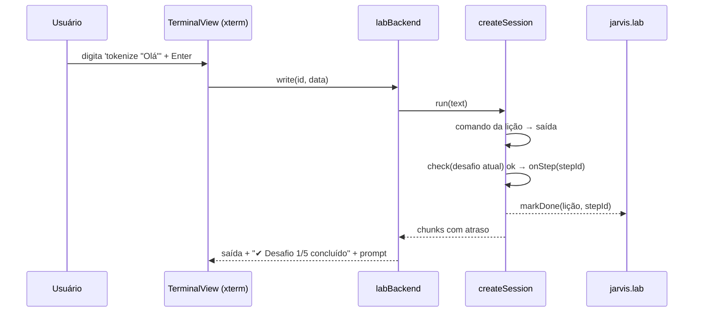

# App: jv_lab

O laboratório de IA do jvOS: lições curtas com o texto à esquerda e um terminal simulado à direita, que espera os comandos de cada desafio.

| | |
|---|---|
| **ID** | `app/jv_lab` |
| **Status** | Implementado |
| **Origem** | `750ebd0` (2026-10-27) |
| **Window kind** | `lab` em `src/lib/desktop.ts` (1180×700, mínimo 720×420) |
| **Voz** | `window:lab` ("jv lab", "laboratório", "lições", "aulas") |

## Objetivo

O jv_lab é o laboratório de IA do jvOS: lições curtas sobre inteligência artificial, cada uma com o texto à esquerda e um terminal simulado à direita. O terminal espera os comandos de cada desafio. É para quem quer entender, na prática, conceitos como treino e inferência, tokens, temperatura, nível de esforço e harness de agentes. Tudo roda na própria página: nenhum modelo de verdade é chamado, e os números são ilustrativos. O progresso de cada lição e a divisão entre texto e terminal ficam guardados.

### As cinco lições

| # | `id` | Título | Resumo (do código) | Tempo |
|---|---|---|---|---|
| 01 | `ia` | O que é IA | Regras escritas à mão × aprendizado com dados; treino, loss e inferência num filtro de spam. | ~10 min |
| 02 | `genai` | IA generativa | Discriminativo × generativo: amostrar de uma distribuição, seeds e um gerador de imagem por difusão. | ~10 min |
| 03 | `llm` | LLM por dentro | Tokens, previsão do próximo token, temperatura e janela de contexto num modelo de brinquedo. | ~12 min |
| 04 | `esforco` | Nível de esforço | Quanto o modelo pensa antes de responder: acerto × latência × custo, de low a max. | ~10 min |
| 05 | `harness` | Harness | O que transforma um modelo num agente: ferramentas, loop, permissões, contexto e hooks. | ~12 min |

Cada lição tem 5 desafios (25 no total).

## Não-objetivos

- Não executa comandos de verdade nem chama o Claude Code ou qualquer modelo.
- O estado de uma sessão de terminal (modelo treinado, execuções) vive só enquanto o terminal está aberto.
- Não tem frases de voz próprias além de abrir e fechar a janela.

## Histórias de usuário

### US1 — Escolher uma lição e cumprir os desafios no terminal (P1)

Quero abrir uma lição, ler o texto e digitar no terminal os comandos que cumprem cada desafio.

**Por que P1:** é o propósito do app.
**Teste independente:** `tests/lab.spec.ts` — "the catalog lists five lessons; a lesson shows its text beside a terminal that checks its challenges".

**Aceite:** [critérios 1 a 6](#critérios-de-aceite).

### US2 — Progresso que volta (P1)

Quero fechar o app e, ao voltar, encontrar os desafios que já fiz.

**Por que P1:** as lições são feitas em mais de uma sessão.
**Teste independente:** `tests/lab.spec.ts` — "progress comes back from storage, Tab completes, Reiniciar clears the lesson and Voltar returns to its card".

**Aceite:** [critérios 7 a 9](#critérios-de-aceite).

### US3 — Terminal que se comporta como um shell (P2)

Quero histórico, Tab, Ctrl+C e digitar adiantado como num terminal de verdade.

**Por que P2:** dá a sensação de terminal real, mas as lições funcionam sem isso.
**Teste independente:** `tests/lab.spec.ts` — "what is typed while a command still prints waits for the prompt, and Ctrl+C stops a command" e o teste de progresso (Tab).

**Aceite:** [critérios 10 a 13](#critérios-de-aceite).

### US4 — Ajustar a divisão entre texto e terminal (P3)

Quero arrastar a divisória ou movê-la pelo teclado, e que ela fique onde deixei.

**Por que P3:** conforto de leitura.
**Teste independente:** `tests/lab.spec.ts` — "the divider moves with the keyboard and the split is remembered".

**Aceite:** [critério 14](#critérios-de-aceite).

## Critérios de aceite

### Critério 1 (US1)

- **Dado** o jv_lab aberto
- **Quando** vejo o catálogo "Laboratório de IA"
- **Então** há 5 cartões, cada um com número, título, tempo, resumo, barra `[████░░]` e "n/5 desafios" (ou "✔ concluída").

### Critério 2 (US1)

- **Dado** o catálogo
- **Quando** abro "LLM por dentro"
- **Então** o texto da lição aparece à esquerda com o título de nível 1, e o terminal à direita mostra o banner e "Desafio 1/5". O teclado vai direto para o terminal.

### Critério 3 (US1)

- **Dado** o desafio atual
- **Quando** digito um comando que passa na checagem
- **Então** o terminal mostra "✔ Desafio n/5 concluído" e o próximo objetivo. Na coluna "Desafios", o item fica `✔` e o seguinte vira o atual `▶`. A barra mostra "n/5 desafios".

### Critério 4 (US1)

- **Dado** um comando que não existe na lição
- **Quando** o digito
- **Então** o terminal responde "comando não encontrado: <nome> — digite help para ver os desta lição".

### Critério 5 (US1)

- **Dado** o desafio atual
- **Quando** clico em "Mostrar dica"
- **Então** aparece o comando exato, com o botão "copiar".

### Critério 6 (US1)

- **Dado** todos os desafios feitos
- **Então** aparece "★ Lição concluída! Volte às lições para escolher a próxima.", e os comandos continuam disponíveis para praticar.

### Critério 7 (US2)

- **Dado** `jarvis.lab` com dois desafios feitos em `ia`
- **Quando** abro o jv_lab
- **Então** o cartão "O que é IA" mostra "2/5 desafios", e a lição abre já no "Desafio 3/5".

### Critério 8 (US2)

- **Dado** uma lição aberta
- **Quando** clico em "Reiniciar lição"
- **Então** os desafios voltam a zero, o terminal recomeça em "Desafio 1/5" e a lição sai de `jarvis.lab`.

### Critério 9 (US2)

- **Dado** uma lição aberta
- **Quando** clico em "Voltar às lições"
- **Então** o catálogo reaparece com o foco no cartão dessa lição.

### Critério 10 (US3)

- **Dado** o prompt
- **Quando** digito `tra` e aperto Tab
- **Então** a linha vira `train `. Com vários candidatos, Tab completa o prefixo comum e lista as opções.

### Critério 11 (US3)

- **Dado** comandos já rodados
- **Quando** aperto ↑ e Enter
- **Então** o último comando roda de novo.

### Critério 12 (US3)

- **Dado** um comando ainda imprimindo
- **Quando** digito outro e Enter
- **Então** o segundo espera o prompt voltar e roda depois.

### Critério 13 (US3)

- **Dado** um comando ainda imprimindo
- **Quando** aperto Ctrl+C
- **Então** a saída para, aparece `^C`, e o que foi digitado adiantado é descartado.

### Critério 14 (US4)

- **Dado** a divisória focada
- **Quando** aperto → duas vezes
- **Então** a coluna de texto passa de 50% para 60% (`aria-valuenow` = 60), e `jarvis.lab.split` fica ≈ 0,6.

## Casos de borda

- **Vazio/nulo:**
  - `jarvis.lab` ausente ou inválido → o padrão `{ done: {}, split: 0.5 }`; o que não é string sai da lista.
  - `split` fora da faixa ou inválido → limitado a 30–70% ou de volta a 50%.
  - Enter numa linha vazia → só um prompt novo; a linha não entra no histórico.
  - `help <comando>` que não existe → "não há o comando <nome>"; aspas sem fechar → "aspas sem fechar".
- **Duplicidade/idempotência:**
  - Desafio já feito cumprido de novo → `markDone` não o grava duas vezes.
  - A mesma linha duas vezes seguidas → o histórico guarda uma vez.
  - Ids de desafios removidos em `jarvis.lab` → não contam (`doneCount`).
  - Lição concluída → os comandos continuam para praticar, sem mudar o progresso.
- **Concorrência/corrida:**
  - Teclas durante a saída de um comando → guardadas até o prompt voltar; Ctrl+C para a saída e descarta o que foi digitado adiantado.
  - Texto colado com várias linhas → uma linha por vez, cada uma depois do prompt da anterior.
  - Desafio 3 cumprido antes do 2 → nada é marcado; só o desafio atual conta.
  - "Reiniciar lição" ou troca de lição → backend novo (`generation`) ou `key` nova; os timers da sessão antiga param no `close`.
- **Permissões/visibilidade:** não se aplica: o terminal é simulado na página, sem Tauri, rede, disco ou microfone; só `jarvis.lab` no localStorage. A única exceção é a área de transferência: sem acesso a ela, "copiar" não faz nada.
- **Fora do Tauri:** funciona igual, porque o terminal é simulado na página e não precisa de fake.

## Dados

- `$progresso`: **Progresso** (`LabProgress`), `{ version: 1, done: { [lição]: string[] }, split }`, com padrão `{ done: {}, split: 0.5 }`. Fica em `jarvis.lab` (localStorage, debounce padrão de `useStoredState`), sem migração. Ver [persistência](../../domain/persistence.md).
  - **RF-005**: Cada desafio cumprido DEVE ser gravado em `jarvis.lab.done[<lição>]`.
  - `parseLab` filtra o que não é string e volta ao padrão quando algo é inválido.
  - Se `jarvis.lab` tiver ids de desafios removidos, eles não entram na contagem (`doneCount`).
  - Se o `split` estiver fora da faixa ou for inválido, ele é limitado a 30–70% ou volta a 50%.
- Entidades do código (ver [glossário](../../domain/glossary.md)):
  - **Lição** (`Lesson`): `id`, título, resumo, minutos, comandos e desafios.
  - **Desafio** (`Step`): `id`, objetivo, dica (o comando exato) e `check`.
  - **Comando do lab** (`LabCommand`): `summary`, `usage`, `subcommands` opcionais e `run`.
- `$sessão`: o estado de um terminal aberto (modelo treinado, execuções, histórico). Só em memória, enquanto o terminal está aberto.

## Telas

### Catálogo

A primeira tela: "Laboratório de IA" e um cartão por lição.

- **Comportamento:**
  - **RF-001**: O catálogo DEVE listar as lições na ordem `ia`, `genai`, `llm`, `esforco`, `harness`, com o progresso de cada uma e o total geral.
  - Um clique num cartão abre a lição.
  - Ao voltar de uma lição, o foco vai para o cartão dela.
- **Layout:**
  - Cabeçalho com o título "Laboratório de IA", o texto "Escolha uma lição: o texto fica à esquerda e, à direita, um terminal simulado espera os comandos de cada desafio. Nada aqui chama um modelo de verdade." e a barra total de 30 células com "n/25 desafios".
  - Abaixo, a lista "Lições" em grade: 1 coluna, 2 a partir de 640 px e 3 a partir de 1000 px de largura do container (container query).
- **Estilo:**
  - Rolagem `hud-scroll`, `px-5 py-4`. O cabeçalho vai até `80ch`.
  - O título fica em 15 px, semibold, `tracking-wide` e `text-hud-light`. O texto usa `font-hud` 13 px em `text-hud-text/70`. A linha da barra total fica em 11 px `text-hud-text/60`.

### Lição

Uma lição aberta: a barra no topo, o texto e os desafios à esquerda, a divisória e o terminal à direita.

- **Comportamento:**
  - **RF-002**: Cada lição DEVE mostrar o texto Markdown `src/lib/lab/lessons/<id>.md` ao lado de um terminal xterm com backend simulado.
  - Ao abrir, o teclado vai direto para o terminal.
- **Layout:** a barra da lição (`Toolbar`) no topo. Embaixo, uma linha com a coluna de texto (largura = `split`), a divisória e o terminal, que ocupa o resto. A coluna de texto tem o artigo em cima e `Challenges` embaixo.

## Componentes

### `LabApp`

A raiz do app: guarda $progresso e alterna entre o catálogo e a lição.

- **Comportamento:**
  - Lê e grava $progresso com `useStoredState("jarvis.lab", DEFAULT_LAB, parseLab)`.
  - "Voltar às lições" fecha a lição e guarda o id dela, para o catálogo devolver o foco ao cartão.
  - Cada lição abre com `key` própria, então trocar de lição monta um terminal novo.
- **Layout:** coluna na altura toda, com o catálogo ou a lição.
- **Estilo:** `font-mono` 12,5 px, `text-hud-text`.

### Cartão da lição (`LessonCard`)

Um botão por lição no catálogo.

- **Comportamento:**
  - Mostre o número com dois dígitos, o título, "~<n> min", o resumo, a barra e "n/5 desafios", ou "✔ concluída" quando a lição estiver toda feita.
  - O leitor de tela ouve o título como rótulo e o resumo com "n de 5 desafios feitos" (ou "Concluída") como descrição.
- **Layout:** coluna com três linhas: número, título e tempo à direita; o resumo; e, no pé, a barra de 16 células à esquerda e o progresso à direita.
- **Estilo:**
  - `rounded-md`, borda `hud-cyan/30`, `px-3 py-2.5`. No hover, borda `hud-light/70` e fundo `bg-hud-cyan/[0.06]`; com foco, borda `hud-light` e fundo `bg-hud-cyan/[0.08]`.
  - O número fica em `text-hud-cyan`, o título semibold em `text-hud-light` e o tempo em 11 px `text-hud-text/45`.
  - O resumo usa `font-hud` 13 px em `text-hud-text/75`. O pé fica em 11 px `text-hud-text/60`, e "✔ concluída" em `text-hud-light`.
  - A barra `[████░░]` é texto (`TextBar`): blocos cheios em `text-hud-light` e vazios em `text-hud-text/25`.

### Barra da lição (`Toolbar`)

- **Comportamento:**
  - "Voltar às lições" volta ao catálogo.
  - **RF-008**: "Reiniciar lição" DEVE apagar o progresso da lição e abrir um terminal novo.
    - O terminal novo vem de um backend novo (`generation`).
  - Mostre "<n>/5 desafios" da lição.
- **Layout:** o botão de voltar (seta), um separador, "<número> · <título>", um espaço flexível, o progresso e o botão de reiniciar (seta circular).
- **Estilo:** `Toolbar` do `editorChrome`: 8 de altura (`h-8`), fundo `bg-hud-text/[0.04]`. O título fica semibold em `text-hud-light`, com o número em `text-hud-cyan`; o progresso em 11 px `text-hud-text/60`. Ícones lucide de 14 px.

### Artigo da lição

O texto da lição, em Markdown.

- **Comportamento:**
  - Renderize `lessonText(lesson.id)` com `react-markdown`, `remark-gfm` e `MARKDOWN_COMPONENTS`. O texto vem embutido pelo `import.meta.glob` com `?raw`.
  - O texto pode ser selecionado.
- **Layout:** `article` "Conteúdo da lição" com rolagem, ocupando o espaço acima de `Challenges`.
- **Estilo:** `font-hud` `text-sm`, `px-5 py-3`, rolagem `hud-scroll`.

### `Challenges`

A lista dos cinco desafios: feitos, o atual com a dica sob pedido e os que faltam.

- **Comportamento:**
  - O desafio atual é o primeiro ainda não feito. Os feitos ganham "✔", o atual "▶" e os outros "○".
  - No desafio atual, "Mostrar dica" troca o botão pelo comando exato e pelo botão "copiar", que vira "copiado" depois de copiar (dica do botão: "Copiar (clique direito no terminal cola)").
  - Quando todos estiverem feitos, mostre "★ Lição concluída! Volte às lições para escolher a próxima.".
- **Layout:** seção "Desafios" no pé da coluna de texto, com até 45% da altura e rolagem. Cabeçalho "Desafios" com "n/5" à direita, e a lista numerada embaixo.
- **Estilo:**
  - Borda superior `hud-cyan/20`, `px-4 py-2`. O cabeçalho é semibold `text-hud-cyan`, com o contador em 11 px `text-hud-text/50`.
  - Marcas: "✔" em `text-hud-light`, "▶" em `text-hud-cyan`, "○" em `text-hud-text/35`. Texto: feito em `text-hud-text/45`, atual em `text-hud-light`, pendente em `text-hud-text/55`.
  - "Mostrar dica" fica em 11 px `text-hud-cyan/80`, sublinhado. A dica é um `code` em `text-hud-holo` sobre `bg-hud-cyan/10`. A mensagem final fica em `text-hud-light`.

### Divisória

A barra entre o texto e o terminal.

- **Comportamento:**
  - **RF-009**: A divisória DEVE ir de 30% a 70%, mover 5% por seta (← →) e ser guardada em `jarvis.lab.split`.
  - Também move com o arrasto (`usePointerDrag`), proporcional à largura da área.
- **Layout:** `separator` vertical "Redimensionar conteúdo e terminal", com `aria-valuenow` em porcentagem (30 a 70).
- **Estilo:** 1 de largura (`w-1`), `bg-hud-cyan/15`, cursor `col-resize`; `bg-hud-light/30` no hover e `bg-hud-light/40` com foco.

### Terminal simulado (`TerminalView` + `labBackend`)

O xterm do jv_sh ligado a um backend que roda o motor da lição na página.

- **Comportamento:**
  - Ao abrir, mostre o banner "jv_lab · <título>", "Terminal simulado: nenhum modelo de verdade roda aqui e os números são ilustrativos.", "Digite help para ver os comandos e hint para a dica do desafio." e o objetivo atual ("→ Desafio n/5: …"). O prompt é `aluno@jv-lab ~/<id> $`.
  - A sessão nasce com os desafios já feitos, então a lição abre no desafio em que parou.
  - **RF-006**: O editor de linha DEVE ter histórico (↑/↓), Tab, Backspace, Ctrl+C, Ctrl+L (limpa) e Ctrl+U (apaga a linha).
    - Tab completa o comando ou o subcomando. Com vários candidatos, completa o prefixo comum e lista as opções.
    - O histórico não repete a mesma linha duas vezes seguidas.
  - A saída de cada comando sai em pedaços, com atrasos (por exemplo, as palavras geradas uma a uma).
  - **RF-007**: Enquanto a saída toca, as teclas DEVEM ficar guardadas até o prompt voltar. Só Ctrl+C age, parando a saída e descartando o que foi digitado.
    - Um texto colado com várias linhas roda uma linha por vez, cada uma depois do prompt da anterior.
- **Layout:** seção "Terminal simulado" com uma faixa de 6 de altura ("terminal simulado" à esquerda e "help · hint · ↑↓ histórico · Tab completa" à direita) e o terminal embaixo. Enquanto o xterm carrega, aparece "Carregando…".
- **Estilo:** a faixa tem fundo `bg-hud-text/[0.04]`, 10 px, maiúsculas com `tracking-[0.12em]` e `text-hud-text/50` (a dica da direita sem maiúsculas). No terminal, cores ANSI: prompt em verde e ciano, sucesso em verde, erros em vermelho, sugestões em cinza, a dica em amarelo e ciano.

### Motor da lição (`createSession`)

Interpreta cada linha, roda o comando e checa o desafio atual. É puro, sem DOM.

- **Comportamento:**
  - **RF-003**: O terminal DEVE aceitar, em toda lição, os comandos `help`/`ajuda`, `hint`/`dica`, `status`/`progresso` e `clear`/`limpar`/`cls`, além dos comandos da lição.
    - `help` lista "Comandos de “<título>”" e "Sempre disponíveis". `help <comando>` mostra o uso e o resumo.
    - Se `help <comando>` não existir, responda "não há o comando <nome>".
    - `hint` mostra o objetivo atual e "dica: <comando>". `status` mostra "<título> · n/5 desafios" e a lista com ✔, ▶ e ○.
  - `parseLine` separa as palavras com aspas retas e curvas e lê `--k v` e `--k=v`.
    - Se as aspas não fecharem, o terminal responde "aspas sem fechar" em vermelho.
  - Se o comando não existir na lição, responda "comando não encontrado: <nome> — digite help para ver os desta lição".
  - Se os argumentos estiverem errados, a mensagem do erro aparece em vermelho, seguida de `uso: <usage>`, e a checagem do desafio não roda.
  - **RF-004**: Um comando que roda sem erro DEVE ser checado só contra o desafio atual, o primeiro ainda não feito.
    - Se passar, mostre "✔ Desafio n/5 concluído" e o próximo objetivo, e chame `onStep` para gravar o desafio.
    - Cumprir o desafio 3 antes do 2 não marca nada.
    - Se houver duas tentativas erradas com o comando do desafio atual, o terminal sugere "(o desafio atual ainda não foi cumprido: digite hint para ver a dica)".
  - Com todos os desafios feitos, mostre "★ Lição concluída! Os comandos continuam aqui para você praticar; escolha a próxima em “Lições”.", e os comandos continuam disponíveis.

### Modelo de brinquedo (`model.ts`)

O "modelo" que as lições usam para gerar texto e imagens.

- **Comportamento:**
  - **RF-010**: O modelo de brinquedo DEVE ser determinístico: temperatura 0 dá sempre o mesmo texto, e a mesma seed reproduz uma amostra.
  - Usa `random` (mulberry32), `hash` (FNV-1a), um tokenizador e uma cadeia de palavras com logits.

## Voz e teclado

- Voz `window:lab` ("jv lab", "laboratório", "lições", "aulas"): abre ou fecha a janela.
- Busca: "lab", "laboratorio", "aprender", "licao", "aula", "curso", "estudo", "inteligencia artificial", "llm", "esforco", "harness"… encontram o jv_lab (`WINDOW_KEYWORDS`).
- Terminal: ↑/↓, Tab, Enter, Backspace, Ctrl+C, Ctrl+L, Ctrl+U: histórico, completar, rodar, apagar, interromper, limpar, apagar linha.
- Divisória focada: ← / → move 5%.

## Restrições

- **RNF-001**: Nada sai da máquina e nenhum modelo de verdade é chamado (texto do catálogo e do banner).
- **RNF-002**: O xterm só carrega quando a primeira lição abre, não com o catálogo.
- **RNF-003**: O app inteiro carrega sob demanda (ver [janelas](../../features/desktop-windows/spec.md)).
- A sugestão de `hint` vem depois de 2 tentativas erradas (`MISSES_BEFORE_NUDGE`).

## Critérios de sucesso

- **SC-001**: Uma pessoa completa uma lição só com o texto, as dicas e o terminal, sem consultar nada fora do app.
- **SC-002**: Depois de recarregar, o progresso e a divisória voltam iguais.
- **SC-003**: Comandos digitados durante uma saída nunca se perdem nem se embaralham.

## Entregáveis

O jv_lab é 100% front-end. Cada lição é um par `<id>.md` (texto, embutido via `import.meta.glob` com `?raw`) e `<id>.ts` (comandos e desafios). Um motor puro (`createSession`) interpreta as linhas e checa o desafio atual. `labBackend` embrulha esse motor na forma de `TerminalBackend`, a mesma interface dos terminais reais, e assim o lab reaproveita o `TerminalView` (xterm.js) do jv_sh sem nenhum comando Tauri. O progresso fica em `jarvis.lab` via `useStoredState`.

| | |
|---|---|
| **Camadas** | UI React (`LabApp`, `LessonCatalog`, `LessonLab`) · lib `src/lib/lab/*` (motor, backend simulado, parser, progresso, ANSI, lições) · `TerminalView` compartilhado |
| **Dependências** | ver [Dependências](#dependências) |
| **Testes** | `tests/lab.spec.ts` (UI), `tests/lab-engine.spec.ts` (motor puro, no projeto `ui`) |
| **Plataforma** | Igual dentro e fora do Tauri: o terminal é simulado na página |

### Arquivos

| Arquivo | Papel |
|---|---|
| `src/components/desktop/apps/lab/LabApp.tsx` | Raiz: `jarvis.lab`, alterna entre catálogo e lição, devolve o foco ao cartão da lição deixada |
| `src/components/desktop/apps/lab/LessonCatalog.tsx` | Cabeçalho "Laboratório de IA", barra total, grade de cartões (1/2/3 colunas por container query) |
| `src/components/desktop/apps/lab/LessonLab.tsx` | Barra (Voltar, título, n/5, Reiniciar), artigo Markdown, `Challenges` com dica e copiar, divisória e `TerminalView` lazy |
| `src/components/desktop/apps/lab/lessonText.ts` | `import.meta.glob("…/lessons/*.md", { query: "?raw", eager: true })` |
| `src/lib/lab/types.ts` | `Chunk`, `Output`, `ParsedLine`, `LabContext`, `LabCommand`, `Step`, `Lesson`, `LabError` |
| `src/lib/lab/parse.ts` | `splitWords` (aspas retas e curvas), `parseLine` (`--k v`, `--k=v`), `flagText`, `flagNumber`, `fold` |
| `src/lib/lab/engine.ts` | `createSession`: built-ins, despacho, checagem do desafio atual, sugestão após 2 erros, `complete` |
| `src/lib/lab/backend.ts` | `labBackend` e `LAB_PROFILE`: editor de linha, histórico, Tab, Ctrl+C/L/U, saída com atrasos, digitação adiantada |
| `src/lib/lab/progress.ts` | `LabProgress`, `DEFAULT_LAB`, `parseLab`, `markDone`, `resetLesson`, `doneCount`, `clampSplit` |
| `src/lib/lab/ansi.ts` | Cores SGR, `CLEAR`, `wrap`, `padEnd` (largura sem códigos ANSI) |
| `src/lib/lab/lessons/index.ts` | `LESSONS = [ia, genai, llmLesson, esforco, harness]` |
| `src/lib/lab/lessons/{ia,genai,llm,esforco,harness}.{md,ts}` | Texto e comandos de cada lição |
| `src/lib/lab/lessons/model.ts` | Modelo de brinquedo: `random` (mulberry32), `hash` (FNV-1a), tokenizador, cadeia de palavras com logits |
| `src/components/desktop/apps/terminal/TerminalView.tsx` | Terminal xterm reutilizado (spec em [jv_sh](../jv_sh/spec.md)) |

### Contratos

O lab não usa comandos Tauri, eventos nem ferramentas MCP. Os contratos são os comandos de cada lição e o backend simulado.

#### Comandos de cada lição

| Lição | Comandos do lab | Desafios (dica) |
|---|---|---|
| `ia` | `rules`, `dataset`, `train [--epochs N]`, `predict` | `rules <msg disfarçada>` · `dataset` · `train --epochs 5` · `predict <msg disfarçada>` · `predict "Reunião do projeto amanhã"` |
| `genai` | `classify`, `gen text\|image [--seed N] [--temperature T]` | `classify "Adorei o filme"` · `gen text "Era uma vez"` (duas vezes) · `… --seed 7` · `gen image "um gato"` |
| `llm` | `tokenize`, `llm next\|gen\|context` | `tokenize "…"` · `llm next "O céu é"` · `llm gen … --temperature 0` · `… --temperature 1.5` · `llm context` |
| `esforco` | `problems`, `llm ask <problema> [--effort low\|medium\|high\|max]`, `effort compare` | `problems` · `llm ask bola --effort low` · `… --effort high` · `effort compare agenda` · `llm ask capital --effort low` |
| `harness` | `harness inspect\|tools\|run\|context\|hooks [--mode default\|plan]` | `harness inspect` · `harness tools` · `harness run <tarefa>` · `… --mode plan` · `harness context` |

Built-ins em toda lição: `help [comando]` (`ajuda`), `hint` (`dica`), `status` (`progresso`), `clear` (`limpar`, `cls`).

#### Backend simulado (`TerminalBackend`)

| Método | Comportamento |
|---|---|
| `profiles()` | Só `LAB_PROFILE` (`id: "jv-lab"`) |
| `open(profile, cols)` | Cria uma sessão com os desafios já feitos e, num `setTimeout(0)`, emite o banner e o prompt `aluno@jv-lab ~/<id> $` |
| `write(id, data)` | Editor de linha; durante a saída, guarda o texto em `ahead`. Com `\x03`, para os timers e descarta tudo |
| `resize(id, cols)` | Ajusta a largura de quebra da sessão |
| `close(id)` | Para os timers e esquece a sessão |

### Fluxo

### Testes

- `npx playwright test tests/lab.spec.ts --project ui`: catálogo com 5 lições, texto ao lado do terminal, desafio cumprido, comando inexistente, dica, ↑, progresso salvo, Tab, "Reiniciar lição", "Voltar às lições", divisória e digitação adiantada com Ctrl+C (critérios 1–5 e 7–14).
- `npx playwright test tests/lab-engine.spec.ts --project ui`: o motor puro: `parseLine` e aspas sem fechar, ids e dicas únicos, built-ins e uso errado, só o desafio atual conta e a sugestão após 2 erros, Tab, o modelo de brinquedo e `parseLab` (critérios 4, 6 e 10; RF-003, RF-004, RF-010).

### Reversão

- Tirar o kind `lab` de `src/lib/desktop.ts` (`WindowKind`, `WINDOW_KINDS`, `WINDOW_SPECS`), de `WINDOW_KEYWORDS`/`APP_SUBTITLES` em `commands.ts`, o `case "lab"` de `Desktop.tsx` e o `LabApp` de `lazyApps.tsx`; `window:lab` de `src-tauri/voice-commands.json` e `"lab"` do `WINDOW_KINDS` de `settings.rs`.
- Apagar `src/components/desktop/apps/lab/` e `src/lib/lab/`; tirar `lab` e `lab-engine` do `testMatch` do projeto `ui`, junto com os dois specs.
- Ficam, porque outros usam: `TerminalView` (jv_sh, jv_ide), `markdownComponents.tsx` e `editorChrome.tsx` (Jarvis Mark) e `usePointerDrag` (janelas, jv_ide). Não há comando Tauri nem código Rust a tirar.
- Fica órfão e é ignorado: `jarvis.lab` no localStorage, a janela `lab` em `jarvis.desktop` (`parseDesktop` descarta kinds desconhecidos) e o comando de voz gravado no `settings.json` (descartado ao carregar).

### Constituição

- [x] P1 Offline-first — nada usa rede; o "modelo" é um brinquedo determinístico (`lessons/model.ts`).
- [x] P2 Rust é dono do nativo — não há acesso nativo; o lab não usa Tauri.
- [x] P5 Persistência tolerante — `parseLab` filtra o que não é string, limita o `split` e volta ao padrão quando algo é inválido; `doneCount` ignora ids de desafios removidos.
- [x] P6 Funciona fora do Tauri — o backend é simulado, sem fake nem fallback.
- [x] P7 PT-BR para o usuário — lições, objetivos, dicas, mensagens do terminal e aria-labels em PT-BR; identificadores e comandos do lab em inglês (`train`, `llm next`, `harness run`).
- [x] P8 Linguagem visual única — fonte mono, barras `[███░░]` em texto, tokens `hud-*`; cores ANSI no terminal.
- [x] P9 Desktop leve — app lazy; o `TerminalView` é `lazy()` dentro do `LessonLab` e só carrega com a primeira lição aberta.
- [x] P11 Coberto por teste — 4 testes de UI e 7 testes do motor.

### Decisões relacionadas

- [ADR-0012 — apps lazy com preload](../../arch/adr/0012-apps-lazy-com-preload.md)
- [ADR-0014 — linguagem visual TUI](../../arch/adr/0014-linguagem-visual-tui.md)
- [ADR-0010 — settings.json vs localStorage](../../arch/adr/0010-persistencia-settings-vs-localstorage.md)
- [ADR-0017 — UI PT-BR, código EN](../../arch/adr/0017-ui-pt-br-codigo-en.md)

## Dependências

- **Vendor:** [React](../../foundation/vendor/react/spec.md), [xterm.js](../../foundation/vendor/terminal/spec.md) (via `TerminalView`), [Markdown](../../foundation/vendor/markdown/spec.md) (`react-markdown`, `remark-gfm`), [lucide](../../foundation/vendor/lucide/spec.md), [Vite](../../foundation/vendor/vite-typescript/spec.md) (`import.meta.glob` com `?raw` em `lessonText.ts`)
- **Specs:** [desktop-windows](../../features/desktop-windows/spec.md) (janela e app lazy), [voice-commands](../../features/voice-commands/spec.md) (`window:lab`), [search](../../features/search/spec.md) (palavras de `WINDOW_KEYWORDS`), [jv_sh](../../apps/jv_sh/spec.md) (o `TerminalView` reaproveitado), [jarvis-mark](../../apps/jarvis-mark/spec.md) (`MARKDOWN_COMPONENTS` e a `Toolbar` do `editorChrome`)
- **Sistema:** WebView2 (ou o navegador no modo web, que funciona igual); a área de transferência para "copiar". Nenhuma rede.

## Tarefas

Legenda: `[x]` feito · `[ ]` pendente · `[P]` pode rodar em paralelo (arquivos diferentes) · `[USn]` história desta spec. As tarefas foram reconstruídas do código e do commit de origem `750ebd0`.

### Fase 1 — Base

- [x] T001 Tipos do lab (`Lesson`, `Step`, `LabCommand`, `Chunk`, `LabError`) — `src/lib/lab/types.ts`
- [x] T002 [P] Parser de linha com aspas retas/curvas e `--flags` — `src/lib/lab/parse.ts`
- [x] T003 [P] Cores ANSI, `CLEAR`, `wrap` e `padEnd` — `src/lib/lab/ansi.ts`
- [x] T004 [P] Progresso `jarvis.lab` com `parseLab`, `markDone`, `resetLesson`, `doneCount`, `clampSplit` — `src/lib/lab/progress.ts`
- [x] T005 [P] Modelo de brinquedo determinístico (mulberry32, FNV-1a, tokenizador, logits) — `src/lib/lab/lessons/model.ts`

### Fase 2 — US1 Escolher uma lição e cumprir os desafios (P1)

- [x] T006 [US1] Motor `createSession`: built-ins, despacho, checagem do desafio atual, sugestão de `hint` — `src/lib/lab/engine.ts`
- [x] T007 [P] [US1] Lição `ia` (texto + comandos + 5 desafios) — `src/lib/lab/lessons/ia.{md,ts}`
- [x] T008 [P] [US1] Lição `genai` — `src/lib/lab/lessons/genai.{md,ts}`
- [x] T009 [P] [US1] Lição `llm` — `src/lib/lab/lessons/llm.{md,ts}`
- [x] T010 [P] [US1] Lição `esforco` — `src/lib/lab/lessons/esforco.{md,ts}`
- [x] T011 [P] [US1] Lição `harness` — `src/lib/lab/lessons/harness.{md,ts}`
- [x] T012 [US1] Ordem do catálogo `LESSONS` e textos via `import.meta.glob` — `src/lib/lab/lessons/index.ts`, `src/components/desktop/apps/lab/lessonText.ts`
- [x] T013 [US1] Catálogo com cartões e barras de progresso — `src/components/desktop/apps/lab/LessonCatalog.tsx`
- [x] T014 [US1] Lição: artigo Markdown, `Challenges` (dica, copiar), terminal lazy — `src/components/desktop/apps/lab/LessonLab.tsx`
- [x] T015 [US1] Janela `lab` lazy e palavras-chave da busca — `src/components/desktop/lazyApps.tsx`, `src/lib/commands.ts`, `src/lib/desktop.ts`

### Fase 3 — US2 Progresso que volta (P1)

- [x] T016 [US2] `LabApp` com `useStoredState("jarvis.lab")`, Voltar com foco no cartão — `src/components/desktop/apps/lab/LabApp.tsx`
- [x] T017 [US2] "Reiniciar lição" com novo backend (`generation`) — `LessonLab.tsx`

### Fase 4 — US3 Terminal que se comporta como um shell (P2)

- [x] T018 [US3] `labBackend`: editor de linha, histórico, Tab, Ctrl+C/L/U, saída com atrasos e digitação adiantada — `src/lib/lab/backend.ts`
- [x] T019 [US3] `complete`/`completeWord` com prefixo comum e opções — `src/lib/lab/engine.ts`

### Fase 5 — US4 Ajustar a divisão (P3)

- [x] T020 [US4] Divisória com arrasto (`usePointerDrag`) e setas, 30–70% — `LessonLab.tsx`

### Fase 6 — Testes

- [x] T021 Playwright `tests/lab.spec.ts` — "the catalog lists five lessons; a lesson shows its text beside a terminal that checks its challenges"
- [x] T022 Playwright `tests/lab.spec.ts` — "progress comes back from storage, Tab completes, Reiniciar clears the lesson and Voltar returns to its card"
- [x] T023 Playwright `tests/lab.spec.ts` — "the divider moves with the keyboard and the split is remembered"
- [x] T024 Playwright `tests/lab.spec.ts` — "what is typed while a command still prints waits for the prompt, and Ctrl+C stops a command"
- [x] T025 [P] Playwright `tests/lab-engine.spec.ts` — "parseLine: quotes keep phrases together, --flags take values"
- [x] T026 [P] Playwright `tests/lab-engine.spec.ts` — "lessons and challenges have unique ids, a hint and a text"
- [x] T027 [P] Playwright `tests/lab-engine.spec.ts` — "built-ins: help lists the lesson's commands, unknown commands and bad usage say so"
- [x] T028 [P] Playwright `tests/lab-engine.spec.ts` — "only the current challenge counts, and two misses at its command suggest the hint"
- [x] T029 [P] Playwright `tests/lab-engine.spec.ts` — "Tab completes commands and subcommands"
- [x] T030 [P] Playwright `tests/lab-engine.spec.ts` — "the toy model: temperature 0 is always the same, a seed reproduces a sample"
- [x] T031 [P] Playwright `tests/lab-engine.spec.ts` — "parseLab keeps what is valid and falls back for the rest"

## Pendências

- Nenhuma registrada.
