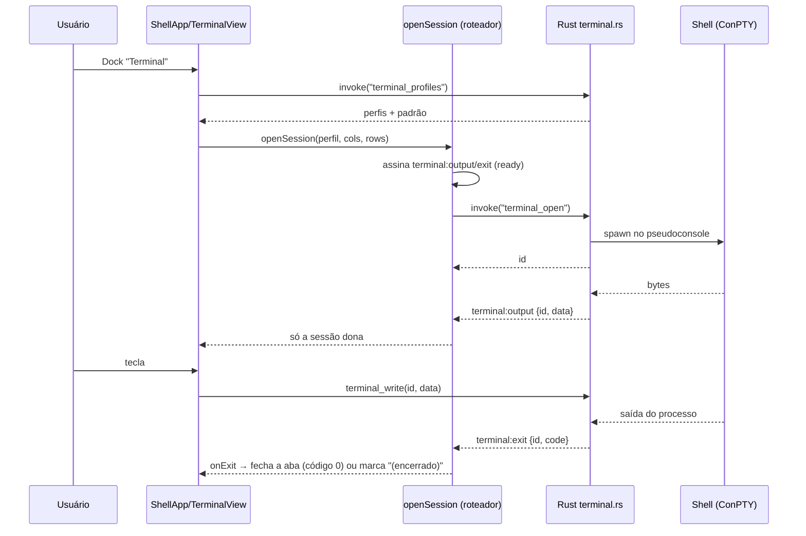

# jv_sh

O terminal do jvOS: os shells reais do usuário, em abas, dentro de uma janela JARVIS.

| | |
|---|---|
| **ID** | `app/jv_sh` |
| **Status** | Implementado |
| **Origem** | `42e671a` (2026-10-23) · evoluída em `c4ccc57` e `750ebd0` |
| **Window kind** | `shell` em `src/lib/desktop.ts` (900×540, mínimo 480×300, grupo `apps`) |
| **Voz** | `window:shell` |

## Visão geral

O jv_sh é o terminal do jvOS: os shells reais do usuário (os perfis do Windows Terminal, ou os shells achados na máquina) rodando em abas dentro de uma janela JARVIS. Ele existe para que o usuário não precise sair do desktop para usar PowerShell, cmd, Git Bash ou WSL, com as cores do tema e um comando próprio, `jvfetch`, que mostra a máquina "no estilo JARVIS". Também é onde o JARVIS roda, uma vez, um agente do Claude Code criado no [jv_agent](../../apps/jv_agent/spec.md).

## Dados

O jv_sh não tem chave `jarvis.*`: não há estado persistido.

- `$perfis` (**Perfis** `TerminalProfiles`): a lista e o id do perfil padrão, vindos de `terminal_profiles`, que lê o `settings.json` do Windows Terminal a cada chamada. `loadProfiles` (usado pela Busca e pelo jv_ide) guarda a lista uma vez por sessão do JARVIS.
  - **Perfil** (`TerminalProfile`): id, nome, linha de comando e pasta inicial de um shell; um perfil de agente leva `agent: { name, task }`. Ver [glossário](../../domain/glossary.md).
- `$abas` (**Aba**): uma sessão na UI, com título e código de falha. Só em memória.
  - **Sessão**: um shell vivo num pseudoconsole, identificado por um número.
- `$pedido`: a aba pedida pela Busca ou pelo JARVIS com a janela fechada (só a última), à espera de `takePendingProfile`.
- No disco, só os arquivos do `jvfetch`: `%LOCALAPPDATA%\dev.jarvis.os\jv_sh\jvfetch.ps1`, `jv_sh\bin\jvfetch.cmd` e `jv_sh\bin\jvfetch`.

## Telas

### Terminal com abas

A janela "jv_sh": a barra de abas e o shell da aba ativa.

- **Comportamento:**
  - Ao abrir, carregue $perfis e abra uma aba: a pedida em $pedido ou a do perfil padrão, já com o foco do teclado.
  - A dock "Terminal" abre a janela (não alterna); clicar de novo deixa a janela aberta e na frente, com as mesmas abas.
  - Fora do Tauri e sem o fake de DEV, mostre "Disponível no app desktop" no lugar de tudo.
- **Layout:** a barra de abas (24 px) no topo e, abaixo, a área do terminal, onde cada aba tem o seu `TerminalView` sobreposto; só o da aba ativa aparece. Um erro de carga aparece entre as duas.
- **Estilo:** `font-mono` 12 px. "Disponível no app desktop" fica centralizado, em `text-sm` `text-hud-text/60`.

## Componentes

### `ShellApp`

A barra de abas, o menu de perfis, os atalhos reservados e a regra "a última aba fecha a janela".

- **Comportamento:**
  - "Nova aba" (o `+`) abre uma aba do perfil padrão, já ativa.
  - **RF-005**: DEVE fechar a janela quando a última aba fecha, e encerrar todos os shells quando a janela fecha ou o JARVIS sai.
  - **RF-006**: DEVE manter abertas as abas cujo shell saiu com erro, mostrando o código.
    - Uma saída com código 0 (ou sem código) fecha a aba. Com erro, a aba fica com " (encerrado)" no título.
  - Fechar uma aba (×, Ctrl+Shift+W) encerra o shell dela. A aba ativa passa para a vizinha.
  - Ctrl+Tab e Ctrl+Shift+Tab andam pelas abas, dando a volta no fim da lista.
  - Se o shell pedir um título (OSC), então a aba mostra até 22 caracteres (cortando com "…") e o título inteiro na dica.
  - Se nenhum perfil for encontrado, então mostre "Nenhum shell encontrado nesta máquina".
  - Os atalhos reservados (ver [Voz e teclado](#voz-e-teclado)) não chegam ao shell; todas as outras teclas chegam.
- **Layout:**
  - Barra de abas de 24 px: as abas (cada uma com até 24 caracteres de largura, o título e o × à direita), o botão `+` "Nova aba" e o botão `⌄` "Escolher perfil".
  - Abaixo da barra, a mensagem de erro (quando há) e a área dos terminais.
- **Estilo:**
  - A barra tem borda inferior `hud-cyan/15` e 1 px entre as abas.
  - A aba ativa fica em vídeo reverso (`bg-hud-light/85 font-semibold text-hud-void`); as outras em `bg-hud-text/[0.07] text-hud-text/65`, acendendo em `text-hud-light` sob o mouse.
  - O × (ícone lucide `X`, 10 px) só aparece sob o mouse numa aba inativa.
  - `+` e `⌄` (ícones lucide de 12 px) ficam em `text-hud-text/60`, com fundo `hud-cyan/10` sob o mouse.
  - O erro fica em `text-hud-alert`.

### `ProfileMenu`

O menu "Escolher perfil", com os perfis de $perfis.

- **Comportamento:**
  - Liste os perfis, com "padrão" ao lado do perfil padrão. Escolher um abre a aba dele.
  - Ao abrir, o foco vai para o primeiro perfil. Esc ou um clique fora fecham o menu.
- **Layout:** um menu ("Perfis") logo abaixo do botão `⌄`, com pelo menos 24 caracteres de largura; cada linha tem o nome à esquerda e "padrão" à direita.
- **Estilo:** borda `hud-cyan/30`, fundo `bg-hud-panel/95` (sem desfoque) e sombra. O item sob o mouse ou com foco fica em vídeo reverso. "padrão" fica em 10 px com 60% de opacidade.

### `TerminalView`

Um xterm ligado a uma sessão: ajuste ao tamanho, tema, copiar e colar e título OSC. Desmontar encerra o shell. É o mesmo componente dos terminais do [jv_ide](../../apps/jv_ide/spec.md).

- **Comportamento:**
  - Abra a sessão pelo roteador (`openSession`) com o tamanho do xterm e mande cada tecla com `terminal_write`.
  - **RF-011**: DEVE seguir as cores do tema e do acento TUI em tempo real.
    - A paleta lê `--color-hud-text`, `--color-hud-light`, `--color-hud-cyan` e `--color-hud-alert`, e um `MutationObserver` no documento e na janela recolore o xterm quando o tema ou o acento mudam.
  - Quando a janela muda de tamanho (ou maximiza), reajuste o xterm e avise o shell do novo número de colunas e linhas (`terminal_resize`); ao restaurar, ele volta ao tamanho anterior.
  - Ao ficar ativo, reajuste o tamanho (uma aba oculta não mede) e pegue o foco do teclado.
  - O botão direito copia a seleção (e a limpa) ou, sem seleção, cola. Ctrl+Shift+C copia e Ctrl+V cola.
  - Se o shell sair com erro, então escreva "[processo encerrado: código N]" na tela.
  - Se o shell falhar ao iniciar, então a mensagem aparece em vermelho dentro do terminal.
- **Layout:** o xterm ocupa a área inteira (`absolute inset-0`), com um respiro de 4 px em cima e embaixo e 8 px à esquerda. Uma aba inativa fica oculta (`hidden`), com o shell vivo.
- **Estilo:**
  - Fonte `--font-mono` (ou Consolas) de 13 px, cursor piscando, fundo transparente.
  - Cores: texto `hud-text`, cursor `hud-light`, seleção com 35% de `hud-cyan`; os slots ANSI vermelho = `hud-alert`, azul = `hud-cyan`, ciano e azul claro = `hud-light`, branco = `hud-text`.
  - Os slots preto, verde, amarelo, magenta e as outras variantes claras são cores fixas (`readTheme`). Ver [Pendências](#pendências).

### Roteador de sessões (`openSession`)

Entrega a cada aba (ou painel do jv_ide) só os eventos da própria sessão.

- **Comportamento:**
  - Assine `terminal:output` e `terminal:exit` antes de abrir o shell, para não perder o banner nem o primeiro prompt.
  - Entregue cada evento só à sessão dona do `id`.
  - Se a saída chegar antes de a UI saber o id da sessão, então ela espera até 10 s (no máximo 256 KiB) para ser entregue.
  - `close()` para de ouvir e depois encerra o shell (`terminal_close`).

### Perfis (Rust `terminal::profiles`)

De onde vêm os shells que o jv_sh oferece.

- **Comportamento:**
  - **RF-001**: O sistema DEVE listar os perfis do Windows Terminal (pacote da Store, estável antes do Preview, depois a instalação sem pacote), ignorando comentários, vírgulas finais e perfis ocultos, e expandindo `%VAR%`.
  - **RF-002**: Sem Windows Terminal utilizável, DEVE oferecer os shells achados: "PowerShell", "Windows PowerShell", "Prompt de comando", "Git Bash" e "WSL", nessa ordem, com o primeiro como padrão.
  - **RF-003**: DEVE abrir só perfis conhecidos: a UI manda o id do perfil, nunca uma linha de comando.
    - Um id fora de `terminal::profiles()` responde "Perfil não encontrado".
  - Se o `settings.json` do Windows Terminal estiver ilegível ou sem perfis utilizáveis, então use os shells achados no PATH (pwsh, powershell, cmd, Git Bash, WSL).
  - Perfis dinâmicos sem linha de comando (Azure Cloud Shell, prompts do Visual Studio) ficam de fora; o perfil "Git" só aparece se o Git for Windows existir.

### Sessões ConPTY (Rust `Terminals`)

Cada shell vivo, num pseudoconsole.

- **Comportamento:**
  - **RF-004**: Cada aba DEVE rodar seu shell num pseudoconsole (ConPTY), repassando teclas e redimensionamentos.
  - **RF-007**: DEVE pôr no ambiente de cada shell `TERM=xterm-256color`, `COLORTERM=truecolor`, `CHERE_INVOKING=1`, `JARVIS_SH`, `JARVIS_SHELL`, `JARVIS_VERSION`, `JARVIS_SETTINGS`, a pasta do `jvfetch` no início do `PATH` e essas quatro variáveis em `WSLENV`, preservando as entradas do usuário.
    - Os valores estão em [Ambiente de cada shell](#ambiente-de-cada-shell).
  - **RF-009**: DEVE aceitar uma pasta inicial absoluta e existente; no WSL, DEVE reescrever `--cd` na linha de comando.
    - Se a pasta inicial for inválida, então responda "Pasta inválida", "Pasta não encontrada" ou "Não é uma pasta".
  - Leia a saída numa thread e emita `terminal:output` com o id da sessão; ao sair, emita `terminal:exit` com o código.
  - Se um caractere UTF-8 for cortado entre duas leituras do pseudoconsole, então ele é guardado para a próxima; bytes inválidos viram U+FFFD.
  - `terminal_close` mata o processo, e a saída ainda é reportada. Uma escrita numa sessão que não existe responde "Sessão encerrada".
  - Na saída do JARVIS (`RunEvent::Exit`), `close_all` encerra todos os shells.

### Pedidos de aba (`requestTab`)

Como a Busca e o JARVIS abrem uma aba no jv_sh.

- **Comportamento:**
  - **RF-010**: DEVE receber pedidos de aba (`requestTab`) da Busca e do JARVIS mesmo com a janela fechada, abrindo a aba quando a janela montar.
  - A Busca oferece um comando `Nova aba: <perfil>` por perfil; ele abre a janela e chama `requestTab(profile.id)`.
  - Para um agente instalado pelo jv_agent, o JARVIS abre a janela e pede uma aba `Agente <nome>` (`agentProfile`), que roda só `claude --agent <nome> "<tarefa>"` na pasta escolhida, via `terminal_open_agent`.
  - Com a janela aberta, o pedido vira uma aba na hora (`onTabRequest`). Com ela fechada, fica em $pedido.

### `jvfetch`

O comando que mostra a máquina "no estilo JARVIS".

- **Comportamento:**
  - **RF-008**: DEVE instalar o `jvfetch` na inicialização, com lançadores para PowerShell/cmd e para bash (Git Bash e WSL). O `jvfetch` mostra sistema, build, máquina, "ligado há", shell, terminal (`jv_sh` · colunas×linhas), tela, cpu, gpu, memória e bateria em barras, e a linha "jarvis" (tema, modelo do whisper, modo de ativação, lidos do `settings.json`); dentro do jv_sh usa os slots ANSI da paleta, que seguem o tema.
  - `install_tools` grava os arquivos só quando eles mudam: `jvfetch.ps1` com BOM e `bin\jvfetch` com LF.

## Voz e teclado

- Voz `window:shell` ("terminal", "jv sh", "shell", "console", "prompt de comando") com verbo de abrir/fechar: abre/fecha a janela.
- Dock "Terminal": abre (não alterna); o item fica marcado enquanto há janela `shell`.
- Busca `Nova aba: <perfil>`: abre a janela e chama `requestTab(profile.id)`.
- `Ctrl+Shift+T`: nova aba com o perfil padrão.
- `Ctrl+Shift+W`: fecha a aba ativa.
- `Ctrl+Tab` / `Ctrl+Shift+Tab`: próxima / anterior, com volta.
- `Ctrl+Shift+C`: copia a seleção.
- `Ctrl+V`: cola.
- Botão direito: copia a seleção (e limpa) ou, sem seleção, cola.
- Qualquer outra tecla vai para o shell. Com o foco no terminal, Ctrl+W e `/` chegam ao shell, e a Busca não abre.

## Restrições

- **RNF-001**: O tamanho do pseudoconsole fica entre 2 e 500 linhas e entre 10 e 1000 colunas.
- **RNF-002**: O redimensionamento espera 60 ms de calma antes de avisar o shell, e só avisa se colunas × linhas mudaram.
- **RNF-003**: Após a saída do shell, o pseudoconsole tem 150 ms para entregar o resto da saída; leituras de até 64 KiB.
- **RNF-004**: O xterm guarda 5000 linhas de histórico, fonte 13.
- **RNF-005**: Abas inativas ficam ocultas, mas os shells continuam rodando.

## Histórias de usuário

### US1 — Abrir um shell e digitar nele (P1)

Como usuário, abro o Terminal pela dock e digito comandos no meu shell padrão.

**Por que P1:** é a razão de existir do app.
**Teste independente:** `tests/shell.spec.ts` — "the dock's Terminal opens jv_sh on the default profile, and what is typed reaches the shell".

**Aceite**

1. **Dado** o desktop sem o jv_sh, **quando** clico em "Terminal" na dock, **então** a janela "jv_sh" abre com uma aba do perfil padrão, já com o foco do teclado.
2. **Dado** o jv_sh aberto, **quando** digito `dir` e Enter, **então** o texto chega ao shell e a saída aparece na aba.
3. **Dado** o jv_sh aberto, **quando** clico de novo em "Terminal" na dock, **então** a janela continua aberta e na frente, com as mesmas abas (a dock abre, não alterna).

### US2 — Várias abas e perfis (P1)

Como usuário, abro outras abas com o perfil padrão ou com qualquer outro perfil, troco entre elas e fecho.

**Por que P1:** um terminal de uso diário precisa de abas.
**Teste independente:** "tabs: + opens the default profile, the menu any other; Ctrl+Tab switches and Ctrl+Shift+W closes".

**Aceite**

1. **Dado** uma aba, **quando** clico em "Nova aba" (ou Ctrl+Shift+T), **então** surge outra aba do perfil padrão, já ativa.
2. **Dado** o menu "Escolher perfil", **quando** ele abre, **então** lista os perfis com "padrão" ao lado do perfil padrão; escolher um abre a aba dele.
3. **Dado** várias abas, **quando** aperto Ctrl+Tab (Ctrl+Shift+Tab volta), **então** a próxima aba fica ativa, dando a volta no fim da lista.
4. **Dado** várias abas, **quando** aperto Ctrl+Shift+W ou o × da aba, **então** a aba fecha e o shell dela é encerrado.

### US3 — Saída e fechamento (P1)

Como usuário, quero que o terminal se comporte como o Windows Terminal ao sair de um shell e ao fechar a janela.

**Por que P1:** nenhum processo pode ficar órfão.
**Teste independente:** "exit closes its tab; an error code keeps it; the last tab closes the window" e "the terminal keeps the keyboard; the × closes the window and every shell".

**Aceite**

1. **Dado** duas abas, **quando** digito `exit`, **então** a aba fecha.
2. **Dado** uma aba, **quando** o shell sai com código diferente de zero, **então** a aba fica, com " (encerrado)" no título e "[processo encerrado: código N]" na tela.
3. **Dado** a última aba, **quando** ela fecha (por saída ou pelo ×), **então** a janela do jv_sh fecha.
4. **Dado** abas abertas, **quando** fecho a janela pelo ×, **então** todos os shells são encerrados.

### US4 — O teclado é do shell (P2)

Como usuário, quero que atalhos como Ctrl+W ou "/" cheguem ao shell, e não ao desktop.

**Por que P2:** atalhos do desktop não podem roubar teclas de quem está no terminal.
**Teste independente:** "the terminal keeps the keyboard; the × closes the window and every shell".

**Aceite**

1. **Dado** o foco no terminal, **quando** aperto Ctrl+W e digito `/m`, **então** o shell recebe `\x17` e `/m`, e a Busca não abre.
2. **Dado** texto selecionado, **quando** clico com o botão direito (ou Ctrl+Shift+C), **então** a seleção vai para a área de transferência; sem seleção, o botão direito (ou Ctrl+V) cola.

### US5 — Tamanho acompanha a janela (P2)

**Teste independente:** "maximised by its button or a double click, the shell learns its new size".

**Aceite**

1. **Dado** o jv_sh aberto, **quando** maximizo a janela (botão ou duplo clique no título), **então** o terminal se reajusta e o shell recebe o novo número de colunas e linhas; ao restaurar, volta ao tamanho anterior.

### US6 — Abrir por voz, pela Busca e pelo JARVIS (P2)

**Teste independente:** "voice and the search open it; the search opens a tab with any profile".

**Aceite**

1. **Dado** o desktop, **quando** digo "abre o terminal" (`window:shell`), **então** o jv_sh abre; "fecha o terminal" fecha.
2. **Dado** a Busca (`/`), **quando** digito "nova aba git bash" e Enter, **então** o jv_sh abre com uma aba "Git Bash", mesmo que a janela estivesse fechada.
3. **Dado** um agente instalado pelo jv_agent, **quando** o JARVIS o roda, **então** abre uma aba `Agente <nome>` executando só `claude --agent <nome> "<tarefa>"` na pasta escolhida.

## Critérios de sucesso

- **SC-001**: Todo comando digitado chega ao shell da aba ativa, e só a ele.
- **SC-002**: Nenhum shell sobrevive ao fechamento da aba, da janela ou do JARVIS.
- **SC-003**: Um perfil do Windows Terminal aparece no jv_sh com o mesmo nome e o mesmo padrão.

## Fora de escopo e limitações

- Não roda linha de comando arbitrária vinda da UI, da voz ou do JARVIS.
- Não persiste abas entre sessões: cada abertura começa com uma aba.
- Não implementa divisão de painéis nem configurações próprias de perfil; os perfis são os do Windows Terminal.
- WSL ignora a pasta de trabalho do processo; para pastas `\\wsl.localhost\` ou `\\wsl$\` de outra distribuição, o shell começa na home.
- O chrome da janela (arrastar, maximizar, carregamento lazy) é de [desktop-windows](../../features/desktop-windows/spec.md).
- Os terminais do jv_ide reutilizam o mesmo backend; ver [jv_ide](../../apps/jv_ide/spec.md).

## Código

O Rust abre cada shell num pseudoconsole ConPTY (`portable-pty`), lê a saída numa thread e a emite como evento `terminal:output` com o id da sessão; a UI desenha com xterm.js e devolve teclas e tamanhos por comandos `terminal_*`. Os perfis vêm do `settings.json` do Windows Terminal (JSON com comentários) ou, sem ele, dos shells achados no `PATH`. Um roteador no TypeScript (`openSession`) entrega a cada aba só os eventos da própria sessão, o que permite ao jv_sh e ao jv_ide dividirem o mesmo backend.

| | |
|---|---|
| **Camadas** | UI React (`ShellApp`, `TerminalView`) · lib (`src/lib/terminal.ts`) · comandos Tauri `terminal_*` · módulo Rust `terminal.rs` |
| **Dependências** | `@xterm/xterm` ^6, `@xterm/addon-fit` ^0.11, `portable-pty` 0.9, `dunce` 1.0.5; processos: os shells do usuário, `powershell.exe` (para o `jvfetch`), `claude.exe` (agentes) |
| **Testes** | `tests/shell.spec.ts`; Rust `mod tests` em `src-tauri/src/terminal.rs` |
| **Plataforma** | Windows 11 · WebView2. Fora do Tauri: fake `window.__JARVIS_TERMINAL__` (só em DEV) com eco e `exit [código]`; sem ele, "Disponível no app desktop" |

### Arquivos

| Arquivo | Papel |
|---|---|
| `src/components/desktop/apps/ShellApp.tsx` | Barra de abas, menu de perfis, atalhos reservados, regra "última aba fecha a janela" |
| `src/components/desktop/apps/terminal/TerminalView.tsx` | Um xterm ligado a uma sessão: fit, resize com debounce, tema, copiar/colar, título OSC; desmontar encerra o shell |
| `src/lib/terminal.ts` | `TerminalBackend` (Tauri ou fake), roteador `openSession`, `requestTab`/`onTabRequest`/`takePendingProfile`, `loadProfiles` |
| `src/lib/commands.ts` | Comandos da Busca `Nova aba: <perfil>` |
| `src/App.tsx` | Dock "Terminal" → `workspace.open("shell")`; carrega perfis para a Busca; lançador de agentes |
| `src-tauri/src/terminal.rs` | `Terminals` (sessões ConPTY), perfis do Windows Terminal e fallback, `jvfetch`, ambiente, `start_dir`, `in_dir`/`wsl_cd` |
| `src-tauri/jvfetch.ps1` | O comando `jvfetch`, embutido no binário com `include_str!` |
| `src-tauri/src/lib.rs` | Comandos `terminal_*`, instalação do `jvfetch` no `setup`, `close_all` no `RunEvent::Exit` |

### Contratos

#### Comandos Tauri

| Comando | Entrada | Saída | Notas |
|---|---|---|---|
| `terminal_profiles` | — | `Profiles { profiles, default }` | Lê o Windows Terminal a cada chamada |
| `terminal_open` | `profile` (id), `cols`, `rows`, `cwd?` | `u32` (id da sessão) | "Perfil não encontrado"; `cwd` validado por `start_dir` e aplicado por `in_dir` |
| `terminal_open_agent` | `name`, `task`, `cwd`, `cols`, `rows` | `u32` | Só agente instalado; cria a pasta se estiver em `Agentes`; "Claude Code não encontrado". Ver [jv_agent](../../apps/jv_agent/spec.md) |
| `terminal_write` | `id`, `data` | — | "Sessão encerrada" se o id não existe |
| `terminal_resize` | `id`, `cols`, `rows` | — | Tamanho limitado por `size()` |
| `terminal_close` | `id` | — | Mata o processo; a saída ainda é reportada |

#### Eventos e Channels

| Nome | Payload | Emissor → consumidor |
|---|---|---|
| `terminal:output` | `{ id, data }` (texto UTF-8) | thread leitora do Rust → roteador de `openSession` |
| `terminal:exit` | `{ id, code: number \| null }` | thread de espera do Rust → roteador → `TerminalView.onExit` |

### Ambiente de cada shell

| Variável | Valor |
|---|---|
| `TERM` / `COLORTERM` | `xterm-256color` / `truecolor` |
| `CHERE_INVOKING` | `1` (shells MSYS2 ficam na pasta inicial) |
| `PATH` | `…\jv_sh\bin;` + PATH original |
| `JARVIS_SH` | `1` |
| `JARVIS_SHELL` | nome do perfil |
| `JARVIS_VERSION` | versão do crate |
| `JARVIS_SETTINGS` | caminho do `settings.json` do JARVIS |
| `WSLENV` | entradas do usuário + `JARVIS_SH:JARVIS_SHELL:JARVIS_VERSION:JARVIS_SETTINGS` |

### Fluxo

### Constituição

- [x] P1 Offline-first — tudo local; nenhuma rede.
- [x] P2 Rust é dono do nativo — o pseudoconsole, os processos e a leitura do `settings.json` ficam no Rust; a WebView não tem plugin `shell`.
- [x] P3 Comandos finos — `terminal_profiles/open/write/resize/close` e `terminal_open_agent` em `lib.rs` só repassam para `terminal::Terminals`. Exceção: a saída usa eventos globais (`terminal:output`, `terminal:exit`) com o `id` da sessão, e não `ipc::Channel`; o roteador `openSession` faz a separação por sessão.
- [x] P4 Contratos espelhados — `TerminalProfile` leva `Mirrors src-tauri/src/terminal.rs`; o campo `agent` só existe no TypeScript (o Rust monta o perfil do agente em `terminal_open_agent`).
- [x] P5 Persistência tolerante — não há estado persistido; um `settings.json` inválido vira lista vazia e cai no fallback.
- [x] P6 Fora do Tauri — fake de DEV `__JARVIS_TERMINAL__` (com `__JARVIS_TERMINAL_LOG__` para os testes) ou "Disponível no app desktop".
- [x] P7 PT-BR na UI — rótulos ("Nova aba", "Escolher perfil", "Perfis", "padrão", "(encerrado)") e erros do Rust em PT-BR.
- [ ] P8 Linguagem visual — a paleta do xterm lê `--color-hud-text/light/cyan/alert` e recolore ao vivo, mas os slots verde, amarelo, magenta, preto e as variantes brilhantes são cores fixas em `TerminalView.tsx`.
- [x] P9 Desktop leve — app lazy; uma janela; abas inativas ficam ocultas (os shells seguem vivos de propósito).
- [x] P10 Confinamento — `terminal_open` só aceita ids de `terminal::profiles()`; a pasta passa por `start_dir`; `terminal_open_agent` só roda `claude --agent <nome>` de agente instalado, com aspas e quebras de linha da tarefa trocadas por espaço.
- [x] P11 Testes — `shell.spec` está no `testMatch` do projeto `ui`; os testes Rust que dependem dos perfis da máquina levam `#[ignore = "uses this machine's terminal profiles"]`.
- [x] P12 README mínimo — atalhos e comportamento ficam aqui.

### Decisões relacionadas

- [ADR-0001 — Tauri 2 + Rust como shell desktop](../../arch/adr/0001-tauri-rust-desktop.md)
- [ADR-0009 — tipos espelhados TS ↔ Rust](../../arch/adr/0009-tipos-espelhados-ts-rust.md)
- [ADR-0011 — fakes de dev e E2E no modo web](../../arch/adr/0011-fakes-de-dev-e-e2e-modo-web.md)
- [ADR-0012 — apps lazy com preload](../../arch/adr/0012-apps-lazy-com-preload.md)
- [ADR-0014 — linguagem visual TUI](../../arch/adr/0014-linguagem-visual-tui.md)
- Segurança: [security.md](../../arch/security.md) · Contrato IPC: [ipc-contract.md](../../arch/ipc-contract.md)

## Tarefas

Legenda: `[x]` feito · `[ ]` pendente · `[P]` pode rodar em paralelo (arquivos diferentes) · `[USn]` história desta spec. As tarefas foram reconstruídas do código e dos commits `42e671a`, `c4ccc57` e `750ebd0`.

### Fase 1 — Base

- [x] T001 Sessões ConPTY (`Terminals::open/write/resize/close/close_all`), leitura em blocos de 64 KiB, dreno de 150 ms e `decode_utf8` — `src-tauri/src/terminal.rs`
- [x] T002 [P] Perfis do Windows Terminal: `wt_settings`, `strip_jsonc`, `expand_env`, `parse_wt_profiles` (WSL e Git dinâmicos) e `fallback_profiles` — `src-tauri/src/terminal.rs`
- [x] T003 [P] `split_commandline` / `join_commandline` — `src-tauri/src/terminal.rs`
- [x] T004 Comandos `terminal_profiles/open/write/resize/close`, eventos `terminal:output`/`terminal:exit` e `close_all` no `RunEvent::Exit` — `src-tauri/src/lib.rs`
- [x] T005 Tipos `TerminalProfile`/`TerminalProfiles`, `TerminalBackend` Tauri e fake de DEV `__JARVIS_TERMINAL__` — `src/lib/terminal.ts`

### Fase 2 — US1 Abrir um shell e digitar nele (P1)

- [x] T006 [US1] `TerminalView`: xterm + fit addon, fonte 13, 5000 linhas, foco ao ficar ativo — `src/components/desktop/apps/terminal/TerminalView.tsx`
- [x] T007 [US1] Roteador `openSession` (assina antes de abrir; segura saída sem dono por 10 s / 256 KiB) — `src/lib/terminal.ts`
- [x] T008 [US1] `ShellApp` abre o perfil padrão; janela `shell` lazy no desktop — `src/components/desktop/apps/ShellApp.tsx`, `src/components/desktop/Desktop.tsx`
- [x] T009 [US1] Dock "Terminal" abre (não alterna) e fica marcada com a janela aberta — `src/App.tsx`

### Fase 3 — US2 Abas e perfis (P1)

- [x] T010 [US2] Barra de abas, "Nova aba", menu "Escolher perfil" com "padrão", título OSC cortado em 22 caracteres — `src/components/desktop/apps/ShellApp.tsx`
- [x] T011 [US2] Atalhos reservados Ctrl+Shift+T/W, Ctrl+(Shift+)Tab — `src/components/desktop/apps/ShellApp.tsx`

### Fase 4 — US3 Saída e fechamento (P1)

- [x] T012 [US3] Código 0/nulo fecha a aba; erro mantém com "(encerrado)" e "[processo encerrado: código N]" — `ShellApp.tsx`, `TerminalView.tsx`
- [x] T013 [US3] Última aba fecha a janela; desmontar encerra a sessão — `ShellApp.tsx`, `TerminalView.tsx`

### Fase 5 — US4/US5 Teclado e tamanho (P2)

- [x] T014 [US4] Copiar/colar por Ctrl+Shift+C, Ctrl+V e botão direito — `TerminalView.tsx`
- [x] T015 [US5] `ResizeObserver` com debounce de 60 ms e `terminal_resize` só quando muda; limites de `size()` — `TerminalView.tsx`, `terminal.rs`
- [x] T016 [P] Paleta lida das variáveis `--color-hud-*` e recolorida por `MutationObserver` — `TerminalView.tsx`

### Fase 6 — US6 Voz, Busca e JARVIS (P2)

- [x] T017 [US6] `requestTab` / `onTabRequest` / `takePendingProfile` e `loadProfiles` — `src/lib/terminal.ts`
- [x] T018 [US6] Comandos da Busca `Nova aba: <perfil>` — `src/lib/commands.ts`
- [x] T019 [US6] Pasta inicial: `start_dir`, `in_dir`, `wsl_cd` (usado também pelo jv_ide) — `src-tauri/src/terminal.rs`, `src-tauri/src/lib.rs`
- [x] T020 [US6] `terminal_open_agent` e aba `Agente <nome>` via `agentProfile` — `src-tauri/src/lib.rs`, `src/lib/agents.ts`, `src/App.tsx`

### Fase 7 — jvfetch

- [x] T021 `jvfetch.ps1` embutido; `install_tools` grava `jvfetch.ps1` (com BOM), `bin\jvfetch.cmd` e `bin\jvfetch` (LF) só quando mudam — `src-tauri/jvfetch.ps1`, `src-tauri/src/terminal.rs`
- [x] T022 `shell_env`: `PATH`, `WSLENV` e `JARVIS_*` — `src-tauri/src/terminal.rs`

### Fase 8 — Testes

- [x] T023 Playwright `tests/shell.spec.ts` — "the dock's Terminal opens jv_sh on the default profile, and what is typed reaches the shell"
- [x] T024 Playwright — "tabs: + opens the default profile, the menu any other; Ctrl+Tab switches and Ctrl+Shift+W closes"
- [x] T025 Playwright — "maximised by its button or a double click, the shell learns its new size"
- [x] T026 Playwright — "the terminal keeps the keyboard; the × closes the window and every shell"
- [x] T027 Playwright — "exit closes its tab; an error code keeps it; the last tab closes the window"
- [x] T028 Playwright — "voice and the search open it; the search opens a tab with any profile"
- [x] T029 Rust `src-tauri/src/terminal.rs` — `reads_windows_terminal_profiles`, `strips_comments_and_trailing_commas_outside_strings`, `splits_windows_command_lines`, `joins_command_lines_back`, `expands_variables`, `keeps_characters_cut_between_reads`, `strips_escape_sequences`
- [x] T030 Rust — `wsl_starts_in_the_project_folder`, `profiles_move_into_a_folder`, `a_shell_starts_in_the_folder_it_is_given`
- [x] T031 Rust — `installs_jvfetch_for_every_shell`, `hands_shells_its_commands_and_shares_them_with_wsl`, `runs_a_shell_in_a_pseudoconsole`, `runs_jvfetch_in_a_tab`
- [x] T032 Rust (ignorados: usam os perfis da máquina) — `opens_the_users_default_profile`, `runs_jvfetch_in_every_profile`

## Pendências

- [ ] Slots ANSI verde, amarelo, magenta, preto e as variantes brilhantes são cores fixas fora dos tokens `hud-*` (P8) — `src/components/desktop/apps/terminal/TerminalView.tsx` (`readTheme`)
- [ ] `loadProfiles` guarda os perfis uma vez por sessão: um perfil novo no Windows Terminal só aparece na Busca (`Nova aba: <perfil>`) e no jv_ide depois de reiniciar o JARVIS — `src/lib/terminal.ts` (`cachedProfiles`)
