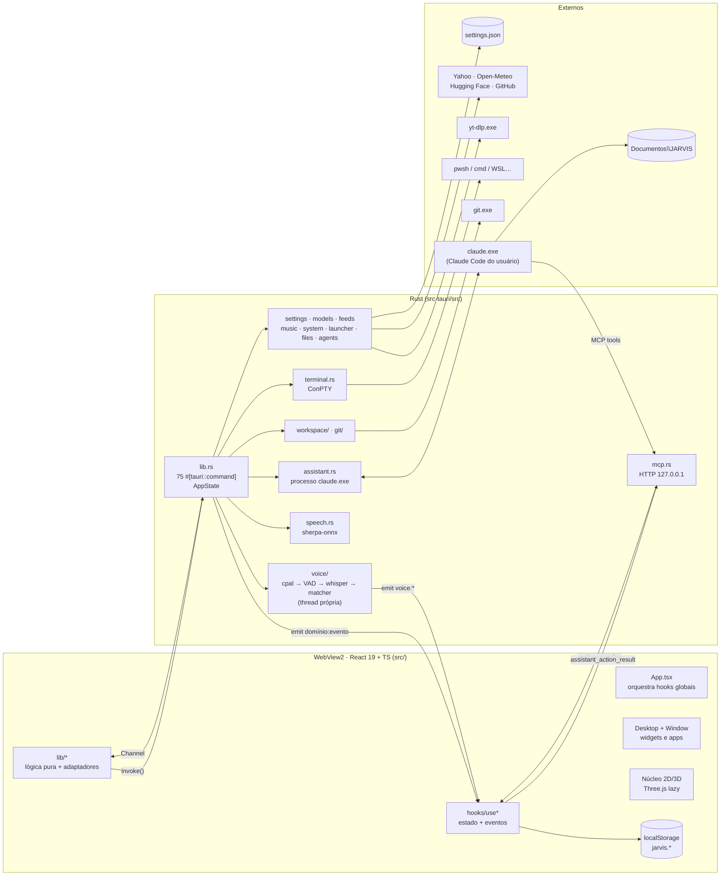

# Visão geral da arquitetura

O JARVIS OS é um app Tauri 2 de janela única, sem moldura, que cobre a tela. A WebView2 desenha tudo: núcleo, dock, barra e janelas internas. O Rust cuida de tudo que é nativo e dos processos externos.

## Camadas do frontend

| Pasta | Responsabilidade | Regra |
|---|---|---|
| `src/components/` | Componentes React. `desktop/widgets/` traz um arquivo por widget; `desktop/apps/<app>/` traz uma pasta por app, com `store.ts`, `types.ts` e `persist.ts` locais quando necessário | Sem `invoke` direto quando já existe adaptador em `lib/` |
| `src/hooks/` | `use*`: estado React, timers e assinatura de eventos Tauri | Um hook por assunto; os globais são montados uma vez em `App.tsx` |
| `src/lib/` | Lógica pura, tipos de domínio, parsers e **adaptadores de backend** (`tauriBackend` / fake de DEV / fallback) | Testável sem React; sem efeitos colaterais no import |
| `src/shaders/hologram/` | Materiais GLSL do núcleo 3D | Carregados só com o núcleo 3D |
| `src/styles/globals.css` | Tokens `@theme hud-*` e utilities (`crt-*`, `tui-*`, `superhot-*`) | Cores só por token |

`App.tsx` é o orquestrador. Ele monta os hooks que precisam viver com a janela fechada (pomodoro, lembretes, watchlist, player de música, voz, assistente, ações MCP) e despacha os atalhos de voz em `shortcutHandler`.

## Camadas do backend

| Módulo | Responsabilidade |
|---|---|
| `lib.rs` | Comandos, `AppState` (settings em `Arc<RwLock>`, e um `Arc`/`Mutex` por subsistema), constantes de evento, boot: escreve as ferramentas do jv_sh, sobe o MCP, restaura a voz, revela a janela com fallback de 2,5 s, encerra tudo ao sair |
| `voice/` | Motor de voz numa **thread própria** (`jarvis-voice`), que continua com a janela minimizada ([ADR-0003](adr/0003-motor-de-voz-thread-rust.md)) |
| `speech.rs`, `models.rs`, `download.rs` | Fala, catálogo Whisper, downloads verificados por SHA-256 |
| `assistant.rs`, `mcp.rs`, `agents.rs` | JARVIS: processo `claude.exe`, servidor MCP, rascunhos e instalação de agentes |
| `workspace/`, `git/`, `files.rs` | Arquivos do jv_ide e do Jarvis Mark; git do usuário |
| `terminal.rs`, `launcher.rs` | Shells em ConPTY; programas externos via `cmd /C start` |
| `feeds.rs`, `music.rs`, `system.rs` | HTTP para terceiros (a CSP bloqueia isso na WebView), yt-dlp, Win32 FFI |
| `settings.rs` | Esquema, sanitização e gravação atômica de `settings.json` |

## Fluxos principais

1. **Comando de voz.** cpal → VAD → whisper → `matcher.rs` → `Decision`.
   - Programas são abertos no próprio Rust.
   - O resto vira um evento `voice:*`, que um hook trata.
   - O texto não reconhecido vira `voice:shortcut{action:"ask"}` e vai para o JARVIS.

   Ver [voice-engine](../features/voice-engine/spec.md) e [voice-commands](../features/voice-commands/spec.md).
2. **Pergunta ao JARVIS.**
   - `assistant_ask` escreve uma linha stream-json no stdin do `claude.exe` já aquecido.
   - A resposta volta pelo Channel (`delta`, `tool`, `file`, `done`).
   - `JarvisReply` pagina o texto e o `speech.ts` sintetiza frase a frase.

   Ver [assistant](../features/assistant/spec.md) e [tts](../features/tts/spec.md).
3. **Ferramenta MCP.**
   - O `claude.exe` faz POST em `127.0.0.1:<porta>/mcp`.
   - `mcp.rs` emite `assistant:action`, e `useAssistantActions` executa na UI (abrir janela, gravar tarefa…).
   - A UI responde com `assistant_action_result`; o servidor espera até 20 s.

   Ver [assistant-tools](../features/assistant-tools/spec.md).
4. **Arquivo escrito pelo JARVIS.** Eventos `file{path, content}` do Channel → `src/lib/requests.ts`. A janela certa (Jarvis Mark para `Notas\`, jv_agent para `Agentes\`) abre e mostra a escrita ao vivo.

## Processos e portas

| Processo | Quem inicia | Ciclo de vida |
|---|---|---|
| `claude.exe` | `assistant.rs` | Pré-aquecido no início, um por app. Reinicia ao trocar o perfil. Morto com `taskkill /T /F` ao sair ou no `assistant_sleep` |
| Servidor MCP | `mcp.rs` (tiny_http) | Porta aleatória em `127.0.0.1` e token novo a cada início, gravados em `assistant\mcp.json` |
| Shells | `terminal.rs` | Um por aba do jv_sh ou do terminal do jv_ide. Fechados com a janela e ao sair |
| `git.exe`, `yt-dlp.exe` | `git/`, `music.rs` | Por chamada, com timeout |
| Vite :1420 | `npm run dev` / `dev:web` | Só em desenvolvimento. `scripts/tauri.mjs` reaproveita um Vite já aberto |

## Mapa das specs

- Comportamento: [features](../features/), [widgets](../widgets/), [apps](../apps/)
- Contratos: [ipc-contract](ipc-contract.md) · Dados: [persistence](../domain/persistence.md) · Termos: [glossary](../domain/glossary.md)
- Decisões: [ADRs](adr/README.md) · Regras: [constituição](constitution.md), [coding-style](coding-style.md), [testing](testing.md), [security](security.md), [build-and-env](build-and-env.md)
