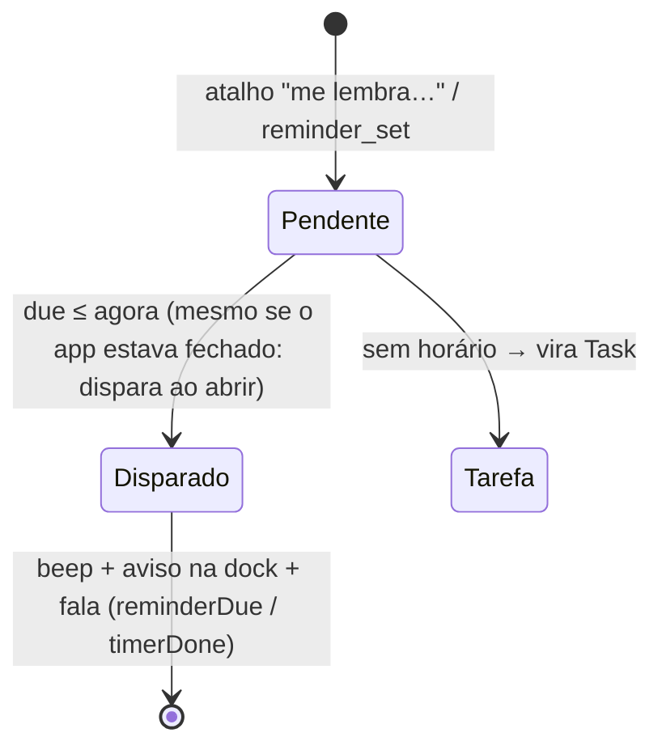
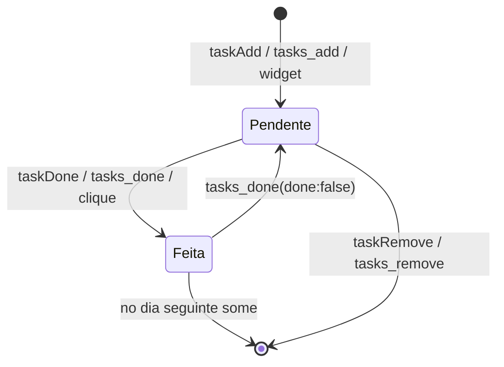
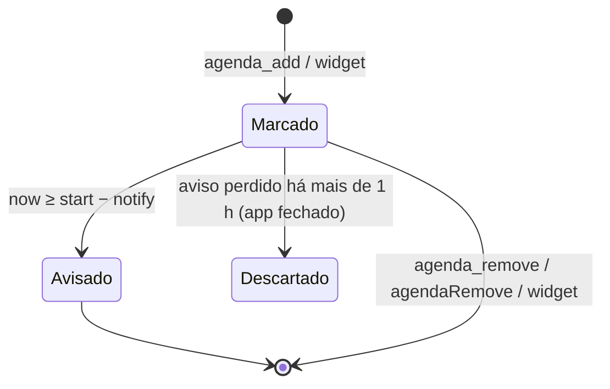
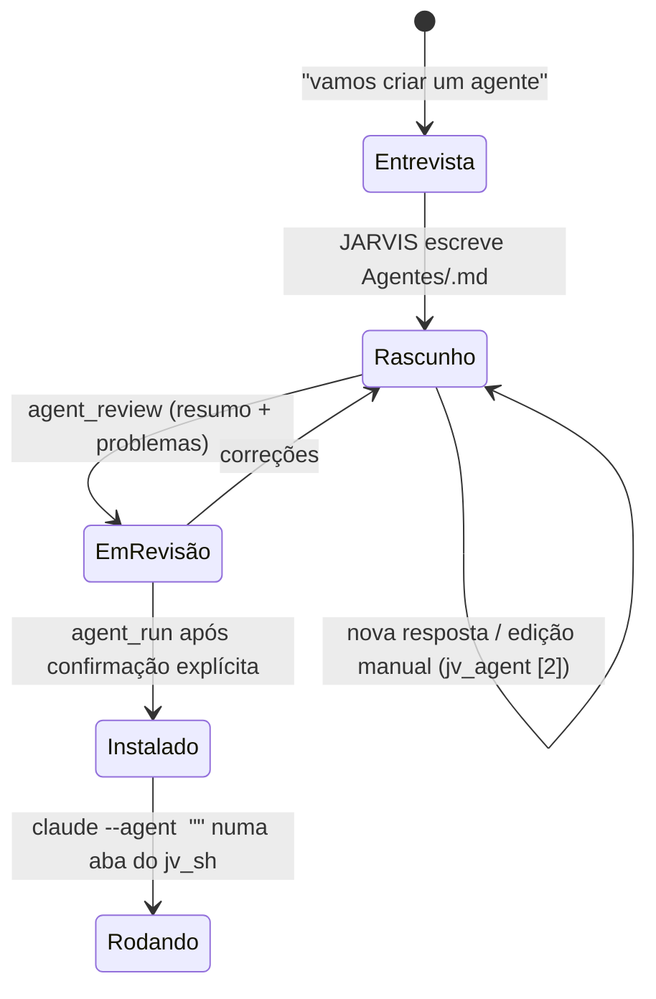
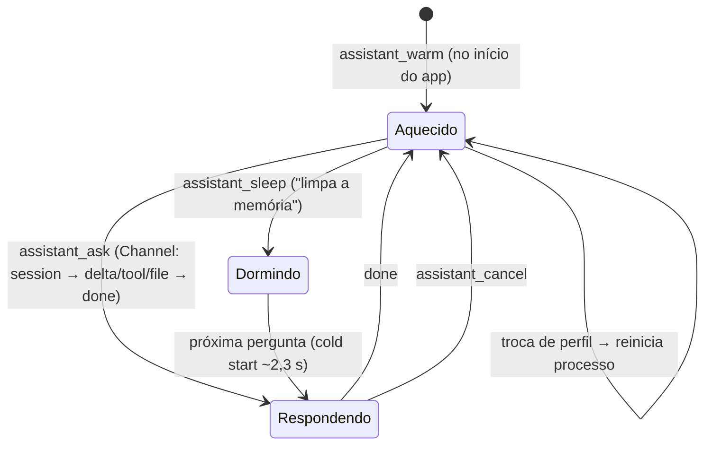

# Modelo de domínio

Este documento mostra como as entidades do [glossário](glossary.md) se relacionam. Os nomes seguem os tipos do código. Onde a forma foi simplificada, isso está indicado.

## Visão geral

```mermaid
classDiagram
  direction LR

  class Settings {
    voiceEnabled
    activation
    model
    assistantModel
    assistantName
    theme / accentHue
    taskbar
  }
  class AppEntry { id; name; keywords[≤12]; command; builtin }
  class VoiceCommand { id; kind; target; label; phrases[≤30]; builtin }
  Settings "1" o-- "*" AppEntry : apps
  Settings "1" o-- "*" VoiceCommand : voiceCommands

  class Desktop { order[]; geometry by kind; maximized; prefs }
  class WindowKind { <<enum>> 11 widgets + 6 apps }
  class WindowSpec { title; icon; size; min; group }
  Desktop "1" --> "0..17" WindowKind : abertas (uma por kind)
  WindowKind "1" -- "1" WindowSpec

  class Decision { <<union>> Launch | Window | CloseGroup | Music | Pomodoro | Shortcut | Ask }
  VoiceCommand ..> Decision : matcher.rs
  AppEntry ..> Decision : Launch
  Decision ..> WindowKind : Window
  Decision ..> ShortcutAction : Shortcut
  Decision ..> Ask : fallback

  class ShortcutAction { <<enum 18>> research; note; reminder; … homecoming }
  class Ask { text }

  class Assistant { session id; history[≤200]; profile }
  class Folder { Memória.md; Notas/; Agentes/ }
  class McpTool { <<18>> jvos_run; agenda_add; tasks_add; … }
  Ask --> Assistant
  ShortcutAction --> Assistant : "[Atalho: …]"
  Assistant --> Folder : lê/escreve (restrito)
  Assistant --> McpTool : chama

  class Reminder { text; due }
  class AgendaEvent { id; title; date; time?; notify }
  class Task { id (menor livre); text; done? }
  class Watchlist { symbols[≤20]; alerts[] }
  class PriceAlert { symbol; above?; below? }
  class Agent { name; description; tools; model; prompt }
  McpTool ..> Reminder : reminder_set
  McpTool ..> AgendaEvent : agenda_*
  McpTool ..> Task : tasks_*
  McpTool ..> Watchlist : stocks_watch / stocks_alert
  McpTool ..> WindowKind : jvos_run
  McpTool ..> Agent : agent_review / agent_run
  Watchlist "1" o-- "*" PriceAlert
  Folder "1" o-- "*" Agent : Agentes/<nome>.md
```

## Ciclos de vida

### Lembrete



### Tarefa



O número de uma tarefa é sempre o **menor inteiro livre**, para continuar fácil de falar ("conclui a tarefa dois").

### Compromisso



### Agente



### Pergunta ao JARVIS



## Invariantes

1. **Uma janela por `WindowKind`.** Abrir um kind já aberto só o traz para a frente.
2. **Built-ins de voz** nunca perdem a ação nem somem. Se o usuário apagar um, ele volta; editar, só as frases.
3. **Uma pergunta por vez** ao `claude.exe`. Uma segunda pergunta recebe "Ainda estou respondendo".
4. **A memória do JARVIS e a "limpeza de memória" não se misturam:** `Memória.md` não é a RAM.
5. **Compromisso tem dia ou hora; tarefa não tem.** A persona usa essa regra para escolher entre `agenda_add` e `tasks_add`.
6. **Um agente só roda depois de `agent_review` e de confirmação explícita,** e só como `claude --agent`.
