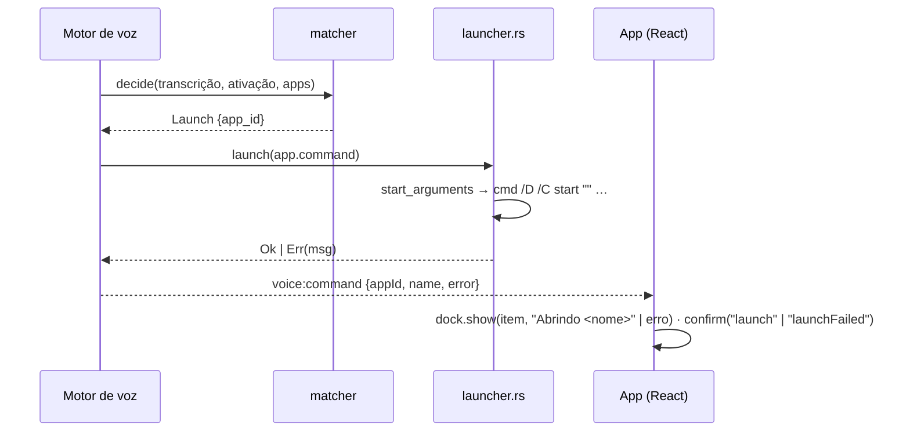

# Programas externos (lançador)

O JARVIS abre programas, sites, pastas e arquivos do Windows pela voz, pela dock, pela busca e pelas Configurações.

| | |
|---|---|
| **ID** | `feature/app-launcher` |
| **Status** | Implementado |
| **Origem** | `42e671a` (2026-10-23) · evoluída em `c4ccc57` e `750ebd0` (sites, pastas e arquivos) |
| **Voz** | palavras-chave de cada `AppEntry` (`Settings.apps[].keywords`). Não estão em `voice-commands.json` |

## Visão geral

Além das próprias janelas, o JARVIS abre coisas do Windows: programas, sites, pastas e arquivos. Cada item é um `AppEntry` com nome, palavras-chave e uma linha de comando. Ele abre:
- pela voz ("abre o navegador", "abre o vs code");
- pela dock (Browser, VS Code, Claude Code);
- pela busca (grupo "Programas");
- pelo botão "Testar" das Configurações;
- pelo JARVIS (`jvos_run`).

Quatro itens vêm de fábrica, ligados à dock: Browser, VS Code, Windows Terminal e Claude Code. O usuário pode acrescentar outros. O Rust executa sempre `cmd /D /C start "" <linha>` sem janela de console. Só ids configurados podem ser lançados, e nada vira linha de comando arbitrária vinda da voz.

## Dados

- `$programas`: `Settings.apps`, uma lista de **AppEntry** `{id, name, keywords, command, builtin}`, espelhada em TS e Rust. Fica em `settings.json` → `apps` (ou `jarvis.settings` no navegador), gravada com 450 ms de debounce. No `sanitize`, a dock é restaurada no topo, as duplicatas saem e `OLD_TERMINAL_KEYWORDS` vira `["windows terminal"]`. Ver [glossário](../../domain/glossary.md) e [settings](../../features/settings/spec.md).
- **CommandEvent** (`voice:command`): `{appId, name, error}`. Ver [contrato IPC](../../arch/ipc-contract.md).

## Componentes

### Seção "Programas e atalhos"

A lista de $programas nas Configurações, com os botões para acrescentar itens.

- **Comportamento:**
  - Mostre a dica "Quando uma palavra-chave é reconhecida, o comando é executado. Use o nome de um programa no PATH (`wt`, `code`), um caminho entre aspas (programa, pasta ou arquivo) ou uma URL. O JARVIS também abre todos eles."
  - "Adicionar programa" cria "Novo programa", com o comando vazio. "Adicionar site" cria "Novo site", com `https://`. Os dois são salvos com `builtin: false`.
  - **RF-007**: Ids de itens novos DEVEM seguir `app-<base36>-<4 chars>` (`createAppId`).
  - "Adicionar pasta" e "Adicionar arquivo" abrem o diálogo do Windows ("Pasta para abrir por voz", "Arquivo para abrir por voz"). O item ganha o nome da pasta (ou o do arquivo sem extensão), o comando com o caminho entre aspas e o nome em minúsculas como palavra-chave.
  - No navegador, "Adicionar pasta" e "Adicionar arquivo" ficam desabilitados, com a dica "Disponível no app desktop".
- **Layout:** a dica, a lista de [`AppRow`](#approw) e, embaixo, o grupo "Adicionar" com quatro botões lado a lado: "Programa", "Site", "Pasta" e "Arquivo", cada um com um ícone de `+`.
- **Estilo:**
  - Dica em `text-xs` `text-hud-text/60`; `wt` e `code` em `Mono` (`bg-hud-cyan/10`, mono de 11 px, `text-hud-light/90`).
  - Os botões ficam numa grade de 4 colunas, com borda tracejada `hud-cyan/25`, `rounded-xl`, 11 px maiúsculo em `text-hud-text/70`; no hover, borda `hud-cyan/50` e `text-hud-light`. Desabilitados, opacidade 40%.

### `AppRow`

Um cartão por item de $programas, para editar, testar e remover.

- **Comportamento:**
  - Um programa da dock (`builtin: true`) mostra o nome como texto, sem edição e sem "Remover". Os outros têm o campo "Nome do programa" e o botão "Remover <nome>".
  - As palavras-chave são um `ChipInput` ("Nova palavra-chave para <nome>", placeholder "Palavras-chave (Enter para adicionar)"): Enter ou vírgula adicionam, Backspace no campo vazio remove a última, e o × de um chip ("Remover palavra-chave <palavra>") a remove. Digitar ali nunca liga o microfone.
  - O campo "Comando" leva um selo que segue o comando (`shortcutKind`):
    - `http://` ou `https://` → "Site";
    - um caminho `X:\…` (entre aspas ou não) que termina em `.exe`, `.bat`, `.cmd`, `.com`, `.lnk` ou `.msc`, ou um comando sem caminho → "Programa";
    - um caminho com extensão → "Arquivo"; sem extensão → "Pasta".
  - "Escolher pasta para <nome>" e "Escolher arquivo para <nome>" trocam o comando pelo caminho escolhido, entre aspas. No navegador, ficam desabilitados.
  - "Testar <nome>" lança o item e mostra o resultado ("Abrindo…" ou o erro) por 2,6 s.
  - Se o comando estiver vazio, ou no navegador, então "Testar" fica desabilitado.
- **Layout:**
  - No topo, o ícone do item (globo para o Browser, `</>` para o VS Code, terminal, nuvem para o Claude Code, janela para os outros), o nome e os botões "Testar" e "Remover" à direita.
  - Embaixo, o `ChipInput` das palavras-chave.
  - Depois, o rótulo "Comando" com o selo ao lado e, numa linha, o campo do comando (placeholder "ex.: notepad, “C:\…\app.exe”, https://…") com os botões de pasta e de arquivo.
  - Por último, a linha do resultado do teste, quando houver.
- **Estilo:**
  - Cartão `rounded-xl` com borda `hud-cyan/12`, fundo `white/2` e `data-testid="app-<id>"`.
  - Ícone lucide de 16 px em `text-hud-light/80`. Nome fixo em `text-sm`; nome editável e comando em `hud-input`, o comando em mono `text-xs`.
  - Rótulo "Comando" em 10 px maiúsculo, `text-hud-text/45`. O selo (`shortcut-kind`) tem fundo `hud-cyan/10` e `text-hud-text/70`.
  - Os botões de ícone são `IconButton` de 28 px. O resultado fica em `text-xs`: `text-hud-light/80` para "Abrindo…" e `text-hud-alert/90` para um erro.

### Programas padrão e saneamento (`settings.rs`)

Os quatro itens de fábrica e as regras que o Rust aplica a $programas na leitura e na gravação.

- **Comportamento:**
  - **RF-004**: Os programas da dock DEVEM existir sempre, no topo e na ordem Browser, VS Code, Windows Terminal, Claude Code, com nome fixo e `builtin: true`.
  - **RF-005**: Os padrões DEVEM ser:
    - Browser: `https://www.google.com`, palavras "navegador", "browser", "internet";
    - VS Code: `Code.exe` ou `code`, palavras "vs code", "visual studio code", "editor de código";
    - Windows Terminal: `wt`, palavra "windows terminal";
    - Claude Code: `wt claude`, palavras "claude code", "claude", "cloud code".
  - **RF-006**: Palavras-chave DEVEM ser aparadas, sem vazias nem duplicadas (ignorando maiúsculas), até 12 por item. Id, nome, comando e palavras são cortados em 300 caracteres. Um item sem nome vira "Programa".
  - O comando padrão do VS Code prefere o `Code.exe` em `%LOCALAPPDATA%\Programs\Microsoft VS Code` ou em `%ProgramFiles%\Microsoft VS Code`, porque o shim `code` é um `.cmd` que pisca um console. Sem eles, fica `code`.
  - Se o Windows Terminal ainda tiver as palavras antigas intocadas ("terminal", "console", "prompt de comando"), então elas viram "windows terminal". Essas palavras agora abrem o jv_sh.

### Lançamento no Rust (`launcher.rs` e `launch_app`)

Monta a linha de `cmd` e cria o processo.

- **Comportamento:**
  - **RF-001**: `launch_app(id)` DEVE aceitar só ids presentes em `Settings.apps` e lançar o `command` deles.
  - **RF-002**: O lançamento DEVE ser `cmd /D /C start "" <linha>`, com `CREATE_NO_WINDOW`. O processo é destacado do app.
  - `start_arguments` valida a linha, põe aspas em URLs e checa caminhos antes de lançar.
  - Se o id não estiver configurado, então responda "Programa não configurado".
  - Se o comando estiver vazio, então responda "Nenhum comando configurado".
  - Se um caminho explícito (com `\`, `:` ou começando com `.`) não existir, então responda "Programa não encontrado: <caminho>".
  - Se a criação do processo falhar, então responda "Falha ao abrir: <erro>".
  - Se a URL tiver `&`, então ela vai entre aspas, para o `cmd` não tratar o `&` como separador.
  - Switches como `/B` começam com barra mas não são caminhos, e não passam pela checagem de existência.

### Dock e busca

Os caminhos de mouse e teclado até o lançamento.

- **Comportamento:**
  - Um clique em Browser, VS Code ou Claude Code na dock chama `launch_app` (`onDockSelect`), e o item mostra "Abrindo…" ou o erro.
  - Terminal na dock abre o jv_sh (dentro do JARVIS), não o Windows Terminal.
  - Cada item de $programas aparece na busca, no grupo "Programas", como "<nome>" / "Programa · <comando>" (ou "sem comando"), com as palavras-chave mais "abrir" e "programa". Enter o lança (`launchProgram`), como a tool `jvos_run` com `program:<id>`.
  - O aviso vai para o item do programa na dock quando ele é um dos lançáveis (`LAUNCHABLE`: `browser`, `vscode`, `claude`); senão, vai para Voice.
  - No navegador, nada é lançado: o item diz "Disponível no app desktop".

### Retorno na UI (`onCommand`)

O que o usuário vê e ouve depois de um lançamento por voz.

- **Comportamento:**
  - Ao receber `voice:command`, mostre na dock "Abrindo <nome>" (ou o erro) no item do programa ou em Voice, e o JARVIS confirma com uma fala de `launch`.
  - Se houver erro, então a dock mostra o erro e o JARVIS usa `launchFailed`.
  - Se o erro for `CANNOT_CLOSE`, então o JARVIS usa `cannotClose` ("Fechar programas pela voz ainda não é possível").

## Voz e teclado

- **RF-003**: A voz DEVE lançar no próprio Rust (`Decision::Launch`) e avisar a UI por `voice:command`. Pedir para fechar um programa vira `CannotClose`.
- **RF-008**: As palavras-chave DEVEM entrar no vocabulário de dica do Whisper (`command_vocabulary`).
- "[verbo de abrir] <palavra-chave>" (modo "Sempre ouvindo" ou segurar-para-falar; com "Hey Jarvis" no modo de ativação por voz): `Launch`.
  - O matcher tolera acentos e erros leves ("abrir o navegadô"), e a palavra-chave mais longa vence (`match_app`).
  - O mesmo comando ouvido duas vezes em menos de 4 s roda uma vez só (`RELAUNCH_COOLDOWN`).
- "[verbo de fechar] <palavra-chave>": `CannotClose`.
- `Enter` / `,` no campo de palavras; `Backspace` com o campo vazio: adiciona; remove a última.

## Restrições

- **RNF-001**: Nenhum texto vindo da voz ou do JARVIS vira comando: só a linha que o próprio usuário configurou roda.
- **RNF-002**: A janela de console nunca pisca ao lançar.
- Só ids configurados. Caminhos explícitos precisam existir. Repetição de voz em menos de 4 s é ignorada (`RELAUNCH_COOLDOWN`).

## Histórias de usuário

### US1 — Abrir um programa por voz (P1)

Digo "abre o navegador" e o navegador abre. O JARVIS confirma e a dock mostra o que aconteceu.

**Por que P1:** é o comando de voz original do produto.
**Teste independente:** Rust `src-tauri/src/voice/matcher.rs` — `matches_keywords_tolerantly`, `longest_keyword_wins`, `programs_win_their_longer_keywords_and_are_never_closed`, `app_names_that_start_with_the_wake_word`.

**Aceite**

1. **Dado** "abre o navegador por favor" (ou "abrir o navegadô"), **então** o matcher decide `Launch {app_id: "browser"}`.
2. **Dado** "abre o editor de código", **então** abre o VS Code, porque a palavra-chave mais longa vence o "código" do jv_ide.
3. **Dado** o lançamento, **então** o motor executa o comando e emite `voice:command {appId, name, error}`. A dock mostra "Abrindo <nome>" no item do programa (Browser, VS Code, Claude Code) ou em Voice, e o JARVIS confirma com uma fala de `launch`.
4. **Dado** um erro, **então** a dock mostra o erro e o JARVIS usa `launchFailed`.
5. **Dado** "fecha o vs code", **então** nada abre nem fecha: o JARVIS diz que "Fechar programas pela voz ainda não é possível" (`cannotClose`).
6. **Dado** o mesmo comando ouvido duas vezes em menos de 4 s, **então** ele roda uma vez só.

### US2 — Abrir pela dock e pela busca (P1)

Clico no ícone ou escolho na busca e o programa abre.

**Por que P1:** o caminho de mouse e teclado.
**Teste independente:** `tests/ui.spec.ts` — "dock hover, tooltip and click feedback" (modo navegador).

**Aceite**

1. **Dado** o app desktop, **quando** clico em VS Code na dock, **então** `launch_app {id: "vscode"}` roda e o item diz "Abrindo…" ou o erro.
2. **Dado** o navegador, **então** o item diz "Disponível no app desktop" e nenhuma aba abre.
3. **Dado** a busca, **então** cada programa aparece em "Programas" como "<nome>" / "Programa · <comando>" (ou "sem comando"), e Enter o lança.
4. **Dado** Terminal na dock, **então** abre o jv_sh (dentro do JARVIS), não o Windows Terminal.

### US3 — Configurar programas, sites, pastas e arquivos (P2)

Acrescento meus próprios atalhos e as palavras que os abrem.

**Por que P2:** estende a voz ao que o usuário usa.
**Teste independente:** `tests/settings.spec.ts` — "keywords can be added and removed per program", "custom programs can be added, edited and removed", "shortcuts: sites, folders and files open by voice like programs".

**Aceite**

1. **Dado** o Browser, **quando** digito "web" + Enter e "google," **então** as duas palavras viram chips. O × de "internet" remove essa palavra, e digitar "música" não liga o microfone. Ao recarregar, ficam `["navegador", "browser", "web", "google", "música"]`.
2. **Quando** clico "Adicionar programa", **então** surge "Novo programa", e posso editar nome, palavras e comando ("notepad"). Ele é salvo com `builtin: false`. "Remover <nome>" o apaga.
3. **Dado** um programa da dock, **então** não há "Remover", e o nome não é editável.
4. **Quando** clico "Adicionar site", **então** surge "Novo site" com `https://`, marcado como "Site". O selo segue o comando: `"C:\…\Documents"` → "Pasta", `"…\plano.pdf"` → "Arquivo", `"…\app.exe"` → "Programa".
5. **Dado** o navegador, **então** "Adicionar pasta", "Adicionar arquivo" e "Escolher pasta/arquivo para <nome>" ficam desabilitados ("Disponível no app desktop").
6. **Dado** o app desktop, **quando** escolho uma pasta ou um arquivo, **então** o item ganha o nome da pasta (ou o do arquivo sem extensão), o comando com o caminho entre aspas, e o nome em minúsculas como palavra-chave.
7. **Dado** "Testar <nome>", **então** o resultado ("Abrindo…" ou o erro) aparece por 2,6 s.

## Critérios de sucesso

- **SC-001**: Todo lançamento produz um retorno visível (aviso na dock) e, por voz, uma confirmação falada.
- **SC-002**: Um item com caminho inválido falha com mensagem clara, sem travar nada.
- **SC-003**: Os quatro programas da dock sobrevivem a qualquer edição ou arquivo corrompido.

## Fora de escopo e limitações

- Fechar programas externos não é suportado (`cannotClose`).
- O matcher de voz (normalização, palavra de ativação, modos) é de [voice-commands](../../features/voice-commands/spec.md). A segurança do lançamento está em [security](../../arch/security.md).
- O JARVIS lança programas pela tool `jvos_run` ([assistant-tools](../../features/assistant-tools/spec.md)).

## Código

Os programas são uma lista de `AppEntry` dentro de `Settings`, saneada pelo Rust. Lançar é uma função pura de montagem de argumentos (`start_arguments`: valida, põe aspas em URLs e checa caminhos) seguida de `Command::new("cmd").raw_arg(...)` com `CREATE_NO_WINDOW`. Dois caminhos chegam lá:
- a UI chama `launch_app(id)`, que procura o comando pelo id;
- o motor de voz, quando o matcher decide `Launch`, chama `launcher::launch` direto e emite `voice:command`.

A UI só mostra o retorno: aviso na dock e fala do JARVIS.

| | |
|---|---|
| **Camadas** | Rust (`launcher.rs`, `lib.rs::launch_app`, `voice/mod.rs`, `voice/matcher.rs`, `settings.rs`) · lib (`settings.ts`, `files.ts`) · UI (`SettingsPanel` → `AppRow`, `QuickDock`, `Spotlight`) · `App.tsx` (`launchApp`, `LAUNCHABLE`, `onCommand`) |
| **Dependências** | `std::process::Command`, `cmd.exe start`; plugin de diálogo para escolher pasta/arquivo (`pickFolder`, `pickAnyFile`) |
| **Testes** | `tests/settings.spec.ts` (3 testes), `tests/ui.spec.ts`; Rust em `launcher.rs`, `settings.rs` e `voice/matcher.rs` |
| **Plataforma** | Só Windows lança de fato. Fora do Tauri: "Disponível no app desktop", botões de pasta e arquivo desabilitados. Fora do Windows, o Rust compila sem `CREATE_NO_WINDOW` |

### Arquivos

| Arquivo | Papel |
|---|---|
| `src-tauri/src/launcher.rs` | `is_url`, `program_of`, `check_program`, `start_arguments`, `launch`, `CREATE_NO_WINDOW` |
| `src-tauri/src/lib.rs` | `launch_app(id)` → "Programa não configurado" ou `launcher::launch` |
| `src-tauri/src/voice/mod.rs` | `Decision::Launch` / `CannotClose` → `voice:command` (`CANNOT_CLOSE`) |
| `src-tauri/src/voice/matcher.rs` | `match_app` (palavra-chave mais longa), `wants_close`, `fire` (cooldown), `command_vocabulary` |
| `src-tauri/src/settings.rs` | `AppEntry`, `default_apps`, `vscode_command`, `MAX_KEYWORDS` = 12, `MAX_TEXT` = 300, `OLD_TERMINAL_KEYWORDS` |
| `src/lib/settings.ts` | `AppEntry`, `DEFAULT_SETTINGS.apps`, `createAppId` |
| `src/components/SettingsPanel.tsx` | Seção "Programas e atalhos": `AppRow` (nome, palavras, comando, selo `shortcutKind`, testar, remover, escolher pasta/arquivo) e "Adicionar programa/site/pasta/arquivo" |
| `src/App.tsx` | `launchApp`, `LAUNCHABLE` (`browser`, `vscode`, `claude`), `onCommand` (aviso + `launch`/`launchFailed`/`cannotClose`), `commandContext.launchProgram`, `onDockSelect` |
| `src/lib/commands.ts` | `program:<id>` no grupo "Programas" |

### Contratos

#### Comandos Tauri

| Comando | Entrada | Saída | Notas |
|---|---|---|---|
| `launch_app` | `{ id: string }` | `()` | Erros: "Programa não configurado", "Nenhum comando configurado", "Programa não encontrado: …", "Falha ao abrir: …" |

#### Eventos e Channels

| Nome | Payload | Emissor → consumidor |
|---|---|---|
| `voice:command` | `{ appId, name, error: string \| null }` | `voice/mod.rs` → `useVoiceAssistant.onCommand` → `App` |

#### Ferramentas MCP (JARVIS)

| Tool | O que faz |
|---|---|
| `jvos_run` | Pode executar `program:<id>`, que chama o mesmo `launchProgram` da busca |

### Fluxo

### Constituição

- [x] P2 Rust é dono do nativo — o processo é criado só no Rust. Não há plugin `shell`.
- [x] P3 Comandos finos — `launch_app` só busca o comando e chama `launcher::launch`.
- [x] P4 Contratos espelhados — `AppEntry` em `settings.ts` ↔ `settings.rs`. `CommandEvent` em camelCase.
- [x] P5 Persistência tolerante — `sanitize` restaura a dock, remove duplicatas, corta campos e migra `OLD_TERMINAL_KEYWORDS`.
- [x] P6 Funciona fora do Tauri — caminho 3, a mensagem "Disponível no app desktop".
- [x] P10 Segurança por confinamento — a voz e o JARVIS só escolhem um id. A linha executada é sempre a que o usuário configurou.
- [x] P11 Coberto por teste — montagem de argumentos, lançamento real (Windows), saneamento e matcher.

### Decisões relacionadas

- [ADR-0001 — Tauri 2 + Rust como shell desktop](../../arch/adr/0001-tauri-rust-desktop.md)
- [ADR-0009 — tipos espelhados TS ↔ Rust](../../arch/adr/0009-tipos-espelhados-ts-rust.md)
- [ADR-0010 — settings.json vs localStorage](../../arch/adr/0010-persistencia-settings-vs-localstorage.md)
- [ADR-0003 — motor de voz numa thread Rust](../../arch/adr/0003-motor-de-voz-thread-rust.md)

## Tarefas

Legenda: `[x]` feito · `[ ]` pendente · `[P]` pode rodar em paralelo (arquivos diferentes) · `[USn]` história desta spec. As tarefas foram reconstruídas do código e dos commits `42e671a`, `c4ccc57` e `750ebd0`.

### Fase 1 — Base

- [x] T001 `start_arguments`, `check_program`, `program_of` e `launch` com `CREATE_NO_WINDOW` — `src-tauri/src/launcher.rs`
- [x] T002 [P] `AppEntry`, `default_apps`, `vscode_command` e o saneamento de `apps` — `src-tauri/src/settings.rs`
- [x] T003 [P] `AppEntry`, programas padrão e `createAppId` no TS — `src/lib/settings.ts`
- [x] T004 Comando `launch_app` restrito a ids configurados — `src-tauri/src/lib.rs`

### Fase 2 — US1 Abrir por voz (P1)

- [x] T005 [US1] `match_app` tolerante (acentos, palavra mais longa) e `CannotClose` — `src-tauri/src/voice/matcher.rs`
- [x] T006 [US1] `Decision::Launch` executa no Rust e emite `voice:command` — `src-tauri/src/voice/mod.rs`
- [x] T007 [US1] `onCommand`: aviso na dock (item do programa ou Voice) e falas `launch`/`launchFailed`/`cannotClose` — `src/App.tsx`
- [x] T008 [P] [US1] Palavras-chave no vocabulário do Whisper — `src-tauri/src/voice/matcher.rs`

### Fase 3 — US2 Dock e busca (P1)

- [x] T009 [US2] `onDockSelect` com `launchApp` e "Disponível no app desktop" — `src/App.tsx`
- [x] T010 [P] [US2] Grupo "Programas" (`program:<id>`) — `src/lib/commands.ts`
- [x] T011 [US2] Terminal da dock abre o jv_sh, e as palavras antigas do Windows Terminal migram (`OLD_TERMINAL_KEYWORDS`) — `src/App.tsx`, `src-tauri/src/settings.rs`

### Fase 4 — US3 Configurar (P2)

- [x] T012 [US3] `AppRow`: nome, `ChipInput` de palavras, comando, testar, remover — `src/components/SettingsPanel.tsx`
- [x] T013 [US3] "Adicionar programa/site/pasta/arquivo" e selo `shortcutKind` — `src/components/SettingsPanel.tsx` (`750ebd0`)
- [x] T014 [P] [US3] `ChipInput` (`Enter`/`,` adicionam, `Backspace` remove) — `src/components/hud.tsx`

### Fase 5 — Testes

- [x] T015 Playwright `tests/settings.spec.ts` — "keywords can be added and removed per program"
- [x] T016 Playwright `tests/settings.spec.ts` — "custom programs can be added, edited and removed"
- [x] T017 Playwright `tests/settings.spec.ts` — "shortcuts: sites, folders and files open by voice like programs"
- [x] T018 Playwright `tests/ui.spec.ts` — "dock hover, tooltip and click feedback"
- [x] T019 Rust `src-tauri/src/launcher.rs` — `extracts_the_program`, `builds_start_arguments`, `launches_a_real_command` (Windows)
- [x] T020 Rust `src-tauri/src/settings.rs` — `sanitize_cleans_keywords_and_restores_dock_apps`, `the_terminal_program_hands_its_old_words_to_jv_sh`, `jarvis_code_moves_to_the_ide` (VS Code mantém "editor de código")
- [x] T021 Rust `src-tauri/src/voice/matcher.rs` — `matches_keywords_tolerantly`, `longest_keyword_wins`, `programs_win_their_longer_keywords_and_are_never_closed`, `app_names_that_start_with_the_wake_word`, `push_to_talk_needs_no_wake_word`, `always_mode_and_cooldown`

## Pendências

- [ ] Fechar programas externos por voz não está implementado: `CANNOT_CLOSE` em `src-tauri/src/voice/mod.rs` diz "ainda não é possível".
- [ ] Nenhum teste Playwright cobre o lançamento bem-sucedido nem o evento `voice:command`: no modo web só aparece "Disponível no app desktop".
