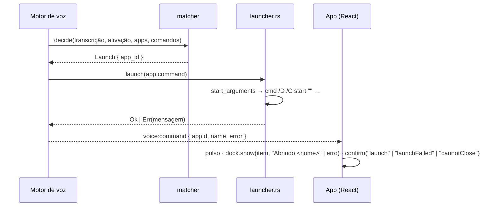

# Feature Specification: App Launcher

## Metadata

| Field | Value |
|---|---|
| Feature ID | `feature/app-launcher` |
| Product | JARVIS OS (jvOS) |
| Feature Status | Implementado |
| Document Status | Reescrita em 2026-11-05 no formato Feature Specification; uma decisão de produto em [Open Questions](#open-questions) |
| Source Commit | `42e671a` (2026-10-23); evoluída em `c4ccc57` e `750ebd0` (sites, pastas e arquivos); conferida no código de `e7151cf` (2026-11-05) |
| Uncommitted Changes | Nenhuma |
| Voice Shortcut | Nenhum no catálogo `voice-commands.json`: as palavras-chave de cada `AppEntry` (`Settings.apps[].keywords`) decidem `Decision::Launch` |
| Assistant Tool | `jvos_run` com `program:<id>` |
| Target Platforms | Windows 11 com WebView2. Só o app desktop lança. No navegador (modo web), a dock e a busca dizem "Disponível no app desktop" e os diálogos de pasta e arquivo ficam desabilitados. Fora do Windows, o Rust compila sem `CREATE_NO_WINDOW` |
| Language | PT-BR no conteúdo e nas falas; inglês nos títulos das seções e em Given / When / Then |
| Last Editorial Revision | 2026-11-05 |
| Verification Scope | Conferida com o código em 2026-11-05: `src-tauri/src/launcher.rs`, `src-tauri/src/lib.rs` (`launch_app`), `src-tauri/src/voice/mod.rs` (`Decision::Launch`, `CannotClose`, `CommandEvent`), `src-tauri/src/voice/matcher.rs`, `src-tauri/src/settings.rs`, `src/lib/settings.ts`, `src/components/SettingsPanel.tsx` (`AppRow`, `shortcutKind`), `src/components/hud.tsx` (`ChipInput`), `src/components/desktop/VoiceTab.tsx` (seção "Programas"), `src/components/QuickDock.tsx`, `src/App.tsx` (`launchApp`, `LAUNCHABLE`, `onCommand`, `onDockSelect`, `launchProgram`), `src/lib/commands.ts`, `src/lib/files.ts`, `src/lib/jarvisLines.ts`, `src/hooks/useAssistantActions.ts` (`jvos_run`), `src/hooks/useVoiceAssistant.ts`, `tests/settings.spec.ts`, `tests/ui.spec.ts` e `tests/shell.spec.ts`. Os testes não foram executados nesta revisão |

Especificação no formato inspirado no GitHub Spec Kit, com seções de desenho técnico ([ADR-0025](../../arch/adr/0025-features-formato-feature-specification.md)). Os identificadores US1–US3, RF-001–RF-008, RNF-001–RNF-002, SC-001–SC-003 e T001–T021 são os mesmos da versão anterior. Os critérios de aceite AC-001–AC-017 são os antigos "Critério 1" a "Critério 17", na mesma ordem. KL-* registra limitações conhecidas; OQ-*, decisões de produto em aberto. Nenhum dos dois acrescenta escopo.

## Overview

Além das próprias janelas, o JARVIS abre coisas do Windows: programas, sites, pastas e arquivos. Cada item é um `AppEntry`, com nome, palavras-chave e uma linha de comando. Quatro vêm de fábrica, ligados à dock: Browser, VS Code, Windows Terminal e Claude Code. O usuário acrescenta os outros nas Configurações.

| Input | Expected Behavior | Execution Path |
|---|---|---|
| "Abre o navegador" | O navegador padrão abre no Google; a dock mostra "Abrindo Browser" e o JARVIS confirma | Rust: matcher → `launcher::launch` → `voice:command` |
| Clique em VS Code na dock | O VS Code abre; o item diz "Abrindo…" ou o erro | UI → `launch_app` (Rust) |
| "notepad" na busca (`/`) e Enter | O item lança; o aviso vai para o item Voice | Busca → `launchProgram` → `launch_app` |
| "Testar Bloco de notas" nas Configurações | "Abrindo…" ou o erro, por 2,6 s | `launch_app` |
| JARVIS chama `jvos_run { id: "program:vscode" }` | O VS Code abre e a ferramenta responde "Feito: VS Code" | MCP → `useAssistantActions` → `launchProgram` |
| "Fecha o VS Code" | Nada abre nem fecha; a dock e o JARVIS dizem que ainda não é possível | Rust: `Decision::CannotClose` |

O Rust executa sempre `cmd /D /C start "" <linha>`, sem janela de console. Só ids configurados podem ser lançados, e nenhum texto da voz ou do JARVIS vira linha de comando.

## Goals and Success Criteria

### Goals

- Abrir programas, sites, pastas e arquivos pela voz, pela dock, pela busca, pelas Configurações e pelo JARVIS.
- Rodar só a linha que o usuário configurou.
- Não piscar janela de console ao lançar.
- Dar um retorno visível a cada lançamento.
- Manter os quatro programas da dock com qualquer edição ou arquivo corrompido.

### Success Criteria

| ID | Criterion | Verification |
|---|---|---|
| SC-001 | Todo lançamento produz um retorno visível (aviso na dock) e, por voz, uma confirmação falada. | `onCommand` mostra "Abrindo <nome>" ou o erro na dock e chama `launch`, `launchFailed` ou `cannotClose`. Pelo JARVIS (`jvos_run`) a fala não reflete uma falha (KL-004). |
| SC-002 | Um item com caminho inválido falha com mensagem clara, sem travar nada. | `builds_start_arguments` recusa `"C:\definitely\missing\app.exe"`; `launch_app` devolve "Programa não encontrado: <caminho>". |
| SC-003 | Os quatro programas da dock sobrevivem a qualquer edição ou arquivo corrompido. | `sanitize_cleans_keywords_and_restores_dock_apps` apaga o Windows Terminal e o vê voltar; `settings::load` cai no padrão com o arquivo corrompido. |

## Scope and Non-Goals

### In Scope

- Os quatro programas de fábrica e os itens do usuário: programas, sites, pastas e arquivos.
- A seção "Programas e atalhos" das Configurações (`AppRow` e os botões "Adicionar").
- As palavras-chave também na aba Voz do Menu avançado (seção "Programas").
- O lançamento no Rust (`launcher.rs`, `launch_app`).
- O lançamento por voz (`Decision::Launch`) e a recusa de fechar (`Decision::CannotClose`).
- Os itens Browser, VS Code e Claude Code da dock, o grupo "Programas" da busca e `program:<id>` no `jvos_run`.

### Out of Scope

- Fechar programas externos (`cannotClose`; ver OQ-001).
- O matcher de voz em geral (normalização, palavra de ativação, modos): [voice-commands](../voice-commands/spec.md). A segurança do lançamento: [security](../../arch/security.md).
- O servidor de ferramentas do JARVIS: [assistant-tools](../assistant-tools/spec.md).
- O Terminal da dock, que abre o [jv_sh](../../apps/jv_sh/spec.md) dentro do JARVIS.

## User Stories

### US1 — Open a Program by Voice

**Priority:** P1.

**User Story:** Como usuário, digo "abre o navegador" e o navegador abre. O JARVIS confirma, e a dock mostra o que aconteceu.

**Why This Priority:** é o comando de voz original do produto.

**Independent Test:** `src-tauri/src/voice/matcher.rs` — `matches_keywords_tolerantly`, `longest_keyword_wins`, `programs_win_their_longer_keywords_and_are_never_closed` e `app_names_that_start_with_the_wake_word`.

**Acceptance Criteria:** AC-001, AC-002, AC-003, AC-004, AC-005 e AC-006.

### US2 — Open From the Dock and the Search

**Priority:** P1.

**User Story:** Como usuário, clico no ícone ou escolho na busca, e o programa abre.

**Why This Priority:** é o caminho de mouse e teclado.

**Independent Test:** `tests/ui.spec.ts` — "dock hover, tooltip and click feedback" (modo navegador).

**Acceptance Criteria:** AC-007, AC-008, AC-009 e AC-010.

### US3 — Configure Programs, Sites, Folders and Files

**Priority:** P2.

**User Story:** Como usuário, acrescento meus próprios atalhos e as palavras que os abrem.

**Why This Priority:** estende a voz ao que o usuário usa.

**Independent Test:** `tests/settings.spec.ts` — "keywords can be added and removed per program", "custom programs can be added, edited and removed" e "shortcuts: sites, folders and files open by voice like programs".

**Acceptance Criteria:** AC-011, AC-012, AC-013, AC-014, AC-015, AC-016 e AC-017.

## Requirements

### Functional Requirements

| ID | Requirement | Related Stories |
|---|---|---|
| RF-001 | `launch_app(id)` DEVE aceitar só ids presentes em `Settings.apps` e lançar o `command` deles. | US2, US3 |
| RF-002 | O lançamento DEVE ser `cmd /D /C start "" <linha>`, com `CREATE_NO_WINDOW`; o processo fica destacado do app. | US1, US2, US3 |
| RF-003 | A voz DEVE lançar no próprio Rust (`Decision::Launch`) e avisar a UI por `voice:command`. Pedir para fechar um programa DEVE virar `CannotClose`. | US1 |
| RF-004 | Os programas da dock DEVEM existir sempre, no topo e na ordem Browser, VS Code, Windows Terminal, Claude Code, com nome fixo e `builtin: true`. | US2, US3 |
| RF-005 | Os padrões DEVEM ser: Browser `https://www.google.com` ("navegador", "browser", "internet"); VS Code `Code.exe` entre aspas ou `code` ("vs code", "visual studio code", "editor de código"); Windows Terminal `wt` ("windows terminal"); Claude Code `wt claude` ("claude code", "claude", "cloud code"). | US1, US2 |
| RF-006 | Palavras-chave DEVEM ser aparadas, sem vazias nem duplicadas (ignorando maiúsculas), até 12 por item. Id, nome, comando e palavras são cortados em 300 caracteres. Um item sem nome vira "Programa". | US3 |
| RF-007 | Ids de itens novos DEVEM seguir `app-<base36>-<4 chars>` (`createAppId`). | US3 |
| RF-008 | As palavras-chave DEVEM entrar no vocabulário de dica do Whisper (`command_vocabulary`). | US1 |

### Non-Functional Requirements

| ID | Requirement | Scope |
|---|---|---|
| RNF-001 | Nenhum texto vindo da voz ou do JARVIS vira comando: só a linha que o próprio usuário configurou roda. | Voz, dock, busca, Configurações e `jvos_run` |
| RNF-002 | A janela de console nunca pisca ao lançar. | O `cmd` do lançamento roda com `CREATE_NO_WINDOW`; um programa de console lançado abre a própria janela (KL-006) |

### Operational Constraints

- Só ids configurados (`Settings.apps`).
- Caminhos explícitos (com `\`, `:` ou começando com `.`) precisam existir.
- O mesmo comando de voz em menos de 4 s roda uma vez só (`RELAUNCH_COOLDOWN`).
- Até 12 palavras-chave por item (`MAX_KEYWORDS`) e 300 caracteres por campo (`MAX_TEXT`).
- O resultado de "Testar" fica 2,6 s na tela.
- O `Settings.apps` do Rust só muda no `save_settings`, 450 ms depois da última edição ([settings](../settings/spec.md)).

## Acceptance Criteria

### AC-001 — Match a Program Keyword

**Related Story:** US1.

- **Given** os programas padrão
- **When** o matcher recebe "abre o navegador por favor" (ou "abrir o navegadô")
- **Then** o programa escolhido é `browser`, e a decisão é `Launch { app_id: "browser" }`.

### AC-002 — The Longest Keyword Wins

**Related Story:** US1.

- **Given** "editor de código" (VS Code) e "código" (jv_ide)
- **When** o usuário diz "abre o editor de código"
- **Then** a decisão é `Launch { app_id: "vscode" }`, porque a palavra-chave mais longa vence.

### AC-003 — Confirm a Voice Launch

**Related Story:** US1.

- **Given** uma decisão `Launch`
- **When** o motor executa o comando
- **Then** ele emite `voice:command { appId, name, error: null }`; o holograma pulsa, a dock mostra "Abrindo <nome>" no item do programa (Browser, VS Code, Claude Code) ou em Voice, e o JARVIS diz uma fala `launch` (ex.: "Pois não. Abrindo VS Code.").

**Coverage Status:** o lançamento real é testado em Rust; o retorno na UI não tem teste (KL-002).

### AC-004 — Report a Launch Failure

**Related Story:** US1.

- **Given** um comando que falha (ex.: "Programa não encontrado: <caminho>")
- **When** o motor tenta lançar
- **Then** a dock mostra o erro, como erro, e o JARVIS diz uma fala `launchFailed` (ex.: "Receio que <nome> se recusou a abrir. Os detalhes estão no dock.").

**Coverage Status:** a mensagem é testada em Rust; o retorno na UI não tem teste (KL-002).

### AC-005 — Refuse to Close a Program

**Related Story:** US1.

- **Given** o VS Code configurado
- **When** o usuário diz "fecha o vs code"
- **Then** nada abre nem fecha: a decisão é `CannotClose`, a dock mostra "Fechar programas pela voz ainda não é possível" como erro, e o JARVIS diz uma fala `cannotClose`.

### AC-006 — Ignore a Repeated Command

**Related Story:** US1.

- **Given** "abre o navegador" acabou de lançar o Browser
- **When** "navegador" é ouvido de novo em menos de 4 s
- **Then** a decisão é `Ignore`. Depois de 4 s, o mesmo comando lança de novo.

### AC-007 — Launch From the Dock

**Related Story:** US2.

- **Given** o app desktop
- **When** o usuário clica em VS Code na dock
- **Then** `launch_app { id: "vscode" }` roda e o item diz "Abrindo…" ou o erro.

**Coverage Status:** sem teste automatizado (KL-002).

### AC-008 — Dock in the Browser

**Related Story:** US2.

- **Given** o navegador (modo web)
- **When** o usuário clica em VS Code na dock
- **Then** o item diz "Disponível no app desktop" e nenhuma aba nova abre.

### AC-009 — Programs in the Search

**Related Story:** US2.

- **Given** a busca aberta
- **When** o usuário digita uma palavra-chave de um item
- **Then** ele aparece no grupo "Programas" como "<nome>" e "Programa · <comando>" (ou "sem comando"), e Enter o lança.

**Coverage Status:** sem teste automatizado (KL-002).

### AC-010 — The Dock's Terminal Opens jv_sh

**Related Story:** US2.

- **Given** a dock
- **When** o usuário clica em Terminal
- **Then** abre o jv_sh, dentro do JARVIS, e não o Windows Terminal.

### AC-011 — Edit Keywords

**Related Story:** US3.

- **Given** o Browser nas Configurações
- **When** o usuário digita "web" + Enter, "google," e remove "internet" pelo ×; depois digita "música" + Enter
- **Then** "web" e "google" viram chips, "internet" some, digitar "m" não liga o microfone, e ao recarregar ficam `["navegador", "browser", "web", "google", "música"]`.

### AC-012 — Add, Edit and Remove a Program

**Related Story:** US3.

- **Given** a seção "Programas e atalhos"
- **When** o usuário clica "Adicionar programa", edita nome, palavras e comando ("notepad") e depois clica "Remover Bloco de notas"
- **Then** o item "Novo programa" surge, é salvo com `builtin: false` e some ao ser removido.

### AC-013 — Dock Programs Are Fixed

**Related Story:** US3.

- **Given** um programa da dock
- **When** a seção é exibida
- **Then** não há "Remover <nome>", e o nome é texto, não campo.

### AC-014 — Add a Site and Read the Kind Badge

**Related Story:** US3.

- **Given** a seção "Programas e atalhos"
- **When** o usuário clica "Adicionar site" e troca o comando
- **Then** surge "Novo site" com `https://`, marcado "Site". O selo segue o comando: `"C:\Users\builder\Documents"` → "Pasta", `"…\plano.pdf"` → "Arquivo", `"C:\Program Files\App\app.exe"` → "Programa".

### AC-015 — File Pickers in the Browser

**Related Story:** US3.

- **Given** o navegador (modo web)
- **When** a seção é exibida
- **Then** "Adicionar pasta", "Adicionar arquivo" e "Escolher pasta para <nome>" ficam desabilitados. Os dois primeiros têm a dica "Disponível no app desktop".

### AC-016 — Add a Folder or a File

**Related Story:** US3.

- **Given** o app desktop
- **When** o usuário escolhe uma pasta ou um arquivo no diálogo do Windows
- **Then** o item novo ganha o nome da pasta (ou o do arquivo sem extensão), o comando com o caminho entre aspas e o nome em minúsculas como palavra-chave.

**Coverage Status:** sem teste automatizado (KL-002).

### AC-017 — Test a Program

**Related Story:** US3.

- **Given** um item com comando, no app desktop
- **When** o usuário clica "Testar <nome>"
- **Then** o resultado ("Abrindo…" ou o erro) aparece no cartão por 2,6 s.

**Coverage Status:** sem teste automatizado (KL-002).

## Behavior and Flows

### Section "Programas e atalhos"

A lista de `$programas` nas Configurações, com os botões para acrescentar itens.

- **Behavior:**
  - A dica diz "Quando uma palavra-chave é reconhecida, o comando é executado. Use o nome de um programa no PATH (`wt`, `code`), um caminho entre aspas (programa, pasta ou arquivo) ou uma URL. O JARVIS também abre todos eles.".
  - "Adicionar programa" cria "Novo programa", com o comando vazio. "Adicionar site" cria "Novo site", com `https://`. Os dois são salvos com `builtin: false` e um id de `createAppId` (RF-007).
  - "Adicionar pasta" e "Adicionar arquivo" abrem o diálogo do Windows ("Pasta para abrir por voz", "Arquivo para abrir por voz"). O item ganha o nome da pasta (ou o do arquivo sem extensão), o comando com o caminho entre aspas e o nome em minúsculas como palavra-chave. Cancelar o diálogo não cria nada.
  - No navegador, "Adicionar pasta" e "Adicionar arquivo" ficam desabilitados, com a dica "Disponível no app desktop".
- **Layout:** a dica, a lista de [`AppRow`](#approw) e, embaixo, o grupo "Adicionar" com quatro botões lado a lado: "Programa", "Site", "Pasta" e "Arquivo" (nomes acessíveis "Adicionar programa", "Adicionar site", "Adicionar pasta", "Adicionar arquivo"), cada um com um ícone de `+`.
- **Style:**
  - Dica em `text-xs` `text-hud-text/60`; `wt` e `code` em `Mono` (`bg-hud-cyan/10`, mono de 11 px, `text-hud-light/90`).
  - Os botões ficam numa grade de 4 colunas, com borda tracejada `hud-cyan/25`, `rounded-xl`, 11 px maiúsculo em `text-hud-text/70`; no hover, borda `hud-cyan/50` e `text-hud-light`. Desabilitados, opacidade 40%.

### `AppRow`

Um cartão por item de `$programas`, para editar, testar e remover.

- **Behavior:**
  - Um programa da dock (`builtin: true`) mostra o nome como texto, sem edição e sem "Remover". Os outros têm o campo "Nome do programa" e o botão "Remover <nome>".
  - As palavras-chave são um `ChipInput` ("Nova palavra-chave para <nome>", placeholder "Palavras-chave (Enter para adicionar)"): Enter ou vírgula adicionam, Backspace no campo vazio remove a última, sair do campo também adiciona, e o × de um chip ("Remover palavra-chave <palavra>") a remove. Digitar ali nunca liga o microfone.
  - O rótulo "Comando" leva um selo que segue o comando (`shortcutKind`):
    - começa com `http://` ou `https://` → "Site";
    - não é um caminho `X:\…` (entre aspas ou sem espaços), ou termina em `.exe`, `.bat`, `.cmd`, `.com`, `.lnk` ou `.msc` → "Programa";
    - um caminho com extensão de 1 a 8 letras ou dígitos → "Arquivo"; sem extensão → "Pasta".
  - "Escolher pasta para <nome>" e "Escolher arquivo para <nome>" trocam o comando pelo caminho escolhido, entre aspas. No navegador, ficam desabilitados.
  - "Testar <nome>" chama `launch_app` e mostra "Abrindo…" ou o erro por 2,6 s.
  - Com o comando vazio (ou só espaços), ou no navegador, "Testar" fica desabilitado.
- **Layout:**
  - No topo: o ícone do item (globo para o Browser, `</>` para o VS Code, terminal para o Windows Terminal, nuvem para o Claude Code, janela para os outros), o nome e os botões "Testar" e "Remover" à direita.
  - Embaixo, o `ChipInput` das palavras-chave.
  - Depois, o rótulo "Comando" com o selo ao lado e, numa linha, o campo do comando (placeholder "ex.: notepad, “C:\…\app.exe”, https://…") com os botões de pasta e de arquivo.
  - Por último, a linha do resultado do teste, quando houver (`role="status"`).
- **Style:**
  - Cartão `rounded-xl` com borda `hud-cyan/12`, fundo `white/2` e `data-testid="app-<id>"`.
  - Ícone lucide de 16 px em `text-hud-light/80`. Nome fixo em `text-sm`; nome editável e comando em `hud-input`, o comando em mono `text-xs`.
  - Rótulo "Comando" em 10 px maiúsculo, `text-hud-text/45`. O selo (`data-testid="shortcut-kind"`) tem fundo `hud-cyan/10` e `text-hud-text/70`.
  - Os botões de ícone são `IconButton` de 28 px. O resultado fica em `text-xs`: `text-hud-light/80` para "Abrindo…" e `text-hud-alert/90` para um erro.

### Voz Tab, Section "Programas"

O Menu avançado › Voz repete as palavras-chave de cada item, para editar junto com as outras frases de voz.

- **Behavior:** a nota diz "Abrem pelo nome (“abre o terminal”); as mesmas palavras-chave das Configurações.". Cada item tem um `ChipInput` ("Nova frase para <nome>", "Remover frase “<palavra>” de <nome>", placeholder "Sem palavras-chave") que grava o mesmo `Settings.apps[].keywords`.
- **Layout:** uma linha por item, com o nome à esquerda. O resto da aba é do [voice-commands](../voice-commands/spec.md).

### Default Programs and Sanitization (`settings.rs`)

- **Behavior:**
  - Os programas da dock existem sempre, no topo e na ordem Browser, VS Code, Windows Terminal, Claude Code, com nome fixo e `builtin: true` (RF-004). `builtin` vem do id, não do que a UI manda.
  - O comando padrão do VS Code é o `Code.exe` em `%LOCALAPPDATA%\Programs\Microsoft VS Code` ou em `%ProgramFiles%\Microsoft VS Code`, entre aspas, porque o atalho `code` é um `.cmd` que pisca um console. Sem eles, fica `code` (KL-006). No navegador, o padrão é sempre `code`.
  - Se o Windows Terminal ainda tiver as palavras antigas intocadas ("terminal", "console", "prompt de comando"), elas viram "windows terminal". "terminal" agora abre o jv_sh.
  - As demais regras estão em [Sanitization Rules](#sanitization-rules).

### Launch (`launcher.rs` and `launch_app`)

- **Behavior:**
  - `launch_app(id)` procura o id em `Settings.apps`; fora dele, responde "Programa não configurado" (RF-001).
  - `start_arguments` monta a linha; `launch` cria `cmd` com `raw_arg` e `CREATE_NO_WINDOW` e não espera o processo (RF-002). O algoritmo está em [Launch Algorithm](#launch-algorithm).

### Voice Matching

- **Behavior:**
  - A palavra-chave basta; o verbo de abrir é opcional. "[verbo de fechar] <palavra-chave>" vira `CannotClose` (o verbo mais próximo antes da palavra decide; senão, um depois dela).
  - O matcher tolera acentos, pontuação e uma letra errada em palavras de 5 letras ou mais ("navegadô"), e junta palavras ("vscode" casa "vs code").
  - A palavra-chave mais longa vence, entre programas, janelas e grupos; no empate, a que vem antes. "abre o terminal" abre o jv_sh; "abre o windows terminal" lança o Windows Terminal.
  - Modos: "Segurar para falar" e "Sempre ouvindo" lançam sem a palavra de ativação; "Hey Jarvis" exige "Jarvis" na frase ou a janela de 8 s depois dela.
  - Com a palavra de ativação (ou segurando o botão), uma frase de 4 palavras ou mais que cita um programa sem verbo de abrir ou fechar vai para o JARVIS como pergunta.
  - O mesmo `Launch` em menos de 4 s é ignorado (`RELAUNCH_COOLDOWN`). `CannotClose` não passa pelo cooldown.
  - As palavras-chave entram no vocabulário de dica do Whisper (`command_vocabulary`, RF-008).

### Dock and Search

- **Behavior:**
  - Um clique em Browser, VS Code ou Claude Code na dock chama `launch_app` (`onDockSelect`), e o item mostra "Abrindo…" ou o erro.
  - Terminal na dock abre o jv_sh (`workspace.open("shell")`), não o Windows Terminal.
  - Cada item de `$programas` aparece na busca, no grupo "Programas", com o título "<nome>", o subtítulo "Programa · <comando>" (ou "sem comando") e as palavras-chave mais "abrir" e "programa". Enter chama `launchProgram`, o mesmo de `jvos_run` com `program:<id>`.
  - O aviso vai para o item do programa na dock quando ele é lançável (`LAUNCHABLE`: `browser`, `vscode`, `claude`); senão, para Voice.
  - No navegador, nada é lançado: o item diz "Disponível no app desktop".

### Interaction Flow



### User Feedback

| Moment | Persona Key | Output |
|---|---|---|
| Lançado por voz | `launch` | Dock "Abrindo <nome>" no item do programa ou em Voice; pulso do holograma; fala no núcleo |
| Falha por voz | `launchFailed` | O erro na dock, como erro; fala |
| "Fecha <programa>" | `cannotClose` | Dock "Fechar programas pela voz ainda não é possível", como erro; fala |
| Dock, busca ou "Testar" | Nenhuma | "Abrindo…" ou o erro no item da dock (ou em Voice), ou no cartão por 2,6 s |
| Modo web | Nenhuma | "Disponível no app desktop" no item |
| JARVIS ocupado ao confirmar | `launch` / `launchFailed` / `cannotClose` | `say` devolve falso e só a dock fala |

As variantes de cada fala estão em `src/lib/jarvisLines.ts`.

### Voice and Keyboard

- Palavras-chave de cada `AppEntry`, com ou sem verbo de abrir: `Launch` (RF-003).
- "[verbo de fechar] <palavra-chave>": `CannotClose`.
- `Enter` ou `,` no campo de palavras-chave: adiciona. `Backspace` com o campo vazio: remove a última.

## Data Model and Persistence

### AppEntry Entity

```ts
interface AppEntry {
  id: string;         // "browser", "vscode", "terminal", "claude" ou app-<base36>-<4 chars>
  name: string;       // fixo nos programas da dock
  keywords: string[]; // até 12, sem repetição
  command: string;    // programa no PATH ou caminho entre aspas, com argumentos, ou URL
  builtin: boolean;   // programas da dock: não saem nem mudam de nome
}
```

```rust
// voice/mod.rs → "voice:command"
struct CommandEvent { app_id: String, name: String, error: Option<String> } // camelCase
```

Ver também o [glossário](../../domain/glossary.md), o [contrato IPC](../../arch/ipc-contract.md) e a [spec de settings](../settings/spec.md).

### Default Programs (RF-005)

| Id | Name | Command | Keywords |
|---|---|---|---|
| `browser` | Browser | `https://www.google.com` | "navegador", "browser", "internet" |
| `vscode` | VS Code | `"…\Microsoft VS Code\Code.exe"` ou `code` | "vs code", "visual studio code", "editor de código" |
| `terminal` | Windows Terminal | `wt` | "windows terminal" |
| `claude` | Claude Code | `wt claude` | "claude code", "claude", "cloud code" |

### Sanitization Rules

| Field | Rule |
|---|---|
| `id` | Aparado e cortado em 300; vazio ou repetido → o item sai (fica o primeiro) |
| `builtin` | Verdadeiro só para os ids da dock |
| `name` | Programa da dock: o nome fixo. Outros: aparado e cortado em 300; vazio → "Programa" |
| `command` | Aparado e cortado em 300 |
| `keywords` | Cada uma aparada e cortada em 300; vazias e repetidas (ignorando maiúsculas) saem; até 12 |
| Dock | Um programa da dock que falta volta na posição dele (Browser, VS Code, Windows Terminal, Claude Code) |
| Windows Terminal | As palavras antigas intocadas (`OLD_TERMINAL_KEYWORDS`) viram "windows terminal" |

### Storage Rules

| Property | Value |
|---|---|
| State | `$programas` = `Settings.apps` |
| Storage | `settings.json` → `apps` no app; `jarvis.settings` no `localStorage` no navegador |
| Write Debounce | 450 ms ([settings](../settings/spec.md)) |
| Reader | `settings::load` + `sanitize` no app; no navegador, a lista salva sem saneamento |
| Missing or Invalid Storage | Os quatro programas padrão |

## Technical Design

### Component Responsibilities

| File or Component | Responsibility |
|---|---|
| `src-tauri/src/launcher.rs` | `is_url`, `program_of`, `check_program`, `start_arguments`, `launch`, `CREATE_NO_WINDOW` |
| `src-tauri/src/lib.rs` | `launch_app(id)` → "Programa não configurado" ou `launcher::launch` |
| `src-tauri/src/voice/mod.rs` | `Decision::Launch` e `Decision::CannotClose` → `voice:command` (`CANNOT_CLOSE`); o prompt do Whisper com `command_vocabulary` |
| `src-tauri/src/voice/matcher.rs` | `match_target`, `match_app`, `score`/`beats` (a mais longa vence), `wants_close`, `fire` (cooldown), `command_vocabulary` |
| `src-tauri/src/settings.rs` | `AppEntry`, `default_apps`, `vscode_command`, `MAX_KEYWORDS` = 12, `MAX_TEXT` = 300, `OLD_TERMINAL_KEYWORDS`, `sanitize` |
| `src/lib/settings.ts` | `AppEntry`, `DEFAULT_SETTINGS.apps`, `createAppId` |
| `src/lib/files.ts` | `pickFolder`, `pickAnyFile`, `baseName` (plugin de diálogo) |
| `src/components/SettingsPanel.tsx` | Seção "Programas e atalhos": `AppRow`, `shortcutKind`, "Adicionar programa/site/pasta/arquivo" |
| `src/components/desktop/VoiceTab.tsx` | Seção "Programas" da aba Voz |
| `src/App.tsx` | `launchApp`, `LAUNCHABLE` (`browser`, `vscode`, `claude`), `onCommand` (aviso, pulso e `launch`/`launchFailed`/`cannotClose`), `commandContext.launchProgram`, `onDockSelect` |
| `src/lib/commands.ts` | `program:<id>` no grupo "Programas" |
| `src/lib/jarvisLines.ts` | `launch`, `launchFailed`, `cannotClose` |

### Launch Algorithm

1. Apare a linha. Vazia → "Nenhum comando configurado".
2. `program_of` pega o primeiro token, respeitando aspas (`"C:\a b\x.exe" --flag` → `C:\a b\x.exe`).
3. Se o token parece caminho (tem `\`, `:` ou começa com `.`), não é URL http(s) e não existe → "Programa não encontrado: <caminho>". Nomes soltos (`wt`, `code`) e switches como `/B` passam: o Windows os resolve.
4. Uma URL http(s) sem aspas vai entre aspas, para o `cmd` não tratar `&` como separador.
5. A linha final é `/D /C start "" <alvo>`, passada com `raw_arg` e `CREATE_NO_WINDOW`.
6. `spawn` sem esperar o fim. Falha → "Falha ao abrir: <erro>".

### Related Architecture Decisions

- [ADR-0001 — Tauri 2 + Rust como shell desktop](../../arch/adr/0001-tauri-rust-desktop.md)
- [ADR-0003 — motor de voz numa thread Rust](../../arch/adr/0003-motor-de-voz-thread-rust.md)
- [ADR-0009 — tipos espelhados TS ↔ Rust](../../arch/adr/0009-tipos-espelhados-ts-rust.md)
- [ADR-0010 — settings.json vs localStorage](../../arch/adr/0010-persistencia-settings-vs-localstorage.md)

## Interfaces and Contracts

### Tauri Commands

| Command | Input | Output | Notes |
|---|---|---|---|
| `launch_app` | `{ id: string }` | `()` | Erros: "Programa não configurado", "Nenhum comando configurado", "Programa não encontrado: …", "Falha ao abrir: …" |

### Events and Channels

| Event | Payload | Producer → Consumer |
|---|---|---|
| `voice:command` | `{ appId, name, error: string \| null }` | `voice/mod.rs` → `useVoiceAssistant.onCommand` → `App` |

### Assistant Tool

| Property | Contract |
|---|---|
| Tool Name | `jvos_run` ([assistant-tools](../assistant-tools/spec.md)) |
| Input | `{ id: "program:<id>" }` ou uma `query` que case o item na busca |
| Action | `launchProgram(id)`, o mesmo da busca |
| Success | `ok: true`, "Feito: <nome>", e a dock avisa "JARVIS: <nome>" em Voice; o resultado do lançamento chega depois, na dock (KL-004) |

## Edge Cases and Error Handling

| Case | Behavior | Reference |
|---|---|---|
| Comando vazio | "Testar" desabilitado, a busca mostra "sem comando", `launch_app` responde "Nenhum comando configurado" | AC-009, AC-017 |
| Comando só com espaços | "Testar" desabilitado; o Rust o apara para vazio ao salvar | `AppRow` |
| Item sem nome | Vira "Programa" no `sanitize` | RF-006 |
| Item sem id, ou com id repetido | Sai no `sanitize`; fica o primeiro | RF-006 |
| Palavra-chave repetida (ignorando maiúsculas) | Sai no `ChipInput` e no `sanitize` | RF-006 |
| Programa da dock apagado do arquivo | Volta na posição dele, com o nome fixo | RF-004 |
| Caminho explícito que não existe | "Programa não encontrado: <caminho>" | SC-002 |
| Link `mailto:`, `ms-settings:` ou outro esquema que não é http(s) | Recusado como caminho inexistente | KL-003 |
| URL com `&` | Vai entre aspas | Launch Algorithm |
| Mesmo comando de voz duas vezes em menos de 4 s | Roda uma vez só | AC-006 |
| "Fecha <programa>" | `CannotClose`; nada abre nem fecha | AC-005, OQ-001 |
| Editar o comando e clicar "Testar" antes de 450 ms | O Rust ainda lê o `Settings.apps` antigo: lança o comando anterior, ou responde "Programa não configurado" para um item novo | KL-005 |
| Lançar pelo JARVIS e falhar | O JARVIS já respondeu "Feito"; só a dock mostra o erro | KL-004 |
| Cancelar o diálogo de pasta ou arquivo | Nada muda | Section "Programas e atalhos" |
| Programa de console no comando (`code` sem `Code.exe`) | Abre uma janela de console própria | KL-006 |
| Permissões | A voz, a busca e o JARVIS só escolhem um id; só roda a linha que o usuário configurou; não há plugin `shell` | RNF-001 |
| Navegador | Nada é lançado ("Disponível no app desktop"); os diálogos de pasta e arquivo ficam desabilitados | AC-008, AC-015 |

## Dependencies

### Feature Dependencies

| Dependency | Purpose |
|---|---|
| [settings](../settings/spec.md) | A seção mora no painel, e `Settings.apps` é gravado por ele |
| [voice-commands](../voice-commands/spec.md) | O matcher, os verbos e `CannotClose`; a aba Voz |
| [voice-engine](../voice-engine/spec.md) | Decide `Launch` e emite `voice:command` |
| [dock-taskbar](../dock-taskbar/spec.md) | Os itens da dock e os avisos "Abrindo…" |
| [search](../search/spec.md) | O grupo "Programas" |
| [assistant-tools](../assistant-tools/spec.md) | `jvos_run` com `program:<id>`; `open_url` também abre por `launcher::launch` |
| [greeting-homecoming](../greeting-homecoming/spec.md) | As falas `launch`, `launchFailed`, `cannotClose` |
| [jv_sh](../../apps/jv_sh/spec.md) | O Terminal da dock |

### Runtime Dependencies

- [Tauri](../../foundation/vendor/tauri/spec.md) (`invoke` e o plugin de diálogo), [React](../../foundation/vendor/react/spec.md), [lucide](../../foundation/vendor/lucide/spec.md) e [serde](../../foundation/vendor/serde/spec.md).
- `cmd.exe` do Windows (`start`), via `std::process::Command` com `CREATE_NO_WINDOW`.
- O diálogo nativo de pasta e arquivo.
- Os programas no PATH (`wt`, `code`) e o navegador padrão para URLs.

## Test Strategy and Coverage

### Reported Tests

| Test Reference | Coverage | Acceptance Mapping |
|---|---|---|
| `tests/settings.spec.ts` — "keywords can be added and removed per program" | Chips de palavras-chave, × que remove, "música" sem ligar o microfone e a lista gravada | AC-011 |
| `tests/settings.spec.ts` — "custom programs can be added, edited and removed" | "Novo programa" editado e salvo com `builtin: false`, removido; a dock sem "Remover" | AC-012, AC-013 |
| `tests/settings.spec.ts` — "shortcuts: sites, folders and files open by voice like programs" | "Novo site" com "Site", o selo que segue o comando e os botões de pasta e arquivo desabilitados no navegador | AC-014, AC-015 |
| `tests/ui.spec.ts` — "dock hover, tooltip and click feedback" | No navegador, VS Code diz "Disponível no app desktop" e nenhuma aba abre | AC-008 |
| `tests/shell.spec.ts` — "the dock's Terminal opens jv_sh on the default profile, and what is typed reaches the shell" | Terminal na dock abre o jv_sh | AC-010 |
| `tests/voicetab.spec.ts` — "the Voz tab gathers every voice interaction, and its phrases can be edited and restored" | A seção "Programas" existe na aba Voz | Voz Tab, Section "Programas" |
| `src-tauri/src/launcher.rs` — `extracts_the_program`, `builds_start_arguments`, `launches_a_real_command` (Windows) | `program_of`, `cmd /D /C start ""`, aspas na URL com `&`, recusa de comando vazio e de caminho inexistente, um lançamento real | AC-003, AC-004, SC-002, RF-002 |
| `src-tauri/src/settings.rs` — `sanitize_cleans_keywords_and_restores_dock_apps`, `the_terminal_program_hands_its_old_words_to_jv_sh`, `jarvis_code_moves_to_the_ide` | Dock de volta com nome fixo, palavras aparadas e sem repetição, migração do Windows Terminal, VS Code com "editor de código" | AC-013, RF-004, RF-006, SC-003 |
| `src-tauri/src/voice/matcher.rs` — `matches_keywords_tolerantly`, `longest_keyword_wins`, `programs_win_their_longer_keywords_and_are_never_closed`, `app_names_that_start_with_the_wake_word`, `push_to_talk_needs_no_wake_word`, `always_mode_and_cooldown` | Palavras tolerantes, a mais longa vence, `CannotClose`, modos e cooldown de 4 s | AC-001, AC-002, AC-005, AC-006 |
| `src-tauri/src/voice/matcher.rs` — `opens_and_closes_jarvis_windows`, `vocabulary_includes_windows` | "abre o terminal" → jv_sh, "abre o windows terminal" → `Launch`; "navegador" no vocabulário | AC-010, RF-008 |

### Verification Commands

Na raiz do repositório:

```powershell
npx playwright test tests/settings.spec.ts --project ui -g "keywords can be added|custom programs|shortcuts: sites"
npx playwright test tests/ui.spec.ts --project ui -g "dock hover"
npx playwright test tests/shell.spec.ts --project ui -g "the dock's Terminal"
```

Em `src-tauri`:

```powershell
cargo test --lib launcher::
cargo test --lib settings::tests
cargo test --lib voice::matcher::
```

### Coverage Gaps

| Gap | Evidence Status | Suggested Verification |
|---|---|---|
| Retorno na UI de `voice:command` (AC-003, AC-004, AC-005) | Sem teste | Emitir o evento pelo fake do motor e conferir a dock e a fala |
| Clique na dock no app (AC-007) | Sem teste | Teste via CDP no app real |
| Grupo "Programas" na busca (AC-009) | Sem teste | Digitar "navegador" na busca e conferir o subtítulo "Programa · https://www.google.com" |
| Pasta e arquivo pelo diálogo (AC-016) | Sem teste | Teste via CDP com o diálogo, ou um fake de `pickFolder` |
| "Testar" (AC-017) | Sem teste | Teste via CDP; conferir "Abrindo…" e o sumiço em 2,6 s |
| `check_program` com `mailto:` | Sem teste | `start_arguments("mailto:a@b.com")` deve ser aceito, se o KL-003 for corrigido |

## Implementation Plan

**Status Convention:** `[x]` feito · `[ ]` pendente · `[P]` pode rodar em paralelo (arquivos diferentes) · `[USn]` história desta spec. As tarefas foram reconstruídas do código e dos commits `42e671a`, `c4ccc57` e `750ebd0`.

### Phase 1 — Foundation

- [x] T001 `start_arguments`, `check_program`, `program_of` e `launch` com `CREATE_NO_WINDOW` — `src-tauri/src/launcher.rs`
- [x] T002 [P] `AppEntry`, `default_apps`, `vscode_command` e o saneamento de `apps` — `src-tauri/src/settings.rs`
- [x] T003 [P] `AppEntry`, programas padrão e `createAppId` no TS — `src/lib/settings.ts`
- [x] T004 Comando `launch_app` restrito a ids configurados — `src-tauri/src/lib.rs`

### Phase 2 — Open by Voice (US1)

- [x] T005 [US1] `match_app` tolerante (acentos, palavra mais longa) e `CannotClose` — `src-tauri/src/voice/matcher.rs`
- [x] T006 [US1] `Decision::Launch` executa no Rust e emite `voice:command` — `src-tauri/src/voice/mod.rs`
- [x] T007 [US1] `onCommand`: aviso na dock (item do programa ou Voice) e falas `launch`/`launchFailed`/`cannotClose` — `src/App.tsx`
- [x] T008 [P] [US1] Palavras-chave no vocabulário do Whisper — `src-tauri/src/voice/matcher.rs`

### Phase 3 — Dock and Search (US2)

- [x] T009 [US2] `onDockSelect` com `launchApp` e "Disponível no app desktop" — `src/App.tsx`
- [x] T010 [P] [US2] Grupo "Programas" (`program:<id>`) — `src/lib/commands.ts`
- [x] T011 [US2] Terminal da dock abre o jv_sh, e as palavras antigas do Windows Terminal migram (`OLD_TERMINAL_KEYWORDS`) — `src/App.tsx`, `src-tauri/src/settings.rs`

### Phase 4 — Configure (US3)

- [x] T012 [US3] `AppRow`: nome, `ChipInput` de palavras, comando, testar, remover — `src/components/SettingsPanel.tsx`
- [x] T013 [US3] "Adicionar programa/site/pasta/arquivo" e selo `shortcutKind` — `src/components/SettingsPanel.tsx` (`750ebd0`)
- [x] T014 [P] [US3] `ChipInput` (`Enter`/`,` adicionam, `Backspace` remove) — `src/components/hud.tsx`

### Phase 5 — Verification

- [x] T015 Playwright `tests/settings.spec.ts` — "keywords can be added and removed per program"
- [x] T016 Playwright `tests/settings.spec.ts` — "custom programs can be added, edited and removed"
- [x] T017 Playwright `tests/settings.spec.ts` — "shortcuts: sites, folders and files open by voice like programs"
- [x] T018 Playwright `tests/ui.spec.ts` — "dock hover, tooltip and click feedback"
- [x] T019 Rust `src-tauri/src/launcher.rs` — `extracts_the_program`, `builds_start_arguments`, `launches_a_real_command` (Windows)
- [x] T020 Rust `src-tauri/src/settings.rs` — `sanitize_cleans_keywords_and_restores_dock_apps`, `the_terminal_program_hands_its_old_words_to_jv_sh`, `jarvis_code_moves_to_the_ide` (VS Code mantém "editor de código")
- [x] T021 Rust `src-tauri/src/voice/matcher.rs` — `matches_keywords_tolerantly`, `longest_keyword_wins`, `programs_win_their_longer_keywords_and_are_never_closed`, `app_names_that_start_with_the_wake_word`, `push_to_talk_needs_no_wake_word`, `always_mode_and_cooldown`

## Rollback Plan

1. No Rust: tire `launch_app` do `invoke_handler` em `lib.rs`, o `launcher.rs`, `Decision::Launch`/`CannotClose` e o evento `voice:command` de `voice/matcher.rs` e `voice/mod.rs`, junto com as palavras-chave em `command_vocabulary`. `open_url` ([assistant-tools](../assistant-tools/spec.md)) também usa `launcher::launch` e precisa de outro caminho antes.
2. Na UI: tire a seção "Programas e atalhos" (`AppRow`) do `SettingsPanel.tsx`, a seção "Programas" do `VoiceTab.tsx`, o grupo "Programas" (`program:<id>`) de `commands.ts`, `launchApp`/`LAUNCHABLE`/`onCommand` do `App.tsx` e os itens Browser, VS Code e Claude Code da dock (`QuickDock.tsx`). O `jvos_run` com `program:<id>` passa a dizer que não achou a ação.
3. Fica para trás e é ignorado: o campo `apps` no `settings.json` (o serde ignora campos desconhecidos) ou em `jarvis.settings`. Os programas já abertos continuam abertos, porque o processo é destacado.
4. Não é seguro tirar `apps` de um lado só (P4): se o TS deixar de mandar o campo e o `Settings` do Rust ainda o tiver, o `#[serde(default)]` volta aos quatro padrões na próxima gravação, e os itens do usuário somem do `settings.json`.

## Constitution Compliance

| Principle | Status | Rationale |
|---|---|---|
| P2 — Rust dono do nativo | Atendido | O processo é criado só no Rust; não há plugin `shell` |
| P3 — Comandos finos | Atendido | `launch_app` só busca o comando e chama `launcher::launch` |
| P4 — Contratos espelhados | Atendido | `AppEntry` em `settings.ts` ↔ `settings.rs`; `CommandEvent` em camelCase |
| P5 — Persistência tolerante | Atendido | `sanitize` restaura a dock, tira duplicatas, corta campos e migra `OLD_TERMINAL_KEYWORDS` |
| P6 — Fora do Tauri | Atendido | "Disponível no app desktop" e os diálogos desabilitados |
| P7 — PT-BR | Atendido | Erros, avisos e falas em PT-BR |
| P10 — Segurança por confinamento | Atendido | A voz e o JARVIS só escolhem um id; a linha executada é sempre a que o usuário configurou |
| P11 — Testes | Atendido, com lacunas | Montagem de argumentos, lançamento real, saneamento e matcher em Rust; o retorno na UI e os caminhos do app sem teste (KL-002) |

## Known Limitations

| ID | Limitation | Status |
|---|---|---|
| KL-001 | Fechar programas externos por voz não está implementado: `CANNOT_CLOSE` em `src-tauri/src/voice/mod.rs` diz "ainda não é possível". | Fora do escopo atual; ver OQ-001 |
| KL-002 | Nenhum teste Playwright cobre o lançamento bem-sucedido nem o evento `voice:command`: no modo web só aparece "Disponível no app desktop". Também ficam sem teste o grupo "Programas" da busca (AC-009), o diálogo de pasta e arquivo (AC-016) e "Testar" (AC-017). | Lacuna de verificação |
| KL-003 | Um comando com esquema que não é http(s) (`mailto:`, `ms-settings:`, `spotify:`) falha com "Programa não encontrado: …": `check_program` trata o `:` como caminho. A dica da seção promete "uma URL". | Defeito |
| KL-004 | `jvos_run` com `program:<id>` responde "Feito: <nome>" antes de o lançamento terminar. Uma falha só aparece na dock, e o JARVIS não sabe dela. | Comportamento atual |
| KL-005 | "Testar" e `launch_app` leem o `Settings.apps` do Rust, que só muda no `save_settings`. Antes dos 450 ms, roda o comando anterior, ou "Programa não configurado" para um item novo. | Comportamento atual |
| KL-006 | Sem o `Code.exe` nos dois caminhos conhecidos, o padrão do VS Code é `code`, um `.cmd` que abre um console. O mesmo vale para qualquer programa de console que o usuário configure. | Limite do desenho; RNF-002 cobre só o `cmd` do lançamento |
| KL-007 | O selo do comando (`shortcutKind`) só reconhece caminhos `X:\…`: um caminho de rede (`\\servidor\pasta`) ou um caminho entre aspas seguido de argumentos aparece como "Programa", e uma pasta com ponto no nome (`C:\proj\v1.2`) aparece como "Arquivo". Só o selo erra; o lançamento não muda. | Comportamento atual |

## Open Questions

| ID | Question | Evidence and Impact | Suggested Resolution |
|---|---|---|---|
| OQ-001 | O JARVIS deve fechar programas externos por voz? | Hoje "fecha <programa>" vira `CannotClose` (KL-001). O `launch` não guarda o processo, que fica destacado do app, então não há o que fechar. | Decidir o produto. Se sim, guardar o processo lançado ou fechar pelo nome da janela, com confirmação. |

## References

- Versão anterior desta spec, no formato SpecLang: `git show e7151cf:.specs/features/app-launcher/spec.md`. A versão intermediária, no formato do spec-coding.dev ([ADR-0023](../../arch/adr/0023-specs-formato-spec-coding-dev.md)), não chegou a ser commitada.
- Modelo de formato: [reminders](../reminders/spec.md) ([ADR-0025](../../arch/adr/0025-features-formato-feature-specification.md)).
- [Segurança](../../arch/security.md).
- Código conferido: listado em Metadata › Verification Scope.
