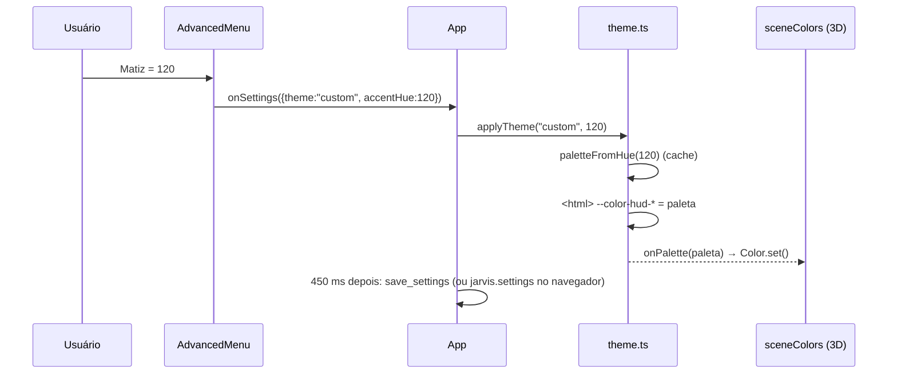

# Feature Specification: Appearance

## Metadata

| Field | Value |
|---|---|
| Feature ID | `feature/appearance` |
| Product | JARVIS OS (jvOS) |
| Feature Status | Implementado |
| Document Status | Reescrita em 2026-11-05 no formato Feature Specification; sem decisões de produto em aberto |
| Source Commit | `42e671a` (2026-10-23); evoluída em `c4ccc57` (2026-10-26, efeitos e acento TUI) e `e7151cf` (2026-11-05, `lights-on`, glow TUI de um halo, janelas sem desfoque) |
| Uncommitted Changes | Nenhuma |
| Voice Shortcut | — |
| Assistant Tool | — |
| Target Platforms | Windows 11 com WebView2; no navegador (modo web) tudo funciona igual, com `theme` e `accentHue` em `jarvis.settings` (`localStorage`) em vez do `settings.json` |
| Language | PT-BR no conteúdo e nas falas; inglês nos títulos das seções e em Given / When / Then |
| Last Editorial Revision | 2026-11-05 |
| Verification Scope | Conferida com o código em 2026-11-05: `src/lib/theme.ts`, `src/lib/tui.ts`, `src/lib/sceneColors.ts`, `src/lib/settings.ts`, `src/lib/desktop.ts`, `src/lib/commands.ts`, `src/hooks/useSettings.ts`, `src/styles/globals.css`, `src/components/hud.tsx`, `src/components/SettingsPanel.tsx`, `src/components/desktop/AdvancedMenu.tsx`, `src/components/desktop/Window.tsx`, `src/components/desktop/Desktop.tsx`, `src/components/desktop/widgets/tui.tsx`, `src/App.tsx`, `src-tauri/src/settings.rs`, `src-tauri/tauri.conf.json`, `tests/settings.spec.ts`, `tests/desktop.spec.ts`, `tests/tui.spec.ts` e `tests/taskbar.spec.ts`. Os testes não foram executados nesta revisão |

Especificação no formato inspirado no GitHub Spec Kit, com seções de desenho técnico ([ADR-0025](../../arch/adr/0025-features-formato-feature-specification.md)). Os identificadores US1–US4, RF-001–RF-007, RNF-001–RNF-002, SC-001–SC-003 e T001–T022 são os mesmos da versão anterior. Os critérios de aceite AC-001–AC-017 são os antigos "Critério 1" a "Critério 17", na mesma ordem. KL-* registra limitações conhecidas; OQ-*, decisões de produto em aberto. Nenhum dos dois acrescenta escopo.

## Overview

O jvOS tem uma linguagem visual única: HUD holográfico sobre fundo quase preto, com cores que vêm de tokens `hud-*`. A "Cor do JARVIS" troca a paleta inteira ao vivo, na interface e no holograma. Há três temas prontos (Azul, Verde Matrix, Amarelo digital) e um "Personalizado", que gira a paleta azul para qualquer matiz OKLCH mantendo luminosidade e croma.

Os apps de terminal (e, no estilo de janela TUI, todas as janelas) têm efeitos próprios de fósforo: brilho (glow), aberração cromática e uma cor de acento que pode diferir da do JARVIS. As janelas são terminais sem borda por padrão, ou painéis de vidro no estilo Holográfico.

O boot usa a fonte de modo texto VT323. A interface usa Segoe UI, e o código, Cascadia.

| Input | Expected Behavior | Execution Path |
|---|---|---|
| Escolher "Verde Matrix" em "Cor do JARVIS" | Interface e holograma ficam verdes na hora | Local (`applyTheme`); grava `theme` nos settings |
| Levar "Matiz" a 120 | "Personalizada" fica marcada e a paleta gira para o verde | Local (`paletteFromHue`) |
| Desligar "Aberração cromática" na aba TUI | A classe sai das janelas TUI na hora | Local (`tuiSurface`); grava `jarvis.tui` |
| Escolher "Âmbar" como cor dos apps de terminal | Só dentro das janelas TUI os tokens viram âmbar | Local (sobrescritas `--color-hud-*`) |
| Escolher "Holográfico" na aba Janelas | As janelas ganham borda e cantos arredondados | Local; grava `jarvis.desktop` |

## Goals and Success Criteria

### Goals

- Uma linguagem visual única, com todas as cores vindas de tokens.
- Trocar a cor do JARVIS ao vivo, sem recarregar e sem remontar nada.
- Qualquer matiz dá uma paleta harmônica e válida em sRGB.
- Dar aos apps de terminal um visual de fósforo ajustável, que não vaza para o resto.
- Escolher entre janelas TUI e janelas de vidro.

### Success Criteria

| ID | Criterion | Verification |
|---|---|---|
| SC-001 | Trocar o tema recolore interface e holograma sem recarregar. | `tests/settings.spec.ts`: `--color-hud-cyan` e o tom do holograma mudam depois do clique, sem `reload`. |
| SC-002 | Qualquer matiz de 0 a 359 produz uma paleta válida em sRGB. | `oklchToHex` reduz o croma por bisseção até caber; conferir `paletteFromHue(h)` para h de 0 a 359 (sem teste hoje, ver Coverage Gaps). |
| SC-003 | O acento TUI de uma janela não vaza para o resto da interface. | `tests/tui.spec.ts`: com "Âmbar", o `--color-hud-light` do `:root` continua o do JARVIS. |

## Scope and Non-Goals

### In Scope

- Os 9 tokens por tema, as paletas prontas, o tema personalizado e `applyTheme`.
- As cores do holograma 3D seguindo a paleta (`sceneColors.ts`).
- O seletor "Cor do JARVIS" (Configurações e Menu avançado), o controle "Matiz" e a faixa de tokens.
- Os efeitos e o acento TUI (`jarvis.tui`), a aba TUI e a prévia.
- O estilo das janelas (`windowStyle`) e onde a superfície TUI é aplicada.
- O kit TUI dos widgets (`tui.tsx`).
- Os tokens, as fontes, a base da página e os utilitários de `globals.css` que as outras features usam.

### Out of Scope

- O tamanho e o comportamento do chrome das janelas estão em [desktop-windows](../desktop-windows/spec.md).
- O fundo é sempre o `void` do tema: a escolha grid/matrix foi removida ([ADR-0015](../../arch/adr/0015-remocao-do-fundo-shader.md)).
- Não há modo claro.

## User Stories

### US1 — Change the JARVIS Color

**Priority:** P1.

**User Story:** Como usuário, escolho a cor e tudo muda junto: holograma, painéis, textos.

**Why This Priority:** é a personalização mais visível.

**Independent Test:** `tests/settings.spec.ts` — "the JARVIS color recolours the hologram and the interface, and persists".

**Acceptance Criteria:** AC-001, AC-002, AC-003, AC-004 e AC-016.

### US2 — Custom Color

**Priority:** P2.

**User Story:** Como usuário, arrasto um controle de matiz e vejo a paleta inteira girar.

**Why This Priority:** amplia os três temas sem perder a harmonia.

**Independent Test:** `tests/desktop.spec.ts` — "the advanced menu tunes snapping, arranges windows and sets a custom hue".

**Acceptance Criteria:** AC-005, AC-006, AC-007 e AC-017.

### US3 — TUI Effects and Accent

**Priority:** P2.

**User Story:** Como usuário, ligo ou desligo o brilho e a aberração dos apps de terminal e escolho a cor deles.

**Why This Priority:** conforto visual e personalidade dos editores.

**Independent Test:** `tests/tui.spec.ts` — "the TUI tab switches the editors' glow and aberration and sets their accent".

**Acceptance Criteria:** AC-008, AC-009, AC-010, AC-011 e AC-012.

### US4 — Window Style

**Priority:** P2.

**User Story:** Como usuário, uso janelas que são terminais sem borda (TUI) por padrão, ou painéis de vidro (Holográfico).

**Why This Priority:** define a cara do desktop.

**Independent Test:** `tests/taskbar.spec.ts` — "windows default to borderless TUIs; the advanced menu switches back to holographic".

**Acceptance Criteria:** AC-013, AC-014 e AC-015.

## Requirements

### Functional Requirements

| ID | Requirement | Related Stories |
|---|---|---|
| RF-001 | As cores DEVEM vir de 9 tokens por tema: `void`, `abyss`, `panel`, `cyan`, `holo`, `light`, `line`, `glow`, `text`, aplicados em `--color-hud-<token>` no elemento raiz por `applyTheme`. | US1, US2 |
| RF-002 | As paletas prontas DEVEM ser azul (`cyan` `#00CAFD`), verde (`#00C238`) e amarelo (`#E6AE00`). A azul também é o padrão CSS em `globals.css`. | US1 |
| RF-003 | O tema "custom" DEVE girar cada token da paleta azul em OKLCH, de forma que o `cyan` caia no matiz pedido (padrão 224°), mantendo L e C. | US2 |
| RF-004 | `--color-hud-alert` (`#ff5c6c`) e `--color-hud-amber` (`#ffb02e`) DEVEM ser os mesmos em todos os temas. | US1 |
| RF-005 | `tuiSurface(prefs)` DEVE produzir a classe `tui-surface` mais `tui-glow` e/ou `tui-aberration` e, para um acento diferente do JARVIS, as sobrescritas `--color-hud-*` do matiz: Fósforo verde 145, Âmbar 75, Ciano 205, Magenta 330, Vermelho 25. | US3, US4 |
| RF-006 | O padrão TUI DEVE ser `{aberration: true, glow: true, accent: "jarvis"}`, e valores inválidos voltam ao padrão por campo. | US3 |
| RF-007 | Os utilitários de `globals.css` DEVEM cobrir `hud-input`, `hud-range`, `hud-scroll`; `crt-*` (boot); `superhot-*` (saudação); `lights-on` (volta para casa); `tui-surface`, `tui-glow`, `tui-aberration`; e as classes `core-spin`/`core-paused` (núcleo 2D). | US3 |

### Non-Functional Requirements

| ID | Requirement | Scope |
|---|---|---|
| RNF-001 | Só fontes locais ou empacotadas: `--font-hud` (Segoe UI Variable Text, Segoe UI), `--font-mono` (Cascadia Code, Cascadia Mono, Consolas) e `--font-bios` (VT323, de `@fontsource/vt323`). A CSP de produção (`default-src 'self'`, sem `font-src`) não permite fontes remotas. | Toda a interface |
| RNF-002 | Uma troca de tema não remonta nada: as variáveis CSS e as instâncias `THREE.Color` são alteradas no lugar. | `applyTheme`, `sceneColors.ts` |

### Operational Constraints

- Cores dos tokens convertidas em JS; nada de `oklch()` em runtime para os tokens (a trilha do "Matiz" usa `oklch()` só como fundo do controle).
- A paleta personalizada fica em cache, uma por grau inteiro.
- O croma fora do gamut é reduzido por bisseção em 20 passos.
- Settings gravados com 450 ms de debounce; `jarvis.tui` e `jarvis.desktop` com 250 ms.

## Acceptance Criteria

### AC-001 — Blue by Default

**Related Story:** US1.

- **Given** uma instalação nova
- **When** abro as Configurações
- **Then** "Azul" está marcado e o holograma é ciano (azul bem acima do vermelho).

### AC-002 — Switch to Matrix Green

**Related Story:** US1.

- **Given** as Configurações abertas
- **When** escolho "Verde Matrix"
- **Then** `--color-hud-cyan` vira `#00c238` e o holograma fica verde.

### AC-003 — Switch to Digital Yellow

**Related Story:** US1.

- **Given** as Configurações abertas
- **When** escolho "Amarelo digital"
- **Then** `--color-hud-cyan` vira `#e6ae00` e o holograma fica amarelo.

### AC-004 — Keep the Theme After a Reload

**Related Story:** US1.

- **Given** o tema amarelo escolhido
- **When** a página recarrega
- **Then** o tema volta, e `theme` = `"yellow"` está salvo nos settings.

### AC-005 — Custom Hue Selects "Personalizada"

**Related Story:** US2.

- **Given** o Menu avançado › Cores
- **When** levo "Matiz" a 120
- **Then** "Personalizada" fica marcada e `--color-hud-cyan` fica verde (G maior que R e B).

### AC-006 — Show the Hue's Tokens

**Related Story:** US2.

- **Given** o controle "Matiz"
- **When** ele muda
- **Then** uma faixa mostra os tokens `line`, `cyan`, `holo`, `light` e `glow` do matiz e o hex do `cyan`.

**Coverage Status:** sem teste automatizado (KL-002).

### AC-007 — Save the Custom Hue

**Related Story:** US2.

- **Given** "Matiz" em 120
- **When** os settings gravam
- **Then** `{theme: "custom", accentHue: 120}` vai para os settings.

### AC-008 — TUI Effects On by Default

**Related Story:** US3.

- **Given** o padrão
- **When** abro o jv_ide
- **Then** a janela tem as classes `tui-glow` e `tui-aberration`, e o acento é "Cor do JARVIS".

### AC-009 — Preview the TUI Look

**Related Story:** US3.

- **Given** o Menu avançado
- **When** abro a aba TUI
- **Then** há uma prévia (`tui-preview`) com um trecho de terminal no visual atual.

### AC-010 — Toggle the Effects Live

**Related Story:** US3.

- **Given** o jv_ide aberto e a aba TUI
- **When** desligo "Aberração cromática" ou "Brilho (glow)"
- **Then** a classe sai da janela na hora.

### AC-011 — Accent Only Inside the Window

**Related Story:** US3.

- **Given** o jv_ide aberto e a aba TUI
- **When** escolho "Âmbar"
- **Then** só dentro da janela `--color-hud-light` vira um tom quente, e o resto da interface mantém a cor do JARVIS.

### AC-012 — Keep the TUI Choices

**Related Story:** US3.

- **Given** aberração desligada e acento "Âmbar"
- **When** a página recarrega
- **Then** `jarvis.tui` = `{aberration: false, glow: true, accent: "amber"}` é reaplicado.

### AC-013 — Borderless TUI Windows by Default

**Related Story:** US4.

- **Given** o padrão
- **When** abro uma janela
- **Then** ela tem `data-chrome="tui"` e borda de 0 px.

### AC-014 — Switch to Holographic

**Related Story:** US4.

- **Given** a aba Janelas do Menu avançado
- **When** escolho "Holográfico"
- **Then** a janela ganha cantos arredondados (`rounded-xl`), e `jarvis.desktop.prefs.windowStyle` vira `"holo"`.

### AC-015 — Where the TUI Surface Applies

**Related Story:** US4.

- **Given** o estilo TUI
- **When** as janelas abrem
- **Then** todas recebem a superfície TUI (glow, aberração, acento). No Holográfico, só os apps.

**Coverage Status:** sem teste automatizado (KL-002).

### AC-016 — Reset an Unknown Theme

**Related Story:** US1.

- **Given** um `settings.json` com `theme` = `"pink"`
- **When** o Rust o lê (`sanitize`)
- **Then** o tema volta a `"blue"`.

### AC-017 — Normalize the Hue

**Related Story:** US2.

- **Given** `accentHue` = 400, −30 ou `NaN`
- **When** o Rust o lê (`sanitize`)
- **Then** o matiz vira 40 (`rem_euclid(360)`), 330, ou 224 (`DEFAULT_HUE`).

## Behavior and Flows

### Theme (`applyTheme`)

Escreve a paleta nas variáveis CSS e avisa quem acompanha a cor (RF-001 a RF-004).

- **Behavior:**
  - O `App` chama `applyTheme(theme, accentHue)` sempre que `theme` ou `accentHue` mudam. A função escreve os 9 tokens como propriedades inline do `<html>` e chama cada ouvinte de `onPalette`.
  - `paletteFor` devolve a paleta pronta, a personalizada, ou a azul para um tema desconhecido.
  - Um matiz fora do gamut sRGB tem o croma reduzido por bisseção (20 passos) até caber.
  - Um matiz repetido usa a paleta em cache, calculada uma vez por grau inteiro.
  - Com os settings ainda carregando, nada é aplicado; até lá valem os valores CSS de `@theme` (azul).

### Hologram Colors (`sceneColors.ts`)

As instâncias `THREE.Color` do 3D, que seguem a paleta.

- **Behavior:**
  - O módulo só existe com o 3D carregado. Ao carregar, ele lê `currentPalette()`, então nasce na cor atual; depois segue `onPalette` e altera cada cor no lugar (`Color.set()`).
  - Guarda 7 tokens: `void`, `cyan`, `holo`, `light`, `line`, `glow` e `abyss`.
  - Fica separado de `theme.ts`, para o three.js só carregar com o 3D.

### "Cor do JARVIS" Picker (`themeOptions` and `ThemeSwatch`)

Os cartões de tema, nas Configurações (seção "Aparência") e na aba Cores do Menu avançado.

- **Behavior:**
  - Escolher um cartão (Azul, Verde Matrix, Amarelo digital ou Personalizada) grava `theme`, e a paleta muda na hora.
  - Cada amostra mostra as próprias cores, seja qual for o tema atual. A de "Personalizada" mostra a cor do matiz salvo.
- **Layout:** `CardPicker` "Cor do JARVIS" em 2 colunas; cada cartão tem a amostra em cima e o nome embaixo.
- **Style:** a amostra é um círculo de 32 px com a borda na cor `holo` do tema e um brilho dela, e um ponto central de 10 px na cor `light`, também com brilho.

### Colors Tab: "Matiz" and `PaletteStrip`

O controle do tema personalizado, no Menu avançado.

- **Behavior:**
  - Mexer em "Matiz" (0 a 359°, mostrado como "120°") grava `{theme: "custom", accentHue}`, e a paleta gira ao vivo.
  - A faixa mostra os tokens `line`, `cyan`, `holo`, `light` e `glow` do matiz e o hex do `cyan`.
  - A aba Cores abre com a seção "Inicialização" do [boot](../boot/spec.md) em cima; sem settings carregados, a seção "Aparência" mostra "Carregando…".
- **Layout:** `Range` "Matiz" com o valor à direita e, embaixo, a faixa: cinco bolinhas seguidas do hex.
- **Style:**
  - A trilha do `Range` é o círculo de matizes na mesma luminosidade e croma (`oklch(0.78 0.14 h)` a cada 30°); o cursor é o de `hud-range` (14 px, `hud-light` com brilho).
  - Bolinhas de 20 px com borda `white/10` e brilho na própria cor. O hex fica em mono de 10 px maiúsculo, `text-hud-text/50`.

### TUI Surface (`tuiSurface`)

O par classe + estilo que dá às janelas de terminal o visual de fósforo (RF-005).

- **Behavior:**
  - As sobrescritas `--color-hud-*` valem só dentro da janela; o resto da interface mantém a cor do JARVIS.
  - O `App` calcula `tuiLook = tuiSurface(jarvis.tui)` e o passa ao desktop, que o entrega às janelas.
- **Style:**
  - `tui-surface` combina as duas camadas num só `text-shadow` e aplica o brilho também aos ícones SVG (`drop-shadow`).
  - `tui-glow`: um halo na cor `holo` (0,36em a 66%). Eram dois (0,28em a 70% e 0,9em a 32%): cada repaint desfoca cada letra uma vez por camada, e o custo cresce com o raio; o halo largo de 0,9em era o caro.
  - `tui-aberration`: franjas de ±0,055em em vermelho e azul fixos (`rgb(255 40 100 / 0.42)` e `rgb(40 210 255 / 0.42)`).

### TUI Tab: Accent and `TuiPreview`

Os efeitos dos apps de terminal, no Menu avançado.

- **Behavior:**
  - A seção "Efeitos dos apps de terminal" avisa: "Valem para o Jarvis Mark e o jv_ide e, no estilo de janela TUI, também para os widgets. Na hora."
  - "Aberração cromática" e "Brilho (glow)" ligam e desligam as classes na hora, em todas as janelas com a superfície TUI.
  - "Cor dos apps de terminal" escolhe entre "Cor do JARVIS", "Fósforo verde", "Âmbar", "Ciano", "Magenta" e "Vermelho" (`accentOptions`).
  - A "Prévia" (`tui-preview`) mostra um trecho de terminal com o visual atual, do mesmo jeito que os apps recebem.
- **Layout:**
  - `CardPicker` em 3 colunas; cada cartão tem um quadrado com `>_` nas cores do acento.
  - A prévia tem um prompt (`builder@jarvis ~/projetos $ jv_ide main.rs`), quatro linhas de Rust e uma barra de status com "RS", "main.rs" e "LN 3, COL 18".
- **Style:**
  - A amostra do acento é um quadrado de 28 px, `rounded-md`, com `>_` em mono negrito de 11 px; a borda e o brilho usam a cor `holo` do acento e o texto, a `light`. "Cor do JARVIS" usa a paleta do tema atual.
  - A prévia é uma caixa `rounded-xl` com borda `hud-cyan/20`, fundo `black/40`, mono de 12,5 px, com a superfície TUI aplicada. O usuário fica em `text-hud-cyan`, o `$` e as palavras-chave em `text-hud-light`, o comentário em itálico `text-hud-text/45` e a string em `text-hud-glow`. "RS" fica em vídeo invertido (`bg-hud-cyan/25`).

### Window Style (`windowStyle`)

As janelas são terminais sem borda (TUI) por padrão, ou painéis de vidro (Holográfico).

- **Behavior:**
  - "Estilo das janelas" (aba Janelas do Menu avançado) grava `prefs.windowStyle`. A janela expõe o estilo em `data-chrome`.
  - A dica embaixo diz "Como apps de terminal num gerenciador tiling: sem bordas, nome em vídeo invertido, widgets em TUI." ou "Painéis de vidro com brilho, no visual do holograma."
  - No estilo TUI, todas as janelas recebem a superfície TUI (glow, aberração, acento). No Holográfico, só os apps (`canMaximize`).
  - No estilo TUI, a janela que não está em foco esmaece um pouco.
- **Style:**
  - TUI: sem borda e sem cantos arredondados, sem `backdrop-filter`; fora de foco, opacidade 80%.
  - Holográfico: borda e `rounded-xl` (sem cantos quando maximizada), sem `backdrop-filter` ([desktop-windows](../desktop-windows/spec.md)). Em foco, borda `hud-cyan/35` com sombra funda e brilho ciano interno; fora de foco, borda `hud-cyan/15`.

### Widget TUI Kit (`tui.tsx`)

As peças com que os widgets são desenhados como apps de terminal.

- **Behavior:**
  - `EditField` edita uma linha no lugar: Enter ou sair do campo salva, Esc cancela (uma resposta só); abre com o texto selecionado e segura as teclas da janela (Ctrl+W) enquanto se digita.
  - `KeyHint` é uma dica `[tecla] ação` que também é um botão.
  - `BlockBar` é uma barra `role="progressbar"` de blocos (`[██████░░░░] 64%`), com 20 células por padrão.
- **Layout:**
  - `KeyValue`: `chave ~ valor`, como no neofetch, com a chave alinhada à direita numa coluna de 7 caracteres.
  - `ReverseRow`: uma linha de cabeçalho em vídeo invertido, com um texto à esquerda e outro, opcional, à direita.
- **Style:**
  - Tudo em `font-mono`: 12 px em `KeyValue` e `BlockBar`, 11 px em `ReverseRow` e `KeyHint`.
  - `KeyValue`: chave em `text-hud-cyan`, `~` em `text-hud-text/50`, valor em `text-hud-text`, cortado com reticências.
  - `BlockBar`: blocos cheios em `text-hud-light` (ou `text-hud-alert` no tom de alerta), vazios em `text-hud-text/25`, percentual em `text-hud-text/70` com números tabulares.
  - `ReverseRow`: fundo `bg-hud-light/80`, texto `font-semibold` em `text-hud-void`.
  - `KeyHint`: a tecla em `text-hud-cyan` sobre `bg-hud-text/12`, que vira vídeo invertido (`bg-hud-light/85`, `text-hud-void`) no hover; a ação em `text-hud-text/60`, `text-hud-light` no hover.
  - `EditField`: borda `hud-light/50`, fundo transparente, texto selecionável.

### `globals.css` Utilities

Os tokens, as fontes, a base da página e os utilitários que as outras features usam (RF-007).

- **Behavior:**
  - Com movimento reduzido, a cortina `lights-on` usa 600 ms com `ease-out` (em vez de 1400 ms em degraus), o `core-spin` para, e `crt-flicker`, `crt-noise` e `crt-roll` param.
- **Style:**
  - `@theme` declara os tokens `--color-hud-*` (a paleta azul, mais `alert` e `amber`) e as fontes `--font-hud`, `--font-mono` e `--font-bios`.
  - `html`, `body` e `#root` ocupam a tela inteira, sem rolagem, com fundo `void`. O `body` usa `--font-hud`, a cor `text`, `user-select: none` e suavização de fonte.
  - `hud-input`: `rounded-lg`, borda `hud-cyan` a 15% (55% em foco), fundo `white/3`, 13 px.
  - `hud-range`: trilha de 6 px `hud-cyan` a 18%, cursor de 14 px em `hud-light` com brilho.
  - `hud-scroll`: barra de rolagem fina em `hud-cyan` a 25%.

### Interaction Flow



### Voice and Keyboard

- Busca: "Cor do JARVIS: Azul", "Cor do JARVIS: Verde Matrix", "Cor do JARVIS: Amarelo digital" e "Cor do JARVIS: Personalizada" (`theme:<valor>`, grupo Aparência, com o selo "atual"); só aparecem com os settings carregados.
- Busca: "Menu avançado › Cores", "Menu avançado › TUI" e "Menu avançado › Janelas" abrem a aba.
- `Ctrl+Shift+,` abre o Menu avançado.
- Não há frase de voz.

## Data Model and Persistence

### Theme

```ts
type Theme = "blue" | "green" | "yellow" | "custom"; // espelha THEMES em settings.rs
type Token = "void" | "abyss" | "panel" | "cyan" | "holo" | "light" | "line" | "glow" | "text";
type Palette = Record<Token, string>;
const DEFAULT_HUE = 224; // espelha DEFAULT_HUE em settings.rs
```

### TUI Preferences

```ts
type TuiAccent = "jarvis" | "phosphor" | "amber" | "cyan" | "magenta" | "red";

interface TuiPrefs {
  aberration: boolean;
  glow: boolean;
  accent: TuiAccent;
}

interface TuiSurface {
  className: string;      // "tui-surface tui-glow tui-aberration"
  style?: CSSProperties;  // --color-hud-* do acento; ausente com "jarvis"
}
```

`WindowStyle` (`"tui"` | `"holo"`) fica nas prefs do desktop ([desktop-windows](../desktop-windows/spec.md)). Ver o [glossário](../../domain/glossary.md) e a [persistência](../../domain/persistence.md).

### Tokens (Blue Theme, CSS Default)

| Token | Hex |
|---|---|
| `void` / `abyss` / `panel` | `#000508` / `#021017` / `#00080C` |
| `cyan` / `holo` / `light` | `#00CAFD` / `#00E5FF` / `#76F3FF` |
| `line` / `glow` / `text` | `#087B94` / `#B5FAFF` / `#A8DBE5` |
| `alert` / `amber` (fixos) | `#ff5c6c` / `#ffb02e` |

### Storage Rules

| Property | Theme | TUI | Window Style |
|---|---|---|---|
| State | `$tema`, `$matiz` | `$tui` | `$estiloDasJanelas` |
| Storage | `settings.json` (Tauri) ou `jarvis.settings` (navegador) | `localStorage` | `localStorage` |
| Key | `theme`, `accentHue` | `jarvis.tui` | `jarvis.desktop` › `prefs.windowStyle` |
| Write Debounce | 450 ms (`useSettings`), com flush no `beforeunload` | 250 ms | 250 ms |
| Reader | `sanitize` no Rust: tema fora de `THEMES` → `blue`; matiz `rem_euclid(360)`, não finito → 224 | `parseTui`: cada campo inválido volta ao padrão | `"holo"` fica; qualquer outro valor (o antigo `sway` inclusive) vira `tui` |
| Missing or Invalid Storage | `blue`, 224 | `{aberration: true, glow: true, accent: "jarvis"}` | `tui` |

`$paleta` (os 9 tokens em uso, `currentPalette`) vive só em memória.

## Technical Design

### Component Responsibilities

| File or Component | Responsibility |
|---|---|
| `src/lib/theme.ts` | `Theme`, `PALETTES`, `DEFAULT_HUE` (224), conversões sRGB ⇄ OKLCH, `paletteFromHue` (com cache), `paletteFor`, `currentPalette`, `onPalette`, `applyTheme` |
| `src/lib/sceneColors.ts` | `colors` (instâncias `THREE.Color`) atualizadas por `onPalette` |
| `src/lib/tui.ts` | `TuiPrefs`, `TUI_ACCENTS`, `useTuiPrefs` (`jarvis.tui`), `tuiSurface` |
| `src/styles/globals.css` | `@theme` (tokens e fontes), base (`html`, `body`, `canvas`), `@utility hud-*`, `crt-*`, `superhot-*`, `lights-on`, `tui-*`, `.core-spin` |
| `src/components/hud.tsx` | `themeOptions`, `ThemeSwatch` (cada amostra nas próprias cores), `CardPicker`, `Range` |
| `src/components/desktop/AdvancedMenu.tsx` | Aba Cores (`CardPicker`, `Range` "Matiz" com trilha de matizes, `PaletteStrip`), aba TUI (`accentOptions`, `TuiPreview`), aba Janelas (estilo) |
| `src/components/SettingsPanel.tsx` | Seção "Aparência" ("Cor do JARVIS") |
| `src/components/desktop/Window.tsx` / `Desktop.tsx` | `data-chrome`, `surface` (TUI em todas as janelas ou só nos apps) |
| `src/components/desktop/widgets/tui.tsx` | Kit de widgets TUI: `EditField`, `KeyValue`, `BlockBar`, `ReverseRow`, `KeyHint` |
| `src/lib/desktop.ts` | `WindowStyle`, `DEFAULT_PREFS` (`windowStyle: "tui"`), o leitor que converte `sway` |
| `src/lib/commands.ts` | `theme:*`, `advanced:colors`, `advanced:tui`, `advanced:windows` |
| `src/App.tsx` | `applyTheme` no efeito, `tuiLook = tuiSurface(tuiPrefs)` |
| `src-tauri/src/settings.rs` | `THEMES`, `DEFAULT_HUE`, `sanitize` do tema e do matiz |

### Custom Palette Algorithm

1. Converte uma vez cada token azul de sRGB para OKLCH (`BLUE_LCH`).
2. Para um matiz `h`, a chave é `round(h)` em 0..359; com ela no cache, devolve a paleta guardada.
3. Para cada token, mantém L e C e usa o matiz `chave + (h_token − h_cyan)`: a paleta gira inteira e o `cyan` cai em `h`.
4. Volta para sRGB; fora do gamut (com folga de 0,002), reduz o croma por bisseção em 20 passos.
5. Guarda no cache e devolve.

### Related Architecture Decisions

- [ADR-0014 — linguagem visual TUI](../../arch/adr/0014-linguagem-visual-tui.md)
- [ADR-0015 — remoção dos fundos animados](../../arch/adr/0015-remocao-do-fundo-shader.md)
- [ADR-0022 — glow TUI de um halo, janelas sem desfoque](../../arch/adr/0022-nucleo-relogio-quadros-limitado-canvas-3.md)
- [ADR-0010 — settings.json vs localStorage](../../arch/adr/0010-persistencia-settings-vs-localstorage.md)
- [ADR-0009 — tipos espelhados](../../arch/adr/0009-tipos-espelhados-ts-rust.md)

## Interfaces and Contracts

### Tauri Commands

| Command | Input | Output | Notes |
|---|---|---|---|
| `get_settings` | — | `Settings` | Traz `theme` e `accentHue` já sanitizados |
| `save_settings` | `{ settings }` | `Settings` | Grava e devolve sanitizado; ver [settings](../settings/spec.md) |

### Theme API

| Function | Contract |
|---|---|
| `applyTheme(theme, hue = 224)` | Escreve os 9 `--color-hud-*` no `<html>` e chama os ouvintes |
| `onPalette(listener)` | Registra um ouvinte; não há remoção |
| `currentPalette()` | A última paleta aplicada (azul até o primeiro `applyTheme`) |
| `paletteFromHue(hue)` / `paletteFor(theme, hue)` | Paletas puras, com cache por grau |

### Search Commands

| Command ID | Title | Action |
|---|---|---|
| `theme:blue`, `theme:green`, `theme:yellow`, `theme:custom` | "Cor do JARVIS: <nome>" | Grava `theme` (o matiz fica como está) |
| `advanced:colors`, `advanced:tui`, `advanced:windows` | "Menu avançado › Cores / TUI / Janelas" | Abre a aba |

## Edge Cases and Error Handling

| Case | Behavior | Reference |
|---|---|---|
| Settings ainda carregando | Nada é aplicado; valem os valores de `@theme` (azul) | Theme |
| `theme` desconhecido no `settings.json` | `sanitize` volta a `blue` | AC-016 |
| `theme` desconhecido no navegador (sem `sanitize`) | `paletteFor` usa a azul | Theme |
| `accentHue` acima de 359 ou negativo | `rem_euclid(360)` no Rust; o cache também reduz a 0..359 | AC-017 |
| `accentHue` `NaN` ou infinito no Rust | 224 | AC-017 |
| `accentHue` não numérico em `jarvis.settings` (só à mão) | Não é tratado: a paleta personalizada sai com cores inválidas | KL-003 |
| `jarvis.tui` ausente ou ilegível | `{aberration: true, glow: true, accent: "jarvis"}` | RF-006 |
| Um campo de `jarvis.tui` inválido | Só ele volta ao padrão | `parseTui` |
| `windowStyle` antigo `sway` | Vira `tui` | Storage Rules |
| O mesmo matiz de novo | Paleta do cache, sem recalcular | Custom Palette Algorithm |
| O mesmo tema de novo | Reescreve as mesmas variáveis, sem remontar nada | RNF-002 |
| O 3D carrega depois de uma troca de tema | `sceneColors.ts` lê `currentPalette()` ao carregar e nasce na cor atual | Hologram Colors |
| Concorrência entre a cor e a gravação | A cor muda na hora, antes de o setting ser gravado (450 ms; 250 ms em `jarvis.tui`) | Operational Constraints |
| Acento TUI | Sobrescreve `--color-hud-*` só dentro da janela | SC-003 |
| Permissões | A CSP de produção não permite fontes remotas: só fontes locais ou empacotadas | RNF-001 |

## Dependencies

### Feature Dependencies

| Dependency | Purpose |
|---|---|
| [settings](../settings/spec.md) | `theme` e `accentHue` são settings; as abas Cores, TUI e Janelas moram no Menu avançado |
| [desktop-windows](../desktop-windows/spec.md) | `windowStyle` fica nas prefs de `jarvis.desktop`, e a `Window` aplica a superfície |
| [holographic-core](../holographic-core/spec.md) | O 3D recolore por `onPalette`; o 2D usa os tokens |
| [boot](../boot/spec.md) | Importa a `@fontsource/vt323` que `--font-bios` usa; usa `crt-*` |
| [greeting-homecoming](../greeting-homecoming/spec.md) | Usa `superhot-*` e `lights-on` |
| [search](../search/spec.md) | `theme:*` e os atalhos para as abas |

### Runtime Dependencies

- [Tailwind CSS 4](../../foundation/vendor/tailwind/spec.md) (`@theme`, `@utility`).
- [Three.js](../../foundation/vendor/three/spec.md) (`Color`, só no 3D).
- [React](../../foundation/vendor/react/spec.md).
- As fontes do Windows (Segoe UI Variable, Cascadia Code ou Consolas) e a preferência de movimento reduzido do sistema.

## Test Strategy and Coverage

### Reported Tests

| Test Reference | Coverage | Acceptance Mapping |
|---|---|---|
| `tests/settings.spec.ts` — "the JARVIS color recolours the hologram and the interface, and persists" | "Azul" de fábrica com holograma ciano; "Verde Matrix" e "Amarelo digital" recolorem interface e holograma; o tema volta depois de recarregar | AC-001–AC-004, SC-001 |
| `tests/desktop.spec.ts` — "the advanced menu tunes snapping, arranges windows and sets a custom hue" | "Matiz" em 120 marca "Personalizada", deixa `--color-hud-cyan` verde e grava `{theme: "custom", accentHue: 120}` | AC-005, AC-007 |
| `tests/tui.spec.ts` — "the TUI tab switches the editors' glow and aberration and sets their accent" | `tui-glow` e `tui-aberration` de fábrica, a prévia, as classes que saem na hora, o "Âmbar" só dentro da janela e `jarvis.tui` reaplicado | AC-008–AC-012, SC-003 |
| `tests/taskbar.spec.ts` — "windows default to borderless TUIs; the advanced menu switches back to holographic" | `data-chrome="tui"` sem borda por padrão; "Holográfico" com `rounded-xl` e `windowStyle: "holo"` | AC-013, AC-014 |
| `src-tauri/src/settings.rs` — `invalid_language_model_and_theme_are_reset` | Tema inválido volta a `blue`; 400 → 40, −30 → 330, `NaN` → 224 | AC-016, AC-017 |

### Verification Commands

Na raiz do repositório:

```powershell
npx playwright test tests/settings.spec.ts --project ui -g "the JARVIS color"
npx playwright test tests/desktop.spec.ts --project ui -g "custom hue"
npx playwright test tests/tui.spec.ts --project ui
npx playwright test tests/taskbar.spec.ts --project ui -g "borderless TUIs"
```

Em `src-tauri`:

```powershell
cargo test --lib invalid_language_model_and_theme_are_reset
```

### Coverage Gaps

| Gap | Evidence Status | Suggested Verification |
|---|---|---|
| Faixa de tokens do "Matiz" (AC-006) | Sem teste | Conferir as 5 bolinhas e o hex depois de mover o controle |
| Superfície TUI nos widgets no estilo TUI e só nos apps no Holográfico (AC-015) | Sem teste | Abrir um widget e um app nos dois estilos e conferir a classe `tui-surface` |
| Paleta válida para todos os matizes (SC-002) | Sem teste | Gerar `paletteFromHue` de 0 a 359 e conferir hex válidos |
| Movimento reduzido em `lights-on` e `core-spin` | Sem teste | `page.emulateMedia({ reducedMotion: "reduce" })` |

## Implementation Plan

**Status Convention:** `[x]` feito · `[ ]` pendente · `[P]` pode rodar em paralelo (arquivos diferentes) · `[USn]` história desta spec. As tarefas foram reconstruídas do código e dos commits `42e671a`, `c4ccc57` e `e7151cf`.

### Phase 1 — Foundation

- [x] T001 Tokens `@theme` (`hud-*`, fontes) e base de `html`/`body` — `src/styles/globals.css`
- [x] T002 `PALETTES`, conversões OKLCH, `paletteFromHue`, `applyTheme`, `onPalette` — `src/lib/theme.ts`
- [x] T003 [P] `THEMES` e `DEFAULT_HUE` espelhados e `sanitize` de tema/matiz — `src-tauri/src/settings.rs`
- [x] T004 [P] Cores do 3D que seguem a paleta — `src/lib/sceneColors.ts`

### Phase 2 — JARVIS Color (US1)

- [x] T005 [US1] `themeOptions` e `ThemeSwatch` — `src/components/hud.tsx`
- [x] T006 [US1] Seção "Aparência" com "Cor do JARVIS" — `src/components/SettingsPanel.tsx`
- [x] T007 [US1] `applyTheme` no efeito do `App` — `src/App.tsx`
- [x] T008 [P] [US1] Comandos `theme:*` na busca — `src/lib/commands.ts`

### Phase 3 — Custom Color (US2)

- [x] T009 [US2] Aba Cores: `Range` "Matiz" com trilha OKLCH e `PaletteStrip` — `src/components/desktop/AdvancedMenu.tsx`

### Phase 4 — TUI Effects and Accent (US3)

- [x] T010 [US3] `TuiPrefs`, `TUI_ACCENTS`, `useTuiPrefs`, `tuiSurface` — `src/lib/tui.ts`
- [x] T011 [P] [US3] `@utility tui-surface`, `tui-glow` e `tui-aberration` — `src/styles/globals.css`
- [x] T012 [US3] Aba TUI: switches, `accentOptions` e `TuiPreview` — `src/components/desktop/AdvancedMenu.tsx`

### Phase 5 — Window Style (US4)

- [x] T013 [US4] `windowStyle` (`tui` padrão, `holo`) e chrome correspondente — `src/lib/desktop.ts`, `src/components/desktop/Window.tsx`
- [x] T014 [US4] Superfície TUI em todas as janelas no estilo TUI, ou só nos apps no Holográfico — `src/components/desktop/Desktop.tsx`
- [x] T015 [P] [US4] Kit TUI dos widgets — `src/components/desktop/widgets/tui.tsx`

### Phase 6 — Utilities for Other Features

- [x] T016 [P] `crt-*` (boot), `superhot-*` (saudação), `core-spin` (núcleo 2D) — `src/styles/globals.css`
- [x] T017 [P] `lights-on` (volta para casa) — `src/styles/globals.css` (`e7151cf`)

### Phase 7 — Verification

- [x] T018 Playwright `tests/settings.spec.ts` — "the JARVIS color recolours the hologram and the interface, and persists"
- [x] T019 Playwright `tests/desktop.spec.ts` — "the advanced menu tunes snapping, arranges windows and sets a custom hue"
- [x] T020 Playwright `tests/tui.spec.ts` — "the TUI tab switches the editors' glow and aberration and sets their accent"
- [x] T021 Playwright `tests/taskbar.spec.ts` — "windows default to borderless TUIs; the advanced menu switches back to holographic"
- [x] T022 Rust `src-tauri/src/settings.rs` — `invalid_language_model_and_theme_are_reset` (tema e matiz)

## Rollback Plan

1. Os tokens `hud-*` de `@theme` e a base de `globals.css` não saem: todo componente usa as classes `hud-*`. O que se desfaz é o que roda por cima deles.
2. Cor do JARVIS: tire o `applyTheme` do efeito do `App`, a seção "Aparência", a aba Cores (fica só a "Inicialização") e os comandos `theme:*` de `commands.ts`. A interface e o holograma ficam no azul (`@theme` e `PALETTES.blue`, o valor inicial de `currentPalette`). `theme` e `accentHue` ficam no `settings.json` e são ignorados, ou saem de `settings.rs` junto com `THEMES` e `DEFAULT_HUE`.
3. TUI: tire `useTuiPrefs`/`tuiSurface` do `App` e a aba TUI. As janelas perdem as classes `tui-*`, e a chave `jarvis.tui` fica órfã no `localStorage`, ignorada.
4. Não apague os utilitários de outras features (`crt-*`, `superhot-*`, `lights-on`, `core-spin`): uma classe que o Tailwind não conhece não gera erro, e o boot, a saudação, a volta para casa, o núcleo 2D, o `JarvisReply`, o histórico do JARVIS, o jv_agent e a calculadora perdem o efeito em silêncio.

## Constitution Compliance

| Principle | Status | Rationale |
|---|---|---|
| P4 — Contratos espelhados | Atendido | `Theme` ↔ `THEMES` e `DEFAULT_HUE` ↔ `DEFAULT_HUE` em `settings.rs` |
| P5 — Persistência tolerante | Atendido, com uma brecha | `sanitize` (Rust) para tema e matiz, `parseTui` para `jarvis.tui`; no navegador, um `accentHue` não numérico passa (KL-003) |
| P6 — Fora do Tauri | Atendido | Tudo roda no Vite, com os settings em `jarvis.settings` |
| P8 — Linguagem visual | Atendido | É o próprio princípio. Exceções explícitas: `hud-alert` e `hud-amber` fixos, e as franjas `tui-aberration` em vermelho e azul fixos (é o efeito) |
| P9 — Desktop leve | Atendido | `sceneColors.ts` separado de `theme.ts`; paleta em cache por grau; glow TUI de um halo; janelas sem `backdrop-filter` |
| P11 — Testes | Atendido, com lacunas | Tema pronto, personalizado, TUI e estilo de janela; AC-006 e AC-015 sem teste (KL-002) |

## Known Limitations

| ID | Limitation | Status |
|---|---|---|
| KL-001 | `accentOptions` em `src/components/desktop/AdvancedMenu.tsx` usa o literal `224` como matiz de reserva, em vez de importar `DEFAULT_HUE` de `src/lib/theme.ts`. | Duplicação de constante |
| KL-002 | A faixa de tokens do "Matiz" (AC-006) e a regra de onde vai a superfície TUI (AC-015) não têm teste automatizado. | Lacuna de verificação |
| KL-003 | No navegador, `loadSettings` não passa por `sanitize`: um `accentHue` que não seja número em `jarvis.settings` (só editando o `localStorage` à mão) gera cores inválidas no tema personalizado. | Lido no código; sem efeito no uso normal |

## Open Questions

Nenhuma.

## References

- Versão anterior desta spec, no formato SpecLang: `git show e7151cf:.specs/features/appearance/spec.md`. A versão intermediária, no formato do spec-coding.dev ([ADR-0023](../../arch/adr/0023-specs-formato-spec-coding-dev.md)), não chegou a ser commitada.
- Modelo de formato: [reminders](../reminders/spec.md) ([ADR-0025](../../arch/adr/0025-features-formato-feature-specification.md)).
- Código conferido: listado em Metadata › Verification Scope.
