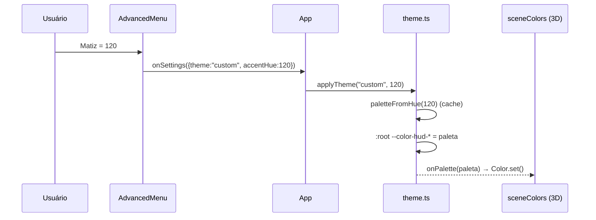

# Aparência (tema, TUI e tokens)

A linguagem visual do jvOS: os tokens de cor `hud-*`, a "Cor do JARVIS", os efeitos de fósforo dos apps de terminal e o estilo das janelas.

| | |
|---|---|
| **ID** | `feature/appearance` |
| **Status** | Implementado |
| **Origem** | `42e671a` (2026-10-23) · evoluída em `c4ccc57` e não commitado (27/10: `lights-on`) |

## Visão geral

O jvOS tem uma linguagem visual única: HUD holográfico sobre fundo quase preto, com cores que vêm de tokens `hud-*`. A "Cor do JARVIS" troca a paleta inteira ao vivo, na interface e no holograma. Há três temas prontos (Azul, Verde Matrix, Amarelo digital) e um "Personalizado", que gira a paleta azul para qualquer matiz OKLCH mantendo luminosidade e croma.

Os apps de terminal (e todas as janelas no estilo TUI) têm efeitos próprios de fósforo:
- brilho (glow);
- aberração cromática;
- uma cor de acento que pode diferir da do JARVIS.

O boot usa a fonte de modo texto VT323. A interface usa Segoe UI, e o código, Cascadia.

## Dados

- `$tema`: `theme` nos settings (`settings.json` ou `jarvis.settings`), `"blue" | "green" | "yellow" | "custom"`. Gravado com 450 ms de debounce. No `sanitize` do Rust, um tema inválido volta a `blue`. Ver [settings](../../features/settings/spec.md).
- `$matiz`: `accentHue` nos settings, um `number` (padrão 224, `DEFAULT_HUE`). O Rust o reduz a 0..360 (`rem_euclid(360)`, NaN → 224).
- `$paleta`: os 9 tokens em uso agora (`currentPalette`). Só em memória.
- `$tui`: `jarvis.tui`, `{aberration: boolean, glow: boolean, accent: TuiAccent}`, gravado com 250 ms de debounce e lido por `parseTui`.
  - **RF-006**: O padrão TUI DEVE ser `{aberration: true, glow: true, accent: "jarvis"}`, e valores inválidos voltam ao padrão por campo.
- `$estiloDasJanelas`: `prefs.windowStyle` em `jarvis.desktop`, `"tui" | "holo"`, com 250 ms de debounce. O valor antigo `sway` vira `tui`.
- **Theme / Palette / Preset**: tema e tokens. Ver [glossário](../../domain/glossary.md).
- **TuiPrefs / TuiAccent / TuiSurface** (`jarvis.tui`). Ver [persistência](../../domain/persistence.md).
- **WindowStyle**: `tui` | `holo`, nas prefs do desktop (ver [desktop-windows](../../features/desktop-windows/spec.md)).

## Componentes

### Tema (`applyTheme`)

Escreve $paleta nas variáveis CSS e avisa quem acompanha a cor.

- **Comportamento:**
  - **RF-001**: As cores DEVEM vir de 9 tokens por tema: `void`, `abyss`, `panel`, `cyan`, `holo`, `light`, `line`, `glow`, `text`. Eles são aplicados em `--color-hud-<token>` no `:root` por `applyTheme`.
  - **RF-002**: As paletas prontas DEVEM ser: azul (`cyan` `#00CAFD`), verde (`#00C238`) e amarelo (`#E6AE00`). A azul também é o padrão CSS em `globals.css`.
  - **RF-003**: O tema "custom" DEVE girar cada token da paleta azul em OKLCH, de forma que o `cyan` caia no matiz pedido (padrão 224°), mantendo L e C.
  - **RF-004**: `--color-hud-alert` (`#ff5c6c`) e `--color-hud-amber` (`#ffb02e`) DEVEM ser os mesmos em todos os temas.
  - O `App` chama `applyTheme($tema, $matiz)` sempre que o setting muda. A função escreve os tokens como propriedades inline do `<html>` e chama cada ouvinte de `onPalette`.
  - Se um matiz cair fora do gamut sRGB, então reduza o croma por bisseção (20 passos) até caber.
  - Se o matiz se repetir, então use a paleta em cache: ela é calculada uma vez por grau inteiro.
  - Se os settings ainda estiverem carregando, então não aplique nada. Até lá valem os valores CSS padrão (azul).

### Cores do holograma (`sceneColors.ts`)

As instâncias `THREE.Color` do 3D, que seguem $paleta.

- **Comportamento:**
  - Se o 3D não estiver carregado, então as cores do holograma não existem. Ele as recebe por `onPalette` ao carregar e a cada troca, e altera cada cor no lugar (`Color.set()`).
  - Fica separado de `theme.ts`, para o three.js só carregar com o 3D.

### Seletor "Cor do JARVIS" (`themeOptions` e `ThemeSwatch`)

Os cartões de tema, no painel de Configurações (seção "Aparência") e na aba Cores do Menu avançado.

- **Comportamento:**
  - Quando o usuário escolhe um cartão (Azul, Verde Matrix, Amarelo digital ou Personalizada), grave `theme`, e a paleta muda na hora.
  - Cada amostra mostra as próprias cores, seja qual for o tema atual. A de "Personalizada" mostra a cor de $matiz.
- **Layout:** `CardPicker` "Cor do JARVIS" em 2 colunas; cada cartão tem a amostra em cima e o nome embaixo.
- **Estilo:** a amostra é um círculo de 32 px com a borda na cor `holo` do tema e um brilho dela, e um ponto central de 10 px na cor `light`, também com brilho.

### Aba Cores: "Matiz" e `PaletteStrip`

O controle do tema personalizado, no Menu avançado.

- **Comportamento:**
  - Mexer em "Matiz" (0 a 359°, mostrado como "120°") grava `{theme: "custom", accentHue}` e a paleta gira ao vivo.
  - A faixa mostra os tokens `line`, `cyan`, `holo`, `light` e `glow` do matiz e o hex do `cyan`.
- **Layout:** `Range` "Matiz" com o valor à direita e, embaixo, a faixa: cinco bolinhas seguidas do hex.
- **Estilo:**
  - A trilha do `Range` é o círculo de matizes na mesma luminosidade e croma (`oklch(0.78 0.14 h)` a cada 30°); o cursor é `hud-range` (14 px, `hud-light` com brilho).
  - Bolinhas de 20 px com borda `white/10` e brilho na própria cor. O hex fica em mono de 10 px maiúsculo, `text-hud-text/50`.

### Superfície TUI (`tuiSurface`)

O par classe + estilo que dá às janelas de terminal o visual de fósforo.

- **Comportamento:**
  - **RF-005**: `tuiSurface(prefs)` DEVE produzir a classe `tui-surface` + `tui-glow` e/ou `tui-aberration` e, para um acento diferente do JARVIS, as sobrescritas `--color-hud-*` do matiz:
    - Fósforo verde: 145;
    - Âmbar: 75;
    - Ciano: 205;
    - Magenta: 330;
    - Vermelho: 25.
  - As sobrescritas valem só dentro da janela; o resto da interface mantém a cor do JARVIS.
  - O `App` calcula `tuiLook = tuiSurface($tui)` e o passa ao desktop, que o entrega às janelas.
- **Estilo:**
  - `tui-surface` combina as duas camadas num só `text-shadow` e aplica o brilho também aos ícones SVG (`drop-shadow`).
  - `tui-glow`: um halo na cor `holo` (0,36em a 66%). Eram dois (0,28em a 70% e 0,9em a 32%): cada repaint desfoca cada letra uma vez por camada, e o custo cresce com o raio; o halo largo de 0,9em era o caro.
  - `tui-aberration`: franjas de ±0,055em em vermelho e azul fixos (`rgb(255 40 100 / 0.42)` e `rgb(40 210 255 / 0.42)`).

### Aba TUI: acento e `TuiPreview`

Os efeitos dos apps de terminal, no Menu avançado.

- **Comportamento:**
  - "Aberração cromática" e "Brilho (glow)" ligam e desligam as classes na hora, em todas as janelas com a superfície TUI.
  - "Cor dos apps de terminal" escolhe entre "Cor do JARVIS", "Fósforo verde", "Âmbar", "Ciano", "Magenta" e "Vermelho" (`accentOptions`).
  - A "Prévia" (`tui-preview`) mostra um trecho de terminal com o visual atual, do mesmo jeito que os apps recebem.
- **Layout:**
  - `CardPicker` em 3 colunas; cada cartão tem um quadrado com `>_` nas cores do acento.
  - A prévia tem um prompt (`builder@jarvis ~/projetos $ jv_ide main.rs`), quatro linhas de Rust e uma barra de status com "RS", "main.rs" e "LN 3, COL 18".
- **Estilo:**
  - A amostra do acento é um quadrado de 28 px, `rounded-md`, com `>_` em mono negrito de 11 px; a borda e o brilho usam a cor `holo` do acento e o texto, a `light`. "Cor do JARVIS" usa a paleta do tema atual.
  - A prévia é uma caixa `rounded-xl` com borda `hud-cyan/20`, fundo `black/40`, mono de 12,5 px, com a superfície TUI aplicada. O usuário fica em `text-hud-cyan`, o `$` e as palavras-chave em `text-hud-light`, o comentário em itálico `text-hud-text/45` e a string em `text-hud-glow`. "RS" fica em vídeo invertido (`bg-hud-cyan/25`).

### Estilo das janelas (`windowStyle`)

As janelas são terminais sem borda (TUI) por padrão, ou painéis de vidro (Holográfico).

- **Comportamento:**
  - "Estilo das janelas" (aba Janelas do Menu avançado) grava $estiloDasJanelas. A janela expõe o estilo em `data-chrome`.
  - No estilo TUI, todas as janelas recebem a superfície TUI (glow, aberração, acento). No Holográfico, só os apps.
  - No estilo TUI, a janela que não está em foco esmaece um pouco.
- **Estilo:**
  - TUI: sem borda e sem cantos arredondados, sem `backdrop-filter`; fora de foco, opacidade 80%.
  - Holográfico: borda e `rounded-xl` (sem cantos quando maximizada), sem `backdrop-filter` (ver [desktop-windows](../desktop-windows/spec.md)). Em foco, borda `hud-cyan/35` com sombra funda e brilho ciano interno; fora de foco, borda `hud-cyan/15`.

### Kit TUI dos widgets (`tui.tsx`)

As peças com que os widgets são desenhados como apps de terminal.

- **Comportamento:**
  - `EditField` edita uma linha no lugar: Enter ou sair do campo salva, Esc cancela; abre com o texto selecionado e segura as teclas da janela (Ctrl+W) enquanto se digita.
  - `KeyHint` é uma dica `[tecla] ação` que também é um botão.
  - `BlockBar` é uma barra `role="progressbar"` de blocos (`[██████░░░░] 64%`), com 20 células por padrão.
- **Layout:**
  - `KeyValue`: `chave ~ valor`, como no neofetch, com a chave alinhada à direita numa coluna de 7 caracteres.
  - `ReverseRow`: uma linha de cabeçalho em vídeo invertido, com um texto à esquerda e outro, opcional, à direita.
- **Estilo:**
  - Tudo em `font-mono`: 12 px em `KeyValue` e `BlockBar`, 11 px em `ReverseRow` e `KeyHint`.
  - `KeyValue`: chave em `text-hud-cyan`, `~` em `text-hud-text/50`, valor em `text-hud-text`, cortado com reticências.
  - `BlockBar`: blocos cheios em `text-hud-light` (ou `text-hud-alert` no tom de alerta), vazios em `text-hud-text/25`, percentual em `text-hud-text/70` com números tabulares.
  - `ReverseRow`: fundo `bg-hud-light/80`, texto `font-semibold` em `text-hud-void`.
  - `KeyHint`: a tecla em `text-hud-cyan` sobre `bg-hud-text/12`, que vira vídeo invertido (`bg-hud-light/85`, `text-hud-void`) no hover; a ação em `text-hud-text/60`, `text-hud-light` no hover.
  - `EditField`: borda `hud-light/50`, fundo transparente, texto selecionável.

### Utilitários de `globals.css`

Os tokens, as fontes, a base da página e os utilitários que as outras features usam.

- **Comportamento:**
  - **RF-007**: Os utilitários de `globals.css` DEVEM cobrir:
    - `hud-input`, `hud-range`, `hud-scroll`;
    - `crt-*` (boot);
    - `superhot-*` (saudação);
    - `lights-on` (volta para casa);
    - `tui-surface`, `tui-glow`, `tui-aberration`;
    - `core-spin`/`core-paused` (núcleo 2D).
  - Se o sistema pedir movimento reduzido, então a cortina `lights-on` usa 600 ms com `ease-out` (em vez de 1400 ms em degraus), e o `core-spin` para.
- **Estilo:**
  - `@theme` declara os tokens `--color-hud-*` (a paleta azul) e as fontes `--font-hud`, `--font-mono` e `--font-bios`.
  - `html`, `body` e `#root` ocupam a tela inteira, sem rolagem, com fundo `void`. O `body` usa `--font-hud`, a cor `text`, `user-select: none` e suavização de fonte.
  - `hud-input`: `rounded-lg`, borda `hud-cyan` a 15% (55% em foco), fundo `white/3`, 13 px.
  - `hud-range`: trilha de 6 px `hud-cyan` a 18%, cursor de 14 px em `hud-light` com brilho.
  - `hud-scroll`: barra de rolagem fina em `hud-cyan` a 25%.

## Voz e teclado

- Busca "Cor do JARVIS: Azul / Verde Matrix / Amarelo digital / Personalizada": troca `theme`.
- Busca "Menu avançado › Cores" / "› TUI": abre a aba.

## Restrições

- **RNF-001**: Só fontes locais ou empacotadas: `--font-hud` (Segoe UI Variable Text, Segoe UI), `--font-mono` (Cascadia Code, Cascadia Mono, Consolas) e `--font-bios` (VT323, de `@fontsource/vt323`). A CSP de produção não permite fontes remotas.
- **RNF-002**: Uma troca de tema não remonta nada: as variáveis CSS e as instâncias `THREE.Color` são alteradas no lugar.
- Sem fontes remotas (CSP). Cores convertidas em JS, sem `oklch()` em runtime para os tokens.

## Histórias de usuário

### US1 — Trocar a cor do JARVIS (P1)

Escolho a cor e tudo muda junto: holograma, painéis, textos.

**Por que P1:** é a personalização mais visível.
**Teste independente:** `tests/settings.spec.ts` — "the JARVIS color recolours the hologram and the interface, and persists".

**Aceite**

1. **Dado** uma instalação nova, **então** "Azul" está marcado e o holograma é ciano (azul bem acima do vermelho).
2. **Quando** escolho "Verde Matrix", **então** `--color-hud-cyan` vira `#00c238` e o holograma fica verde.
3. **Quando** escolho "Amarelo digital", **então** `--color-hud-cyan` vira `#e6ae00` e o holograma fica amarelo.
4. **Dado** um recarregamento, **então** o tema volta, e `theme` = `"yellow"` está salvo nos settings.

### US2 — Cor personalizada (P2)

Arrasto um controle de matiz e vejo a paleta inteira girar.

**Por que P2:** amplia os três temas sem perder a harmonia.
**Teste independente:** `tests/desktop.spec.ts` — "the advanced menu tunes snapping, arranges windows and sets a custom hue".

**Aceite**

1. **Dado** o Menu avançado → Cores, **quando** levo "Matiz" a 120, **então** "Personalizada" fica marcada e `--color-hud-cyan` fica verde (G maior que R e B).
2. **Dado** o controle, **então** uma faixa mostra os tokens `line`, `cyan`, `holo`, `light` e `glow` do matiz e o hex do `cyan`.
3. **Dado** a mudança, **então** `{theme: "custom", accentHue: 120}` vai para os settings.

### US3 — Efeitos e acento TUI (P2)

Ligo ou desligo o brilho e a aberração dos apps de terminal e escolho a cor deles.

**Por que P2:** conforto visual e personalidade dos editores.
**Teste independente:** `tests/tui.spec.ts` — "the TUI tab switches the editors' glow and aberration and sets their accent".

**Aceite**

1. **Dado** o padrão, **então** a janela do jv_ide tem as classes `tui-glow` e `tui-aberration`, e o acento é "Cor do JARVIS".
2. **Dado** a aba TUI, **então** há uma prévia (`tui-preview`) com um trecho de terminal no visual atual.
3. **Quando** desligo "Aberração cromática" ou "Brilho (glow)", **então** a classe sai da janela na hora.
4. **Quando** escolho "Âmbar", **então** só dentro da janela `--color-hud-light` vira um tom quente, e o resto da interface mantém a cor do JARVIS.
5. **Dado** um recarregamento, **então** `jarvis.tui` = `{aberration: false, glow: true, accent: "amber"}` é reaplicado.

### US4 — Estilo das janelas (P2)

As janelas são terminais sem borda (TUI) por padrão, ou painéis de vidro (Holográfico).

**Por que P2:** define a cara do desktop.
**Teste independente:** `tests/taskbar.spec.ts` — "windows default to borderless TUIs; the advanced menu switches back to holographic".

**Aceite**

1. **Dado** o padrão, **então** a janela tem `data-chrome="tui"` e borda de 0 px.
2. **Quando** escolho "Holográfico" na aba Janelas, **então** a janela ganha cantos arredondados (`rounded-xl`), e `jarvis.desktop.prefs.windowStyle` vira `"holo"`.
3. **Dado** o estilo TUI, **então** todas as janelas recebem a superfície TUI (glow, aberração, acento). No Holográfico, só os apps.

## Critérios de sucesso

- **SC-001**: Trocar o tema recolore interface e holograma sem recarregar.
- **SC-002**: Qualquer matiz de 0 a 359 produz uma paleta válida em sRGB.
- **SC-003**: O acento TUI de uma janela não vaza para o resto da interface.

## Fora de escopo e limitações

- O tamanho e o comportamento do chrome das janelas estão em [desktop-windows](../../features/desktop-windows/spec.md).
- O fundo é sempre o `void` do tema: a escolha grid/matrix foi removida (ver [ADR-0015](../../arch/adr/0015-remocao-do-fundo-shader.md)).
- Não há modo claro.

## Código

O Tailwind 4 declara os tokens `--color-hud-*` em `@theme`, e todo componente usa classes `hud-*` ou `var(--color-hud-*)`. O `App` chama `applyTheme(theme, accentHue)` quando o setting muda. A função escreve os 9 tokens como propriedades inline do `<html>` e avisa os ouvintes (`onPalette`), entre eles o `sceneColors.ts` do 3D. O tema personalizado é calculado convertendo a paleta azul para OKLCH e girando o matiz. A superfície TUI é um par classe + estilo aplicado à janela: as classes ligam camadas de `text-shadow`, e o estilo sobrescreve os tokens só dentro dela.

| | |
|---|---|
| **Camadas** | lib (`theme.ts`, `tui.ts`, `sceneColors.ts`) · CSS (`globals.css`) · UI (`AdvancedMenu` abas Cores/TUI/Janelas, `SettingsPanel` Aparência, `hud.tsx` `ThemeSwatch`, `Window`) · `App.tsx` |
| **Dependências** | Tailwind CSS 4 (`@theme`, `@utility`), `@fontsource/vt323`, `three` (`Color`, só no 3D) |
| **Testes** | `tests/settings.spec.ts`, `tests/desktop.spec.ts`, `tests/tui.spec.ts`, `tests/taskbar.spec.ts`; Rust `invalid_language_model_and_theme_are_reset` |
| **Plataforma** | Igual dentro e fora do Tauri |

### Arquivos

| Arquivo | Papel |
|---|---|
| `src/lib/theme.ts` | `Theme`, `PALETTES`, `DEFAULT_HUE` (224), conversões sRGB ⇄ OKLCH, `paletteFromHue` (com cache), `paletteFor`, `currentPalette`, `onPalette`, `applyTheme` |
| `src/lib/sceneColors.ts` | `colors` (instâncias `THREE.Color`) atualizadas por `onPalette` |
| `src/lib/tui.ts` | `TuiPrefs`, `TUI_ACCENTS`, `useTuiPrefs` (`jarvis.tui`), `tuiSurface` |
| `src/styles/globals.css` | `@theme` (tokens e fontes), base (`html`, `body`, `canvas`), `@utility hud-*`, `crt-*`, `superhot-*`, `lights-on`, `tui-*`, `.core-spin` |
| `src/components/hud.tsx` | `themeOptions`, `ThemeSwatch` (cada amostra nas próprias cores) |
| `src/components/desktop/AdvancedMenu.tsx` | Aba Cores (`CardPicker`, `Range` "Matiz" com trilha de matizes, `PaletteStrip`), aba TUI (`accentOptions`, `TuiPreview`), aba Janelas (estilo) |
| `src/components/SettingsPanel.tsx` | Seção "Aparência" ("Cor do JARVIS") |
| `src/components/desktop/Window.tsx` / `Desktop.tsx` | `data-chrome`, `surface` (TUI em todas as janelas ou só nos apps) |
| `src/components/desktop/widgets/tui.tsx` | Kit de widgets TUI: `EditField`, `KeyValue`, `BlockBar`, `ReverseRow`, `KeyHint` |
| `src/App.tsx` | `applyTheme` no efeito, `tuiLook = tuiSurface(tuiPrefs)` |

### Tokens (tema azul, padrão CSS)

| Token | Hex |
|---|---|
| `void` / `abyss` / `panel` | `#000508` / `#021017` / `#00080C` |
| `cyan` / `holo` / `light` | `#00CAFD` / `#00E5FF` / `#76F3FF` |
| `line` / `glow` / `text` | `#087B94` / `#B5FAFF` / `#A8DBE5` |
| `alert` / `amber` (fixos) | `#ff5c6c` / `#ffb02e` |

### Fluxo

### Constituição

- [x] P4 Contratos espelhados — `Theme` ↔ `THEMES` e `DEFAULT_HUE` ↔ `DEFAULT_HUE` em `settings.rs`.
- [x] P5 Persistência tolerante — `sanitize` (Rust) para tema e matiz, `parseTui` para `jarvis.tui`.
- [x] P8 Linguagem visual única — é o próprio princípio. Exceções explícitas: `hud-alert` e `hud-amber` fixos, e as franjas `tui-aberration` em vermelho e azul fixos (é o efeito).
- [x] P9 Desktop leve — `sceneColors.ts` fica separado de `theme.ts`, para o three.js só carregar com o 3D. A paleta personalizada fica em cache por grau.
- [x] P11 Coberto por teste — tema pronto, personalizado, TUI e estilo de janela.

### Decisões relacionadas

- [ADR-0014 — linguagem visual TUI](../../arch/adr/0014-linguagem-visual-tui.md)
- [ADR-0015 — remoção do fundo grid/matrix](../../arch/adr/0015-remocao-do-fundo-shader.md)
- [ADR-0022 — glow TUI de um halo, janelas sem desfoque](../../arch/adr/0022-nucleo-relogio-quadros-limitado-canvas-3.md)
- [ADR-0010 — settings.json vs localStorage](../../arch/adr/0010-persistencia-settings-vs-localstorage.md)
- [ADR-0009 — tipos espelhados](../../arch/adr/0009-tipos-espelhados-ts-rust.md)

## Tarefas

Legenda: `[x]` feito · `[ ]` pendente · `[P]` pode rodar em paralelo (arquivos diferentes) · `[USn]` história desta spec. As tarefas foram reconstruídas do código e dos commits `42e671a`, `c4ccc57` e do working tree de 27/10.

### Fase 1 — Base

- [x] T001 Tokens `@theme` (`hud-*`, fontes) e base de `html`/`body` — `src/styles/globals.css`
- [x] T002 `PALETTES`, conversões OKLCH, `paletteFromHue`, `applyTheme`, `onPalette` — `src/lib/theme.ts`
- [x] T003 [P] `THEMES` e `DEFAULT_HUE` espelhados e `sanitize` de tema/matiz — `src-tauri/src/settings.rs`
- [x] T004 [P] Cores do 3D que seguem a paleta — `src/lib/sceneColors.ts`

### Fase 2 — US1 Cor do JARVIS (P1)

- [x] T005 [US1] `themeOptions` e `ThemeSwatch` — `src/components/hud.tsx`
- [x] T006 [US1] Seção "Aparência" com "Cor do JARVIS" — `src/components/SettingsPanel.tsx`
- [x] T007 [US1] `applyTheme` no efeito do `App` — `src/App.tsx`
- [x] T008 [P] [US1] Comandos `theme:*` na busca — `src/lib/commands.ts`

### Fase 3 — US2 Cor personalizada (P2)

- [x] T009 [US2] Aba Cores: `Range` "Matiz" com trilha OKLCH e `PaletteStrip` — `src/components/desktop/AdvancedMenu.tsx`

### Fase 4 — US3 Efeitos e acento TUI (P2)

- [x] T010 [US3] `TuiPrefs`, `TUI_ACCENTS`, `useTuiPrefs`, `tuiSurface` — `src/lib/tui.ts`
- [x] T011 [P] [US3] `@utility tui-surface`, `tui-glow` e `tui-aberration` — `src/styles/globals.css`
- [x] T012 [US3] Aba TUI: switches, `accentOptions` e `TuiPreview` — `src/components/desktop/AdvancedMenu.tsx`

### Fase 5 — US4 Estilo das janelas (P2)

- [x] T013 [US4] `windowStyle` (`tui` padrão, `holo`) e chrome correspondente — `src/lib/desktop.ts`, `src/components/desktop/Window.tsx`
- [x] T014 [US4] Superfície TUI em todas as janelas no estilo TUI, ou só nos apps no Holográfico — `src/components/desktop/Desktop.tsx`
- [x] T015 [P] [US4] Kit TUI dos widgets — `src/components/desktop/widgets/tui.tsx`

### Fase 6 — Utilitários de outras features

- [x] T016 [P] `crt-*` (boot), `superhot-*` (saudação), `core-spin` (núcleo 2D) — `src/styles/globals.css`
- [x] T017 [P] `lights-on` (volta para casa) — `src/styles/globals.css` (não commitado)

### Fase 7 — Testes

- [x] T018 Playwright `tests/settings.spec.ts` — "the JARVIS color recolours the hologram and the interface, and persists"
- [x] T019 Playwright `tests/desktop.spec.ts` — "the advanced menu tunes snapping, arranges windows and sets a custom hue"
- [x] T020 Playwright `tests/tui.spec.ts` — "the TUI tab switches the editors' glow and aberration and sets their accent"
- [x] T021 Playwright `tests/taskbar.spec.ts` — "windows default to borderless TUIs; the advanced menu switches back to holographic"
- [x] T022 Rust `src-tauri/src/settings.rs` — `invalid_language_model_and_theme_are_reset` (tema e matiz)

## Pendências

- [ ] `accentOptions` em `src/components/desktop/AdvancedMenu.tsx` usa o literal `224` como matiz de reserva, em vez de importar `DEFAULT_HUE` de `src/lib/theme.ts`.
