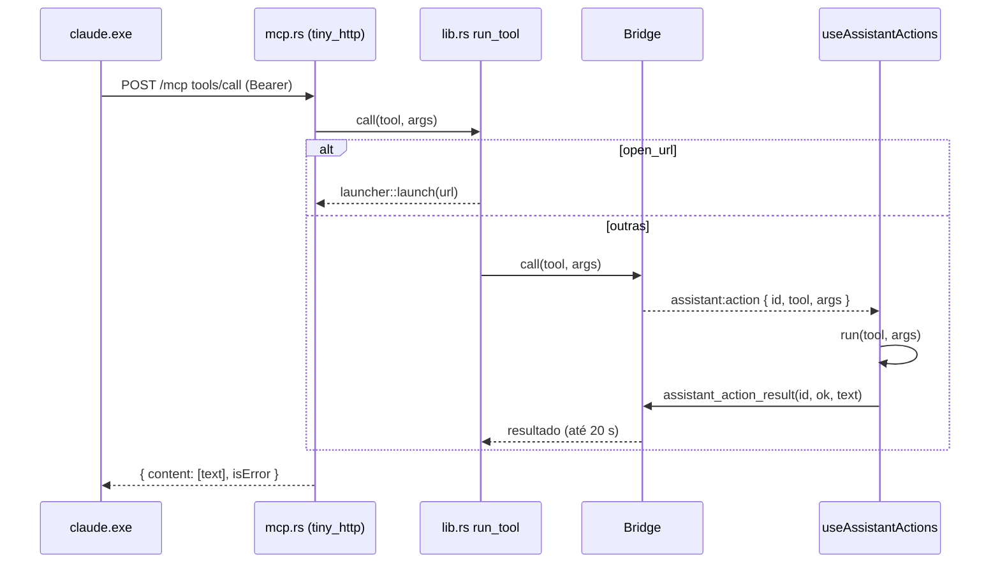

# Feature Specification: Assistant Tools

## Metadata

| Field | Value |
|---|---|
| Feature ID | `feature/assistant-tools` |
| Product | JARVIS OS (jvOS) |
| Feature Status | Implementado |
| Document Status | Reescrita em 2026-11-05 no formato Feature Specification; sem decisões em aberto |
| Source Commit | `750ebd0` (2026-10-27), com 5 ferramentas; `048a254` (2026-10-27) somou `system_status` e `reminder_set`; as outras 11 (ações, clima, agenda e tarefas) entraram em `e7151cf` (2026-11-05) |
| Uncommitted Changes | Nenhuma |
| Voice Shortcut | — |
| Assistant Tool | 18 ferramentas: `jvos_run`, `jvos_commands`, `open_url`, `system_status`, `reminder_set`, `stocks_quote`, `stocks_watch`, `stocks_alert`, `weather`, `agenda_add`, `agenda_list`, `agenda_remove`, `tasks_add`, `tasks_list`, `tasks_done`, `tasks_remove`, `agent_review`, `agent_run` |
| Target Platforms | Windows 11 com WebView2; no navegador (modo web) não há servidor, e só o probe de DEV `window.__JARVIS__.action` chama a execução da UI |
| Language | PT-BR no conteúdo e nas falas; inglês nos títulos das seções e em Given / When / Then |
| Last Editorial Revision | 2026-11-05 |
| Verification Scope | Conferida com o código em 2026-11-05: `src-tauri/src/mcp.rs`, `src-tauri/src/lib.rs` (`run_tool`, `start_mcp`, `assistant_action_result`, `setup`), `src-tauri/src/assistant.rs` (`ALLOWED`, `spawn`), `src-tauri/src/launcher.rs` (`launch`), `src/hooks/useAssistantActions.ts`, `src/lib/assistant.ts` (`describeTool`), `src/lib/agents.ts`, `src/lib/feeds.ts` (`MAX_WATCHED`), `src/lib/shortcuts.ts` (`MAX_REMINDER_MINUTES`, `shortcutPrompt`), `src-tauri/assistant-persona.md`, `src/App.tsx` (`useAssistantActions`, `readMachine`, `window.__JARVIS__`), `tests/assistant.spec.ts`, `tests/agent.spec.ts`, `tests/feeds.spec.ts`, `tests/tasks.spec.ts` e `tests/shortcuts.spec.ts`. Os testes não foram executados nesta revisão |

Especificação no formato inspirado no GitHub Spec Kit, com seções de desenho técnico ([ADR-0025](../../arch/adr/0025-features-formato-feature-specification.md)). Os identificadores US1–US4, RF-001–RF-008, RNF-001–RNF-002, SC-001–SC-002 e T001–T025 são os mesmos da versão anterior. Os critérios de aceite AC-001–AC-011 são os antigos "Critério 1" a "Critério 11", na mesma ordem. KL-* registra limitações conhecidas; OQ-*, decisões de produto em aberto. Nenhum dos dois acrescenta escopo.

## Overview

As ferramentas são as mãos do JARVIS no jvOS. O app sobe um servidor MCP próprio, local e protegido por token, e entrega ao Claude Code (o [assistente](../assistant/spec.md)) 18 ferramentas.

Com elas, o JARVIS executa qualquer ação da busca, abre um site, lê o estado da máquina, agenda lembretes, cuida das ações, do clima, da agenda e das tarefas, e revisa e roda os agentes que ele escreve. Quase todas são executadas pela UI, que é dona do desktop: o servidor repassa a chamada por evento e espera a resposta. Assim, "abre o relógio" ou "marca dentista sexta às 10" ditos ao JARVIS viram ações reais na tela, e ele confirma no personagem.

| Input | Expected Behavior | Execution Path |
|---|---|---|
| "Abre o relógio" | O Relógio abre e a dock diz "JARVIS: Relógio" | Claude Code → `jvos_run` → UI (`findCommand`) |
| "Configurações de voz" | As Configurações abrem na seção pedida | `jvos_run { id: "settings:voice" }` → UI |
| "Abre o site da Anthropic" | O navegador padrão abre o endereço | `open_url` → Rust (`launcher::launch`) |
| "Marca dentista sexta às 10" | O compromisso entra na Agenda, que abre no dia | `agenda_add` → UI (`useAgenda`) |
| "Põe comprar pão na lista" | A tarefa entra e o widget Tarefas abre | `tasks_add` → UI (`useTasks`) |
| "Cria um agente que revisa PRs" e "pode rodar" | O agente é revisado no jv_agent e roda uma vez no jv_sh | `agent_review` e `agent_run` → UI → jv_agent |

## Goals and Success Criteria

### Goals

- Deixar o JARVIS agir no desktop, e não só conversar.
- Reaproveitar o catálogo da busca, sem uma lista de ações paralela.
- Ligar o JARVIS aos dados do dia a dia: lembretes, ações, clima, agenda e tarefas.
- Mostrar ao usuário cada agente antes de rodá-lo.
- Garantir que só o Claude Code iniciado pelo JARVIS use o servidor.
- Responder sempre, mesmo quando a UI não responde.

### Success Criteria

| ID | Criterion | Verification |
|---|---|---|
| SC-001 | Toda ferramenta pedida pelo JARVIS recebe uma resposta (sucesso, erro ou prazo esgotado) em até 20 s. | `Bridge::call` espera no máximo `UI_TIMEOUT` (20 s); `the_bridge_waits_for_the_ui` confere a espera e a recusa. `open_url` responde no próprio Rust. |
| SC-002 | Nenhuma página web nem programa sem o token consegue chamar uma ferramenta. | `respond` devolve 403 sem `Authorization: Bearer <token>` ou com `Origin`. Só `tokens_differ` é testado; a regra HTTP não tem teste (KL-003). |

## Scope and Non-Goals

### In Scope

- Um servidor MCP "Streamable HTTP" mínimo em `127.0.0.1`, com JSON simples.
- A lista fixa de 18 ferramentas, com descrição em PT-BR e `inputSchema`.
- `open_url` executada no Rust; as outras 17, na UI, pela `Bridge`.
- O arquivo `--mcp-config` com a URL e o token, regravado a cada início do app.
- O status em PT-BR de cada ferramenta no núcleo.

### Out of Scope

- O comportamento de cada widget ao receber a chamada: ver a spec dona na [tabela das ferramentas](#tool-catalog).
- Ferramentas de shell, de arquivo fora de `Documentos\JARVIS` ou de rede genérica.
- Stream iniciado pelo servidor: GET recebe 405.
- O processo do Claude Code e a exibição no núcleo: ver [assistant](../assistant/spec.md).

## User Stories

### US1 — JARVIS Acts on the Desktop

**Priority:** P1.

**User Story:** Como usuário, peço ao JARVIS "abre o relógio" ou "configurações de voz" e ele faz.

**Why This Priority:** sem isso o JARVIS só conversa.

**Independent Test:** `tests/assistant.spec.ts` — "JARVIS runs jvOS actions: windows, menus, and says what it could not find".

**Acceptance Criteria:** AC-001, AC-002, AC-003 e AC-004.

### US2 — Everyday Data

**Priority:** P1.

**User Story:** Como usuário, peço ao JARVIS para marcar compromissos, anotar tarefas, acompanhar ações e dizer o clima, e os widgets mudam.

**Why This Priority:** é o que o torna um assistente pessoal.

**Independent Test:** `tests/tasks.spec.ts` — "JARVIS's tools for the list: add (the widget opens), list, done, remove"; `tests/shortcuts.spec.ts` — "reminders: a timer said to Voice, and one JARVIS sets that goes off"; e, em `tests/feeds.spec.ts`, os testes de ações, clima e agenda.

**Acceptance Criteria:** AC-005, AC-006 e AC-007.

### US3 — Agents Reviewed Before They Run

**Priority:** P2.

**User Story:** Como usuário, vejo no jv_agent o agente que o JARVIS escreveu antes de ele rodar, e ele só roda depois da revisão.

**Why This Priority:** um agente age por conta própria; o usuário precisa ver o que ele vai fazer.

**Independent Test:** `tests/agent.spec.ts` — "JARVIS writes the agent in jv_agent, shows it for review and runs it once in jv_sh".

**Acceptance Criteria:** AC-008 e AC-009.

### US4 — Nobody Else Uses the Server

**Priority:** P1.

**User Story:** Como usuário, só o Claude Code que o JARVIS iniciou acessa as ferramentas.

**Why This Priority:** o servidor age no desktop; outro programa ou uma página web não pode usá-lo.

**Independent Test:** `src-tauri/src/mcp.rs` — `tokens_differ`. A lógica de `respond` não tem teste HTTP (KL-003).

**Acceptance Criteria:** AC-010 e AC-011.

## Requirements

### Functional Requirements

| ID | Requirement | Related Stories |
|---|---|---|
| RF-001 | O servidor DEVE escutar só em `127.0.0.1`, numa porta livre, no caminho `/mcp`, respondendo JSON simples (sem SSE). | US1, US4 |
| RF-002 | Um token de 128 bits DEVE ser exigido como `Authorization: Bearer`; requisições com `Origin` DEVEM ser recusadas. | US4 |
| RF-003 | O corpo DEVE ser lido até 1 MiB; cada requisição DEVE rodar na própria thread. | US1, US4 |
| RF-004 | O servidor DEVE responder `initialize` (com a versão do cliente, ou `2025-11-25`), `ping`, `tools/list` e `tools/call`. | US1 |
| RF-005 | `tools/call` DEVE devolver `{ content: [{ type: "text", text }], isError }`. | US1, US2, US3 |
| RF-006 | `open_url` DEVE ser executada no Rust; as outras 17 DEVEM ir à UI por `assistant:action` e voltar por `assistant_action_result`. | US1, US2, US3 |
| RF-007 | O arquivo `--mcp-config` DEVE ser gravado em `%LOCALAPPDATA%\dev.jarvis.os\assistant\mcp.json`, com URL e cabeçalho de autorização. | US4 |
| RF-008 | O núcleo DEVE mostrar um status em PT-BR enquanto cada ferramenta roda (ex.: "Marcando na agenda", "Consultando a bolsa"; as outras do jvOS mostram "Executando no jvOS"). | US1, US2 |

### Non-Functional Requirements

| ID | Requirement | Scope |
|---|---|---|
| RNF-001 | Nenhuma ferramenta executa linha de comando arbitrária; `agent_run` só roda `claude --agent`. | As 18 ferramentas; `open_url` só abre endereços http e https. |
| RNF-002 | A UI responde em milissegundos às ações locais; as que buscam na rede (`stocks_quote`, `stocks_watch`, `stocks_alert`, `weather`) dependem do serviço. O prazo de 20 s cobre todas, inclusive a revisão de agente. | A espera da `Bridge`. |

### Operational Constraints

- Só `127.0.0.1`, numa porta escolhida pelo sistema (`127.0.0.1:0`).
- Corpo de no máximo 1 MiB (`MAX_BODY`).
- Espera pela UI de no máximo 20 s (`UI_TIMEOUT`).
- Lista fixa de 18 ferramentas (`TOOLS`).
- Até 20 códigos por cotação (`MAX_WATCHED`); lembretes até 10 080 minutos (`MAX_REMINDER_MINUTES`).
- Token e `mcp.json` novos a cada início do app.

## Acceptance Criteria

### AC-001 — Run an Action by Words

**Related Story:** US1.

- **Given** `jvos_run { query: "abre o relógio" }`
- **When** a ferramenta roda
- **Then** o Relógio abre, a dock diz "JARVIS: Relógio" e a ferramenta devolve "Feito: Relógio".

### AC-002 — Run an Action by Id

**Related Story:** US1.

- **Given** `jvos_run { id: "settings:voice" }`
- **When** a ferramenta roda
- **Then** as Configurações abrem.

### AC-003 — Report an Unknown Action

**Related Story:** US1.

- **Given** uma busca sem resultado ("teletransporte quântico")
- **When** a ferramenta roda
- **Then** volta `ok: false` com até 5 opções próximas ("Nada certo para "…". Opções próximas:"), ou "Nenhuma ação do jvOS para "…". Veja jvos_commands.".

### AC-004 — List the Actions

**Related Story:** US1.

- **Given** `jvos_commands`
- **When** a ferramenta roda
- **Then** lista cada ação como `id — título (grupo)` (ex.: "window:clock — Relógio (Widgets)").

### AC-005 — Add a Task

**Related Story:** US2.

- **Given** `tasks_add { text }`
- **When** a ferramenta roda
- **Then** a tarefa entra na lista, o widget Tarefas abre e volta "Na lista como tarefa <n>: <texto>".

### AC-006 — Reject an Out-of-Range Reminder

**Related Story:** US2.

- **Given** `reminder_set { minutes: 0, … }`
- **When** a ferramenta roda
- **Then** volta `ok: false` ("Minutos fora do intervalo (1 a 10080)").

### AC-007 — Ask for the City

**Related Story:** US2.

- **Given** `weather` sem cidade e o widget Clima sem cidade
- **When** a ferramenta roda
- **Then** volta `ok: false` com "O widget Clima não tem cidade: pergunte ao usuário e chame de novo com city".

**Coverage Status:** sem teste automatizado (KL-004).

### AC-008 — Review an Agent

**Related Story:** US3.

- **Given** `agent_review { name, folder?, task? }`
- **When** a ferramenta roda
- **Then** o jv_agent abre a revisão e a ferramenta devolve o resumo e os problemas ("Em revisão no jv_agent: <nome>…").

### AC-009 — Run a Reviewed Agent

**Related Story:** US3.

- **Given** `agent_run { name }` depois de `agent_review`
- **When** a ferramenta roda
- **Then** o agente roda uma vez numa aba do jv_sh. Sem revisão, ou com o agente mudado depois dela, volta `ok: false` (detalhes em [jv_agent](../../apps/jv_agent/spec.md)).

### AC-010 — Refuse Requests Without the Token

**Related Story:** US4.

- **Given** uma requisição sem o `Bearer` certo, ou com cabeçalho `Origin`
- **When** ela chega
- **Then** a resposta é 403.

**Coverage Status:** sem teste automatizado (KL-003).

### AC-011 — Refuse Other Paths and Methods

**Related Story:** US4.

- **Given** uma requisição com o token certo e um caminho diferente de `/mcp`
- **When** ela chega
- **Then** a resposta é 404. Em `/mcp`, qualquer método que não seja POST recebe 405.

**Coverage Status:** sem teste automatizado (KL-003).

## Behavior and Flows

### Tool Catalog

| Tool | What It Does | Runs In | Owner Spec |
|---|---|---|---|
| `jvos_run` | Executa uma ação da busca por `query` ou `id` | UI | esta spec (catálogo da [busca](../search/spec.md), `src/lib/commands.ts`) |
| `jvos_commands` | Lista as ações disponíveis agora | UI | esta spec / [busca](../search/spec.md) |
| `open_url` | Abre um site http ou https no navegador | Rust | esta spec |
| `system_status` | CPU, GPU, RAM, discos, bateria, Wi-Fi, hora local e música tocando | UI | esta spec (`statusReport` de [voice-shortcuts](../voice-shortcuts/spec.md)) |
| `reminder_set` | Lembrete daqui a N minutos | UI | [reminders](../reminders/spec.md) |
| `stocks_quote` | Cotações (sem códigos: as do widget) | UI | [stocks](../../widgets/stocks/spec.md) |
| `stocks_watch` | Põe ou tira um código do widget Ações | UI | [stocks](../../widgets/stocks/spec.md) |
| `stocks_alert` | Cria ou apaga alertas `above`/`below` | UI | [stocks](../../widgets/stocks/spec.md) |
| `weather` | Agora e os próximos cinco dias (sem cidade: a do widget) | UI | [weather](../../widgets/weather/spec.md) |
| `agenda_add` | Marca compromisso (data, hora, aviso padrão de 10 min) | UI | [agenda](../../widgets/agenda/spec.md) |
| `agenda_list` | Lista entre duas datas (padrão: hoje a +7 dias) | UI | [agenda](../../widgets/agenda/spec.md) |
| `agenda_remove` | Apaga pelo número | UI | [agenda](../../widgets/agenda/spec.md) |
| `tasks_add` | Põe tarefa na lista e devolve o número | UI | [tasks](../../widgets/tasks/spec.md) |
| `tasks_list` | Lista as tarefas do dia | UI | [tasks](../../widgets/tasks/spec.md) |
| `tasks_done` | Marca feita (ou pendente com `done: false`) | UI | [tasks](../../widgets/tasks/spec.md) |
| `tasks_remove` | Apaga pelo número | UI | [tasks](../../widgets/tasks/spec.md) |
| `agent_review` | Mostra o agente para revisão no jv_agent | UI | [jv_agent](../../apps/jv_agent/spec.md) |
| `agent_run` | Roda o agente revisado numa aba do jv_sh | UI | [jv_agent](../../apps/jv_agent/spec.md) |

### HTTP Server (`mcp::start`, `respond`)

Um servidor MCP "Streamable HTTP" mínimo (`tiny_http`), dentro do processo do app.

- **Behavior:**
  - RF-001: o servidor roda na thread `jarvis-mcp`, em `127.0.0.1:0`, e anuncia `http://127.0.0.1:<porta>/mcp`.
  - RF-003: cada requisição roda na própria thread, para que uma chamada à espera da UI não segure as outras.
  - As regras, na ordem:

    | Situation | Response |
    |---|---|
    | Sem `Authorization: Bearer <token>` exato, ou com `Origin` | 403 |
    | Caminho diferente de `/mcp` | 404 |
    | Método diferente de POST (o Claude Code manda um GET; não há stream do servidor) | 405 |
    | O corpo não pode ser lido (ex.: texto que não é UTF-8) | 400 |
    | Notificação ou resposta JSON-RPC (sem `id` ou sem `method`) | 202, sem corpo |
    | Requisição | 200 `application/json` |

  - Um corpo maior que 1 MiB é cortado no limite; sem o fim, o JSON falha e a resposta é o erro -32700.

### JSON-RPC (`handle`)

Responde aos métodos MCP que o Claude Code usa (RF-004, RF-005).

| Method | Answer |
|---|---|
| `initialize` | `protocolVersion` do cliente (ou `2025-11-25`), `capabilities: { tools: {} }`, `serverInfo: { name: "jarvis", version }` |
| `ping` | `{}` |
| `tools/list` | As 18 de `TOOLS`, cada uma com descrição em PT-BR e `inputSchema` (`tools()`) |
| `tools/call` com ferramenta da lista | `{ content: [{ type: "text", text }], isError }`; uma falha da ferramenta é `isError: true`, não erro JSON-RPC |
| `tools/call` fora da lista | Erro -32602, "Ferramenta desconhecida: <nome>" |
| `server/discover` ou outro método | Erro -32601, "Method not found"; o Claude Code recai para `initialize` |
| JSON inválido | Erro -32700, "Parse error", com `id: null` |

### Client Configuration (`start_mcp`)

Liga o servidor ao Claude Code do JARVIS.

- **Behavior:**
  - RF-007: `start_mcp` sobe o servidor e grava `mcp.json` com `Server::config`: o bloco `mcpServers.jarvis` com `type: "http"`, a URL e `headers.Authorization`.
  - O `claude.exe` recebe `--strict-mcp-config --mcp-config <mcp.json>` e `mcp__jarvis` em `--allowedTools`. As ferramentas aparecem para ele como `mcp__jarvis__<tool>`.
  - Se o servidor não subir, o Claude Code roda sem `--mcp-config`, sem as ferramentas do jvOS, e o motivo vai para o stderr ("[jarvis] JARVIS's tools unavailable: …").

### UI Bridge (`run_tool`, `Bridge`)

Decide onde cada ferramenta roda e espera a resposta da UI (RF-006).

- **Behavior:**
  - `open_url` só abre endereços que começam com `http://` ou `https://` e não têm espaços; senão, responde "Só abro endereços http ou https". O site abre por `launcher::launch` (`cmd /D /C start "" "<url>"`), e a resposta é "Aberto <url>".
  - `Bridge::call` dá um id à chamada, emite `assistant:action` e bloqueia até 20 s pela resposta.
    - Se a UI não responder em 20 s, responda "O jvOS não respondeu a tempo".
    - Se o evento não puder ser emitido, responda "A interface do jvOS não está disponível".
    - Uma resposta da UI depois do prazo, ou uma segunda resposta ao mesmo id, é ignorada.

### UI Execution (`useAssistantActions`)

Recebe `assistant:action`, roda a ferramenta e devolve a resposta por `assistant_action_result`.

- **Behavior:**
  - `run(tool, args)` concentra as 17 ferramentas e as delega aos hooks dos widgets, ao catálogo da busca e ao jv_agent. Uma ferramenta fora da lista responde "Ferramenta desconhecida: <tool>".
  - No listener, uma exceção vira `{ ok: false, text }`. Pelo probe de DEV, ela rejeita a promessa.
  - `jvos_run` procura primeiro o `id` exato. Senão, usa `findCommand` com `query` (ou com o `id`, se não houver `query`): a busca inteira, depois sem as palavras iniciais, enquanto sobrar uma palavra de 3 letras ou mais.
    - Ao achar, rode a ação, avise na dock "JARVIS: <título>" e responda "Feito: <título>".
    - Sem match, responda `ok: false` com até 5 candidatos (até 3 por palavra de 3 letras ou mais), ou "Nenhuma ação do jvOS para "…". Veja jvos_commands.".
  - `jvos_commands` lista cada ação como `id — título (grupo)`, uma por linha.
  - `system_status` responde `statusReport(await machine(), new Date())`: os medidores (`system_stats`), a bateria e a música do jv_T4p3.
  - `reminder_set` valida `0 < minutes ≤ MAX_REMINDER_MINUTES` e chama `remind`.
  - `stocks_*` e `weather` delegam a `useWatchlist` e `useWeather`; `stocks_watch` e `stocks_alert` abrem o widget Ações.
  - `agenda_*` e `tasks_*` delegam a `useAgenda` e `useTasks`; `agenda_add` e `tasks_add` abrem o widget e avisam na dock.
  - `agent_review` e `agent_run` exigem `name` ("Falta o nome do agente"), abrem o jv_agent e esperam a resposta dele por `agentRequests`.
  - Fora do Tauri não há servidor nem listener. Os testes chamam `window.__JARVIS__.action(tool, args)`, que roda a mesma função `run`.

### Status in the Core (`describeTool`)

O que o núcleo mostra enquanto uma ferramenta roda (RF-008; a exibição é do [assistente](../assistant/spec.md)).

| Tool | Status |
|---|---|
| `agent_review` | "Preparando o agente" |
| `agent_run` | "Rodando o agente" |
| `system_status` | "Verificando o sistema" |
| `reminder_set` | "Agendando o lembrete" |
| `stocks_quote` | "Consultando a bolsa" |
| `stocks_watch` | "Atualizando suas ações" |
| `stocks_alert` | "Criando o alerta de preço" |
| `weather` | "Consultando o tempo" |
| `agenda_add` | "Marcando na agenda" |
| `agenda_list` | "Lendo a agenda" |
| `agenda_remove` | "Apagando da agenda" |
| `tasks_add` | "Anotando na lista" |
| `tasks_list` | "Lendo a lista de tarefas" |
| `tasks_done` | "Riscando da lista" |
| `tasks_remove` | "Apagando da lista" |
| `jvos_run`, `jvos_commands`, `open_url` | "Executando no jvOS" |

O Claude Code nomeia cada uma como `mcp__jarvis__<tool>`.

### Interaction Flow



### User Feedback

| Moment | Persona Key | Output |
|---|---|---|
| Ferramenta em curso | — | Status de `describeTool` no núcleo e no histórico |
| `jvos_run` achou a ação | — | Dock "JARVIS: <título>" no item Voice |
| `agenda_add` | — | A Agenda abre no dia e a dock diz "Agenda: <título>" |
| `tasks_add` | — | O widget Tarefas abre e a dock diz "Tarefa <n>: <texto>" |
| `stocks_alert` | — | O widget Ações abre e a dock diz "Alerta: <código>", com "≥ <above>" e/ou "≤ <below>" |
| `stocks_watch` | — | O widget Ações abre |
| Resposta da ferramenta | — | O JARVIS a usa para confirmar no personagem, na fala dele |

### Voice and Keyboard

- Não há atalho próprio: o JARVIS escolhe as ferramentas a partir da conversa e dos prompts dos [voice-shortcuts](../voice-shortcuts/spec.md).
- A persona (`src-tauri/assistant-persona.md`) e os prompts de `shortcutPrompt` (`src/lib/shortcuts.ts`) dizem quando usar `jvos_run`, `agenda_add`, `tasks_add`, `reminder_set` e as outras.

## Data Model and Persistence

### Bridge Messages

```rust
// src-tauri/src/mcp.rs; a UI espelha em src/hooks/useAssistantActions.ts.
pub struct ActionRequest {
    pub id: u64,      // 1, 2, 3… por início do app
    pub tool: String, // nome em TOOLS
    pub args: Value,  // os `arguments` do tools/call (ou {})
}
pub type ToolResult = Result<String, String>; // Ok = ok: true; Err = ok: false
```

```ts
interface ToolReply {
  ok: boolean;
  text: string; // PT-BR, para o JARVIS
}
```

Ver o [glossário](../../domain/glossary.md).

### Storage Rules

| Property | Value |
|---|---|
| State | `$config`, `$token`, `$pendentes` |
| Storage | `$config` em arquivo; `$token` e `$pendentes` só em memória |
| Key | `%LOCALAPPDATA%\dev.jarvis.os\assistant\mcp.json` (`app_local_data_dir`) |
| Contents | `{ "mcpServers": { "jarvis": { "type": "http", "url": "http://127.0.0.1:<porta>/mcp", "headers": { "Authorization": "Bearer <token>" } } } }` |
| Write | Uma vez, a cada início do app, em `start_mcp` |
| Token | 128 bits em 32 dígitos hexa, das chaves aleatórias do `RandomState` da biblioteca padrão; um novo a cada início |
| Pending Calls | `$pendentes`: um canal por id em `Bridge.pending`, removido na resposta ou no prazo |
| Missing or Invalid Storage | O arquivo é sempre regravado; se a gravação falhar, o Claude Code roda sem `--mcp-config` |

O que cada ferramenta grava (lembretes, ações, agenda, tarefas) é da spec dona.

## Technical Design

### Component Responsibilities

| File or Component | Responsibility |
|---|---|
| `src-tauri/src/mcp.rs` | `start`, `token`, `respond` (403/404/405/400/202), `handle` (JSON-RPC), `TOOLS`, `tools()` (descrições e `inputSchema`), `Bridge`, `Server::config` |
| `src-tauri/src/lib.rs` | `run_tool` (`open_url` no Rust), `start_mcp` (grava `mcp.json`), `assistant_action_result`; `actions` no `AppState` |
| `src-tauri/src/assistant.rs` | `--strict-mcp-config --mcp-config <mcp.json>` e `mcp__jarvis` em `ALLOWED` |
| `src-tauri/src/launcher.rs` | `launch`, usado por `open_url` |
| `src/hooks/useAssistantActions.ts` | `run(tool, args)`, `findCommand`, o listener de `assistant:action` |
| `src/lib/assistant.ts` | `describeTool`: status em PT-BR por ferramenta |
| `src/lib/agents.ts` | `agentRequests` e `ToolReply`, para a revisão e a execução no jv_agent |
| `src/App.tsx` | `useAssistantActions({ commands, openAgents, notify, machine, remind, stocks, weather, agenda, tasks, show })` e o probe `window.__JARVIS__.action` |

### Related Architecture Decisions

- [ADR-0008 — servidor MCP HTTP in-process; a UI executa as tools](../../arch/adr/0008-mcp-http-in-process.md)
- [ADR-0007 — JARVIS restrito a Documentos\JARVIS](../../arch/adr/0007-jarvis-confinado-a-documentos.md)
- [ADR-0009 — tipos espelhados](../../arch/adr/0009-tipos-espelhados-ts-rust.md)
- [Segurança](../../arch/security.md)

## Interfaces and Contracts

### Tauri Commands

| Command | Input | Output | Notes |
|---|---|---|---|
| `assistant_action_result` | `{ id, ok, text }` | — | Resolve a chamada `id`; ignorado se ela já expirou ou já foi respondida |

### Events and Channels

| Event | Payload | Producer → Consumer |
|---|---|---|
| `assistant:action` | `{ id, tool, args }` | `Bridge::call` → `useAssistantActions` |

### Assistant Tool

| Tool | Input | Success | Failure |
|---|---|---|---|
| `jvos_run` | `query?`, `id?` | "Feito: <título>" | "Nada certo para "…". Opções próximas: …" ou "Nenhuma ação do jvOS para "…". Veja jvos_commands." |
| `jvos_commands` | — | Uma linha `id — título (grupo)` por ação | — |
| `open_url` | `url` (obrigatório) | "Aberto <url>" | "Só abro endereços http ou https"; erros do `launcher` ("Falha ao abrir: …") |
| `system_status` | — | `statusReport` | — |
| `reminder_set` | `minutes`, `text` (obrigatórios) | "Lembrete agendado para daqui a <duração>: <texto ou timer>" | "Minutos fora do intervalo (1 a 10080)", "Não consegui agendar o lembrete" |
| `stocks_quote` | `symbols?` (até 20) | `quotesReport` | "Nenhum código pedido e o widget Ações está vazio" |
| `stocks_watch` | `symbol` (obrigatório), `remove?` | "<CÓDIGO> no widget Ações. <cotação>" ou "<CÓDIGO> saiu do widget Ações" | "Código inválido ou lista cheia (máximo 20): <código>" |
| `stocks_alert` | `symbol` (obrigatório), `above?`, `below?`, `remove?` | "Alerta criado para <CÓDIGO>. Agora: <cotação>" ou "Alertas de <CÓDIGO> apagados" | "Passe o código e um preço above e/ou below maior que zero" |
| `weather` | `city?` | `weatherReport` | "O widget Clima não tem cidade: pergunte ao usuário e chame de novo com city" |
| `agenda_add` | `title`, `date` (obrigatórios), `time?`, `notify?` (0 a 1440) | "Marcado: <compromisso>" | O motivo devolvido por `useAgenda.add` |
| `agenda_list` | `from?`, `to?` (AAAA-MM-DD) | `agendaReport` do período | — |
| `agenda_remove` | `id` (obrigatório) | "Apagado: <título>" | "Nenhum compromisso com esse número (veja agenda_list)" |
| `tasks_add` | `text` (obrigatório) | "Na lista como tarefa <n>: <texto>" | O motivo devolvido por `useTasks.add` |
| `tasks_list` | — | `tasksReport` | — |
| `tasks_done` | `id` (obrigatório), `done?` | "Feita: <n>, <texto>" ou "De volta a pendente: <n>, <texto>" | "Nenhuma tarefa com esse número (veja tasks_list)" |
| `tasks_remove` | `id` (obrigatório) | "Apagada: <n>, <texto>" | "Nenhuma tarefa com esse número (veja tasks_list)" |
| `agent_review` | `name` (obrigatório), `folder?`, `task?` | O resumo e os problemas, do jv_agent | "Falta o nome do agente" e as recusas do jv_agent |
| `agent_run` | `name` (obrigatório) | "Rodando o agente <nome> numa aba do jv_sh, em <pasta>" | "Falta o nome do agente" e as recusas do jv_agent |

Os textos completos das descrições estão em `tools()` (`src-tauri/src/mcp.rs`). Exemplo de chamada:

```json
{ "jsonrpc": "2.0", "id": 2, "method": "tools/call", "params": { "name": "jvos_run", "arguments": { "query": "relógio" } } }
```

## Edge Cases and Error Handling

| Case | Behavior | Reference |
|---|---|---|
| `jvos_run` sem `query` nem `id` | "Nenhuma ação do jvOS para "". Veja jvos_commands." | AC-003 |
| `jvos_run` com `id` que não existe | O `id` vira texto de busca | UI Execution |
| `stocks_quote` sem códigos e com o widget vazio | `ok: false` ("Nenhum código pedido e o widget Ações está vazio") | Assistant Tool |
| `weather` sem cidade e sem cidade no widget | `ok: false`, para o JARVIS perguntar | AC-007 |
| `agent_review` ou `agent_run` sem `name` | "Falta o nome do agente" | AC-008, AC-009 |
| `reminder_set` com fração de minuto | Aceito, apesar de o schema dizer "1 a 10080" | [reminders, KL-004](../reminders/spec.md#known-limitations) |
| Ferramenta fora da lista | Erro JSON-RPC -32602 | JSON-RPC |
| `open_url` pelo probe de DEV | "Ferramenta desconhecida: open_url" (a UI não a conhece) | KL-001 |
| O servidor não sobe | O Claude Code roda sem `--mcp-config`, sem as ferramentas do jvOS | Client Configuration |
| Uma resposta da UI depois dos 20 s, ou repetida | Ignorada: `Bridge::resolve` só acha a chamada uma vez | UI Bridge |
| Novo início do app | Token e `mcp.json` novos; o token anterior recebe 403 | Storage Rules |
| Várias chamadas ao mesmo tempo | Cada requisição na própria thread, com um id próprio; nenhuma espera pela outra | RF-003 |
| A UI não responde em 20 s | "O jvOS não respondeu a tempo" | SC-001 |
| Nenhum listener na UI (antes de o React montar, durante um recarregamento) | O evento sai sem erro, ninguém responde e a chamada espera os 20 s | KL-005 |
| O evento não pode ser emitido | "A interface do jvOS não está disponível" | UI Bridge |
| Corpo acima de 1 MiB | Cortado; o JSON incompleto recebe -32700 | HTTP Server |
| Exceção na UI | `{ ok: false, text }` pelo listener; pelo probe, a promessa rejeita | UI Execution |
| Permissões | Só `127.0.0.1`, `Authorization: Bearer` de 128 bits e sem `Origin`. A lista é fechada: nada de shell, de arquivo fora de `Documentos\JARVIS` ou de rede genérica; `open_url` só http e https sem espaços; `agent_run` só `claude --agent` | AC-010, RNF-001, [ADR-0007](../../arch/adr/0007-jarvis-confinado-a-documentos.md) |
| Fora do Tauri | Sem servidor nem listener; só o probe `__JARVIS__.action` chama `run` | P6 |

## Dependencies

### Feature Dependencies

| Dependency | Purpose |
|---|---|
| [assistant](../assistant/spec.md) | Inicia o `claude.exe` com `--mcp-config` e mostra o status no núcleo |
| [search](../search/spec.md) | O catálogo de `jvos_run` e `jvos_commands` |
| [app-launcher](../app-launcher/spec.md) | `open_url` abre por `launcher::launch`; `jvos_run` com `program:<id>` |
| [reminders](../reminders/spec.md) | `reminder_set` |
| [voice-shortcuts](../voice-shortcuts/spec.md) | `statusReport` e os prompts que citam as ferramentas |
| [dock-taskbar](../dock-taskbar/spec.md) | Os avisos "JARVIS: <título>" e dos widgets |
| [stocks](../../widgets/stocks/spec.md), [weather](../../widgets/weather/spec.md), [agenda](../../widgets/agenda/spec.md) e [tasks](../../widgets/tasks/spec.md) | Os hooks a que as ferramentas delegam |
| [jv_agent](../../apps/jv_agent/spec.md) | `agent_review` e `agent_run` |

### Runtime Dependencies

- [HTTP](../../foundation/vendor/http/spec.md) (`tiny_http` 0.12) e [serde](../../foundation/vendor/serde/spec.md) (`serde_json`).
- [Tauri](../../foundation/vendor/tauri/spec.md) (evento `assistant:action`, `invoke`) e [React](../../foundation/vendor/react/spec.md).
- [Claude Code](../../foundation/vendor/claude-code/spec.md): o cliente, com `--mcp-config` e `--allowedTools mcp__jarvis`.
- Uma porta livre em `127.0.0.1`, a pasta `%LOCALAPPDATA%\dev.jarvis.os\assistant` (o `mcp.json`) e o navegador padrão do Windows para `open_url`.
- Rede, só nas ferramentas de ações e de clima (Yahoo Finance e Open-Meteo, pelas specs donas).

## Test Strategy and Coverage

### Reported Tests

| Test Reference | Coverage | Acceptance Mapping |
|---|---|---|
| `tests/assistant.spec.ts` — "JARVIS runs jvOS actions: windows, menus, and says what it could not find" | `jvos_run` por `query` (abrir e fechar) e por `id`, `ok: false` sem resultado, o catálogo de `jvos_commands` | AC-001, AC-002, AC-003, AC-004 |
| `tests/tasks.spec.ts` — "JARVIS's tools for the list: add (the widget opens), list, done, remove" | `tasks_add` abre o widget e devolve o número; `tasks_list`, `tasks_done`, `tasks_remove` | AC-005 |
| `tests/shortcuts.spec.ts` — "reminders: a timer said to Voice, and one JARVIS sets that goes off" | `reminder_set` dispara o lembrete; `minutes: 0` volta `ok: false` | AC-006 |
| `tests/feeds.spec.ts` — "stocks: typed into the widget or watched by JARVIS, with a price alert that goes off" | `stocks_watch`, `stocks_quote` e `stocks_alert` | US2 |
| `tests/feeds.spec.ts` — "the weather: the widget's city, spoken now and tomorrow, another city on request" | `weather` com a cidade do widget e com outra cidade | US2 |
| `tests/feeds.spec.ts` — "the agenda: marked by JARVIS or by hand, numbered, edited, read back, said before it starts" | `agenda_add`, `agenda_list`, `agenda_remove` | US2 |
| `tests/agent.spec.ts` — "JARVIS writes the agent in jv_agent, shows it for review and runs it once in jv_sh" | `agent_run` recusado sem revisão, `agent_review`, recusa depois de editar, `agent_run` numa aba do jv_sh | AC-008, AC-009 |
| `src-tauri/src/mcp.rs` — `initializes_with_the_clients_version`, `notifications_and_responses_get_no_answer`, `unknown_methods_and_bad_json_are_errors`, `lists_every_tool_with_a_schema` | `initialize`, notificações e respostas sem resposta (o 202), -32601 e -32700, as 18 com schema | RF-004 |
| `src-tauri/src/mcp.rs` — `calls_carry_the_arguments_and_report_failures`, `the_bridge_waits_for_the_ui`, `tokens_differ` | `isError`, -32602, a espera da `Bridge` e a recusa sem emissão, tokens de 32 dígitos diferentes | RF-005, RF-006, SC-001, US4 |

### Verification Commands

Na raiz do repositório:

```powershell
npx playwright test tests/assistant.spec.ts --project ui -g "JARVIS runs jvOS actions"
npx playwright test tests/tasks.spec.ts --project ui -g "JARVIS's tools for the list"
npx playwright test tests/shortcuts.spec.ts --project ui -g "reminders: a timer"
npx playwright test tests/feeds.spec.ts --project ui -g "stocks: typed|the weather: the widget|the agenda: marked"
npx playwright test tests/agent.spec.ts --project ui -g "JARVIS writes the agent"
```

Em `src-tauri`:

```powershell
cargo test --lib mcp::tests
```

### Coverage Gaps

| Gap | Evidence Status | Suggested Verification |
|---|---|---|
| Regras HTTP de `respond` (AC-010, AC-011) | Sem teste: os testes Rust chamam `handle` direto | Um teste que sobe `mcp::start` e manda requisições sem token, com `Origin`, em outro caminho e com GET |
| `open_url` | Sem teste: a validação vive em `run_tool`, e `lib.rs` não tem `mod tests` | Extrair a validação para uma função testável |
| `system_status` pela ferramenta | Só `statusReport` é testado | Chamar `__JARVIS__.action("system_status", {})` com `__JARVIS_SYSTEM__` |
| `weather` sem cidade (AC-007) | Sem teste da ferramenta; só o atalho de voz é testado | Chamar `weather` com o widget sem cidade e conferir `ok: false` |
| `agent_review`/`agent_run` sem `name` | Sem teste | Chamar sem `name` e conferir "Falta o nome do agente" |
| Prazo de 20 s | Só a resposta imediata é testada | Uma `Bridge` sem resposta e um prazo curto |

## Implementation Plan

**Status Convention:** `[x]` feito · `[ ]` pendente · `[P]` pode rodar em paralelo (arquivos diferentes) · `[USn]` história desta spec. As tarefas foram reconstruídas do código e do commit de origem.

### Phase 1 — Foundation

- [x] T001 Servidor `tiny_http` em `127.0.0.1:0`, thread `jarvis-mcp`, uma thread por requisição — `src-tauri/src/mcp.rs`
- [x] T002 Token de 128 bits, `Server::config` (bloco `mcpServers.jarvis` com `type: "http"`) — `src-tauri/src/mcp.rs`
- [x] T003 `handle`: `initialize`, `ping`, `tools/list`, `tools/call`, -32601/-32602/-32700 — `src-tauri/src/mcp.rs`
- [x] T004 `Bridge` (ids, espera de 20 s, `resolve`) — `src-tauri/src/mcp.rs`
- [x] T005 `start_mcp` grava `assistant\mcp.json`; `run_tool`; `assistant_action_result` — `src-tauri/src/lib.rs`
- [x] T006 `--strict-mcp-config`, `--mcp-config` e `mcp__jarvis` liberado — `src-tauri/src/assistant.rs`

### Phase 2 — jvOS Actions (US1)

- [x] T007 [US1] `jvos_run` (`findCommand`) e `jvos_commands` — `src/hooks/useAssistantActions.ts`
- [x] T008 [US1] `open_url` só http/https, sem espaços — `src-tauri/src/lib.rs`
- [x] T009 [US1] Listener de `assistant:action` → `assistant_action_result` — `src/hooks/useAssistantActions.ts`
- [x] T010 [US1] Status em PT-BR por ferramenta (`describeTool`) — `src/lib/assistant.ts`

### Phase 3 — Everyday Data (US2)

- [x] T011 [US2] `system_status` (`statusReport`) e `reminder_set` — `src/hooks/useAssistantActions.ts`
- [x] T012 [US2] [P] `stocks_quote`, `stocks_watch`, `stocks_alert`, `weather` — `src/hooks/useAssistantActions.ts`, `src-tauri/src/mcp.rs`
- [x] T013 [US2] [P] `agenda_add`, `agenda_list`, `agenda_remove`, `tasks_add`, `tasks_list`, `tasks_done`, `tasks_remove` — `src/hooks/useAssistantActions.ts`, `src-tauri/src/mcp.rs`
- [x] T014 [US2] Ligação com os hooks dos widgets e `show(kind)` — `src/App.tsx`

### Phase 4 — Agents (US3)

- [x] T015 [US3] `agent_review` e `agent_run` via `agentRequests`, abrindo o jv_agent — `src/hooks/useAssistantActions.ts`, `src/lib/agents.ts`

### Phase 5 — Closed Access (US4)

- [x] T016 [US4] `respond`: 403 sem token ou com `Origin`, 404, 405, 400, 202; corpo ≤ 1 MiB — `src-tauri/src/mcp.rs`

### Phase 6 — Verification

- [x] T017 Playwright `tests/assistant.spec.ts` — "JARVIS runs jvOS actions: windows, menus, and says what it could not find"
- [x] T018 Playwright `tests/agent.spec.ts` — "JARVIS writes the agent in jv_agent, shows it for review and runs it once in jv_sh"
- [x] T019 Playwright `tests/feeds.spec.ts` — "stocks: typed into the widget or watched by JARVIS, with a price alert that goes off"
- [x] T020 Playwright `tests/feeds.spec.ts` — "the weather: the widget's city, spoken now and tomorrow, another city on request"
- [x] T021 Playwright `tests/feeds.spec.ts` — "the agenda: marked by JARVIS or by hand, numbered, edited, read back, said before it starts"
- [x] T022 Playwright `tests/tasks.spec.ts` — "JARVIS's tools for the list: add (the widget opens), list, done, remove"
- [x] T023 Playwright `tests/shortcuts.spec.ts` — "reminders: a timer said to Voice, and one JARVIS sets that goes off" (`reminder_set`)
- [x] T024 Rust `src-tauri/src/mcp.rs` — `initializes_with_the_clients_version`, `notifications_and_responses_get_no_answer`, `unknown_methods_and_bad_json_are_errors`, `lists_every_tool_with_a_schema`
- [x] T025 Rust `src-tauri/src/mcp.rs` — `calls_carry_the_arguments_and_report_failures`, `the_bridge_waits_for_the_ui`, `tokens_differ`

## Rollback Plan

1. Para desligar só as ferramentas, tire `start_mcp` de `lib.rs`. O Claude Code passa a rodar sem `--mcp-config`, o mesmo caminho de quando o servidor não sobe, e o JARVIS continua conversando.
2. Para tirar tudo, apague `mcp.rs` e tire `run_tool`, `assistant_action_result` do `invoke_handler`, `actions` do `AppState`, `mcp__jarvis` de `ALLOWED` (`assistant.rs`), `useAssistantActions` e o probe `action` do `App.tsx`, e `describeTool` de `src/lib/assistant.ts` (ou só os casos `mcp__jarvis__*`).
3. Tire junto as menções às ferramentas em `src-tauri/assistant-persona.md` e nos prompts de `shortcutPrompt` (`src/lib/shortcuts.ts`), que mandam o JARVIS usar `jvos_run`, `agenda_add`, `tasks_add`, `reminder_set`…
4. Os testes de feeds, tasks, shortcuts, assistant e agent usam o probe `__JARVIS__.action` e quebram sem ele: ajuste-os no mesmo passo.
5. Fica para trás e é ignorado: `%LOCALAPPDATA%\dev.jarvis.os\assistant\mcp.json`, com um token que já não vale e que ninguém mais lê.

## Constitution Compliance

| Principle | Status | Rationale |
|---|---|---|
| P2 — Rust é dono do nativo | Atendido | O servidor HTTP e `open_url` (via `launcher`) ficam no Rust; a UI só executa ações de desktop |
| P3 — Comandos finos | Atendido | `assistant_action_result` em `lib.rs` só resolve a `Bridge`; evento `assistant:action` |
| P4 — Contratos espelhados | Atendido | `ActionRequest` com "Mirrors `ActionRequest` in `src-tauri/src/mcp.rs`" |
| P6 — Fora do Tauri | Atendido | `run` exposto no probe de DEV `__JARVIS__.action` |
| P7 — PT-BR | Atendido | Descrições das ferramentas e respostas em PT-BR; as mensagens JSON-RPC de protocolo ficam em inglês |
| P10 — Confinamento | Atendido | Só `127.0.0.1`, token bearer de 128 bits, `Origin` recusado, lista fechada de ferramentas, URLs só http e https |
| P11 — Testes | Atendido, com lacunas | JSON-RPC e `Bridge` com testes Rust; cada ferramenta da UI com Playwright, exceto `system_status`; `open_url` e as regras HTTP sem teste (KL-001 a KL-003) |

## Known Limitations

| ID | Limitation | Status |
|---|---|---|
| KL-001 | `open_url` não tem teste: a validação (só http/https, sem espaços) vive em `run_tool` em `src-tauri/src/lib.rs`, que não tem `mod tests`, e o `run` da UI não conhece essa ferramenta (pelo probe `__JARVIS__.action` ela volta "Ferramenta desconhecida: open_url"). | Lacuna de verificação |
| KL-002 | `system_status` não é chamada por nenhum teste via `action`; só `statusReport` é testado em `tests/shortcuts.spec.ts`. | Lacuna de verificação |
| KL-003 | As regras HTTP de `respond` (403 com `Origin` ou token errado, 404, 405, 400, 202) não têm teste: os testes Rust de `mcp.rs` chamam `handle` direto, sem HTTP (AC-010, AC-011). | Lacuna de verificação |
| KL-004 | `weather` sem cidade, com o widget sem cidade, não é testada pela ferramenta (AC-007); o teste de clima só cobre esse caso pelo atalho de voz. | Lacuna de verificação |
| KL-005 | `emit` não falha quando ninguém escuta. Uma chamada feita antes de o listener da UI existir (abertura, recarregamento) espera os 20 s e volta "O jvOS não respondeu a tempo", e não "A interface do jvOS não está disponível". | Comportamento atual |

## Open Questions

Nenhuma.

## References

- Versão anterior desta spec, no formato SpecLang: `git show e7151cf:.specs/features/assistant-tools/spec.md`. A versão intermediária, no formato do spec-coding.dev ([ADR-0023](../../arch/adr/0023-specs-formato-spec-coding-dev.md)), não chegou a ser commitada.
- Modelo de formato: [reminders](../reminders/spec.md) ([ADR-0025](../../arch/adr/0025-features-formato-feature-specification.md)).
- Comportamento do cliente MCP do `claude.exe` 2.1.310 (`server/discover`, GET, sem `Origin`): sondagem de 2026-10-26 registrada nas memórias do projeto.
- Código conferido: listado em Metadata › Verification Scope.
