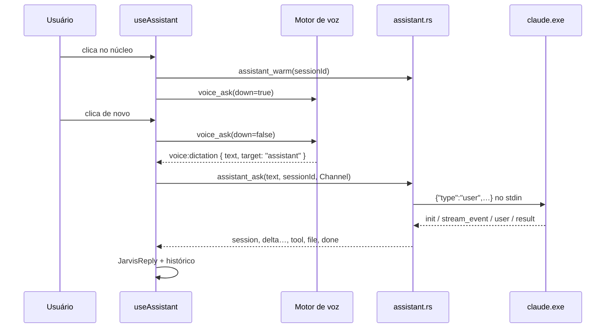

# Feature Specification: JARVIS Assistant

## Metadata

| Field | Value |
|---|---|
| Feature ID | `feature/assistant` |
| Product | JARVIS OS (jvOS) |
| Feature Status | Implementado |
| Document Status | Reescrita em 2026-11-05 no formato Feature Specification; sem decisões em aberto |
| Source Commit | `750ebd0` (2026-10-27); evoluída em `048a254` (2026-10-27); o nome do usuário no perfil, o passo crescente dos arquivos (`FILE_STEP_SHARE`) e a renderização a cada 32 ms entraram em `e7151cf` (2026-11-05) |
| Uncommitted Changes | Nenhuma |
| Voice Shortcut | `voice:shortcut` com `action: "ask"` (frase sem comando dita ao Voice) |
| Assistant Tool | Nenhuma própria; as ferramentas do JARVIS são do [assistant-tools](../assistant-tools/spec.md) |
| Target Platforms | Windows 11 com WebView2 e o `claude.exe` do usuário; no navegador (modo web) não há conversa, só o fake de DEV dos testes |
| Language | PT-BR no conteúdo e nas falas; inglês nos títulos das seções e em Given / When / Then |
| Last Editorial Revision | 2026-11-05 |
| Verification Scope | Conferida com o código em 2026-11-05: `src-tauri/src/assistant.rs`, `src-tauri/src/lib.rs` (`assistant_*`, `voice_ask`, `AppState::assistant_profile`, `setup`, `RunEvent::Exit`), `src-tauri/src/voice/mod.rs` (`Buttons`, `Recording`, `dictation_prompt`), `src-tauri/src/git/mod.rs` (`kill_tree`), `src-tauri/src/settings.rs` (`ASSISTANT_MODELS`, `MAX_NAME`), `src/lib/assistant.ts`, `src/lib/storage.ts`, `src/hooks/useAssistant.ts`, `src/components/CoreButton.tsx`, `src/components/JarvisReply.tsx`, `src/components/AssistantDrawer.tsx`, `src/components/AssistantHistory.tsx`, `src/styles/globals.css` (`superhot-*`), `src/App.tsx`, `tests/assistant.spec.ts`, `tests/agent.spec.ts` e `tests/shortcuts.spec.ts`. Os testes não foram executados nesta revisão |

Especificação no formato inspirado no GitHub Spec Kit, com seções de desenho técnico ([ADR-0025](../../arch/adr/0025-features-formato-feature-specification.md)). Os identificadores US1–US6, RF-001–RF-010, RNF-001–RNF-002, SC-001–SC-002 e T001–T032 são os mesmos da versão anterior. Os critérios de aceite AC-001–AC-013 são os antigos "Critério 1" a "Critério 13", na mesma ordem. KL-* registra limitações conhecidas; OQ-*, decisões de produto em aberto. Nenhum dos dois acrescenta escopo.

## Overview

O JARVIS é o cérebro conversacional do jvOS. O usuário clica no núcleo do holograma e fala. A resposta aparece dentro do núcleo em letras grandes, palavra por palavra (estilo SUPERHOT), e é falada pela [voz do JARVIS](../tts/spec.md).

Quem responde é o Claude Code local do usuário (`claude.exe`), com a conta dele e sem chave de API. O processo fica aberto entre as perguntas, para responder em cerca de um segundo. Ele trabalha confinado à pasta `Documentos\JARVIS` (notas, rascunhos de agentes e a memória de longo prazo) e age no desktop pelas ferramentas do [servidor MCP](../assistant-tools/spec.md). A conversa fica num histórico ao lado do núcleo. Personalidade e regras de fala estão em [jarvis-persona](../../domain/jarvis-persona.md).

| Input | Expected Behavior | Execution Path |
|---|---|---|
| Clique no núcleo, a pergunta falada, outro clique | A pergunta vai ao JARVIS e a resposta entra no núcleo e no histórico | `voice_ask` → Whisper → `assistant_ask` → `claude.exe` |
| Segurar o núcleo por 350 ms ou mais e soltar | O mesmo, como segurar-para-falar | Idem |
| Uma frase sem comando dita ao Voice | Vai ao JARVIS como pergunta | `voice:shortcut` `ask` → `useAssistant.ask` |
| "Salva isso nas notas" | A nota abre no Jarvis Mark enquanto é escrita | `Write` → evento `file` → `noteRequests` |
| Clique no núcleo ou Esc durante a resposta | A resposta para e fica como "Interrompida" | `assistant_cancel` |
| "Que horas são?" (atalho local) | A resposta entra no núcleo e no histórico sem o Claude Code | `useAssistant.say` |

## Goals and Success Criteria

### Goals

- Conversar com o JARVIS só pela voz, a partir do núcleo.
- Responder rápido, com o processo do Claude Code aquecido e reaproveitado.
- Manter a conversa entre perguntas e entre aberturas do app, pela sessão do Claude Code.
- Deixar o usuário interromper uma resposta a qualquer momento.
- Mostrar os erros do Claude Code, em vez de falhar em silêncio.
- Abrir na janela certa o que o JARVIS escreve, enquanto ele escreve.
- Nunca deixar o JARVIS ler, escrever ou rodar nada fora de `Documentos\JARVIS`.

### Success Criteria

| ID | Criterion | Verification |
|---|---|---|
| SC-001 | Com o processo pré-aquecido, a primeira palavra chega em cerca de 1 s após a pergunta. | Medição manual no app desktop: partida a frio ~2,3 s, ~1 s com o processo vivo ou com `--resume` (RNF-001). Sem teste automatizado (KL-001). |
| SC-002 | O JARVIS nunca lê nem escreve fora de `Documentos\JARVIS` e não roda comandos. | Os argumentos de `spawn` em `assistant.rs`: `--restricted`, `--tools` sem `Bash`, `--permission-mode dontAsk`, cwd na pasta. Comportamento do `--restricted` verificado no `claude.exe` 2.1.310 ([ADR-0007](../../arch/adr/0007-jarvis-confinado-a-documentos.md)). |

## Scope and Non-Goals

### In Scope

- Um único `claude.exe` em stream-json, vivo entre as perguntas, com pré-aquecimento.
- A pergunta pelo microfone do núcleo (clique ou segurar) e pelo Voice (`ask`).
- A resposta transmitida aos pedaços até o núcleo e o histórico.
- Continuar a conversa pela sessão do Claude Code, "Nova conversa" e "Limpar histórico".
- Interromper pela voz do núcleo, pelo clique ou pelo Esc.
- Erros do Claude Code no núcleo e no histórico.
- Notas e agentes escritos pelo JARVIS abrindo no Jarvis Mark e no jv_agent.
- Respostas locais (hora, lembretes, confirmações) mostradas como respostas do JARVIS.
- O modelo (`assistantModel`) e o nome do usuário (`assistantName`) vindos das Configurações.

### Out of Scope

- As ferramentas do jvOS (MCP): ver [assistant-tools](../assistant-tools/spec.md).
- Os atalhos de voz que viram prompts: ver [voice-shortcuts](../voice-shortcuts/spec.md).
- Digitar a pergunta: só por voz (núcleo ou Voice) ou pelos atalhos.
- A memória inteira: ela entra pela linha de comando (limite de 32 767 caracteres do Windows), então só os primeiros 8000 caracteres de `Memória.md` chegam ao JARVIS (KL-003).
- A anotação rápida (`assistant_note`), em [quick-notes](../quick-notes/spec.md), e a limpeza de memória (`assistant_sleep`), em [memory-cleanup](../memory-cleanup/spec.md).

## User Stories

### US1 — Ask Through the Core

**Priority:** P1.

**User Story:** Como usuário, clico no núcleo, falo e clico de novo para enviar.

**Why This Priority:** é a interação principal com o JARVIS.

**Independent Test:** `tests/assistant.spec.ts` — "the core answers SUPERHOT style, word by word, and the answer lands in the history".

**Acceptance Criteria:** AC-001, AC-002, AC-003 e AC-004.

### US2 — Continue or Restart the Conversation

**Priority:** P1.

**User Story:** Como usuário, faço uma pergunta de seguimento, e "Nova conversa" começa outra.

**Why This Priority:** sem contexto, cada pergunta seria isolada.

**Independent Test:** `tests/assistant.spec.ts` — "a follow-up continues the conversation; Nova conversa starts another".

**Acceptance Criteria:** AC-005, AC-006 e AC-007.

### US3 — Interrupt an Answer

**Priority:** P1.

**User Story:** Como usuário, interrompo uma resposta longa.

**Why This Priority:** respostas erradas ou longas demais precisam parar.

**Independent Test:** `tests/assistant.spec.ts` — "a click on the core or Esc interrupts the answer, which is kept as interrupted".

**Acceptance Criteria:** AC-008 e AC-009.

### US4 — See Failures

**Priority:** P2.

**User Story:** Como usuário, vejo por que o JARVIS não respondeu (sem login, processo encerrado), no núcleo e no histórico.

**Why This Priority:** sem o erro, o usuário não sabe se deve esperar, tentar de novo ou entrar na conta.

**Independent Test:** `tests/assistant.spec.ts` — "a failure shows inside the core and in the history".

**Acceptance Criteria:** AC-010.

### US5 — Files JARVIS Writes Open by Themselves

**Priority:** P2.

**User Story:** Como usuário, peço "salva isso nas notas" e vejo a nota sendo escrita no Jarvis Mark.

**Why This Priority:** o usuário acompanha e edita o que o JARVIS produz.

**Independent Test:** `tests/assistant.spec.ts` — "a note JARVIS writes opens in Jarvis Mark, its text arriving as it is written".

**Acceptance Criteria:** AC-011 e AC-012.

### US6 — Outside the Desktop App

**Priority:** P3.

**User Story:** Como usuário no navegador, sou avisado de que a conversa precisa do app desktop.

**Why This Priority:** o modo web serve para desenvolver e testar a interface; o Claude Code só roda no app.

**Independent Test:** `tests/assistant.spec.ts` — "in a browser the core says the conversation needs the desktop app".

**Acceptance Criteria:** AC-013.

## Requirements

### Functional Requirements

| ID | Requirement | Related Stories |
|---|---|---|
| RF-001 | O sistema DEVE rodar `claude.exe` (achado no `PATH` ou em `%USERPROFILE%\.local\bin`) em `-p` com entrada e saída stream-json, mantendo o processo vivo entre perguntas. | US1, US2 |
| RF-002 | O processo DEVE rodar com `--restricted`, ferramentas `WebSearch,WebFetch,Read,Edit,Write,Glob,Grep`, `--permission-mode dontAsk`, só o servidor MCP do JARVIS (`--strict-mcp-config`), `--disable-slash-commands`, `--effort low` e cwd `Documentos\JARVIS`. | US1 |
| RF-003 | O prompt de sistema DEVE somar a persona (`src-tauri/assistant-persona.md`, embutida com `include_str!`), o nome do usuário (ou a instrução de não usar nome) e até 8000 caracteres de `Memória.md`. | US1 |
| RF-004 | O modelo DEVE vir de `assistantModel` (`haiku`, `sonnet`, `opus` ou `default`, que não passa `--model`); padrão `sonnet`. | US1 |
| RF-005 | O sistema DEVE pré-aquecer o processo ao abrir o app, ao começar a gravar uma pergunta e depois de cancelar ou resetar. `assistant_warm` é ignorado com uma resposta em curso. | US1, US2, US3 |
| RF-006 | A resposta DEVE chegar por `ipc::Channel` como eventos `session`, `delta`, `tool`, `file` e `done`, e sempre terminar com `done`. | US1, US4, US5 |
| RF-007 | Durante uma ferramenta, o núcleo DEVE mostrar o status em PT-BR (`describeTool`: "Pesquisando na web", "Lendo uma página", "Escrevendo"…). | US1 |
| RF-008 | O histórico DEVE guardar no máximo 200 itens e o id da sessão em `jarvis.assistant`, validados ao ler. | US2 |
| RF-009 | Respostas locais (hora, lembretes, confirmações de voz) DEVEM entrar no núcleo e no histórico como qualquer resposta, sem o Claude Code (`say`), e só quando ele está ocioso. | US1 |
| RF-010 | Ao fechar o app, nenhum `claude.exe` DEVE sobreviver (`taskkill /T /F`). | US3 |

### Non-Functional Requirements

| ID | Requirement | Scope |
|---|---|---|
| RNF-001 | Partida a frio ~2,3 s, ~1 s com `--resume`. Latência de API medida com `--effort low`: Haiku ~0,77 s, Sonnet ~0,86 s, Opus ~1,7 s. | Medido em 2026-10-27 no `claude.exe` 2.1.310 desta máquina; não é verificado por teste. |
| RNF-002 | O autoupdater do Claude Code fica desligado no processo do JARVIS (`DISABLE_AUTOUPDATER=1`). | Só o processo do JARVIS; as sessões do próprio usuário atualizam o `claude.exe`. |

### Operational Constraints

- Uma pergunta por vez.
- Memória: no máximo 8000 caracteres (`MAX_MEMORY`), lidos de novo a cada início do processo.
- Histórico: no máximo 200 itens (`MAX_ITEMS`), gravado com debounce de 250 ms.
- Transcrição do núcleo: no máximo 90 s (`TRANSCRIBE_TIMEOUT_MS`).
- Clique × segurar: 350 ms (`MIN_HOLD_MS`).
- Renderização da resposta: no máximo a cada 32 ms (`STREAM_STEP_MS`).
- Arquivo em escrita: um evento a cada 24 caracteres novos ou mais (`FILE_STEP`, `FILE_STEP_SHARE` = 1/32).
- Stderr guardado: as últimas 12 linhas (`STDERR_LINES`).
- Nome do usuário: uma linha, até 40 caracteres (`MAX_NAME`).

## Acceptance Criteria

### AC-001 — Show the Idle Core

**Related Story:** US1.

- **Given** o núcleo ocioso
- **When** o mouse passa sobre ele
- **Then** o botão se chama "Falar com o JARVIS" e o título diz "Clique e fale (ou segure enquanto fala)".

### AC-002 — Record a Question

**Related Story:** US1.

- **Given** o núcleo ocioso no app desktop
- **When** o usuário clica e fala
- **Then** o microfone grava para o JARVIS (estado `asking`) e o botão vira "Enviar para o JARVIS". Segurar por 350 ms ou mais e soltar também envia.

**Coverage Status:** sem teste automatizado (KL-002).

### AC-003 — Stream the Answer Word by Word

**Related Story:** US1.

- **Given** a pergunta enviada
- **When** o Whisper termina
- **Then** a pergunta aparece no topo, três pontos pulsam e, ao chegar o texto, as palavras entram uma a uma, uma frase (ou 14 palavras) por página.

### AC-004 — Keep the Answer in the History

**Related Story:** US1.

- **Given** a resposta completa (`done`)
- **When** a última página sai do núcleo
- **Then** o par pergunta/resposta está no histórico e em `jarvis.assistant`, com o id da sessão.

### AC-005 — Continue the Session

**Related Story:** US2.

- **Given** uma resposta anterior
- **When** o usuário pergunta de novo
- **Then** a pergunta vai na mesma sessão do Claude Code (o id salvo).

### AC-006 — Start a New Conversation

**Related Story:** US2.

- **Given** "Nova conversa" no histórico
- **When** o usuário clica
- **Then** a sessão é esquecida, uma marca "Nova conversa · <hora>" entra no histórico e a próxima pergunta abre outra sessão.

### AC-007 — Clear the History

**Related Story:** US2.

- **Given** "Limpar histórico"
- **When** o usuário clica
- **Then** o histórico fica vazio ("Clique no núcleo e fale com o JARVIS. As respostas ficam guardadas aqui.") e a sessão também é esquecida.

### AC-008 — Interrupt an Answer

**Related Story:** US3.

- **Given** o JARVIS respondendo ("Interromper o JARVIS")
- **When** o usuário clica no núcleo ou aperta Esc
- **Then** a resposta para e fica no histórico como "Interrompida", com o que já tinha sido mostrado.

### AC-009 — Discard a Recording

**Related Story:** US3.

- **Given** o microfone do núcleo gravando
- **When** o usuário aperta Esc
- **Then** a pergunta é descartada antes do Whisper e a dock diz "Pergunta cancelada".

**Coverage Status:** sem teste automatizado (KL-002).

### AC-010 — Show a Failure

**Related Story:** US4.

- **Given** o Claude Code sem login
- **When** o usuário pergunta
- **Then** o erro ("Not logged in · Please run /login") aparece no núcleo por 5 s e no histórico.

### AC-011 — Stream a Note Into Jarvis Mark

**Related Story:** US5.

- **Given** um `Write` em `Notas\`
- **When** o conteúdo chega aos pedaços
- **Then** o Jarvis Mark abre e o texto cresce a cada 24 caracteres ou mais.

### AC-012 — Open an Agent Draft in jv_agent

**Related Story:** US5.

- **Given** um `Write` ou `Edit` em `Agentes\*.md`
- **When** acontece
- **Then** o arquivo abre no [jv_agent](../../apps/jv_agent/spec.md).

### AC-013 — Explain the Browser Limitation

**Related Story:** US6.

- **Given** o navegador, sem o app desktop
- **When** o usuário clica no núcleo
- **Then** a dock diz "Disponível no app desktop". Com o núcleo desligado, nem o núcleo nem o botão do histórico aparecem.

## Behavior and Flows

### Claude Code Process (`Assistant`)

Em `assistant.rs`, um único `claude.exe` em stream-json, vivo entre as perguntas.

- **Behavior:**
  - Rode o `claude.exe` com os argumentos de RF-001, RF-002 e RF-004 (lista completa em [Claude Code Command Line](#claude-code-command-line)). Antes, crie `Documentos\JARVIS`, `Notas\` e `Agentes\`; se falhar, responda "Falha ao criar <pasta>: <erro>".
  - O prompt de sistema vai em `--append-system-prompt` (RF-003): a persona; "O usuário se chama <nome>: …" ou "Você ainda não sabe o nome do usuário: …"; e, se `Memória.md` tiver texto, "O que você já guardou em Memória.md:" seguido dos primeiros 8000 caracteres. O nome vem antes da memória.
  - Cada pergunta é uma linha JSON no stdin (`{"type":"user",…}`). Só uma por vez: com outra em curso, o Rust responde "Ainda estou respondendo.". Uma pergunta vazia recebe "Pergunta vazia".
  - `ensure` reinicia o processo se ele morreu, se o perfil mudou (modelo ou nome nas Configurações) ou se a sessão pedida é outra que a do processo. O processo novo é retomado com `--resume <id>`.
  - Se a sessão estiver apagada ou for de outra máquina (não existe `<CLAUDE_CONFIG_DIR ou ~/.claude>/projects/*/<id>.jsonl`), ou se o id não for só hexa e hífen, ela não é retomada e começa uma nova. Sem a pasta `projects`, a sessão é dada como existente.
  - Se o `claude.exe` não for encontrado, responda "Claude Code não encontrado. Instale-o (claude.ai/code) e entre na sua conta rodando `claude` uma vez.". Se ele não iniciar: "Não consegui iniciar o Claude Code: <erro>". Se o stdin falhar: "Falha ao falar com o Claude Code: <erro>".
  - `cancel` mata o processo e envia `done { cancelled: true }`; a sessão continua. `reset` esquece a sessão e faz o mesmo com uma resposta em curso.
  - Ao fechar o app, `close()` roda no `RunEvent::Exit` e `kill_tree` encerra a árvore do processo (RF-010).
  - O processo roda sem janela (`CREATE_NO_WINDOW`) e com `DISABLE_AUTOUPDATER=1` (RNF-002).

### Answer Reading (`parse_line`)

Uma thread lê o stdout e converte cada linha em `AssistantEvent`, enviado ao `ipc::Channel` da pergunta em curso (RF-006).

| stream-json | Event | Rule |
|---|---|---|
| `system` / `init` | `session { id }` | Grava o id da sessão no Rust |
| `content_block_start` de texto | — | Se já houve texto, o próximo `delta` começa com `\n\n` (um parágrafo novo depois de uma ferramenta) |
| `text_delta` | `delta { text }` | Vazio é ignorado |
| `tool_use` ou `server_tool_use` | `tool { name }` | Abre o bloco da ferramenta |
| `input_json_delta` de um `Write` | `file { path, content }` | Relido quando o JSON cresce `max(24, 1/32 do que já chegou)`; enviado com 24 caracteres novos ou mais |
| `content_block_stop` de `Write` ou `Edit` | `file { path, content }` (só `Write`) | O conteúdo completo; o arquivo fica à espera do resultado |
| `tool_result` sem `is_error` | `file { path, done: true }` | Um resultado com erro não avisa nada |
| `result` | `done { text, error }` | O texto é o que foi transmitido; sem nada transmitido, o `result` |
| Linha de subagente (`parent_tool_use_id` preenchido), `thinking_delta`, `rate_limit_event`, outros `system` | — | Ignorada: só a fala do próprio JARVIS aparece |

- Os erros de `result` (`is_error` ou subtype diferente de `success`) vão em `done { error }`: as linhas de `errors`; senão, o texto de `result`; senão, "O Claude Code falhou (<subtype>)".
- Se o processo morrer no meio, a resposta termina com as últimas 12 linhas do stderr, ou "O Claude Code encerrou sem responder".
- Um `done` com erro antes do `init` (por exemplo, uma sessão que não pôde ser retomada) faz o Rust e a UI esquecerem o id.
- Com passos fixos, um arquivo longo custava tempo quadrático, porque cada passo relê o JSON inteiro e manda o conteúdo inteiro. O passo crescente (`FILE_STEP_SHARE`) mantém o custo perto do linear.
- Na UI, os `delta` são juntados: o texto é renderizado no máximo a cada 32 ms (`STREAM_STEP_MS`), não a cada token. Um `tool` ou o `done` descarregam antes o que estiver pendente.

### `useAssistant`

O hook que controla as fases do núcleo, o microfone do núcleo e o histórico.

- **Behavior:**
  - As fases (`CorePhase`) são `idle`, `listening`, `transcribing`, `thinking` (resposta sem texto ainda) e `answering`.
  - `press`/`release`: um clique abre o microfone (`voice_ask`, estado `asking`) e o próximo envia. Segurar por 350 ms ou mais e soltar também envia. Um clique com o JARVIS trabalhando cancela.
    - Com a escuta desligada, `voice_ask` liga o motor só para a pergunta e o desliga depois.
    - O texto chega por `voice:dictation` com `target: "assistant"`. O motor grava como `Recording::Dictation(Assistant)`, com o prompt "Olá, Jarvis, tudo bem? …" para o Whisper (em inglês, "Hello, Jarvis, …").
    - Sem modelo de voz baixado, as Configurações abrem e a dock diz "Baixe um modelo de voz".
  - `ask(question, prompt?)` chama `assistant_ask` com o id salvo. O histórico guarda `question`; o Claude Code recebe `prompt`, se houver (um atalho com instruções). O evento `session` grava o id novo.
  - Ao chegar `done`, grave o par pergunta/resposta no histórico. Uma resposta cancelada fica como "Interrompida", com o que já tinha sido mostrado. Se `assistant_ask` for rejeitado, a entrada fica com o erro.
  - RF-009: `say(question, answer)` mostra uma resposta local como qualquer outra e a guarda no histórico. Devolve falso fora da fase `idle`; quem chamou manda a fala para a dock (`reply` em `App.tsx`).
  - `reset` ("Nova conversa") esquece a sessão e põe a marca "Nova conversa" no histórico, se o último item já não for uma. `clear` ("Limpar histórico") esvazia a lista e também esquece a sessão. Os dois pré-aquecem um processo novo.
  - Uma frase sem comando dita ao Voice chega como `ask(said)`; um atalho de pesquisa, como `ask(said, shortcutPrompt(…))`.
  - Esc cancela o que o núcleo estiver fazendo; com o núcleo ocioso, tira da tela uma resposta pronta (`dismiss`).

### `CoreButton`

O coração do holograma como botão: falar com o JARVIS.

- **Behavior:**
  - O rótulo (`aria-label`) e a dica (`title`) seguem a fase:

    | Phase | Label | Hint |
    |---|---|---|
    | `idle` | "Falar com o JARVIS" | "Clique e fale (ou segure enquanto fala)" |
    | `listening` | "Enviar para o JARVIS" | "Clique para enviar · Esc cancela" |
    | `transcribing` | "Cancelar a pergunta" | "Entendendo a pergunta… · clique ou Esc cancela" |
    | `thinking` | "Interromper o JARVIS" | "Pensando… · clique ou Esc interrompe" |
    | `answering` | "Interromper o JARVIS" | "Respondendo… · clique ou Esc interrompe" |

  - Só o botão esquerdo conta. O ponteiro é capturado ao pressionar. Se ele for perdido (`pointercancel`), a liberação conta como cancelamento.
  - Enter e Espaço pressionam e soltam como o ponteiro; a repetição da tecla é ignorada.
  - O botão continua sendo superfície do desktop (`data-desktop-surface`): um clique nele não deixa nenhuma janela em foco.
  - Não aparece com o núcleo desligado, durante o boot nem durante a saudação.
- **Layout:** um círculo invisível no centro do núcleo (`CORE_CENTER_Y_CSS`), com 50% da composição, acima do holograma e abaixo das janelas (`z-[12]`).
- **Style:**
  - Gravando, um anel `border-hud-holo/60` pulsa (`animate-pulse`) com brilho por dentro e por fora.
  - Nas outras fases, o anel é `border-hud-cyan/25` e só aparece no hover ou no foco; o foco por teclado ganha um anel `hud-light/40`.

### `JarvisReply`

A resposta dentro do núcleo, estilo SUPERHOT: letras grandes entrando palavra por palavra, uma frase por vez, enquanto a resposta ainda chega.

- **Behavior:**
  - `paginate` limpa o Markdown (`speechText`: sem blocos de código, links e URLs) e corta a resposta em páginas: uma frase (termina em `.`, `!`, `?`, `…`, `:` ou `;`), ou 14 palavras de uma frase longa. Uma frase com menos de 4 palavras divide a página com a próxima, e um parágrafo novo começa outra página. A palavra ainda sendo escrita fica para depois.
  - Sem voz, as palavras entram a cada 170 ms. Uma página completa fica 1,1 s + 230 ms por palavra e sai num glitch de 280 ms. Com a voz, cada página aparece quando a fala começa, as palavras se espalham pela fala e a página sai 250 ms depois do fim dela ([tts](../tts/spec.md)).
  - Antes da primeira palavra, mostre a pergunta no topo e três pontos pulsando (`Thinking`).
  - RF-007: durante uma ferramenta, mostre a pergunta e o status de `describeTool`:

    | Tool | Status |
    |---|---|
    | `WebSearch` | "Pesquisando na web" |
    | `WebFetch` | "Lendo uma página" |
    | `Write`, `Edit` | "Escrevendo" |
    | `Read`, `Glob`, `Grep` | "Lendo suas notas" |
    | Ferramentas do jvOS | O status de cada uma, em [assistant-tools](../assistant-tools/spec.md#status-in-the-core-describetool) ("Rodando o agente", "Consultando o tempo"…) |
    | Outra do jvOS sem texto próprio | "Executando no jvOS" |
    | Qualquer outra | "Trabalhando" |

  - Se a resposta falhar, mostre o erro no núcleo por 5 s, depois das páginas que já tinham chegado.
  - Se for cancelada, a página na tela sai no glitch e nada mais entra.
  - Com a preferência de som do boot ligada e sem voz, cada página entra com um impacto e sai com o zap do glitch.
  - O texto final também vai para um `role="status"` invisível, para leitores de tela.
- **Layout:**
  - Fixo no centro do núcleo, com 110% da largura da composição, e o fundo radial escuro (`BACKDROP`) de 95% atrás (`z-[11]`, sem receber cliques).
  - A pergunta ("› <pergunta>") fica logo acima das palavras, numa linha cortada com reticências.
  - O status da ferramenta, o erro ou as palavras ficam no centro. As palavras que ainda não entraram já ocupam o lugar delas, então as linhas nunca se rearrumam.
- **Style:**
  - Palavras `crt-text superhot-text` em maiúsculas: "Segoe UI Black" peso 900, `clamp(18px, composição × 0,052, 42px)`, com o desvio de cor do CRT. Cada uma entra com `superhot-word` (230 ms); a página sai com `superhot-out` (280 ms, em 4 passos). Com movimento reduzido, a página entra inteira e sai num fade de 300 ms.
  - A pergunta fica em `font-mono` maiúsculas `text-hud-text/60`, `clamp(10px, composição × 0,024, 14px)`.
  - O status da ferramenta fica em `font-mono` maiúsculas `text-hud-amber`, `clamp(11px, composição × 0,028, 16px)`, com o cursor piscando (`crt-cursor`).
  - O erro fica em `font-mono text-sm text-hud-alert`, com até 80% da largura.

### `AssistantDrawer` and `AssistantHistory`

O histórico do JARVIS, numa gaveta ao lado do núcleo.

- **Behavior:**
  - O botão "Histórico do JARVIS", junto ao núcleo, abre e fecha a gaveta. Ele some com o núcleo desligado e durante o boot.
  - Ao abrir, o foco vai para "Fechar histórico". Um clique fora fecha a gaveta, exceto no núcleo: dá para falar com o histórico aberto.
  - Esc com o foco dentro da gaveta fecha só a gaveta e devolve o foco ao botão. Com o foco fora, Esc fecha a gaveta só com o núcleo ocioso; senão, o Esc é do núcleo.
  - "Nova conversa" e "Limpar histórico" ficam desabilitados enquanto o JARVIS trabalha. "Nova conversa" também com o histórico vazio; "Limpar histórico", sem itens.
  - Vazio, mostre "Clique no núcleo e fale com o JARVIS. As respostas ficam guardadas aqui.".
  - A lista vai do mais antigo ao mais novo, com a resposta em curso no fim, e rola sozinha para o item mais novo.
    - A resposta é Markdown (com GFM); o renderizador só carrega com a gaveta aberta (`lazy`).
    - A resposta em curso mostra "Pensando", "Respondendo" ou o status da ferramenta.
    - A hora é "14:32" para hoje e "25/10 14:32" antes disso.
- **Layout:**
  - O botão é um círculo `size-9` com o ícone `History`, abaixo e à direita do núcleo (37% da composição em cada eixo).
  - A gaveta fica à direita (`top-10 right-4 bottom-4`, `z-[23]`), com 420 px de largura (no máximo `calc(100vw - 2rem)`). No cabeçalho, "JARVIS · Histórico" e os botões "Nova conversa", "Limpar histórico" e "Fechar histórico".
  - Cada item tem a pergunta numa linha (com `›` e a hora à direita) e, embaixo, a resposta com uma borda à esquerda. "Interrompida" e o erro vêm depois da resposta.
  - A marca de nova conversa é uma linha "Nova conversa · <hora>" entre dois traços.
- **Style:**
  - Botão `bg-hud-panel/70` (sem desfoque: fica sempre na tela, sobre o núcleo), `border-hud-cyan/25 text-hud-text/60`; aberto ou no hover, `border-hud-light/50 text-hud-light`.
  - Gaveta `rounded-2xl border border-hud-cyan/20 bg-hud-panel/82 backdrop-blur-xl`, com um fio de luz no topo e o texto selecionável. Entra deslizando 32 px em 0,35 s e sai em 0,18 s.
  - Título em 11 px, maiúsculas, `tracking-[0.32em] text-hud-light`. Botões do cabeçalho `size-8 text-hud-text/60`, com opacidade 35% desabilitados.
  - Pergunta em `font-mono` 12 px `text-hud-text/65`, com o `›` em `text-hud-cyan` e a hora em 10 px `text-hud-text/35`.
  - Resposta em 13 px `text-hud-text/90`, com `border-l border-hud-cyan/20`. O status em curso em `font-mono` 11 px maiúsculas `text-hud-amber/80`; "Interrompida" em 10 px maiúsculas `text-hud-text/40`; o erro em `font-mono` 11 px `text-hud-alert`.
  - A marca "Nova conversa" fica em 10 px maiúsculas `tracking-[0.24em] text-hud-text/40`, entre traços `bg-hud-cyan/15`.

### Files That Open by Themselves (`onAssistantFile`)

O que o JARVIS escreve aparece na janela certa enquanto ele escreve.

| File | Window | Channel |
|---|---|---|
| Dentro de `Notas\` | Jarvis Mark | `noteRequests` |
| `Agentes\*.md` (`Write` ou `Edit`) | [jv_agent](../../apps/jv_agent/spec.md) | `draftRequests` |
| Qualquer outro (`Memória.md`, a raiz, `Agentes\<nome>\…`) | Nenhuma | — |

- `assistant_folder` diz à UI onde ficam `root`, `notes` e `agents`. Antes de essa resposta chegar, os arquivos são ignorados.
- Se a janela não estiver aberta, ela é pré-carregada e aberta enquanto o conteúdo continua chegando.
- O último conteúdo de cada arquivo vai junto com o `done`, para uma janela que abriu tarde.

### Outside the Desktop App

- **Behavior:**
  - Sem Tauri e sem fake, `assistantBackend()` é nulo: `ask` faz a dock dizer "Disponível no app desktop".
  - O microfone do núcleo é do motor de voz do app. No navegador, com ou sem fake, um clique no núcleo faz a dock dizer "Disponível no app desktop".
  - Com o núcleo desligado, nem o núcleo nem o botão do histórico aparecem.
  - Em DEV, o fake `window.__JARVIS_ASSISTANT__` dá respostas roteirizadas, arquivos e erros, com log em `__JARVIS_ASSISTANT_LOG__`. Os testes perguntam por `window.__JARVIS__.ask`.

### Interaction Flow



### User Feedback

| Moment | Persona Key | Output |
|---|---|---|
| Resposta chegando | — | Palavras no núcleo, voz do JARVIS e a entrada em curso no histórico |
| Ferramenta em uso | — | Status de `describeTool` no núcleo e no histórico |
| Pergunta com outra em curso | — | Dock "Ainda estou respondendo", como erro |
| Enviar antes de o motor estar em `asking` | — | Dock "A voz ainda está carregando · tente de novo" |
| Nada foi dito | — | Dock "Não ouvi nada" |
| Whisper passa de 90 s | — | Dock "Não consegui entender a pergunta", como erro |
| Gravação ou transcrição cancelada | — | Dock "Pergunta cancelada" |
| Sem modelo de voz | — | Configurações abertas e dock "Baixe um modelo de voz", como erro |
| Resposta com erro | — | Erro no núcleo por 5 s e no histórico |
| Navegador | — | Dock "Disponível no app desktop" |
| Resposta local com o JARVIS ocupado | — | `reply` manda a fala para a dock (`notifyVoice`) |

As falas locais do JARVIS (hora, lembretes, confirmações) estão em `src/lib/jarvisLines.ts` e nas specs que as usam.

### Voice and Keyboard

- Clique no núcleo (ocioso): abre o microfone; o próximo clique envia.
- Segurar o núcleo por 350 ms ou mais: segurar-para-falar; soltar envia.
- Clique no núcleo (pensando ou respondendo): interrompe.
- `Enter` / `Espaço` no núcleo: como o clique.
- `Esc`: cancela a gravação, a transcrição ou a resposta; uma resposta pronta sai da tela; com o foco na gaveta, fecha o histórico.
- Frase sem comando dita ao Voice: `voice:shortcut` com `action: "ask"` → `ask(said)`.

## Data Model and Persistence

### Assistant Memory

```ts
interface ConversationEntry {
  id: number;          // Date.now() na pergunta
  at: number;          // ms desde a época Unix
  question: string;    // o que o usuário disse (não o prompt do atalho)
  answer: string;      // Markdown
  error?: string;
  cancelled?: boolean; // "Interrompida"
}

interface ConversationBreak {
  id: number;
  at: number;
  newConversation: true; // "Nova conversa"
}

type HistoryItem = ConversationEntry | ConversationBreak;

interface AssistantMemory {
  sessionId: string | null; // a sessão do Claude Code
  items: HistoryItem[];
}
```

Ver o [glossário](../../domain/glossary.md) e a [persistência](../../domain/persistence.md).

### Storage Rules

| Property | Value |
|---|---|
| State | `$histórico` (`AssistantMemory`) |
| Storage | `localStorage` |
| Key | `jarvis.assistant` |
| Write Debounce | 250 ms (`useStoredState`), com `flush` no `beforeunload` |
| Maximum Items | 200 (`MAX_ITEMS`): ficam os 200 últimos |
| Reader | `parseMemory`/`parseItem`: descartam itens sem `id` e `at` numéricos, ou sem `question` e `answer` texto (a marca só precisa de `newConversation: true`); `sessionId` só se for texto não vazio |
| Missing or Invalid Storage | `{ sessionId: null, items: [] }` |
| Session Id Format | A UI guarda qualquer texto não vazio; o Rust só retoma um id de hexa e hífen com o transcript presente |

### Profile and Folder

| Entity | Source | Rule |
|---|---|---|
| `Profile.model` | `settings.json` → `assistantModel` | `haiku`, `sonnet`, `opus` ou `default`; outro valor volta a `sonnet` no `sanitize` |
| `Profile.name` | `settings.json` → `assistantName` | Espaços e controles viram um espaço, até 40 caracteres; vazio por padrão |
| `Folder.root` | `Documentos\JARVIS` (ou `<home>\JARVIS` sem a pasta Documentos) | Criada pelo `spawn` |
| `Folder.notes`, `Folder.agents` | `root\Notas`, `root\Agentes` | Criadas pelo `spawn` |
| `Memória.md` | `root\Memória.md` | Relida a cada início do processo; aparada e cortada em 8000 caracteres |
| Sessões | `~/.claude/projects/` (ou `CLAUDE_CONFIG_DIR`) | São do Claude Code, não do jvOS |

Uma mudança de perfil reinicia o processo na próxima pergunta ou pré-aquecimento, retomando a sessão.

### Turn (memory only)

`AssistantTurn { id, question, text, tool, done, error, cancelled }`: a pergunta em curso, montada a partir dos `AssistantEvent`. Ela fica na tela até a última página sair.

## Technical Design

### Component Responsibilities

| File or Component | Responsibility |
|---|---|
| `src-tauri/src/assistant.rs` | `Assistant` (`warm`, `ask`, `cancel`, `reset`, `sleep`, `close`, `stop`, `ensure`, `spawn`), `system_prompt`, `read_output`, `read_errors`, `parse_line`, `partial_field`, `json_string`, `session_exists`, `claude_exe`, `append_note` |
| `src-tauri/assistant-persona.md` | A persona, embutida com `include_str!` (conteúdo em [jarvis-persona](../../domain/jarvis-persona.md)) |
| `src-tauri/src/lib.rs` | Comandos `assistant_ask`, `assistant_warm`, `assistant_cancel`, `assistant_reset`, `assistant_folder`, `voice_ask`; `assistant_profile`; a pasta em `setup`; `close()` no `RunEvent::Exit` |
| `src-tauri/src/voice/mod.rs` | `set_asking`, `DictationTarget::Assistant`, `VoiceState::Asking`, o prompt "Olá, Jarvis, …" |
| `src-tauri/src/git/mod.rs` | `kill_tree` (`taskkill /T /F /PID`) |
| `src/lib/assistant.ts` | `AssistantEvent`, `AssistantFolder`, backends Tauri e fake, `HistoryItem`, `parseMemory`, `describeTool`, `speechText` |
| `src/hooks/useAssistant.ts` | `CorePhase`, `ask`, `say`, `press`/`release`, `cancel`, `dismiss`, `reset`, `clear`, Esc |
| `src/components/CoreButton.tsx` | Rótulos e dicas por fase, captura do ponteiro, Enter/Espaço |
| `src/components/JarvisReply.tsx` | `paginate`, palavras SUPERHOT, ritmo com e sem voz, erro por 5 s |
| `src/components/AssistantDrawer.tsx`, `src/components/AssistantHistory.tsx` | "Histórico do JARVIS", "Nova conversa", "Limpar histórico", "Interrompida", Markdown |
| `src/App.tsx` | `coreVoice`, `onAssistantFile`, `reply`, `confirmCommand`, o caso `ask` de `shortcutHandler`, a montagem do núcleo e da gaveta |

### Process Lifecycle

1. Ao abrir o app, `useAssistant` chama `warm` com o id salvo. O processo nasce com `--resume`, se a sessão existir.
2. Cada pergunta passa por `ensure`: o mesmo processo, se estiver vivo, com o mesmo perfil e na mesma sessão; senão, um novo.
3. A thread de stdout entrega os eventos ao `Channel` da pergunta e libera a vez no `done`.
4. `cancel`, `reset`, uma troca de processo ou o fim do app aumentam a `generation`: as threads do processo antigo param de entregar eventos.
5. Se o processo terminar com uma pergunta em aberto, a thread fecha a pergunta com o stderr.

### Related Architecture Decisions

- [ADR-0006 — cérebro = claude.exe local em stream-json](../../arch/adr/0006-jarvis-via-claude-cli.md)
- [ADR-0007 — JARVIS restrito a Documentos\JARVIS](../../arch/adr/0007-jarvis-confinado-a-documentos.md)
- [ADR-0011 — fakes de dev e E2E modo web](../../arch/adr/0011-fakes-de-dev-e-e2e-modo-web.md)
- [Segurança](../../arch/security.md)

## Interfaces and Contracts

### Tauri Commands

| Command | Input | Output | Notes |
|---|---|---|---|
| `assistant_ask` | `{ text, sessionId, onEvent: Channel }` | — | Erros: "Pergunta vazia", "Ainda estou respondendo.", Claude Code ausente ou sem iniciar, "Falha ao falar com o Claude Code: …" |
| `assistant_warm` | `{ sessionId }` | — | Ignorado com uma resposta em curso |
| `assistant_cancel` | — | — | Mata o processo e envia `done { cancelled: true }`; a sessão continua |
| `assistant_reset` | — | — | Esquece a sessão (e cancela) |
| `assistant_folder` | — | `{ root, notes, agents }` | Para a UI saber de quem é cada arquivo |
| `voice_ask` | `{ down, cancel }` | `VoiceStatus` | Microfone do núcleo; liga o motor só para a pergunta, se preciso |

`assistant_note` está em [quick-notes](../quick-notes/spec.md) e `assistant_sleep` em [memory-cleanup](../memory-cleanup/spec.md).

### Events and Channels

| Event | Payload | Producer → Consumer |
|---|---|---|
| Channel `AssistantEvent` | `session { id }`, `delta { text }`, `tool { name }`, `file { path, content, done }`, `done { text, error, cancelled }` | `read_output` → `useAssistant.ask` |
| `voice:dictation` (`assistant`) | `{ text, pending, target }` | motor de voz → `asked` / `askPending` de `useVoiceAssistant` |
| `voice:shortcut` (`ask`) | `{ action: "ask", text, said }` | matcher → `shortcutHandler` → `ask(said)` |

`AssistantEvent` é um enum com tag `event` em camelCase, espelhado como união discriminada em `src/lib/assistant.ts`.

### Claude Code Command Line

```text
claude.exe -p --input-format stream-json --output-format stream-json --verbose --include-partial-messages
  --restricted --tools WebSearch,WebFetch,Read,Edit,Write,Glob,Grep --permission-mode dontAsk
  --allowedTools WebSearch WebFetch Read Edit Write Glob Grep mcp__jarvis
  --strict-mcp-config [--mcp-config <mcp.json>] [--model haiku|sonnet|opus]
  --disable-slash-commands --effort low --append-system-prompt <persona + nome + memória>
  [--resume <id>]
cwd: Documentos\JARVIS · env: DISABLE_AUTOUPDATER=1 · CREATE_NO_WINDOW
```

Sem o servidor MCP, o processo roda sem `--mcp-config` ([assistant-tools](../assistant-tools/spec.md)).

## Edge Cases and Error Handling

| Case | Behavior | Reference |
|---|---|---|
| Nada foi dito | Dock "Não ouvi nada" | `useAssistant` |
| Texto vazio no Rust | "Pergunta vazia" | `Assistant::ask` |
| Nada transmitido aos pedaços | O texto de `result` é a resposta | `nothing_streamed_falls_back_to_the_result` |
| Sem `Memória.md`, ou vazia | O prompt leva só a persona e o nome | RF-003 |
| Sem nome | A instrução de tratar o usuário sem nome | RF-003 |
| `jarvis.assistant` ausente ou ilegível | Histórico vazio; itens inválidos saem um a um | Storage Rules |
| Id de sessão fora do formato | A UI o guarda; o Rust não o retoma e começa outra sessão | `session_exists` |
| Pergunta com outra resposta em curso | A UI avisa "Ainda estou respondendo" na dock; o Rust também recusa com "Ainda estou respondendo." | `ask`, `Assistant::ask` |
| `assistant_warm` durante uma resposta | Ignorado | RF-005 |
| A mesma sessão e o mesmo perfil | O processo vivo é reaproveitado | `ensure` |
| "Nova conversa" duas vezes seguidas | Uma marca só | `reset` |
| Mais de 200 itens | Saem os mais antigos | RF-008 |
| Resposta local com o JARVIS ocupado | `say` devolve falso e a fala vai para a dock | RF-009 |
| Enviar antes de o motor estar em `asking` | "A voz ainda está carregando · tente de novo" | `send` |
| Whisper passa de 90 s | "Não consegui entender a pergunta" | Operational Constraints |
| O motor falha ou é desligado durante a pergunta | O núcleo sai da gravação ou da transcrição | `useAssistant` |
| O processo morre no meio | A resposta termina com as últimas 12 linhas do stderr, ou "O Claude Code encerrou sem responder" | Answer Reading |
| Falha antes de anunciar a sessão | Rust e UI esquecem o id; a próxima pergunta abre outra | Answer Reading |
| Modelo ou nome mudam nas Configurações | `ensure` reinicia o processo na próxima pergunta, com `--resume` | Profile and Folder |
| Sessão apagada ou de outra máquina | Não é retomada; começa outra | `session_exists` |
| Sem `claude.exe` | "Claude Code não encontrado. Instale-o (claude.ai/code) e entre na sua conta rodando `claude` uma vez." | AC-010 |
| Sem login | O erro do Claude Code no núcleo e no histórico | AC-010 |
| Um `Write` em `Notas\` que falha | O Jarvis Mark já recebeu o conteúdo, mas nunca o `done` | KL-004 |
| Um arquivo fora de `Notas\` e de `Agentes\*.md` | Nenhuma janela abre | Files That Open by Themselves |
| Fora do Tauri, sem fake | "Disponível no app desktop" | AC-013 |
| Permissões | `--restricted`, sem `Bash`, `dontAsk`, cwd `Documentos\JARVIS` e só o MCP do JARVIS: não lê nem escreve fora da pasta | SC-002, [ADR-0007](../../arch/adr/0007-jarvis-confinado-a-documentos.md) |
| Fechar o app com o processo vivo | `close()` e `taskkill /T /F` | RF-010 |

## Dependencies

### Feature Dependencies

| Dependency | Purpose |
|---|---|
| [voice-engine](../voice-engine/spec.md) | `voice_ask` e o texto em `voice:dictation` |
| [voice-shortcuts](../voice-shortcuts/spec.md) | A pergunta livre (`ask`) e os prompts dos atalhos |
| [tts](../tts/spec.md) | A voz e o ritmo das palavras |
| [assistant-tools](../assistant-tools/spec.md) | O servidor MCP passado em `--mcp-config` e os status das ferramentas do jvOS |
| [holographic-core](../holographic-core/spec.md) | O núcleo onde ficam o botão e a resposta |
| [appearance](../appearance/spec.md) | `crt-*` e `superhot-*` |
| [settings](../settings/spec.md) | `assistantModel` e `assistantName` |
| [dock-taskbar](../dock-taskbar/spec.md) | Os avisos no item Voice |
| [jarvis-mark](../../apps/jarvis-mark/spec.md) e [jv_agent](../../apps/jv_agent/spec.md) | Onde os arquivos abrem |

### Runtime Dependencies

- [Claude Code](../../foundation/vendor/claude-code/spec.md): o `claude.exe` do usuário, do instalador nativo, verificado na versão 2.1.310.
- [Tauri](../../foundation/vendor/tauri/spec.md) (`ipc::Channel`, `invoke`), [serde](../../foundation/vendor/serde/spec.md) (`serde_json`), [React](../../foundation/vendor/react/spec.md), [motion](../../foundation/vendor/motion/spec.md), [lucide](../../foundation/vendor/lucide/spec.md) e [Markdown](../../foundation/vendor/markdown/spec.md) (`react-markdown`, `remark-gfm` no histórico).
- Rede: o Claude Code fala com a API da Anthropic com o login do usuário, sem chave de API.
- `claude.exe` no `PATH` ou em `%USERPROFILE%\.local\bin`, a pasta `Documentos\JARVIS`, as sessões em `~/.claude/projects/` e o `taskkill` do Windows.

## Test Strategy and Coverage

### Reported Tests

| Test Reference | Coverage | Acceptance Mapping |
|---|---|---|
| `tests/assistant.spec.ts` — "the core answers SUPERHOT style, word by word, and the answer lands in the history" | Núcleo ocioso, palavras uma a uma, 14 por página, segunda página, par no histórico e em `jarvis.assistant` com a sessão | AC-001 (rótulo), AC-003, AC-004 |
| `tests/assistant.spec.ts` — "a follow-up continues the conversation; Nova conversa starts another" | Mesma sessão no seguimento, marca "Nova conversa ·", sessão nova, "Limpar histórico" | AC-005, AC-006, AC-007 |
| `tests/assistant.spec.ts` — "a click on the core or Esc interrupts the answer, which is kept as interrupted" | Interrupção por clique e por Esc, "Interrompida" com o texto mostrado | AC-008 |
| `tests/assistant.spec.ts` — "a failure shows inside the core and in the history" | "Not logged in · Please run /login" no núcleo e no histórico | AC-010 |
| `tests/assistant.spec.ts` — "a note JARVIS writes opens in Jarvis Mark, its text arriving as it is written" | A nota cresce no Jarvis Mark antes de ficar completa | AC-011 |
| `tests/assistant.spec.ts` — "in a browser the core says the conversation needs the desktop app" | "Disponível no app desktop"; núcleo desligado sem botão nem histórico | AC-013 |
| `tests/agent.spec.ts` — "JARVIS writes the agent in jv_agent, shows it for review and runs it once in jv_sh" | Um `Write` em `Agentes\*.md` abre no jv_agent | AC-012 |
| `tests/shortcuts.spec.ts` — "a question said to Voice goes to JARVIS; a research goes with its instructions, the words stay in the history" | `ask(said)` e o prompt do atalho, com a frase dita no histórico | `ask` |
| `tests/shortcuts.spec.ts` — "the time, the date and the status are answered at once, without Claude Code" | Respostas locais no núcleo e no histórico, sem perguntas ao Claude Code | RF-009 |
| `tests/shortcuts.spec.ts` — "JARVIS's model is chosen in the settings, next to the Whisper models" | `assistantModel` escolhido nas Configurações | RF-004 |
| `src-tauri/src/assistant.rs` — `streams_the_answer_and_ends_the_turn`, `a_web_search_splits_the_answer_into_paragraphs`, `nothing_streamed_falls_back_to_the_result`, `failures_carry_their_reason` | `session`, `delta`, `tool`, `done`; parágrafo após ferramenta; recuo para o `result`; erros com motivo | AC-003, AC-010 |
| `src-tauri/src/assistant.rs` — `a_write_streams_its_content_then_lands_on_disk`, `an_edit_reports_its_file_once_done_and_failures_report_nothing`, `partial_fields_are_read_as_they_arrive` | `Write` aos pedaços, `Edit` só no fim, falha sem aviso, JSON parcial | AC-011, AC-012 |
| `src-tauri/src/assistant.rs` — `the_memory_joins_the_persona`, `only_session_ids_are_looked_up`, `subagents_and_other_lines_are_ignored` | Persona, nome e memória; ids de sessão; subagentes ignorados | RF-003, RF-006 |
| `src-tauri/src/settings.rs` — `jarvis_models_are_checked`, `the_name_is_one_short_line` | `assistantModel` fora da lista volta a `sonnet`; nome em uma linha de até 40 caracteres | RF-004 |

### Verification Commands

Na raiz do repositório:

```powershell
npx playwright test tests/assistant.spec.ts --project ui
npx playwright test tests/agent.spec.ts --project ui -g "JARVIS writes the agent"
npx playwright test tests/shortcuts.spec.ts --project ui -g "a question said to Voice"
npx playwright test tests/shortcuts.spec.ts --project ui -g "answered at once"
npx playwright test tests/shortcuts.spec.ts --project ui -g "JARVIS's model is chosen"
```

Em `src-tauri`:

```powershell
cargo test --lib assistant::tests
cargo test --lib settings::tests::jarvis_models_are_checked
cargo test --lib settings::tests::the_name_is_one_short_line
```

### Coverage Gaps

| Gap | Evidence Status | Suggested Verification |
|---|---|---|
| Microfone do núcleo (AC-002, AC-009) | Sem teste: os testes usam `__JARVIS__.ask` | Um teste com um fake de `voice_ask` que confira `asking`, o envio e o descarte |
| O `claude.exe` real | Só linhas gravadas em `assistant.rs` | Um teste manual ou de integração contra o `claude.exe` instalado |
| Dica do núcleo ocioso (AC-001) | Só o rótulo é conferido | Conferir o `title` "Clique e fale (ou segure enquanto fala)" |
| Esc com a gaveta aberta e o núcleo ativo | Sem teste | Abrir a gaveta durante uma resposta e conferir quem recebe o Esc |
| Processo que morre no meio | Sem teste | Um processo falso que encerra antes do `result` |
| `ensure` com troca de perfil | Sem teste | Mudar `assistantModel` entre duas perguntas e conferir o reinício com `--resume` |

## Implementation Plan

**Status Convention:** `[x]` feito · `[ ]` pendente · `[P]` pode rodar em paralelo (arquivos diferentes) · `[USn]` história desta spec. As tarefas foram reconstruídas do código e do commit de origem.

### Phase 1 — Foundation

- [x] T001 [P] Persona do JARVIS — `src-tauri/assistant-persona.md`
- [x] T002 [P] `AssistantEvent`, `Folder`, `Profile`, `claude_exe`, `session_exists` — `src-tauri/src/assistant.rs`
- [x] T003 `spawn` com os argumentos stream-json, `--restricted`, ferramentas, `dontAsk`, MCP estrito, `--model`, `--effort low`, prompt de sistema e `--resume` — `src-tauri/src/assistant.rs`
- [x] T004 `parse_line`: init → `session`, `text_delta` → `delta` (parágrafo após ferramenta), `tool_use` → `tool`, `result` → `done`; subagentes ignorados — `src-tauri/src/assistant.rs`
- [x] T005 [P] Tipos espelhados, backends Tauri/fake, `parseMemory`, `describeTool`, `speechText` — `src/lib/assistant.ts`

### Phase 2 — Ask Through the Core (US1)

- [x] T006 [US1] Comandos `assistant_ask` (Channel), `assistant_warm`, `assistant_folder`, `voice_ask` — `src-tauri/src/lib.rs`
- [x] T007 [US1] Flag `asking` e `Recording::Dictation(Assistant)` com prompt "Olá, Jarvis, …" — `src-tauri/src/voice/mod.rs`
- [x] T008 [US1] `useAssistant`: fases, `press`/`release` (350 ms), `listen`, `send`, timeout de 90 s, pré-aquecimento — `src/hooks/useAssistant.ts`
- [x] T009 [US1] `CoreButton` com rótulos e dicas por fase — `src/components/CoreButton.tsx`
- [x] T010 [US1] `JarvisReply`: `paginate`, palavras SUPERHOT, pergunta e `Thinking`, status de ferramenta — `src/components/JarvisReply.tsx`
- [x] T011 [US1] `coreVoice`, `reply`, `confirmCommand` e montagem do núcleo — `src/App.tsx`

### Phase 3 — Continue or Restart (US2)

- [x] T012 [US2] `ensure`: reinicia se o processo morreu, o perfil mudou ou a sessão pedida é outra; sessão desconhecida não é retomada — `src-tauri/src/assistant.rs`
- [x] T013 [US2] `assistant_reset`; `reset` e `clear` na UI com a marca "Nova conversa" — `src-tauri/src/lib.rs`, `src/hooks/useAssistant.ts`
- [x] T014 [US2] Gaveta "Histórico do JARVIS" com Markdown, "Nova conversa" e "Limpar histórico" — `src/components/AssistantDrawer.tsx`, `src/components/AssistantHistory.tsx`

### Phase 4 — Interrupt (US3)

- [x] T015 [US3] `cancel` (mata o processo, `done { cancelled }`) e `kill_tree` — `src-tauri/src/assistant.rs`, `src-tauri/src/git/mod.rs`
- [x] T016 [US3] Esc e clique cancelam por fase; resposta guardada como "Interrompida" — `src/hooks/useAssistant.ts`, `src/components/JarvisReply.tsx`

### Phase 5 — Failures (US4)

- [x] T017 [US4] Erros de `result` (`errors`, `result`, subtype) e stderr (12 linhas) ao morrer — `src-tauri/src/assistant.rs`
- [x] T018 [US4] Erro no núcleo por 5 s e no histórico — `src/components/JarvisReply.tsx`

### Phase 6 — Files That Open by Themselves (US5)

- [x] T019 [US5] `input_json_delta` de `Write` → `file` a cada 24 caracteres (`partial_field`, `json_string`); `tool_result` → `file { done }` — `src-tauri/src/assistant.rs`
- [x] T020 [US5] `onAssistantFile`: Notas → `noteRequests`, Agentes → `draftRequests`, com pré-carga da janela — `src/App.tsx`, `src/lib/requests.ts`

### Phase 7 — Outside the Desktop App (US6)

- [x] T021 [US6] `assistantBackend()` nulo sem Tauri nem fake → "Disponível no app desktop" — `src/lib/assistant.ts`, `src/hooks/useAssistant.ts`

### Phase 8 — Verification

- [x] T022 Playwright `tests/assistant.spec.ts` — "the core answers SUPERHOT style, word by word, and the answer lands in the history"
- [x] T023 Playwright `tests/assistant.spec.ts` — "a follow-up continues the conversation; Nova conversa starts another"
- [x] T024 Playwright `tests/assistant.spec.ts` — "a click on the core or Esc interrupts the answer, which is kept as interrupted"
- [x] T025 Playwright `tests/assistant.spec.ts` — "a failure shows inside the core and in the history"
- [x] T026 Playwright `tests/assistant.spec.ts` — "a note JARVIS writes opens in Jarvis Mark, its text arriving as it is written"
- [x] T027 Playwright `tests/assistant.spec.ts` — "in a browser the core says the conversation needs the desktop app"
- [x] T028 Playwright `tests/shortcuts.spec.ts` — "JARVIS's model is chosen in the settings, next to the Whisper models"
- [x] T029 Rust `src-tauri/src/assistant.rs` — `streams_the_answer_and_ends_the_turn`, `a_web_search_splits_the_answer_into_paragraphs`, `nothing_streamed_falls_back_to_the_result`, `failures_carry_their_reason`
- [x] T030 Rust `src-tauri/src/assistant.rs` — `a_write_streams_its_content_then_lands_on_disk`, `an_edit_reports_its_file_once_done_and_failures_report_nothing`, `partial_fields_are_read_as_they_arrive`
- [x] T031 Rust `src-tauri/src/assistant.rs` — `the_memory_joins_the_persona`, `only_session_ids_are_looked_up`, `subagents_and_other_lines_are_ignored`
- [x] T032 Rust `src-tauri/src/settings.rs` — `jarvis_models_are_checked`, `the_name_is_one_short_line`

## Rollback Plan

1. Na UI, tire `CoreButton`, `JarvisReply`, `AssistantDrawer`/`AssistantHistory`, `useAssistant` e, no `App.tsx`, `coreVoice`, `onAssistantFile`, `reply`, `confirmCommand` e o caso `ask` do `shortcutHandler`. As respostas locais (hora, lembretes, confirmações de voz) continuam pela dock, o caminho que elas já usam quando `say` devolve falso.
2. No Rust, tire `assistant_ask`, `assistant_warm`, `assistant_cancel`, `assistant_reset`, `assistant_folder` e `voice_ask` do `invoke_handler`, o `Assistant` do `AppState` e o `close()` do `RunEvent::Exit`.
3. Não tire `assistant.rs` sozinho: ele também tem `append_note` ([quick-notes](../quick-notes/spec.md)) e `sleep` ([memory-cleanup](../memory-cleanup/spec.md)), e o [assistant-tools](../assistant-tools/spec.md), o [jv_agent](../../apps/jv_agent/spec.md) e a pergunta livre dos [voice-shortcuts](../voice-shortcuts/spec.md) dependem do processo.
4. Ficam para trás e são ignorados: a chave `jarvis.assistant`, `assistantModel` e `assistantName` no `settings.json` e as sessões em `~/.claude/projects/` (são do Claude Code).
5. A pasta `Documentos\JARVIS` é do usuário e não deve ser apagada.

## Constitution Compliance

| Principle | Status | Rationale |
|---|---|---|
| P1 — Offline-first | Exceção prevista | O Claude Code é online por natureza, mas não exige chave de API (usa o login do usuário); as respostas locais (`say`) não passam por ele |
| P2 — Rust é dono do nativo | Atendido | O processo, a pasta e as sessões só passam pelo Rust |
| P3 — Comandos finos | Atendido | `assistant_*` em `lib.rs` delegam ao `Assistant` via `blocking()`; a resposta vai por `ipc::Channel` |
| P4 — Contratos espelhados | Atendido | `AssistantEvent` e `AssistantFolder` com "Mirrors"; o enum com tag `event` vira união discriminada |
| P5 — Persistência tolerante | Atendido | `parseMemory`/`parseItem` validam campo a campo; o Rust só retoma ids de hexa e hífen com transcript |
| P6 — Fora do Tauri | Atendido | Fake `window.__JARVIS_ASSISTANT__` (resposta roteirizada, arquivos, erro) com log `__JARVIS_ASSISTANT_LOG__`; sem fake, "Disponível no app desktop" |
| P7 — PT-BR | Atendido | Persona, status de ferramentas, avisos e erros do jvOS em PT-BR; os erros do próprio Claude Code chegam como ele os escreve |
| P10 — Confinamento | Atendido | `--restricted`, sem `Bash`, cwd `Documentos\JARVIS`, `--strict-mcp-config`; nome do usuário saneado (uma linha, até 40 caracteres) |
| P11 — Testes | Atendido, com lacunas | Playwright cobre o fluxo com o fake; o parser stream-json tem testes Rust; o microfone do núcleo e o processo real não têm (KL-001, KL-002) |

## Known Limitations

| ID | Limitation | Status |
|---|---|---|
| KL-001 | O comportamento do `claude.exe` (stream-json, `--resume`, `--restricted`, MCP HTTP) foi verificado na versão 2.1.310. Não há teste automatizado contra o processo real, só contra linhas gravadas em `assistant.rs`. | Lacuna de verificação; refazer a sondagem depois de atualizar o Claude Code |
| KL-002 | O microfone do núcleo (`voice_ask`) não tem teste Playwright: `tests/assistant.spec.ts` usa `window.__JARVIS__.ask` no lugar da fala (AC-002, AC-009). | Lacuna de verificação |
| KL-003 | Só os primeiros 8000 caracteres de `Memória.md` chegam ao JARVIS, porque a memória vai na linha de comando (limite de 32 767 caracteres do Windows). O resto é ignorado sem aviso. | Limite do desenho |
| KL-004 | Os eventos `file` de um `Write` saem antes do resultado. Se o `Write` falhar, o Jarvis Mark já mostrou o conteúdo, que nunca chegou ao disco, e não recebe `done`. | Comportamento atual |

## Open Questions

Nenhuma.

## References

- Versão anterior desta spec, no formato SpecLang: `git show e7151cf:.specs/features/assistant/spec.md`. A versão intermediária, no formato do spec-coding.dev ([ADR-0023](../../arch/adr/0023-specs-formato-spec-coding-dev.md)), não chegou a ser commitada.
- Modelo de formato: [reminders](../reminders/spec.md) ([ADR-0025](../../arch/adr/0025-features-formato-feature-specification.md)).
- Comportamento do `claude.exe` 2.1.310 e latências por modelo: sondagens de 2026-10-26 e 2026-10-27 registradas nas memórias do projeto.
- Código conferido: listado em Metadata › Verification Scope.
