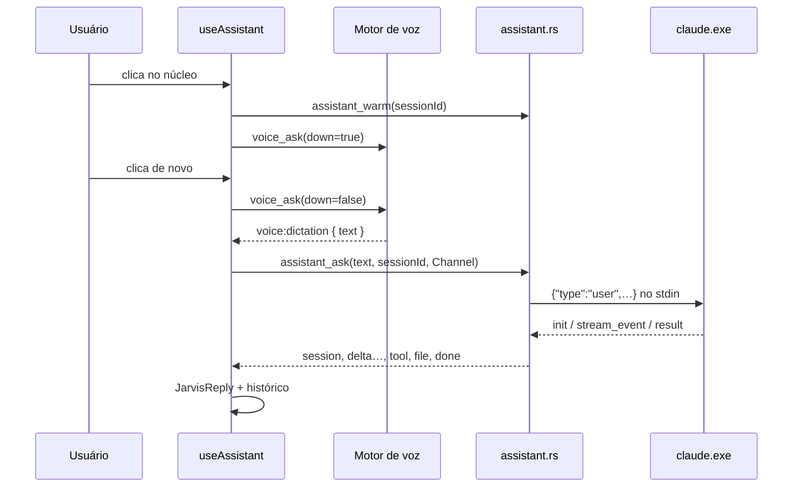

# JARVIS no Claude Code (assistente)

O cérebro conversacional do jvOS: o usuário fala com o núcleo do holograma, e o Claude Code local responde dentro dele, palavra por palavra.

| | |
|---|---|
| **ID** | `feature/assistant` |
| **Status** | Implementado |
| **Origem** | `750ebd0` (2026-10-27) · evoluída em `048a254` e não commitado |

## Visão geral

O JARVIS é o cérebro conversacional do jvOS: o usuário clica no núcleo do holograma, fala, e a resposta aparece dentro do núcleo em letras grandes, palavra por palavra (estilo SUPERHOT), falada pela [voz do JARVIS](../tts/spec.md). Quem responde é o Claude Code local do usuário (`claude.exe`), mantido aberto entre as perguntas para responder em cerca de um segundo, com a conta do próprio usuário e sem chave de API. Ele trabalha confinado à pasta `Documentos\JARVIS` (notas, rascunhos de agentes e a memória de longo prazo) e age no desktop pelas ferramentas do [servidor MCP](../assistant-tools/spec.md). A conversa fica num histórico ao lado do núcleo. Personalidade e regras de fala estão em [jarvis-persona](../../domain/jarvis-persona.md).

## Dados

- `$histórico`: a **AssistantMemory** `{ sessionId, items: HistoryItem[] }`, em que cada **HistoryItem** é uma `ConversationEntry` (pergunta, resposta, erro, interrompida, hora) ou uma `ConversationBreak` ("Nova conversa"). Fica em `jarvis.assistant` (localStorage), gravada com debounce de 250 ms. Ver [glossário](../../domain/glossary.md) e [persistência](../../domain/persistence.md).
  - **RF-008**: O histórico DEVE guardar no máximo 200 itens e o id da sessão em `jarvis.assistant`, validados ao ler.
    - `parseMemory` e `parseItem` validam campo a campo. O id da sessão só é aceito com hexa e hífen.
- `$perfil`: o **Profile**: `settings.json` → `assistantModel` (padrão `sonnet`) e `assistantName` (padrão vazio). O nome é sanitizado: uma linha, até 40 caracteres.
- `$pasta`: a **Folder** `Documentos\JARVIS`, com `Memória.md`, `Notas\` e `Agentes\`. `Documentos\JARVIS\Memória.md` é relido a cada início do processo.
- `$sessões`: as sessões do Claude Code, em `~/.claude/projects/` (são do Claude Code, não do jvOS).
- `$turno`: o **AssistantTurn** em curso (pergunta, texto, ferramenta, erro, fim), montado a partir dos **AssistantEvent**. Só em memória.

## Componentes

### Processo do Claude Code (`Assistant`)

Em `assistant.rs`, um único `claude.exe` em stream-json, vivo entre as perguntas.

- **Comportamento:**
  - **RF-001**: O sistema DEVE rodar `claude.exe` (achado no PATH ou em `%USERPROFILE%\.local\bin`) em `-p` com entrada e saída stream-json, mantendo o processo vivo entre perguntas.
  - **RF-002**: O processo DEVE rodar com `--restricted`, ferramentas `WebSearch,WebFetch,Read,Edit,Write,Glob,Grep`, `--permission-mode dontAsk`, só o servidor MCP do JARVIS (`--strict-mcp-config`), `--disable-slash-commands`, `--effort low` e cwd `Documentos\JARVIS`.
  - **RF-003**: O prompt de sistema DEVE somar a persona, o nome do usuário (ou a instrução de não usar nome) e até 8000 caracteres de `Memória.md`.
    - A persona vem de `src-tauri/assistant-persona.md`, embutida com `include_str!`.
  - **RF-004**: O modelo DEVE vir de `assistantModel` (`haiku`, `sonnet`, `opus` ou `default`, que não passa `--model`); padrão `sonnet`.
  - **RF-005**: O sistema DEVE pré-aquecer o processo ao abrir o app, ao começar a gravar uma pergunta e depois de cancelar ou resetar.
    - `assistant_warm` é ignorado com uma resposta em curso.
  - Cada pergunta é uma linha JSON no stdin (`{"type":"user",…}`). Só uma pergunta por vez: com outra em curso, o Rust responde "Ainda estou respondendo.".
  - `ensure` reinicia o processo se ele morreu, se $perfil mudou (modelo ou nome nas Configurações) ou se a sessão pedida é outra. O processo é retomado com `--resume <id>`.
  - Se a sessão estiver apagada ou for de outra máquina (o transcript `~/.claude/projects/*/<id>.jsonl` não existe), ela não é retomada e começa uma nova.
  - Se o `claude.exe` não for encontrado, responda "Claude Code não encontrado. Instale-o (claude.ai/code) e entre na sua conta rodando `claude` uma vez."
  - `cancel` mata o processo e envia `done { cancelled: true }`; a sessão continua. `reset` esquece a sessão (e cancela).
  - **RF-010**: Ao fechar o app, nenhum `claude.exe` DEVE sobreviver (`taskkill /T /F`).
    - `close()` roda no `RunEvent::Exit`, e `kill_tree` encerra a árvore do processo.
  - O processo roda com `DISABLE_AUTOUPDATER=1` (ver RNF-002).

### Leitura da resposta (`parse_line`)

Uma thread lê o stdout e converte cada linha em `AssistantEvent`, enviado ao `ipc::Channel` da pergunta em curso.

- **Comportamento:**
  - **RF-006**: A resposta DEVE chegar por `ipc::Channel` como eventos `session`, `delta`, `tool`, `file` e `done`, e sempre terminar com `done`.
    - `init` vira `session`; `text_delta` vira `delta`; `tool_use` vira `tool`; `result` vira `done`.
    - Depois de uma ferramenta, o próximo `delta` começa um parágrafo novo.
    - Se nada foi transmitido aos pedaços, o texto de `result` é a resposta.
  - Ignore as linhas de subagentes: só a fala do próprio JARVIS aparece.
  - Os erros de `result` (`errors`, `result`, subtype) vão em `done { error }`.
  - Se o processo morrer no meio, a resposta termina com as últimas 12 linhas do stderr, ou "O Claude Code encerrou sem responder".
  - Num `Write`, os pedaços de `input_json_delta` viram `file { path, content }` a cada 24 caracteres ou mais (`partial_field`, `json_string`). O JSON só é relido depois de crescer 24 caracteres ou 1/32 do que já chegou (`FILE_STEP_SHARE`): com passos fixos, um arquivo longo custava tempo quadrático, porque cada passo relê o JSON inteiro e manda o conteúdo inteiro. O fim do bloco sempre manda o conteúdo completo. O `tool_result` vira `file { done }`. Um `Edit` só avisa o arquivo quando termina, e uma falha não avisa nada.
  - Na UI, os `delta` são juntados: o texto da resposta é renderizado no máximo a cada 32 ms (`STREAM_STEP_MS` em `useAssistant.ts`), não a cada token. Um `tool` ou o `done` descarregam o que estiver pendente antes.

### `useAssistant`

O hook que controla as fases do núcleo, o microfone do núcleo e $histórico.

- **Comportamento:**
  - As fases do núcleo (`CorePhase`) são `idle`, `listening`, `transcribing`, `thinking` e `answering`.
  - `press`/`release`: um clique abre o microfone para o JARVIS (`voice_ask`, estado `asking`) e o próximo envia. Segurar por 350 ms ou mais e soltar também envia.
    - O texto chega por `voice:dictation` com `target: "assistant"`. O motor grava como `Recording::Dictation(Assistant)`, com o prompt "Olá, Jarvis, …" para o Whisper.
  - `send` chama `assistant_ask` com o id salvo. O evento `session` grava o id novo. Se falhar antes de anunciar a sessão, a UI esquece o id.
  - Ao chegar `done`, grave o par pergunta/resposta em $histórico. Uma resposta cancelada fica como "Interrompida", com o que já tinha sido mostrado.
  - **RF-009**: Respostas locais (hora, lembretes, confirmações de voz) DEVEM entrar no núcleo e no histórico como qualquer resposta, sem o Claude Code (`say`), e só quando ele está ocioso.
    - `say` devolve falso quando o JARVIS está ocupado; quem chamou manda a fala para a dock.
  - `reset` ("Nova conversa") esquece a sessão e põe uma marca "Nova conversa" em $histórico. `clear` ("Limpar histórico") esvazia a lista.
  - Uma frase sem comando dita ao Voice chega como `ask(said)`.
  - Avisos na dock:
    - Se perguntar enquanto ele responde: "Ainda estou respondendo".
    - Se enviar antes de o modelo de voz carregar: "A voz ainda está carregando · tente de novo".
    - Se nada foi dito: "Não ouvi nada". Se o Whisper demorar mais de 90 s: "Não consegui entender a pergunta".
    - Se a gravação for cancelada: "Pergunta cancelada".

### `CoreButton`

O coração do holograma como botão: falar com o JARVIS.

- **Comportamento:**
  - O rótulo e a dica seguem a fase:
    - `idle`: "Falar com o JARVIS" · "Clique e fale (ou segure enquanto fala)".
    - `listening`: "Enviar para o JARVIS" · "Clique para enviar · Esc cancela".
    - `transcribing`: "Cancelar a pergunta" · "Entendendo a pergunta… · clique ou Esc cancela".
    - `thinking`: "Interromper o JARVIS" · "Pensando… · clique ou Esc interrompe".
    - `answering`: "Interromper o JARVIS" · "Respondendo… · clique ou Esc interrompe".
  - O ponteiro é capturado ao pressionar. Se o ponteiro for perdido (`pointercancel`), a liberação conta como cancelamento.
  - Enter e Espaço pressionam e soltam como o ponteiro.
  - O botão continua sendo superfície do desktop: um clique nele não deixa nenhuma janela em foco.
- **Layout:**
  - Um círculo invisível no centro do núcleo (`CORE_CENTER_Y_CSS`), com 50% da composição, acima do holograma e abaixo das janelas (`z-[12]`).
- **Estilo:**
  - Gravando, um anel `border-hud-holo/60` pulsa (`animate-pulse`) com brilho por dentro e por fora.
  - Nas outras fases, o anel é `border-hud-cyan/25` e só aparece no hover ou no foco.

### `JarvisReply`

A resposta dentro do núcleo, estilo SUPERHOT: letras grandes entrando palavra por palavra, uma frase por vez, enquanto a resposta ainda chega.

- **Comportamento:**
  - `paginate` corta a resposta em páginas: uma frase, ou 14 palavras de uma frase longa. Uma frase com menos de 4 palavras divide a página com a próxima. A palavra ainda sendo escrita fica para depois.
  - Sem voz, as palavras entram a cada 170 ms. Uma página completa fica 1,1 s + 230 ms por palavra e sai num glitch de 280 ms. Com a voz, o ritmo é o da fala ([tts](../tts/spec.md)).
  - Antes da primeira palavra, mostre a pergunta no topo e três pontos pulsando (`Thinking`).
  - **RF-007**: Durante uma ferramenta, o núcleo DEVE mostrar o status em PT-BR ("Pesquisando na web", "Lendo uma página", "Escrevendo"…).
    - `describeTool` traduz cada ferramenta: "Lendo suas notas", "Rodando o agente", "Consultando o tempo"…; uma do jvOS sem texto próprio é "Executando no jvOS"; o resto é "Trabalhando".
  - Se a resposta falhar, mostre o erro no núcleo por 5 s.
  - Se for cancelada, a página na tela sai no glitch e nada mais entra.
  - Com a preferência de som do boot ligada, cada página entra com um impacto e sai com o zap do glitch, quando não há voz.
  - O texto final também vai para um `role="status"` invisível, para leitores de tela.
- **Layout:**
  - Fixo no centro do núcleo, com 110% da largura da composição, e o fundo radial escuro (`BACKDROP`) de 95% atrás.
  - A pergunta ("› <pergunta>") fica logo acima das palavras, numa linha cortada com reticências.
  - O status da ferramenta, o erro ou as palavras ficam no centro. As palavras que ainda não entraram já ocupam o lugar delas, então as linhas nunca se rearrumam.
- **Estilo:**
  - Palavras `crt-text superhot-text` em maiúsculas: "Segoe UI Black" peso 900, `clamp(18px, composição × 0,052, 42px)`, com o desvio de cor do CRT. Cada uma entra com `superhot-word` (230 ms); a página sai com `superhot-out` (280 ms, em 4 passos). Com movimento reduzido, a página entra inteira e sai num fade de 300 ms.
  - A pergunta fica em `font-mono` maiúsculas `text-hud-text/60`, `clamp(10px, composição × 0,024, 14px)`.
  - O status da ferramenta fica em `font-mono` maiúsculas `text-hud-amber`, `clamp(11px, composição × 0,028, 16px)`, com o cursor piscando (`crt-cursor`).
  - O erro fica em `font-mono text-sm text-hud-alert`, com até 80% da largura.

### `AssistantDrawer` e `AssistantHistory`

O histórico do JARVIS, numa gaveta ao lado do núcleo.

- **Comportamento:**
  - O botão "Histórico do JARVIS", junto ao núcleo, abre e fecha a gaveta. Ele some com o núcleo desligado e durante o boot.
  - Ao abrir, o foco vai para "Fechar histórico". Um clique fora fecha a gaveta, exceto no núcleo: dá para falar com o histórico aberto.
  - Esc fecha a gaveta, a não ser que o núcleo esteja ouvindo ou respondendo (aí o Esc é do núcleo).
  - "Nova conversa" e "Limpar histórico" ficam desabilitados enquanto o JARVIS trabalha. "Nova conversa" também com o histórico vazio; "Limpar histórico", sem itens.
  - Vazio, mostre "Clique no núcleo e fale com o JARVIS. As respostas ficam guardadas aqui.".
  - A lista vai do mais antigo ao mais novo, com a resposta em curso no fim, e rola sozinha para o item mais novo.
    - A resposta é Markdown (com GFM); o renderizador só carrega com a gaveta aberta.
    - A resposta em curso mostra "Pensando", "Respondendo" ou o status da ferramenta.
    - A hora é "14:32" para hoje e "25/10 14:32" antes disso.
- **Layout:**
  - O botão é um círculo `size-9` com o ícone `History`, abaixo e à direita do núcleo (37% da composição em cada eixo).
  - A gaveta fica à direita (`top-10 right-4 bottom-4`), com 420 px de largura. No cabeçalho, "JARVIS · Histórico" e os botões "Nova conversa", "Limpar histórico" e "Fechar histórico".
  - Cada item tem a pergunta numa linha (com `›` e a hora à direita) e, embaixo, a resposta com uma borda à esquerda. "Interrompida" e o erro vêm depois da resposta.
  - A marca de nova conversa é uma linha "Nova conversa · <hora>" entre dois traços.
- **Estilo:**
  - Botão `bg-hud-panel/70` (sem desfoque: fica sempre na tela, sobre o núcleo), `border-hud-cyan/25 text-hud-text/60`; aberto, `border-hud-light/50 text-hud-light`.
  - Gaveta `rounded-2xl border border-hud-cyan/20 bg-hud-panel/82 backdrop-blur-xl`, com um fio de luz no topo e o texto selecionável. Entra deslizando 32 px em 0,35 s.
  - Título em 11 px, maiúsculas, `tracking-[0.32em] text-hud-light`. Botões do cabeçalho `size-8 text-hud-text/60`, com opacidade 35% desabilitados.
  - Pergunta em `font-mono` 12 px `text-hud-text/65`, com o `›` em `text-hud-cyan` e a hora em 10 px `text-hud-text/35`.
  - Resposta em 13 px `text-hud-text/90`, com `border-l border-hud-cyan/20`. O status em curso em `font-mono` 11 px maiúsculas `text-hud-amber/80`; "Interrompida" em 10 px maiúsculas `text-hud-text/40`; o erro em `font-mono` 11 px `text-hud-alert`.
  - A marca "Nova conversa" fica em 10 px maiúsculas `tracking-[0.24em] text-hud-text/40`, entre traços `bg-hud-cyan/15`.

### Arquivos que abrem sozinhos (`onAssistantFile`)

O que o JARVIS escreve aparece na janela certa enquanto ele escreve.

- **Comportamento:**
  - Se o `file` for de `Notas\`, abra o Jarvis Mark e mande o texto por `noteRequests`; ele cresce a cada pedaço.
  - Se for de `Agentes\*.md` (`Write` ou `Edit`), abra o arquivo no [jv_agent](../../apps/jv_agent/spec.md) por `draftRequests`.
  - A janela é pré-carregada antes de o conteúdo chegar. `assistant_folder` diz à UI onde ficam `root`, `notes` e `agents`.

### Fora do app desktop

- **Comportamento:**
  - Sem Tauri e sem fake, `assistantBackend()` é nulo: um clique no núcleo faz a dock dizer "Disponível no app desktop".
  - Com o núcleo desligado, nem o núcleo nem o histórico aparecem.
  - Em DEV, o fake `window.__JARVIS_ASSISTANT__` dá respostas roteirizadas, arquivos e erros, com log em `__JARVIS_ASSISTANT_LOG__`.

## Voz e teclado

- Clique no núcleo (ocioso): abre o microfone; o próximo clique envia.
- Segurar o núcleo ≥ 350 ms: push-to-talk; soltar envia.
- Clique no núcleo (pensando/respondendo): interrompe.
- `Esc`: cancela a gravação, a transcrição ou a resposta; uma resposta pronta sai da tela.
- Frase sem comando dita ao Voice: `voice:shortcut` com `action: "ask"` → `ask(said)`.

## Restrições

- **RNF-001**: Partida a frio ~2,3 s, ~1 s com `--resume`. Latência de API medida: Haiku ~0,77 s, Sonnet ~0,86 s, Opus ~1,7 s.
- **RNF-002**: O autoupdater do Claude Code fica desligado no processo do JARVIS (`DISABLE_AUTOUPDATER=1`).
- Uma pergunta por vez; memória ≤ 8000 caracteres; histórico ≤ 200 itens; transcrição do núcleo ≤ 90 s.

## Histórias de usuário

### US1 — Perguntar pelo núcleo (P1)

Como usuário, clico no núcleo, falo e clico de novo para enviar.

**Por que P1:** é a interação principal com o JARVIS.
**Teste independente:** `tests/assistant.spec.ts` — "the core answers SUPERHOT style, word by word, and the answer lands in the history".

**Aceite**

1. **Dado** o núcleo ocioso, **quando** passo o mouse, **então** o botão se chama "Falar com o JARVIS" e o título diz "Clique e fale (ou segure enquanto fala)".
2. **Dado** um clique, **quando** falo, **então** o microfone grava para o JARVIS (estado `asking`) e o botão vira "Enviar para o JARVIS". Segurar por 350 ms ou mais e soltar também envia.
3. **Dado** a pergunta enviada, **quando** o Whisper termina, **então** a pergunta aparece no topo, três pontos pulsam e, ao chegar o texto, as palavras entram uma a uma, uma frase (ou 14 palavras) por página.
4. **Dado** o fim da resposta, **quando** a última página sai, **então** o par pergunta/resposta está no histórico e em `jarvis.assistant`.

### US2 — Continuar ou recomeçar a conversa (P1)

Como usuário, faço uma pergunta de seguimento, e "Nova conversa" começa outra.

**Por que P1:** sem contexto, cada pergunta seria isolada.
**Teste independente:** `tests/assistant.spec.ts` — "a follow-up continues the conversation; Nova conversa starts another".

**Aceite**

1. **Dado** uma resposta anterior, **quando** pergunto de novo, **então** a pergunta vai na mesma sessão do Claude Code (o id salvo).
2. **Dado** "Nova conversa" no histórico, **quando** clico, **então** a sessão é esquecida, uma marca "Nova conversa · <hora>" entra no histórico e a próxima pergunta abre outra sessão.
3. **Dado** "Limpar histórico", **quando** clico, **então** o histórico fica vazio ("Clique no núcleo e fale com o JARVIS. As respostas ficam guardadas aqui.").

### US3 — Interromper (P1)

Como usuário, interrompo uma resposta longa.

**Por que P1:** respostas erradas ou longas demais precisam parar.
**Teste independente:** `tests/assistant.spec.ts` — "a click on the core or Esc interrupts the answer, which is kept as interrupted".

**Aceite**

1. **Dado** o JARVIS respondendo ("Interromper o JARVIS"), **quando** clico no núcleo ou aperto Esc, **então** a resposta para e fica no histórico como "Interrompida", com o que já tinha sido mostrado.
2. **Dado** o microfone gravando, **quando** aperto Esc, **então** a pergunta é descartada ("Pergunta cancelada").

### US4 — Ver erros (P2)

**Teste independente:** `tests/assistant.spec.ts` — "a failure shows inside the core and in the history".

**Aceite**

1. **Dado** o Claude Code sem login, **quando** pergunto, **então** o erro ("Not logged in · Please run /login") aparece no núcleo por 5 s e no histórico.

### US5 — Arquivos que o JARVIS escreve abrem sozinhos (P2)

Como usuário, peço "salva isso nas notas" e vejo a nota sendo escrita no Jarvis Mark.

**Por que P2:** o usuário acompanha e edita o que o JARVIS produz.
**Teste independente:** `tests/assistant.spec.ts` — "a note JARVIS writes opens in Jarvis Mark, its text arriving as it is written".

**Aceite**

1. **Dado** um `Write` em `Notas\`, **quando** o conteúdo chega aos pedaços, **então** o Jarvis Mark abre e o texto cresce a cada 24 caracteres ou mais.
2. **Dado** um `Write` ou `Edit` em `Agentes\*.md`, **quando** acontece, **então** o arquivo abre no [jv_agent](../../apps/jv_agent/spec.md).

### US6 — Fora do app desktop (P3)

**Teste independente:** `tests/assistant.spec.ts` — "in a browser the core says the conversation needs the desktop app".

**Aceite**

1. **Dado** o navegador sem fake, **quando** clico no núcleo, **então** a dock diz "Disponível no app desktop". Com o núcleo desligado, nem o núcleo nem o histórico aparecem.

## Critérios de sucesso

- **SC-001**: Com o processo pré-aquecido, a primeira palavra chega em cerca de 1 s após a pergunta.
- **SC-002**: O JARVIS nunca lê nem escreve fora de `Documentos\JARVIS` e não roda comandos.

## Fora de escopo e limitações

- Ferramentas do jvOS (MCP): ver [assistant-tools](../assistant-tools/spec.md).
- Atalhos de voz que viram prompts: ver [voice-shortcuts](../voice-shortcuts/spec.md).
- Digitar a pergunta: só por voz (núcleo ou Voice) ou pelos atalhos.
- A memória entra pela linha de comando (limite de 32 767 caracteres do Windows), então só os primeiros 8000 caracteres de `Memória.md` chegam ao JARVIS.

## Código

O Rust (`assistant.rs`) mantém um único processo `claude.exe` em modo stream-json. Cada pergunta é uma linha JSON no stdin, e uma thread lê o stdout e converte cada linha em `AssistantEvent`, enviado ao `ipc::Channel` da pergunta em curso. A sessão do Claude Code é o histórico real da conversa: a UI guarda o id e o processo é retomado com `--resume` quando precisa reiniciar. A UI (`useAssistant`) controla as fases do núcleo, o microfone do núcleo (`voice_ask`), o histórico persistido e a exibição em `JarvisReply`.

| | |
|---|---|
| **Camadas** | `CoreButton` · `JarvisReply` · `AssistantDrawer` / `AssistantHistory` · `useAssistant` · `src/lib/assistant.ts` · comandos `assistant_*`, `voice_ask` · `src-tauri/src/assistant.rs` |
| **Dependências** | `claude.exe` do usuário (instalador nativo; verificado com a versão 2.1.310), `serde_json` |
| **Testes** | `tests/assistant.spec.ts` (fake `__JARVIS_ASSISTANT__`); Rust `mod tests` em `assistant.rs` |
| **Plataforma** | Windows 11 · WebView2. Fora do Tauri: fake de DEV, ou "Disponível no app desktop" |

### Arquivos

| Arquivo | Papel |
|---|---|
| `src-tauri/src/assistant.rs` | `Assistant` (`warm`, `ask`, `cancel`, `reset`, `sleep`, `close`, `ensure`, `spawn`), `system_prompt`, `parse_line`, `partial_field`, `session_exists`, `claude_exe`, `append_note` |
| `src-tauri/assistant-persona.md` | persona embutida com `include_str!` (conteúdo em [jarvis-persona](../../domain/jarvis-persona.md)) |
| `src-tauri/src/lib.rs` | comandos `assistant_ask`, `assistant_warm`, `assistant_cancel`, `assistant_reset`, `assistant_folder`, `voice_ask`; `close()` no `RunEvent::Exit` |
| `src/lib/assistant.ts` | `AssistantEvent`, backends Tauri/fake, `HistoryItem`, `parseMemory`, `describeTool`, `speechText` |
| `src/hooks/useAssistant.ts` | `CorePhase`, `ask`, `say`, `press`/`release`, `cancel`, `reset`, `clear`, Esc |
| `src/components/CoreButton.tsx` | rótulos e dicas por fase, captura de ponteiro, Enter/Espaço |
| `src/components/JarvisReply.tsx` | `paginate` (14 palavras, frase ≥ 4), 170 ms por palavra, glitch de saída, erro por 5 s |
| `src/components/AssistantDrawer.tsx`, `AssistantHistory.tsx` | "Histórico do JARVIS", "Nova conversa", "Limpar histórico", "Interrompida" |
| `src/App.tsx` | `coreVoice`, `onAssistantFile` (Notas → Jarvis Mark, Agentes → jv_agent), `reply`, `confirmCommand` |

### Contratos

#### Comandos Tauri

| Comando | Entrada | Saída | Notas |
|---|---|---|---|
| `assistant_ask` | `{ text, sessionId, onEvent: Channel }` | — | Erros: "Pergunta vazia", "Ainda estou respondendo.", Claude ausente |
| `assistant_warm` | `{ sessionId }` | — | Ignorado com uma resposta em curso |
| `assistant_cancel` | — | — | Mata o processo e envia `done { cancelled: true }`; a sessão continua |
| `assistant_reset` | — | — | Esquece a sessão (e cancela) |
| `assistant_folder` | — | `{ root, notes, agents }` | Para a UI saber de quem é cada arquivo |
| `voice_ask` | `{ down, cancel }` | `VoiceStatus` | Microfone do núcleo; texto em `voice:dictation` com `target: "assistant"` |

`assistant_note` está em [quick-notes](../quick-notes/spec.md) e `assistant_sleep` em [memory-cleanup](../memory-cleanup/spec.md).

#### Eventos e Channels

| Nome | Payload | Emissor → consumidor |
|---|---|---|
| Channel `AssistantEvent` | `session { id }`, `delta { text }`, `tool { name }`, `file { path, content, done }`, `done { text, error, cancelled }` | `read_output` → `useAssistant.ask` |
| `voice:dictation` (`assistant`) | `{ text, pending, target }` | motor de voz → `asked` / `askPending` |

### Fluxo

### Constituição

- [x] P1 Offline-first — exceção prevista: o Claude Code é online por natureza, mas não exige chave de API (usa o login do usuário).
- [x] P2 Rust é dono do nativo — o processo, a pasta e as sessões só passam pelo Rust.
- [x] P3 Comandos finos — `assistant_*` em `lib.rs` delegam ao `Assistant` via `blocking()`; resposta por `ipc::Channel`.
- [x] P4 Contratos espelhados — `AssistantEvent` e `AssistantFolder` com "Mirrors"; enum com tag `event` vira união discriminada.
- [x] P5 Persistência tolerante — `parseMemory`/`parseItem` validam campo a campo; id de sessão só com hexa e hífen.
- [x] P6 Fora do Tauri — fake `window.__JARVIS_ASSISTANT__` (resposta roteirizada, arquivos, erro) com log `__JARVIS_ASSISTANT_LOG__`.
- [x] P7 PT-BR — persona, status de ferramentas e erros em PT-BR.
- [x] P10 Confinamento — `--restricted`, sem Bash, cwd `Documentos\JARVIS`, `--strict-mcp-config`; nome do usuário sanitizado (uma linha, ≤ 40 caracteres).
- [x] P11 Testes — Playwright cobre o fluxo com o fake; o parser stream-json tem testes Rust.

### Decisões relacionadas

- [ADR-0006 — cérebro = claude.exe local em stream-json](../../arch/adr/0006-jarvis-via-claude-cli.md)
- [ADR-0007 — JARVIS restrito a Documentos\JARVIS](../../arch/adr/0007-jarvis-confinado-a-documentos.md)
- [ADR-0011 — fakes de dev e E2E modo web](../../arch/adr/0011-fakes-de-dev-e-e2e-modo-web.md)
- [Segurança](../../arch/security.md)

## Tarefas

Legenda: `[x]` feito · `[ ]` pendente · `[P]` pode rodar em paralelo (arquivos diferentes) · `[USn]` história desta spec. As tarefas foram reconstruídas do código e do commit de origem.

### Fase 1 — Base

- [x] T001 [P] Persona do JARVIS — `src-tauri/assistant-persona.md`
- [x] T002 [P] `AssistantEvent`, `Folder`, `Profile`, `claude_exe`, `session_exists` — `src-tauri/src/assistant.rs`
- [x] T003 `spawn` com os argumentos stream-json, `--restricted`, ferramentas, `dontAsk`, MCP estrito, `--model`, `--effort low`, prompt de sistema e `--resume` — `src-tauri/src/assistant.rs`
- [x] T004 `parse_line`: init → `session`, `text_delta` → `delta` (parágrafo após ferramenta), `tool_use` → `tool`, `result` → `done`; subagentes ignorados — `src-tauri/src/assistant.rs`
- [x] T005 [P] Tipos espelhados, backends Tauri/fake, `parseMemory`, `describeTool`, `speechText` — `src/lib/assistant.ts`

### Fase 2 — US1 Perguntar pelo núcleo (P1)

- [x] T006 [US1] Comandos `assistant_ask` (Channel), `assistant_warm`, `assistant_folder`, `voice_ask` — `src-tauri/src/lib.rs`
- [x] T007 [US1] Flag `asking` e `Recording::Dictation(Assistant)` com prompt "Olá, Jarvis, …" — `src-tauri/src/voice/mod.rs`
- [x] T008 [US1] `useAssistant`: fases, `press`/`release` (350 ms), `listen`, `send`, timeout de 90 s, pré-aquecimento — `src/hooks/useAssistant.ts`
- [x] T009 [US1] `CoreButton` com rótulos e dicas por fase — `src/components/CoreButton.tsx`
- [x] T010 [US1] `JarvisReply`: `paginate`, palavras SUPERHOT, pergunta e `Thinking`, status de ferramenta — `src/components/JarvisReply.tsx`
- [x] T011 [US1] `coreVoice`, `reply`, `confirmCommand` e montagem do núcleo — `src/App.tsx`

### Fase 3 — US2 Continuar ou recomeçar (P1)

- [x] T012 [US2] `ensure`: reinicia se o processo morreu, o perfil mudou ou a sessão pedida é outra; sessão desconhecida não é retomada — `src-tauri/src/assistant.rs`
- [x] T013 [US2] `assistant_reset`; `reset` e `clear` na UI com a marca "Nova conversa" — `src-tauri/src/lib.rs`, `src/hooks/useAssistant.ts`
- [x] T014 [US2] Gaveta "Histórico do JARVIS" com Markdown, "Nova conversa" e "Limpar histórico" — `src/components/AssistantDrawer.tsx`, `src/components/AssistantHistory.tsx`

### Fase 4 — US3 Interromper (P1)

- [x] T015 [US3] `cancel` (mata o processo, `done { cancelled }`) e `kill_tree` — `src-tauri/src/assistant.rs`, `src-tauri/src/git/mod.rs`
- [x] T016 [US3] Esc e clique cancelam por fase; resposta guardada como "Interrompida" — `src/hooks/useAssistant.ts`, `src/components/JarvisReply.tsx`

### Fase 5 — US4 Erros (P2)

- [x] T017 [US4] Erros de `result` (`errors`, `result`, subtype) e stderr (12 linhas) ao morrer — `src-tauri/src/assistant.rs`
- [x] T018 [US4] Erro no núcleo por 5 s e no histórico — `src/components/JarvisReply.tsx`

### Fase 6 — US5 Arquivos que abrem sozinhos (P2)

- [x] T019 [US5] `input_json_delta` de `Write` → `file` a cada 24 caracteres (`partial_field`, `json_string`); `tool_result` → `file { done }` — `src-tauri/src/assistant.rs`
- [x] T020 [US5] `onAssistantFile`: Notas → `noteRequests`, Agentes → `draftRequests`, com pré-carga da janela — `src/App.tsx`, `src/lib/requests.ts`

### Fase 7 — US6 Fora do desktop (P3)

- [x] T021 [US6] `assistantBackend()` nulo sem Tauri nem fake → "Disponível no app desktop" — `src/lib/assistant.ts`, `src/hooks/useAssistant.ts`

### Fase 8 — Testes

- [x] T022 Playwright `tests/assistant.spec.ts` — "the core answers SUPERHOT style, word by word, and the answer lands in the history"
- [x] T023 Playwright `tests/assistant.spec.ts` — "a follow-up continues the conversation; Nova conversa starts another"
- [x] T024 Playwright `tests/assistant.spec.ts` — "a click on the core or Esc interrupts the answer, which is kept as interrupted"
- [x] T025 Playwright `tests/assistant.spec.ts` — "a failure shows inside the core and in the history"
- [x] T026 Playwright `tests/assistant.spec.ts` — "a note JARVIS writes opens in Jarvis Mark, its text arriving as it is written"
- [x] T027 Playwright `tests/assistant.spec.ts` — "in a browser the core says the conversation needs the desktop app"
- [x] T028 Playwright `tests/shortcuts.spec.ts` — "JARVIS's model is chosen in the settings, next to the Whisper models"
- [x] T029 Rust `src-tauri/src/assistant.rs` — `streams_the_answer_and_ends_the_turn`, `a_web_search_splits_the_answer_into_paragraphs`, `nothing_streamed_falls_back_to_the_result`, `failures_carry_their_reason`
- [x] T030 Rust `src-tauri/src/assistant.rs` — `a_write_streams_its_content_then_lands_on_disk`, `an_edit_reports_its_file_once_done_and_failures_report_nothing`, `partial_fields_are_read_as_they_arrive`
- [x] T031 Rust `src-tauri/src/assistant.rs` — `the_memory_joins_the_persona`, `only_session_ids_are_looked_up`, `subagents_and_other_lines_are_ignored`
- [x] T032 Rust `src-tauri/src/settings.rs` — `jarvis_models_are_checked`, `the_name_is_one_short_line`

## Pendências

- [ ] O comportamento do `claude.exe` (stream-json, `--resume`, `--restricted`, MCP HTTP) foi verificado na versão 2.1.310; não há teste automatizado contra o processo real, só contra linhas gravadas em `assistant.rs`.
- [ ] O microfone do núcleo (`voice_ask`) não tem teste Playwright: `tests/assistant.spec.ts` usa `window.__JARVIS__.ask` no lugar da fala.
