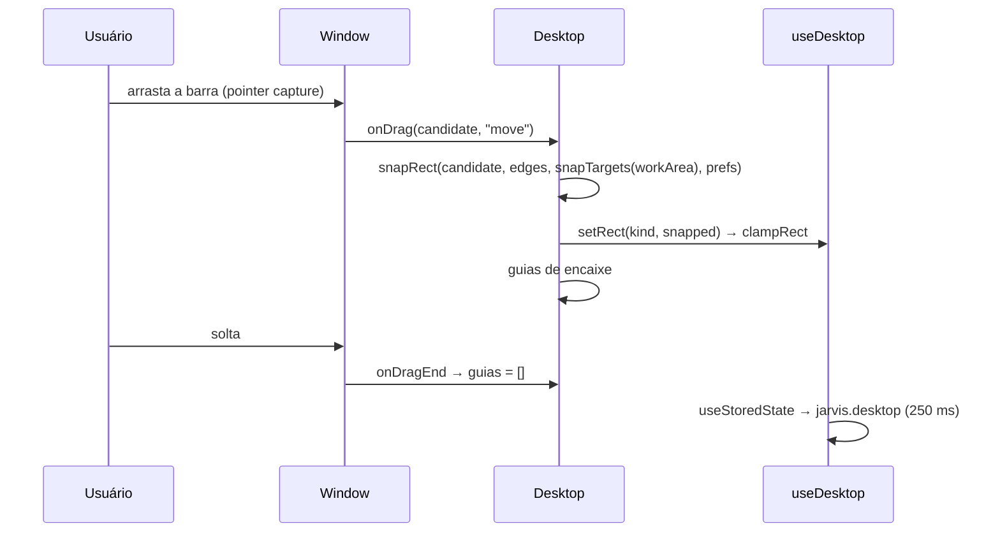

# Janelas do desktop (gerenciador de janelas)

O gerenciador de janelas do jvOS: abre, move, encaixa, maximiza e lembra os widgets e apps que rodam sobre o núcleo.

| | |
|---|---|
| **ID** | `feature/desktop-windows` |
| **Status** | Implementado |
| **Origem** | `42e671a` (2026-10-23) · evoluída em `c4ccc57` (menu de opções, arrastar pelo corpo), `750ebd0` (canal `requests`) e não commitado (27/10: `lazyApps.tsx`, kinds `stocks`/`weather`/`agenda`/`tasks`) |
| **Voz** | `window:<kind>` (17), `group:widgets`, `group:apps`, `group:all`, `verbs:open`, `verbs:close` |

## Visão geral

Sobre o núcleo, o jvOS tem um gerenciador de janelas próprio. Há 17 tipos de janela (`WindowKind`): 11 widgets pequenos e 6 apps. Cada tipo abre no máximo uma vez. As janelas:
- arrastam e redimensionam pelas bordas;
- encaixam nas bordas e no centro;
- nunca saem da tela;
- lembram posição e tamanho;
- sobrevivem a um recarregamento.

Os apps maximizam, os widgets não. Os widgets se arrastam pelo corpo inteiro e têm um menu de opções no botão direito. Os apps carregam sob demanda. Esta spec cobre o "chrome" e as regras comuns. O conteúdo de cada janela fica na spec do widget ou do app.

## Dados

- `$desktop`: **DesktopState** (`jarvis.desktop`): `{version: 1, rects, order, maximized, prefs}`, com `rects: Partial<Record<WindowKind, Rect>>`, `order: WindowKind[]` e `maximized: WindowKind[]`. Gravado com debounce de 250 ms e de novo no `beforeunload`. Estar em `order` é estar aberto. Ver [persistência](../../domain/persistence.md).
  - Se `jarvis.desktop` tiver um kind desconhecido ou corrompido, então ele é descartado. `code` vira `ide` (`RENAMED`), e o estilo `"sway"` antigo vira `tui`. `maximized` é filtrado aos apps.
- `$prefs`: **DesktopPrefs**: `windowStyle`, `snap`, `snapDistance`, `snapCenter`, `grid`, `opacity`. Ficam em `$desktop.prefs`.
  - Padrões de `prefs`: `windowStyle: "tui"`, `snap: true`, `snapDistance: 14`, `snapCenter: true`, `grid: false`, `opacity: 0.85`.
- `$opções`: `jarvis.widget.<nome>`, um `Record<string, boolean>` por widget (`useWidgetOptions`), com debounce de 250 ms. Uma chave ausente volta ao padrão do widget (`parseToggles`).
- **WindowKind / WindowSpec / DesktopGroup**: tipos, título, ícone, tamanho padrão e mínimo, grupo. Ver [glossário](../../domain/glossary.md).
- **FileRequest**: `{path, content, done}` entregue a Jarvis Mark (`noteRequests`) ou jv_agent (`draftRequests`).

### Tamanhos (`WINDOW_SPECS`, padrão → mínimo, em px)

| Kind | Título | Grupo | Padrão | Mínimo |
|---|---|---|---|---|
| `clock` | Relógio | widgets | 300×160 | 220×120 |
| `pomodoro` | Pomodoro | widgets | 300×250 | 260×220 |
| `battery` | Bateria | widgets | 300×150 | 220×120 |
| `calculator` | Calculadora | widgets | 300×420 | 260×360 |
| `tape` | Fita | widgets | 380×250 | 260×180 |
| `miniplayer` | Mini player | widgets | 360×150 | 300×140 |
| `system` | Sistema | widgets | 300×290 | 220×110 |
| `stocks` | Ações | widgets | 380×300 | 300×180 |
| `weather` | Clima | widgets | 400×230 | 340×200 |
| `agenda` | Agenda | widgets | 340×420 | 300×340 |
| `tasks` | Tarefas | widgets | 320×300 | 240×180 |
| `markdown` | Jarvis Mark | apps | 880×560 | 480×300 |
| `ide` | jv_ide | apps | 1180×700 | 640×360 |
| `music` | jv_T4p3 | apps | 920×620 | 660×480 |
| `shell` | jv_sh | apps | 900×540 | 480×300 |
| `lab` | jv_lab | apps | 1180×700 | 720×420 |
| `agent` | jv_agent | apps | 1000×600 | 640×380 |

## Componentes

### Gerenciador (`useDesktop`)

As operações puras sobre $desktop: abrir, fechar, focar, recortar, arranjar e maximizar.

- **Comportamento:**
  - **RF-001**: O sistema DEVE manter no máximo uma janela por `WindowKind`. Abrir uma janela aberta só a traz para a frente.
  - **RF-002**: A ordem de abertura DEVE ser o z-order (fundo → topo), e a última da lista é a focada, a menos que o desktop vazio tenha sido clicado.
  - **RF-003**: Uma janela nova sem geometria salva DEVE abrir em cascata a partir de (24, 40), em passos de 32 px que recomeçam quando não cabem.
  - **RF-004**: Fechar DEVE manter a geometria (e o estado maximizado) para a próxima abertura.
  - `setRect` recorta a geometria com `clampRect`: ao menos 48 px da janela ficam na tela, e a barra de título nunca passa por baixo da faixa de arrasto (28 px).
  - Se a viewport ficar menor que a sessão salva, então, no carregamento e a cada `resize` (agrupado por rAF), todas as janelas são recortadas para caber.
  - `arrange` organiza as janelas: "Lado a lado" (`tileRects`) forma uma grade sem sobreposição acima da dock, "Cascata" escalona e "Centralizar" (`centerRect`) põe cada uma no centro da área do núcleo.
    - Se houver janelas maximizadas, então arranjar as devolve ao tamanho próprio.
  - `closeAll` fecha tudo; `closeGroup` fecha os widgets ou os apps.

### `Desktop`

A camada das janelas sobre o núcleo, com as guias de encaixe.

- **Comportamento:**
  - Desenhe um `Window` por kind aberto, na ordem de $desktop, com o conteúdo de `WindowContent`.
  - Quando o usuário pressionar uma superfície do desktop (`[data-desktop-surface]`: o núcleo, o vazio), chame `blur`: nenhuma janela fica focada e nenhuma se move. Clicar na dock não tira o foco.
  - Ao arrastar, aplique `snapRect` sobre a geometria proposta e mostre as guias. Ao soltar, apague as guias.
  - **RF-013**: Durante o gesto, a geometria DEVE ficar no próprio `Desktop` (já encaixada e recortada como o `setRect` faria): cada movimento do ponteiro re-renderiza só a camada das janelas, não o app inteiro (dock, barra, painéis). Ao soltar, o `setRect` grava a posição final.
  - Repasse `paused` aos widgets, que param timers e polls com a janela do app oculta.
  - jv_sh recebe `onClose` e fecha a própria janela quando a última aba sai.
  - No estilo TUI, todas as janelas recebem a superfície de terminal (`tuiSurface`); no Holográfico, só os apps.
- **Layout:**
  - A camada cobre a tela (`fixed inset-0`, sem receber cliques fora das janelas), acima da legenda e abaixo da dock (`z-[15]`).
  - Com um app maximizado na frente, a camada inteira sobe para `z-[21]`, por cima da dock e da faixa de arrasto.
  - Cada guia é uma linha de 1 px de ponta a ponta da tela, vertical ou horizontal, em `z-[100]`.
- **Estilo:** as guias ficam em `bg-hud-light/50`, com brilho de `--color-hud-holo` a 70%.

### `Window`

O chrome de uma janela: barra de título, corpo, alças e botões.

- **Comportamento:**
  - Pressionar a janela a foca e a traz para a frente. Arrastar a barra de título move a janela.
  - **RF-007**: Widgets NÃO DEVEM mostrar o nome na barra de título. Apps mostram ícone e título; no estilo TUI, em vídeo invertido quando focados.
  - **RF-008**: No estilo TUI, as janelas não têm borda nem cantos arredondados, e a desfocada esmaece para 80%. No Holográfico, são vidro com borda e brilho.
  - Um widget também arrasta pelo corpo: uma pressão que anda mais de 4 px (`GRAB_DISTANCE`) arrasta e mantém o foco do teclado; uma que fica parada continua sendo clique.
  - Os controles que usam o ponteiro (`input, textarea, select, [contenteditable], [role=slider]`) e o conteúdo dos apps não iniciam arrasto (`usePointerDrag`).
  - As 8 alças redimensionam respeitando o mínimo do tipo.
  - **RF-011**: A geometria DEVE suavizar em 300 ms quando ninguém arrasta (soltar o encaixe, arranjar). A entrada leva 0,2 s.
  - Os botões da barra ("Maximizar <título>", "Restaurar <título>", "Fechar <título>") não arrastam e não respondem ao duplo clique.
- **Layout:**
  - Uma `section` com `role="dialog"` e `aria-label` = título, posicionada por `left`/`top`/`width`/`height`.
  - TUI: barra de 24 px (`h-6`) com o nome do app à esquerda e os botões à direita.
  - Holográfico: barra de 32 px (`h-8`) com ícone, título e os botões.
  - O corpo ocupa o resto e é um container query (`@container`).
  - As alças são faixas de 6 px sobre a borda e quadrados de 12 px nos cantos; somem quando maximizada.
- **Estilo:**
  - O painel é `--color-hud-panel` com a opacidade de $prefs.opacity, **sem** `backdrop-filter`. Atrás de uma janela o núcleo se mexe a cada quadro, e o desfoque seria refeito a cada quadro na área inteira da janela ([ADR-0022](../../arch/adr/0022-nucleo-relogio-quadros-limitado-canvas-3.md)).
  - TUI: barra em `font-mono` 11 px; o nome do app focado fica em `bg-hud-light/85 text-hud-void`, o desfocado em `bg-hud-text/12 text-hud-text/60`; os botões acendem em `bg-hud-light/85` no hover.
  - Holográfico: borda `hud-cyan/35` com sombra e brilho interno quando focada, `hud-cyan/15` quando não; `rounded-xl`, ou sem cantos quando maximizada; uma linha de luz `hud-light/40` no topo da focada; título em 10 px, maiúsculas e `tracking-[0.28em]`, em `text-hud-light` (focada) ou `text-hud-text/50`.
  - A entrada vai de `opacity 0`, `scale 0.96` e 6 px abaixo; a saída, em 0,15 s, para `scale 0.97`. Com movimento reduzido, a geometria não suaviza.

### Encaixe (`snapRect`)

Gruda a janela nas bordas, no centro e na grade enquanto ela é arrastada.

- **Comportamento:**
  - **RF-005**: O encaixe DEVE usar as bordas da área útil (tela − faixa de 28 px − dock de 120 px), com margem de 16 px e topo em 32 px. Com "Encaixar no centro", vale também o centro. A distância é 8, 14 ou 24 px (Curta/Média/Longa). Ao mover, as bordas e o centro encaixam. Ao redimensionar, só as bordas arrastadas.
  - Uma guia aparece para cada borda ou centro encaixado.
  - Se o encaixe estiver desligado, então a janela fica exatamente onde foi solta.
  - Se "Alinhar à grade" estiver ligado, então as posições arredondam para 8 px quando nada encaixa.

### Maximizar

Um app ocupa a tela inteira e volta ao tamanho dele.

- **Comportamento:**
  - **RF-006**: Só apps DEVEM maximizar. O maximizado ocupa a tela toda, ou fica abaixo da barra superior quando ela está ligada.
  - O botão "Maximizar <título>" ou o duplo clique na barra alterna. Num widget, não há botão e o duplo clique não faz nada.
  - Se um maximizado for arrastado mais de 6 px (`DETACH_DISTANCE`), então ele volta ao próprio tamanho, sob o ponteiro, no mesmo ponto da barra.
  - O estado vai para `maximized` em $desktop e sobrevive a um recarregamento.
  - Com um maximizado na frente, o núcleo descansa atrás.
  - Maximizado, a opacidade do painel é no mínimo 0,95.

### `Launcher`

O popover acima dos itens Widgets e Apps da dock.

- **Comportamento:**
  - Liste os kinds do grupo: o "Menu de widgets" tem os 11 widgets e o "Menu de apps", os 6 apps.
  - Um kind já aberto aparece marcado (`aria-pressed`). Escolhê-lo só o traz para a frente.
  - Esc ou um clique fora fecham o lançador. Clicar de novo no próprio item da dock alterna.
  - O lançador também fecha quando abrem as Configurações, o Menu avançado ou a busca, ou quando a dock some.
  - O botão "Menu avançado" abre o Menu avançado.
- **Layout:**
  - Um painel de 264 px de largura: o nome do grupo no topo, uma grade de duas colunas com um botão por kind (ícone de 20 px e título), a dica de voz e, embaixo, o botão "Menu avançado".
  - A dica diz, por exemplo, "Por voz: “abre o relógio”, “fecha todos os widgets”. Ou tecle / para buscar."
  - Um kind aberto ganha um ponto no canto superior direito.
- **Estilo:**
  - Painel `rounded-2xl` com borda `hud-cyan/18`, fundo `hud-panel/80`, `backdrop-blur-md` e sombra escura.
  - O nome do grupo e os botões em maiúsculas pequenas (10 px), o nome em `text-hud-cyan/80`.
  - Botão fechado: borda `hud-cyan/12` e `text-hud-text/60`, que acende para `text-hud-light` no hover. Botão aberto: borda `hud-cyan/35`, fundo `hud-cyan/[0.07]` e `text-hud-light`, com o ponto em `bg-hud-light` brilhando.
  - A dica em 11 px `text-hud-text/45`, com o `/` em `font-mono`.

### Menu de opções do widget (`WidgetMenu`)

O menu do botão direito, que liga e desliga partes de um widget.

- **Comportamento:**
  - **RF-009**: O menu de opções de um widget DEVE abrir com o botão direito, a tecla Menu ou Shift+F10 (no canto do widget + 16 px). Ele fica dentro da tela e navega com ↑ ↓ Home End. Marcar mantém o menu aberto, uma ação o fecha, e Esc/clique fora/perder o foco da janela fecham. As opções ficam em `jarvis.widget.<nome>`.
  - Se o menu passar da borda, então ele abre do outro lado do ponteiro, a 8 px das bordas.
  - Se o menu estiver aberto, então as teclas ficam no menu (Espaço marca a opção, não aciona o widget). Esc fecha e devolve o foco ao widget.
  - `toggleItems` monta as caixas de marcar a partir de $opções. `MenuPopup` também é usado pelos menus do jv_ide.
- **Layout:** uma lista de seções, cada uma com título opcional e itens; um separador entre as seções; o detalhe (atalho, tamanho) à direita do item.
- **Estilo:**
  - Menu TUI em `font-mono` 12 px, com largura mínima de `24ch`, até `80vh` de altura, borda `hud-cyan/30` e fundo `hud-panel/95` (opaco o bastante para dispensar desfoque).
  - As marcas são texto, em `text-hud-cyan`: `[x]`/`[ ]` para caixas, `(•)`/`( )` para opções.
  - O item sob o ponteiro ou o foco fica em vídeo invertido (`bg-hud-light/85 text-hud-void`).
  - Títulos de seção em 10 px maiúsculas `text-hud-text/45`; separadores em `hud-cyan/20`.

### Apps sob demanda (`lazyApps`)

O carregamento dos 6 apps, fora do pacote principal.

- **Comportamento:**
  - **RF-010**: Os 6 apps DEVEM carregar sob demanda (`lazyApp`), com `preload()` para abrir já carregados. Os widgets entram no pacote principal.
  - `preloadWindow(kind)` baixa o app antes de abrir a janela; para um widget, resolve na hora.
  - Se o app for aberto antes do código chegar, então mostra "Carregando…" por pelo menos 300 ms (throttle do Suspense do React 19). Com o código pré-carregado, aparece direto.
  - O componente escolhido (o carregado ou o lazy) não muda depois de montado, para o app não remontar.
- **Layout:** "Carregando…" fica centrado no corpo da janela.
- **Estilo:** `text-xs text-hud-text/50`.

### Aberturas automáticas e pedidos de arquivo (`requests.ts`)

Janelas que abrem sozinhas quando faz sentido.

- **Comportamento:**
  - Abra a janela certa quando chegar uma tarefa pendente nova, na volta para casa, quando o JARVIS escrever um arquivo em `Notas\` ou `Agentes\`, ou quando uma tool MCP pedir (`show`).
  - `onAssistantFile` pré-carrega o app, abre a janela e entrega o arquivo pelo canal: `noteRequests` (Jarvis Mark) ou `draftRequests` (jv_agent).
  - Se o JARVIS escrever num arquivo com a janela ainda fechada, então o pedido mais recente fica guardado (`requestChannel.take()`) até a janela abrir.

### Abas Janelas e Layout do Menu avançado

As preferências das janelas.

- **Comportamento:**
  - Aba Janelas:
    - "Estilo das janelas": TUI ("Como apps de terminal num gerenciador tiling: sem bordas, nome em vídeo invertido, widgets em TUI.") ou Holográfico ("Painéis de vidro com brilho, no visual do holograma.").
    - "Encaixar nas bordas" e "Encaixar no centro" ligam $prefs.snap e $prefs.snapCenter. "Distância de encaixe" escolhe Curta, Média ou Longa.
    - "Opacidade das janelas" vai de 60% a 100%.
  - Aba Layout:
    - "Organizar janelas": "Lado a lado", "Cascata" e "Centralizar", desabilitados sem janelas abertas, e a contagem ("2 janelas abertas.") ou "Abra janelas pelos itens Widgets e Apps da dock.".
    - "Alinhar à grade" ("Posições arredondam para 8 px quando nada encaixa").
    - "Fechar todas as janelas".
  - Tudo vale na hora para todas as janelas.
- **Layout:**
  - Janelas: as seções "Estilo" (`Segmented` e a descrição), "Encaixe" (dois `SwitchRow` e um `Segmented`) e "Aparência das janelas" (`Range`).
  - Layout: as seções "Organizar janelas" (três `ActionButton` em três colunas e a contagem), "Alinhamento" (`SwitchRow`) e "Janelas abertas" (`ActionButton`).
- **Estilo:** os controles do kit do Menu avançado; as descrições em `text-xs text-hud-text/55` e a contagem em `text-xs text-hud-text/50`.

## Voz e teclado

- "abre/fecha <frase de window:kind>": `voice:window`.
  - Abrindo, a dock (item Widgets ou Apps) diz "Abrindo <título>" e o JARVIS confirma. Fechando, "Fechando <título>"; se não estiver aberta, "<título> não está aberto".
- "fecha todos os widgets", "fecha todas as aplicações", "fecha tudo": `voice:windows`.
  - A dock diz "Fechando N widgets/apps/janelas". Sem nada aberto: "Nenhum widget aberto", "Nenhum app aberto" ou "Nenhuma janela aberta".
- `Ctrl+W` na janela (fora de `[data-terminal]` e se nada tratou antes): fecha a janela. Dentro de um terminal, o Ctrl+W é do shell.
- Duplo clique na barra (apps): maximizar/restaurar.
- Botão direito, tecla Menu, `Shift+F10` (widgets): menu de opções.
- `↑` `↓` `Home` `End` `Esc` no menu: navegação, fechar e devolver o foco.
- `Esc` / clique fora (lançador): fecha o lançador.

## Restrições

- **RNF-001**: `jarvis.desktop` é gravado com debounce de 250 ms e salvo de novo no `beforeunload`.
- **RNF-002**: A opacidade do painel fica entre 0,6 e 1. Maximizado, ela é no mínimo 0,95.
- **RNF-003**: Widgets pausam timers e polls quando a janela do app está oculta (`paused` repassado).
- Uma janela por kind. 48 px sempre visíveis. Apps maximizam, widgets não.

## Histórias de usuário

### US1 — Abrir, focar e fechar janelas (P1)

Abro widgets e apps de vários jeitos. Uma janela já aberta só vem para a frente.

**Por que P1:** é a base de tudo que roda sobre o núcleo.
**Teste independente:** `tests/desktop.spec.ts` — "Widgets and Apps open their own launchers, which close with Escape or a click outside" e "a widget opens once, shows the time and closes".

**Aceite**

1. **Dado** o item Widgets da dock, **quando** clico, **então** o "Menu de widgets" abre acima dele com os 11 widgets (Relógio, Pomodoro, Bateria, Calculadora…) e sem os apps. O item Apps faz o mesmo com os 6 apps.
2. **Dado** o lançador aberto, **quando** aperto Esc ou clico fora, **então** ele fecha. Clicar de novo no próprio item alterna.
3. **Dado** um widget aberto, **quando** o abro de novo, **então** continua uma só janela, que vem para a frente. No lançador ele aparece marcado (`aria-pressed`).
4. **Dado** uma janela focada, **quando** aperto Ctrl+W ou clico no ×, **então** ela fecha. Dentro de um terminal, o Ctrl+W é do shell.
5. **Dado** uma janela em foco, **quando** clico no desktop vazio, **então** nenhuma fica focada e nenhuma se move. Clicar na dock não tira o foco.
6. **Dado** duas janelas, **quando** clico na de trás, **então** ela sobe. A dock continua acima das janelas.

### US2 — Mover, redimensionar e encaixar (P1)

Arrasto as janelas com precisão, e elas grudam nas bordas sem nunca sumir da tela.

**Por que P1:** é o que faz parecer um desktop de verdade.
**Teste independente:** "windows snap to the edges while dragged and never leave the screen", "windows resize from the corner down to their minimum size" e, em `tests/widgets.spec.ts`, "a widget drags from anywhere on it, and its buttons still click".

**Aceite**

1. **Dado** o encaixe ligado, **quando** solto uma janela perto de uma borda, **então** ela gruda (16 px das laterais e da base da área útil, 32 px do topo) e uma guia aparece enquanto arrasto.
2. **Dado** uma janela arrastada para fora, **então** ao menos 48 px dela ficam na tela, e a barra de título nunca passa por baixo da faixa de arrasto (28 px).
3. **Dado** um canto, **quando** redimensiono, **então** o tamanho para no mínimo do tipo.
4. **Dado** um widget, **quando** pressiono no corpo e movo mais de 4 px, **então** ele arrasta e mantém o foco do teclado. Um clique parado continua sendo clique (um botão aperta).
5. **Dado** os controles que usam o ponteiro (sliders, campos) e o conteúdo dos apps, **então** eles não iniciam arrasto.

### US3 — Maximizar apps (P2)

Um app pode ocupar a tela inteira e voltar ao tamanho dele.

**Por que P2:** editores e terminais precisam de espaço.
**Teste independente:** "apps maximise from their button or a double click on the title bar; widgets don't".

**Aceite**

1. **Dado** um app, **quando** clico em "Maximizar <título>" ou dou duplo clique na barra de título, **então** ele cobre a tela inteira, por cima da dock e da faixa de arrasto. Sem alças de redimensionar.
2. **Dado** a barra superior ligada, **então** o maximizado para abaixo dela (y = 28).
3. **Dado** um maximizado, **quando** recarrego, **então** ele continua maximizado (`maximized` em `jarvis.desktop`) e o núcleo descansa atrás.
4. **Dado** um maximizado, **quando** arrasto a barra mais de 6 px, **então** ele volta ao próprio tamanho sob o ponteiro.
5. **Dado** um widget, **então** não há botão de maximizar e o duplo clique não faz nada.

### US4 — Persistência e preferências (P2)

O desktop volta como deixei, e posso ajustar o comportamento das janelas.

**Por que P2:** continuidade entre sessões.
**Teste independente:** "open windows and their positions survive a reload" e "the advanced menu tunes snapping, arranges windows and sets a custom hue".

**Aceite**

1. **Dado** janelas abertas e movidas, **quando** recarrego, **então** as mesmas janelas voltam na mesma ordem e geometria.
2. **Dado** "Encaixar nas bordas" desligado (aba Janelas), **quando** solto a janela a 22 px da borda, **então** ela fica exatamente ali.
3. **Dado** a aba Layout, **quando** clico "Lado a lado", **então** as janelas formam uma grade sem sobreposição, acima da dock. "Centralizar" põe cada uma no centro da área do núcleo, e "Cascata" as escalona.
4. **Dado** "Alinhar à grade", **então** as posições arredondam para 8 px quando nada encaixa.
5. **Dado** a opacidade (60% a 100%) e o estilo (TUI ou Holográfico), **então** valem na hora para todas as janelas.

### US5 — Abrir e fechar por voz e por outros caminhos (P2)

Janelas abrem e fecham por voz, pela busca, pela barra superior, pelo JARVIS e sozinhas quando faz sentido.

**Por que P2:** a voz é o modo principal do JARVIS.
**Teste independente:** "voice commands open and close windows (engine event stand-in)" e "voice closes every widget, every app or everything (engine event stand-in)".

**Aceite**

1. **Dado** `voice:window {kind, open: true}`, **então** a janela abre, a dock (item Widgets ou Apps) diz "Abrindo <título>" e o JARVIS confirma.
2. **Dado** `open: false` com a janela aberta, **então** ela fecha com "Fechando <título>". Se não estiver aberta: "<título> não está aberto".
3. **Dado** `voice:windows {group}`, **então** fecham todos os widgets, todos os apps ou tudo, com "Fechando N widgets/apps/janelas". Sem nada aberto: "Nenhum widget aberto", "Nenhum app aberto" ou "Nenhuma janela aberta".
4. **Dado** uma tarefa pendente nova, a volta para casa, um arquivo que o JARVIS escreve em `Notas\` ou `Agentes\`, ou uma tool MCP (`show`), **então** a janela certa abre sozinha.

## Critérios de sucesso

- **SC-001**: Nenhuma combinação de arrastar, redimensionar ou mudar a tela deixa uma janela inalcançável.
- **SC-002**: Recarregar devolve as mesmas janelas, na mesma ordem, posição e estado de maximizado.
- **SC-003**: Abrir um tipo já aberto nunca cria uma segunda janela.

## Fora de escopo e limitações

- O conteúdo de cada janela está nas specs dos widgets e apps (ex.: [jv_sh](../../apps/jv_sh/spec.md), [Jarvis Mark](../../apps/jarvis-mark/spec.md)).
- Não há minimizar janela individual nem várias instâncias do mesmo tipo.
- A dock e a barra superior são de [dock-taskbar](../../features/dock-taskbar/spec.md). O lançador (popover acima de Widgets/Apps) é descrito aqui. As frases `window:*` e `group:*` podem ser editadas em [voice-commands](../../features/voice-commands/spec.md).

## Código

O estado inteiro do desktop é um objeto serializável (`DesktopState`) guardado por `useStoredState` em `jarvis.desktop`. Estar em `order` é estar aberto. `useDesktop` expõe operações puras sobre ele (abrir, fechar, focar, recortar, arranjar, maximizar), e o `Desktop` desenha um `Window` por kind aberto. O `Window` só propõe geometria (`onDrag`): o `Desktop` aplica `snapRect` e `clampRect` numa geometria "ao vivo" local durante o gesto, e o `setRect` grava a final ao soltar (`onDragEnd`). Os apps vêm de `lazyApps.tsx`.

| | |
|---|---|
| **Camadas** | UI React (`Desktop`, `Window`, `Launcher`, `WidgetMenu`, `lazyApps`) · hooks (`useDesktop`, `usePointerDrag`, `useWidgetOptions`) · lib (`desktop.ts`, `snap.ts`, `requests.ts`, `layout.ts`) |
| **Dependências** | `motion/react` (entrada/saída), `lucide-react` (ícones de `WINDOW_SPECS`), `React.lazy`/`Suspense` |
| **Testes** | `tests/desktop.spec.ts`, `tests/widgets.spec.ts`, `tests/ui.spec.ts`, `tests/taskbar.spec.ts` (estilo TUI, maximizado abaixo da barra) |
| **Plataforma** | Só UI. Igual dentro e fora do Tauri. A faixa `data-tauri-drag-region` (28 px) move a janela nativa no app |

### Arquivos

| Arquivo | Papel |
|---|---|
| `src/lib/desktop.ts` | `WindowKind`, `WINDOW_KINDS`, `WINDOW_SPECS`, `canMaximize`, constantes (`TOP_SAFE` 28, `TOP_MARGIN` 32, `EDGE_MARGIN` 16, `MIN_VISIBLE` 48, `GRID` 8), `workArea`, `maximizedArea`, `clampRect`, `cascadeRect`, `tileRects`, `centerRect`, `parseDesktop`, `RENAMED` |
| `src/hooks/useDesktop.ts` | API `Desktop`: `open`, `close`, `focus`, `blur`, `setRect`, `arrange`, `closeAll`, `closeGroup`, `toggleMaximize`, `unmaximize`, `setPrefs`. Recorta tudo no `resize` |
| `src/lib/snap.ts` | `snapTargets`, `snapRect` (bordas, centro, grade) e guias |
| `src/hooks/usePointerDrag.ts` | Arrasto com captura do ponteiro e `threshold`. Ignora `input, textarea, select, [contenteditable], [role=slider]` |
| `src/components/desktop/Desktop.tsx` | Camada das janelas (`z-[15]`, ou `z-[21]` com um maximizado na frente), guias de encaixe, clique no vazio (`[data-desktop-surface]`) → `blur`, `WindowContent` |
| `src/components/desktop/Window.tsx` | Chrome TUI/holo, barra que arrasta, corpo que arrasta (widgets, 4 px), 8 alças de redimensionar, maximizar/restaurar, Ctrl+W |
| `src/components/desktop/Launcher.tsx` | Popover "Menu de widgets"/"Menu de apps" acima do item da dock |
| `src/components/desktop/lazyApps.tsx` | `lazyApp`, os 6 apps lazy, `preloadWindow(kind)` |
| `src/hooks/useWidgetOptions.ts` | `useWidgetOptions(name, defaults)` → `jarvis.widget.<name>` |
| `src/components/desktop/widgets/WidgetMenu.tsx` | `useWidgetMenu`, `toggleItems`, `WidgetMenu`, `MenuPopup` (reusado pelo jv_ide) |
| `src/lib/requests.ts` | `requestChannel`, `noteRequests`, `draftRequests` |
| `src/App.tsx` | `onWindowCommand`, `onCloseGroup`, `onAssistantFile` (preload + open), aberturas automáticas |

### Contratos

#### Eventos e Channels

| Nome | Payload | Emissor → consumidor |
|---|---|---|
| `voice:window` | `{ kind: string, open: boolean }` | `voice/mod.rs` → `onWindowCommand` (o kind é validado com `isWindowKind`) |
| `voice:windows` | `{ group: "widgets" \| "apps" \| "all" }` | `voice/mod.rs` → `onCloseGroup` |
| `noteRequests` / `draftRequests` | `FileRequest {path, content, done}` | `App.onAssistantFile` → `useEditorDocument` (Jarvis Mark) / `AgentApp` |

#### Ferramentas MCP (JARVIS)

| Tool | O que faz |
|---|---|
| `jvos_run` | Executa um comando da busca, inclusive abrir e fechar janelas e arranjar. Ver [assistant-tools](../../features/assistant-tools/spec.md) |

### Fluxo

### Constituição

- [x] P5 Persistência tolerante — `parseDesktop` descarta o que não reconhece e migra `code` → `ide` (`RENAMED`) e `sway` → `tui`. `parseToggles` volta ao padrão de cada opção.
- [x] P6 Funciona fora do Tauri — o desktop é 100% UI. Nos testes, `__JARVIS__.voiceWindow`/`voiceCloseGroup` substituem os eventos do motor.
- [x] P7 PT-BR — títulos, aria-labels ("Fechar <título>", "Maximizar <título>", "Menu de widgets") e avisos em PT-BR.
- [x] P8 Linguagem visual — o chrome usa tokens `hud-*`. O estilo TUI aplica `tuiSurface` (glow, aberração, acento).
- [x] P9 Desktop leve — uma janela por kind, apps lazy com preload, widgets recebem `paused`.
- [x] P11 Coberto por teste — abrir, encaixar, redimensionar, persistir, maximizar, focar, voz e menu de opções.

### Decisões relacionadas

- [ADR-0012 — apps lazy com preload](../../arch/adr/0012-apps-lazy-com-preload.md)
- [ADR-0010 — settings.json vs localStorage](../../arch/adr/0010-persistencia-settings-vs-localstorage.md)
- [ADR-0022 — sem `backdrop-filter` em superfícies permanentes](../../arch/adr/0022-nucleo-relogio-quadros-limitado-canvas-3.md)
- [ADR-0014 — linguagem visual TUI](../../arch/adr/0014-linguagem-visual-tui.md)
- [ADR-0011 — fakes de dev e E2E no modo web](../../arch/adr/0011-fakes-de-dev-e-e2e-modo-web.md)

## Tarefas

Legenda: `[x]` feito · `[ ]` pendente · `[P]` pode rodar em paralelo (arquivos diferentes) · `[USn]` história desta spec. As tarefas foram reconstruídas do código e dos commits `42e671a`, `c4ccc57`, `750ebd0` e do working tree de 27/10.

### Fase 1 — Base

- [x] T001 `WindowKind`, `WINDOW_SPECS`, constantes de margem e `workArea`/`clampRect`/`cascadeRect`/`tileRects`/`centerRect` — `src/lib/desktop.ts`
- [x] T002 `parseDesktop` tolerante com `RENAMED` (`code` → `ide`) e `sway` → `tui` — `src/lib/desktop.ts`
- [x] T003 [P] `snapTargets` e `snapRect` com guias e grade — `src/lib/snap.ts`
- [x] T004 [P] `usePointerDrag` com captura e `threshold` — `src/hooks/usePointerDrag.ts`
- [x] T005 `useDesktop`: abrir, fechar, focar, `blur`, `setRect`, recorte no `resize` — `src/hooks/useDesktop.ts`

### Fase 2 — US1 Abrir, focar e fechar (P1)

- [x] T006 [US1] `Desktop` com `WindowContent`, clique no vazio → `blur` — `src/components/desktop/Desktop.tsx`
- [x] T007 [US1] `Window`: chrome, foco ao pressionar, Ctrl+W (exceto em `[data-terminal]`) — `src/components/desktop/Window.tsx`
- [x] T008 [P] [US1] `Launcher` por grupo, com marca de aberto, Esc e clique fora — `src/components/desktop/Launcher.tsx`
- [x] T009 [US1] Itens Widgets/Apps abrem o lançador. O lançador fecha com Configurações/Menu avançado/busca/dock oculta — `src/App.tsx`

### Fase 3 — US2 Mover, redimensionar e encaixar (P1)

- [x] T010 [US2] Barra que arrasta e 8 alças de redimensionar respeitando o mínimo — `src/components/desktop/Window.tsx`
- [x] T011 [US2] Encaixe e guias no `Desktop.drag` — `src/components/desktop/Desktop.tsx`
- [x] T012 [US2] Widgets arrastam pelo corpo (`GRAB_DISTANCE` 4 px) — `src/components/desktop/Window.tsx` (`c4ccc57`)

### Fase 4 — US3 Maximizar apps (P2)

- [x] T013 [US3] `toggleMaximize`, `unmaximize`, `maximizedArea` abaixo da barra superior — `src/hooks/useDesktop.ts`, `src/lib/desktop.ts`
- [x] T014 [US3] Botão, duplo clique e desacoplar ao arrastar (`DETACH_DISTANCE` 6 px) — `src/components/desktop/Window.tsx`
- [x] T015 [US3] Camada sobe sobre a dock (`z-[21]`) e o núcleo descansa atrás — `src/components/desktop/Desktop.tsx`, `src/App.tsx`

### Fase 5 — US4 Persistência e preferências (P2)

- [x] T016 [US4] `arrange` (tile/cascade/center), `closeAll`, `closeGroup`, `setPrefs` — `src/hooks/useDesktop.ts`
- [x] T017 [US4] Abas Janelas e Layout do Menu avançado — `src/components/desktop/AdvancedMenu.tsx`
- [x] T018 [P] [US4] Opções de widget: `useWidgetOptions`, `useWidgetMenu`, `toggleItems`, `MenuPopup` — `src/hooks/useWidgetOptions.ts`, `src/components/desktop/widgets/WidgetMenu.tsx` (`c4ccc57`)

### Fase 6 — US5 Voz e outros caminhos (P2)

- [x] T019 [US5] `onWindowCommand` e `onCloseGroup` com aviso na dock e confirmação do JARVIS — `src/App.tsx`
- [x] T020 [P] [US5] Canal `requests` para arquivos que o JARVIS escreve — `src/lib/requests.ts` (`750ebd0`)
- [x] T021 [US5] `lazyApp` + `preloadWindow` e abertura após o preload — `src/components/desktop/lazyApps.tsx`, `src/App.tsx` (não commitado)
- [x] T022 [US5] Aberturas automáticas (tarefas pendentes, chegada, foco, nota, agente) — `src/App.tsx`
- [x] T023 [P] Kinds `stocks`, `weather`, `agenda` e `tasks` — `src/lib/desktop.ts`, `src-tauri/src/settings.rs` (`WINDOW_KINDS`) (não commitado)

### Fase 7 — Testes

- [x] T024 Playwright `tests/desktop.spec.ts` — "Widgets and Apps open their own launchers, which close with Escape or a click outside"
- [x] T025 Playwright `tests/desktop.spec.ts` — "a widget opens once, shows the time and closes"
- [x] T026 Playwright `tests/desktop.spec.ts` — "windows snap to the edges while dragged and never leave the screen"
- [x] T027 Playwright `tests/desktop.spec.ts` — "windows resize from the corner down to their minimum size"
- [x] T028 Playwright `tests/desktop.spec.ts` — "open windows and their positions survive a reload"
- [x] T029 Playwright `tests/desktop.spec.ts` — "the advanced menu tunes snapping, arranges windows and sets a custom hue"
- [x] T030 Playwright `tests/desktop.spec.ts` — "voice commands open and close windows (engine event stand-in)"
- [x] T031 Playwright `tests/desktop.spec.ts` — "voice closes every widget, every app or everything (engine event stand-in)"
- [x] T032 Playwright `tests/desktop.spec.ts` — "apps maximise from their button or a double click on the title bar; widgets don't"
- [x] T033 Playwright `tests/desktop.spec.ts` — "a click on the empty desktop leaves no window focused, without moving any"
- [x] T034 Playwright `tests/desktop.spec.ts` — "clicking a window raises it; the dock stays above the windows"
- [x] T035 Playwright `tests/widgets.spec.ts` — "<título>: right click turns parts of the widget off, and it stays so" (Relógio, Pomodoro, Calculadora, Fita, Mini player, Bateria)
- [x] T036 Playwright `tests/widgets.spec.ts` — "keys pressed in a widget's menu stay in the menu"
- [x] T037 Playwright `tests/widgets.spec.ts` — "a widget drags from anywhere on it, and its buttons still click"
- [x] T038 Playwright `tests/widgets.spec.ts` — "sliders inside a widget, and the apps' content, keep the pointer"
- [x] T039 Rust `src-tauri/src/settings.rs` — `default_voice_commands_are_valid` (toda `WINDOW_KINDS` tem frases)

## Pendências

- [ ] `WINDOW_KINDS` existe duplicado em `src/lib/desktop.ts` e em `src-tauri/src/settings.rs`. A única proteção é o comentário "Mirrors" e o teste Rust `default_voice_commands_are_valid`, que só confere o lado Rust.
