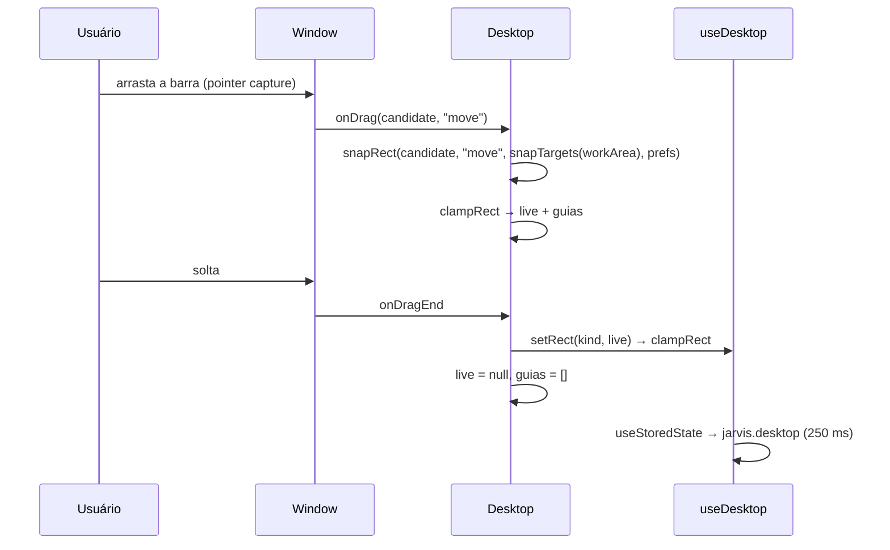

# Feature Specification: Desktop Windows

## Metadata

| Field | Value |
|---|---|
| Feature ID | `feature/desktop-windows` |
| Product | JARVIS OS (jvOS) |
| Feature Status | Implementado |
| Document Status | Reescrita em 2026-11-05 no formato Feature Specification; sem decisões em aberto |
| Source Commit | `42e671a` (2026-10-23); evoluída em `c4ccc57` (2026-10-26: menu de opções, arrastar pelo corpo) e `750ebd0` (2026-10-27: canal `requests`); `lazyApps.tsx`, a geometria ao vivo no `Desktop` e os kinds `stocks`, `weather`, `agenda` e `tasks` entraram em `e7151cf` (2026-11-05) |
| Uncommitted Changes | 2026-11-19: mover por `translate` (RF-014) e conteúdo memoizado por kind (RNF-004), em `Desktop.tsx` e `Window.tsx` |
| Voice Shortcut | `window:<kind>` (17), `group:widgets`, `group:apps`, `group:all`, `verbs:open`, `verbs:close` |
| Assistant Tool | `jvos_run` (abre, fecha e arranja pela lista da [busca](../search/spec.md)) |
| Target Platforms | Windows 11 com WebView2; no navegador (modo web) tudo funciona igual, menos a faixa `data-tauri-drag-region`, que só move a janela nativa no app |
| Language | PT-BR no conteúdo e nas falas; inglês nos títulos das seções e em Given / When / Then |
| Last Editorial Revision | 2026-11-05 |
| Verification Scope | Conferida com o código em 2026-11-05: `src/lib/desktop.ts`, `src/hooks/useDesktop.ts`, `src/lib/snap.ts`, `src/hooks/usePointerDrag.ts`, `src/components/desktop/Desktop.tsx`, `src/components/desktop/Window.tsx`, `src/components/desktop/Launcher.tsx`, `src/components/desktop/lazyApps.tsx`, `src/hooks/useWidgetOptions.ts`, `src/components/desktop/widgets/WidgetMenu.tsx`, `src/lib/requests.ts`, `src/lib/storage.ts`, `src/lib/layout.ts`, `src/App.tsx`, `src/components/desktop/AdvancedMenu.tsx`, `src/hooks/useAssistantActions.ts`, `src/hooks/useEditorDocument.ts`, `src-tauri/src/settings.rs`, `src-tauri/voice-commands.json`, `tests/desktop.spec.ts`, `tests/widgets.spec.ts`, `tests/taskbar.spec.ts`, `tests/tasks.spec.ts` e `tests/assistant.spec.ts`. Os testes não foram executados nesta revisão |

Especificação no formato inspirado no GitHub Spec Kit, com seções de desenho técnico ([ADR-0025](../../arch/adr/0025-features-formato-feature-specification.md)). Os identificadores US1–US5, RF-001–RF-011, RF-013, RNF-001–RNF-003, SC-001–SC-003 e T001–T039 são os mesmos da versão anterior; RF-012 nunca existiu. Os critérios de aceite AC-001–AC-025 são os antigos "Critério 1" a "Critério 25", na mesma ordem. KL-* registra limitações conhecidas; OQ-*, decisões de produto em aberto. Nenhum dos dois acrescenta escopo.

## Overview

Sobre o núcleo, o jvOS tem um gerenciador de janelas próprio. Há 17 tipos de janela (`WindowKind`): 11 widgets e 6 apps. Cada tipo abre no máximo uma vez.

As janelas arrastam, redimensionam pelas bordas, encaixam nas bordas e no centro, nunca saem da tela, lembram posição e tamanho e sobrevivem a um recarregamento. Os apps maximizam; os widgets não. Os widgets também arrastam pelo corpo, e sete deles têm um menu de opções no botão direito. Os apps carregam sob demanda.

Esta spec cobre o "chrome" e as regras comuns. O conteúdo de cada janela fica na spec do widget ou do app.

| Input | Expected Behavior | Execution Path |
|---|---|---|
| Clique em Widgets ou Apps na dock | O lançador abre acima do item | Local (`Launcher`) |
| "Abre o relógio" | O Relógio abre, a dock diz "Abrindo Relógio" e o JARVIS confirma | Rust (matcher) → `voice:window` → `onWindowCommand` |
| "Fecha todos os widgets" | Os widgets fecham com "Fechando N widgets" | Rust (matcher) → `voice:windows` → `onCloseGroup` |
| Arrastar a barra de título | A janela se move e gruda nas bordas | Local (`Window` → `Desktop` → `snapRect`) |
| Duplo clique na barra de um app | O app maximiza ou volta ao tamanho dele | Local (`useDesktop.toggleMaximize`) |
| O JARVIS escreve uma nota em `Notas\` | O Jarvis Mark abre e recebe o arquivo | Claude Code → `onAssistantFile` → `noteRequests` |

## Goals and Success Criteria

### Goals

- Abrir, focar e fechar widgets e apps por dock, busca, barra superior, voz e JARVIS.
- Mover, redimensionar e encaixar janelas sem que nenhuma fique inalcançável.
- Dar a um app a tela inteira e devolver o tamanho dele.
- Devolver o desktop como estava depois de um recarregamento.
- Abrir sozinha a janela certa quando faz sentido.

### Success Criteria

| ID | Criterion | Verification |
|---|---|---|
| SC-001 | Nenhuma combinação de arrastar, redimensionar ou mudar a tela deixa uma janela inalcançável. | Arrastar uma janela para fora pelo canto superior esquerdo: o topo fica em y ≥ 28 e ao menos 48 px seguem na tela (`tests/desktop.spec.ts`). Exceção conhecida atrás da dock: KL-003. |
| SC-002 | Recarregar devolve as mesmas janelas, na mesma ordem, posição e estado de maximizado. | Mover, recarregar e conferir `order`, `rects` e `maximized` em `jarvis.desktop`. |
| SC-003 | Abrir um tipo já aberto nunca cria uma segunda janela. | Escolher de novo um widget aberto no lançador: continua um único `dialog` com aquele nome. |

## Scope and Non-Goals

### In Scope

- 17 tipos de janela (`WINDOW_SPECS`), uma janela por tipo.
- Lançadores de Widgets e Apps acima da dock.
- Foco, z-order, clique no desktop vazio, fechar pelo × e por `Ctrl+W`.
- Arrastar pela barra, arrastar widgets pelo corpo, 8 alças de redimensionar.
- Encaixe nas bordas, no centro e na grade, com guias.
- Maximizar apps, inclusive abaixo da barra superior.
- Arranjos "Lado a lado", "Cascata" e "Centralizar", e fechar tudo ou um grupo.
- Abas Janelas e Layout do Menu avançado.
- Menu de opções dos widgets (`WidgetMenu`) e opções em `jarvis.widget.<nome>`.
- Apps sob demanda com pré-carregamento.
- Aberturas automáticas e entrega de arquivos que o JARVIS escreve.

### Out of Scope

- O conteúdo de cada janela, que está nas specs dos widgets e apps (ex.: [jv_sh](../../apps/jv_sh/spec.md), [Jarvis Mark](../../apps/jarvis-mark/spec.md)).
- Minimizar uma janela só, ou várias instâncias do mesmo tipo.
- Menu de opções em Ações, Clima, Agenda e Tarefas: o botão direito não abre nada neles.
- A dock e a barra superior, que são de [dock-taskbar](../dock-taskbar/spec.md). O lançador (popover acima de Widgets e Apps) é descrito aqui.
- Editar as frases `window:*` e `group:*`, que é de [voice-commands](../voice-commands/spec.md).

## User Stories

### US1 — Open, Focus and Close Windows

**Priority:** P1.

**User Story:** Como usuário, abro widgets e apps de vários jeitos, e uma janela já aberta só vem para a frente.

**Why This Priority:** é a base de tudo que roda sobre o núcleo.

**Independent Test:** `tests/desktop.spec.ts` — "Widgets and Apps open their own launchers, which close with Escape or a click outside" e "a widget opens once, shows the time and closes".

**Acceptance Criteria:** AC-001 a AC-006.

### US2 — Move, Resize and Snap

**Priority:** P1.

**User Story:** Como usuário, arrasto as janelas com precisão, e elas grudam nas bordas sem nunca sumir da tela.

**Why This Priority:** é o que faz parecer um desktop de verdade.

**Independent Test:** `tests/desktop.spec.ts` — "windows snap to the edges while dragged and never leave the screen" e "windows resize from the corner down to their minimum size"; `tests/widgets.spec.ts` — "a widget drags from anywhere on it, and its buttons still click".

**Acceptance Criteria:** AC-007 a AC-011.

### US3 — Maximize Apps

**Priority:** P2.

**User Story:** Como usuário, ponho um app na tela inteira e depois o devolvo ao tamanho dele.

**Why This Priority:** editores e terminais precisam de espaço.

**Independent Test:** `tests/desktop.spec.ts` — "apps maximise from their button or a double click on the title bar; widgets don't".

**Acceptance Criteria:** AC-012 a AC-016.

### US4 — Persistence and Preferences

**Priority:** P2.

**User Story:** Como usuário, encontro o desktop como deixei e ajusto o comportamento das janelas.

**Why This Priority:** continuidade entre sessões.

**Independent Test:** `tests/desktop.spec.ts` — "open windows and their positions survive a reload" e "the advanced menu tunes snapping, arranges windows and sets a custom hue".

**Acceptance Criteria:** AC-017 a AC-021.

### US5 — Open and Close by Voice and Other Paths

**Priority:** P2.

**User Story:** Como usuário, abro e fecho janelas pela voz, pela busca, pela barra superior e pelo JARVIS, e algumas abrem sozinhas quando faz sentido.

**Why This Priority:** a voz é o modo principal do JARVIS.

**Independent Test:** `tests/desktop.spec.ts` — "voice commands open and close windows (engine event stand-in)" e "voice closes every widget, every app or everything (engine event stand-in)".

**Acceptance Criteria:** AC-022 a AC-025.

## Requirements

### Functional Requirements

| ID | Requirement | Related Stories |
|---|---|---|
| RF-001 | O sistema DEVE manter no máximo uma janela por `WindowKind`. Abrir uma janela aberta só a traz para a frente. | US1 |
| RF-002 | A ordem de abertura DEVE ser o z-order (fundo → topo), e a última da lista é a focada, a menos que o desktop vazio tenha sido clicado. | US1 |
| RF-003 | Uma janela nova sem geometria salva DEVE abrir em cascata a partir de (24, 40), em passos de 32 px que recomeçam quando não cabem acima da dock. | US1, US4 |
| RF-004 | Fechar DEVE manter a geometria (e o estado maximizado) para a próxima abertura. | US1, US3, US4 |
| RF-005 | O encaixe DEVE usar as bordas da área útil (tela − faixa de 28 px − dock de 120 px), com margem de 16 px e topo em 32 px; com "Encaixar no centro", vale também o centro. A distância é 8, 14 ou 24 px (Curta, Média, Longa). Ao mover, encaixam as bordas e o centro; ao redimensionar, só as bordas arrastadas. | US2 |
| RF-006 | Só apps DEVEM maximizar. O maximizado ocupa a tela toda, ou começa abaixo da barra superior quando ela está ligada. | US3 |
| RF-007 | Widgets NÃO DEVEM mostrar o nome na barra de título. Apps mostram ícone e título; no estilo TUI, em vídeo invertido quando focados. | US1 |
| RF-008 | No estilo TUI, as janelas NÃO DEVEM ter borda nem cantos arredondados, e a desfocada esmaece para 80%. No Holográfico, são vidro com borda e brilho. | US4 |
| RF-009 | O menu de opções de um widget DEVE abrir com o botão direito, a tecla Menu ou `Shift+F10` (no canto do widget + 16 px). Ele fica dentro da tela e navega com ↑ ↓ Home End. Marcar mantém o menu aberto, uma ação o fecha, e Esc, um clique fora ou a janela perder o foco o fecham. | US4 |
| RF-010 | Os 6 apps DEVEM carregar sob demanda (`lazyApp`), com `preload()` para abrir já carregados. Os widgets entram no pacote principal. | US1, US5 |
| RF-011 | A geometria DEVE suavizar em 300 ms quando ninguém arrasta (soltar o encaixe, arranjar). A entrada leva 0,2 s. | US2, US4 |
| RF-013 | Durante o gesto, a geometria DEVE ficar no próprio `Desktop`, já encaixada e recortada como o `setRect` faria: cada movimento do ponteiro re-renderiza só a camada das janelas, não o app inteiro. Ao soltar, o `setRect` grava a posição final. | US2 |
| RF-014 | Enquanto uma janela é movida (mesmo tamanho), ela DEVE ser desenhada na posição guardada mais um `translate` com a diferença, numa camada própria (`will-change: translate`): o compositor a desliza, sem layout nem repintura do conteúdo. Redimensionar continua por `left`, `top`, `width` e `height`. Ao soltar, a posição final entra sem suavização. | US2 |

### Non-Functional Requirements

| ID | Requirement | Scope |
|---|---|---|
| RNF-001 | `jarvis.desktop` é gravado com debounce de 250 ms e salvo de novo no `beforeunload` (e ao desmontar) se houver gravação pendente. | Persistência do desktop |
| RNF-002 | A opacidade do painel fica entre 0,6 e 1. Maximizado, ela é no mínimo 0,95. | Todas as janelas |
| RNF-003 | Com a janela do app oculta ou minimizada, o `paused` repassado faz o Relógio, a Fita, o Sistema, o jv_ide e o jv_T4p3 pararem timers e consultas. Ações e Clima seguram as próprias consultas com `document.hidden`. | Widgets e apps que fazem trabalho periódico |
| RNF-004 | O conteúdo de uma janela só renderiza de novo quando muda o que ele lê (`CONTENT_INPUTS`, por kind): arrastar uma janela ou o JARVIS escrevendo uma resposta não refaz o conteúdo das outras. Medido no build de release em 2026-11-19 (i7-13700, arrastando o jv_ide com cinco janelas abertas): a thread principal caiu de 164 para 91 ms por segundo, e o script de 71 para 28 ms por segundo. | Conteúdo de todas as janelas |

### Operational Constraints

- Uma janela por kind; 17 kinds (`WINDOW_KINDS`).
- `TOP_SAFE` 28 px, `TOP_MARGIN` 32 px, `EDGE_MARGIN` 16 px, `MIN_VISIBLE` 48 px, `GRID` 8 px, `DOCK_RESERVE` 120 px.
- Arrasto pelo corpo do widget a partir de 4 px (`GRAB_DISTANCE`); desacoplar um maximizado a partir de 6 px (`DETACH_DISTANCE`).
- "Carregando…" fica ao menos 300 ms na tela quando o app ainda não chegou (throttle do Suspense do React 19).
- Opções de widget em `jarvis.widget.<nome>`, com debounce de 250 ms.
- Rótulos, avisos e falas em PT-BR.

## Acceptance Criteria

### AC-001 — Open a Launcher

**Related Story:** US1.

- **Given** o item Widgets da dock
- **When** o usuário clica nele
- **Then** o "Menu de widgets" abre acima dele com os 11 widgets (Relógio, Pomodoro, Bateria, Calculadora…) e sem os apps. O item Apps faz o mesmo com os 6 apps, no "Menu de apps".

### AC-002 — Close the Launcher

**Related Story:** US1.

- **Given** o lançador aberto
- **When** o usuário aperta Esc ou clica fora
- **Then** ele fecha. Clicar de novo no próprio item da dock alterna.

### AC-003 — Reopen an Open Window

**Related Story:** US1.

- **Given** um widget aberto
- **When** o usuário o abre de novo
- **Then** continua uma só janela, que vem para a frente. No lançador ele aparece marcado (`aria-pressed="true"`).

### AC-004 — Close a Window

**Related Story:** US1.

- **Given** uma janela focada
- **When** o usuário aperta `Ctrl+W` ou clica no × ("Fechar <título>")
- **Then** ela fecha. Dentro de um terminal (`[data-terminal]`), o `Ctrl+W` é do shell.

### AC-005 — Unfocus on the Empty Desktop

**Related Story:** US1.

- **Given** uma janela em foco
- **When** o usuário clica no desktop vazio (o núcleo)
- **Then** nenhuma janela fica focada e nenhuma se move. Clicar na dock não tira o foco.

### AC-006 — Raise a Window

**Related Story:** US1.

- **Given** duas janelas abertas
- **When** o usuário clica na de trás
- **Then** ela sobe. A dock continua acima das janelas.

### AC-007 — Snap to the Edges

**Related Story:** US2.

- **Given** o encaixe ligado
- **When** o usuário solta uma janela perto de uma borda
- **Then** ela gruda (16 px das laterais e da base da área útil, 32 px do topo) e uma guia aparece enquanto ele arrasta.

### AC-008 — Keep Windows Reachable

**Related Story:** US2.

- **Given** uma janela arrastada para fora da tela
- **When** o usuário a solta
- **Then** ao menos 48 px dela ficam na tela, e a barra de título nunca entra na faixa de arrasto de 28 px (y ≥ 28).

### AC-009 — Resize Down to the Minimum

**Related Story:** US2.

- **Given** um canto de redimensionar
- **When** o usuário arrasta para dentro além do possível
- **Then** o tamanho para no mínimo do tipo (Relógio: 220 × 120).

### AC-010 — Drag a Widget by Its Body

**Related Story:** US2.

- **Given** um widget
- **When** o usuário pressiona o corpo e move 4 px ou mais
- **Then** ele arrasta e mantém o foco do teclado. Uma pressão parada continua sendo clique (um botão aperta).

### AC-011 — Keep Pointer Controls

**Related Story:** US2.

- **Given** os controles que usam o ponteiro (sliders, campos) e o conteúdo dos apps
- **When** o usuário arrasta sobre eles
- **Then** a janela não se move.

### AC-012 — Maximize an App

**Related Story:** US3.

- **Given** um app aberto
- **When** o usuário clica em "Maximizar <título>" ou dá duplo clique na barra de título
- **Then** ele cobre a tela inteira, por cima da dock e da faixa de arrasto, sem alças de redimensionar.

### AC-013 — Maximize Below the Top Bar

**Related Story:** US3.

- **Given** a barra superior ligada
- **When** um app maximiza
- **Then** ele começa em y = 28 e tem altura de tela − 28.

### AC-014 — Restore Maximized State After Reload

**Related Story:** US3.

- **Given** um app maximizado
- **When** o usuário recarrega
- **Then** ele continua maximizado (`maximized` em `jarvis.desktop`) e o núcleo descansa atrás dele.

### AC-015 — Detach a Maximized App

**Related Story:** US3.

- **Given** um app maximizado
- **When** o usuário arrasta a barra 6 px ou mais
- **Then** ele volta ao próprio tamanho sob o ponteiro, no mesmo ponto da barra.

### AC-016 — Widgets Do Not Maximize

**Related Story:** US3.

- **Given** um widget aberto
- **When** o usuário dá duplo clique na barra
- **Then** nada muda, e não há botão de maximizar.

### AC-017 — Restore Windows After Reload

**Related Story:** US4.

- **Given** janelas abertas e movidas
- **When** o usuário recarrega
- **Then** as mesmas janelas voltam na mesma ordem e geometria.

### AC-018 — Drop Without Snapping

**Related Story:** US4.

- **Given** "Encaixar nas bordas" desligado (aba Janelas)
- **When** o usuário solta a janela a 22 px da borda
- **Then** ela fica exatamente ali.

### AC-019 — Arrange Windows

**Related Story:** US4.

- **Given** a aba Layout com janelas abertas
- **When** o usuário clica "Lado a lado"
- **Then** as janelas formam uma grade sem sobreposição, acima da dock. "Centralizar" põe cada uma no centro da área do núcleo, e "Cascata" as escalona.

**Coverage Status:** "Lado a lado" e "Centralizar" têm teste; "Cascata" não (KL-004).

### AC-020 — Align to the Grid

**Related Story:** US4.

- **Given** "Alinhar à grade" ligado
- **When** o usuário solta uma janela longe de bordas e do centro
- **Then** a posição arredonda para múltiplos de 8 px.

**Coverage Status:** sem teste automatizado (KL-004).

### AC-021 — Apply Opacity and Style

**Related Story:** US4.

- **Given** a opacidade (60% a 100%) e o estilo (TUI ou Holográfico) da aba Janelas
- **When** o usuário muda um deles
- **Then** a mudança vale na hora para todas as janelas.

**Coverage Status:** o estilo tem teste; a opacidade não (KL-004).

### AC-022 — Open by Voice

**Related Story:** US5.

- **Given** `voice:window { kind, open: true }`
- **When** o evento chega
- **Then** a janela abre, a dock (item Widgets ou Apps) diz "Abrindo <título>" e o JARVIS confirma com uma fala `openWindow`.

### AC-023 — Close by Voice

**Related Story:** US5.

- **Given** `voice:window { kind, open: false }`
- **When** a janela está aberta
- **Then** ela fecha com "Fechando <título>". Se não estiver aberta, a dock diz "<título> não está aberto".

### AC-024 — Close a Group by Voice

**Related Story:** US5.

- **Given** `voice:windows { group }`
- **When** o evento chega
- **Then** fecham todos os widgets, todos os apps ou tudo, com "Fechando N widgets", "Fechando N apps" ou "Fechando N janelas" (no singular com uma só). Sem nada aberto: "Nenhum widget aberto", "Nenhum app aberto" ou "Nenhuma janela aberta".

### AC-025 — Open Automatically

**Related Story:** US5.

- **Given** uma tarefa pendente nova, a volta para casa, um arquivo que o JARVIS escreve em `Notas\` ou `Agentes\`, ou uma tool do JARVIS que mostra um widget
- **When** o evento acontece
- **Then** a janela certa abre sozinha.

## Behavior and Flows

### Window Manager (`useDesktop`)

As operações puras sobre `$desktop`: abrir, fechar, focar, recortar, arranjar e maximizar.

- **Behavior:**
  - `open` tira o kind da lista e o põe no fim (topo). Com geometria salva, recorta-a com `clampRect`; sem ela, usa `cascadeRect` com o número de janelas abertas como posição na cascata (RF-001, RF-003).
  - `focus` traz para o topo; `blur` só marca que nada está focado. O próximo clique numa janela ou a próxima abertura focam de novo (RF-002).
  - `close` tira o kind de `order` e mantém `rects` e `maximized` (RF-004).
  - `setRect` recorta a geometria com `clampRect`: a largura e a altura ficam entre o mínimo do tipo e a tela; `x` fica entre `48 − largura` e `largura da tela − 48`; `y` fica entre 28 e `altura da tela − 48`.
  - No carregamento e a cada `resize` (agrupado por `requestAnimationFrame`), todas as janelas abertas são recortadas para caber; uma aberta sem geometria ganha a da cascata.
  - `arrange("tile")` usa `tileRects`: uma grade de `ceil(√n)` colunas acima da dock, com margens de 16 px e topo em 32 px. `arrange("cascade")` refaz a cascata pela ordem. `arrange("center")` centraliza cada janela na área útil. Arranjar tira o maximizado de todas as janelas abertas.
  - `closeAll` fecha tudo; `closeGroup` fecha os widgets ou os apps.
  - `toggleMaximize` só age em apps, alterna o maximizado e traz o app para o topo; `unmaximize` só tira o maximizado.

### `Desktop`

A camada das janelas sobre o núcleo, com as guias de encaixe.

- **Behavior:**
  - Desenha um `Window` por kind aberto, na ordem de `$desktop`, com o conteúdo de `WindowContent`.
  - Um `pointerdown` em `[data-desktop-surface]` (o núcleo 2D ou 3D, o núcleo desligado, o botão do núcleo) chama `blur`. Nada se move. A dock, a barra e os menus não são superfície, então clicar neles não tira o foco.
  - Durante o gesto, aplica `snapRect` e `clampRect` à geometria proposta, guarda-a em `live` e mostra as guias (RF-013). A janela do gesto recebe a geometria guardada em `rect` e a do gesto em `live`. Ao soltar, chama `setRect` com a geometria final e apaga as guias.
  - `WindowContent` é memoizado e compara só as entradas do seu kind (`CONTENT_INPUTS`): `paused`, o timer, a música, o feed do widget, a conversa (jv_agent) ou `close` (jv_sh) (RNF-004).
  - Repassa `paused` ao Relógio, à Fita, ao Sistema, ao jv_ide e ao jv_T4p3 (RNF-003).
  - O jv_sh recebe `onClose` e fecha a própria janela quando a última aba sai.
  - No estilo TUI, todas as janelas recebem a superfície de terminal (`tuiSurface`); no Holográfico, só os apps.
- **Layout:**
  - A camada cobre a tela (`fixed inset-0`, `pointer-events-none` fora das janelas), em `z-[15]`: acima da legenda e abaixo da dock (`z-[16]`).
  - Com um app maximizado na frente, a camada sobe para `z-[21]`: acima da dock e da faixa de arrasto (`z-20`), abaixo da barra superior (`z-[22]`).
  - Cada guia é uma linha de 1 px de ponta a ponta da tela, vertical ou horizontal, em `z-[100]`.
- **Style:** as guias ficam em `bg-hud-light/50`, com brilho de `--color-hud-holo` a 70%.

### `Window`

O chrome de uma janela: barra de título, corpo, alças e botões.

- **Behavior:**
  - Pressionar a janela (`onPointerDownCapture`) a foca e a traz para a frente. Arrastar a barra de título move a janela desde o primeiro pixel.
  - Widgets não mostram o nome; apps mostram ícone e título (RF-007).
  - TUI sem borda e sem cantos; a desfocada esmaece para 80%. Holográfico com borda, sombra e brilho (RF-008).
  - Um widget também arrasta pelo corpo: uma pressão que anda 4 px ou mais (`GRAB_DISTANCE`) arrasta e mantém o foco do teclado; uma que fica parada continua sendo clique.
  - O arrasto pelo corpo ignora `input, textarea, select, [contenteditable], [role=slider]` (`usePointerDrag`). O corpo dos apps não tem arrasto.
  - As 8 alças redimensionam respeitando o mínimo do tipo; somem com a janela maximizada.
  - A geometria suaviza em 300 ms quando ninguém arrasta, com a curva `cubic-bezier(0.22, 1, 0.36, 1)` (RF-011).
  - Com `live` do mesmo tamanho de `rect` (um movimento), desenha `rect` e aplica `translate` com a diferença e `will-change: translate`; com outro tamanho (redimensionar), desenha `live` direto (RF-014).
  - Ao soltar, grava a geometria com `flushSync` e lê o layout antes de religar a suavização: `left` e `top` não suavizam a partir de onde o movimento começou.
  - Os botões da barra ("Maximizar <título>", "Restaurar <título>", "Fechar <título>") param o `pointerdown` e o duplo clique: não arrastam nem maximizam.
  - `Ctrl+W` (ou `Meta+W`) dentro da janela a fecha, a menos que o evento já tenha `defaultPrevented` ou venha de `[data-terminal]`.
  - Com um app, a barra tem a dica "Duplo clique para maximizar ou restaurar".
- **Layout:**
  - Uma `section` com `role="dialog"`, `aria-label` igual ao título, `tabIndex=-1` e `data-window`, `data-chrome` e `data-focused`; posicionada por `left`, `top`, `width` e `height` (mais um `translate` enquanto é movida; o `transform` é do motion, para a entrada e a saída), com `zIndex` = posição na ordem + 1.
  - TUI: barra de 24 px (`h-6`) com o nome do app à esquerda e os botões à direita.
  - Holográfico: barra de 32 px (`h-8`) com ícone, título e os botões, e uma borda inferior `hud-cyan/10`.
  - O corpo ocupa o resto e é um container query (`@container`).
  - As alças são faixas de 6 px sobre a borda e quadrados de 12 px nos cantos.
- **Style:**
  - O painel é `--color-hud-panel` com a opacidade de `$prefs.opacity`, sem `backdrop-filter`: atrás de uma janela o núcleo se mexe a cada quadro, e o desfoque seria refeito a cada quadro ([ADR-0022](../../arch/adr/0022-nucleo-relogio-quadros-limitado-canvas-3.md)).
  - TUI: barra em `font-mono` 11 px; o nome do app focado em `bg-hud-light/85 text-hud-void`, o desfocado em `bg-hud-text/12 text-hud-text/60`; os botões acendem em `bg-hud-light/85` no hover.
  - Holográfico: borda `hud-cyan/35` com sombra e brilho interno quando focada, `hud-cyan/15` quando não; `rounded-xl`, ou sem cantos e sem bordas laterais quando maximizada; uma linha de luz `hud-light/40` no topo da focada; título em 10 px, maiúsculas e `tracking-[0.28em]`, em `text-hud-light` (focada) ou `text-hud-text/50`; botões acendem em `bg-hud-cyan/10`.
  - A entrada vai de `opacity 0`, `scale 0.96` e 6 px abaixo, em 0,2 s; a saída, em 0,15 s, para `scale 0.97`. Com movimento reduzido, a geometria não suaviza.

### Snapping (`snapRect`)

Gruda a janela nas bordas, no centro e na grade enquanto ela é arrastada.

- **Behavior:**
  - Os alvos (`snapTargets`) são x = 16 e x = largura − 16; y = 32 e y = altura − 120 − 16; e, com "Encaixar no centro", o centro da área útil (RF-005).
  - Em cada eixo, a linha mais próxima dentro da distância (8, 14 ou 24 px) é puxada para o alvo, e uma guia aparece nesse alvo.
  - Ao mover, contam as duas bordas e o centro da janela. Ao redimensionar, só as bordas arrastadas.
  - Com o encaixe desligado, a janela fica exatamente onde foi solta.
  - Com "Alinhar à grade" ligado, um eixo sem encaixe arredonda para 8 px.

### Maximize

Um app ocupa a tela inteira e volta ao tamanho dele.

- **Behavior:**
  - O botão "Maximizar <título>" ou o duplo clique na barra alternam (RF-006). Num widget, não há botão e o duplo clique não faz nada.
  - A área é a tela inteira, ou de y = 28 até a base com a barra superior ligada (`maximizedArea`).
  - Arrastado 6 px ou mais (`DETACH_DISTANCE`), o maximizado volta ao tamanho próprio sob o ponteiro, no mesmo ponto proporcional da barra.
  - O estado vai para `maximized` em `$desktop` e sobrevive a um recarregamento.
  - Com um maximizado na frente, o núcleo para de desenhar depois do primeiro quadro (`covered` em `App.tsx`).
  - Maximizado, a opacidade do painel é no mínimo 0,95 (RNF-002).

### `Launcher`

O popover acima dos itens Widgets e Apps da dock.

- **Behavior:**
  - Lista os kinds do grupo: o "Menu de widgets" tem os 11 widgets e o "Menu de apps", os 6 apps.
  - Um kind aberto aparece marcado (`aria-pressed="true"`). Escolher um kind abre a janela (ou a traz para a frente) e fecha o lançador.
  - Esc ou um `pointerdown` fora fecham o lançador. Clicar de novo no próprio item da dock alterna.
  - O lançador também fecha quando abrem as Configurações, o Menu avançado ou a busca, ou quando a dock some.
  - O botão "Menu avançado" abre o Menu avançado.
- **Layout:**
  - Um `dialog` de 264 px de largura: o nome do grupo no topo, uma grade de duas colunas com um botão por kind (ícone de 20 px e título), a dica de voz e, embaixo, o botão "Menu avançado".
  - A dica diz "Por voz: “abre o relógio”, “fecha todos os widgets”. Ou tecle / para buscar." (widgets) ou "Por voz: “abre o Jarvis Mark”, “fecha todas as aplicações”. Ou tecle / para buscar." (apps).
  - Um kind aberto ganha um ponto de 4 px no canto superior direito.
- **Style:**
  - Painel `rounded-2xl` com borda `hud-cyan/18`, fundo `hud-panel/80`, `backdrop-blur-md` e sombra escura.
  - O nome do grupo e os botões em 10 px maiúsculos; o nome em `text-hud-cyan/80`.
  - Botão fechado: borda `hud-cyan/12` e `text-hud-text/60`, que vão para `hud-cyan/30` e `text-hud-light` no hover. Botão aberto: borda `hud-cyan/35`, fundo `hud-cyan/[0.07]` e `text-hud-light`, com o ponto em `bg-hud-light` brilhando.
  - A dica em 11 px `text-hud-text/45`, com o `/` em `font-mono text-hud-light/80`.

### Widget Options Menu (`WidgetMenu`)

O menu do botão direito, que liga e desliga partes de um widget.

- **Behavior:**
  - Existe em Relógio, Pomodoro, Bateria, Calculadora, Fita, Mini player e Sistema, com o rótulo "Opções do widget <título>" (RF-009).
  - Abre no ponto do clique. Pelo teclado (tecla Menu, `Shift+F10`) o evento não tem ponteiro, e o menu abre no canto do widget + 16 px.
  - Se passar da borda, abre do outro lado do ponto, a 8 px das bordas.
  - Ao abrir, o foco vai ao primeiro item. As teclas param no menu: ↑ ↓ circulam, Home e End vão às pontas, Espaço marca a opção sem acionar o widget.
  - Esc (capturado na janela) fecha e devolve o foco ao widget. Um `pointerdown` fora ou a janela perder o foco fecham.
  - Uma caixa ou rádio mantém o menu aberto; uma ação o fecha.
  - `toggleItems` monta as caixas a partir das opções. Seis widgets guardam as opções em `jarvis.widget.<nome>` (`useWidgetOptions`); o Sistema guarda em `jarvis.meters` (ver [system](../../widgets/system/spec.md)).
  - `MenuPopup` também serve aos menus do jv_ide, que usam ← → para ir ao menu vizinho.
- **Layout:** um `role="menu"` com seções (`role="group"`), cada uma com título opcional; um separador entre as seções; o detalhe (atalho, tamanho) à direita do item.
- **Style:**
  - Menu TUI em `font-mono` 12 px, `min-w-[24ch]`, até `80vh` de altura, `z-[90]`, borda `hud-cyan/30` e fundo `hud-panel/95` (opaco o bastante para dispensar desfoque).
  - As marcas são texto em `text-hud-cyan`: `[x]` e `[ ]` para caixas, `(•)` e `( )` para rádios.
  - O item sob o ponteiro ou o foco fica em vídeo invertido (`bg-hud-light/85 text-hud-void`).
  - Títulos de seção em 10 px maiúsculos `text-hud-text/45`; separadores em `hud-cyan/20`.

### Lazy Apps (`lazyApps`)

O carregamento dos 6 apps, fora do pacote principal.

- **Behavior:**
  - Jarvis Mark, jv_ide, jv_T4p3, jv_sh, jv_lab e jv_agent são `lazyApp` com `preload()` (RF-010).
  - `preloadWindow(kind)` baixa o app antes de abrir a janela; para um widget, resolve na hora.
  - Aberto antes de o código chegar, o app mostra "Carregando…" por pelo menos 300 ms. Já pré-carregado, aparece direto.
  - O componente escolhido (o carregado ou o lazy) não muda depois de montado, para o app não remontar.
  - Uma falha no carregamento libera o `preload` para uma nova tentativa.
- **Layout:** "Carregando…" fica centrado no corpo da janela.
- **Style:** `text-xs text-hud-text/50`.

### Automatic Openings and File Requests

Janelas que abrem sozinhas quando faz sentido.

- **Behavior:**
  - O widget Tarefas abre quando o número de tarefas pendentes cresce, inclusive na abertura do app.
  - Na volta para casa ("acorda, querido, papai chegou"), Relógio, Agenda e Tarefas abrem um a um, a partir de 800 ms e a cada 300 ms.
  - `onAssistantFile`: um arquivo em `Notas\` abre o Jarvis Mark; um `.md` em `Agentes\` abre o jv_agent. O app é pré-carregado, a janela abre e o arquivo segue pelo canal `noteRequests` ou `draftRequests`.
  - As tools do JARVIS que mostram um widget (`stocks_watch`, `stocks_alert`, `agenda_add`, `tasks_add`) o abrem por `show`; `jvos_run` abre, fecha e arranja pela lista da busca.
  - Os atalhos de voz também abrem janelas: Clima, Agenda, Tarefas, o Pomodoro do "protocolo foco" (que antes fecha tudo) e o Jarvis Mark da [anotação rápida](../quick-notes/spec.md).
  - Com a janela ainda fechada, o canal guarda o último pedido (`requestChannel.take()`) até a janela abrir.

### Windows and Layout Tabs (Advanced Menu)

As preferências das janelas.

- **Behavior:**
  - Aba Janelas:
    - "Estilo das janelas": TUI ("Como apps de terminal num gerenciador tiling: sem bordas, nome em vídeo invertido, widgets em TUI.") ou Holográfico ("Painéis de vidro com brilho, no visual do holograma.").
    - "Encaixar nas bordas" ("A janela gruda na borda da tela quando é solta perto dela") e "Encaixar no centro" ("Também gruda no centro da área do holograma") ligam `snap` e `snapCenter`. "Distância de encaixe" escolhe Curta, Média ou Longa.
    - "Opacidade das janelas" vai de 60% a 100%.
  - Aba Layout:
    - "Lado a lado", "Cascata" e "Centralizar", desabilitados sem janelas abertas, e a contagem ("1 janela aberta.", "2 janelas abertas.") ou "Abra janelas pelos itens Widgets e Apps da dock.".
    - "Alinhar à grade" ("Posições arredondam para 8 px quando nada encaixa").
    - "Fechar todas as janelas", desabilitado sem janelas.
  - Tudo vale na hora para todas as janelas.
- **Layout:**
  - Janelas: as seções "Estilo" (`Segmented` e a descrição), "Encaixe" (dois `SwitchRow` e um `Segmented`) e "Aparência das janelas" (`Range`).
  - Layout: as seções "Organizar janelas" (três `ActionButton` em três colunas e a contagem), "Alinhamento" (`SwitchRow`) e "Janelas abertas" (`ActionButton`).
- **Style:** os controles do kit do Menu avançado; a descrição do estilo em `text-xs text-hud-text/55` e a contagem em `text-xs text-hud-text/50`.

### Interaction Flow



### User Feedback

| Moment | Persona Key | Output |
|---|---|---|
| Janela aberta por voz | `openWindow` | Dock (Widgets ou Apps) "Abrindo <título>", pulso do núcleo e fala |
| Janela fechada por voz | `closeWindow` | Dock "Fechando <título>" e fala |
| Fechar por voz uma janela fechada | `notOpen` | Dock "<título> não está aberto" e fala |
| Grupo fechado por voz | `closeGroup` | Dock "Fechando N widgets", "Fechando N apps" ou "Fechando N janelas" (item Apps para apps, Widgets nos outros casos) e fala |
| Grupo vazio | `nothingOpen` | Dock "Nenhum widget aberto", "Nenhum app aberto" ou "Nenhuma janela aberta" e fala |
| Comando do JARVIS pela busca | — | Dock (Voice) "JARVIS: <título>" |

As variantes de cada fala estão em `src/lib/jarvisLines.ts`. Com o JARVIS ocupado, a confirmação vai só para a dock.

### Voice and Keyboard

- `window:<kind>` com `verbs:open` ou `verbs:close` ("abre o relógio", "fecha a calculadora"): `voice:window`.
- `group:widgets`, `group:apps` e `group:all` com `verbs:close` ("fecha todos os widgets", "fecha todas as aplicações", "fecha tudo"): `voice:windows`.
- `Ctrl+W` na janela (fora de `[data-terminal]` e se nada tratou antes): fecha a janela.
- Duplo clique na barra (apps): maximizar ou restaurar.
- Botão direito, tecla Menu, `Shift+F10` (widgets com menu): menu de opções.
- ↑ ↓ Home End Esc no menu: navegação, fechar e devolver o foco.
- Esc ou clique fora (lançador): fecha o lançador.

## Data Model and Persistence

### Desktop State

```ts
type WindowKind =
  | "clock" | "pomodoro" | "battery" | "calculator" | "tape" | "miniplayer" | "system"
  | "stocks" | "weather" | "agenda" | "tasks"
  | "markdown" | "ide" | "music" | "shell" | "lab" | "agent";

interface Rect { x: number; y: number; w: number; h: number } // px CSS, do canto superior esquerdo

interface DesktopPrefs {
  windowStyle: "tui" | "holo";
  snap: boolean;
  snapDistance: 8 | 14 | 24;
  snapCenter: boolean;
  grid: boolean;
  opacity: number; // 0,6 a 1
}

interface DesktopState {
  version: 1;
  rects: Partial<Record<WindowKind, Rect>>; // mantida ao fechar; maximizado: o tamanho a restaurar
  order: WindowKind[];                      // abertas, do fundo ao topo; estar aqui é estar aberto
  maximized: WindowKind[];                  // só apps
  prefs: DesktopPrefs;
}
```

| Field | Meaning | Rule |
|---|---|---|
| `rects` | Última geometria de cada kind | Só números finitos; um kind repetido fica com a primeira entrada |
| `order` | Janelas abertas, em z-order | Sem repetição; kinds desconhecidos saem |
| `maximized` | Apps maximizados | Filtrado aos apps; sobrevive a fechar e reabrir |
| `prefs` | Preferências das janelas | Padrão `{ windowStyle: "tui", snap: true, snapDistance: 14, snapCenter: true, grid: false, opacity: 0.85 }` |

`WindowSpec` (título, ícone, tamanho padrão, mínimo e grupo) e `DesktopGroup` (`"widgets" | "apps"`) estão no [glossário](../../domain/glossary.md).

### Window Sizes (`WINDOW_SPECS`, padrão → mínimo, em px)

| Kind | Título | Grupo | Padrão | Mínimo |
|---|---|---|---|---|
| `clock` | Relógio | widgets | 300×160 | 220×120 |
| `pomodoro` | Pomodoro | widgets | 300×250 | 260×220 |
| `battery` | Bateria | widgets | 300×150 | 220×120 |
| `calculator` | Calculadora | widgets | 300×420 | 260×360 |
| `tape` | Fita | widgets | 380×250 | 260×180 |
| `miniplayer` | Mini player | widgets | 360×150 | 300×140 |
| `system` | Sistema | widgets | 300×290 | 220×110 |
| `stocks` | Ações | widgets | 380×300 | 300×180 |
| `weather` | Clima | widgets | 400×230 | 340×200 |
| `agenda` | Agenda | widgets | 340×420 | 300×340 |
| `tasks` | Tarefas | widgets | 320×300 | 240×180 |
| `markdown` | Jarvis Mark | apps | 880×560 | 480×300 |
| `ide` | jv_ide | apps | 1180×700 | 640×360 |
| `music` | jv_T4p3 | apps | 920×620 | 660×480 |
| `shell` | jv_sh | apps | 900×540 | 480×300 |
| `lab` | jv_lab | apps | 1180×700 | 720×420 |
| `agent` | jv_agent | apps | 1000×600 | 640×380 |

### File Request

```ts
interface FileRequest {
  path: string;
  content: string | null; // o texto até agora; null quando o disco já tem (um Edit)
  done: boolean;          // true quando o arquivo está no disco
}
```

### Storage Rules

| Property | Value |
|---|---|
| State | `$desktop` (`DesktopState`) e `$opções` (`Record<string, boolean>` por widget) |
| Storage | `localStorage` |
| Key | `jarvis.desktop`; `jarvis.widget.<nome>` (`clock`, `pomodoro`, `battery`, `calculator`, `tape`, `miniplayer`) |
| Write Debounce | 250 ms, mais uma gravação no `beforeunload` se houver pendência |
| Reader | `parseDesktop`: descarta kinds desconhecidos e geometrias inválidas, migra `code` → `ide` (`RENAMED`), aceita só `"holo"` como estilo (o resto, inclusive o antigo `"sway"`, vira `"tui"`), aceita `snapDistance` 8, 14 ou 24 e `opacity` entre 0,6 e 1, e filtra `maximized` aos apps. `parseToggles`: cada opção ausente ou não booleana volta ao padrão do widget |
| Missing or Invalid Storage | Desktop vazio com as `prefs` padrão; opções no padrão do widget |

Ver [persistência](../../domain/persistence.md) e [ADR-0010](../../arch/adr/0010-persistencia-settings-vs-localstorage.md).

### Restart Behavior

Na abertura, `jarvis.desktop` volta pelo `parseDesktop`. As janelas de `order` reabrem na mesma ordem, recortadas para a tela atual; uma sem geometria entra na cascata. Os apps de `maximized` que estão abertos voltam maximizados, e o núcleo descansa atrás do da frente.

## Technical Design

### Component Responsibilities

| File or Component | Responsibility |
|---|---|
| `src/lib/desktop.ts` | `WindowKind`, `WINDOW_KINDS`, `WINDOW_SPECS`, `canMaximize`, constantes (`TOP_SAFE`, `TASKBAR_HEIGHT`, `TOP_MARGIN`, `EDGE_MARGIN`, `MIN_VISIBLE`, `GRID`), `workArea`, `maximizedArea`, `clampRect`, `cascadeRect`, `tileRects`, `centerRect`, `isWindowKind`, `parseDesktop`, `RENAMED` |
| `src/hooks/useDesktop.ts` | API `Desktop`: `open`, `close`, `focus`, `blur`, `setRect`, `arrange`, `closeAll`, `closeGroup`, `toggleMaximize`, `unmaximize`, `setPrefs`; recorte no `resize` |
| `src/lib/snap.ts` | `snapTargets`, `snapRect` (bordas, centro, grade) e guias |
| `src/hooks/usePointerDrag.ts` | Arrasto com captura do ponteiro e `threshold`; com `threshold`, ignora `input, textarea, select, [contenteditable], [role=slider]` |
| `src/components/desktop/Desktop.tsx` | Camada das janelas, geometria ao vivo, guias, `[data-desktop-surface]` → `blur`, `WindowContent` |
| `src/components/desktop/Window.tsx` | Chrome TUI e Holográfico, barra que arrasta, corpo que arrasta (widgets, 4 px), 8 alças, maximizar e restaurar, `Ctrl+W` |
| `src/components/desktop/Launcher.tsx` | Popover "Menu de widgets" e "Menu de apps" |
| `src/components/desktop/lazyApps.tsx` | `lazyApp`, os 6 apps lazy, `preloadWindow(kind)` |
| `src/hooks/useWidgetOptions.ts` | `useWidgetOptions(name, defaults)` → `jarvis.widget.<name>`, `parseToggles` |
| `src/components/desktop/widgets/WidgetMenu.tsx` | `useWidgetMenu`, `toggleItems`, `WidgetMenu`, `MenuPopup` (reusado pelo jv_ide) |
| `src/lib/requests.ts` | `requestChannel`, `FileRequest`, `noteRequests`, `draftRequests` |
| `src/components/desktop/AdvancedMenu.tsx` | Abas Janelas e Layout |
| `src/App.tsx` | `useDesktop({ taskbar })`, `onWindowCommand`, `onCloseGroup`, `onAssistantFile`, aberturas automáticas, lançador como popover da dock, `covered` |
| `src-tauri/src/settings.rs` | `WINDOW_KINDS` do Rust (validação das frases `window:*`) |

O desktop é só UI: igual dentro e fora do Tauri. O Rust entra no reconhecimento das frases (matcher) e na validação do catálogo de voz.

### Geometry Rules

1. A área útil (`workArea`) vai de y = 28 até `altura − 120` (a dock).
2. `clampRect` é a única porta de gravação (`setRect`, abrir, recortar, arranjar).
3. Durante o gesto, `Window` só propõe uma geometria; o `Desktop` encaixa, recorta e guarda em `live`.
4. Ao soltar, `setRect` grava a geometria final, e `useStoredState` a salva depois de 250 ms.
5. Sem gesto, uma mudança de geometria suaviza em 300 ms (CSS `transition`).

### Related Architecture Decisions

- [ADR-0012 — apps lazy com preload](../../arch/adr/0012-apps-lazy-com-preload.md)
- [ADR-0010 — settings.json vs localStorage](../../arch/adr/0010-persistencia-settings-vs-localstorage.md)
- [ADR-0022 — sem `backdrop-filter` em superfícies permanentes](../../arch/adr/0022-nucleo-relogio-quadros-limitado-canvas-3.md)
- [ADR-0014 — linguagem visual TUI](../../arch/adr/0014-linguagem-visual-tui.md)
- [ADR-0011 — fakes de dev e E2E no modo web](../../arch/adr/0011-fakes-de-dev-e-e2e-modo-web.md)
- [ADR-0009 — tipos espelhados TS ↔ Rust](../../arch/adr/0009-tipos-espelhados-ts-rust.md)

## Interfaces and Contracts

### Events and Channels

| Event | Payload | Producer → Consumer |
|---|---|---|
| `voice:window` | `{ kind: string, open: boolean }` | `voice/mod.rs` → `onWindowCommand` (o kind é validado com `isWindowKind`) |
| `voice:windows` | `{ group: "widgets" \| "apps" \| "all" }` | `voice/mod.rs` → `onCloseGroup` |
| `noteRequests` | `FileRequest` | `App.onAssistantFile` e o atalho de anotação → `useEditorDocument` (Jarvis Mark) |
| `draftRequests` | `FileRequest` | `App.onAssistantFile` → `AgentApp` (jv_agent) |

No modo web de desenvolvimento, `window.__JARVIS__.voiceWindow` e `window.__JARVIS__.voiceCloseGroup` fazem o papel dos eventos do motor ([ADR-0011](../../arch/adr/0011-fakes-de-dev-e-e2e-modo-web.md)).

### Assistant Tool

| Property | Contract |
|---|---|
| Tool Name | `jvos_run` (e `jvos_commands`, que lista) |
| Window Commands | `window:<kind>`, `close:<kind>`, `arrange:tile`, `arrange:cascade`, `arrange:center`, `close-all`, `close-widgets`, `close-apps` |
| Success | `ok: true`, "Feito: <título>", e a dock (Voice) diz "JARVIS: <título>" |
| Contract | Ver [assistant-tools](../assistant-tools/spec.md) e [search](../search/spec.md) |

## Edge Cases and Error Handling

| Case | Behavior | Reference |
|---|---|---|
| `jarvis.desktop` ausente ou com JSON inválido | Desktop vazio, `prefs` padrão | Storage Rules |
| Kind desconhecido ou geometria inválida no armazenamento | Descartado na leitura | `parseDesktop` |
| `code` salvo por uma versão antiga | Vira `ide` | `RENAMED` |
| Estilo `"sway"` salvo | Vira `"tui"` | `parseDesktop` |
| Janela aberta sem geometria | Cascata a partir de (24, 40), passos de 32 px | RF-003 |
| Opção ausente em `jarvis.widget.<nome>` | Volta ao padrão do widget | `parseToggles` |
| Abrir um kind já aberto | Nenhuma janela nova; ela vem para a frente | RF-001, AC-003 |
| Fechar por voz uma janela fechada | "<título> não está aberto" | AC-023 |
| Fechar um grupo vazio | "Nenhum widget aberto", "Nenhum app aberto" ou "Nenhuma janela aberta" | AC-024 |
| `voice:window` com kind inexistente | Ignorado, sem aviso | `isWindowKind` |
| Arranjos sem janelas | Botões desabilitados e "Abra janelas pelos itens Widgets e Apps da dock." | Layout tab |
| Muitas janelas em "Lado a lado" numa tela pequena | As células crescem até o mínimo de cada tipo e podem se sobrepor | KL-002 |
| Arranjar com um app maximizado | Ele volta ao tamanho próprio | `arrange` |
| Vários arquivos escritos com a janela fechada | Só o pedido mais recente fica guardado | `requestChannel.take()` |
| App aberto antes de o código chegar | "Carregando…" por pelo menos 300 ms | RF-010 |
| A tela encolhe | Todas as janelas são recortadas de novo no `resize`, uma vez por quadro | `clampAll` |
| Concorrência: arrasto em andamento | A geometria fica em `live`; só o fim do gesto grava | RF-013 |
| App estreito estacionado atrás da dock | A barra de título pode ficar coberta pela dock | KL-003 |
| `Ctrl+W` dentro de `[data-terminal]` | Fica com o shell | AC-004 |
| Arrasto sobre sliders, campos ou o conteúdo de um app | A janela não se move | AC-011 |
| Janela do app oculta ou minimizada | Relógio, Fita, Sistema, jv_ide e jv_T4p3 recebem `paused` | RNF-003 |
| Permissões | Não se aplica: só `localStorage`, sem arquivos nem comandos nativos | — |

## Dependencies

### Feature Dependencies

| Dependency | Purpose |
|---|---|
| [dock-taskbar](../dock-taskbar/spec.md) | Os itens Widgets e Apps, os avisos, e a barra superior que limita o maximizado |
| [appearance](../appearance/spec.md) | `windowStyle` e `tuiSurface` |
| [settings](../settings/spec.md) | O Menu avançado que hospeda as abas Janelas e Layout |
| [voice-engine](../voice-engine/spec.md) | Os eventos `voice:window` e `voice:windows` |
| [voice-commands](../voice-commands/spec.md) | As frases `window:*`, `group:*` e `verbs:*` |
| [holographic-core](../holographic-core/spec.md) | A superfície `[data-desktop-surface]` e o núcleo que descansa atrás de um maximizado |
| [search](../search/spec.md) | Os comandos de janela da busca e de `jvos_run` |
| [assistant-tools](../assistant-tools/spec.md) | `jvos_run` e as tools que mostram widgets |
| [quick-notes](../quick-notes/spec.md) e [assistant](../assistant/spec.md) | Os arquivos que chegam ao Jarvis Mark por `noteRequests` |

### Runtime Dependencies

- [React](../../foundation/vendor/react/spec.md): `React.lazy`, `Suspense` e o portal do `WidgetMenu`.
- [motion](../../foundation/vendor/motion/spec.md): entrada e saída das janelas e do lançador.
- [lucide](../../foundation/vendor/lucide/spec.md): os ícones de `WINDOW_SPECS`.
- `localStorage` e Pointer Events da WebView2 ou do navegador.
- [Tauri](../../foundation/vendor/tauri/spec.md): no app, a faixa `data-tauri-drag-region` de 28 px move a janela nativa.

## Test Strategy and Coverage

### Reported Tests

| Test Reference | Coverage | Acceptance Mapping |
|---|---|---|
| `tests/desktop.spec.ts` — "Widgets and Apps open their own launchers, which close with Escape or a click outside" | Os dois lançadores, o conteúdo de cada um, `aria-pressed`, Esc e clique fora | AC-001, AC-002 |
| `tests/desktop.spec.ts` — "a widget opens once, shows the time and closes" | Sem `backdrop-filter`, uma janela por kind, `aria-pressed`, o ×, `order` vazio | AC-003, AC-004, SC-003 |
| `tests/desktop.spec.ts` — "windows snap to the edges while dragged and never leave the screen" | Guia durante o arrasto, x = 16 depois de soltar, y ≥ 28 e 48 px na tela | AC-007, AC-008, SC-001 |
| `tests/desktop.spec.ts` — "windows resize from the corner down to their minimum size" | Canto `se` cresce e para em 220 × 120 | AC-009 |
| `tests/desktop.spec.ts` — "open windows and their positions survive a reload" | `order` e `rects` depois de recarregar | AC-017, SC-002 |
| `tests/desktop.spec.ts` — "the advanced menu tunes snapping, arranges windows and sets a custom hue" | Encaixe desligado (22 px), "Lado a lado" sem sobreposição, "Centralizar" | AC-018, AC-019 |
| `tests/desktop.spec.ts` — "voice commands open and close windows (engine event stand-in)" | "Abrindo Relógio", trazer para a frente, "Fechando Relógio", "Relógio não está aberto", kind inexistente ignorado | AC-022, AC-023 |
| `tests/desktop.spec.ts` — "voice closes every widget, every app or everything (engine event stand-in)" | "Fechando 3 widgets", "Nenhum widget aberto", "Fechando 2 apps" sobre o item Apps, "Fechando 2 janelas" | AC-024 |
| `tests/desktop.spec.ts` — "apps maximise from their button or a double click on the title bar; widgets don't" | Botão, duplo clique, sem alças, sobre a dock e a faixa, recarregar, núcleo parado, desacoplar ao arrastar, widget sem maximizar | AC-012, AC-014, AC-015, AC-016 |
| `tests/desktop.spec.ts` — "a click on the empty desktop leaves no window focused, without moving any" | `blur`, a dock não tira o foco, clicar e abrir focam de novo | AC-005 |
| `tests/desktop.spec.ts` — "clicking a window raises it; the dock stays above the windows" | z-order e a dock acima de uma janela estacionada | AC-006 |
| `tests/widgets.spec.ts` — "<título>: right click turns parts of the widget off, and it stays so" (Relógio, Pomodoro, Calculadora, Fita, Mini player, Bateria) | Menu de opções, `jarvis.widget.<nome>` e persistência | RF-009 |
| `tests/widgets.spec.ts` — "keys pressed in a widget's menu stay in the menu" | Setas, Espaço no menu, Esc devolve o foco | RF-009 |
| `tests/widgets.spec.ts` — "a widget drags from anywhere on it, and its buttons still click" | Arrasto pelo corpo, foco mantido, clique parado | AC-010 |
| `tests/widgets.spec.ts` — "sliders inside a widget, and the apps' content, keep the pointer" | Slider do Mini player e o conteúdo do Jarvis Mark | AC-011 |
| `tests/ide.spec.ts` — "tabs cycle and close; with no tab left Ctrl+W closes the window" | `Ctrl+W` fecha a janela depois das abas | AC-004 |
| `tests/taskbar.spec.ts` — "the top bar is on by default, turns off and on in the settings and drives the windows" | Maximizado em y = 28, altura 1080 − 28 | AC-013 |
| `tests/taskbar.spec.ts` — "windows default to borderless TUIs; the advanced menu switches back to holographic" | Borda 0 no TUI, `rounded-xl` no Holográfico, `prefs.windowStyle` | AC-021, RF-008 |
| `tests/tasks.spec.ts` — "the list by hand: added, ticked, edited and deleted, kept, and open by itself while something is pending" | Tarefas abre sozinho na reabertura | AC-025 |
| `tests/assistant.spec.ts` — "a note JARVIS writes opens in Jarvis Mark, its text arriving as it is written" | Arquivo em `Notas\` abre o Jarvis Mark pelo canal | AC-025 |
| `src-tauri/src/settings.rs` — `default_voice_commands_are_valid` | Todo kind de `WINDOW_KINDS` no Rust tem frases | US5 |

### Verification Commands

Na raiz do repositório:

```powershell
npx playwright test tests/desktop.spec.ts --project ui
npx playwright test tests/widgets.spec.ts --project ui
npx playwright test tests/ide.spec.ts --project ui -g "tabs cycle and close"
npx playwright test tests/taskbar.spec.ts --project ui -g "drives the windows|borderless TUIs"
npx playwright test tests/tasks.spec.ts --project ui -g "open by itself"
npx playwright test tests/assistant.spec.ts --project ui -g "a note JARVIS writes"
```

Em `src-tauri`:

```powershell
cargo test --lib default_voice_commands_are_valid
```

### Coverage Gaps

| Gap | Evidence Status | Suggested Verification |
|---|---|---|
| "Alinhar à grade" (AC-020) | Sem teste | Ligar a grade, soltar longe das bordas e conferir `x` e `y` múltiplos de 8 |
| Opacidade das janelas (AC-021) | Sem teste | Mudar para 60% e conferir o `background-color` do painel |
| "Cascata" (AC-019) | Sem teste | Duas janelas, "Cascata", e conferir o passo de 32 px |
| Topo do encaixe em 32 px e encaixe no centro | Sem teste | Soltar perto do topo e do centro e conferir as guias |
| Tecla Menu e `Shift+F10` no widget | Sem teste | Focar um widget, apertar `Shift+F10` e conferir o menu no canto + 16 px |
| `WINDOW_KINDS` do TypeScript igual ao do Rust | Sem teste | Teste que compare as duas listas (KL-001) |

## Implementation Plan

**Status Convention:** `[x]` feito · `[ ]` pendente · `[P]` pode rodar em paralelo (arquivos diferentes) · `[USn]` história desta spec. As tarefas foram reconstruídas do código e dos commits `42e671a`, `c4ccc57`, `750ebd0` e `e7151cf`.

### Phase 1 — Foundation

- [x] T001 `WindowKind`, `WINDOW_SPECS`, constantes de margem e `workArea`/`clampRect`/`cascadeRect`/`tileRects`/`centerRect` — `src/lib/desktop.ts`
- [x] T002 `parseDesktop` tolerante com `RENAMED` (`code` → `ide`) e `sway` → `tui` — `src/lib/desktop.ts`
- [x] T003 [P] `snapTargets` e `snapRect` com guias e grade — `src/lib/snap.ts`
- [x] T004 [P] `usePointerDrag` com captura e `threshold` — `src/hooks/usePointerDrag.ts`
- [x] T005 `useDesktop`: abrir, fechar, focar, `blur`, `setRect`, recorte no `resize` — `src/hooks/useDesktop.ts`

### Phase 2 — Open, Focus and Close (US1)

- [x] T006 [US1] `Desktop` com `WindowContent`, clique no vazio → `blur` — `src/components/desktop/Desktop.tsx`
- [x] T007 [US1] `Window`: chrome, foco ao pressionar, Ctrl+W (exceto em `[data-terminal]`) — `src/components/desktop/Window.tsx`
- [x] T008 [P] [US1] `Launcher` por grupo, com marca de aberto, Esc e clique fora — `src/components/desktop/Launcher.tsx`
- [x] T009 [US1] Itens Widgets/Apps abrem o lançador. O lançador fecha com Configurações/Menu avançado/busca/dock oculta — `src/App.tsx`

### Phase 3 — Move, Resize and Snap (US2)

- [x] T010 [US2] Barra que arrasta e 8 alças de redimensionar respeitando o mínimo — `src/components/desktop/Window.tsx`
- [x] T011 [US2] Encaixe e guias no `Desktop.drag` — `src/components/desktop/Desktop.tsx`
- [x] T012 [US2] Widgets arrastam pelo corpo (`GRAB_DISTANCE` 4 px) — `src/components/desktop/Window.tsx` (`c4ccc57`)

### Phase 4 — Maximize Apps (US3)

- [x] T013 [US3] `toggleMaximize`, `unmaximize`, `maximizedArea` abaixo da barra superior — `src/hooks/useDesktop.ts`, `src/lib/desktop.ts`
- [x] T014 [US3] Botão, duplo clique e desacoplar ao arrastar (`DETACH_DISTANCE` 6 px) — `src/components/desktop/Window.tsx`
- [x] T015 [US3] Camada sobe sobre a dock (`z-[21]`) e o núcleo descansa atrás — `src/components/desktop/Desktop.tsx`, `src/App.tsx`

### Phase 5 — Persistence and Preferences (US4)

- [x] T016 [US4] `arrange` (tile/cascade/center), `closeAll`, `closeGroup`, `setPrefs` — `src/hooks/useDesktop.ts`
- [x] T017 [US4] Abas Janelas e Layout do Menu avançado — `src/components/desktop/AdvancedMenu.tsx`
- [x] T018 [P] [US4] Opções de widget: `useWidgetOptions`, `useWidgetMenu`, `toggleItems`, `MenuPopup` — `src/hooks/useWidgetOptions.ts`, `src/components/desktop/widgets/WidgetMenu.tsx` (`c4ccc57`)

### Phase 6 — Voice and Other Paths (US5)

- [x] T019 [US5] `onWindowCommand` e `onCloseGroup` com aviso na dock e confirmação do JARVIS — `src/App.tsx`
- [x] T020 [P] [US5] Canal `requests` para arquivos que o JARVIS escreve — `src/lib/requests.ts` (`750ebd0`)
- [x] T021 [US5] `lazyApp` + `preloadWindow` e abertura após o preload — `src/components/desktop/lazyApps.tsx`, `src/App.tsx` (`e7151cf`)
- [x] T022 [US5] Aberturas automáticas (tarefas pendentes, chegada, foco, nota, agente) — `src/App.tsx`
- [x] T023 [P] Kinds `stocks`, `weather`, `agenda` e `tasks` — `src/lib/desktop.ts`, `src-tauri/src/settings.rs` (`WINDOW_KINDS`) (`e7151cf`)

### Phase 7 — Verification

- [x] T024 Playwright `tests/desktop.spec.ts` — "Widgets and Apps open their own launchers, which close with Escape or a click outside"
- [x] T025 Playwright `tests/desktop.spec.ts` — "a widget opens once, shows the time and closes"
- [x] T026 Playwright `tests/desktop.spec.ts` — "windows snap to the edges while dragged and never leave the screen"
- [x] T027 Playwright `tests/desktop.spec.ts` — "windows resize from the corner down to their minimum size"
- [x] T028 Playwright `tests/desktop.spec.ts` — "open windows and their positions survive a reload"
- [x] T029 Playwright `tests/desktop.spec.ts` — "the advanced menu tunes snapping, arranges windows and sets a custom hue"
- [x] T030 Playwright `tests/desktop.spec.ts` — "voice commands open and close windows (engine event stand-in)"
- [x] T031 Playwright `tests/desktop.spec.ts` — "voice closes every widget, every app or everything (engine event stand-in)"
- [x] T032 Playwright `tests/desktop.spec.ts` — "apps maximise from their button or a double click on the title bar; widgets don't"
- [x] T033 Playwright `tests/desktop.spec.ts` — "a click on the empty desktop leaves no window focused, without moving any"
- [x] T034 Playwright `tests/desktop.spec.ts` — "clicking a window raises it; the dock stays above the windows"
- [x] T035 Playwright `tests/widgets.spec.ts` — "<título>: right click turns parts of the widget off, and it stays so" (Relógio, Pomodoro, Calculadora, Fita, Mini player, Bateria)
- [x] T036 Playwright `tests/widgets.spec.ts` — "keys pressed in a widget's menu stay in the menu"
- [x] T037 Playwright `tests/widgets.spec.ts` — "a widget drags from anywhere on it, and its buttons still click"
- [x] T038 Playwright `tests/widgets.spec.ts` — "sliders inside a widget, and the apps' content, keep the pointer"
- [x] T039 Rust `src-tauri/src/settings.rs` — `default_voice_commands_are_valid` (toda `WINDOW_KINDS` tem frases)

### Phase 6 — Fluidez (2026-11-19)

- [x] T040 [US2] Mover por `translate` numa camada própria e soltar sem suavização (RF-014) — `src/components/desktop/Window.tsx`, `src/components/desktop/Desktop.tsx`
- [x] T041 [US2] `WindowContent` memoizado por kind (RNF-004) — `src/components/desktop/Desktop.tsx`
- [x] T042 Conferir com `tests/desktop.spec.ts`, `tests/widgets.spec.ts`, `tests/taskbar.spec.ts` e `tests/shell.spec.ts` (33 testes) e medir o arrasto no build de release por CDP

## Rollback Plan

1. O gerenciador é a base de todos os widgets e apps: não sai sem eles. O que se desfaz sozinho são as partes.
2. Para tirar um kind, tire-o de `WINDOW_SPECS` e `WINDOW_KINDS` em `src/lib/desktop.ts`, de `WINDOW_KINDS` em `src-tauri/src/settings.rs` e as frases `window:<kind>` de `src-tauri/voice-commands.json`. Faça os três de uma vez: as listas são cópias (KL-001) e `default_voice_commands_are_valid` exige frases para cada kind do Rust.
3. O kind que ficar em `jarvis.desktop` é descartado pelo `parseDesktop` na próxima leitura.
4. Para tirar uma preferência ou um gesto (encaixe, grade, arrasto pelo corpo, menu de opções), tire o controle das abas Janelas e Layout e o ramo em `snap.ts` ou `Window.tsx`. O campo que sobrar em `prefs` some na próxima gravação, porque o `parseDesktop` só lê os campos que conhece.
5. As chaves `jarvis.widget.<nome>` ficam órfãs no `localStorage` e são ignoradas.

## Constitution Compliance

| Principle | Status | Rationale |
|---|---|---|
| P4 — Contratos espelhados | Parcial | `WINDOW_KINDS` existe nos dois lados, mas o TypeScript não leva o comentário `Mirrors` e nenhum teste compara as listas (KL-001) |
| P5 — Persistência tolerante | Atendido | `parseDesktop` descarta o que não reconhece e migra `code` → `ide` e `sway` → `tui`; `parseToggles` volta ao padrão de cada opção |
| P6 — Fora do Tauri | Atendido | O desktop é só UI; nos testes, `__JARVIS__.voiceWindow` e `voiceCloseGroup` fazem o papel dos eventos do motor |
| P7 — PT-BR | Atendido | Títulos, `aria-label` ("Fechar <título>", "Maximizar <título>", "Menu de widgets") e avisos em PT-BR |
| P8 — Linguagem visual | Atendido | Tokens `hud-*`; o estilo TUI aplica `tuiSurface` (glow, aberração, acento) |
| P9 — Desktop leve | Atendido | Uma janela por kind, apps lazy com preload, `paused` repassado, geometria ao vivo só na camada das janelas, sem `backdrop-filter` nas janelas |
| P11 — Testes | Atendido, com lacunas | Abrir, encaixar, redimensionar, persistir, maximizar, focar, voz e menu de opções; grade, opacidade e cascata sem teste (KL-004) |

## Known Limitations

| ID | Limitation | Status |
|---|---|---|
| KL-001 | `WINDOW_KINDS` existe duplicado em `src/lib/desktop.ts` e em `src-tauri/src/settings.rs`. Só o lado Rust tem o comentário "Mirrors", e o teste `default_voice_commands_are_valid` só confere o lado Rust. | Risco de divergência |
| KL-002 | "Lado a lado" divide a área útil em células iguais, mas `clampRect` não deixa uma célula menor que o mínimo do tipo. Com muitas janelas ou uma tela pequena, as células crescem e se sobrepõem. | Comportamento atual |
| KL-003 | `clampRect` aceita y até `altura − 48`, e a dock (`z-[16]`) fica acima das janelas (`z-[15]`). Um app estreitado para caber na largura da dock e estacionado atrás dela fica com a barra de título coberta; o corpo de um app não arrasta. "Centralizar", "Lado a lado" ou ocultar a dock o devolvem. | Comportamento atual; contornável |
| KL-004 | "Alinhar à grade" (AC-020), a opacidade (AC-021), "Cascata" (AC-019) e o menu pelo teclado não têm teste automatizado. | Lacuna de verificação |
| KL-005 | O custo do arrasto (RF-014, RNF-004) não tem teste automatizado: foi medido à mão no app real, por CDP (`Performance.getMetrics` e intervalos de `requestAnimationFrame`). | Lacuna de verificação |

## Open Questions

Nenhuma.

## References

- Versão anterior desta spec, no formato SpecLang: `git show e7151cf:.specs/features/desktop-windows/spec.md`. A versão intermediária, no formato do spec-coding.dev ([ADR-0023](../../arch/adr/0023-specs-formato-spec-coding-dev.md)), não chegou a ser commitada.
- Modelo de formato: [reminders](../reminders/spec.md) ([ADR-0025](../../arch/adr/0025-features-formato-feature-specification.md)).
- Código conferido: listado em Metadata › Verification Scope.
