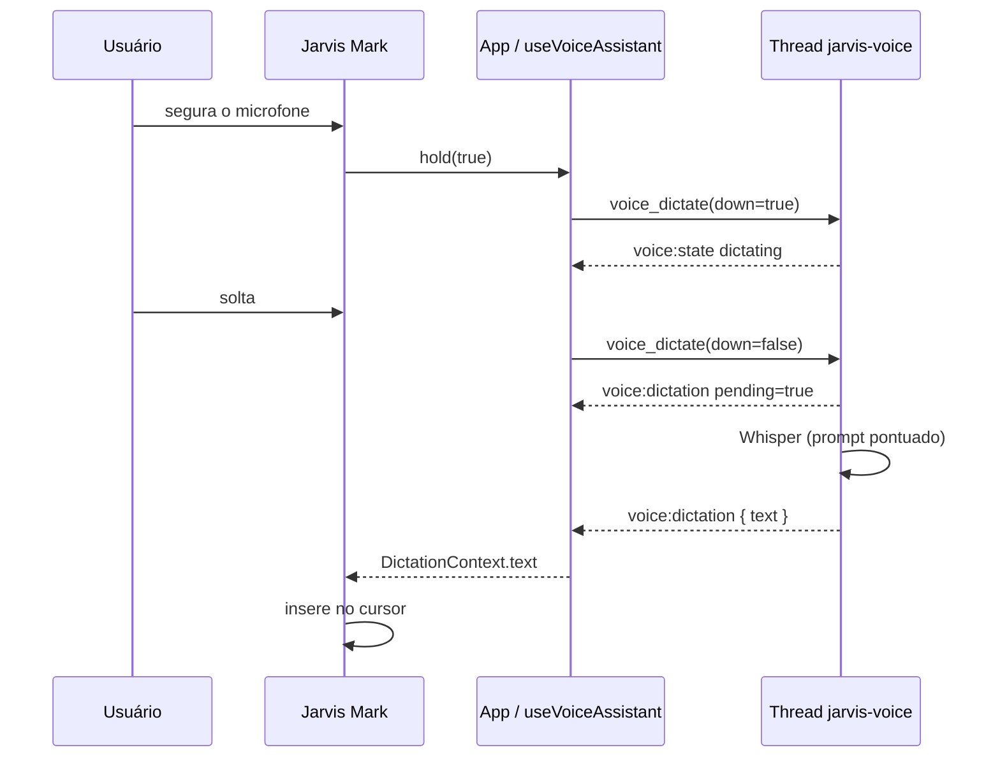

# Ditado

A fala dita no microfone do Jarvis Mark vira texto puro no cursor, sem passar pelo matcher de comandos.

| | |
|---|---|
| **ID** | `feature/dictation` |
| **Status** | Implementado |
| **Origem** | `42e671a` (2026-10-23) |

## Visão geral

O ditado transforma fala em texto puro: o que é dito enquanto o microfone do editor está pressionado vai para o Whisper e volta como texto, sem passar pelo matcher. Nada é aberto, lançado ou perguntado. Ele existe para escrever no Jarvis Mark sem teclar. O motor de voz é o mesmo do [voice-engine](../voice-engine/spec.md), com um caminho próprio: funciona em qualquer modo de ativação, liga o motor só para isso se ele estiver desligado e deixa os comandos surdos enquanto grava. O mesmo caminho atende a pergunta falada ao núcleo (`target: "assistant"`), descrita em [assistant](../assistant/spec.md). O botão e a inserção no cursor são do [Jarvis Mark](../../apps/jarvis-mark/spec.md).

## Dados

O ditado não tem armazenamento próprio: o texto vai para o documento do Jarvis Mark.

- `$alvo` (**DictationTarget**): `editor` ou `assistant`. Ver [glossário](../../domain/glossary.md).
- `$gravação`: o áudio guardado em `Recording::Dictation(target, …)` enquanto o botão está pressionado. Só em memória, na thread do motor.
- `$ditado` (**DictationApi**): `available`, `state` (`idle`/`listening`/`transcribing`), `hold(down)`, `text { id, text }`. Vem do `App` pelo `DictationContext`.
- O idioma do prompt vem de `Settings.language`.

## Componentes

### Gravação (`voice_dictate` e o loop do motor)

O microfone grava enquanto o botão do editor está pressionado, em qualquer modo de ativação.

- **Comportamento:**
  - **RF-001**: `voice_dictate(down)` DEVE gravar enquanto `down`, em qualquer modo de ativação.
    - Enquanto grava, o estado do motor é `dictating`.
  - **RF-005**: Um motor ligado só para ditar DEVE sair depois do ditado (`exit_after_dictation`) e não DEVE gravar `voiceEnabled`.
    - Com o motor desligado, pressionar carrega o modelo, grava e, depois do texto, desliga o motor de novo.
    - Se o usuário soltar antes de o modelo terminar de carregar, então o motor sai sem transcrever.
  - Se o microfone já estiver aberto pelo modo de escuta, então o ditado assume: VAD e `Session` são zerados e a fala vai só para o editor. Ao soltar, o motor volta ao estado de repouso do modo.
  - Se o núcleo e o editor gravarem ao mesmo tempo, então o núcleo vence (`target: "assistant"`).
  - Se a gravação for longa, então ela para de crescer em 30 s.

### Transcrição (`dictate`)

O áudio gravado vai só para o Whisper, nunca para os comandos.

- **Comportamento:**
  - **RF-002**: O texto ditado NUNCA DEVE passar pelo matcher.
  - **RF-003**: O Whisper DEVE usar um prompt de exemplo pontuado por idioma (PT: "Olá, tudo bem? Sim, obrigado. Primeiro, segundo e terceiro."; EN: "Hello, how are you? …"), sem palavras-chave.
  - **RF-004**: O motor DEVE emitir `voice:dictation` com `pending: true` antes do Whisper e `pending: false` com o texto depois. Sem fala, emite só o evento final com texto vazio.
  - Se a transcrição falhar, então o evento final leva texto vazio.

### Ponte na UI (`useVoiceAssistant`, `DictationContext`)

Leva o botão ao motor e o texto de volta ao editor.

- **Comportamento:**
  - **RF-006**: A UI DEVE enfileirar pressionar e soltar na mesma fila do push-to-talk.
  - `holdDictation` chama `dictate(down)`, que invoca `voice_dictate`.
  - Só `voice:dictation` com `target: "editor"` chega ao `DictationContext`; `assistant` vai para o [assistant](../assistant/spec.md).
  - Traduza o motor para o editor: `dictating` vira `listening` e um evento pendente vira `transcribing`. A dock mostra "Voice · ditando no Markdown".
  - Cada ditado ganha um `id` novo. Se o mesmo texto for ditado duas vezes, então ele é inserido de novo.
  - Se não houver modelo baixado, então `voice_dictate` devolve `model-missing` e as Configurações abrem.
  - Fora do Tauri, `DictationApi.available` é falso e o botão fica desabilitado.
  - Se o microfone estiver mudo, então, ao soltar, o aviso de microfone mudo aparece como no push-to-talk.

### Botão e inserção no editor

O microfone do Jarvis Mark e onde o texto entra.

- **Comportamento:**
  - Enquanto o botão está pressionado, a barra do editor diz "Ditando… solte para inserir"; ao soltar, "Transcrevendo…".
  - Quando há texto, insira no cursor, com espaço antes (se preciso) e depois. Sem fala, nada é inserido.
  - Se só a pré-visualização estiver visível, então o texto vai para o fim do documento.
- **Layout:** é o `DictationButton` da barra de ferramentas do Jarvis Mark; ver [Jarvis Mark](../../apps/jarvis-mark/spec.md#dictationbutton).
- **Estilo:** o do `DictationButton`, descrito no [Jarvis Mark](../../apps/jarvis-mark/spec.md#dictationbutton).

## Voz e teclado

- Segurar o microfone do Jarvis Mark (ponteiro, Espaço ou Enter): grava.
- Soltar / perder o foco / perder a captura: envia ao Whisper.

## Restrições

- **RNF-001**: Offline (Whisper local).
- **RNF-002**: Uma gravação sem fala (`contains_speech` falso) não chega ao Whisper.
- 30 s por gravação; idioma de `Settings.language`.

## Histórias de usuário

### US1 — Ditar no editor (P1)

Como usuário, seguro o microfone do Jarvis Mark, falo e, ao soltar, o texto aparece no cursor.

**Por que P1:** é a razão de existir do ditado.
**Teste independente:** só no app desktop (o motor é Rust); no navegador, `tests/desktop.spec.ts` — "the markdown editor previews what is typed, formats with Ctrl+B and keeps the draft" confere que "Ditar (segure para falar)" está desabilitado.

**Aceite**

1. **Dado** o botão pressionado, **quando** falo, **então** o estado do motor é `dictating`, o rótulo da dock é "Voice · ditando no Markdown" e a barra do editor diz "Ditando… solte para inserir".
2. **Dado** que soltei, **quando** o Whisper trabalha, **então** a barra diz "Transcrevendo…".
3. **Dado** que a transcrição terminou, **quando** há texto, **então** ele entra no cursor, com espaço antes (se preciso) e depois.
4. **Dado** que não falei nada, **quando** solto, **então** nada é inserido.

### US2 — Ditar sem a escuta ligada (P2)

Como usuário com a escuta desligada, dito mesmo assim, sem precisar ligá-la.

**Por que P2:** o ditado não deve mudar a preferência "Escuta".
**Teste independente:** sem teste automatizado; comportamento em `voice_dictate` (`src-tauri/src/lib.rs`).

**Aceite**

1. **Dado** o motor desligado, **quando** pressiono o microfone, **então** o modelo carrega, grava e, depois do texto, o motor desliga de novo. `voiceEnabled` não muda.
2. **Dado** o motor desligado, **quando** solto antes de o modelo terminar de carregar, **então** o motor sai sem transcrever.

### US3 — Ditar sem disparar comandos (P2)

Como usuário em "Sempre ouvindo", dito uma frase com "abre o relógio" e nada abre.

**Por que P2:** o ditado não pode virar comando.
**Teste independente:** sem teste automatizado; comportamento no loop `run` (`src-tauri/src/voice/mod.rs`).

**Aceite**

1. **Dado** o microfone aberto pelo modo de escuta, **quando** pressiono o microfone do editor, **então** o ditado assume: VAD e sessão são zeradas e a fala vai só para o editor.
2. **Dado** que soltei, **quando** a escuta continua aberta, **então** o motor volta ao estado de repouso do modo.

## Critérios de sucesso

- **SC-001**: O texto ditado aparece no cursor sem que nenhuma janela abra ou feche.
- **SC-002**: Ditar com a escuta desligada não a deixa ligada depois.

## Fora de escopo e limitações

- Cancelar um ditado: `voice_dictate` não tem `cancel`; soltar sempre envia.
- Ditado em outros editores além do Jarvis Mark: só ele consome o `DictationContext`.
- Pontuação por voz ("vírgula", "ponto"): fica a cargo do Whisper.

## Código

O ditado reaproveita a thread do motor de voz. Uma flag atômica `dictating` faz o loop abrir o microfone (em qualquer modo) e guardar o áudio numa `Recording::Dictation(target, …)`. Ao soltar, `dictate()` chama o Whisper com um prompt pontuado e emite `voice:dictation`, sem consultar o matcher. A UI expõe o resultado por um contexto React (`DictationContext`) que o Jarvis Mark consome.

| | |
|---|---|
| **Camadas** | `MarkdownEditor` (`DictationButton`) · `DictationContext` (`src/lib/dictation.ts`) · `App.tsx` (`holdDictation`) · `useVoiceAssistant.dictate` · comando `voice_dictate` · `voice/mod.rs` |
| **Dependências** | as do [voice-engine](../voice-engine/spec.md) (cpal, whisper-rs) |
| **Testes** | `tests/desktop.spec.ts` (botão desabilitado no navegador) |
| **Plataforma** | Windows 11 · WebView2. Fora do Tauri: indisponível (botão desabilitado) |

### Arquivos

| Arquivo | Papel |
|---|---|
| `src-tauri/src/lib.rs` | `voice_dictate`: `set_dictating`, `set_exit_after_dictation` e start sob demanda |
| `src-tauri/src/voice/mod.rs` | `Buttons::dictation`, `Recording::Dictation`, `dictation_state`, `dictation_prompt`, `dictate`, `EVENT_DICTATION` |
| `src/hooks/useVoiceAssistant.ts` | `dictate(down)` na `pushQueue`; `dictation` e `dictationPending` vindos de `voice:dictation` com `target: "editor"` |
| `src/lib/dictation.ts` | `DictationApi`, `DictationContext`, `useDictation` |
| `src/App.tsx` | `holdDictation` (trata `model-missing`) e o `DictationContext.Provider` em volta do `Desktop` |
| `src/components/desktop/apps/MarkdownEditor.tsx` | `DictationButton` e inserção no cursor (detalhes em [Jarvis Mark](../../apps/jarvis-mark/spec.md)) |

### Contratos

#### Comandos Tauri

| Comando | Entrada | Saída | Notas |
|---|---|---|---|
| `voice_dictate` | `{ down }` | `VoiceStatus` | Motor parado: liga só para isso e sai depois; erro `model-missing` |

#### Eventos e Channels

| Nome | Payload | Emissor → consumidor |
|---|---|---|
| `voice:dictation` | `{ text, pending, target: "editor" \| "assistant" }` | `dictate()` → `useVoiceAssistant` (`editor` → `DictationContext`; `assistant` → [assistant](../assistant/spec.md)) |
| `voice:state` | `{ state: "dictating", … }` | `Reporter` → rótulos da dock e do editor |

### Fluxo

### Constituição

- [x] P1 Offline-first — Whisper local.
- [x] P2 Rust é dono do nativo — microfone e transcrição só no Rust.
- [x] P3 Comandos finos — `voice_dictate` só ajusta flags e liga o motor; evento `voice:dictation`.
- [x] P4 Contratos espelhados — `DictationTarget` (`editor`/`assistant`) com `rename_all = "camelCase"`; payload tipado em `useVoiceAssistant`.
- [x] P6 Fora do Tauri — caminho 3: a ação fica indisponível, com o título explicando.
- [x] P7 PT-BR — rótulos e status em PT-BR.
- [ ] P11 Testes — o ditado real não tem teste (ver [Pendências](#pendências)).

### Decisões relacionadas

- [ADR-0002 — STT offline whisper.cpp na CPU](../../arch/adr/0002-stt-whisper-offline-cpu.md)
- [ADR-0003 — motor de voz numa thread Rust](../../arch/adr/0003-motor-de-voz-thread-rust.md)

## Tarefas

Legenda: `[x]` feito · `[ ]` pendente · `[P]` pode rodar em paralelo (arquivos diferentes) · `[USn]` história desta spec. As tarefas foram reconstruídas do código e do commit de origem.

### Fase 1 — Base

- [x] T001 [P] `DictationTarget`, `DictationEvent`, `EVENT_DICTATION` e estado `Dictating` — `src-tauri/src/voice/mod.rs`
- [x] T002 [P] `DictationApi`, `DictationContext`, `useDictation` — `src/lib/dictation.ts`

### Fase 2 — US1 Ditar no editor (P1)

- [x] T003 [US1] Flag `dictating` e `Recording::Dictation` no loop; microfone aberto em qualquer modo — `src-tauri/src/voice/mod.rs`
- [x] T004 [US1] `dictate()` com `contains_speech`, `dictation_prompt` por idioma e eventos `pending` → texto — `src-tauri/src/voice/mod.rs`
- [x] T005 [US1] Comando `voice_dictate` — `src-tauri/src/lib.rs`
- [x] T006 [US1] `dictate(down)` na fila `pushQueue`, `dictation` e `dictationPending` — `src/hooks/useVoiceAssistant.ts`
- [x] T007 [US1] `holdDictation`, `DictationApi` e `DictationContext.Provider` — `src/App.tsx`
- [x] T008 [US1] `DictationButton`, status "Ditando… solte para inserir" / "Transcrevendo…" e inserção no cursor — `src/components/desktop/apps/MarkdownEditor.tsx`

### Fase 3 — US2 Ditar sem a escuta ligada (P2)

- [x] T009 [US2] `set_exit_after_dictation`: motor iniciado só para ditar sai depois, ou antes se soltar durante o carregamento — `src-tauri/src/lib.rs`, `src-tauri/src/voice/mod.rs`

### Fase 4 — US3 Sem comandos durante o ditado (P2)

- [x] T010 [US3] Ditado assume o microfone aberto: zera VAD e `Session`; ao terminar, volta ao repouso do modo — `src-tauri/src/voice/mod.rs`

### Fase 5 — Testes

- [x] T011 Playwright `tests/desktop.spec.ts` — "the markdown editor previews what is typed, formats with Ctrl+B and keeps the draft" (botão "Ditar (segure para falar)" desabilitado no navegador)

## Pendências

- [ ] Nenhum teste exercita `voice_dictate` nem o evento `voice:dictation`. Não há fake de dev para o ditado, então o Playwright só confere o botão desabilitado e o fluxo real não tem cobertura.
