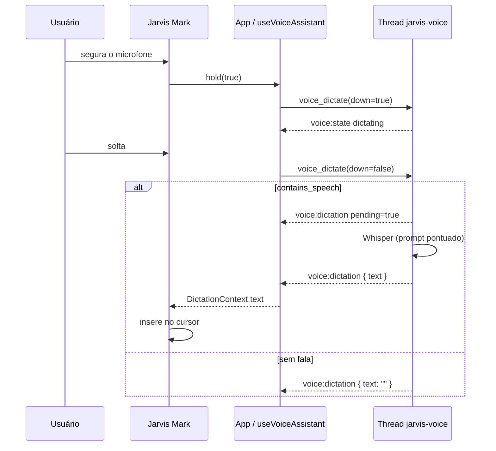

# Feature Specification: Dictation

## Metadata

| Field | Value |
|---|---|
| Feature ID | `feature/dictation` |
| Product | JARVIS OS (jvOS) |
| Feature Status | Implementado |
| Document Status | Reescrita em 2026-11-05 no formato Feature Specification; sem decisões em aberto |
| Source Commit | `42e671a` (2026-10-23); o `target` (`editor` ou `assistant`), que divide o caminho com a pergunta ao núcleo, entrou em `750ebd0` (2026-10-27) |
| Uncommitted Changes | Nenhuma |
| Voice Shortcut | — (o ditado não passa pelo matcher) |
| Assistant Tool | — |
| Target Platforms | Windows 11 com WebView2; no navegador (modo web) o botão aparece desabilitado ("Disponível no app desktop"), porque o motor é Rust |
| Language | PT-BR no conteúdo e nas falas; inglês nos títulos das seções e em Given / When / Then |
| Last Editorial Revision | 2026-11-05 |
| Verification Scope | Conferida com o código em 2026-11-05: `src-tauri/src/voice/mod.rs`, `src-tauri/src/voice/vad.rs`, `src-tauri/src/lib.rs`, `src/hooks/useVoiceAssistant.ts`, `src/lib/dictation.ts`, `src/App.tsx`, `src/components/desktop/apps/MarkdownEditor.tsx`, `src/lib/files.ts` e `tests/desktop.spec.ts`. Os testes não foram executados nesta revisão |

Especificação no formato inspirado no GitHub Spec Kit, com seções de desenho técnico ([ADR-0025](../../arch/adr/0025-features-formato-feature-specification.md)). Os identificadores US1–US3, RF-001–RF-006, RNF-001–RNF-002, SC-001–SC-002 e T001–T011 são os mesmos da versão anterior. Os critérios de aceite AC-001–AC-008 são os antigos "Critério 1" a "Critério 8", na mesma ordem. KL-* registra limitações conhecidas; OQ-*, decisões de produto em aberto. Nenhum dos dois acrescenta escopo.

## Overview

O ditado transforma fala em texto puro. O que é dito enquanto o microfone do editor está pressionado vai para o Whisper e volta como texto, sem passar pelo matcher: nada é aberto, lançado ou perguntado. Ele existe para escrever no Jarvis Mark sem teclar.

O motor de voz é o mesmo do [voice-engine](../voice-engine/spec.md), com um caminho próprio: funciona em qualquer modo de ativação, liga o motor só para isso se ele estiver desligado e deixa os comandos surdos enquanto grava. O mesmo caminho atende a pergunta falada ao núcleo (`target: "assistant"`), descrita em [assistant](../assistant/spec.md). O botão e a inserção no cursor são do [Jarvis Mark](../../apps/jarvis-mark/spec.md).

| Input | Expected Behavior | Execution Path |
|---|---|---|
| Segurar o microfone do Jarvis Mark, falar e soltar | Grava em qualquer modo; ao soltar, o Whisper transcreve com um prompt pontuado e o texto entra no cursor | `DictationButton` → `holdDictation` → `voice_dictate` → `dictate()` → `voice:dictation` → `DictationContext` |
| O mesmo com a escuta desligada | O motor liga só para isso e desliga depois; a preferência "Escuta" não muda | `voice_dictate` com `exit_after_dictation` |
| O mesmo com o microfone aberto por "Sempre ouvindo" | O ditado assume; nada vira comando | Loop do motor (`Recording::Dictation`) |
| O mesmo no navegador | Botão desabilitado | `DictationApi.available` falso |

## Goals and Success Criteria

### Goals

- Escrever no Jarvis Mark pela voz, no ponto do cursor.
- Nunca transformar um ditado em comando.
- Não mexer na preferência "Escuta" para ditar.
- Pontuar o texto ditado sem comandos de pontuação.

### Success Criteria

| ID | Criterion | Verification |
|---|---|---|
| SC-001 | O texto ditado aparece no cursor sem que nenhuma janela abra ou feche. | Leitura do código: `dictate()` não chama `Session::decide`; sem teste automatizado (KL-001). |
| SC-002 | Ditar com a escuta desligada não a deixa ligada depois. | Leitura do código: `voice_dictate` não grava `voiceEnabled` e liga `exit_after_dictation`; sem teste automatizado (KL-001). |

## Scope and Non-Goals

### In Scope

- Gravar enquanto o microfone do editor está pressionado, em qualquer modo de ativação.
- Ligar o motor só para ditar e desligá-lo depois.
- Assumir um microfone já aberto pelos modos de escuta.
- Transcrever com um prompt pontuado por idioma, sem o matcher.
- Mostrar "Ditando…" e "Transcrevendo…" e inserir o texto no cursor.

### Out of Scope

- Cancelar um ditado: `voice_dictate` não tem `cancel`; soltar sempre envia.
- Ditado em outros editores além do Jarvis Mark: só ele consome o `DictationContext`.
- Pontuação por voz ("vírgula", "ponto"): fica a cargo do Whisper.
- A pergunta ao núcleo (`voice_ask`, `target: "assistant"`), que usa o mesmo caminho: ver [assistant](../assistant/spec.md).

## User Stories

### US1 — Dictate into the Editor

**Priority:** P1.

**User Story:** Como usuário, seguro o microfone do Jarvis Mark, falo e, ao soltar, o texto aparece no cursor.

**Why This Priority:** é a razão de existir do ditado.

**Independent Test:** só no app desktop (o motor é Rust); no navegador, `tests/desktop.spec.ts` — "the markdown editor previews what is typed, formats with Ctrl+B and keeps the draft" confere que "Ditar (segure para falar)" está desabilitado.

**Acceptance Criteria:** AC-001, AC-002, AC-003 e AC-004.

### US2 — Dictate with Listening Off

**Priority:** P2.

**User Story:** Como usuário com a escuta desligada, dito mesmo assim, sem precisar ligá-la.

**Why This Priority:** o ditado não deve mudar a preferência "Escuta".

**Independent Test:** sem teste automatizado; comportamento em `voice_dictate` (`src-tauri/src/lib.rs`).

**Acceptance Criteria:** AC-005 e AC-006.

### US3 — Dictate Without Triggering Commands

**Priority:** P2.

**User Story:** Como usuário em "Sempre ouvindo", dito uma frase com "abre o relógio" e nada abre.

**Why This Priority:** o ditado não pode virar comando.

**Independent Test:** sem teste automatizado; comportamento no loop `run` (`src-tauri/src/voice/mod.rs`).

**Acceptance Criteria:** AC-007 e AC-008.

## Requirements

### Functional Requirements

| ID | Requirement | Related Stories |
|---|---|---|
| RF-001 | `voice_dictate(down)` DEVE gravar enquanto `down`, em qualquer modo de ativação; enquanto grava, o estado do motor é `dictating`. | US1, US3 |
| RF-002 | O texto ditado NUNCA DEVE passar pelo matcher. | US3 |
| RF-003 | O Whisper DEVE usar um prompt de exemplo pontuado por idioma (PT: "Olá, tudo bem? Sim, obrigado. Primeiro, segundo e terceiro."; EN: "Hello, how are you? Yes, thank you. First, second and third."), sem palavras-chave. | US1 |
| RF-004 | O motor DEVE emitir `voice:dictation` com `pending: true` antes do Whisper e `pending: false` com o texto depois. Sem fala, emite só o evento final com texto vazio. | US1 |
| RF-005 | Um motor ligado só para ditar DEVE sair depois do ditado (`exit_after_dictation`) e não DEVE gravar `voiceEnabled`. | US2 |
| RF-006 | A UI DEVE enfileirar pressionar e soltar na mesma fila do push-to-talk (`pushQueue`). | US1 |

### Non-Functional Requirements

| ID | Requirement | Scope |
|---|---|---|
| RNF-001 | Offline (Whisper local). | Gravação e transcrição. |
| RNF-002 | Uma gravação sem fala (`contains_speech` falso: menos de 8 quadros de 30 ms com voz) não chega ao Whisper. | Todo ditado. |

### Operational Constraints

- No máximo 30 s por gravação; o resto é cortado.
- Idioma de `Settings.language`: `en` usa o prompt em inglês; `pt` e `auto` usam o em português.
- Sem cancelamento: soltar, perder o foco ou perder a captura do ponteiro sempre envia.
- O porteiro Silero não se aplica: quem segurou o botão quer ser ouvido.
- O aviso de microfone mudo vale como no push-to-talk (4 s de zeros, ou 0,3 s ou mais de silêncio digital ao soltar).

## Acceptance Criteria

### AC-001 — Recording Feedback

**Related Story:** US1.

- **Given** o botão pressionado
- **When** falo
- **Then** o estado do motor é `dictating`, o rótulo da dock é "Voice · ditando no Markdown" e a barra do editor diz "Ditando… solte para inserir".

**Coverage Status:** sem teste automatizado (KL-001).

### AC-002 — Transcribing Feedback

**Related Story:** US1.

- **Given** que soltei
- **When** o Whisper trabalha (`voice:dictation` com `pending: true`)
- **Then** a barra diz "Transcrevendo…".

**Coverage Status:** sem teste automatizado (KL-001).

### AC-003 — Text at the Cursor

**Related Story:** US1.

- **Given** que a transcrição terminou
- **When** há texto
- **Then** ele entra no cursor, com espaço antes (se o caractere anterior não for espaço) e um espaço depois.

**Coverage Status:** sem teste automatizado (KL-001).

### AC-004 — Nothing Said

**Related Story:** US1.

- **Given** que não falei nada
- **When** solto
- **Then** nada é inserido: a gravação não chega ao Whisper e o evento final vem com texto vazio.

**Coverage Status:** só a regra `contains_speech` tem teste (Rust); o fluxo não (KL-001).

### AC-005 — Engine Started Just to Dictate

**Related Story:** US2.

- **Given** o motor desligado
- **When** pressiono o microfone
- **Then** o modelo carrega, grava e, depois do texto, o motor desliga de novo. `voiceEnabled` não muda.

**Coverage Status:** sem teste automatizado (KL-001).

### AC-006 — Released While Loading

**Related Story:** US2.

- **Given** o motor desligado
- **When** solto antes de o modelo terminar de carregar
- **Then** o motor sai sem transcrever e sem emitir `voice:dictation`.

**Coverage Status:** sem teste automatizado (KL-001).

### AC-007 — Dictation Takes Over an Open Microphone

**Related Story:** US3.

- **Given** o microfone aberto pelo modo de escuta
- **When** pressiono o microfone do editor
- **Then** o ditado assume: VAD e sessão do matcher são zeradas e a fala vai só para o editor.

**Coverage Status:** sem teste automatizado (KL-001).

### AC-008 — Back to the Listening Mode

**Related Story:** US3.

- **Given** que soltei
- **When** a escuta continua aberta
- **Then** o motor volta ao estado de repouso do modo (`standby` ou `listening`).

**Coverage Status:** sem teste automatizado (KL-001).

## Behavior and Flows

### Recording (`voice_dictate` and the Engine Loop)

O microfone grava enquanto o botão do editor está pressionado, em qualquer modo de ativação.

- `voice_dictate(down)` liga a flag `dictating` e acorda o loop (RF-001).
- Com o motor desligado, o comando liga `exit_after_dictation` e inicia o motor (RF-005). Se a carga falhar (por exemplo, `model-missing`), as duas flags voltam a falso e o erro sobe.
- O loop vê o ditado e abre o microfone (ou assume o que já está aberto), começa uma `Recording::Dictation(Editor, …)`, zera a sessão do matcher e emite `dictating`.
- Assumindo um microfone aberto pelos modos de escuta, também zera a VAD: a fala vai só para o editor (AC-007).
- Ao soltar, com o microfone fechando (push-to-talk ou motor ligado só para isso): junta o que sobrou no canal, volta ao repouso do modo, avisa se o microfone estava mudo e chama `dictate`. Se o motor foi ligado só para isso, ele sai.
- Ao soltar com o microfone continuando aberto (modos de escuta): volta ao repouso do modo, chama `dictate` e zera a VAD (AC-008).
- Solto antes de o modelo carregar, o loop vê `exit_after_dictation` sem ditado e sai na primeira volta (AC-006).
- Se o núcleo e o editor gravarem ao mesmo tempo, o núcleo vence (`target: "assistant"`).
- A gravação para de crescer em 30 s.

### Transcription (`dictate`)

O áudio gravado vai só para o Whisper, nunca para os comandos (RF-002).

- Sem fala (`contains_speech` falso), emite só `voice:dictation { text: "", pending: false }` (RF-004).
- Com fala, emite `pending: true`, transcreve com `dictation_prompt(idioma, alvo)` (RF-003) e emite `pending: false` com o texto.
- Se a transcrição falhar, o erro vai para o stderr e o evento final leva texto vazio.
- O prompt do núcleo (`assistant`) é o mesmo com "Jarvis" ("Olá, Jarvis, tudo bem? …"), para o Whisper acertar o nome.

### UI Bridge (`useVoiceAssistant`, `DictationContext`)

Leva o botão ao motor e o texto de volta ao editor.

- `holdDictation(down)` chama `dictate(down)`, que invoca `voice_dictate` na mesma `pushQueue` do push-to-talk e da pergunta ao núcleo (RF-006). Fora do Tauri, `holdDictation` não faz nada.
- `model-missing` abre as Configurações e mostra "Baixe um modelo de voz" na dock.
- Só `voice:dictation` com `target: "editor"` chega ao `DictationContext`; `assistant` vai para o [assistant](../assistant/spec.md).
- Desde 2026-11-19 há dois editores que consomem o ditado: o Jarvis Mark, no desktop, e a nota aberta na [área de notas](../notes-area/spec.md) do modo chat (RF-013 a RF-015 de lá), com o mesmo botão (`desktop/apps/DictationButton.tsx`). O `App` entrega o texto só ao que está na tela: no modo chat, ao chat; no desktop, ao Jarvis Mark.
- Um evento final com texto vira um `DictationText` com `id` novo; o texto vazio é ignorado. O mesmo texto ditado duas vezes é inserido duas vezes.

| Engine State or Event | `DictationApi.state` | Editor Status | Dock Label |
|---|---|---|---|
| `dictating` | `listening` | "Ditando… solte para inserir" | "Voice · ditando no Markdown" |
| `voice:dictation` com `pending: true` | `transcribing` | "Transcrevendo…" | o do repouso do modo |
| Outro estado, sem pendência | `idle` | — | o do estado |

### Editor Button and Insertion

O microfone do Jarvis Mark e onde o texto entra. Os detalhes do editor estão no [Jarvis Mark](../../apps/jarvis-mark/spec.md#dictationbutton).

- **Behavior:**
  - O botão "Ditar (segure para falar)" é segurado como o Voice: ponteiro com captura, Espaço ou Enter. Soltar, perder o foco, cancelar o ponteiro ou perder a captura enviam. O `pointerdown` não tira a seleção do editor.
  - Título: "Ditar: segure para falar, solte para inserir no cursor" no app; "Disponível no app desktop" fora dele, com o botão desabilitado.
  - Quando chega um texto, ele é inserido no cursor com `replaceSelection`: um espaço antes se o caractere anterior não for espaço, o texto, e um espaço depois; o editor recebe o foco (AC-003).
  - Se só a pré-visualização estiver visível, o texto vai para o fim do documento, com um espaço antes se o documento não terminar em espaço.
- **Layout:** o `DictationButton` fica na barra de ferramentas do Jarvis Mark, depois dos botões de formatação.
- **Style:** botão `size-7 rounded-lg` com o ícone `Mic` de 14 px. Gravando: `bg-hud-alert/15 text-hud-alert` e um ponto vermelho pulsando no canto. Transcrevendo: `bg-hud-cyan/[0.12] text-hud-light`. Parado: `text-hud-text/60`. Desabilitado: opacidade 30%.

### Interaction Flow



### User Feedback

| Moment | Persona Key | Output |
|---|---|---|
| Gravando | — | Barra "Ditando… solte para inserir"; dock "Voice · ditando no Markdown" |
| Transcrevendo | — | Barra "Transcrevendo…" |
| Texto pronto | — | Texto no cursor |
| Sem modelo | — | Configurações abertas e dock "Baixe um modelo de voz" (erro) |
| Microfone mudo | — | Dock "O microfone não está captando som. Verifique a tecla de mudo do microfone." |

### Voice and Keyboard

- Segurar o microfone do Jarvis Mark (ponteiro, Espaço ou Enter): grava.
- Soltar, perder o foco ou perder a captura: envia ao Whisper.
- Não há frase de voz para ditar.

## Data Model and Persistence

### Dictation Types

```ts
/** Mirrors `DictationTarget` in src-tauri/src/voice/mod.rs (rename_all = "camelCase"). */
type DictationTarget = "editor" | "assistant";

interface DictationEvent { text: string; pending: boolean; target: DictationTarget } // voice:dictation

interface DictationText { id: number; text: string } // id muda a cada ditado

interface DictationApi {
  available: boolean;                              // falso fora do Tauri
  state: "idle" | "listening" | "transcribing";
  hold: (down: boolean) => void;
  text: DictationText | null;
}
```

O áudio fica em `Recording::Dictation(target, …)` enquanto o botão está pressionado, só em memória, na thread do motor. Ver o [glossário](../../domain/glossary.md).

### Storage Rules

| Property | Value |
|---|---|
| State | Nenhum próprio; o texto vai para o documento do Jarvis Mark |
| Settings Read | `Settings.language` (o prompt) e `Settings.activation` (o repouso depois do ditado) |
| Settings Written | Nenhuma: `voice_dictate` não grava `voiceEnabled` |
| Missing or Invalid Storage | Não se aplica |

## Technical Design

### Component Responsibilities

| File or Component | Responsibility |
|---|---|
| `src-tauri/src/lib.rs` | `voice_dictate`: `set_dictating`, `set_exit_after_dictation` e o início sob demanda |
| `src-tauri/src/voice/mod.rs` | `Buttons::dictation`, `Recording::Dictation`, `dictation_state`, `dictation_prompt`, `dictate`, `EVENT_DICTATION` |
| `src-tauri/src/voice/vad.rs` | `contains_speech` |
| `src/hooks/useVoiceAssistant.ts` | `dictate(down)` na `pushQueue`; `dictation` e `dictationPending` vindos de `voice:dictation` com `target: "editor"` |
| `src/lib/dictation.ts` | `DictationApi`, `DictationText`, `DictationContext`, `useDictation` |
| `src/App.tsx` | `holdDictation` (trata `model-missing`), o `DictationApi` e o `DictationContext.Provider` em volta do `Desktop` |
| `src/components/desktop/apps/MarkdownEditor.tsx` | `DictationButton`, `DICTATION_STATUS` e a inserção no cursor (detalhes em [Jarvis Mark](../../apps/jarvis-mark/spec.md)) |

O ditado reaproveita a thread do motor de voz: uma flag atômica faz o loop abrir o microfone em qualquer modo e guardar o áudio; ao soltar, `dictate()` chama o Whisper e emite o evento, sem consultar o matcher.

### Related Architecture Decisions

- [ADR-0002 — STT offline whisper.cpp na CPU](../../arch/adr/0002-stt-whisper-offline-cpu.md) (substituído pelo [ADR-0021](../../arch/adr/0021-reconhecimento-voz-gpu-via-vulkan-porteiro.md))
- [ADR-0003 — motor de voz numa thread Rust](../../arch/adr/0003-motor-de-voz-thread-rust.md)

## Interfaces and Contracts

### Tauri Commands

| Command | Input | Output | Notes |
|---|---|---|---|
| `voice_dictate` | `{ down }` | `VoiceStatus` | Motor parado: liga só para isso e sai depois; erro `model-missing`; sem `cancel` |

### Events and Channels

| Event | Payload | Producer → Consumer |
|---|---|---|
| `voice:dictation` | `{ text, pending, target: "editor" \| "assistant" }` | `dictate()` → `useVoiceAssistant` (`editor` → `DictationContext`; `assistant` → [assistant](../assistant/spec.md)) |
| `voice:state` | `{ state: "dictating", message }` | `Reporter` → rótulos da dock e do editor |

## Edge Cases and Error Handling

| Case | Behavior | Reference |
|---|---|---|
| Gravação sem fala | Não chega ao Whisper; sai só o evento final com texto vazio, e nada é inserido | AC-004 |
| Transcrição que falha | O mesmo evento vazio; o erro só no stderr | Transcription |
| Sem modelo baixado | `voice_dictate` devolve `model-missing`, e as Configurações abrem | UI Bridge |
| Só a pré-visualização visível | O texto vai para o fim do documento | Editor Button |
| O mesmo texto ditado duas vezes | É inserido de novo, porque cada ditado ganha um `id` novo | UI Bridge |
| Pressionar e soltar em sequência | Entram na `pushQueue`, na ordem em que aconteceram | RF-006 |
| O núcleo e o editor gravam ao mesmo tempo | O núcleo vence (`target: "assistant"`) | Recording |
| Microfone já aberto pelo modo de escuta | O ditado assume, com VAD e sessão zeradas; ao soltar, o motor volta ao repouso do modo | AC-007, AC-008 |
| Soltar antes de o modelo carregar | O motor sai sem transcrever | AC-006 |
| Gravação longa | Para de crescer em 30 s | Operational Constraints |
| O JARVIS falando (`deaf`) | Não afeta o ditado: botões pressionados continuam gravando | [voice-engine](../voice-engine/spec.md) |
| Um cancelamento anterior que o loop não consumiu | O primeiro ditado seguinte é descartado em silêncio | KL-002 |
| Voice (ou M) segurado junto com o microfone do editor | O ditado assume e a gravação do Voice se perde | KL-003 |
| Permissões | Fora do Tauri, `DictationApi.available` é falso e o botão fica desabilitado; microfone mudo gera o mesmo aviso do push-to-talk; o texto nunca passa pelo matcher, e um motor ligado só para ditar não grava `voiceEnabled` | RF-002, RF-005 |

## Dependencies

### Feature Dependencies

| Dependency | Purpose |
|---|---|
| [voice-engine](../voice-engine/spec.md) | A thread do motor, a VAD, o Whisper e a fila do push-to-talk |
| [jarvis-mark](../../apps/jarvis-mark/spec.md) | O `DictationButton` e o cursor |
| [assistant](../assistant/spec.md) | Divide o caminho com `target: "assistant"` |
| [settings](../settings/spec.md) | `language` e as Configurações que abrem com `model-missing` |
| [dock-taskbar](../dock-taskbar/spec.md) | O rótulo "Voice · ditando no Markdown" e os avisos |

### Runtime Dependencies

- [whisper-rs](../../foundation/vendor/whisper-rs/spec.md) e os [modelos Whisper](../../foundation/vendor/whisper-models/spec.md) (a transcrição), [cpal](../../foundation/vendor/cpal/spec.md) (o microfone).
- [Tauri](../../foundation/vendor/tauri/spec.md) (`voice_dictate`, `voice:dictation`), [serde](../../foundation/vendor/serde/spec.md) (`DictationTarget` em camelCase).
- [React](../../foundation/vendor/react/spec.md) (`DictationContext`), [CodeMirror](../../foundation/vendor/codemirror/spec.md) (a inserção no cursor).
- O microfone padrão do Windows e um modelo Whisper baixado.

## Test Strategy and Coverage

### Reported Tests

| Test Reference | Coverage | Acceptance Mapping |
|---|---|---|
| `tests/desktop.spec.ts` — "the markdown editor previews what is typed, formats with Ctrl+B and keeps the draft" | No navegador, "Ditar (segure para falar)" fica desabilitado | US1 (fora do Tauri) |
| `src-tauri/src/voice/vad.rs` — `push_to_talk_recordings_need_speech` | Silêncio, ruído e um clique não contam como fala, então uma gravação sem fala não chega ao Whisper | RNF-002, base de AC-004 |

### Verification Commands

Na raiz do repositório:

```powershell
npx playwright test tests/desktop.spec.ts --project ui -g "the markdown editor previews"
```

Em `src-tauri`:

```powershell
cargo test --lib voice::vad::tests::push_to_talk_recordings_need_speech
```

### Coverage Gaps

| Gap | Evidence Status | Suggested Verification |
|---|---|---|
| Ditado de ponta a ponta (AC-001–AC-003) | Sem teste; não há fake de dev para o ditado | Um fake de `voice_dictate` no modo web que emita `voice:dictation`, e conferir os textos da barra e a inserção |
| Motor ligado só para ditar (AC-005, AC-006) | Sem teste | Teste Rust do loop com um `Transcriber` falso, ou CDP no app real |
| Ditado sobre um modo de escuta (AC-007, AC-008) | Sem teste | CDP no app real em "Sempre ouvindo" |
| Descarte por `discard` antigo (KL-002) | Sem teste | `voice_stop` e, em seguida, um ditado; conferir o `voice:dictation` |

## Implementation Plan

**Status Convention:** `[x]` feito · `[ ]` pendente · `[P]` pode rodar em paralelo (arquivos diferentes) · `[USn]` história desta spec. As tarefas foram reconstruídas do código e do commit de origem.

### Phase 1 — Foundation

- [x] T001 [P] `DictationTarget`, `DictationEvent`, `EVENT_DICTATION` e estado `Dictating` — `src-tauri/src/voice/mod.rs`
- [x] T002 [P] `DictationApi`, `DictationContext`, `useDictation` — `src/lib/dictation.ts`

### Phase 2 — Dictate into the Editor (US1)

- [x] T003 [US1] Flag `dictating` e `Recording::Dictation` no loop; microfone aberto em qualquer modo — `src-tauri/src/voice/mod.rs`
- [x] T004 [US1] `dictate()` com `contains_speech`, `dictation_prompt` por idioma e eventos `pending` → texto — `src-tauri/src/voice/mod.rs`
- [x] T005 [US1] Comando `voice_dictate` — `src-tauri/src/lib.rs`
- [x] T006 [US1] `dictate(down)` na fila `pushQueue`, `dictation` e `dictationPending` — `src/hooks/useVoiceAssistant.ts`
- [x] T007 [US1] `holdDictation`, `DictationApi` e `DictationContext.Provider` — `src/App.tsx`
- [x] T008 [US1] `DictationButton`, status "Ditando… solte para inserir" / "Transcrevendo…" e inserção no cursor — `src/components/desktop/apps/MarkdownEditor.tsx`

### Phase 3 — Dictate with Listening Off (US2)

- [x] T009 [US2] `set_exit_after_dictation`: motor iniciado só para ditar sai depois, ou antes se soltar durante o carregamento — `src-tauri/src/lib.rs`, `src-tauri/src/voice/mod.rs`

### Phase 4 — No Commands While Dictating (US3)

- [x] T010 [US3] Ditado assume o microfone aberto: zera VAD e `Session`; ao terminar, volta ao repouso do modo — `src-tauri/src/voice/mod.rs`

### Phase 5 — Verification

- [x] T011 Playwright `tests/desktop.spec.ts` — "the markdown editor previews what is typed, formats with Ctrl+B and keeps the draft" (botão "Ditar (segure para falar)" desabilitado no navegador)

## Rollback Plan

1. Na UI, tire o `DictationButton` do `MarkdownEditor.tsx`, o `DictationContext.Provider` e o `holdDictation` do `App.tsx`, `src/lib/dictation.ts` e `dictate`, `dictation` e `dictationPending` de `useVoiceAssistant.ts`.
2. No Rust, tire `voice_dictate` do `invoke_handler` e `set_dictating`, que só ele chama. `set_exit_after_dictation` fica, porque o `voice_ask` também o usa.
3. Mantenha `Recording::Dictation`, `dictate()` e o evento `voice:dictation`: a pergunta ao núcleo (`voice_ask`, `target: "assistant"`) usa o mesmo caminho.
4. Nada fica para trás: o ditado não guarda estado próprio; o texto já inserido é do documento do Jarvis Mark.

## Constitution Compliance

| Principle | Status | Rationale |
|---|---|---|
| P1 — Offline-first | Atendido | Whisper local |
| P2 — Rust é dono do nativo | Atendido | Microfone e transcrição só no Rust |
| P3 — Comandos finos | Atendido | `voice_dictate` só ajusta flags e liga o motor; evento `voice:dictation` |
| P4 — Contratos espelhados | Atendido | `DictationTarget` (`editor`/`assistant`) com `rename_all = "camelCase"`; payload tipado em `useVoiceAssistant` |
| P6 — Fora do Tauri | Atendido | A ação fica indisponível, com o título explicando |
| P7 — PT-BR | Atendido | Rótulos e status em PT-BR |
| P11 — Testes | Não atendido | O ditado real não tem teste (KL-001) |

## Known Limitations

| ID | Limitation | Status |
|---|---|---|
| KL-001 | Nenhum teste exercita `voice_dictate` nem o evento `voice:dictation`. Não há fake de dev para o ditado, então o Playwright só confere o botão desabilitado e o fluxo real não tem cobertura. | Lacuna de verificação |
| KL-002 | O primeiro ditado depois de um cancelamento que o loop não consumiu é descartado em silêncio (sem "Transcrevendo…" e sem texto): `voice_stop` grava `set_talking(false, true)`, um push-to-talk ou pergunta que falha ao ligar o motor faz o mesmo, e um toque rápido que só ligou o motor deixa a liberação cancelada pendente. Isso deixa `discard` ligado, e `set_dictating` não o zera (o push-to-talk e o núcleo o zeram ao pressionar). | Defeito, pela leitura do código; sem teste |
| KL-003 | Com Voice (ou M) segurado no push-to-talk, pressionar o microfone do editor faz o ditado assumir e a gravação do Voice se perde; depois de soltar o editor, até soltar o Voice, o microfone aberto passa pela VAD e pelo porteiro como num modo de escuta. | Comportamento atual, caso raro |

## Open Questions

Nenhuma.

## References

- Versão anterior desta spec, no formato SpecLang: `git show e7151cf:.specs/features/dictation/spec.md`. A versão intermediária, no formato do spec-coding.dev ([ADR-0023](../../arch/adr/0023-specs-formato-spec-coding-dev.md)), não chegou a ser commitada.
- Modelo de formato: [reminders](../reminders/spec.md) ([ADR-0025](../../arch/adr/0025-features-formato-feature-specification.md)).
- Código conferido: listado em Metadata › Verification Scope.
