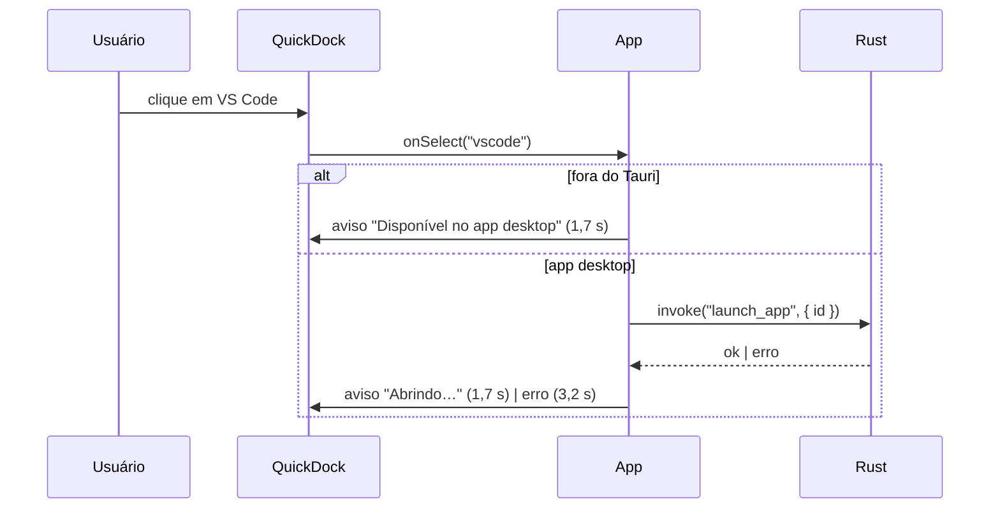

# Feature Specification: Dock and Top Bar

## Metadata

| Field | Value |
|---|---|
| Feature ID | `feature/dock-taskbar` |
| Product | JARVIS OS (jvOS) |
| Feature Status | Implementado |
| Document Status | Reescrita em 2026-11-05 no formato Feature Specification; sem decisões em aberto |
| Source Commit | `42e671a` (2026-10-23); evoluída em `c4ccc57` (2026-10-26: dock no estilo Nexus, relógio por minuto); a barra sem `backdrop-filter` e com o meio vazio sem janela focada entrou em `e7151cf` (2026-11-05) |
| Uncommitted Changes | Nenhuma |
| Voice Shortcut | — |
| Assistant Tool | Nenhuma própria; os comandos `taskbar`, `dock` e `launcher:*` da [busca](../search/spec.md) também chegam ao JARVIS por `jvos_run` |
| Target Platforms | Windows 11 com WebView2; no navegador (modo web), Browser, VS Code e Claude Code dizem "Disponível no app desktop", a migração da barra não roda e `data-tauri-drag-region` não move nada |
| Language | PT-BR no conteúdo e nas falas; inglês nos títulos das seções e em Given / When / Then. Os nomes dos itens da dock ("Browser", "Settings", "Quick actions") ficam em inglês, como no código |
| Last Editorial Revision | 2026-11-05 |
| Verification Scope | Conferida com o código em 2026-11-05: `src/components/QuickDock.tsx`, `src/hooks/useDockNotice.ts`, `src/lib/dock.ts`, `src/components/Taskbar.tsx`, `src/lib/taskbar.ts`, `src/hooks/useMinuteClock.ts`, `src/hooks/useBattery.ts`, `src/lib/storage.ts`, `src/lib/settings.ts`, `src/hooks/useSettings.ts`, `src/lib/commands.ts`, `src/lib/search.ts`, `src/App.tsx`, `src/components/desktop/AdvancedMenu.tsx`, `src/components/SettingsPanel.tsx`, `src-tauri/src/settings.rs`, `src-tauri/src/lib.rs` (`launch_app`), `tests/ui.spec.ts`, `tests/dock.spec.ts`, `tests/taskbar.spec.ts`, `tests/shell.spec.ts`, `tests/settings.spec.ts` e `tests/voice.spec.ts`. Os testes não foram executados nesta revisão |

Especificação no formato inspirado no GitHub Spec Kit, com seções de desenho técnico ([ADR-0025](../../arch/adr/0025-features-formato-feature-specification.md)). Os identificadores US1–US4, RF-001–RF-009, RNF-001–RNF-003, SC-001–SC-003 e T001–T026 são os mesmos da versão anterior. Os critérios de aceite AC-001–AC-021 são os antigos "Critério 1" a "Critério 21", na mesma ordem. KL-* registra limitações conhecidas; OQ-*, decisões de produto em aberto. Nenhum dos dois acrescenta escopo.

## Overview

A dock é a barra de ícones na base da tela, sem painel e com reflexo, no estilo Nexus. Ela tem Voice, Browser, VS Code, Terminal, Widgets, Apps, Claude Code e Settings, e é o ponto de partida do mouse. Também é onde o sistema "fala" em avisos curtos: "Abrindo Relógio", "Disponível no app desktop", alarmes e erros.

A barra superior é uma faixa de 28 px no estilo Waybar. Mostra a busca, o microfone, as janelas abertas, o título da janela em foco, o Pomodoro, a música, a bateria, a qualidade e a data e hora. Ela vem ligada por padrão e pode ser desligada.

As duas entram depois do boot. As partes vazias da barra arrastam a janela nativa.

| Input | Expected Behavior | Execution Path |
|---|---|---|
| Passar o mouse sobre um item da dock | O nome aparece acima dele e o ícone cresce | Local (`DockButton`) |
| Clique em VS Code | O programa abre, e a dock diz "Abrindo…" ou o erro | Rust (`launch_app`); no navegador, "Disponível no app desktop" |
| Clique em Widgets | O "Menu de widgets" abre acima do item | Local ([desktop-windows](../desktop-windows/spec.md)) |
| Desligar "Mostrar a dock" | A dock some; os avisos aparecem num toast no rodapé | Local (`jarvis.dock`) |
| Clique em "Data e hora" na barra | O Relógio abre ou vem para a frente | Local (`useDesktop.open`) |
| Ligar "Qualidade gráfica" na aba "Barra superior" | O módulo aparece na barra na hora | Local (`jarvis.taskbar`) |

## Goals and Success Criteria

### Goals

- Dar ao mouse um ponto de partida com resposta visível a cada clique.
- Ser o lugar onde o sistema dá avisos curtos, com ou sem a dock na tela.
- Mostrar no topo o que está aberto e o que está acontecendo, e alternar janelas por ali.
- Deixar o usuário tirar a dock, a ampliação, a barra e cada módulo da barra.

### Success Criteria

| ID | Criterion | Verification |
|---|---|---|
| SC-001 | Todo clique na dock produz uma reação visível: ação, lançador ou aviso. | No navegador, clicar em VS Code mostra "Disponível no app desktop" e nenhuma aba nova abre; Widgets abre o lançador; Settings abre o painel. |
| SC-002 | Com a dock oculta, nenhum aviso se perde. | Com "Mostrar a dock" desligado, "Abrindo Relógio" aparece no `dock-toast` centrado no rodapé. |
| SC-003 | Os módulos da barra mudam sem recarregar. | Ligar "Qualidade gráfica" e desligar "Título da janela" na aba "Barra superior" com a barra visível. |

## Scope and Non-Goals

### In Scope

- A dock: oito itens, dica, aviso, luz de estado, ampliação, onda de clique e reflexo.
- Os avisos (`useDockNotice`) e o `DockToast` com a dock oculta.
- Ligar e desligar a dock e a ampliação (aba Dock).
- A barra superior e os 9 módulos (aba "Barra superior" e switch nas Configurações).
- A migração única que liga a barra nas instalações antigas.

### Out of Scope

- O lançador de widgets e apps, descrito em [desktop-windows](../desktop-windows/spec.md).
- A gravação segurar-para-falar (faixa "Deslize para cancelar", `RecordingBar`), que é de [voice-engine](../voice-engine/spec.md).
- Segurar-para-falar no botão Voz da barra superior: ele só alterna a escuta.
- Reordenar ou acrescentar itens da dock.

## User Stories

### US1 — Use the Dock

**Priority:** P1.

**User Story:** Como usuário, passo o mouse e vejo o nome; clico e algo acontece, ou a dock me diz por que não.

**Why This Priority:** é a navegação principal por mouse.

**Independent Test:** `tests/ui.spec.ts` — "dock hover, tooltip and click feedback".

**Acceptance Criteria:** AC-001 a AC-007.

### US2 — Turn Off the Dock and Magnification

**Priority:** P2.

**User Story:** Como usuário, tiro a dock da tela sem perder os avisos dela, e desligo o efeito de ampliar.

**Why This Priority:** tela limpa para quem usa teclado e voz.

**Independent Test:** `tests/dock.spec.ts` — "the advanced menu's Dock tab turns the dock off; its notices still show, and it comes back" e "the icon magnification can be turned off".

**Acceptance Criteria:** AC-008 a AC-012.

### US3 — Top Bar

**Priority:** P1.

**User Story:** Como usuário, vejo no topo o que está aberto e o que está acontecendo, e alterno janelas por ali.

**Why This Priority:** é a barra de status do sistema.

**Independent Test:** `tests/taskbar.spec.ts` — "the top bar is on by default, turns off and on in the settings and drives the windows".

**Acceptance Criteria:** AC-013 a AC-017.

### US4 — Choose the Bar Modules

**Priority:** P2.

**User Story:** Como usuário, ligo e desligo cada módulo da barra, ao vivo.

**Why This Priority:** personaliza a densidade de informação.

**Independent Test:** `tests/taskbar.spec.ts` — "the advanced menu has a tab of its own for the top bar and its modules".

**Acceptance Criteria:** AC-018 a AC-021.

## Requirements

### Functional Requirements

| ID | Requirement | Related Stories |
|---|---|---|
| RF-001 | A dock DEVE ter, nesta ordem: Voice, separador, Browser, VS Code, Terminal, Widgets, Apps, Claude Code, Settings. | US1 |
| RF-002 | Browser, VS Code e Claude Code DEVEM chamar `launch_app` com o próprio id, e o resultado aparece no próprio item ("Abrindo…" ou o erro). No modo navegador, eles dizem "Disponível no app desktop", e nenhuma aba nova abre. | US1 |
| RF-003 | Um aviso (`DockNotice`) DEVE ocupar o lugar da dica do item-alvo, com tom `info` ou `error`, e um novo substitui o anterior. | US1, US2 |
| RF-004 | A ampliação DEVE seguir o ponteiro: escala 1,32 no ícone sob ele, 1,1 a 70 px e 1 a 150 px, com mola e elevação. | US1, US2 |
| RF-005 | A luz de cada item DEVE refletir o estado: `active`, `loading`, `armed`, `selected`, `error`. O item Voice mostra `MicOff` em erro. | US1 |
| RF-006 | A barra superior DEVE ter à esquerda "Buscar (/)", Voz e as janelas abertas; no centro, o título da janela em foco; à direita, Pomodoro, Música, Bateria, Qualidade, "Data e hora" e "Configurações". | US3 |
| RF-007 | Clicar num ícone de janela, no Pomodoro, na Bateria ou em "Data e hora" DEVE abrir a janela correspondente ou trazê-la para a frente. | US3 |
| RF-008 | Ligar ou desligar a barra DEVE ser um setting (`taskbar` em `settings.json`); os módulos DEVEM ser uma preferência local (`jarvis.taskbar`). | US3, US4 |
| RF-009 | O relógio da barra DEVE atualizar só na virada de cada minuto (`useMinuteClock`) e parar com a janela oculta. | US3 |

### Non-Functional Requirements

| ID | Requirement | Scope |
|---|---|---|
| RNF-001 | A dock fica 24 px acima da base (`bottom-6`; o teste aceita de 20 a 32 px de folga), centrada, acima das janelas (`z-[16]`). | Dock, em qualquer resolução |
| RNF-002 | A dock oculta fica `inert` e com `visibility: hidden`: fora do Tab e dos leitores de tela. | Dock oculta |
| RNF-003 | Módulos padrão: `windows`, `voice`, `title`, `pomodoro`, `music`, `battery` e `clock` ligados; `quality` e `date` desligados. | Barra superior numa instalação nova |

### Operational Constraints

- Barra com altura fixa de 28 px (`TASKBAR_HEIGHT` = `TOP_SAFE`), igual à faixa de arrasto.
- Um aviso por vez: 1,7 s para `info` e 3,2 s para `error`.
- `jarvis.dock` e `jarvis.taskbar` com debounce de 250 ms; `taskbar` em `settings.json` com debounce de 450 ms.
- Entrada da dock 0,6 s depois do boot, em 0,9 s; trocas seguintes em 0,35 s.
- Bateria em alerta com 15% ou menos (`LOW_BATTERY`) e sem carregar.

## Acceptance Criteria

### AC-001 — Show a Tooltip on Hover

**Related Story:** US1.

- **Given** a dock na tela
- **When** o usuário passa o mouse sobre "VS Code"
- **Then** aparece um `role="status"` com "VS Code", e o ícone cresce, com os vizinhos um pouco.

### AC-002 — Report Desktop-Only Programs

**Related Story:** US1.

- **Given** o modo navegador
- **When** o usuário clica em VS Code (ou Browser, ou Claude Code)
- **Then** o aviso "Disponível no app desktop" aparece e some sozinho. Nenhuma aba nova abre.

### AC-003 — Toggle the Widgets Launcher

**Related Story:** US1.

- **Given** o item Widgets
- **When** o usuário clica nele
- **Then** o "Menu de widgets" abre e o item fica `aria-pressed="true"`. Esc fecha, e o item volta a `false`.

### AC-004 — Open the Terminal

**Related Story:** US1.

- **Given** o item Terminal
- **When** o usuário clica nele
- **Then** abre o jv_sh, o terminal dentro do JARVIS. Clicado de novo, ele não fecha: só vem para a frente.

### AC-005 — Toggle the Settings Panel

**Related Story:** US1.

- **Given** o item Settings
- **When** o usuário clica nele
- **Then** o painel de Configurações alterna, e o item fica `aria-pressed="true"` enquanto o painel está aberto.

### AC-006 — Toggle Listening

**Related Story:** US1.

- **Given** o item Voice
- **When** o usuário clica nele
- **Then** a escuta liga ou desliga. No modo segurar-para-falar, o item é segurado em vez de clicado (ver [voice-engine](../voice-engine/spec.md)).

### AC-007 — Light Items With Open Windows

**Related Story:** US1.

- **Given** um widget ou app aberto
- **When** a dock é desenhada
- **Then** uma luz fixa (`armed`) aparece sob Widgets ou Apps. Com o jv_sh aberto, a luz acende também sob Terminal.

**Coverage Status:** sem teste automatizado (KL-001).

### AC-008 — Hide the Dock

**Related Story:** US2.

- **Given** o Menu avançado na aba Dock
- **When** o usuário desliga "Mostrar a dock"
- **Then** ela some e sai da árvore de acessibilidade (nenhum botão "Settings"), e `jarvis.dock.visible` vira `false`.

### AC-009 — Show Notices Without the Dock

**Related Story:** US2.

- **Given** a dock oculta
- **When** um evento a faria falar ("Abrindo Relógio")
- **Then** um toast `dock-toast` aparece centrado no rodapé (y > 980 em 1080p) e some.

### AC-010 — Search Without the Dock

**Related Story:** US2.

- **Given** a dock oculta
- **When** o usuário procura "menu de widgets" na busca
- **Then** a busca não oferece "Menu de widgets" nem "Menu de apps". O comando "Mostrar a dock" a traz de volta.

### AC-011 — Turn Off Magnification

**Related Story:** US2.

- **Given** "Ampliar ícones" desligado
- **When** o usuário passa o mouse sobre um ícone
- **Then** o ícone fica em escala 1 (ligado, passa de 1,15), e `jarvis.dock.magnify` vira `false`.

### AC-012 — Explain the Shortcuts Without the Dock

**Related Story:** US2.

- **Given** o Menu avançado na aba Dock
- **When** o usuário a abre
- **Then** a seção "Sem a dock" explica os atalhos: M para falar, `/` para abrir widgets, apps e programas, Ctrl , para as Configurações e Ctrl Shift , para voltar ao menu.

**Coverage Status:** sem teste automatizado (KL-002).

### AC-013 — Top Bar On by Default

**Related Story:** US3.

- **Given** uma instalação nova
- **When** o desktop aparece
- **Then** a "Barra superior" está visível, com 28 px de altura e a largura da tela, e o switch "Barra superior" das Configurações está ligado.

### AC-014 — Minimal Default Modules

**Related Story:** US3.

- **Given** os módulos padrão
- **When** a barra aparece
- **Then** a hora aparece sozinha (`HH:MM`) no módulo "Data e hora", o microfone aparece como ícone sem texto, e não há módulo de qualidade.

### AC-015 — Show the Open Windows

**Related Story:** US3.

- **Given** a Calculadora aberta e focada
- **When** a barra é desenhada
- **Then** a barra ganha um botão "Calculadora" com `aria-pressed="true"` e mostra o título no meio. Sem janela focada, o meio fica vazio.

### AC-016 — Maximize Below the Bar

**Related Story:** US3.

- **Given** a barra ligada
- **When** um app maximiza
- **Then** ele começa em y = 28 e tem altura de tela − 28. A barra continua usável.

### AC-017 — Hide the Bar From the Search

**Related Story:** US3.

- **Given** a busca aberta
- **When** o usuário escolhe "Ocultar a barra superior"
- **Then** ela some, e `taskbar` vira `false` nos settings.

### AC-018 — Top Bar Tab

**Related Story:** US4.

- **Given** o Menu avançado na aba "Barra superior"
- **When** a aba abre
- **Then** há "Mostrar a barra superior" e 9 switches de módulo. Com a barra ligada, o texto diz "Mudam na barra, ao vivo."; desligada, "Ligue a barra para ver os módulos.".

### AC-019 — Toggle Modules Live

**Related Story:** US4.

- **Given** a barra ligada
- **When** o usuário liga "Qualidade gráfica"
- **Then** o botão "Qualidade gráfica (Ctrl+Shift+Q)" aparece. Desligar "Título da janela" ou "Janelas abertas" tira esses módulos.

### AC-020 — Show the Date

**Related Story:** US4.

- **Given** a barra ligada
- **When** o usuário liga "Data"
- **Then** o módulo "Data e hora" deixa de ser só `HH:MM`, e `jarvis.taskbar` guarda o estado de cada módulo.

### AC-021 — Find the Tab From the Search

**Related Story:** US4.

- **Given** a busca aberta
- **When** o usuário digita "modulos" ou "barra superior"
- **Then** "Menu avançado › Barra superior" aparece. Com "modulos", é o primeiro resultado; com "barra superior", vem logo depois de "Ocultar a barra superior" (ou "Mostrar…").

## Behavior and Flows

### `QuickDock`

A dock na base da tela.

- **Behavior:**
  - Itens na ordem de RF-001. O `nav` se chama "Quick actions".
  - Widgets, Apps e Settings têm `aria-pressed` igual a "o que eles abrem está na tela" (o lançador ou o painel). Browser, VS Code, Terminal e Claude Code não têm `aria-pressed`.
  - Um item fica `selected` quando é o selecionado (Settings com o painel aberto, ou o lançador aberto) ou o alvo do aviso atual, e `armed` quando tem algo aberto. O item Voice segue o estado do microfone (`idle`, `loading`, `armed`, `active`, `error`).
  - O item Voice usa o rótulo do estado ("Voice · segure para falar", "Voice · diga “Hey Jarvis”"…); no segurar-para-falar, `aria-pressed` acompanha a escuta ativa.
  - Com `$dock.visible` desligado, a dock sai da tela e da árvore de acessibilidade (`inert`, `visibility: hidden`), mas os avisos e a gravação aparecem no `DockToast` (RNF-002).
  - Na primeira entrada, a dock espera o holograma: entra 0,6 s depois, em 0,9 s. Ligar e desligar depois levam 0,35 s.
- **Layout:**
  - Centrada, 24 px acima da base (`bottom-6`), em `z-[16]` (RNF-001).
  - Uma linha de 64 px de altura (`h-16`) com os itens a 8 px um do outro. Entre Voice e Browser, um separador vertical de 36 px.
  - Sem painel: os ícones ficam direto sobre o desktop, sobre os próprios reflexos.
- **Style:**
  - O separador é um gradiente vertical que some nas pontas, com `hud-cyan/35` no meio.
  - A entrada e a saída deslizam 24 px na vertical com fade, com a curva `[0.22, 1, 0.36, 1]`.

### `DockButton`

Um item da dock: ícone, dica, aviso, luz e popover.

- **Behavior:**
  - Com o mouse em cima, ou com foco de teclado (`:focus-visible`), mostra a dica com o nome do item (`role="status"`, `aria-live="polite"`). O foco deixado por um clique do mouse não mostra a dica.
  - Um aviso para o item ocupa o lugar da dica. A dica sai antes de o aviso entrar (`AnimatePresence mode="wait"`), e os dois nunca se sobrepõem (RF-003).
  - Um popover (o lançador de Widgets ou Apps) fica acima do item no lugar da dica; passar o mouse sobre ele não amplia os ícones de baixo.
  - A ampliação segue o ponteiro (RF-004). Com `$dock.magnify` desligado, o ícone fica em escala 1.
  - A luz reflete o estado (RF-005).
  - Um clique dispara uma onda ao redor do ícone.
  - No segurar-para-falar, o item Voice é segurado em vez de clicado: ponteiro com captura, `Espaço` e `Enter` segurados, `Esc` cancela (ver [voice-engine](../voice-engine/spec.md)).
- **Layout:**
  - Um quadrado de 56 px com o ícone de 30 px no centro e o reflexo logo abaixo.
  - A dica e o aviso ficam acima do item, centrados (`mb-3`); o popover, um pouco mais alto (`mb-4`).
  - A luz é um ponto de 4 px sob o ícone.
- **Style:**
  - O reflexo é o mesmo ícone invertido, com opacidade 30% e uma máscara que some de cima para baixo; ele cresce com o ícone.
  - Cores do ícone: `text-hud-text/65` em repouso, que vai para `text-hud-light` com brilho `hud-holo` no hover; `text-hud-text/85` quando `armed` ou `loading`; `text-hud-light` com brilho e fundo `hud-cyan/[0.08]` quando `active` ou `selected`; `text-hud-alert/80` em erro.
  - A mola da ampliação usa `stiffness` 380, `damping` 26 e `mass` 0,35, e o ícone sobe até 20 px × (escala − 1). Um toque encolhe o botão para 0,88.
  - A onda é uma borda `hud-light/50` que cresce de 0,7 para 1,45 e some em 0,6 s.
  - A dica é uma etiqueta `rounded-md` em `bg-hud-panel/80` com `backdrop-blur-sm`, 10 px, maiúsculas e `tracking-[0.22em]`: borda `hud-cyan/20` e `text-hud-text` para informação, borda `hud-alert/30` e `text-hud-alert/90` para erro.
  - A luz é `bg-hud-light` com brilho, ou `bg-hud-alert` em erro. `active` pulsa em 1,8 s e `loading` em 0,9 s; `armed` fica a 45%, `selected` a 60% e `error` a 90%.

### Notices (`useDockNotice`)

A forma como o sistema "fala" pela dock.

- **Behavior:**
  - `show(target, text, tone = "info")` troca o aviso atual; há um só por vez (RF-003).
  - Os de informação duram 1,7 s e os de erro 3,2 s.
  - `clear(target, tone?)` apaga o aviso de um item, ou só o de um tom. Um erro do motor de voz aparece no item Voice e é limpo quando some, sem apagar dicas como "Segure para falar".

### `DockToast`

O que a dock diria, quando ela está oculta.

- **Behavior:**
  - Com a dock oculta e depois do boot, um aviso ou uma gravação mostram o toast centrado no rodapé; ele some com o aviso.
  - O aviso tem `role="status"` e `data-testid="dock-toast"`.
- **Layout:** centrado na área da dock (`bottom-4` dentro dela), com a faixa de gravação e o aviso lado a lado.
- **Style:** a mesma etiqueta da dica (`rounded-md`, 10 px, maiúsculas, `bg-hud-panel/80`), um pouco mais larga (`px-2.5 py-1.5`), com as cores de informação ou erro. Entra subindo 12 px em 0,22 s.

### Item Actions (`onDockSelect`)

O que cada item faz, decidido no `App`.

- **Behavior:**
  - Voice liga ou desliga a escuta. No segurar-para-falar, o clique não age; o item é segurado.
  - Settings abre o painel, ou o fecha se estiver aberto.
  - Widgets e Apps abrem ou fecham o lançador acima deles.
  - Terminal abre o jv_sh (ou o traz para a frente).
  - Browser, VS Code e Claude Code chamam `launch_app` (RF-002). Ver [app-launcher](../app-launcher/spec.md).
  - `armed` acende sob Widgets ou Apps quando há um widget ou app aberto, e sob Terminal com o jv_sh aberto.

### `Taskbar`

A barra de status no topo, no estilo Waybar.

- **Behavior:**
  - Existe só com `$barra` ligado e o boot terminado.
  - Cada módulo só aparece se estiver ligado em `$módulos` (RF-006).
  - Um botão por janela aberta, todos com `aria-pressed="true"`; o da janela em foco ganha fundo e ícone acesos (KL-003). O meio mostra o título da janela em foco; sem janela focada, fica vazio.
  - Clicar num ícone de janela, no Pomodoro, na Bateria ou em "Data e hora" chama `open` da janela (RF-007).
  - O botão Voz só alterna a escuta. "Buscar (/)" abre a busca, "Configurações" abre o painel e "Qualidade gráfica (Ctrl+Shift+Q)" chama `cycle()`.
  - O Pomodoro aparece com a fase correndo ou com o tempo diferente da duração cheia, com o rótulo "Pomodoro: <fase>".
  - A Música aparece com algo carregado no jv_T4p3 ("Música: pausar" ou "Música: tocar"); o clique pausa ou retoma.
  - A Bateria aparece quando a API responde (`useBattery` em `ready`), com "Bateria N%". Com 15% ou menos e sem carregar, fica em alerta.
  - O relógio atualiza na virada do minuto e para com a janela oculta (RF-009).
  - "Data e hora" aparece se "Data" ou "Hora" estiver ligado. Só com "Hora", é `HH:MM`; com "Data", vem antes o dia da semana, o dia e o mês.
  - A barra e o espaço vazio do meio têm `data-tauri-drag-region`: no app, arrastam a janela nativa.
- **Layout:**
  - Um `nav` "Barra superior" de 28 px (`h-7`) no topo, na largura da tela, em `z-[22]`, acima das janelas e de um app maximizado.
  - À esquerda, botões de 28 × 24 px: Buscar, Voz e um ícone de 13 px por janela aberta, com um traço de 2 px embaixo.
  - O título fica centrado na tela (não no espaço livre), com até `28vw`.
  - À direita, os módulos de ícone e texto e o botão Configurações. O título da música vai até 180 px.
- **Style:**
  - Fundo `bg-hud-panel/94`, sem `backdrop-filter` (ela fica sobre a tela toda, e o desfoque seria refeito a cada quadro do núcleo), e borda inferior `hud-line/40`; texto `font-mono` 11 px em `text-hud-text/80`.
  - Botões e módulos acendem em `bg-hud-cyan/10` no hover; a janela focada tem fundo `hud-cyan/[0.12]`, ícone em `text-hud-light` e traço `bg-hud-light`; as outras, ícone `text-hud-text/70` e traço `hud-line/70`.
  - O microfone fica em `text-hud-light` escutando, `text-hud-text/50` desligado e `MicOff` em `text-hud-alert` com erro.
  - Tons dos módulos: `text-hud-light` (relógio, Pomodoro correndo, música tocando), `text-hud-text/55` (pausado) e `text-hud-alert` (bateria fraca). O título em `text-hud-text/55`; a data em `text-hud-text/60`; números tabulares.
  - A barra entra descendo 28 px em 0,3 s e sai em 0,15 s.

### Dock Tab (Advanced Menu)

Onde o usuário liga a dock e a ampliação.

- **Behavior:**
  - "Mostrar a dock" ("Voice, programas, Widgets, Apps e Configurações na base da tela") troca `$dock.visible`.
  - "Ampliar ícones" ("O ícone sob o ponteiro cresce, como no macOS") troca `$dock.magnify`.
  - A seção "Sem a dock" diz: "Tecle M para falar, / para abrir widgets, apps e programas, Ctrl , para as Configurações e Ctrl Shift , para voltar aqui. Os avisos continuam aparecendo na base da tela."
- **Layout:** as seções "Dock" (dois `SwitchRow`) e "Sem a dock" (o texto, com as teclas em `kbd`).
- **Style:** o texto em `text-xs text-hud-text/55`; as teclas com borda `hud-cyan/20`, `font-mono` 11 px e `text-hud-light/85`.

### Top Bar Tab (Advanced Menu)

Onde o usuário liga a barra e escolhe os módulos.

- **Behavior:**
  - "Mostrar a barra superior" ("Barra no topo da tela, estilo Waybar; as partes vazias arrastam a janela") troca `$barra`.
  - A seção "Módulos" tem os 9 switches de `TASKBAR_MODULES`: "Janelas abertas", "Status da voz", "Título da janela", "Pomodoro", "Música", "Bateria", "Qualidade gráfica", "Data" e "Hora", cada um com a sua dica.
  - Com a barra ligada, o texto diz "Mudam na barra, ao vivo."; desligada, "Ligue a barra para ver os módulos.".
  - Enquanto os settings carregam, a aba mostra "Carregando…".
  - O painel de Configurações também tem o switch "Barra superior", na seção Aparência ("Atalhos das janelas, status, pomodoro, bateria e relógio no topo, estilo Waybar").
- **Layout:** as seções "Barra superior" (um `SwitchRow`) e "Módulos" (o texto e um `SwitchRow` por módulo).
- **Style:** o texto em `text-xs text-hud-text/55`; os controles do kit do Menu avançado.

### Interaction Flow



### User Feedback

Exemplos de avisos da dock, do código:

| Moment | Item | Output |
|---|---|---|
| Janela por voz | Widgets ou Apps | "Abrindo <título>", "Fechando <título>", "<título> não está aberto" |
| Programa no navegador | O item do programa (ou Voice) | "Disponível no app desktop" |
| Programa no app | O item do programa (ou Voice) | "Abrindo…" ou o erro de `launch_app` |
| Fim de fase do Pomodoro | Widgets | "Pomodoro: fim do foco · …" |
| Modelo de voz ausente | Voice | "Baixe um modelo de voz" (erro) |
| Toque curto no segurar-para-falar | Voice | "Segure para falar" |
| Gravação cancelada | Voice | "Gravação cancelada" |
| Lembrete vencido | Voice | "Lembrete: <texto>" ou "Timer concluído" |
| Comando do JARVIS | Voice | "JARVIS: <título>" |

### Voice and Keyboard

- Busca "Ocultar a dock" ou "Mostrar a dock": alterna `jarvis.dock.visible`.
- Busca "Ocultar a barra superior" ou "Mostrar a barra superior": alterna `settings.taskbar`.
- Busca "Menu de widgets" ou "Menu de apps": abre o lançador (só com a dock visível).
- Busca "modulos" ou "barra superior": encontra a aba "Barra superior" do Menu avançado.
- Clique em "Qualidade gráfica (Ctrl+Shift+Q)": `cycle()` da qualidade.
- No item Voice focado, `Espaço` e `Enter` segurados falam (segurar-para-falar); `Esc` cancela.

## Data Model and Persistence

### Dock and Bar State

```ts
interface DockPrefs {
  visible: boolean; // padrão true
  magnify: boolean; // padrão true
}

interface TaskbarModules {
  windows: boolean; voice: boolean; title: boolean; pomodoro: boolean; music: boolean;
  battery: boolean; quality: boolean; date: boolean; clock: boolean;
}

type DockItemId = "voice" | "browser" | "vscode" | "terminal" | "widgets" | "apps" | "claude" | "settings";

interface DockNotice {
  target: DockItemId;
  text: string;
  tone: "info" | "error";
  key: number; // Date.now(): um aviso igual ao anterior ainda reanima
}
```

`Settings.taskbar` é um `boolean` em `settings.json` (padrão `true`, no Rust e no navegador). Ver o [glossário](../../domain/glossary.md).

### Storage Rules

| Property | Value |
|---|---|
| State | `$dock` (`DockPrefs`), `$módulos` (`TaskbarModules`), `$barra` (`Settings.taskbar`) |
| Storage | `localStorage` para `$dock` e `$módulos`; `settings.json` para `$barra` (`jarvis.settings` no navegador) |
| Key | `jarvis.dock`, `jarvis.taskbar`, `taskbar`; `jarvis.migrations.taskbarOn` (`true`) |
| Write Debounce | 250 ms (`jarvis.dock`, `jarvis.taskbar`); 450 ms (`useSettings`); a migração grava na hora |
| Reader | `parseDock` e `parseModules`: cada campo ausente ou não booleano volta ao padrão |
| Missing or Invalid Storage | `{ visible: true, magnify: true }` e os módulos de RNF-003; `taskbar: true` |

Ver [persistência](../../domain/persistence.md).

### Restart Behavior

Na abertura, a dock e os módulos voltam do `localStorage`, e a barra volta dos settings. No app desktop, se `jarvis.migrations.taskbarOn` não existir, ele é gravado e a barra é ligada uma única vez (instalações antigas que a tinham desligada). Escolhas posteriores ficam. No navegador, a migração não roda.

## Technical Design

### Component Responsibilities

| File or Component | Responsibility |
|---|---|
| `src/components/QuickDock.tsx` | `DockItemId`, `DockNotice`, `QuickDock`, `DockButton` (ampliação, dica e aviso, luz, onda, segurar), `RecordingBar`, `DockToast`, `Indicator` |
| `src/hooks/useDockNotice.ts` | `show(target, text, tone)`, `clear(target, tone?)`, durações de 1700 e 3200 ms |
| `src/lib/dock.ts` | `DockPrefs`, `parseDock`, `useDockPrefs` (`jarvis.dock`) |
| `src/components/Taskbar.tsx` | Barra superior, `BarButton`, `Module`, `PomodoroModule`, `BatteryModule` |
| `src/lib/taskbar.ts` | `TaskbarModules`, `TASKBAR_MODULES` (rótulo e dica), `parseModules`, `useTaskbarModules` (`jarvis.taskbar`) |
| `src/hooks/useMinuteClock.ts` | Hora atualizada na virada do minuto, parada com `paused` |
| `src/App.tsx` | `onDockSelect`, `LAUNCHABLE`, `armed`, `selected`, `voiceIndicator` e `voiceLabel`, migração `TASKBAR_MIGRATION`, lançador como popover |
| `src/components/desktop/AdvancedMenu.tsx` | Abas "Barra superior" e "Dock" |
| `src/components/SettingsPanel.tsx` | Switch "Barra superior" na seção Aparência |
| `src/lib/commands.ts` | Comandos `taskbar`, `dock`, `launcher:widgets`, `launcher:apps` |

`QuickDock` é só apresentação: o `App` diz o estado da voz, o aviso, o item selecionado, os itens `armed` e os popovers, e recebe `onSelect` e `onVoiceHold`. A ampliação usa `useMotionValue` e `useSpring` sobre a posição do mouse. `Taskbar` lê janelas, Pomodoro, música, bateria e relógio e chama de volta `onWindow`, `onVoice`, `onQuality`, `onSearch` e `onSettings`.

### Related Architecture Decisions

- [ADR-0010 — settings.json vs localStorage](../../arch/adr/0010-persistencia-settings-vs-localstorage.md)
- [ADR-0014 — linguagem visual TUI](../../arch/adr/0014-linguagem-visual-tui.md)
- [ADR-0011 — fakes de dev e E2E no modo web](../../arch/adr/0011-fakes-de-dev-e-e2e-modo-web.md)
- [ADR-0022 — sem `backdrop-filter` em superfícies permanentes](../../arch/adr/0022-nucleo-relogio-quadros-limitado-canvas-3.md)

## Interfaces and Contracts

### Tauri Commands

| Command | Input | Output | Notes |
|---|---|---|---|
| `launch_app` | `{ id: string }` | `()` ou erro (string) | Só ids configurados em `settings.apps`. Ver [app-launcher](../app-launcher/spec.md) |

### Events and Channels

A dock e a barra não escutam eventos próprios: recebem tudo por props do `App`. Os avisos chegam por `useDockNotice.show`, chamado pelos handlers de voz, música, Pomodoro, lembretes, agenda, tarefas e tools do JARVIS.

## Edge Cases and Error Handling

| Case | Behavior | Reference |
|---|---|---|
| `jarvis.dock` ou `jarvis.taskbar` ausentes ou ilegíveis | O padrão, campo a campo | `parseDock`, `parseModules` |
| Settings ainda carregando | A aba "Barra superior" mostra "Carregando…"; a barra usa `taskbar: true` | `settings?.taskbar ?? true` |
| Sem janela focada | O meio da barra fica vazio | AC-015 |
| Pomodoro parado e cheio, nada carregado no jv_T4p3, API de bateria sem resposta | O módulo correspondente não aparece | `Taskbar` |
| "Data" e "Hora" desligados | O módulo "Data e hora" some | `Taskbar` |
| Um aviso novo com outro na tela | Substitui o anterior; há um só por vez | RF-003 |
| O mesmo texto duas vezes seguidas | O aviso reaparece (chave nova) | `DockNotice.key` |
| A dica e um aviso no mesmo item | A dica sai antes de o aviso entrar | `AnimatePresence mode="wait"` |
| Um erro do motor de voz que some | `clear("voice", "error")` apaga só ele | `useDockNotice.clear` |
| Aviso com a dock oculta | Vai para o `DockToast`, que só aparece depois do boot | AC-009 |
| A migração da barra roda de novo | Não roda: `jarvis.migrations.taskbarOn` já é `true` | Restart Behavior |
| Clicar de novo em Widgets ou Apps | Fecha o lançador | AC-003 |
| Clicar de novo em Terminal | O jv_sh só vem para a frente | AC-004 |
| Configurações, Menu avançado ou busca abertos, ou dock oculta | O lançador fecha | [desktop-windows](../desktop-windows/spec.md) |
| Durante o boot | Nem a dock nem a barra aparecem | `entered`, `!booting` |
| Janela do app oculta | O relógio da barra para | RF-009 |
| Permissões e visibilidade | A dock oculta fica `inert` e `visibility: hidden`; no navegador, `data-tauri-drag-region` não move nada e os programas dizem "Disponível no app desktop" | RNF-002, RF-002 |

## Dependencies

### Feature Dependencies

| Dependency | Purpose |
|---|---|
| [app-launcher](../app-launcher/spec.md) | Browser, VS Code e Claude Code (`launch_app`) |
| [desktop-windows](../desktop-windows/spec.md) | O lançador e as janelas que a barra mostra |
| [voice-engine](../voice-engine/spec.md) | O estado do item Voice e a faixa de gravação |
| [settings](../settings/spec.md) | `taskbar` e o Menu avançado |
| [boot](../boot/spec.md) | A dock e a barra entram depois dele |
| [search](../search/spec.md) | Os comandos `taskbar`, `dock` e `launcher:*` |
| [holographic-core](../holographic-core/spec.md) | `cycle()` da qualidade gráfica |
| [pomodoro](../../widgets/pomodoro/spec.md), [battery](../../widgets/battery/spec.md), [clock](../../widgets/clock/spec.md) e [jv_t4p3](../../apps/jv_t4p3/spec.md) | Os módulos da barra |
| [jv_sh](../../apps/jv_sh/spec.md) | O item Terminal |

### Runtime Dependencies

- [React](../../foundation/vendor/react/spec.md).
- [motion](../../foundation/vendor/motion/spec.md): molas da ampliação e `AnimatePresence`.
- [lucide](../../foundation/vendor/lucide/spec.md): os ícones.
- [Tauri](../../foundation/vendor/tauri/spec.md): `launch_app` e `data-tauri-drag-region`.
- A API de bateria da WebView2 (`navigator.getBattery`).

## Test Strategy and Coverage

### Reported Tests

| Test Reference | Coverage | Acceptance Mapping |
|---|---|---|
| `tests/ui.spec.ts` — "dock hover, tooltip and click feedback" | Dica `role="status"`, "Disponível no app desktop" sem aba nova, "Menu de widgets" com `aria-pressed` e Esc | AC-001, AC-002, AC-003, SC-001 |
| `tests/ui.spec.ts` — "composition at <largura>x<altura>" | Dock centrada, a 20–32 px da base, em quatro resoluções | RNF-001 |
| `tests/shell.spec.ts` — "the dock's Terminal opens jv_sh on the default profile, and what is typed reaches the shell" | Terminal abre o jv_sh e, clicado de novo, não o fecha | AC-004 |
| `tests/settings.spec.ts` — "opens from the dock and the keyboard, closes with Escape" | Settings abre o painel e fica com `aria-pressed="true"` | AC-005 |
| `tests/voice.spec.ts` — "listens, reacts to audio and releases resources" | O clique em Voice liga a escuta no modo de alternar | AC-006 |
| `tests/voice.spec.ts` — "push-to-talk (the default) listens only while Voice or M is held" | Voice segurado, rótulos e `aria-pressed`, "Segure para falar" | AC-006 |
| `tests/dock.spec.ts` — "the advanced menu's Dock tab turns the dock off; its notices still show, and it comes back" | Dock fora da árvore, `jarvis.dock.visible`, `dock-toast` no rodapé, busca sem lançadores, "Mostrar a dock" | AC-008, AC-009, AC-010, SC-002 |
| `tests/dock.spec.ts` — "the icon magnification can be turned off" | Escala > 1,15 ligada e 1 desligada, `jarvis.dock.magnify` | AC-011 |
| `tests/taskbar.spec.ts` — "the top bar is on by default, turns off and on in the settings and drives the windows" | Barra de 28 px por padrão, switch das Configurações, `HH:MM`, microfone sem texto, sem qualidade, botão da janela e título, meio vazio, "Data e hora" abre o Relógio, maximizado em y = 28, "Ocultar a barra superior" | AC-013 a AC-017, RF-007 |
| `tests/taskbar.spec.ts` — "the advanced menu has a tab of its own for the top bar and its modules" | Aba, textos, módulos ao vivo, `jarvis.taskbar`, busca "modulos" | AC-018 a AC-021, SC-003 |
| `src-tauri/src/settings.rs` — `missing_fields_fall_back_to_defaults` | `taskbar` ligado por padrão, e desligado persiste | AC-013 |

### Verification Commands

Na raiz do repositório:

```powershell
npx playwright test tests/ui.spec.ts --project ui -g "dock hover|composition at"
npx playwright test tests/shell.spec.ts --project ui -g "the dock's Terminal"
npx playwright test tests/settings.spec.ts --project ui -g "opens from the dock"
npx playwright test tests/voice.spec.ts --project voice -g "listens, reacts|listens only while Voice"
npx playwright test tests/dock.spec.ts --project ui
npx playwright test tests/taskbar.spec.ts --project ui -g "drives the windows|tab of its own"
```

Em `src-tauri`:

```powershell
cargo test --lib missing_fields_fall_back_to_defaults
```

### Coverage Gaps

| Gap | Evidence Status | Suggested Verification |
|---|---|---|
| Luz `armed` sob Widgets, Apps e Terminal (AC-007) | Sem teste | Abrir um widget e o jv_sh e conferir o ponto sob os itens |
| Seção "Sem a dock" (AC-012) | Sem teste | Abrir a aba Dock e conferir o texto e as teclas |
| Os 9 switches da aba (AC-018) | Parcial: o teste usa quatro | Contar os `switch` da seção "Módulos" |
| "barra superior" na busca (AC-021) | O teste usa "modulos" | Digitar "barra superior" e conferir a aba em segundo |
| Migração `jarvis.migrations.taskbarOn` | Sem teste (só roda no app) | Verificação manual no app com `taskbar: false` salvo |
| Bateria em alerta e módulos Pomodoro e Música | Sem teste na barra | Fakes de bateria e de música no modo web |

## Implementation Plan

**Status Convention:** `[x]` feito · `[ ]` pendente · `[P]` pode rodar em paralelo (arquivos diferentes) · `[USn]` história desta spec. As tarefas foram reconstruídas do código e dos commits `42e671a`, `c4ccc57` e `e7151cf`.

### Phase 1 — Foundation

- [x] T001 `DockPrefs` e `useDockPrefs` — `src/lib/dock.ts`
- [x] T002 [P] `useDockNotice` (um aviso por vez, 1700/3200 ms) — `src/hooks/useDockNotice.ts`
- [x] T003 [P] `TaskbarModules`, `TASKBAR_MODULES` e `useTaskbarModules` — `src/lib/taskbar.ts`
- [x] T004 [P] `useMinuteClock` — `src/hooks/useMinuteClock.ts` (`c4ccc57`)

### Phase 2 — Use the Dock (US1)

- [x] T005 [US1] `QuickDock` e `DockButton` com dica, aviso, luz de estado e ripple — `src/components/QuickDock.tsx`
- [x] T006 [US1] Ampliação no estilo macOS com mola — `src/components/QuickDock.tsx`
- [x] T007 [US1] Visual no estilo Nexus (sem painel, com reflexo) — `src/components/QuickDock.tsx` (`c4ccc57`)
- [x] T008 [US1] `onDockSelect`: voz, Settings, lançadores, Terminal → jv_sh, programas via `launch_app` — `src/App.tsx`
- [x] T009 [US1] `armed` (grupo com janela aberta, jv_sh aberto) e entrada após o boot — `src/App.tsx`

### Phase 3 — Turn Off the Dock and Magnification (US2)

- [x] T010 [US2] `visible`/`magnify`, `inert` e `DockToast` com a dock oculta — `src/components/QuickDock.tsx`
- [x] T011 [P] [US2] Aba "Dock" com a explicação dos atalhos — `src/components/desktop/AdvancedMenu.tsx`
- [x] T012 [P] [US2] Comandos `dock`, e `launcher:*` só com a dock visível — `src/lib/commands.ts`

### Phase 4 — Top Bar (US3)

- [x] T013 [US3] `Taskbar` com busca, voz, janelas, título, Pomodoro, música, bateria, qualidade, data/hora e Configurações — `src/components/Taskbar.tsx`
- [x] T014 [US3] Barra ligada por padrão (`taskbar: true` no Rust e no navegador) — `src-tauri/src/settings.rs`, `src/lib/settings.ts`
- [x] T015 [US3] Migração única `jarvis.migrations.taskbarOn` — `src/App.tsx`
- [x] T016 [P] [US3] Maximizado abaixo da barra (`maximizedArea`) — `src/lib/desktop.ts`
- [x] T017 [P] [US3] Switch "Barra superior" nas Configurações e comando `taskbar` na busca — `src/components/SettingsPanel.tsx`, `src/lib/commands.ts`

### Phase 5 — Bar Modules (US4)

- [x] T018 [US4] Aba "Barra superior" com os 9 switches ao vivo — `src/components/desktop/AdvancedMenu.tsx`

### Phase 6 — Verification

- [x] T019 Playwright `tests/ui.spec.ts` — "dock hover, tooltip and click feedback"
- [x] T020 Playwright `tests/dock.spec.ts` — "the advanced menu's Dock tab turns the dock off; its notices still show, and it comes back"
- [x] T021 Playwright `tests/dock.spec.ts` — "the icon magnification can be turned off"
- [x] T022 Playwright `tests/taskbar.spec.ts` — "the top bar is on by default, turns off and on in the settings and drives the windows"
- [x] T023 Playwright `tests/taskbar.spec.ts` — "the advanced menu has a tab of its own for the top bar and its modules"
- [x] T024 Playwright `tests/ui.spec.ts` — "composition at <largura>x<altura>" (posição da dock: centrada, 20–32 px da base)
- [x] T025 Rust `src-tauri/src/settings.rs` — `missing_fields_fall_back_to_defaults` (barra ligada por padrão, e desligar persiste)
- [x] T026 Sem janela focada, o centro da barra fica vazio (antes dizia "JARVIS OS") — `src/components/Taskbar.tsx`, `tests/taskbar.spec.ts` (`e7151cf`)

## Rollback Plan

1. Barra superior: tire `Taskbar`, a aba "Barra superior", o switch das Configurações, o comando `taskbar` e a migração `TASKBAR_MIGRATION` do `App.tsx`. O caminho com `taskbar: false` já existe e deixa o desktop sem a barra; o maximizado volta a ocupar a tela toda.
2. Ficam para trás e são ignorados: `taskbar` no `settings.json`, `jarvis.taskbar` e `jarvis.migrations.taskbarOn`.
3. Dock: o caminho com `visible: false` já existe e mantém os avisos no `DockToast`. Não tire o `QuickDock` inteiro sem antes levar para outro lugar os avisos de todo o sistema (`useDockNotice`) e a faixa de gravação do segurar-para-falar, que passam por ele. A chave `jarvis.dock` fica para trás e é ignorada.
4. Os lançadores de Widgets e Apps só abrem pela dock e pela busca (`launcher:*`): sem a dock, as janelas continuam abrindo pela busca, pela voz e pela barra.

## Constitution Compliance

| Principle | Status | Rationale |
|---|---|---|
| P2 — Rust é dono do nativo | Atendido | Abrir programas passa por `launch_app` |
| P5 — Persistência tolerante | Atendido | `parseDock` e `parseModules` voltam ao padrão por campo; a migração roda uma única vez |
| P6 — Fora do Tauri | Atendido | Caminho 3: "Disponível no app desktop"; a migração não roda no navegador |
| P7 — PT-BR | Atendido | Rótulos da barra e avisos em PT-BR; os nomes dos itens da dock ficam em inglês, como no código |
| P8 — Linguagem visual | Atendido | Tokens `hud-*`; o alerta usa `hud-alert` |
| P9 — Desktop leve | Atendido | Relógio por minuto, parado com a janela oculta; barra sem `backdrop-filter` |
| P11 — Testes | Atendido, com lacunas | Dock, ocultar, ampliação, barra e módulos; a luz `armed` e a seção "Sem a dock" sem teste (KL-001, KL-002) |

## Known Limitations

| ID | Limitation | Status |
|---|---|---|
| KL-001 | A luz `armed` sob Widgets, Apps e Terminal (AC-007) não tem teste automatizado. | Lacuna de verificação |
| KL-002 | A seção "Sem a dock" da aba Dock (AC-012) não tem teste automatizado. | Lacuna de verificação |
| KL-003 | Todo botão de janela da barra superior tem `aria-pressed="true"`; a janela em foco só se distingue pela cor. Um leitor de tela anuncia todas como pressionadas. | Comportamento atual |

## Open Questions

Nenhuma.

## References

- Versão anterior desta spec, no formato SpecLang: `git show e7151cf:.specs/features/dock-taskbar/spec.md`. A versão intermediária, no formato do spec-coding.dev ([ADR-0023](../../arch/adr/0023-specs-formato-spec-coding-dev.md)), não chegou a ser commitada.
- Modelo de formato: [reminders](../reminders/spec.md) ([ADR-0025](../../arch/adr/0025-features-formato-feature-specification.md)).
- Código conferido: listado em Metadata › Verification Scope.
