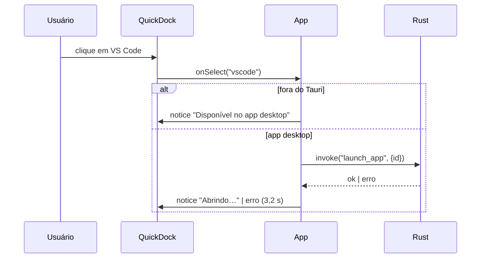

# Dock e barra superior

A dock de ícones na base da tela, que também dá os avisos do sistema, e a barra de status no topo.

| | |
|---|---|
| **ID** | `feature/dock-taskbar` |
| **Status** | Implementado |
| **Origem** | `42e671a` (2026-10-23) · evoluída em `c4ccc57` (dock no estilo Nexus, relógio por minuto) |

## Visão geral

A **dock** é a barra de ícones na base da tela, sem painel e com reflexo, no estilo Nexus. Ela tem Voice, Browser, VS Code, Terminal, Widgets, Apps, Claude Code e Settings, e é o ponto de partida do mouse. Ela também é o lugar onde o sistema "fala" em avisos curtos: "Abrindo Relógio", "Disponível no app desktop", alarmes e erros.

A **barra superior** é uma faixa de 28 px no estilo Waybar. Mostra a busca, o microfone, as janelas abertas, o título da janela em foco, o Pomodoro, a música, a bateria, a qualidade e a data/hora. Ela vem ligada por padrão e pode ser desligada.

As duas entram depois do boot. As partes vazias da barra arrastam a janela nativa.

## Dados

- **RF-008**: Ligar ou desligar a barra é um setting (`taskbar` em `settings.json`). Os módulos são uma preferência local (`jarvis.taskbar`).
- `$dock`: **DockPrefs** (`jarvis.dock`), `{visible: boolean, magnify: boolean}`, padrão `{visible: true, magnify: true}`, com debounce de 250 ms. `parseDock` volta ao padrão campo a campo. Ver [glossário](../../domain/glossary.md).
- `$módulos`: **TaskbarModules** (`jarvis.taskbar`), `{windows, voice, title, pomodoro, music, battery, quality, date, clock}: boolean`, com debounce de 250 ms. `parseModules` volta ao padrão módulo a módulo. Ver [persistência](../../domain/persistence.md).
- `$barra`: `Settings.taskbar` (`settings.json` → `taskbar`, ou `jarvis.settings` no navegador), `boolean`, padrão `true`, com debounce de 450 ms (`useSettings`).
- `jarvis.migrations.taskbarOn`: `true`, gravado na hora. Só no app desktop: liga a barra uma vez.
  - Se uma instalação antiga tiver a barra desligada, então, no app desktop, ela é ligada uma única vez (`jarvis.migrations.taskbarOn`). Escolhas posteriores ficam.
- **DockItemId / DockNotice**: o id de cada item da dock e o aviso atual `{target, text, tone, key}`.

## Componentes

### `QuickDock`

A dock na base da tela.

- **Comportamento:**
  - **RF-001**: A dock DEVE ter, nesta ordem: Voice, separador, Browser, VS Code, Terminal, Widgets, Apps, Claude Code, Settings.
  - O `nav` se chama "Quick actions". Widgets, Apps e Settings mostram `aria-pressed` enquanto o que abrem está na tela.
  - Um item fica `selected` quando é o selecionado ou o alvo do aviso atual, e `armed` quando tem algo aberto. O item Voice segue o estado do microfone.
  - Se $dock.visible estiver desligado, então a dock some e sai da árvore de acessibilidade (`inert`, `visibility: hidden`), mas os avisos e a gravação continuam no `DockToast`.
  - Na primeira entrada, a dock espera o holograma: entra 0,6 s depois, em 0,9 s. As trocas seguintes (ligar e desligar) levam 0,35 s.
- **Layout:**
  - Centrada, 24 px acima da base (`bottom-6`), acima das janelas (`z-[16]`).
  - Uma linha de 64 px de altura com os itens a 8 px um do outro. Entre Voice e Browser, um separador vertical de 36 px.
  - Não há painel: os ícones ficam direto sobre o desktop, sobre os próprios reflexos.
- **Estilo:**
  - O separador é um gradiente vertical que some nas pontas, com `hud-cyan/35` no meio.
  - A entrada e a saída deslizam 24 px na vertical com fade, com a curva `[0.22, 1, 0.36, 1]`.

### `DockButton`

Um item da dock: ícone, dica, aviso, luz e popover.

- **Comportamento:**
  - Quando o usuário passar o mouse (ou focar pelo teclado), mostre a dica com o nome do item (`role="status"`). O foco deixado por um clique do mouse não mostra a dica.
  - Se houver um aviso para o item, então ele ocupa o lugar da dica. A dica sai antes de o aviso entrar, para nunca se sobreporem.
  - Se houver um popover (o lançador de Widgets ou Apps), então ele fica acima do item, no lugar da dica, e passar o mouse sobre ele não amplia os ícones de baixo.
  - **RF-004**: A ampliação DEVE seguir o ponteiro: escala 1,32 no ícone sob ele, 1,1 a 70 px e 1 a 150 px, com mola e elevação.
  - Se $dock.magnify estiver desligado, então o ícone fica em escala 1.
  - **RF-005**: A luz de cada item DEVE refletir o estado: `active`, `loading`, `armed`, `selected`, `error`. O item de voz mostra `MicOff` em erro.
  - Um clique dispara uma onda (ripple) ao redor do ícone.
  - No modo segurar-para-falar, o item Voice é segurado em vez de clicado (ver [voice-engine](../../features/voice-engine/spec.md)).
- **Layout:**
  - Um quadrado de 56 px com o ícone de 30 px no centro e o reflexo logo abaixo.
  - A dica e o aviso ficam acima do item, centrados (`mb-3`); o popover, um pouco mais alto (`mb-4`).
  - A luz é um ponto de 4 px sob o ícone.
- **Estilo:**
  - O reflexo é o mesmo ícone invertido, com opacidade 30% e uma máscara que some de cima para baixo; ele cresce com o ícone.
  - Cores do ícone: `text-hud-text/65` em repouso, que vai para `text-hud-light` com brilho `hud-holo` no hover; `text-hud-text/85` quando `armed` ou `loading`; `text-hud-light` com brilho e fundo `hud-cyan/[0.08]` quando `active` ou `selected`; `text-hud-alert/80` em erro.
  - A mola da ampliação usa `stiffness` 380, `damping` 26 e `mass` 0,35, e o ícone sobe até 20 px × (escala − 1). Um toque encolhe o botão para 0,88.
  - A onda é uma borda `hud-light/50` que cresce de 0,7 para 1,45 e some em 0,6 s.
  - A dica é uma etiqueta `rounded-md` em `bg-hud-panel/80` com `backdrop-blur-sm`, 10 px, maiúsculas e `tracking-[0.22em]`: borda `hud-cyan/20` e `text-hud-text` para informação, borda `hud-alert/30` e `text-hud-alert/90` para erro.
  - A luz é `bg-hud-light` com brilho, ou `bg-hud-alert` em erro. `active` pulsa em 1,8 s e `loading` em 0,9 s; `armed` fica a 45%, `selected` a 60% e `error` a 90%.

### Avisos (`useDockNotice`)

A forma como o sistema "fala" pela dock.

- **Comportamento:**
  - **RF-003**: Um aviso (`DockNotice`) DEVE ocupar o lugar da dica do item-alvo, com tom `info` ou `error`, e um novo substitui o anterior.
  - Mostre um aviso por vez. Os de informação duram 1,7 s e os de erro 3,2 s.
  - `clear(target, tone?)` apaga o aviso de um item, ou só o de um tom. Um erro do motor de voz aparece no item Voice e é limpo quando some, sem apagar dicas como "Segure para falar".

### `DockToast`

O que a dock diria, quando ela está oculta.

- **Comportamento:**
  - Se a dock estiver oculta e chegar um aviso ou uma gravação, então mostre o toast `dock-toast` centrado no rodapé, que some com o aviso.
  - O toast só aparece depois do boot.
- **Layout:** centrado no rodapé, na área da dock (`bottom-4` dentro dela), com a faixa de gravação e o aviso lado a lado.
- **Estilo:** a mesma etiqueta da dica (`rounded-md`, 10 px, maiúsculas, `bg-hud-panel/80`), um pouco mais larga (`px-2.5 py-1.5`), com as cores de informação ou erro. Entra subindo 12 px em 0,22 s.

### Ações dos itens (`onDockSelect`)

O que cada item faz, decidido no `App`.

- **Comportamento:**
  - **RF-002**: Browser, VS Code e Claude Code DEVEM chamar `launch_app` com o próprio id. O resultado aparece no próprio item ("Abrindo…" ou o erro). Ver [app-launcher](../../features/app-launcher/spec.md).
    - Se estiver no modo navegador, então esses itens dizem "Disponível no app desktop", e nenhuma aba nova abre.
  - Terminal abre o jv_sh, o terminal dentro do JARVIS.
  - Widgets e Apps abrem ou fecham o lançador acima deles (ver [desktop-windows](../../features/desktop-windows/spec.md)).
  - Settings alterna o painel de Configurações.
  - Voice liga ou desliga a escuta. No modo segurar-para-falar, ele é segurado.
  - `armed` acende uma luz fixa sob Widgets ou Apps quando há um widget ou app aberto, e sob Terminal com o jv_sh aberto.

### `Taskbar`

A barra de status no topo, no estilo Waybar.

- **Comportamento:**
  - A barra existe só quando $barra está ligado e o boot terminou.
  - **RF-006**: A barra superior DEVE ter à esquerda Buscar (/), Voz e as janelas abertas; no centro, o título da janela em foco; à direita, Pomodoro, Música, Bateria, Qualidade, Data e hora, e Configurações.
  - Cada módulo só aparece se estiver ligado em $módulos.
  - Mostre um botão por janela aberta, pressionado e aceso quando a janela está em foco. O meio mostra o título da janela em foco; sem janela focada, fica vazio.
  - **RF-007**: Clicar num ícone de janela, no Pomodoro, na Bateria ou na Data e hora DEVE abrir a janela correspondente ou trazê-la para a frente.
  - O botão Voz só alterna a escuta. "Buscar (/)" abre a busca, "Configurações" abre o painel e "Qualidade gráfica (Ctrl+Shift+Q)" chama `cycle()`.
  - Se o Pomodoro não estiver com a fase em andamento nem o tempo alterado, então o módulo não aparece.
  - Se nada estiver carregado no jv_T4p3, então o módulo Música não aparece. O clique pausa ou retoma.
  - Se a API de bateria não responder, então o módulo Bateria não aparece. Com ≤ 15% e fora da tomada, ele fica em alerta.
  - **RF-009**: O relógio DEVE atualizar só na virada de cada minuto (`useMinuteClock`) e parar com a janela oculta.
  - Com o módulo "Data" desligado, a hora aparece sozinha (`HH:MM`); ligado, vem antes o dia da semana, o dia e o mês.
  - As partes vazias da barra arrastam a janela nativa (`data-tauri-drag-region`).
- **Layout:**
  - Uma faixa de 28 px (`h-7`) no topo, na largura da tela, acima das janelas, mesmo de um app maximizado (`z-[22]`).
  - À esquerda, botões de 28 × 24 px: Buscar, Voz e um ícone de 13 px por janela aberta, com um traço de 2 px embaixo.
  - O título fica centrado na tela (não no espaço livre), com até `28vw`.
  - À direita, os módulos de ícone e texto e o botão Configurações. O título da música vai até 180 px.
- **Estilo:**
  - Fundo `bg-hud-panel/94`, sem `backdrop-filter` (ela fica sobre a tela toda e o desfoque seria refeito a cada quadro do núcleo), e borda inferior `hud-line/40`; texto `font-mono` 11 px em `text-hud-text/80`.
  - Botões e módulos acendem em `bg-hud-cyan/10` no hover; a janela focada tem fundo `hud-cyan/[0.12]`, ícone em `text-hud-light` e traço `bg-hud-light`; as outras, ícone `text-hud-text/70` e traço `hud-line/70`.
  - O microfone fica em `text-hud-light` escutando, `text-hud-text/50` desligado e `MicOff` em `text-hud-alert` com erro.
  - Tons dos módulos: `text-hud-light` (relógio, Pomodoro correndo, música tocando), `text-hud-text/55` (pausado) e `text-hud-alert` (bateria fraca). O título fica em `text-hud-text/55`; a data em `text-hud-text/60`; números tabulares.
  - A barra entra descendo 28 px em 0,3 s.

### Aba "Dock" do Menu avançado

Onde o usuário liga a dock e a ampliação.

- **Comportamento:**
  - "Mostrar a dock" ("Voice, programas, Widgets, Apps e Configurações na base da tela") troca $dock.visible.
  - "Ampliar ícones" ("O ícone sob o ponteiro cresce, como no macOS") troca $dock.magnify.
  - A seção "Sem a dock" explica os atalhos: M para falar, `/` para buscar, Ctrl , para as Configurações e Ctrl Shift , para voltar ao menu.
- **Layout:** as seções "Dock" (dois `SwitchRow`) e "Sem a dock" (o texto, com as teclas em `kbd`).
- **Estilo:** o texto em `text-xs text-hud-text/55`; as teclas com borda `hud-cyan/20`, `font-mono` 11 px e `text-hud-light/85`.

### Aba "Barra superior" do Menu avançado

Onde o usuário liga a barra e escolhe os módulos.

- **Comportamento:**
  - "Mostrar a barra superior" ("Barra no topo da tela, estilo Waybar; as partes vazias arrastam a janela") troca $barra.
  - A seção "Módulos" tem os 9 switches de `TASKBAR_MODULES`: "Janelas abertas", "Status da voz", "Título da janela", "Pomodoro", "Música", "Bateria", "Qualidade gráfica", "Data" e "Hora", cada um com a sua dica.
  - Com a barra ligada, o texto diz "Mudam na barra, ao vivo."; desligada, "Ligue a barra para ver os módulos.".
  - Enquanto os settings carregam, a aba mostra "Carregando…".
  - O painel de Configurações também tem o switch "Barra superior", na seção Aparência ("Atalhos das janelas, status, pomodoro, bateria e relógio no topo, estilo Waybar").
- **Layout:** as seções "Barra superior" (um `SwitchRow`) e "Módulos" (o texto e um `SwitchRow` por módulo).
- **Estilo:** o texto em `text-xs text-hud-text/55`; os controles do kit do Menu avançado.

## Casos de borda

- **Durante o boot:** nem a dock nem a barra aparecem. A dock entra 0,6 s depois, em 0,9 s, e as trocas seguintes levam 0,35 s.
- **Configurações, Menu avançado ou busca abertos, ou dock oculta:** o lançador fecha.
- **Janela oculta:** o relógio da barra para de atualizar.

## Voz e teclado

- Busca "Ocultar a dock" / "Mostrar a dock": alterna `jarvis.dock.visible`.
- Busca "Ocultar a barra superior" / "Mostrar a barra superior": alterna `settings.taskbar`.
- Busca "Menu de widgets" / "Menu de apps": abre o lançador (só com a dock visível).
- Busca "barra superior": encontra a aba "Barra superior" do Menu avançado.
- Clique em "Qualidade gráfica (Ctrl+Shift+Q)": `cycle()` da qualidade.
- Espaço/Enter segurados no item Voice (segurar-para-falar): segura. `Esc` cancela.

## Restrições

- **RNF-001**: A dock fica 24 px acima da base (o teste aceita de 20 a 32 px de folga), centrada, acima das janelas (`z-[16]`).
- **RNF-002**: A dock oculta fica `inert` e com `visibility: hidden`: fora do Tab e dos leitores de tela.
- **RNF-003**: Módulos padrão: `windows`, `voice`, `title`, `pomodoro`, `music`, `battery` e `clock` ligados; `quality` e `date` desligados.
- Barra com altura fixa de 28 px (`TASKBAR_HEIGHT` = `TOP_SAFE`), igual à faixa de arrasto.

## Histórias de usuário

### US1 — Usar a dock (P1)

Passo o mouse e vejo o nome; clico e algo acontece, ou a dock me diz por que não.

**Por que P1:** é a navegação principal por mouse.
**Teste independente:** `tests/ui.spec.ts` — "dock hover, tooltip and click feedback".

**Aceite**

1. **Dado** o mouse sobre "VS Code", **então** aparece um `role="status"` com "VS Code" e o ícone cresce, com os vizinhos um pouco.
2. **Dado** o modo navegador, **quando** clico em VS Code (ou Browser, ou Claude Code), **então** o aviso "Disponível no app desktop" aparece e some sozinho. Nenhuma aba nova abre.
3. **Dado** Widgets, **quando** clico, **então** o "Menu de widgets" abre e o item fica `aria-pressed="true"`. Esc fecha e o item volta a `false`.
4. **Dado** Terminal, **quando** clico, **então** abre o jv_sh, o terminal dentro do JARVIS.
5. **Dado** Settings, **quando** clico, **então** o painel de Configurações alterna e o item fica pressionado enquanto ele está aberto.
6. **Dado** Voice, **então** o clique liga ou desliga a escuta. No modo segurar-para-falar, ele é segurado (ver [voice-engine](../../features/voice-engine/spec.md)).
7. **Dado** um widget ou app aberto, **então** uma luz fixa aparece sob Widgets ou Apps. Com o jv_sh aberto, a luz fica sob Terminal.

### US2 — Desligar a dock e a ampliação (P2)

Posso tirar a dock da tela sem perder os avisos dela, e desligar o efeito de ampliar.

**Por que P2:** tela limpa para quem usa teclado e voz.
**Teste independente:** `tests/dock.spec.ts` — "the advanced menu's Dock tab turns the dock off; its notices still show, and it comes back" e "the icon magnification can be turned off".

**Aceite**

1. **Dado** o Menu avançado → aba Dock, **quando** desligo "Mostrar a dock", **então** ela some e sai da árvore de acessibilidade (nenhum botão "Settings"), e `jarvis.dock.visible` vira `false`.
2. **Dado** a dock oculta, **quando** um evento a faria falar ("Abrindo Relógio"), **então** um toast `dock-toast` aparece centrado no rodapé (y > 980 em 1080p) e some.
3. **Dado** a dock oculta, **então** a busca não oferece "Menu de widgets" nem "Menu de apps". O comando "Mostrar a dock" a traz de volta.
4. **Dado** "Ampliar ícones" desligado, **então** o ícone sob o ponteiro fica em escala 1 (ligado passa de 1,15) e `jarvis.dock.magnify` vira `false`.
5. **Dado** a dock oculta, **então** a aba explica os atalhos: M para falar, `/` para buscar, Ctrl , para as Configurações e Ctrl Shift , para voltar ao menu.

### US3 — Barra superior (P1)

Vejo no topo o que está aberto e o que está acontecendo, e alterno janelas por ela.

**Por que P1:** é a barra de status do sistema.
**Teste independente:** `tests/taskbar.spec.ts` — "the top bar is on by default, turns off and on in the settings and drives the windows".

**Aceite**

1. **Dado** uma instalação nova, **então** a "Barra superior" está visível, com 28 px de altura e a largura da tela, e o switch "Barra superior" das Configurações está ligado.
2. **Dado** o padrão, **então** a hora aparece sozinha (`HH:MM`) no módulo "Data e hora", o microfone aparece como ícone sem texto, e não há módulo de qualidade.
3. **Dado** a Calculadora aberta, **então** a barra ganha um botão "Calculadora" pressionado e mostra o título no meio. Sem janela focada, o meio fica vazio.
4. **Dado** um app maximizado, **então** ele começa em y = 28 e tem altura de tela − 28. A barra continua usável.
5. **Dado** a busca, **quando** escolho "Ocultar a barra superior", **então** ela some e `taskbar` vira `false` nos settings.

### US4 — Escolher os módulos da barra (P2)

Ligo e desligo cada módulo da barra ao vivo.

**Por que P2:** personalização da densidade de informação.
**Teste independente:** `tests/taskbar.spec.ts` — "the advanced menu has a tab of its own for the top bar and its modules".

**Aceite**

1. **Dado** o Menu avançado → aba "Barra superior", **então** há "Mostrar a barra superior" e 9 switches de módulo. Com a barra ligada, o texto diz "Mudam na barra, ao vivo."; desligada, "Ligue a barra para ver os módulos.".
2. **Quando** ligo "Qualidade gráfica", **então** o botão "Qualidade gráfica (Ctrl+Shift+Q)" aparece. Desligar "Título da janela" ou "Janelas abertas" tira esses módulos.
3. **Quando** ligo "Data", **então** o módulo deixa de ser só `HH:MM`, e `jarvis.taskbar` guarda o estado de cada módulo.
4. **Dado** a busca "barra superior", **então** ela encontra a aba.

## Critérios de sucesso

- **SC-001**: Todo clique na dock produz uma reação visível: ação, lançador ou aviso.
- **SC-002**: Com a dock oculta, nenhum aviso se perde.
- **SC-003**: Os módulos da barra mudam sem recarregar.

## Fora de escopo e limitações

- O lançador de widgets e apps é descrito em [desktop-windows](../../features/desktop-windows/spec.md).
- A gravação segurar-para-falar (faixa "Deslize para cancelar", `RecordingBar`) é de [voice-engine](../../features/voice-engine/spec.md).
- O botão Voice da barra superior só alterna a escuta: não há segurar-para-falar nele.

## Código

`QuickDock` é um componente de apresentação. O `App` diz o estado da voz, o aviso atual, o item selecionado, os itens "armados" e os popovers, e recebe `onSelect`/`onVoiceHold`. Os avisos vêm de `useDockNotice` (um por vez, com timeout por tom). A ampliação usa `useMotionValue`/`useSpring` sobre a posição do mouse. `Taskbar` lê janelas, Pomodoro, música, bateria e relógio e chama de volta `onWindow`, `onVoice`, `onQuality`, `onSearch` e `onSettings`. A barra existe só quando `settings.taskbar` está ligado e o boot terminou.

| | |
|---|---|
| **Camadas** | UI React (`QuickDock`, `Taskbar`) · hooks (`useDockNotice`, `useMinuteClock`, `useBattery`, `usePomodoroRemaining`) · lib (`dock.ts`, `taskbar.ts`) · comando Tauri `launch_app` |
| **Dependências** | `motion/react` (molas, `AnimatePresence`), `lucide-react` |
| **Testes** | `tests/ui.spec.ts`, `tests/dock.spec.ts`, `tests/taskbar.spec.ts` |
| **Plataforma** | Fora do Tauri, os itens que abrem programas dizem "Disponível no app desktop", e a migração da barra não roda. `data-tauri-drag-region` só tem efeito no app |

### Arquivos

| Arquivo | Papel |
|---|---|
| `src/components/QuickDock.tsx` | Itens (`DockItemId`), `DockButton` (ampliação, dica/aviso, luz, ripple, segurar), `RecordingBar`, `DockToast`, `DockNotice` |
| `src/hooks/useDockNotice.ts` | `show(target, text, tone)`, `clear(target, tone?)`, timeouts de 1700/3200 ms |
| `src/lib/dock.ts` | `DockPrefs`, `useDockPrefs` (`jarvis.dock`, padrão `{visible: true, magnify: true}`) |
| `src/components/Taskbar.tsx` | Barra superior, `BarButton`, `Module`, `PomodoroModule`, `BatteryModule` |
| `src/lib/taskbar.ts` | `TaskbarModules`, `TASKBAR_MODULES` (rótulo e dica), `useTaskbarModules` (`jarvis.taskbar`) |
| `src/hooks/useMinuteClock.ts` | Hora atualizada na virada do minuto |
| `src/App.tsx` | `onDockSelect`, `LAUNCHABLE`, `armed`, `selected`, `voiceIndicator`/`voiceLabel`, migração `TASKBAR_MIGRATION`, lançador como popover |
| `src/components/desktop/AdvancedMenu.tsx` | Abas "Barra superior" e "Dock" |
| `src/components/SettingsPanel.tsx` | Switch "Barra superior" na seção Aparência |
| `src/lib/commands.ts` | `taskbar`, `dock`, `launcher:widgets`, `launcher:apps` |

### Contratos

#### Comandos Tauri

| Comando | Entrada | Saída | Notas |
|---|---|---|---|
| `launch_app` | `{ id: string }` | `()` ou erro (string) | Só ids configurados. Ver [app-launcher](../../features/app-launcher/spec.md) |

### Avisos da dock (exemplos do código)

| Origem | Item | Texto |
|---|---|---|
| Janela por voz | Widgets/Apps | "Abrindo <título>", "Fechando <título>", "<título> não está aberto" |
| Programa (navegador) | item do programa | "Disponível no app desktop" |
| Programa (app) | item do programa ou Voice | "Abrindo…" ou o erro de `launch_app` |
| Pomodoro | Widgets | "Pomodoro: fim do foco · …" |
| Modelo ausente | Voice | "Baixe um modelo de voz" (erro) |

### Fluxo

### Constituição

- [x] P2 Rust é dono do nativo — abrir programas passa por `launch_app`.
- [x] P5 Persistência tolerante — `parseDock` e `parseModules` voltam ao padrão por campo. A migração `jarvis.migrations.taskbarOn` roda uma única vez.
- [x] P6 Funciona fora do Tauri — caminho 3, a mensagem "Disponível no app desktop".
- [x] P7 PT-BR — rótulos da barra e avisos em PT-BR. Os nomes dos itens da dock ("Browser", "Settings", "Quick actions") ficam em inglês, como no código.
- [x] P8 Linguagem visual — tokens `hud-*`. O alerta usa `hud-alert`.
- [x] P9 Desktop leve — relógio por minuto, que para com a janela oculta.
- [x] P11 Coberto por teste — dock, ocultar, ampliação, barra e módulos.

### Decisões relacionadas

- [ADR-0010 — settings.json vs localStorage](../../arch/adr/0010-persistencia-settings-vs-localstorage.md)
- [ADR-0014 — linguagem visual TUI](../../arch/adr/0014-linguagem-visual-tui.md)
- [ADR-0011 — fakes de dev e E2E no modo web](../../arch/adr/0011-fakes-de-dev-e-e2e-modo-web.md)

## Tarefas

Legenda: `[x]` feito · `[ ]` pendente · `[P]` pode rodar em paralelo (arquivos diferentes) · `[USn]` história desta spec. As tarefas foram reconstruídas do código e dos commits `42e671a` e `c4ccc57`.

### Fase 1 — Base

- [x] T001 `DockPrefs` e `useDockPrefs` — `src/lib/dock.ts`
- [x] T002 [P] `useDockNotice` (um aviso por vez, 1700/3200 ms) — `src/hooks/useDockNotice.ts`
- [x] T003 [P] `TaskbarModules`, `TASKBAR_MODULES` e `useTaskbarModules` — `src/lib/taskbar.ts`
- [x] T004 [P] `useMinuteClock` — `src/hooks/useMinuteClock.ts` (`c4ccc57`)

### Fase 2 — US1 Usar a dock (P1)

- [x] T005 [US1] `QuickDock` e `DockButton` com dica, aviso, luz de estado e ripple — `src/components/QuickDock.tsx`
- [x] T006 [US1] Ampliação no estilo macOS com mola — `src/components/QuickDock.tsx`
- [x] T007 [US1] Visual no estilo Nexus (sem painel, com reflexo) — `src/components/QuickDock.tsx` (`c4ccc57`)
- [x] T008 [US1] `onDockSelect`: voz, Settings, lançadores, Terminal → jv_sh, programas via `launch_app` — `src/App.tsx`
- [x] T009 [US1] `armed` (grupo com janela aberta, jv_sh aberto) e entrada após o boot — `src/App.tsx`

### Fase 3 — US2 Desligar a dock e a ampliação (P2)

- [x] T010 [US2] `visible`/`magnify`, `inert` e `DockToast` com a dock oculta — `src/components/QuickDock.tsx`
- [x] T011 [P] [US2] Aba "Dock" com a explicação dos atalhos — `src/components/desktop/AdvancedMenu.tsx`
- [x] T012 [P] [US2] Comandos `dock`, e `launcher:*` só com a dock visível — `src/lib/commands.ts`

### Fase 4 — US3 Barra superior (P1)

- [x] T013 [US3] `Taskbar` com busca, voz, janelas, título, Pomodoro, música, bateria, qualidade, data/hora e Configurações — `src/components/Taskbar.tsx`
- [x] T014 [US3] Barra ligada por padrão (`taskbar: true` no Rust e no navegador) — `src-tauri/src/settings.rs`, `src/lib/settings.ts`
- [x] T015 [US3] Migração única `jarvis.migrations.taskbarOn` — `src/App.tsx`
- [x] T016 [P] [US3] Maximizado abaixo da barra (`maximizedArea`) — `src/lib/desktop.ts`
- [x] T017 [P] [US3] Switch "Barra superior" nas Configurações e comando `taskbar` na busca — `src/components/SettingsPanel.tsx`, `src/lib/commands.ts`

### Fase 5 — US4 Módulos (P2)

- [x] T018 [US4] Aba "Barra superior" com os 9 switches ao vivo — `src/components/desktop/AdvancedMenu.tsx`

### Fase 6 — Testes

- [x] T019 Playwright `tests/ui.spec.ts` — "dock hover, tooltip and click feedback"
- [x] T020 Playwright `tests/dock.spec.ts` — "the advanced menu's Dock tab turns the dock off; its notices still show, and it comes back"
- [x] T021 Playwright `tests/dock.spec.ts` — "the icon magnification can be turned off"
- [x] T022 Playwright `tests/taskbar.spec.ts` — "the top bar is on by default, turns off and on in the settings and drives the windows"
- [x] T023 Playwright `tests/taskbar.spec.ts` — "the advanced menu has a tab of its own for the top bar and its modules"
- [x] T024 Playwright `tests/ui.spec.ts` — "composition at <largura>x<altura>" (posição da dock: centrada, 20–32 px da base)
- [x] T025 Rust `src-tauri/src/settings.rs` — `missing_fields_fall_back_to_defaults` (barra ligada por padrão, e desligar persiste)
- [x] T026 Sem janela focada, o centro da barra fica vazio (antes dizia "JARVIS OS") — `src/components/Taskbar.tsx`, `tests/taskbar.spec.ts`

## Pendências

- Nenhuma registrada.
