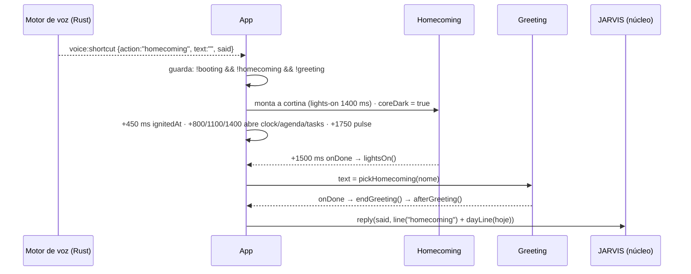

# Feature Specification: Greeting, Homecoming and Local Lines

## Metadata

| Field | Value |
|---|---|
| Feature ID | `feature/greeting-homecoming` |
| Product | JARVIS OS (jvOS) |
| Feature Status | Implementado |
| Document Status | Reescrita em 2026-11-05 no formato Feature Specification; sem decisões de produto em aberto |
| Source Commit | `42e671a` (2026-10-23, a saudação); o nome do usuário, as frases reescritas, a volta para casa (`Homecoming.tsx`) e `jarvisLines.ts` entraram em `e7151cf` (2026-11-05) |
| Uncommitted Changes | Nenhuma |
| Voice Shortcut | `shortcut:homecoming` |
| Assistant Tool | — |
| Target Platforms | Windows 11 com WebView2; no navegador (modo web) tudo funciona, mas não há motor de voz: a frase de chegada entra por `window.__JARVIS__.voiceShortcut` |
| Language | PT-BR no conteúdo e nas falas; inglês nos títulos das seções e em Given / When / Then |
| Last Editorial Revision | 2026-11-05 |
| Verification Scope | Conferida com o código em 2026-11-05: `src/components/Greeting.tsx`, `src/components/Homecoming.tsx`, `src/lib/greetings.ts`, `src/lib/jarvisLines.ts`, `src/lib/bootSound.ts`, `src/lib/storage.ts`, `src/hooks/useAssistant.ts`, `src/App.tsx`, `src/styles/globals.css`, `src-tauri/voice-commands.json`, `src-tauri/src/voice/matcher.rs`, `src-tauri/src/settings.rs`, `tests/boot.spec.ts`, `tests/tasks.spec.ts` e `tests/personality.spec.ts`. Os testes não foram executados nesta revisão |

Especificação no formato inspirado no GitHub Spec Kit, com seções de desenho técnico ([ADR-0025](../../arch/adr/0025-features-formato-feature-specification.md)). Os identificadores US1–US3, RF-001–RF-008, RNF-001–RNF-003, SC-001–SC-003 e T001–T024 são os mesmos da versão anterior. Os critérios de aceite AC-001–AC-016 são os antigos "Critério 1" a "Critério 16", na mesma ordem. KL-* registra limitações conhecidas; OQ-*, decisões de produto em aberto. Nenhum dos dois acrescenta escopo.

## Overview

Quando o núcleo liga depois do boot, o JARVIS cumprimenta dentro dele: maiúsculas pesadas, no estilo SUPERHOT, que entram palavra por palavra com um impacto digital e saem num glitch. A frase muda com a hora e o dia da semana e não repete as cinco últimas. Quando o JARVIS sabe o nome do usuário, às vezes o usa como vocativo.

Dizer "acorda, querido, papai chegou", a fala de Tony Stark, acorda a oficina: as luzes piscam e acendem, o núcleo liga, Relógio, Agenda e Tarefas abrem um a um, e o JARVIS dá as boas-vindas e repassa o dia.

As respostas que o JARVIS dá sem o Claude Code saem de um catálogo de falas locais (`jarvisLines.ts`): confirmações de comandos, hora, status, clima, agenda, tarefas e alertas. O tom e o catálogo completo estão em [persona](../../domain/jarvis-persona.md).

| Input | Expected Behavior | Execution Path |
|---|---|---|
| Fim do boot, ou um pulo | Saudação SUPERHOT no núcleo, escolhida pela hora e pelo dia | Local (`Greeting`, `pickGreeting`) |
| "Acorda, querido, papai chegou!" | Cortina, núcleo, Relógio, Agenda e Tarefas, saudação de chegada e o resumo do dia | Rust (matcher, `UNADDRESSED`) → `comeHome` no `App` |
| "Abre o relógio" | Dock "Abrindo Relógio" e uma confirmação curta no núcleo | Local (`confirm` com uma fala `openWindow`) |
| "Que horas são?" | A hora na voz do JARVIS, com uma observação de madrugada | Local (`timeLine`) |

## Goals and Success Criteria

### Goals

- Fechar a abertura com a personalidade do JARVIS.
- Variar a saudação para não cansar, sem repetir as recentes.
- Usar o nome do usuário como nos filmes: às vezes, nunca duas vezes na mesma frase.
- Fazer da chegada em casa um ritual que junta voz, desktop e JARVIS.
- Responder na hora, sem rede nem Claude Code, quando a resposta é local.

### Success Criteria

| ID | Criterion | Verification |
|---|---|---|
| SC-001 | Dois boots seguidos nunca mostram a mesma saudação. | `tests/boot.spec.ts`: depois do `reload`, a frase do `role="status"` é outra. |
| SC-002 | As três janelas da chegada estão na tela antes de a cortina sumir: até 1,4 s após a frase, contra 1,5 s da cortina. | `tests/tasks.spec.ts`: Relógio, Agenda e Tarefas visíveis, depois a cortina escondida. |
| SC-003 | Nenhuma fala local sai com erro tipográfico, com ou sem nome. | `tests/personality.spec.ts`: sem `{}`, espaço duplo, espaço antes de pontuação ou minúscula no começo, para todas as falas e saudações. |

## Scope and Non-Goals

### In Scope

- A saudação depois do boot: sorteio, memória das 5 últimas, vocativo e animação.
- A cena "acorda, querido, papai chegou": cortina, ignição, janelas, saudação de chegada e o resumo do dia.
- O atalho `shortcut:homecoming`, ouvido sem a palavra de ativação.
- O catálogo de falas locais (`LINES`), `line`, `fill`, `vocative` e os compostos.
- Onde a fala local aparece: no núcleo (`reply`, `confirm`) ou na dock.

### Out of Scope

- As 18 ações de voz que usam essas falas (hora, status, lembrete, foco…) são de [voice-shortcuts](../voice-shortcuts/spec.md). As respostas do Claude são de [assistant](../assistant/spec.md).
- A memória de "não repetir" das falas (`lastPicked`) vive só na memória da página. Depois de recarregar, a primeira fala de uma situação pode repetir a última da sessão anterior.
- `pickHomecoming` sorteia sem memória e pode repetir a mesma saudação de chegada.
- A animação da saudação reaproveita os sons `hit`/`glitch` de `bootSound.ts` ([boot](../boot/spec.md)).

## User Stories

### US1 — Greeted After the Boot

**Priority:** P1.

**User Story:** Como usuário, quando o desktop aparece, o JARVIS me dá boas-vindas com uma frase que combina com o momento.

**Why This Priority:** fecha a abertura e apresenta a personalidade.

**Independent Test:** `tests/boot.spec.ts` — "the BIOS runs its POST over two screens, comes to life with the emblem and a welcome, and reveals the hologram" (parte final).

**Acceptance Criteria:** AC-001, AC-002, AC-003, AC-004 e AC-005.

### US2 — "Acorda, querido, papai chegou"

**Priority:** P1.

**User Story:** Como usuário, chego em casa, falo a frase do Tony e a oficina acorda comigo: luzes, núcleo, relógio, agenda, tarefas e um resumo do meu dia.

**Why This Priority:** é o ritual de chegada, que junta voz, desktop e JARVIS.

**Independent Test:** `tests/tasks.spec.ts` — "\"acorda, querido, papai chegou\": the lights come on, the widgets light up, JARVIS welcomes him home".

**Acceptance Criteria:** AC-006, AC-007, AC-008, AC-009, AC-010 e AC-011.

### US3 — Local Answers in JARVIS's Voice

**Priority:** P2.

**User Story:** Como usuário, recebo nos comandos de voz e nas perguntas simples uma resposta curta no tom do JARVIS, sem esperar o Claude.

**Why This Priority:** dá personalidade e confirmação imediata aos comandos.

**Independent Test:** `tests/personality.spec.ts` — os quatro testes.

**Acceptance Criteria:** AC-012, AC-013, AC-014, AC-015 e AC-016.

## Requirements

### Functional Requirements

| ID | Requirement | Related Stories |
|---|---|---|
| RF-001 | A saudação DEVE começar 450 ms após montar, com 210 ms entre palavras; depois fica 2600 ms e sai num glitch de 280 ms (`START_MS`, `WORD_MS`, `HOLD_MS`, `OUT_MS`). | US1, US2 |
| RF-002 | As palavras ainda não mostradas DEVEM ocupar o espaço delas (`invisible`), para que as linhas não refluam. | US1, US2 |
| RF-003 | `pickGreeting` DEVE filtrar as variantes por hora (`[início, fim)`) e dia da semana. As específicas valem peso 3 e as gerais peso 1, e ficam de fora as 5 últimas gravadas em `jarvis.greeting.recent`. | US1 |
| RF-004 | As faixas DEVEM ser manhã 5–12, tarde 12–18, noite 18–24 e madrugada 0–5. Há variantes de segunda, quarta, sexta, sábado, domingo e fim de semana. | US1 |
| RF-005 | A volta para casa DEVE seguir esta linha do tempo: 0 ms, núcleo em `standby` e cortina preta (`lights-on`, 1400 ms); 450 ms, o núcleo liga, com pulso; 800, 1100 e 1400 ms, Relógio, Agenda e Tarefas abrem; 1500 ms, a cortina sai e vem a saudação de `HOMECOMING`; 1750 ms, pulso; ao fim da saudação, a resposta. | US2 |
| RF-006 | O matcher DEVE reconhecer `shortcut:homecoming` em qualquer modo de ativação, mesmo sem a palavra de ativação (`UNADDRESSED` em `src-tauri/src/voice/matcher.rs`). | US2 |
| RF-007 | `line(key, name, values)` DEVE sortear uma fala do pool sem repetir a última dita para a mesma chave. `fill` substitui `{n}` pelo vocativo, `{key}` pelo valor e `{Key}` pelo valor capitalizado. | US3 |
| RF-008 | As confirmações de comandos de voz DEVEM ir para o núcleo, "sob o que foi dito" (a pergunta é a última transcrição, ou "Comando de voz"), e a dock continua mostrando o próprio aviso. | US3 |

### Non-Functional Requirements

| ID | Requirement | Scope |
|---|---|---|
| RNF-001 | As falas locais não chamam a rede nem o Claude Code. A resposta é instantânea. | `jarvisLines.ts`, `reply`, `confirm` |
| RNF-002 | `{n}` só pode vir antes de pontuação (`. , : ; ? !`), regra verificada para todas as falas e saudações. | `LINES`, `GREETINGS`, `HOMECOMING` |
| RNF-003 | Mais de um terço das saudações usa o nome, mas não todas. Hoje são 35 de 46. | `GREETINGS` |

### Operational Constraints

- Uma cena de chegada por vez; ela é ignorada durante o boot ou durante uma saudação.
- `jarvis.greeting.recent` guarda até 5 índices, gravados na hora, sem debounce.
- A cortina chama `onDone` após `LIGHTS_MS` = 1500 ms (a animação tem 1400 ms, mais uma folga).
- `GREETINGS` tem 46 variantes (27 gerais, 13 por hora do dia e 6 por dia da semana); `HOMECOMING` tem 4.

## Acceptance Criteria

### AC-001 — Greeting Word by Word

**Related Story:** US1.

- **Given** que o boot acabou ou foi pulado
- **When** o núcleo liga
- **Then** `data-testid="greeting"` aparece no centro do núcleo e as palavras entram uma a uma, cada uma com um impacto sonoro.

### AC-002 — Accessible Lines

**Related Story:** US1.

- **Given** a saudação na tela
- **When** um leitor de tela a lê
- **Then** o `role="status"` (oculto) traz as duas linhas de uma variante de `GREETINGS` válida para a hora e o dia.

### AC-003 — Another Phrase Next Boot

**Related Story:** US1.

- **Given** uma saudação já mostrada
- **When** acontece um novo boot (recarregar e pular)
- **Then** a frase é outra: as cinco últimas ficam em `jarvis.greeting.recent`.

### AC-004 — No Greeting Without the Boot

**Related Story:** US1.

- **Given** o boot desligado
- **When** o app abre
- **Then** não há saudação.

### AC-005 — The User's Name as a Vocative

**Related Story:** US1.

- **Given** o nome "Tony" nas Configurações
- **When** uma saudação com `{n}` é escolhida
- **Then** `{n}` vira ", Tony". Com o nome em branco, fica vazio.

### AC-006 — The Lights Go Out

**Related Story:** US2.

- **Given** uma tarefa pendente e a janela Tarefas fechada
- **When** chega o atalho `homecoming` ("Acorda, querido, papai chegou!")
- **Then** aparece a cortina `data-testid="homecoming"`.

### AC-007 — The Widgets Light Up

**Related Story:** US2.

- **Given** a cortina `homecoming` na tela
- **When** a cena avança
- **Then** Relógio, Agenda e Tarefas abrem na sequência e a cortina some.

### AC-008 — Homecoming Greeting

**Related Story:** US2.

- **Given** as luzes acesas
- **When** a cortina sai
- **Then** a saudação mostra uma das variantes de `HOMECOMING`.

### AC-009 — Welcome Home and the Day

**Related Story:** US2.

- **Given** a saudação de chegada na tela
- **When** ela termina
- **Then** o JARVIS responde com uma fala de `homecoming` seguida do resumo do dia: a agenda de hoje e, se houver, as tarefas pendentes ("número 1, Comprar pão"). O nome aparece uma única vez.

### AC-010 — Ignore the Phrase While Busy

**Related Story:** US2.

- **Given** a cena em andamento, o boot na tela ou outra saudação
- **When** a frase é dita de novo
- **Then** ela é ignorada.

**Coverage Status:** sem teste automatizado (KL-002).

### AC-011 — Heard Without "Jarvis"

**Related Story:** US2.

- **Given** qualquer modo de ativação (segurar para falar, "Hey Jarvis", "Sempre ouvindo")
- **When** a frase abre o que foi dito
- **Then** ela vale sem "Jarvis" antes (atalho não endereçado); no meio de outra frase ("o papai chegou cedo hoje"), não dispara.

### AC-012 — Confirm a Voice Command in the Core

**Related Story:** US3.

- **Given** "abre o relógio" por voz
- **When** a janela abre
- **Then** a dock diz "Abrindo Relógio" e o histórico do JARVIS ganha `{question: "abre o relógio", answer: <uma fala de openWindow>}`.

### AC-013 — Confirm Closing a Group

**Related Story:** US3.

- **Given** 1 widget aberto
- **When** digo "fecha todos os widgets"
- **Then** a resposta é uma fala de `closeGroup` com "1 widget".

### AC-014 — Never the Same Line Twice in a Row

**Related Story:** US3.

- **Given** a mesma situação várias vezes seguidas
- **When** o JARVIS responde
- **Then** a fala nunca repete a anterior.

### AC-015 — Clean Lines, the Name at Most Once

**Related Story:** US3.

- **Given** qualquer fala ou saudação, com ou sem nome
- **When** ela é preenchida
- **Then** o texto sai limpo (sem `{}`, espaço duplo ou espaço antes de pontuação) e o nome aparece no máximo uma vez.

### AC-016 — A Remark in the Small Hours, Attention First

**Related Story:** US3.

- **Given** a hora pedida entre 0 h e 5 h
- **When** o JARVIS responde
- **Then** a fala vem de `lateTime`, com uma observação. O status traz primeiro o que precisa de atenção.

## Behavior and Flows

### `Greeting`

A saudação SUPERHOT no centro do núcleo, depois do boot e depois da volta para casa (RF-001, RF-002).

- **Behavior:**
  - O texto é sorteado uma vez, quando o componente monta (um inicializador preguiçoso, para o StrictMode não gastar dois sorteios). Com `text`, mostra a saudação recebida (a da volta para casa).
  - Cada palavra entra com o som `hit`, e a saída toca `glitch`. Ao fim da saída, chama `onDone`.
  - Com movimento reduzido, mostra todas as palavras de uma vez, com um único impacto, e sai num fade de 300 ms.
  - Com o som do boot desligado (`jarvis.boot.sound`), a saudação fica muda.
  - O `role="status"` (oculto) traz as duas linhas inteiras, para o leitor de tela.
  - Enquanto a saudação está na tela, o `CoreButton` e a resposta do JARVIS (`JarvisReply`) não aparecem.
- **Layout:**
  - `data-testid="greeting"` fica fixo no centro do núcleo: `top` = `CORE_CENTER_Y_CSS`, centrado na horizontal, com largura `COMPOSITION_CSS` × 0,96, acima do núcleo (`z-[11]`) e sem receber cliques.
  - As duas linhas ficam uma embaixo da outra, centradas, com `0.12em` de cada lado de cada palavra.
- **Style:**
  - Maiúsculas `superhot-text`: "Segoe UI Black", peso 900, `line-height` 1.04, cor `--color-hud-glow` com opacidade 0,78 (o holograma aparece por trás), mais o brilho `crt-text`.
  - Tamanho `clamp(22px, COMPOSITION_CSS × 0,075, 64px)`.
  - Cada palavra entra com `superhot-word` (230 ms): de `scale(1.4)`, brilho 2,4 e letras espaçadas para o tamanho normal.
  - A saída `superhot-out` (280 ms em quatro degraus) inclina, pisca e achata a frase até sumir.

### Greeting Pick (`pickGreeting`)

Escolhe a frase de `GREETINGS` para o momento (RF-003, RF-004).

- **Behavior:**
  - Lê `jarvis.greeting.recent`, filtra as variantes válidas para a hora e o dia e tira as recentes.
  - Se as cinco últimas esgotarem as frases válidas, o sorteio volta a usar todas as válidas.
  - Sorteia com peso 3 para as variantes de hora ou dia e peso 1 para as gerais.
  - Grava a escolhida no começo da lista, sem duplicata, e corta em 5.
  - `greetingLines` troca `{n}` pelo vocativo: ", Tony", ou nada com o nome em branco.

### Homecoming Scene (`comeHome` and `lightsOn`)

A cena de "acorda, querido, papai chegou", orquestrada no `App` (RF-005).

- **Behavior:**
  - Se houver boot, uma cena em andamento ou uma saudação na tela, a frase é ignorada.
  - `coreDark` mantém o núcleo em `standby` até os 450 ms; aí `ignitedAt` marca a ignição, com pulso.
  - Só as janelas da chegada que faltam abrem, a 800 ms + 300 ms × índice entre as que faltam; cada uma dá um pulso.
  - `Homecoming` chama `lightsOn` após 1500 ms: a cortina sai e `Greeting` mostra `pickHomecoming(nome)`, sorteada sem memória entre as 4 variantes de `HOMECOMING`.
  - `afterGreeting` guarda a resposta, dita quando a saudação acaba: uma fala de `homecoming` seguida de `dayLine` com a agenda de hoje e as tarefas pendentes, esta sem o nome.
  - Com a agenda vazia, a resposta usa `agendaEmpty` ("Nada marcado para hoje…"). Sem tarefas pendentes, o trecho de tarefas sai.
  - A resposta vai por `reply`: com o JARVIS ocupado, ela cai na dock.

### `Homecoming`

A cortina preta das luzes acendendo.

- **Behavior:**
  - Chama `onDone` após `LIGHTS_MS` = 1500 ms.
  - Com movimento reduzido, a cortina usa a mesma animação em 600 ms com `ease-out`, em vez de 1400 ms em degraus.
- **Layout:** `data-testid="homecoming"` cobre a tela inteira (`fixed inset-0`, `z-[30]`), acima do desktop, sem receber cliques e oculta do leitor de tela.
- **Style:**
  - Fundo `bg-black`, fora dos tokens do tema.
  - Na animação `lights-on` (1400 ms, `steps(1, end)`), a cortina fica opaca até 30%, pisca (opacidade 0,55, 1, 0,3, 0,9 e 0,6) e então some com `ease-out`.

### Line Catalog (`line` and `fill`)

As respostas que o JARVIS dá sem o Claude Code (RF-007).

- **Behavior:**
  - `line` guarda o índice da última fala de cada chave (`lastPicked`, só na memória da página) e sorteia entre as outras; um pool de uma fala só repete.
  - `vocative` devolve ", <nome>" (aparado) ou nada, quando o JARVIS não sabe o nome.
  - Os compostos `timeLine`, `dateLine`, `statusLine`, `weatherLine`, `agendaLine`, `tasksLine`, `dayLine`, `agendaDueLine` e `stockAlertLine` juntam falas numa resposta, com o nome no máximo uma vez. `spokenClock` ("15 e 30", "9 horas") e `reminderText` (tira o ponto final) são auxiliares de formatação.
  - Entre 0 h e 5 h, a hora vem de `lateTime`, com uma observação. O status traz primeiro o que precisa de atenção e depois as leituras; sem leituras, `statusUnknown`.
  - `dayLine` junta a agenda de hoje e, se houver pendentes, a lista de tarefas sem o nome.

### Local Answers (`reply` and `confirm`)

Onde a fala local aparece (RF-008).

- **Behavior:**
  - `reply(question, answer)` fala no núcleo e grava `{question, answer}` no histórico do JARVIS (`jarvis.assistant`). Com o JARVIS ocupado, a resposta vai para o aviso da dock (item Voice).
  - `confirm(key, values)` é usado nos comandos de janela, grupo, música, Pomodoro e programas. Ele fala no núcleo sob a última transcrição, ou "Comando de voz"; com o JARVIS ocupado, não fala nada, e a dock fica só com o aviso do comando.

### Interaction Flow



### User Feedback

| Moment | Persona Key | Output |
|---|---|---|
| Fim do boot | `GREETINGS` | Saudação no núcleo, com `hit` por palavra e `glitch` na saída |
| Luzes acesas | `HOMECOMING` | Saudação de chegada no núcleo |
| Fim da saudação de chegada | `homecoming` + `agendaList`/`agendaEmpty` + `tasksList` | Resposta no núcleo e no histórico |
| Comando de voz executado | `openWindow`, `closeWindow`, `closeGroup`, `music*`, `pomodoro*`, `launch`… | Confirmação no núcleo sob o que foi dito; a dock mostra o próprio aviso |
| JARVIS ocupado | as mesmas | `reply` cai na dock; `confirm` fica só com o aviso da dock |

### Voice and Keyboard

- `shortcut:homecoming` reconhece "acorda querido papai chegou", "acorda querida papai chegou", "acorda querido o papai chegou", "acorda que o papai chegou", "acorda que papai chegou", "acorda papai chegou", "acorda o papai chegou", "papai chegou", "acorda querido" e "acorda querida" (`src-tauri/voice-commands.json`): `comeHome(said)`.
- `UNADDRESSED = ["homecoming"]` casa antes de qualquer outra regra e só quando a frase abre o que foi dito, então ela vale sem "Jarvis" antes em todos os modos (RF-006).
- Não há tecla de atalho.

## Data Model and Persistence

### Greeting Variant

```ts
interface GreetingVariant {
  lines: [string, string]; // {n} = vocativo (", Tony") ou nada
  hours?: [number, number]; // [início, fim)
  days?: number[];          // 0 = domingo … 6 = sábado
}
```

### Local Lines

```ts
type Pool = readonly string[];
const LINES: Record<LineKey, Pool>; // falas por situação
type LineValues = Record<string, string | number>;
```

### Shortcut Event

```ts
// voice:shortcut da chegada
{ action: "homecoming", text: "", said: string }
```

Ver o [glossário](../../domain/glossary.md), a [persona](../../domain/jarvis-persona.md) e os [intents de voz](../../domain/voice-intents.md).

### Storage Rules

| Property | Value |
|---|---|
| State | `$recentes`: até 5 índices de `GREETINGS`, o mais novo primeiro |
| Storage | `localStorage` |
| Key | `jarvis.greeting.recent` |
| Write Debounce | 0 ms (`writeJson` no sorteio) |
| Reader | `parseRecent`: só um array; fica com os inteiros |
| Missing or Invalid Storage | Lista vazia |
| Migration | Nenhuma (KL-001) |

O nome (`$nome`) é `settings.assistantName`, digitado nas Configurações ([settings](../settings/spec.md)); vazio quando o JARVIS não sabe o nome. As respostas locais entram no histórico do JARVIS (`jarvis.assistant`, de [assistant](../assistant/spec.md)). `lastPicked` vive só em memória.

### Local Lines Summary

| Group | `LINES` Keys |
|---|---|
| Hora, data, status | `time`, `lateTime`, `date`, `statusOk`, `statusWarning`, `statusUnknown` |
| Comandos de voz | `launch`, `launchFailed`, `cannotClose`, `openWindow`, `closeWindow`, `notOpen`, `closeGroup`, `nothingOpen` |
| Música e Pomodoro | `music*`, `pomodoro*` |
| Clima, agenda, tarefas | `weather*`, `agenda*`, `task*`, `tasks*` |
| Outros | `reminder*`, `timer*`, `focus`, `noted`, `desktopOnly`, `cleanup*`, `homecoming`, `stockAlert` |

O catálogo completo e as regras de tom estão em [persona](../../domain/jarvis-persona.md).

## Technical Design

### Component Responsibilities

| File or Component | Responsibility |
|---|---|
| `src/components/Greeting.tsx` | Saudação SUPERHOT no centro do núcleo (`CORE_CENTER_Y_CSS`, largura `COMPOSITION_CSS` × 0,96) |
| `src/lib/greetings.ts` | `GREETINGS` (gerais, por hora e por dia), `HOMECOMING`, `greetingLines`, `pickGreeting`, `pickHomecoming` |
| `src/components/Homecoming.tsx` | Cortina `lights-on` de tela inteira (`z-[30]`); chama `onDone` após `LIGHTS_MS` = 1500 ms |
| `src/lib/jarvisLines.ts` | `LINES`, `vocative`, `fill`, `line`, os compostos e os auxiliares `spokenClock` e `reminderText` |
| `src/App.tsx` | `greeting`/`greetingText`, `afterGreeting`, `homecoming`/`coreDark`, `comeHome`, `lightsOn`, `endGreeting`, `confirm`/`confirmCommand`, `reply` |
| `src/hooks/useAssistant.ts` | `say`: põe a resposta no núcleo e no histórico, ou devolve `false` com o JARVIS ocupado |
| `src/styles/globals.css` | `@keyframes superhot-in/out`, `@utility superhot-text`, `superhot-word`, `superhot-out`, `@keyframes lights-on`, `@utility lights-on` |
| `src-tauri/voice-commands.json` | `shortcut:homecoming` e as 10 frases |
| `src-tauri/src/voice/matcher.rs` | `UNADDRESSED = ["homecoming"]`: casa antes de qualquer outra regra |
| `src-tauri/src/settings.rs` | `homecoming` em `SHORTCUT_TARGETS` |

### Greeting Timeline

1. A saudação é um componente com chave (`key={greeting}`): cada boot ou chegada monta um novo.
2. Com `n` palavras, a palavra `i` entra em `450 + 210 × i` ms.
3. A saída começa em `450 + 210 × n + 2600` ms e `onDone` vem 280 ms depois.
4. Com movimento reduzido, a saída começa em 2600 ms.
5. `endGreeting` limpa a saudação e roda `afterGreeting`, se houver.

### Related Architecture Decisions

- [ADR-0004 — catálogo de voz compartilhado e fallback](../../arch/adr/0004-catalogo-de-voz-compartilhado-e-fallback.md)
- [ADR-0011 — fakes de dev e E2E no modo web](../../arch/adr/0011-fakes-de-dev-e-e2e-modo-web.md)
- [ADR-0017 — UI PT-BR, código EN](../../arch/adr/0017-ui-pt-br-codigo-en.md)

## Interfaces and Contracts

### Events and Channels

| Event | Payload | Producer → Consumer |
|---|---|---|
| `voice:shortcut` | `{ action: "homecoming", text: "", said }` | `voice/mod.rs` → `useVoiceAssistant` → `shortcutHandler` em `App.tsx` |

### Test Probe

| Field of `window.__JARVIS__` | Usage |
|---|---|
| `voiceShortcut(event)` | Entra no lugar do evento `voice:shortcut` no navegador |
| `hear(text)` | Define a última transcrição, a pergunta das confirmações |
| `voiceWindow`, `voiceCloseGroup`, `voicePomodoro` | Entram no lugar dos eventos de janela, grupo e Pomodoro |

### Line API

| Function | Contract |
|---|---|
| `line(key, name, values?, random?)` | Uma fala da chave, nunca a última dita para ela |
| `fill(template, name, values?)` | `{n}` → vocativo; `{key}` → valor; `{Key}` → valor capitalizado; chave sem valor → vazio |
| `pickGreeting(name, now?, random?)` | Duas linhas; grava `jarvis.greeting.recent` |
| `pickHomecoming(name, random?)` | Duas linhas de `HOMECOMING`, sem memória |

## Edge Cases and Error Handling

| Case | Behavior | Reference |
|---|---|---|
| Nome em branco ou só espaços | `{n}` some; o JARVIS trata o usuário sem nome | AC-005 |
| `jarvis.greeting.recent` ausente, inválido ou com itens não inteiros | Lista vazia, ou só os inteiros | Storage Rules |
| Índices gravados antes de `e7151cf` | Apontam para outras frases; no máximo 5 boots com exclusões erradas | KL-001 |
| As 5 recentes esgotam as válidas | O sorteio volta a usar todas as válidas | Greeting Pick |
| StrictMode | O inicializador preguiçoso impede que dois sorteios entrem na memória | `Greeting` |
| `jarvis.greeting.recent` gravado sem debounce | Um recarregamento logo em seguida já evita a mesma frase | Storage Rules |
| Agenda de hoje vazia | A resposta da chegada usa `agendaEmpty` | AC-009 |
| Sem tarefas pendentes | O trecho das tarefas sai | AC-009 |
| Janelas da chegada já abertas | Só as que faltam abrem, a 800 ms + 300 ms × índice | Homecoming Scene |
| Frase dita de novo durante a cena, o boot ou uma saudação | Ignorada | AC-010 |
| JARVIS ocupado | `reply` cai na dock (item Voice); `confirm` fica só com o aviso da dock | Local Answers |
| Sem transcrição recente | A confirmação fica sob "Comando de voz" | RF-008 |
| Som do boot desligado | A saudação fica muda | `Greeting` |
| Movimento reduzido na saudação | Palavras de uma vez, um impacto, fade de 300 ms cortado aos 280 ms | KL-003 |
| "o papai chegou cedo hoje" | Não dispara: a frase precisa abrir o que foi dito | AC-011 |
| Permissões | As falas locais não usam rede nem Claude Code; a saudação e a cortina não recebem cliques; o leitor de tela ouve as duas linhas pelo `role="status"` | RNF-001 |

## Dependencies

### Feature Dependencies

| Dependency | Purpose |
|---|---|
| [boot](../boot/spec.md) | A saudação começa no fim dele; os sons `hit`/`glitch` e a preferência `sound` vêm de `bootSound.ts` |
| [holographic-core](../holographic-core/spec.md) | O centro e o diâmetro do núcleo em `src/lib/layout.ts`, a ignição e os pulsos |
| [voice-commands](../voice-commands/spec.md) | O matcher e o catálogo com `shortcut:homecoming` |
| [voice-shortcuts](../voice-shortcuts/spec.md) | As ações que respondem com as falas locais |
| [desktop-windows](../desktop-windows/spec.md) | Relógio, Agenda e Tarefas que abrem |
| [agenda](../../widgets/agenda/spec.md) e [tasks](../../widgets/tasks/spec.md) | O resumo do dia |
| [assistant](../assistant/spec.md) | O núcleo e o histórico onde as falas locais aparecem (`say`) |
| [settings](../settings/spec.md) | `assistantName` |
| [appearance](../appearance/spec.md) | `superhot-*`, `crt-text` e `lights-on` |

### Runtime Dependencies

- [React](../../foundation/vendor/react/spec.md) e [motion](../../foundation/vendor/motion/spec.md) (`useReducedMotion`).
- [Tailwind CSS 4](../../foundation/vendor/tailwind/spec.md) (`@utility superhot-*` e `lights-on`).
- Web Audio do WebView2 (os sons sintetizados) e a preferência de movimento reduzido do sistema.

## Test Strategy and Coverage

### Reported Tests

| Test Reference | Coverage | Acceptance Mapping |
|---|---|---|
| `tests/boot.spec.ts` — "the BIOS runs its POST over two screens, comes to life with the emblem and a welcome, and reveals the hologram" | A saudação aparece no núcleo com uma frase de `GREETINGS`; o próximo boot diz outra | AC-001–AC-003, SC-001 |
| `tests/boot.spec.ts` — "the advanced menu turns the boot off and replays it" | Com o boot desligado, não há saudação | AC-004 |
| `tests/tasks.spec.ts` — "\"acorda, querido, papai chegou\": the lights come on, the widgets light up, JARVIS welcomes him home" | A cortina, Relógio, Agenda e Tarefas, a saudação de `HOMECOMING` com o nome, o resumo do dia com o nome uma vez só | AC-005–AC-009, SC-002 |
| `tests/personality.spec.ts` — "every line reads cleanly with and without the name, which only ever comes before punctuation" | Falas e saudações limpas, `{n}` só antes de pontuação, o nome no máximo uma vez, mais de um terço das saudações com nome | AC-015, RNF-002, RNF-003, SC-003 |
| `tests/personality.spec.ts` — "he varies his words: never the same line twice in a row" | 12 sorteios seguidos de `noted` sem repetir | AC-014 |
| `tests/personality.spec.ts` — "the time comes with a remark in the small hours, the status with what needs attention first" | `lateTime` às 3 h; o disco quase cheio antes das leituras; `statusUnknown` sem leituras | AC-016 |
| `tests/personality.spec.ts` — "voice commands get a short spoken confirmation, under what was said, and the dock still says it" | "Abrindo Relógio" na dock, `openWindow` no histórico sob "abre o relógio", `closeGroup` com "1 widget", `pomodoroPause` | AC-012, AC-013 |
| `src-tauri/src/voice/matcher.rs` — `the_tasks_the_agenda_numbers_and_the_homecoming_by_voice` | A frase vale no segurar-para-falar, na ativação por voz e em "Sempre ouvindo"; "o papai chegou cedo hoje" não dispara | AC-011 |

### Verification Commands

Na raiz do repositório:

```powershell
npx playwright test tests/boot.spec.ts --project ui -g "the BIOS runs its POST|turns the boot off"
npx playwright test tests/tasks.spec.ts --project ui -g "papai chegou"
npx playwright test tests/personality.spec.ts --project ui
```

Em `src-tauri`:

```powershell
cargo test --lib the_tasks_the_agenda_numbers_and_the_homecoming_by_voice
```

### Coverage Gaps

| Gap | Evidence Status | Suggested Verification |
|---|---|---|
| Frase repetida durante a cena (AC-010) | Sem teste: o comentário existe, a segunda frase não | Mandar `homecoming` de novo antes de a cortina sumir e conferir uma cortina só |
| Faixas de hora e dia no sorteio | Sem teste direto | Chamar `pickGreeting` com `now` fixo e `random` fixo |
| Saudação muda com `sound: false` | Sem teste | Espionar `AudioContext` |
| Confirmação com o JARVIS ocupado | Sem teste | Ocupar o JARVIS e mandar um comando de janela |

## Implementation Plan

**Status Convention:** `[x]` feito · `[ ]` pendente · `[P]` pode rodar em paralelo (arquivos diferentes) · `[USn]` história desta spec. As tarefas foram reconstruídas do código e dos commits `42e671a` e `e7151cf`.

### Phase 1 — Foundation

- [x] T001 `GreetingVariant`, faixas `MORNING`/`AFTERNOON`/`EVENING`/`LATE`/`WEEKEND` e `GREETINGS` — `src/lib/greetings.ts`
- [x] T002 `pickGreeting` com peso 3 para as específicas e memória de 5 em `jarvis.greeting.recent` — `src/lib/greetings.ts`
- [x] T003 [P] Sons `hit` e `glitch` — `src/lib/bootSound.ts`
- [x] T004 [P] Utilitários `superhot-text`, `superhot-word` e `superhot-out` — `src/styles/globals.css`

### Phase 2 — Greeting After the Boot (US1)

- [x] T005 [US1] `Greeting`: palavras com `START_MS`/`WORD_MS`, `HOLD_MS` e saída com glitch, versão de movimento reduzido — `src/components/Greeting.tsx`
- [x] T006 [US1] Montagem após `finishBoot` e `endGreeting` — `src/App.tsx`
- [x] T007 [US1] Nome do usuário como vocativo `{n}` (`greetingLines`) e frases reescritas — `src/lib/greetings.ts` (`e7151cf`)

### Phase 3 — Local Lines (US3)

- [x] T008 [US3] `LINES`, `vocative`, `fill` e `line` sem repetir a anterior — `src/lib/jarvisLines.ts` (`e7151cf`)
- [x] T009 [P] [US3] Compostos `timeLine`, `dateLine`, `statusLine`, `weatherLine`, `agendaLine`, `tasksLine`, `dayLine`, `agendaDueLine`, `stockAlertLine` — `src/lib/jarvisLines.ts`
- [x] T010 [US3] `confirm`/`confirmCommand` nos comandos de janela, grupo, música, Pomodoro e programas — `src/App.tsx`
- [x] T011 [US3] `reply`: no núcleo, ou no aviso da dock quando o JARVIS está ocupado — `src/App.tsx`

### Phase 4 — Homecoming (US2)

- [x] T012 [US2] `shortcut:homecoming` com as frases — `src-tauri/voice-commands.json`
- [x] T013 [P] [US2] `UNADDRESSED` no `decide` do matcher — `src-tauri/src/voice/matcher.rs`
- [x] T014 [P] [US2] `homecoming` em `SHORTCUT_TARGETS` — `src-tauri/src/settings.rs`
- [x] T015 [P] [US2] `HOMECOMING` e `pickHomecoming` — `src/lib/greetings.ts`
- [x] T016 [P] [US2] Cortina `Homecoming` e `@keyframes lights-on` — `src/components/Homecoming.tsx`, `src/styles/globals.css`
- [x] T017 [US2] `comeHome`, `lightsOn`, `coreDark` e `afterGreeting` com `dayLine` — `src/App.tsx`

### Phase 5 — Verification

- [x] T018 Playwright `tests/boot.spec.ts` — "the BIOS runs its POST over two screens, comes to life with the emblem and a welcome, and reveals the hologram" (saudação e "the next boot says something else")
- [x] T019 Playwright `tests/tasks.spec.ts` — "\"acorda, querido, papai chegou\": the lights come on, the widgets light up, JARVIS welcomes him home"
- [x] T020 Playwright `tests/personality.spec.ts` — "every line reads cleanly with and without the name, which only ever comes before punctuation"
- [x] T021 Playwright `tests/personality.spec.ts` — "he varies his words: never the same line twice in a row"
- [x] T022 Playwright `tests/personality.spec.ts` — "the time comes with a remark in the small hours, the status with what needs attention first"
- [x] T023 Playwright `tests/personality.spec.ts` — "voice commands get a short spoken confirmation, under what was said, and the dock still says it"
- [x] T024 Rust `src-tauri/src/voice/matcher.rs` — `the_tasks_the_agenda_numbers_and_the_homecoming_by_voice`

## Rollback Plan

1. Volta para casa: tire `shortcut:homecoming` de `src-tauri/voice-commands.json`, `homecoming` de `UNADDRESSED` (`matcher.rs`) e de `SHORTCUT_TARGETS` (`settings.rs`, ajustando o tamanho do array), `Homecoming.tsx`, `HOMECOMING`/`pickHomecoming` e, no `App.tsx`, `comeHome`, `lightsOn` e `coreDark`.
2. O que ficar em `voiceCommands` no `settings.json` é descartado na próxima leitura: o `shortcut:homecoming` gravado deixa de ser um padrão, e um comando próprio com esse alvo falha em `valid_custom`.
3. Saudação: tire o `Greeting` do `finishBoot` e o `endGreeting`. A chave `jarvis.greeting.recent` fica órfã e é ignorada.
4. Mantenha `jarvisLines.ts`: as confirmações de voz, os atalhos ([voice-shortcuts](../voice-shortcuts/spec.md)), os lembretes, a agenda, o clima, a limpeza de memória e as ações usam `line` e os compostos. Sem ele, a UI não compila.
5. Mantenha `superhot-*` em `globals.css`: o `JarvisReply` do [assistant](../assistant/spec.md) também usa. Só `lights-on` é exclusivo da volta para casa.

## Constitution Compliance

| Principle | Status | Rationale |
|---|---|---|
| P1 — Offline-first | Atendido | As falas locais não usam rede nem Claude |
| P3 — Comandos finos | Atendido | O motor só emite `voice:shortcut`; a UI faz a cena |
| P5 — Persistência tolerante | Atendido | `parseRecent` aceita só inteiros; um valor inválido vira lista vazia |
| P6 — Fora do Tauri | Atendido | A cena inteira roda no Vite, com `__JARVIS__.voiceShortcut` |
| P7 — PT-BR | Atendido | Todas as frases estão em PT-BR; os identificadores ficam em inglês |
| P8 — Linguagem visual | Atendido | `superhot-*` e `crt-text` usam `--color-hud-glow`/`holo`. Exceção: a cortina `Homecoming` é `bg-black`, fora dos tokens |
| P11 — Testes | Atendido, com lacunas | Saudação, chegada e falas têm testes; o matcher tem teste Rust; AC-010 sem teste (KL-002) |

## Known Limitations

| ID | Limitation | Status |
|---|---|---|
| KL-001 | `jarvis.greeting.recent` guarda índices de `GREETINGS`. A lista foi reescrita em `e7151cf`, então os índices gravados por versões anteriores apontam para outras frases. Não existe migração; o efeito some depois de 5 boots. | Sem migração, impacto baixo |
| KL-002 | AC-010 (frase repetida durante a cena) não tem teste: `tests/tasks.spec.ts` diz "Said once: a second time while the scene runs is ignored", mas não manda a segunda frase. | Lacuna de verificação |
| KL-003 | Com movimento reduzido, a saudação começa um fade de 300 ms, mas `onDone` vem 280 ms depois e a desmonta antes do fim. | Diferença de 20 ms, sem efeito visível |

## Open Questions

Nenhuma.

## References

- Versão anterior desta spec, no formato SpecLang: `git show e7151cf:.specs/features/greeting-homecoming/spec.md`. A versão intermediária, no formato do spec-coding.dev ([ADR-0023](../../arch/adr/0023-specs-formato-spec-coding-dev.md)), não chegou a ser commitada.
- Modelo de formato: [reminders](../reminders/spec.md) ([ADR-0025](../../arch/adr/0025-features-formato-feature-specification.md)).
- Código conferido: listado em Metadata › Verification Scope.
