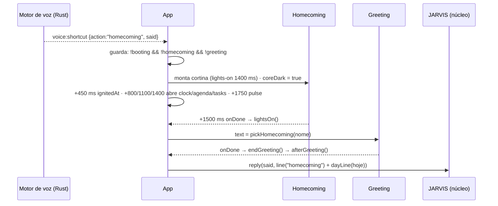

# Saudação, volta para casa e falas locais

O JARVIS cumprimenta dentro do núcleo depois do boot, acorda a oficina com a frase do Tony Stark e responde sozinho, sem o Claude Code, com um catálogo de falas no tom dele.

| | |
|---|---|
| **ID** | `feature/greeting-homecoming` |
| **Status** | Implementado (saudação) · Implementado · não commitado (volta para casa e `jarvisLines.ts`) |
| **Origem** | `42e671a` (2026-10-23) · evoluída não commitado (27/10): nome do usuário, frases reescritas, `Homecoming.tsx`, `jarvisLines.ts` |
| **Voz** | `shortcut:homecoming` |

## Visão geral

Quando o núcleo liga depois do boot, o JARVIS cumprimenta dentro dele. São maiúsculas pesadas, no estilo SUPERHOT, que entram palavra por palavra com um impacto digital e saem num glitch. A frase muda com a hora e o dia da semana e não repete as cinco últimas. Quando o JARVIS sabe o nome do usuário, às vezes o usa como vocativo.

Dizer "acorda, querido, papai chegou", a fala de Tony Stark, acorda a oficina:
- as luzes piscam e acendem e o núcleo liga;
- Relógio, Agenda e Tarefas abrem um a um;
- o JARVIS dá as boas-vindas e repassa o dia.

As respostas que o JARVIS dá sem o Claude Code saem de um catálogo de falas locais (`jarvisLines.ts`): confirmações de comandos, hora, status, clima, agenda, tarefas e alertas. O tom e o catálogo completo estão em [persona](../../domain/jarvis-persona.md).

## Dados

- `$recentes`: `number[]` com até 5 índices de `GREETINGS`, o mais novo primeiro. Fica em `jarvis.greeting.recent`, gravado na hora (`writeJson`), sem debounce e sem migração. `parseRecent` aceita só inteiros; se o valor for inválido, a lista fica vazia. Ver [persistência](../../domain/persistence.md).
- `$nome`: o nome do usuário, digitado nas Configurações (`settings.assistantName`). Vazio quando o JARVIS não sabe o nome.
- **GreetingVariant**: duas linhas, com `hours` e `days` opcionais. Ver [glossário](../../domain/glossary.md).
- **LINES / Pool / LineKey**: catálogo de falas locais por situação. Ver [persona](../../domain/jarvis-persona.md).
- **ShortcutEvent `homecoming`**: `{action: "homecoming", text: "", said}`. Ver [intents de voz](../../domain/voice-intents.md).
- O histórico do JARVIS (`jarvis.assistant`) recebe as respostas locais.

## Componentes

### `Greeting`

A saudação SUPERHOT no centro do núcleo, depois do boot e depois da volta para casa.

- **Comportamento:**
  - O texto é sorteado uma vez, quando o componente monta (um inicializador preguiçoso, para o StrictMode não gastar dois sorteios). Com `text`, mostra a saudação recebida (a da volta para casa).
  - **RF-001**: A saudação DEVE começar 450 ms após montar, com 210 ms entre palavras. Depois fica 2600 ms e sai num glitch de 280 ms (`START_MS`, `WORD_MS`, `HOLD_MS`, `OUT_MS`).
  - Cada palavra entra com o som `hit`, e a saída toca `glitch`. Ao fim da saída, chame `onDone`.
  - **RF-002**: As palavras ainda não mostradas DEVEM ocupar o espaço delas (`invisible`), para que as linhas não refluam.
  - Se o usuário pedir movimento reduzido, então mostre todas as palavras de uma vez, com um único impacto, e saia num fade de 300 ms.
  - Se o som do boot estiver desligado (`jarvis.boot.sound`), então a saudação fica muda.
  - O `role="status"` (oculto) traz as duas linhas inteiras, para o leitor de tela.
- **Layout:**
  - `data-testid="greeting"` fica fixo no centro do núcleo: `top` = `CORE_CENTER_Y_CSS`, centrado na horizontal, com largura `COMPOSITION_CSS` × 0,96, acima do núcleo (`z-[11]`) e sem receber cliques.
  - As duas linhas ficam uma embaixo da outra, centradas, com `0.12em` de cada lado de cada palavra.
- **Estilo:**
  - Maiúsculas `superhot-text`: "Segoe UI Black", peso 900, `line-height` 1.04, cor `--color-hud-glow` com opacidade 0,78 (o holograma aparece por trás), mais o brilho `crt-text`.
  - Tamanho `clamp(22px, COMPOSITION_CSS × 0,075, 64px)`.
  - Cada palavra entra com `superhot-word` (230 ms): de `scale(1.4)`, brilho 2,4 e letras espaçadas para o tamanho normal.
  - A saída `superhot-out` (280 ms em quatro degraus) inclina, pisca e achata a frase até sumir.

### Sorteio da saudação (`pickGreeting`)

Escolhe a frase de `GREETINGS` para o momento.

- **Comportamento:**
  - **RF-003**: `pickGreeting` DEVE filtrar as variantes por hora (`[início, fim)`) e dia da semana. As específicas valem peso 3 e as gerais peso 1, e ficam de fora as 5 últimas gravadas em `jarvis.greeting.recent`.
  - **RF-004**: As faixas DEVEM ser manhã 5–12, tarde 12–18, noite 18–24 e madrugada 0–5. Há variantes de segunda, quarta, sexta, sábado, domingo e fim de semana.
  - Grave a escolhida no começo de $recentes e corte a lista em 5.
  - Se as cinco últimas esgotarem as frases válidas, então o sorteio volta a usar todas as válidas.
  - `greetingLines` troca `{n}` pelo vocativo de $nome: ", Tony", ou nada com o nome em branco.

### Volta para casa (`comeHome` e `lightsOn`)

A cena de "acorda, querido, papai chegou", orquestrada no `App`.

- **Comportamento:**
  - **RF-005**: A volta para casa DEVE seguir esta linha do tempo:
    - 0 ms: núcleo em `standby` e cortina preta (`lights-on`, 1400 ms);
    - 450 ms: o núcleo liga, com pulso;
    - 800/1100/1400 ms: Relógio, Agenda e Tarefas abrem;
    - 1750 ms: pulso;
    - 1500 ms: a cortina sai, vem a saudação de `HOMECOMING` e, ao fim dela, a resposta.
  - `coreDark` mantém o núcleo em `standby` até os 450 ms. Cada janela que abre também dá um pulso.
  - Se as janelas da chegada já estiverem abertas, então só as que faltam abrem, a 800 ms + 300 ms × índice.
  - `lightsOn` tira a cortina e mostra `Greeting` com `pickHomecoming($nome)`, que sorteia sem memória entre as variantes de `HOMECOMING`.
  - `afterGreeting` guarda a resposta, dita quando a saudação acaba: uma fala de `homecoming` seguida de `dayLine` com a agenda de hoje e as tarefas pendentes.
    - Se a agenda estiver vazia, então a resposta usa `agendaEmpty` ("Nada marcado para hoje…"). Sem tarefas pendentes, o trecho de tarefas é omitido.
  - Se a cena estiver em andamento, ou houver boot ou outra saudação na tela, então a frase é ignorada.

### `Homecoming`

A cortina preta das luzes acendendo.

- **Comportamento:**
  - Chame `onDone` após `LIGHTS_MS` = 1500 ms: a animação tem 1400 ms, mais uma folga.
  - Se o usuário pedir movimento reduzido, então a cortina pisca por 600 ms com `ease-out`, em vez de 1400 ms em degraus.
- **Layout:** `data-testid="homecoming"` cobre a tela inteira (`fixed inset-0`, `z-[30]`), acima do desktop e sem receber cliques.
- **Estilo:**
  - Fundo `bg-black`, fora dos tokens do tema.
  - Na animação `lights-on` (1400 ms, `steps(1, end)`), a cortina fica opaca até 30%, pisca (opacidade 0,55, 1, 0,3, 0,9 e 0,6) e então some com `ease-out`.

### Catálogo de falas (`line` e `fill`)

As respostas que o JARVIS dá sem o Claude Code.

- **Comportamento:**
  - **RF-007**: `line(key, name, values)` DEVE sortear uma fala do pool sem repetir a última dita para a mesma chave. `fill` substitui `{n}` pelo vocativo, `{key}` pelo valor e `{Key}` pelo valor capitalizado.
  - A memória de "não repetir" (`lastPicked`) fica só na memória da página.
  - `vocative` devolve ", <nome>" ou nada, quando o JARVIS não sabe o nome.
  - Os compostos (`timeLine`, `dateLine`, `statusLine`, `weatherLine`, `agendaLine`, `tasksLine`, `dayLine`, `agendaDueLine`, `stockAlertLine`, `spokenClock`, `reminderText`) juntam várias falas numa resposta, e o nome aparece no máximo uma vez.
  - Entre 0 h e 5 h, a hora vem de `lateTime`, com uma observação. O status traz primeiro o que precisa de atenção.

### Respostas locais (`reply` e `confirm`)

Onde a fala local aparece.

- **Comportamento:**
  - **RF-008**: As confirmações de comandos de voz DEVEM ir para o núcleo, "sob o que foi dito" (a pergunta é a última transcrição, ou "Comando de voz"), e a dock continua mostrando o próprio aviso.
  - `confirm(key, values)` é usado nos comandos de janela, grupo, música, Pomodoro e programas.
  - `reply(question, answer)` fala no núcleo e grava `{question, answer}` no histórico do JARVIS.
  - Se o JARVIS estiver ocupado, então a resposta local vai para o aviso da dock (item Voice) em vez do núcleo.

## Voz e teclado

- **RF-006**: O matcher DEVE reconhecer `shortcut:homecoming` em qualquer modo de ativação, mesmo sem a palavra de ativação (`UNADDRESSED` em `src-tauri/src/voice/matcher.rs`).
  - `UNADDRESSED = ["homecoming"]` casa antes de qualquer outra regra, então a frase vale sem "Jarvis" antes.
- "acorda querido papai chegou", "acorda querida papai chegou", "acorda querido o papai chegou", "acorda que o papai chegou", "acorda que papai chegou", "acorda papai chegou", "acorda o papai chegou", "papai chegou", "acorda querido", "acorda querida": `comeHome(said)`.

## Restrições

- **RNF-001**: As falas locais não chamam a rede nem o Claude Code. A resposta é instantânea.
- **RNF-002**: `{n}` só pode vir antes de pontuação (`. , : ; ? !`), regra verificada para todas as falas e saudações.
- **RNF-003**: Mais de um terço das saudações usa o nome, mas não todas.
- Uma cena de chegada por vez. Ignorada durante o boot ou uma saudação.

## Histórias de usuário

### US1 — Ser cumprimentado depois do boot (P1)

Quando o desktop aparece, o JARVIS me dá boas-vindas com uma frase que combina com o momento.

**Por que P1:** fecha a abertura e apresenta a personalidade.
**Teste independente:** `tests/boot.spec.ts` — "the BIOS runs its POST over two screens, comes to life with the emblem and a welcome, and reveals the hologram" (parte final).

**Aceite**

1. **Dado** que o boot acabou ou foi pulado, **então** `data-testid="greeting"` aparece no centro do núcleo e as palavras entram uma a uma, cada uma com um impacto sonoro.
2. **Dado** a saudação na tela, **então** o `role="status"` (oculto) traz as duas linhas de uma variante de `GREETINGS` válida para a hora e o dia.
3. **Dado** um novo boot (recarregar e pular), **então** a frase é outra: as cinco últimas ficam em `jarvis.greeting.recent`.
4. **Dado** o boot desligado, **então** não há saudação.
5. **Dado** o nome "Tony" nas Configurações, **então** `{n}` vira ", Tony". Com o nome em branco, fica vazio.

### US2 — "Acorda, querido, papai chegou" (P1)

Chego em casa, falo a frase do Tony e a oficina acorda comigo: luzes, núcleo, relógio, agenda, tarefas e um resumo do meu dia.

**Por que P1:** é o ritual de chegada, que junta voz, desktop e JARVIS.
**Teste independente:** `tests/tasks.spec.ts` — "\"acorda, querido, papai chegou\": the lights come on, the widgets light up, JARVIS welcomes him home".

**Aceite**

1. **Dado** uma tarefa pendente e a janela Tarefas fechada, **quando** chega o atalho `homecoming` ("Acorda, querido, papai chegou!"), **então** aparece a cortina `data-testid="homecoming"`.
2. Na sequência, Relógio, Agenda e Tarefas abrem e a cortina some.
3. **Dado** as luzes acesas, **então** a saudação mostra uma das variantes de `HOMECOMING`.
4. **Dado** o fim dessa saudação, **então** o JARVIS responde com uma fala de `homecoming` seguida do resumo do dia: a agenda de hoje e, se houver, as tarefas pendentes ("número 1, Comprar pão"). O nome aparece uma única vez.
5. **Dado** a cena em andamento, **quando** a frase é dita de novo, **então** ela é ignorada. Também é ignorada durante o boot ou durante outra saudação.
6. **Dado** qualquer modo de ativação, **então** a frase vale sem "Jarvis" antes (atalho não endereçado).

### US3 — Respostas locais com a voz do JARVIS (P2)

Comandos de voz e perguntas simples recebem uma resposta curta no tom do JARVIS, sem esperar o Claude.

**Por que P2:** dá personalidade e confirmação imediata aos comandos.
**Teste independente:** `tests/personality.spec.ts` — os quatro testes.

**Aceite**

1. **Dado** "abre o relógio" por voz, **quando** a janela abre, **então** a dock diz "Abrindo Relógio" e o histórico do JARVIS ganha `{question: "abre o relógio", answer: <uma fala de openWindow>}`.
2. **Dado** "fecha todos os widgets" com 1 widget aberto, **então** a resposta é uma fala de `closeGroup` com "1 widget".
3. **Dado** a mesma situação várias vezes seguidas, **então** a fala nunca repete a anterior.
4. **Dado** qualquer fala, com ou sem nome, **então** o texto sai limpo (sem `{}`, espaço duplo ou espaço antes de pontuação) e o nome aparece no máximo uma vez.
5. **Dado** a hora pedida entre 0 h e 5 h, **então** vem de `lateTime`, com uma observação. O status traz primeiro o que precisa de atenção.

## Critérios de sucesso

- **SC-001**: Dois boots seguidos nunca mostram a mesma saudação.
- **SC-002**: As três janelas da chegada estão na tela antes de a cortina sumir: até 1,4 s após a frase, contra 1,5 s da cortina.
- **SC-003**: Nenhuma fala local sai com erro tipográfico, com ou sem nome.

## Fora de escopo e limitações

- As 18 ações de voz que usam essas falas (hora, status, lembrete, foco…) são de [voice-shortcuts](../../features/voice-shortcuts/spec.md). As respostas do Claude são de [assistant](../../features/assistant/spec.md).
- A memória de "não repetir" das falas (`lastPicked`) vive só na memória da página. Depois de recarregar, a primeira fala de uma situação pode repetir a última da sessão anterior.
- `pickHomecoming` sorteia sem memória e pode repetir a mesma saudação de chegada.
- A animação da saudação reaproveita os sons `hit`/`glitch` de `bootSound.ts` (ver [boot](../../features/boot/spec.md)).

## Código

A saudação é um componente com chave (`key={greeting}`). Ele sorteia o texto uma vez num inicializador preguiçoso e agenda as palavras com `setTimeout`. A volta para casa é orquestrada no `App`: `comeHome` agenda os passos, e `Homecoming` (uma cortina preta com a animação `lights-on`) chama `lightsOn` ao terminar. `lightsOn` mostra a saudação de `HOMECOMING`, e `afterGreeting` guarda o que o JARVIS diz quando ela acaba. As falas locais são pools de templates em `jarvisLines.ts`, preenchidos por `fill`.

| | |
|---|---|
| **Camadas** | UI React (`Greeting`, `Homecoming`) · `App.tsx` (orquestração) · lib (`greetings.ts`, `jarvisLines.ts`, `bootSound.ts`) · Rust (`voice/matcher.rs`, `voice-commands.json`) |
| **Dependências** | `motion/react` (`useReducedMotion`), Web Audio (sons sintetizados), `src/lib/layout.ts` (centro e diâmetro do núcleo) |
| **Testes** | `tests/boot.spec.ts`, `tests/tasks.spec.ts`, `tests/personality.spec.ts`; Rust `the_tasks_the_agenda_numbers_and_the_homecoming_by_voice` em `matcher.rs` |
| **Plataforma** | No navegador não há motor de voz, então os testes usam `window.__JARVIS__.voiceShortcut` no lugar do evento `voice:shortcut` |

### Arquivos

| Arquivo | Papel |
|---|---|
| `src/components/Greeting.tsx` | Saudação SUPERHOT no centro do núcleo (`CORE_CENTER_Y_CSS`, largura `COMPOSITION_CSS` × 0,96) |
| `src/lib/greetings.ts` | `GREETINGS` (gerais, por hora e por dia), `HOMECOMING`, `greetingLines`, `pickGreeting`, `pickHomecoming` |
| `src/components/Homecoming.tsx` | Cortina `lights-on` de tela inteira (`z-[30]`). Chama `onDone` após `LIGHTS_MS` = 1500 ms |
| `src/lib/jarvisLines.ts` | `LINES`, `vocative`, `fill`, `line`, e os compostos `timeLine`, `dateLine`, `statusLine`, `weatherLine`, `agendaLine`, `tasksLine`, `dayLine`, `agendaDueLine`, `stockAlertLine`, `spokenClock`, `reminderText` |
| `src/App.tsx` | `greeting`/`greetingText`, `afterGreeting`, `homecoming`/`coreDark`, `comeHome`, `lightsOn`, `endGreeting`, `confirm`/`confirmCommand`, `reply` |
| `src/styles/globals.css` | `@keyframes superhot-in/out`, `@utility superhot-text`, `superhot-word`, `superhot-out`, `@keyframes lights-on`, `@utility lights-on` |
| `src-tauri/voice-commands.json` | `shortcut:homecoming` e as frases dele |
| `src-tauri/src/voice/matcher.rs` | `UNADDRESSED = ["homecoming"]`: casa antes de qualquer outra regra |

### Contratos

#### Eventos e Channels

| Nome | Payload | Emissor → consumidor |
|---|---|---|
| `voice:shortcut` | `{action: "homecoming", text: "", said}` | `voice/mod.rs` → `useVoiceAssistant` → `shortcutHandler` em `App.tsx` |

### Falas locais (resumo)

| Grupo | Chaves de `LINES` |
|---|---|
| Hora, data, status | `time`, `lateTime`, `date`, `statusOk`, `statusWarning`, `statusUnknown` |
| Comandos de voz | `launch`, `launchFailed`, `cannotClose`, `openWindow`, `closeWindow`, `notOpen`, `closeGroup`, `nothingOpen` |
| Música e Pomodoro | `music*`, `pomodoro*` |
| Clima, agenda, tarefas | `weather*`, `agenda*`, `task*`, `tasks*` |
| Outros | `reminder*`, `timer*`, `focus`, `noted`, `desktopOnly`, `cleanup*`, `homecoming`, `stockAlert` |

O catálogo completo e as regras de tom estão em [persona](../../domain/jarvis-persona.md).

### Fluxo

### Constituição

- [x] P1 Offline-first — as falas locais não usam rede nem Claude.
- [x] P3 Comandos finos — o motor só emite `voice:shortcut`. A UI faz a cena.
- [x] P5 Persistência tolerante — `parseRecent` aceita só inteiros. Se o valor for inválido, a lista fica vazia.
- [x] P6 Funciona fora do Tauri — a cena inteira roda no Vite, com `__JARVIS__.voiceShortcut`.
- [x] P7 PT-BR — todas as frases estão em PT-BR. Os identificadores ficam em inglês.
- [x] P8 Linguagem visual — `superhot-*` e `crt-text` usam `--color-hud-glow`/`holo`. Exceção: a cortina `Homecoming` é `bg-black`, fora dos tokens.
- [x] P11 Coberto por teste — saudação, chegada e falas têm testes. O matcher tem teste Rust.

### Decisões relacionadas

- [ADR-0004 — catálogo de voz compartilhado e fallback](../../arch/adr/0004-catalogo-de-voz-compartilhado-e-fallback.md)
- [ADR-0011 — fakes de dev e E2E no modo web](../../arch/adr/0011-fakes-de-dev-e-e2e-modo-web.md)
- [ADR-0017 — UI PT-BR, código EN](../../arch/adr/0017-ui-pt-br-codigo-en.md)

## Tarefas

Legenda: `[x]` feito · `[ ]` pendente · `[P]` pode rodar em paralelo (arquivos diferentes) · `[USn]` história desta spec. As tarefas foram reconstruídas do código, do commit `42e671a` e do working tree de 27/10.

### Fase 1 — Base

- [x] T001 `GreetingVariant`, faixas `MORNING`/`AFTERNOON`/`EVENING`/`LATE`/`WEEKEND` e `GREETINGS` — `src/lib/greetings.ts`
- [x] T002 `pickGreeting` com peso 3 para as específicas e memória de 5 em `jarvis.greeting.recent` — `src/lib/greetings.ts`
- [x] T003 [P] Sons `hit` e `glitch` — `src/lib/bootSound.ts`
- [x] T004 [P] Utilitários `superhot-text`, `superhot-word` e `superhot-out` — `src/styles/globals.css`

### Fase 2 — US1 Saudação depois do boot (P1)

- [x] T005 [US1] `Greeting`: palavras com `START_MS`/`WORD_MS`, `HOLD_MS` e saída com glitch, versão de movimento reduzido — `src/components/Greeting.tsx`
- [x] T006 [US1] Montagem após `finishBoot` e `endGreeting` — `src/App.tsx`
- [x] T007 [US1] Nome do usuário como vocativo `{n}` (`greetingLines`) e frases reescritas — `src/lib/greetings.ts` (não commitado)

### Fase 3 — US3 Falas locais (P2)

- [x] T008 [US3] `LINES`, `vocative`, `fill` e `line` sem repetir a anterior — `src/lib/jarvisLines.ts` (não commitado)
- [x] T009 [P] [US3] Compostos `timeLine`, `dateLine`, `statusLine`, `weatherLine`, `agendaLine`, `tasksLine`, `dayLine`, `agendaDueLine`, `stockAlertLine` — `src/lib/jarvisLines.ts`
- [x] T010 [US3] `confirm`/`confirmCommand` nos comandos de janela, grupo, música, Pomodoro e programas — `src/App.tsx`
- [x] T011 [US3] `reply`: no núcleo, ou no aviso da dock quando o JARVIS está ocupado — `src/App.tsx`

### Fase 4 — US2 Volta para casa (P1)

- [x] T012 [US2] `shortcut:homecoming` com as frases — `src-tauri/voice-commands.json`
- [x] T013 [P] [US2] `UNADDRESSED` no `decide` do matcher — `src-tauri/src/voice/matcher.rs`
- [x] T014 [P] [US2] `homecoming` em `SHORTCUT_TARGETS` — `src-tauri/src/settings.rs`
- [x] T015 [P] [US2] `HOMECOMING` e `pickHomecoming` — `src/lib/greetings.ts`
- [x] T016 [P] [US2] Cortina `Homecoming` e `@keyframes lights-on` — `src/components/Homecoming.tsx`, `src/styles/globals.css`
- [x] T017 [US2] `comeHome`, `lightsOn`, `coreDark` e `afterGreeting` com `dayLine` — `src/App.tsx`

### Fase 5 — Testes

- [x] T018 Playwright `tests/boot.spec.ts` — "the BIOS runs its POST over two screens, comes to life with the emblem and a welcome, and reveals the hologram" (saudação e "the next boot says something else")
- [x] T019 Playwright `tests/tasks.spec.ts` — "\"acorda, querido, papai chegou\": the lights come on, the widgets light up, JARVIS welcomes him home"
- [x] T020 Playwright `tests/personality.spec.ts` — "every line reads cleanly with and without the name, which only ever comes before punctuation"
- [x] T021 Playwright `tests/personality.spec.ts` — "he varies his words: never the same line twice in a row"
- [x] T022 Playwright `tests/personality.spec.ts` — "the time comes with a remark in the small hours, the status with what needs attention first"
- [x] T023 Playwright `tests/personality.spec.ts` — "voice commands get a short spoken confirmation, under what was said, and the dock still says it"
- [x] T024 Rust `src-tauri/src/voice/matcher.rs` — `the_tasks_the_agenda_numbers_and_the_homecoming_by_voice`

## Pendências

- [ ] `jarvis.greeting.recent` guarda índices de `GREETINGS`. Como a lista foi reescrita no working tree, os índices gravados por versões anteriores apontam para outras frases. Não existe migração.
