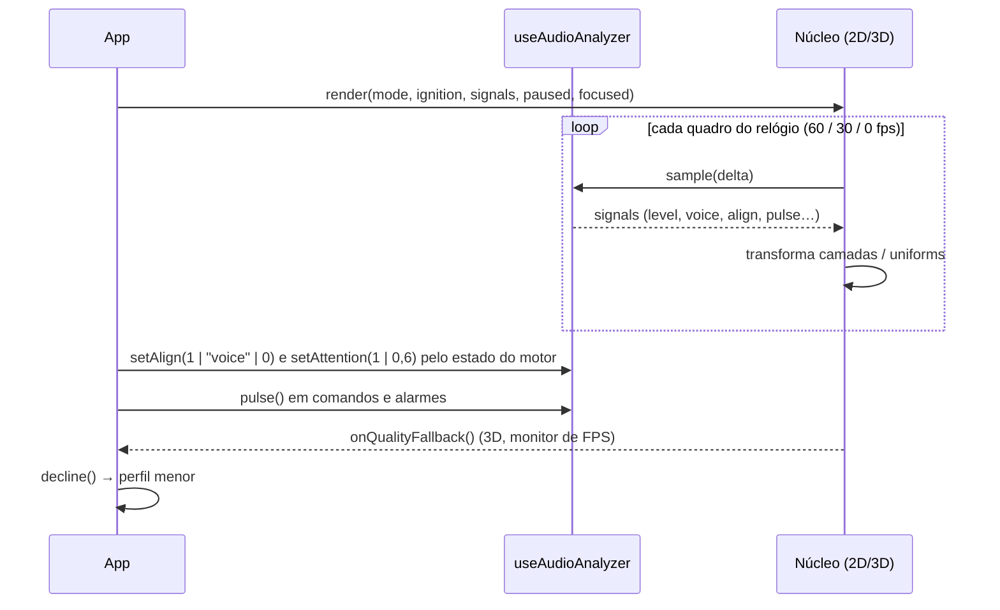

# Feature Specification: Holographic Core

## Metadata

| Field | Value |
|---|---|
| Feature ID | `feature/holographic-core` |
| Product | JARVIS OS (jvOS) |
| Feature Status | Implementado |
| Document Status | Reescrita em 2026-11-05 no formato Feature Specification; sem decisões de produto em aberto |
| Source Commit | `42e671a` (2026-10-23); evoluída em `c4ccc57` (2026-10-26, o 2D vira padrão), `750ebd0` (2026-10-27, núcleo clicável) e `e7151cf` (2026-11-05, fundo removido, relógio de quadros, canvas 3D recortado) |
| Uncommitted Changes | Nenhuma |
| Voice Shortcut | — |
| Assistant Tool | — |
| Target Platforms | Windows 11 com WebView2 e GPU (WebGL no 3D); no navegador (modo web) os três modos funcionam igual, e a captura visual abre pelo botão Voice em vez de seguir o motor de voz |
| Language | PT-BR no conteúdo e nas falas; inglês nos títulos das seções e em Given / When / Then |
| Last Editorial Revision | 2026-11-05 |
| Verification Scope | Conferida com o código em 2026-11-05: `src/lib/core.ts`, `src/lib/quality.ts`, `src/lib/signals.ts`, `src/lib/layout.ts`, `src/lib/frameClock.ts`, `src/lib/sceneColors.ts`, `src/lib/commands.ts`, `src/hooks/useAudioAnalyzer.ts`, `src/hooks/useWindowControls.ts`, `src/hooks/useVoiceAssistant.ts`, `src/components/FlatCore.tsx`, `src/components/JarvisScene.tsx`, `src/components/AudioDriver.tsx`, `src/components/JarvisCore.tsx`, `src/components/OrbitalRings.tsx`, `src/components/CoreButton.tsx`, `src/components/hud.tsx`, `src/components/desktop/AdvancedMenu.tsx`, `src/App.tsx`, `src/styles/globals.css`, `src-tauri/src/lib.rs`, `playwright.config.ts`, `tests/core.spec.ts`, `tests/ui.spec.ts`, `tests/voice.spec.ts`, `tests/voice-denied.spec.ts`, `tests/settings.spec.ts` e `tests/desktop.spec.ts`. Os testes não foram executados nesta revisão |

Especificação no formato inspirado no GitHub Spec Kit, com seções de desenho técnico ([ADR-0025](../../arch/adr/0025-features-formato-feature-specification.md)). Os identificadores US1–US6, RF-001–RF-011, RNF-001–RNF-005, SC-001–SC-003 e T001–T038 são os mesmos da versão anterior. Os critérios de aceite AC-001–AC-022 são os antigos "Critério 1" a "Critério 22", na mesma ordem. KL-* registra limitações conhecidas; OQ-*, decisões de produto em aberto. Nenhum dos dois acrescenta escopo.

## Overview

O núcleo é o "reator" no centro da tela, a identidade visual do JARVIS. Ele reage ao microfone e à voz do próprio JARVIS e pulsa a cada evento (palavra de ativação, comando, alarme). Enquanto o JARVIS escuta, partículas, anéis e colchetes se alinham no equador. Depois do boot, ele nasce de um ponto.

Há três modos, trocados na hora, sem reiniciar:

- **2D** (padrão): um reator do HUD do JARVIS em vetor, sem WebGL.
- **3D**: o holograma completo em WebGL, com bloom e partículas, carregado só quando escolhido.
- **Desligado**: nada no centro, para gastar o mínimo de memória. A voz continua funcionando.

O 3D tem perfis de qualidade e rebaixa sozinho quando o monitor de FPS desiste. Clicar no núcleo fala com o JARVIS, mas essa interação é de [assistant](../assistant/spec.md); aqui ficam os estados visuais.

| Input | Expected Behavior | Execution Path |
|---|---|---|
| Abrir o JARVIS numa instalação nova | O reator 2D aparece, sem nenhum `<canvas>` | Local (`FlatCore`) |
| Menu avançado › Núcleo › "Holograma 3D" | O 3D entra na hora; o código dele é baixado nesse momento | Local (`JarvisScene` com `lazy`) |
| Busca "Núcleo: Desligado" | Nada no centro; o desktop segue funcionando | Local (`HiddenCore`) |
| Segurar Voice (escutando um comando) | Partículas, anéis e colchetes de mira se alinham | Local (`useAudioAnalyzer.setAlign`) |
| `Ctrl+Shift+Q` | O nível do 3D gira low → medium → high e fica salvo | Local (`useQuality.cycle`) |

## Goals and Success Criteria

### Goals

- Dar ao JARVIS uma presença visual que responde à voz.
- Abrir leve: o 2D por padrão, sem WebGL e sem baixar o código do 3D.
- Deixar o usuário trocar visual por memória (3D, 2D, desligado) ao vivo.
- Mostrar que o JARVIS está ouvindo, com o alinhamento no equador.
- Costurar o boot com o desktop pela ignição.
- Ajustar o custo do 3D à GPU, sem ação do usuário.

### Success Criteria

| ID | Criterion | Verification |
|---|---|---|
| SC-001 | Num recarregamento em 2D, zero pedidos de rede de código 3D. | `tests/core.spec.ts`: nenhuma URL com `JarvisScene`, `react-three`, `three.module` ou `postprocessing` depois do `reload`. |
| SC-002 | Em 4 resoluções (1366×768 a 3440×1440), a tela mostra só o núcleo e a dock, sem nenhum texto. | `tests/ui.spec.ts`, "composition at …": `document.body.innerText` vazio e a dock centrada. |
| SC-003 | Ouvindo, o alinhamento completa em até 5 s e se desfaz em até 6 s. | `tests/voice.spec.ts`: `align` acima de 0,98 em até 5 s e abaixo de 0,02 em até 6 s. |

## Scope and Non-Goals

### In Scope

- Os três modos (2D, 3D, desligado), a troca ao vivo e a persistência em `jarvis.core`.
- A composição: tamanho e centro do núcleo acima da dock, iguais nos três modos.
- Os sinais de áudio (`HoloSignals`) do microfone e da voz do JARVIS, o pulso, a atenção e o alinhamento.
- A ignição depois do boot e no escuro da volta para casa.
- Os perfis de qualidade do 3D, o rebaixamento automático e o ciclo manual.
- A aba "Núcleo" do Menu avançado, os comandos de busca `core:<modo>` e "Alternar qualidade gráfica".
- O anel do `CoreButton` (só o visual).
- A pausa com a janela oculta, minimizada ou coberta, e o relógio de quadros limitado.

### Out of Scope

- **Fundo removido:** o fundo grid/matrix em shader (`SceneBackground.tsx`, `src/shaders/background/*`) e a opção `background` (`"solid"`, `"grid"`, `"matrix"`) foram apagados em `e7151cf`. Os testes conferem que não há "Fundo" para escolher ([ADR-0015](../../arch/adr/0015-remocao-do-fundo-shader.md)).
- **Interação:** clicar ou segurar o núcleo para perguntar, as fases (`CorePhase`) e o Esc ficam em [assistant](../assistant/spec.md). Aqui só entra o anel do `CoreButton`: invisível em repouso, aparece no hover e no foco, e pulsa com brilho enquanto ouve.
- **Legenda:** a transcrição dentro do núcleo é de [voice-engine](../voice-engine/spec.md).
- **Cores:** são do tema ([appearance](../appearance/spec.md)). O âmbar do colchete 2D é o mesmo em todos os temas (`--color-hud-amber`).

## User Stories

### US1 — Lightweight 2D Core by Default

**Priority:** P1.

**User Story:** Como usuário, abro o JARVIS e vejo o reator 2D, que gira, reage à voz e não carrega o 3D.

**Why This Priority:** é o que todo usuário vê, com o menor custo de memória.

**Independent Test:** `tests/core.spec.ts` — "the core opens as the 2D rings, the Núcleo tab swaps the 3D hologram in and out live, and a restart never loads the 3D".

**Acceptance Criteria:** AC-001, AC-002, AC-003 e AC-004.

### US2 — Live Mode Switch

**Priority:** P1.

**User Story:** Como usuário, escolho 3D, 2D ou desligado e a troca acontece na hora.

**Why This Priority:** é o controle de custo × visual.

**Independent Test:** o mesmo teste de US1 e `tests/core.spec.ts` — "the core switched off leaves an empty, working desktop; the search turns the 3D back on".

**Acceptance Criteria:** AC-005, AC-006, AC-007 e AC-008.

### US3 — Core Switched Off

**Priority:** P2.

**User Story:** Como usuário, desligo o núcleo e o desktop continua funcionando.

**Why This Priority:** atende máquinas fracas. A voz segue funcionando.

**Independent Test:** `tests/core.spec.ts` — "the core switched off leaves an empty, working desktop; the search turns the 3D back on".

**Acceptance Criteria:** AC-009, AC-010 e AC-011.

### US4 — React to the Voice and Align While Listening

**Priority:** P1.

**User Story:** Como usuário, vejo o núcleo seguir a minha voz e a do JARVIS, e se alinhar quando ele me escuta.

**Why This Priority:** é o retorno visual de que o JARVIS ouviu.

**Independent Test:** `tests/voice.spec.ts` — "particles and rings align on the core's equator while listening, then scatter" e "listens, reacts to audio and releases resources".

**Acceptance Criteria:** AC-012, AC-013, AC-014, AC-015 e AC-016.

### US5 — Power On After the Boot

**Priority:** P2.

**User Story:** Como usuário, depois do boot vejo o núcleo nascer de um ponto, girando até o lugar.

**Why This Priority:** costura o boot com o desktop.

**Independent Test:** `tests/core.spec.ts` — "with the core in 2D (the default), the boot screen still plays and hands over" (a escala chega a 1).

**Acceptance Criteria:** AC-017 e AC-018.

### US6 — 3D Graphics Quality

**Priority:** P3.

**User Story:** Como usuário, tenho um 3D que se ajusta à GPU, e posso fixar um nível.

**Why This Priority:** só importa no 3D.

**Independent Test:** `tests/ui.spec.ts` — "renderer and frame rate" (só registra o FPS; ver KL-001).

**Acceptance Criteria:** AC-019, AC-020, AC-021 e AC-022.

## Requirements

### Functional Requirements

| ID | Requirement | Related Stories |
|---|---|---|
| RF-001 | O núcleo DEVE ficar centrado na área acima da dock (`DOCK_RESERVE` = 120 px), com diâmetro `min(max(240, altura − 120) × 0,54, largura × 0,62)`, igual nos três modos. | US1, US2 |
| RF-002 | O 3D DEVE ter 7 camadas: 01 esfera em wireframe, com treliça geodésica e nós; 02 casca externa partida com marcas ("scanner"); 03 anéis orbitais; 04 fragmentos de HUD com ping de varredura; 05 partículas; 06 halo; 07 onda de voz (some no silêncio). O bloom só pega valores HDR acima do limiar 0,95, há vinheta em CSS, e a neblina escurece o lado de trás. | US2, US4 |
| RF-003 | O 2D DEVE ter estas camadas, cada uma girando no compositor: disco; aro segmentado (150 s por volta); escala de marcas (220 s, ao contrário); anel tracejado (70 s, ao contrário); faixa interna (40 s); colchete âmbar, anel interno e placa; colchetes de mira; o triângulo central, cujo brilho cresce com a voz. O laço só escreve estilos quando eles mudam. | US1 |
| RF-004 | Os sinais (`HoloSignals`) DEVEM ser `time`, `frames`, `level`, `bass`, `mid`, `treble`, `voice`, `spectrum` (32 bandas), `active`, `attention`, `pulse` e `align`, mutados no laço e nunca guardados em estado React. | US4 |
| RF-005 | A voz do JARVIS tocando DEVE alimentar o núcleo como se fosse o microfone (`setVoiceSource`). | US4 |
| RF-006 | O alinhamento DEVE entrar rápido e sair devagar (constantes de 0,35 s e 0,7 s), e os anéis entram escalonados (`LOCK_STAGGER` = 0,12 de `align`). | US4 |
| RF-007 | O 3D DEVE oferecer parallax suave do mouse: até 0,05 rad de rotação em x e 0,07 rad em y. | US2 |
| RF-008 | Os perfis DEVEM ser `low` (dpr 1, msaa 2, 350 partículas, linhas ×0,5, bloom 5 níveis), `medium` (1,25, 2, 800, ×0,75, 6) e `high` (1,5, 2, 1400, ×1, 6). | US6 |
| RF-009 | O monitor de FPS DEVE começar 5 s depois que o 3D sai da pausa, e só com a janela em foco; DEVE ajustar o dpr em passos de 0,25, sem passar da densidade da tela nem do perfil; e DEVE chamar `decline` no fallback. É a lógica do `PerformanceMonitor` do drei, reescrita em `JarvisScene.tsx` sem o pacote. | US6 |
| RF-010 | O fundo do 3D DEVE ser sempre o `void` do tema (quase preto). Não existe escolha de fundo. | US2 |
| RF-011 | O 3D DEVE desenhar no relógio de quadros: o r3f roda com `frameloop="never"` e o `FrameDriver` chama `advance` até 60 vezes por segundo em foco e 30 com outro app na frente, mesmo numa tela de 120/144 Hz. | US2, US6 |

### Non-Functional Requirements

| ID | Requirement | Scope |
|---|---|---|
| RNF-001 | O three.js e os efeitos só carregam no modo 3D (`lazy(() => import("./components/JarvisScene"))`). As cores do 3D ficam em `sceneColors.ts`, fora de `theme.ts`. | Carregamento do app |
| RNF-002 | No modo 2D, um recarregamento não baixa nenhum chunk do 3D. | Rede, na abertura em 2D |
| RNF-003 | Com o 3D a 1080p, o holograma ocupa de 40% a 60% da altura útil, centrado com até 3% de desvio, e nunca encosta na dock. | `tests/ui.spec.ts`, 4 resoluções, `?quality=high` |
| RNF-004 | No modo 2D e desligado, nenhum contexto WebGL é criado fora da tela de boot (que lê o nome da GPU). Desde 2026-11-19 há uma segunda exceção, fora do núcleo: o grafo de notas do modo chat, só enquanto está na tela ([ADR-0027](../../arch/adr/0027-grafo-notas-pode-criar-contexto-web.md)). | `useQuality(false)` e os modos sem canvas |
| RNF-005 | Custo ocioso dentro do orçamento de [Performance Budget](#performance-budget): 2D ocioso ≤ 100 ms de CPU por segundo; 3D ocioso ≤ 170 ms/s e ≤ 30% da iGPU. | Build de release a 1920×1080, janela em foco, `npm run perf` |

### Operational Constraints

- Relógio de quadros: 60 fps em foco, 30 com outro app na frente, 0 com a janela oculta, minimizada ou coberta por um app maximizado (`frameRate`).
- Monitor de FPS só 5 s depois de sair da pausa (`MONITOR_DELAY_MS`) e só em foco.
- dpr limitado pelo perfil e pela densidade da tela; MSAA de no máximo 2.
- Canvas do 3D: um quadrado de 1,6 diâmetros em volta do núcleo (`CANVAS_SPAN`), com as bordas em múltiplos de 4 px CSS (`CANVAS_SNAP`).
- `jarvis.core` gravado com 250 ms de debounce; `jarvis.quality` gravado na hora, só pelo ciclo manual.
- Depois de 5 s escondida, a WebView2 recebe a meta de memória "low" (`TRIM_AFTER_MS`).

### Performance Budget

<a id="desempenho"></a>

Build de release, 1920×1080, janela em foco, 45 s por cenário depois de 15 s de assentamento, árvore inteira do app (`jarvis.exe` + WebView2 + `claude.exe`). Medido com `npm run perf` em 2026-11-04, antes e depois do [ADR-0022](../../arch/adr/0022-nucleo-relogio-quadros-limitado-canvas-3.md), num Core 7 150U com Intel Graphics:

| Scenario | CPU (ms de CPU por s) | iGPU (motor 3D) | GPU Memory |
|---|---|---|---|
| 2D ocioso | 169 → **92** (−46%) | 6,2% → 5,5% | 49 → 53 MB |
| 3D ocioso | 202 → **161** (−20%) | 49% → **24%** (−51%) | 134 → **89 MB** |
| 3D + uma janela TUI | 263 → **232** (−12%) | 50% → **24%** | 144 → **96 MB** |
| 3D minimizado (30 s) | 8,5 → 6,5 | 0% | 246 → **119 MB**; RAM do processo de GPU 295 → 165 MB |

Orçamento daqui em diante: 2D ocioso ≤ 100 ms/s; 3D ocioso ≤ 170 ms/s e ≤ 30% da iGPU (RNF-005).

## Acceptance Criteria

### AC-001 — Open in 2D Without WebGL

**Related Story:** US1.

- **Given** uma instalação nova, sem `jarvis.core`
- **When** o app abre
- **Then** existe `[data-core="2d"]` e nenhum `<canvas>`.

### AC-002 — Keep Sampling the Audio in 2D

**Related Story:** US1.

- **Given** o núcleo em 2D
- **When** passam 500 ms
- **Then** os sinais continuam amostrados: `__JARVIS__.signals.frames` cresce mais de 10.

### AC-003 — Close the Lock-On Brackets While Listening

**Related Story:** US1.

- **Given** o núcleo em 2D
- **When** o JARVIS ouve um comando (`align` = 1)
- **Then** os colchetes de mira (`[data-lock]`) giram de 45° para 0°, encolhem de 1,25 para 1 e acendem (opacidade acima de 0,95).

### AC-004 — Never Download the 3D in 2D

**Related Story:** US1.

- **Given** o núcleo em 2D
- **When** a página recarrega
- **Then** nenhum pedido de rede busca `JarvisScene`, `react-three`, `three.module` ou `postprocessing`.

### AC-005 — Show the Mode Cards

**Related Story:** US2.

- **Given** o Menu avançado
- **When** abro a aba "Núcleo"
- **Then** os cartões "Holograma 3D", "Anéis 2D" e "Desligado" aparecem, com a dica do modo escolhido ("…sem WebGL…", "…o mínimo de memória…").

### AC-006 — Switch to 3D

**Related Story:** US2.

- **Given** a aba "Núcleo" no 2D
- **When** escolho "Holograma 3D"
- **Then** um `<canvas>` aparece, o 2D sai e `jarvis.core.mode` vira `"3d"`.

### AC-007 — Switch Back to 2D

**Related Story:** US2.

- **Given** o núcleo em 3D
- **When** volto para "Anéis 2D"
- **Then** o canvas some, `[data-core="2d"]` volta e `jarvis.core.mode` vira `"2d"`.

### AC-008 — Turn the 3D Back On From the Search

**Related Story:** US2.

- **Given** o núcleo desligado e a busca aberta
- **When** digito "nucleo 3d" e dou Enter em "Núcleo: Holograma 3D"
- **Then** o 3D volta e anima (`frames` cresce mais de 10 em 500 ms).

### AC-009 — Switch Off

**Related Story:** US3.

- **Given** a aba "Núcleo"
- **When** escolho "Desligado"
- **Then** não há canvas nem `[data-core="2d"]`; há `[data-core="off"]`, que ainda é superfície do desktop.

### AC-010 — Clicking the Empty Desktop Clears the Focus

**Related Story:** US3.

- **Given** o núcleo desligado e uma janela focada
- **When** clico no vazio
- **Then** nenhuma janela fica focada.

### AC-011 — Nothing Runs for the Visual While Off

**Related Story:** US3.

- **Given** o núcleo desligado
- **When** o motor de voz abre o microfone
- **Then** a captura de áudio só para o visual não abre, e o botão do núcleo e o botão do histórico do JARVIS não aparecem.

**Coverage Status:** sem teste automatizado (KL-005).

### AC-012 — Free Particles at Rest

**Related Story:** US4.

- **Given** o repouso
- **When** nada é ouvido
- **Then** `signals.align` = 0 e as partículas voam livres.

### AC-013 — Align While Listening

**Related Story:** US4.

- **Given** o repouso
- **When** seguro Voice (a captura em `listening`)
- **Then** `align` passa de 0,98 em até 5 s: as partículas e os 4 anéis orbitais vão para o equador, um após o outro.

### AC-014 — Scatter on Release

**Related Story:** US4.

- **Given** o núcleo alinhado
- **When** solto Voice
- **Then** `align` cai abaixo de 0,02 em até 6 s.

### AC-015 — Follow the Voice in "Sempre ouvindo"

**Related Story:** US4.

- **Given** o app desktop no modo "Sempre ouvindo"
- **When** o motor está no estado `listening`
- **Then** o alinhamento segue a voz (`"voice"`), não fica fixo.

**Coverage Status:** sem teste automatizado (KL-004).

### AC-016 — Softer While Waiting for "Hey Jarvis"

**Related Story:** US4.

- **Given** o app desktop
- **When** o motor espera por "Hey Jarvis" (`standby`)
- **Then** a atenção alvo cai para 0,6: o núcleo reage mais suave.

**Coverage Status:** sem teste automatizado (KL-004).

### AC-017 — Standby During the Boot

**Related Story:** US5.

- **Given** o boot na tela, ou o escuro da volta para casa
- **When** o núcleo desenha
- **Then** ele fica em `standby`: invisível no 3D e com escala 0,001, −270° e opacidade 0 no 2D.

**Coverage Status:** sem teste automatizado direto (KL-005).

### AC-018 — Ignite After the Boot

**Related Story:** US5.

- **Given** o fim do boot
- **When** `ignition` vira um instante
- **Then** o núcleo cresce até a escala 1 em 1,5 s, com um pequeno excesso (`backOut` no 2D, `easeOutBack` no 3D).

### AC-019 — Quality From the URL

**Related Story:** US6.

- **Given** `?quality=low|medium|high` na URL
- **When** o app abre
- **Then** esse nível vale e fica travado.

**Coverage Status:** os testes de composição usam `?quality=high`, mas nenhum confere o nível nem a trava (KL-001).

### AC-020 — Quality From Storage or the GPU

**Related Story:** US6.

- **Given** um nível salvo em `jarvis.quality`
- **When** o 3D entra em uso
- **Then** ele vale e fica travado. Sem nada salvo, o nível vem do nome da GPU: software (SwiftShader, llvmpipe, "software", Microsoft Basic) → `low`; integrada (Intel, UHD, Iris, Mali, Adreno, Apple M1) → `medium`; outras → `high`; sem WebGL → `low`.

**Coverage Status:** sem teste automatizado (KL-001).

### AC-021 — Cycle the Quality by Hand

**Related Story:** US6.

- **Given** qualquer nível
- **When** aperto `Ctrl+Shift+Q` (ou uso a busca ou o módulo da barra)
- **Then** o nível gira low → medium → high, é salvo em `jarvis.quality` e trava.

**Coverage Status:** sem teste automatizado (KL-001).

### AC-022 — Decline on the FPS Fallback

**Related Story:** US6.

- **Given** um nível não travado e o 3D em foco
- **When** o monitor de FPS passa de 3 mudanças de densidade (`flipflops`) e chama o fallback
- **Then** o nível cai um degrau, nunca abaixo de `low`.

**Coverage Status:** sem teste automatizado (KL-001, KL-003).

## Behavior and Flows

### Composition (`layout.ts`)

O tamanho e o lugar do núcleo, iguais nos três modos e nas sobreposições do DOM (saudação, `CoreButton`).

- **Behavior:** centra o núcleo na área acima da dock (RF-001). `compositionPixels` dá o diâmetro em pixels, para o 3D. `COMPOSITION_CSS` e `CORE_CENTER_Y_CSS` dão o mesmo diâmetro e o mesmo centro em CSS, para o 2D e as camadas do DOM.
- **Layout:** centro em `(100vh − 120px) / 2`; diâmetro `min(max(240px, 100vh − 120px) × 0,54, 62vw)`.

### Signals (`useAudioAnalyzer`)

Lê o microfone e a voz do JARVIS e os transforma nos sinais que todas as camadas leem (RF-004).

- **Behavior:**
  - `sample(delta)` avança os sinais uma vez por quadro, chamado pelo núcleo que está na tela. O passo é limitado a 0,05 s.
  - A captura usa `getUserMedia` sem cancelamento de eco, supressão de ruído nem ganho automático, e um `AnalyserNode` (FFT de 1024) que não vai para a saída.
  - `voice` sobe quando o nível passa de 6 a 18 dB acima do ruído de fundo, que é reaprendido a cada captura; abaixo de −62 dBFS nada conta como fala.
  - A voz do JARVIS tocando entra pelo mesmo caminho (`setVoiceSource`, RF-005), com uma escala fixa.
  - `pulse()` põe `pulse` em 1 a cada evento (palavra de ativação, comando, música nova, alarme), e ele decai.
  - O alinhamento entra com 0,35 s e sai com 0,7 s (RF-006). Com o alvo `"voice"`, `align` segue `voice`.
  - A atenção multiplica a reação: com atenção 0, sobra 25% (`RESTING_GAIN`).
  - Com a janela oculta ou minimizada, o `AudioContext` é suspenso (`setSuspended`).

O `App` define o alvo do alinhamento e da atenção pelo estado do motor de voz:

| Engine State | Align Target | Attention Target |
|---|---|---|
| `awake`, `talking`, `dictating`, `asking` (escutando um comando) | 1 | 1 |
| `listening` ("Sempre ouvindo") | `"voice"` | 1 |
| `standby` (esperando "Hey Jarvis"), `ready`, `off`, `loading`, `error` | 0 | 0,6 |
| Navegador, sem motor | 1 com a captura em `listening`, senão 0 | 1 |

No desktop, a captura visual abre quando o microfone do motor está aberto (`isMicOpen`), menos em `standby`, e nunca com o núcleo desligado. Esperando "Hey Jarvis", só o motor Rust ouve; a captura abre quando ele acorda.

### `FlatCore` (2D)

O reator do HUD do JARVIS em vetor, o modo padrão (RF-003).

- **Behavior:**
  - A cada quadro do relógio, o laço chama `sample` e ajusta só transform e opacidade: o halo respira com `level`, `bass` e `pulse`; o triângulo brilha com `voice`; a escala de marcas acende com `active`; os colchetes de mira (`[data-lock]`) seguem `align`, girando de 45° para 0°, encolhendo de 1,25 para 1 e acendendo até a opacidade 1.
  - Um estilo só é escrito quando o valor muda: em repouso, o laço custa uma amostra e nada mais.
  - O primeiro quadro é avisado por `requestAnimationFrame(onFirstFrame)`, mesmo pausado.
  - O laço roda no relógio de quadros (`src/lib/frameClock.ts`): até 60 quadros por segundo em foco e 30 com outro app na frente, qualquer que seja a taxa da tela ([ADR-0022](../../arch/adr/0022-nucleo-relogio-quadros-limitado-canvas-3.md)).
  - Pausado, as rotações CSS param (`core-paused`) e o laço não roda.
  - Com movimento reduzido, os anéis não giram (`.core-spin` sem animação).
- **Layout:**
  - `[data-core="2d"]` cobre a tela (`fixed inset-0`) e é superfície do desktop (`data-desktop-surface`).
  - O reator é um quadrado de `COMPOSITION_CSS`, centrado em `CORE_CENTER_Y_CSS`, sem receber cliques.
  - Cada camada é um SVG de tela cheia (`viewBox="-100 -100 200 200"`), empilhado nesta ordem: disco com o globo em wireframe, halo (um `div` com gradiente), aro, escala de marcas, anel tracejado, faixa interna, colchete âmbar com o anel interno e a placa, colchetes de mira, o brilho do triângulo e o triângulo.
- **Style:**
  - Tudo em tokens do tema: corpo em `fill-hud-abyss/85`, linhas em `stroke-hud-cyan` (de /15 a /80) e `stroke-hud-holo`, anel interno em `stroke-hud-light`, triângulo em `stroke-hud-glow` sobre `fill-hud-cyan/10`.
  - O colchete à esquerda fica em `stroke-hud-amber`, o mesmo em todos os temas.
  - O brilho vem de dois filtros SVG: `flat-core-glow` (desfoque de 1,2) e `flat-core-bloom` (desfoque de 3,5, no triângulo).
  - O halo é um gradiente radial de `--color-hud-holo` a 34% até transparente em 68%, numa camada própria (`will-change: transform, opacity`), como os colchetes de mira e o brilho do triângulo: a voz muda a escala e a opacidade sem repintar o gradiente.
  - As rotações usam `@keyframes core-spin` com `--spin` em segundos e `will-change: transform`.

### `JarvisScene` (3D)

O holograma completo em WebGL, carregado só quando escolhido (RF-002).

- **Behavior:**
  - O r3f roda com `frameloop="never"` e o `FrameDriver` chama `advance` no relógio de quadros (RF-011). Pausado, a taxa é 0 e nada é desenhado.
  - Um `AudioDriver` de prioridade −1 chama `sample`, publica os uniforms compartilhados (`uTime`, `uAudio`, `uVoice`, `uSpectrum`) antes de qualquer camada e avisa `onFirstFrame` no primeiro quadro.
  - A intensidade do bloom é `0,9 + level × 0,4 + bass × 0,2 + voice × 0,5 + pulse × 0,5`.
  - Ouvindo, as partículas e os 4 anéis orbitais vão para o equador, um após o outro.
  - O parallax segue o ponteiro com amortecimento e volta ao centro quando ele sai da janela (RF-007).
  - O monitor de FPS segue o RF-009 (ver [FPS Monitor Algorithm](#fps-monitor-algorithm)).
  - O fundo é sempre `colors.void`, a mesma instância que o tema recolore (RF-010).
  - Ao sair do 3D, a memória de vídeo volta na hora. O código do three.js já baixado só sai ao reabrir o JARVIS (KL-002).
  - Se o tema mudar, o 3D recolore no lugar (`onPalette`): os materiais guardam as cores de `sceneColors.ts` por referência.
- **Layout:**
  - `[data-core="3d"]` cobre a tela (`fixed inset-0`) e é superfície do desktop. Dentro dele, o `Canvas` cobre só o holograma: um quadrado de 1,6 diâmetros de `compositionPixels` em volta do núcleo (~830 px a 1080p), cortado nas bordas da tela.
  - Medido a 1080p com todos os sinais no máximo, o que acende ocupa ~744×667 px; a margem cobre o excesso de 7% da ignição e o parallax.
  - A câmera tem FOV 32 e é `manual`: o aspecto é o da tela inteira. `Composition` ajusta a distância ao diâmetro e usa `setViewOffset(largura, altura, x, y + DOCK_RESERVE / 2, w, h)`: o canvas mostra exatamente o recorte que um canvas de tela cheia mostraria ali.
  - `powerPreference: "default"`: num notebook com duas GPUs, o holograma fica na integrada.
- **Style:**
  - Sem antialias no canvas; o MSAA fica no compositor de efeitos (2 em todos os perfis).
  - Bloom `mipmapBlur` com limiar 0,95, suavização 0,08, raio 0,62 e intensidade base 0,9.
  - Vinheta: um `div` estático por cima do canvas, com o mesmo `smoothstep` do `Vignette` do postprocessing (`offset` 0,3, `darkness` 0,55) em `radial-gradient`, preto com alfa 1 − fator. É pintada uma vez, não a cada quadro.
  - A emenda entre o canvas e a página não aparece: no máximo 1 nível de cor de diferença na borda.
  - Neblina preta, de `distância − 1,3` a `distância + 4,6`, que com a mistura aditiva escurece o lado de trás.
  - As cores são as do tema, em espaço linear (`sceneColors.ts`).

### `HiddenCore` (Off)

Nada no centro da tela.

- **Behavior:**
  - Desenha um `div` vazio que ainda avisa o primeiro quadro, para a janela aparecer e o boot começar.
  - `[data-core="off"]` continua sendo superfície do desktop: um clique no vazio tira o foco de todas as janelas.
  - Com o núcleo desligado, a captura de áudio só para o visual não abre, e o `CoreButton` e o botão do histórico do JARVIS (`AssistantDrawer`, `showToggle`) não aparecem. A voz segue funcionando.
- **Layout:** um `div` de tela cheia (`fixed inset-0`), sem filhos.
- **Style:** sem estilo próprio; aparece o fundo `bg-hud-void` do `App`.

### Ignition

O núcleo nasce de um ponto, girando até o lugar, depois do boot e no escuro da volta para casa.

- **Behavior:**
  - `ignition` é `"standby"` durante o boot e enquanto `coreDark` estiver ligado (volta para casa); depois, o instante `performance.now()` da ignição; `null` quando o núcleo simplesmente está ligado.
  - Em `standby`, o 3D esconde o grupo (`visible = false`) e o 2D fica com escala 0,001, −270° e opacidade 0.
  - Com um instante, o núcleo cresce até a escala 1 em 1,5 s, com um pequeno excesso: `backOut` no 2D (`motion/react`), `easeOutBack` no 3D, que também gira 1,5 π até o lugar.

### 3D Quality (`useQuality`)

O perfil gráfico do holograma (RF-008).

- **Behavior:**
  - A ordem de escolha é `?quality=` na URL → `jarvis.quality` salvo → nome da GPU. As duas primeiras travam o nível.
  - A GPU só é consultada (um contexto WebGL descartável) quando o 3D entra em uso. No 2D e desligado, `useQuality(false)` fica no `medium` provisório, sem criar contexto. Uma exceção na consulta também dá `medium`.
  - `cycle()` gira low → medium → high, grava e trava. Funciona em qualquer modo, inclusive no 2D.
  - `decline()` cai um nível quando o monitor desiste, nunca abaixo de `low`, e não grava nada. Com o nível travado, não muda nada.
  - O MSAA 4× e os níveis 7 e 8 do bloom (o brilho mais largo e fraco) custavam tempo de quadro sem diferença visível em linhas finas aditivas; por isso todos os perfis usam MSAA 2 e até 6 níveis.

### Advanced Menu "Núcleo" Tab

Onde o usuário escolhe o modo.

- **Behavior:**
  - O `CardPicker` "Visual do núcleo" mostra os cartões "Holograma 3D", "Anéis 2D" e "Desligado" (`CORE_OPTIONS`). Escolher um troca o modo na hora.
  - Embaixo, a dica do modo escolhido (`CORE_MODES`), como "…sem WebGL…" ou "…o mínimo de memória…".
  - A seção "Memória" avisa: "Vale na hora. Ao sair do 3D, a memória de vídeo do holograma é devolvida na hora; o código dele, se já tinha sido carregado, só sai ao reabrir o JARVIS. Abrindo no 2D ou desligado, o 3D nem é carregado."
- **Layout:** duas `Section`: "Núcleo", com o `CardPicker` em 3 colunas e a dica, e "Memória", com o aviso. Cada cartão tem uma miniatura SVG do modo (`CoreSwatch`).
- **Style:** a dica e o aviso em `text-xs leading-relaxed text-hud-text/55`; os cartões são os do kit do Menu avançado (`src/components/hud.tsx`).

### `CoreButton` Ring

O único visual do botão invisível sobre o centro do núcleo; o clique em si é de [assistant](../assistant/spec.md).

- **Behavior:**
  - Em repouso, o anel fica invisível. Ele aparece no hover e no foco do teclado.
  - Enquanto o JARVIS ouve (`phase` = `listening`), o anel fica aceso e pulsa com brilho.
  - O botão só existe com o núcleo ligado, fora do boot e sem saudação na tela.
- **Layout:** um círculo com 50% do diâmetro do núcleo, centrado em `CORE_CENTER_Y_CSS`, acima do núcleo (`z-[12]`) e abaixo das janelas. Também é superfície do desktop.
- **Style:**
  - Em repouso, borda `hud-cyan/25` com opacidade 0, que vai a 1 no hover e no foco; o foco ganha `ring-2` em `hud-light/40`.
  - Ouvindo, borda `hud-holo/60`, `animate-pulse` e sombra externa e interna de `--color-hud-holo` (45% e 30%).
  - A troca dura 300 ms.

### Interaction Flow



### User Feedback

| Moment | Persona Key | Output |
|---|---|---|
| Microfone negado no navegador | — | Dock "Acesso ao microfone negado", como erro; o núcleo continua desenhando |
| Nenhum microfone / microfone ocupado | — | Dock "Nenhum microfone encontrado" ou "Microfone indisponível", como erro |
| Busca aberta | — | "Alternar qualidade gráfica" com o subtítulo "Atual: <NÍVEL>" |

### Voice and Keyboard

- `Ctrl+Shift+Q`: `cycle()` da qualidade. Dentro de um terminal (`[data-terminal]`), a tecla fica com o terminal.
- Busca: "Núcleo: Holograma 3D", "Núcleo: Anéis 2D", "Núcleo: Desligado" (`core:<modo>`, grupo Aparência) e "Alternar qualidade gráfica" (`quality`, grupo Sistema); "Menu avançado › Núcleo" abre a aba.
- Módulo "Qualidade gráfica" da barra superior (desligado por padrão): `cycle()`.
- URL `?quality=<nível>`: nível fixo para a sessão.
- Não há frase de voz própria.

## Data Model and Persistence

### Core Preferences

```ts
type CoreMode = "3d" | "2d" | "off";

interface CorePrefs {
  mode: CoreMode; // padrão "2d" desde c4ccc57 (era "3d")
}
```

### 3D Quality

```ts
type QualityLevel = "low" | "medium" | "high";

interface QualityPreset {
  level: QualityLevel;
  maxDpr: number;       // teto do dpr do canvas
  msaa: number;         // amostras do compositor de efeitos
  particles: number;
  wireDensity: number;  // 0..1, multiplica as linhas do wireframe
  bloomLevels: number;
}
```

### Signals and Ignition

```ts
interface HoloSignals {
  time: number; frames: number;
  level: number; bass: number; mid: number; treble: number; // 0..1
  voice: number;          // 0..1 enquanto alguém fala
  spectrum: Float32Array; // 32 bandas, de 90 a 7000 Hz
  active: number;         // 0 → 1 com o microfone aberto
  attention: number;      // baixa esperando "Hey Jarvis"
  pulse: number;          // 1 num evento, decai
  align: number;          // 0 → 1 escutando um comando
}

type Ignition = "standby" | number | null;
```

Os sinais vivem só em memória. Ver o [glossário](../../domain/glossary.md) e a [persistência](../../domain/persistence.md).

### Storage Rules

| Property | Core Mode | 3D Quality |
|---|---|---|
| State | `$modo` (`CorePrefs`) | `$qualidade` (`QualityLevel`) |
| Storage | `localStorage` | `localStorage` |
| Key | `jarvis.core` | `jarvis.quality` |
| Format | JSON `{ "mode": "2d" }` | Texto cru (`low`, `medium` ou `high`), sem JSON |
| Write Debounce | 250 ms (`useStoredState`), com flush no `beforeunload` | 0 ms, só em `cycle()`; `decline()` não grava |
| Reader | `parseCore`: um objeto com `mode` fora dos três vira `2d` | `isLevel`: só os três níveis |
| Missing or Invalid Storage | `2d` | Ignorado; o nível vem da GPU quando o 3D entra em uso |

O antigo `background` do `settings.json` não tem migração: o serde ignora o campo desconhecido.

## Technical Design

### Component Responsibilities

| File or Component | Responsibility |
|---|---|
| `src/lib/core.ts` | `CoreMode`, `CORE_MODES` (rótulo e dica), `useCorePrefs` (`jarvis.core`, padrão `2d`) |
| `src/lib/quality.ts` | `QUALITY_PRESETS`, `resolveInitial` (URL → salvo → GPU), `useQuality(probe)` com `cycle` e `decline` |
| `src/lib/signals.ts` | `HoloSignals`, `createSignals`, `SignalsContext`, `approach`, `SPECTRUM_BANDS` = 32 |
| `src/lib/layout.ts` | `DOCK_RESERVE`, `COMPOSITION_DIAMETER`, `compositionPixels`, `COMPOSITION_CSS`, `CORE_CENTER_Y_CSS` |
| `src/lib/frameClock.ts` | `runFrames(fps, frame)` e `frameRate(paused, focused)`: 60 em foco, 30 atrás de outro app, 0 escondido |
| `src/hooks/useAudioAnalyzer.ts` | Captura do microfone, bandas, espectro, detecção de fala, `pulse`, `setAttention`, `setAlign`, `setSuspended`, `setVoiceSource`, `sample` |
| `src/components/JarvisScene.tsx` | `canvasRect` (o recorte), `Canvas`, `FrameDriver`, `Composition` (câmera manual, view offset, neblina, parallax, ignição), `Effects` (Bloom), `PerformanceMonitor` próprio, `VIGNETTE` |
| `src/components/AudioDriver.tsx` | `useFrame(-1)`: `sample`, uniforms compartilhados e `onFirstFrame` |
| `src/components/JarvisCore.tsx` | Raiz das 7 camadas: `InnerCore` (01 e halo 06), `OuterShell` (02) |
| `src/components/OrbitalRings.tsx`, `HudFragments.tsx`, `HolographicParticles.tsx`, `VoiceWave.tsx` | Camadas 03, 04, 05 e 07 |
| `src/lib/rings.ts`, `geometry.ts`, `fatLines.ts`, `sceneColors.ts` | Os 4 anéis e o equador (`CORE_TILT`), builders de linhas e pontos com PRNG fixo, linhas largas, cores lineares do tema |
| `src/shaders/hologram/*` | `haloMaterial`, `holoLineMaterial`, `holoPointsMaterial`, `voiceWaveMaterial`, `sharedUniforms` |
| `src/components/FlatCore.tsx` | Reator 2D e `HiddenCore` |
| `src/components/CoreButton.tsx` | Botão invisível sobre o centro (50% do diâmetro), anel de hover e escuta |
| `src/components/hud.tsx` | `CORE_OPTIONS` e `CoreSwatch` (as miniaturas dos cartões) |
| `src/components/desktop/AdvancedMenu.tsx` | Aba "Núcleo" |
| `src/lib/commands.ts` | `core:<modo>`, `quality`, `advanced:core` |
| `src/App.tsx` | Escolha do modo, `ignition`, `paused`/`covered`/`focused`, atenção, alinhamento, captura visual (fechada no `standby`) |
| `src/hooks/useWindowControls.ts` | `paused` (escondido ou minimizado), `focused`, `Ctrl+Shift+Q`, `webview_background` depois de 5 s escondido |
| `src-tauri/src/lib.rs` | Comando `webview_background` (meta de memória da WebView2) |
| `src/styles/globals.css` | `@keyframes core-spin`, `.core-spin`, `.core-paused` |

### Mode Selection

O `App` monta um de três componentes pelo `jarvis.core`:

- `JarvisScene`, com `lazy` dentro de um `Suspense` sem fallback: um `Canvas` do react-three-fiber recortado em volta do núcleo, com `JarvisCore` e bloom, mais a vinheta em CSS.
- `FlatCore`: camadas SVG giradas por CSS, mais um laço no relógio de quadros que só escreve transform e opacidade quando mudam.
- `HiddenCore`: um `div` vazio que ainda reporta o primeiro quadro.

Os três recebem o mesmo objeto `signals` e o mesmo `ignition`. O 2D e o 3D recebem `paused = escondido || (coberto && firstFrame)`: atrás de um app maximizado, o núcleo desenha o primeiro quadro (que revela a janela) e depois descansa.

### Frame Clock Algorithm

1. `frameRate(paused, focused)` dá 0, 30 ou 60.
2. Com 0, nada roda.
3. Senão, um único `requestAnimationFrame` entrega um quadro quando o instante passa do próximo prazo, com folga de até 2 ms (`min(2, intervalo × 0,1)`), para uma tela de 60 Hz não cair para 30.
4. Os prazos mantêm a cadência; depois de uma parada, o relógio recomeça do instante atual.

### FPS Monitor Algorithm

1. Começa 5 s depois de o 3D sair da pausa, com a janela em foco; perder o foco ou pausar desmonta o monitor, que recomeça do zero.
2. A cada janela de pelo menos 250 ms, mede o FPS; guarda o maior como taxa da tela.
3. A cada 10 janelas, com a taxa até 100: mais de 75% das janelas em 60 ou mais sobe o dpr 0,25 (até o teto do perfil e da tela); mais de 75% abaixo de 40 desce 0,25 (até 1). Acima de 100 Hz, os limites são 100 e 60.
4. Cada subida ou descida conta uma virada. Passando de 3 viradas (`flipflops`), chama `onFallback` uma vez e para.
5. `onFallback` é `decline()`.

### Related Architecture Decisions

- [ADR-0013 — núcleo 2D por padrão, 3D opcional, ou desligado](../../arch/adr/0013-nucleo-2d-padrao.md)
- [ADR-0022 — relógio de quadros limitado, canvas 3D recortado e UI em D3D11](../../arch/adr/0022-nucleo-relogio-quadros-limitado-canvas-3.md)
- [ADR-0015 — remoção dos fundos animados](../../arch/adr/0015-remocao-do-fundo-shader.md)
- [ADR-0011 — fakes de dev e E2E no modo web](../../arch/adr/0011-fakes-de-dev-e-e2e-modo-web.md)
- [ADR-0014 — linguagem visual TUI](../../arch/adr/0014-linguagem-visual-tui.md)

## Interfaces and Contracts

### Tauri Commands

| Command | Input | Output | Notes |
|---|---|---|---|
| `webview_background` | `{ background: boolean }` | `()` | `true` depois de 5 s com a janela escondida ou minimizada: meta de memória "low" da WebView2; `false` ao voltar. Uma WebView2 sem a API ignora. |

### Window Signals

| Signal | Source | Effect |
|---|---|---|
| `visibilitychange` e `onResized` + `isMinimized()` | WebView / Tauri | `paused` |
| `focus` / `blur` da janela | WebView | `focused` (60 ou 30 fps) |
| Última janela do desktop maximizada | `useDesktop` | `covered` (pausa depois do primeiro quadro) |

### Search Commands

| Command ID | Title | Action |
|---|---|---|
| `core:3d`, `core:2d`, `core:off` | "Núcleo: Holograma 3D", "Núcleo: Anéis 2D", "Núcleo: Desligado" | `setCore(mode)`; o atual ganha o selo "atual" |
| `quality` | "Alternar qualidade gráfica" | `cycleQuality` |
| `advanced:core` | "Menu avançado › Núcleo" | Abre a aba |

### Test Probe

Só em DEV, em `window.__JARVIS__`:

| Field | Usage |
|---|---|
| `signals` | `frames`, `align`, `voice`, `level` lidos ou forçados pelos testes |
| `quality` | Nível atual |
| `status` | Estado da captura (`idle` / `listening` / `error`) |

## Edge Cases and Error Handling

| Case | Behavior | Reference |
|---|---|---|
| `jarvis.core` ausente ou com JSON inválido | 2D | Storage Rules |
| `jarvis.core` com `mode` desconhecido | 2D (`parseCore`) | P5 |
| `jarvis.quality` fora de `low`/`medium`/`high` | Ignorado; o nível vem da GPU | AC-020 |
| Sem WebGL (consulta da GPU) | `low` | AC-020 |
| 2D ou desligado | `useQuality(false)` fica em `medium` sem criar contexto WebGL | RNF-004 |
| `background` antigo no `settings.json` | O serde ignora | Storage Rules |
| `cycle()` repetido | Grava e trava a cada vez | AC-021 |
| `decline()` com o nível travado ou em `low` | Nada muda; nada é gravado | AC-022 |
| Voltar ao 3D na mesma sessão | O código não é baixado de novo; sai só ao reabrir o JARVIS | KL-002 |
| Monitor de FPS logo depois de abrir ou de voltar da pausa | Só começa 5 s depois, e só em foco: os 30 fps atrás de outro app não rebaixam o nível | RF-009 |
| GPU que segura 60 fps no 3D | As subidas contam como viradas; ~15 s depois o fallback baixa um nível não travado | KL-003 |
| Boot e escuro da volta para casa | Núcleo em `standby` até a ignição; o primeiro quadro, que revela a janela, é desenhado mesmo assim | AC-017 |
| Microfone negado no navegador | Dock "Acesso ao microfone negado"; o núcleo continua desenhando | `tests/voice-denied.spec.ts` |
| Microfone desconectado durante a captura | Dock "Microfone desconectado", como erro | `useAudioAnalyzer` |
| Captura pedida de novo durante o pedido de permissão | O pedido antigo é cancelado; o stream que chegar tarde é fechado | `useAudioAnalyzer.start` |
| Janela oculta ou minimizada | 3D e 2D param, a captura é suspensa; 5 s depois, `webview_background` | Operational Constraints |
| Outro app em foco | O núcleo continua se mexendo, a 30 quadros por segundo | RF-011 |
| Esperando "Hey Jarvis" | Captura visual fechada; só o motor Rust ouve. No "Sempre ouvindo", segue aberta | Signals |
| App maximizado na frente | Primeiro quadro desenhado, depois descanso; volta quando o app é restaurado | `tests/desktop.spec.ts` |
| Troca de tema | O 3D recolore no lugar (`onPalette`); o 2D segue os tokens CSS | [appearance](../appearance/spec.md) |
| `Ctrl+Shift+Q` dentro do jv_sh | A tecla fica com o terminal | Voice and Keyboard |
| Concorrência | Um único laço por modo; os sinais são um objeto mutável compartilhado, sem estado React por quadro | RF-004 |
| Permissões | Microfone pelo `getUserMedia` (o app WebView2 concede; o navegador pergunta). Nada de arquivos nem comandos nativos, além de `webview_background` | RNF-004 |

## Dependencies

### Feature Dependencies

| Dependency | Purpose |
|---|---|
| [appearance](../appearance/spec.md) | Os tokens, `sceneColors` e `onPalette` |
| [voice-engine](../voice-engine/spec.md) | O estado do motor, que define alinhamento, atenção e `isMicOpen`; a legenda no núcleo |
| [tts](../tts/spec.md) | A voz do JARVIS em `setVoiceSource` |
| [boot](../boot/spec.md) | O `standby` durante o boot; o primeiro quadro libera o POST |
| [greeting-homecoming](../greeting-homecoming/spec.md) | O `standby` no escuro da volta para casa e a ignição |
| [assistant](../assistant/spec.md) | O clique no núcleo e as fases do `CoreButton` |
| [settings](../settings/spec.md) | A aba Núcleo do Menu avançado |
| [search](../search/spec.md) | `core:<modo>` e a qualidade |
| [dock-taskbar](../dock-taskbar/spec.md) | O módulo de qualidade da barra e os avisos da dock |

### Runtime Dependencies

- [Three.js](../../foundation/vendor/three/spec.md): `three`, `@react-three/fiber`, `@react-three/postprocessing` (Bloom) e `postprocessing`. O `@react-three/drei` saiu: só dava o `PerformanceMonitor`.
- [React](../../foundation/vendor/react/spec.md) e [motion](../../foundation/vendor/motion/spec.md) (a ignição do 2D).
- [Tauri](../../foundation/vendor/tauri/spec.md): estado da janela e `webview_background`.
- WebView2 com GPU (WebGL; num notebook com duas GPUs, `powerPreference: "default"` fica na integrada).
- Microfone pelo Web Audio (`AnalyserNode`) e a preferência de movimento reduzido do sistema.

## Test Strategy and Coverage

### Reported Tests

| Test Reference | Coverage | Acceptance Mapping |
|---|---|---|
| `tests/core.spec.ts` — "the core opens as the 2D rings, the Núcleo tab swaps the 3D hologram in and out live, and a restart never loads the 3D" | 2D de fábrica sem `<canvas>`, sinais correndo, colchetes de mira, a aba Núcleo trocando 3D e 2D, nenhum chunk 3D ao recarregar | AC-001–AC-007 |
| `tests/core.spec.ts` — "the core switched off leaves an empty, working desktop; the search turns the 3D back on" | Desligado sem canvas, clique no vazio sem foco, a busca religando o 3D | AC-005, AC-008–AC-010 |
| `tests/core.spec.ts` — "the 2D core never creates a WebGL context; the 3D draws only around the core, at most 60 fps, and slower behind other apps" | Zero contextos WebGL no 2D; canvas quadrado menor que 1000 px; no máximo 62 fps em foco e de 5 a 32 atrás | RNF-004, RF-011 |
| `tests/core.spec.ts` — "with the core in 2D (the default), the boot screen still plays and hands over" e "with the core off, the boot screen still plays and hands over" | O POST começa sem holograma; no 2D, a escala chega a 1 depois do boot | AC-018 |
| `tests/voice.spec.ts` — "particles and rings align on the core's equator while listening, then scatter" | `align` em 0, acima de 0,98 em até 5 s, abaixo de 0,02 em até 6 s | AC-012–AC-014 |
| `tests/voice.spec.ts` — "listens, reacts to audio and releases resources" | `level`, `voice` e `spectrum` sobem com o microfone falso; streams e contextos liberados | RF-004 |
| `tests/voice-denied.spec.ts` — "denied microphone shows a discreet error and keeps rendering" | O aviso aparece e `frames` continua crescendo | Edge Cases |
| `tests/ui.spec.ts` — "composition at 1366x768", "composition at 1920x1080", "composition at 2560x1440", "composition at 3440x1440" | Holograma entre 40% e 60% da altura útil, centrado, sem encostar na dock, sem texto | RNF-003, SC-002 |
| `tests/ui.spec.ts` — "renderer and frame rate" | Só registra o renderer e o FPS | AC-019 (parcial) |
| `tests/settings.spec.ts` — "the backdrop is always black: there is no background to pick" | Não há "Fundo"; o lado do holograma fica escuro | RF-010 |
| `tests/desktop.spec.ts` — "apps maximise from their button or a double click on the title bar; widgets don't" | O núcleo descansa atrás de um app maximizado e volta quando ele é restaurado | Edge Cases |

### Verification Commands

Na raiz do repositório:

```powershell
npx playwright test tests/core.spec.ts --project ui
npx playwright test tests/voice.spec.ts --project voice -g "align on the core's equator|reacts to audio"
npx playwright test tests/voice-denied.spec.ts --project voice-denied
npx playwright test tests/ui.spec.ts --project ui -g "composition at|renderer and frame rate"
npx playwright test tests/settings.spec.ts --project ui -g "the backdrop is always black"
npx playwright test tests/desktop.spec.ts --project ui -g "apps maximise"
```

Desempenho, num build de release:

```powershell
npm run perf
```

### Coverage Gaps

| Gap | Evidence Status | Suggested Verification |
|---|---|---|
| Ciclo manual (`Ctrl+Shift+Q`, busca, barra) | Sem teste | Apertar `Ctrl+Shift+Q` e conferir `jarvis.quality` e `__JARVIS__.quality` |
| Rebaixamento automático (`decline`) | Sem teste | Simular janelas de FPS e conferir o nível; incluir o caso de 60 fps estáveis (KL-003) |
| Nível pela URL, pelo armazenamento e pela GPU | Parcial (só a URL é usada) | Conferir `__JARVIS__.quality` com cada fonte |
| Estados do motor (`listening`, `standby`) | Sem teste (o Playwright roda sem motor) | Teste via CDP no app real ([desktop-app E2E](../../arch/adr/0011-fakes-de-dev-e-e2e-modo-web.md)) |
| Núcleo desligado: captura, `CoreButton` e histórico | Sem teste | Conferir a ausência de `[data-core-button]` e do botão do histórico |
| `standby` durante o boot | Indireto | Ler a transformação de `[data-core="2d"] > div` com o boot na tela |

## Implementation Plan

**Status Convention:** `[x]` feito · `[ ]` pendente · `[P]` pode rodar em paralelo (arquivos diferentes) · `[USn]` história desta spec. As tarefas foram reconstruídas do código e dos commits `42e671a`, `c4ccc57`, `750ebd0` e `e7151cf`.

### Phase 1 — Foundation

- [x] T001 `HoloSignals`, `createSignals` e `approach` — `src/lib/signals.ts`
- [x] T002 [P] Composição acima da dock — `src/lib/layout.ts`
- [x] T003 [P] Perfis e resolução de qualidade — `src/lib/quality.ts`
- [x] T004 [P] `CoreMode`, `CORE_MODES` e `useCorePrefs` — `src/lib/core.ts`
- [x] T005 Captura, bandas, espectro, detecção de fala, atenção, alinhamento e pulso — `src/hooks/useAudioAnalyzer.ts`

### Phase 2 — React to the Voice and 3D (US4)

- [x] T006 [US4] `JarvisScene`, `Composition`, `Effects` e `PerformanceMonitor` — `src/components/JarvisScene.tsx`
- [x] T007 [P] [US4] `AudioDriver` e uniforms compartilhados — `src/components/AudioDriver.tsx`, `src/shaders/hologram/sharedUniforms.ts`
- [x] T008 [P] [US4] Camadas 01/02/06 — `src/components/JarvisCore.tsx`, `src/shaders/hologram/haloMaterial.ts`, `holoLineMaterial.ts`, `holoPointsMaterial.ts`
- [x] T009 [P] [US4] Camada 03 e equador — `src/components/OrbitalRings.tsx`, `src/lib/rings.ts`, `src/lib/fatLines.ts`
- [x] T010 [P] [US4] Camadas 04/05/07 — `src/components/HudFragments.tsx`, `HolographicParticles.tsx`, `VoiceWave.tsx`, `src/shaders/hologram/voiceWaveMaterial.ts`
- [x] T011 [US4] Atenção, alinhamento, captura visual e voz do JARVIS no `App` — `src/App.tsx`

### Phase 3 — 2D Core (US1)

- [x] T012 [US1] `FlatCore`: camadas SVG, laço que escreve só o que muda, colchetes de mira — `src/components/FlatCore.tsx`
- [x] T013 [US1] `core-spin` e `core-paused` — `src/styles/globals.css`
- [x] T014 [US1] 2D como padrão e reator no estilo do HUD — `c4ccc57`
- [x] T015 [US1] `JarvisScene` com `lazy` para não baixar o 3D no 2D — `src/App.tsx`

### Phase 4 — Mode Switch and Core Off (US2, US3)

- [x] T016 [US2] Aba "Núcleo" com `CardPicker` e o texto "Memória" — `src/components/desktop/AdvancedMenu.tsx`, `src/components/hud.tsx`
- [x] T017 [P] [US2] Comandos `core:<modo>` — `src/lib/commands.ts`
- [x] T018 [US3] `HiddenCore` e captura visual desligada no modo `off` — `src/components/FlatCore.tsx`, `src/App.tsx`

### Phase 5 — Ignition and Quality (US5, US6)

- [x] T019 [US5] `ignition` (`standby` → instante → `null`) no 3D e no 2D — `src/components/JarvisScene.tsx`, `src/components/FlatCore.tsx`
- [x] T020 [US6] `cycle` (Ctrl+Shift+Q) e `decline` (fallback do monitor) — `src/lib/quality.ts`, `src/hooks/useWindowControls.ts`
- [x] T021 [US1] `CoreButton`: anel de hover e escuta sobre o núcleo — `src/components/CoreButton.tsx` (`750ebd0`)

### Phase 6 — Background Removal

- [x] T022 Apagar `SceneBackground.tsx` e `src/shaders/background/*`, e tirar `background` de `Settings` (TS e Rust) e do boot — `e7151cf`

### Phase 7 — Verification

- [x] T023 Playwright `tests/core.spec.ts` — "the core opens as the 2D rings, the Núcleo tab swaps the 3D hologram in and out live, and a restart never loads the 3D"
- [x] T024 Playwright `tests/core.spec.ts` — "the core switched off leaves an empty, working desktop; the search turns the 3D back on"
- [x] T025 Playwright `tests/core.spec.ts` — "with the core in 2D (the default), the boot screen still plays and hands over" e "with the core off, the boot screen still plays and hands over"
- [x] T026 Playwright `tests/ui.spec.ts` — "composition at 1366x768", "composition at 1920x1080", "composition at 2560x1440", "composition at 3440x1440"
- [x] T027 Playwright `tests/ui.spec.ts` — "renderer and frame rate"
- [x] T028 Playwright `tests/voice.spec.ts` — "particles and rings align on the core's equator while listening, then scatter"
- [x] T029 Playwright `tests/voice.spec.ts` — "listens, reacts to audio and releases resources"
- [x] T030 Playwright `tests/settings.spec.ts` — "the backdrop is always black: there is no background to pick"

### Phase 8 — Performance (2026-11-04, ADR-0022)

- [x] T031 Relógio de quadros (`runFrames`, `frameRate`) no 2D e no 3D; `focused` em `useWindowControls` — `src/lib/frameClock.ts`, `src/components/FlatCore.tsx`, `src/components/JarvisScene.tsx`, `src/hooks/useWindowControls.ts`
- [x] T032 Canvas recortado com câmera manual e `setViewOffset`; vinheta em CSS; `powerPreference: "default"` — `src/components/JarvisScene.tsx`
- [x] T033 `PerformanceMonitor` próprio; `@react-three/drei` removido — `src/components/JarvisScene.tsx`, `package.json`
- [x] T034 MSAA 2× e bloom de até 6 níveis; probe da GPU só com o 3D em uso — `src/lib/quality.ts`, `src/App.tsx`
- [x] T035 Captura visual fechada no standby do "Hey Jarvis" — `src/App.tsx`
- [x] T036 `webview_background` depois de 5 s escondido — `src-tauri/src/lib.rs`, `src/hooks/useWindowControls.ts`
- [x] T037 Playwright `tests/core.spec.ts` — "the 2D core never creates a WebGL context; the 3D draws only around the core, at most 60 fps, and slower behind other apps"
- [x] T038 Medições antes/depois com `npm run perf` ([Performance Budget](#performance-budget)); emenda e extensão do recorte conferidas com renders de tela cheia × recortados

## Rollback Plan

1. O núcleo não sai inteiro: ele é a superfície do desktop (`data-desktop-surface`) e avisa o primeiro quadro, que revela a janela e libera o boot. O modo "Desligado" (`HiddenCore`) já é o jeito de tirar o visual sem quebrar nada.
2. Para tirar só o 3D, remova `JarvisScene`, as camadas (`JarvisCore`, `OrbitalRings`, `HudFragments`, `HolographicParticles`, `VoiceWave`, `AudioDriver`), `src/shaders/hologram/*`, `rings`/`geometry`/`fatLines`/`sceneColors`, o `"3d"` de `CORE_MODES` (e o `CoreSwatch` dele), `core:3d` da busca e `useQuality` com o `Ctrl+Shift+Q` e o módulo da barra. `three`, `@react-three/*` e `postprocessing` saem do `package.json`.
3. Antes, ajuste os testes: o `storageState` de `playwright.config.ts` semeia `jarvis.core` = `{"mode":"3d"}` em todos os testes, e `core.spec.ts` e "composition at" (`ui.spec.ts`) procuram o `<canvas>`.
4. Um `jarvis.core` com `"3d"` volta ao 2D pelo `parseCore`, e `jarvis.quality` fica órfã e é ignorada.
5. O `background` antigo no `settings.json` continua ignorado pelo serde.

## Constitution Compliance

| Principle | Status | Rationale |
|---|---|---|
| P1 — Offline-first | Atendido | Todo o render é local |
| P5 — Persistência tolerante | Atendido | `parseCore` volta ao `2d`; `quality.ts` só aceita `low`/`medium`/`high` |
| P6 — Fora do Tauri | Atendido | Os três modos rodam no Vite; o probe `__JARVIS__.signals` expõe os sinais aos testes |
| P8 — Linguagem visual | Atendido | Cores dos tokens: `sceneColors.ts` segue `onPalette`, e o 2D usa classes `hud-*`. Exceção documentada: `--color-hud-amber` fixo |
| P9 — Desktop leve | Atendido | 2D por padrão, 3D só carrega se escolhido, pausa oculto ou coberto, relógio limitado, sem estado React por quadro |
| P11 — Testes | Atendido, com lacunas | Modos, alinhamento, composição e troca ao vivo têm testes; a qualidade não (KL-001) |

## Known Limitations

| ID | Limitation | Status |
|---|---|---|
| KL-001 | Nenhum teste aperta `Ctrl+Shift+Q`, usa a busca ou a barra para a qualidade, nem confere o rebaixamento automático; "renderer and frame rate" (`tests/ui.spec.ts`) só registra o FPS. AC-019 a AC-022 ficam sem verificação. | Lacuna de verificação |
| KL-002 | Ao sair do 3D, o código do three.js já carregado só é liberado ao reabrir o app. A própria aba Núcleo (`src/components/desktop/AdvancedMenu.tsx`) avisa disso. | Limite do carregamento por módulo |
| KL-003 | O `PerformanceMonitor` conta cada subida de densidade como uma virada (`flipped++`), como o do drei. Com o relógio limitado a 60 fps, uma GPU que segura 60 fps mede ~64 fps por janela e sobe a cada ~2,5 s; na quarta virada (~15 s depois de o 3D entrar em foco) chama `onFallback`, e `decline()` baixa um nível não travado mesmo sem queda de FPS. Cada volta do foco reinicia o monitor. | Lido no código de `src/components/JarvisScene.tsx`; sem teste que confirme em execução |
| KL-004 | AC-015 e AC-016 dependem dos estados do motor de voz, que só existem no app desktop; o Playwright roda no navegador. | Lacuna de verificação |
| KL-005 | AC-011 (captura, `CoreButton` e histórico com o núcleo desligado) e AC-017 (`standby` durante o boot) não têm asserção direta. | Lacuna de verificação |

## Open Questions

Nenhuma.

## References

- Versão anterior desta spec, no formato SpecLang: `git show e7151cf:.specs/features/holographic-core/spec.md`. A versão intermediária, no formato do spec-coding.dev ([ADR-0023](../../arch/adr/0023-specs-formato-spec-coding-dev.md)), não chegou a ser commitada.
- Modelo de formato: [reminders](../reminders/spec.md) ([ADR-0025](../../arch/adr/0025-features-formato-feature-specification.md)).
- [ADR-0022](../../arch/adr/0022-nucleo-relogio-quadros-limitado-canvas-3.md) aponta para a seção de desempenho desta spec pela âncora `#desempenho`, mantida em [Performance Budget](#performance-budget).
- Código conferido: listado em Metadata › Verification Scope.
