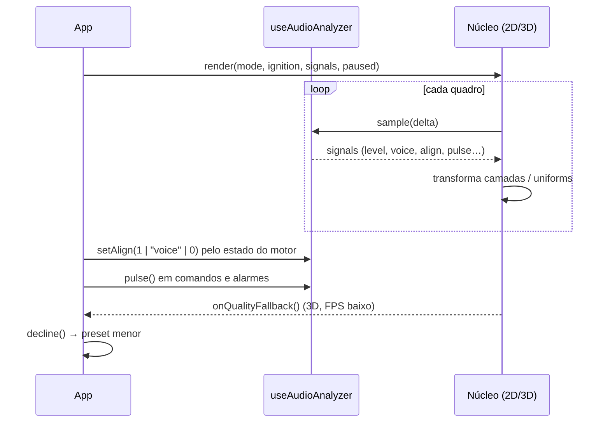

# Núcleo holográfico

O "reator" no centro da tela, em 2D, 3D ou desligado, que reage à voz e é a identidade visual do JARVIS.

| | |
|---|---|
| **ID** | `feature/holographic-core` |
| **Status** | Implementado |
| **Origem** | `42e671a` (2026-10-23) · evoluída em `c4ccc57` (2D vira padrão), `750ebd0` (núcleo clicável) e não commitado (27/10, fundo removido) |

## Visão geral

O núcleo é o "reator" no centro da tela, a identidade visual do JARVIS. Ele reage ao microfone e à voz do próprio JARVIS e pulsa a cada evento (palavra de ativação, comando, alarme). Enquanto o JARVIS escuta, ele se alinha no equador. Liga depois do boot.

Há três modos:
- **2D** (padrão): um reator do HUD do JARVIS em vetor, sem WebGL;
- **3D**: o holograma completo em WebGL, com bloom e partículas;
- **desligado**: sem nada no centro, para gastar o mínimo de memória.

Trocar de modo vale na hora, sem reiniciar. O 3D tem perfis de qualidade e rebaixa sozinho se o FPS cair. Clicar no núcleo fala com o JARVIS: a interação é de [assistant](../../features/assistant/spec.md), e aqui ficam só os estados visuais.

## Dados

- `$modo`: **CoreMode / CorePrefs**, `3d` | `2d` | `off`, em `jarvis.core` como `{ mode: "3d" | "2d" | "off" }` (`useStoredState`, debounce de 250 ms). Padrão `2d` desde `c4ccc57` (era `3d`). Ver [glossário](../../domain/glossary.md) e [persistência](../../domain/persistence.md).
  - Se `jarvis.core` tiver um valor inválido, então volta ao `2d` (`parseCore`).
- `$qualidade`: o nível do 3D, `"low"` | `"medium"` | `"high"`, em `jarvis.quality` como string crua (sem JSON). Gravado na hora, só em `cycle()`; `decline()` não grava. `quality.ts` só aceita os três níveis.
- `settings.json` → `background`: removido. Não há migração explícita: o serde ignora o campo desconhecido.
- `$sinais`: **HoloSignals**, valores por quadro, compartilhados por todas as camadas. Só em memória.
- **QualityPreset**: limites de dpr, msaa, partículas, densidade e bloom.
- **Ignition**: `"standby"`, um instante `performance.now()` (ligando) ou `null` (ligado).

## Componentes

### Composição (`layout.ts`)

O tamanho e o lugar do núcleo, iguais nos três modos e nas sobreposições do DOM (saudação, `CoreButton`).

- **Comportamento:**
  - **RF-001**: O núcleo DEVE ficar centrado na área acima da dock (`DOCK_RESERVE` = 120 px), com diâmetro `min(max(240, altura − 120) × 0,54, largura × 0,62)`.
  - `compositionPixels` dá o diâmetro em pixels, para o 3D. `COMPOSITION_CSS` e `CORE_CENTER_Y_CSS` dão o mesmo diâmetro e o mesmo centro em CSS, para o 2D e as camadas do DOM.

### Sinais (`useAudioAnalyzer`)

Lê o microfone e a voz do JARVIS e transforma em $sinais, que todas as camadas leem.

- **Comportamento:**
  - **RF-004**: Os sinais (`HoloSignals`) DEVEM ser `time`, `frames`, `level`, `bass`, `mid`, `treble`, `voice`, `spectrum` (32 bandas), `active`, `attention`, `pulse` e `align`. Eles são mutados no laço, nunca guardados em estado React.
  - `sample(delta)` avança os sinais uma vez por quadro, chamado pelo núcleo que está na tela.
  - **RF-005**: A voz do JARVIS tocando DEVE alimentar o núcleo como se fosse o microfone (`setVoiceSource`).
  - `pulse()` dispara a cada evento: palavra de ativação, comando, alarme.
  - **RF-006**: O alinhamento DEVE entrar rápido e sair devagar (constantes de 0,35 s e 0,7 s). Os anéis entram escalonados (`LOCK_STAGGER` 0,12 de `align`).
  - O `App` define o alvo do alinhamento pelo estado do motor de voz:
    - escutando um comando (`awake`, `talking`, `dictating`, `asking`): `align` = 1;
    - no modo "Sempre ouvindo" (estado `listening`): o alinhamento segue a voz (`"voice"`), não fica fixo;
    - em repouso: `align` = 0;
    - no navegador, sem motor: 1 enquanto a captura está em `listening`, senão 0.
  - Se o motor estiver esperando por "Hey Jarvis", então a atenção cai para 0,6: o núcleo reage mais suave.
  - No desktop, a captura visual segue o microfone do motor (`isMicOpen`). Com o núcleo desligado, ela não abre.

### `FlatCore` (2D)

O reator do HUD do JARVIS em vetor, o modo padrão.

- **Comportamento:**
  - **RF-003**: O 2D DEVE ter estas camadas, cada uma girando no compositor:
    - disco;
    - aro segmentado (150 s por volta);
    - escala de marcas (220 s, ao contrário);
    - anel tracejado (70 s, ao contrário);
    - faixa interna (40 s);
    - colchete âmbar, anel interno e placa;
    - colchetes de mira;
    - o triângulo central, cujo brilho cresce com a voz.

    O laço só escreve estilos quando eles mudam.
  - A cada quadro, o laço chama `sample` e ajusta só transform e opacidade: o halo respira com `level`, `bass` e `pulse`; o triângulo brilha com `voice`; a escala de marcas acende com `active`.
  - Os colchetes de mira (`[data-lock]`) seguem `align`: giram de 45° para 0°, encolhem de 1,25 para 1 e acendem até a opacidade 1.
  - Desenhe o primeiro quadro e avise `onFirstFrame`, mesmo pausado.
  - O laço roda no relógio de quadros (`src/lib/frameClock.ts`): até 60 quadros por segundo com a janela em foco e 30 com outro app na frente, qualquer que seja a taxa da tela ([ADR-0022](../../arch/adr/0022-nucleo-relogio-quadros-limitado-canvas-3.md)).
  - Se estiver pausado, então as rotações CSS param (`core-paused`) e o laço não roda.
  - Se o usuário pedir movimento reduzido, então os anéis 2D não giram (`.core-spin` sem animação).
- **Layout:**
  - `[data-core="2d"]` cobre a tela (`fixed inset-0`) e é superfície do desktop (`data-desktop-surface`).
  - O reator é um quadrado de `COMPOSITION_CSS`, centrado em `CORE_CENTER_Y_CSS`, sem receber cliques.
  - Cada camada é um SVG de tela cheia (`viewBox="-100 -100 200 200"`), empilhado nesta ordem: disco com o globo em wireframe, halo, aro, escala de marcas, anel tracejado, faixa interna, colchete âmbar com o anel interno e a placa, colchetes de mira, o brilho do triângulo e o triângulo.
- **Estilo:**
  - Tudo em tokens do tema: corpo em `fill-hud-abyss/85`, linhas em `stroke-hud-cyan` (de /15 a /80) e `stroke-hud-holo`, anel interno em `stroke-hud-light`, triângulo em `stroke-hud-glow` sobre `fill-hud-cyan/10`.
  - O colchete à esquerda fica em `stroke-hud-amber`, o mesmo em todos os temas (`--color-hud-amber`).
  - O brilho vem de dois filtros SVG: `flat-core-glow` (desfoque de 1,2) e `flat-core-bloom` (desfoque de 3,5, no triângulo).
  - O halo é um gradiente radial de `--color-hud-holo` a 34%.
  - As rotações usam `@keyframes core-spin` com `--spin` em segundos e `will-change: transform`.

### `JarvisScene` (3D)

O holograma completo em WebGL, carregado só quando escolhido.

- **Comportamento:**
  - **RF-002**: O 3D DEVE ter 7 camadas:
    - 01 esfera em wireframe, com treliça geodésica e nós;
    - 02 casca externa partida com marcas ("scanner");
    - 03 anéis orbitais;
    - 04 fragmentos de HUD com ping de varredura;
    - 05 partículas;
    - 06 halo;
    - 07 onda de voz (some no silêncio).

    O bloom só pega valores HDR > 1 (limiar 0,95), há vinheta (um overlay CSS, ver Estilo), e a neblina escurece o lado de trás.
  - **RF-011**: O 3D DEVE desenhar no relógio de quadros: o r3f roda com `frameloop="never"` e o `FrameDriver` chama `advance` até 60 vezes por segundo em foco e 30 com outro app na frente, mesmo numa tela de 120/144 Hz.
  - Um `AudioDriver` de prioridade −1 chama `sample`, publica os uniforms compartilhados antes de qualquer camada e avisa `onFirstFrame`.
  - A intensidade do bloom sobe com `level`, `bass`, `voice` e `pulse`.
  - Ouvindo, as partículas e os 4 anéis orbitais vão para o equador, um após o outro.
  - **RF-007**: O 3D DEVE oferecer parallax suave do mouse (até 0,05 rad em x e 0,07 rad em y).
  - **RF-009**: O monitor de FPS DEVE começar 5 s depois que o 3D sai da pausa (e só com a janela em foco, onde os 60 fps valem), ajustar o dpr em passos de 0,25 (sem passar da densidade da tela) e chamar `decline` no fallback. É a lógica do `PerformanceMonitor` do drei, reescrita no `JarvisScene.tsx` sem o pacote.
  - **RF-010**: O fundo DEVE ser sempre o `void` do tema (quase preto). Não existe mais a escolha de fundo grid/matrix.
  - Se estiver pausado, então o 3D para (`frameloop="never"`).
  - Se o usuário sair do 3D, então a memória de vídeo volta na hora. O código do three.js já baixado só sai ao reabrir o JARVIS (texto da aba Núcleo).
  - Se o tema mudar, então o 3D recolore no lugar (`onPalette`): os materiais guardam as cores de `sceneColors.ts` por referência.
- **Layout:**
  - `[data-core="3d"]` cobre a tela (`fixed inset-0`) e é superfície do desktop. Dentro dele, o `Canvas` cobre **só o holograma**: um quadrado de 1,6 diâmetros de `compositionPixels` em volta do núcleo (~830 px a 1080p), com as bordas em múltiplos de 4 px CSS.
    - Medido a 1080p com todos os sinais no máximo, o que acende ocupa ~744×667 px; a margem cobre o excesso de 7% da ignição e o parallax.
  - A câmera tem FOV 32 e é `manual`: o aspecto é o da tela inteira. `Composition` ajusta a distância ao diâmetro de `compositionPixels` e usa `setViewOffset(largura, altura, x, y + DOCK_RESERVE / 2, w, h)`: o canvas mostra exatamente o recorte que um canvas de tela cheia mostraria ali, com o núcleo centrado acima da dock sem inclinar a câmera.
  - `powerPreference: "default"`: num notebook com duas GPUs, o holograma fica na integrada e não acorda a dedicada.
- **Estilo:**
  - Sem antialias no canvas; o MSAA fica no compositor de efeitos (no máximo 2 com dpr acima de 1,25).
  - Bloom `mipmapBlur` com limiar 0,95, raio 0,62 e intensidade base 0,9.
  - Vinheta: um `div` estático por cima do canvas, com o mesmo `smoothstep` do `Vignette` do postprocessing (`offset` 0,3, `darkness` 0,55) em `radial-gradient`, preto com alfa 1 − fator. Bate com o shader antigo a 1 nível de cor e é pintada uma vez, não a cada quadro.
  - A emenda entre o canvas e a página não aparece: no máximo 1 nível de cor de diferença na borda.
  - Neblina preta, de `distância − 1,3` a `distância + 4,6`, que com a mistura aditiva escurece o lado de trás.
  - As cores são as do tema, em espaço linear (`sceneColors.ts`).

### `HiddenCore` (desligado)

Nada no centro da tela.

- **Comportamento:**
  - Desenhe um `div` vazio que ainda avisa o primeiro quadro, para a janela aparecer e o boot começar.
  - `[data-core="off"]` continua sendo superfície do desktop: um clique no vazio tira o foco de todas as janelas.
  - Com o núcleo desligado, a captura de áudio só para o visual não abre, e o botão do núcleo e o histórico do JARVIS não aparecem. A voz segue funcionando.
- **Layout:** um `div` de tela cheia (`fixed inset-0`), sem filhos.
- **Estilo:** sem estilo próprio; aparece o fundo `bg-hud-void` do `App`.

### Ignição

O núcleo nasce de um ponto, girando até o lugar, depois do boot e no escuro da volta para casa.

- **Comportamento:**
  - Durante o boot ou o escuro da volta para casa, o núcleo fica em `standby`: invisível no 3D e com escala 0,001, −270° e opacidade 0 no 2D.
  - Quando `ignition` vira um instante, o núcleo cresce até a escala 1 em 1,5 s, com um pequeno excesso: `backOut` no 2D (`motion/react`), `easeOutBack` no 3D, que também gira 1,5 π até o lugar.
  - Com `ignition` = `null`, o núcleo simplesmente está ligado.

### Qualidade do 3D (`useQuality`)

O perfil gráfico do holograma.

- **Comportamento:**
  - **RF-008**: Os perfis DEVEM ser:
    - `low`: dpr 1, msaa 2, 350 partículas, linhas ×0,5, bloom 5;
    - `medium`: 1,25, 2, 800, ×0,75, 6;
    - `high`: 1,5, 2, 1400, ×1, 6.

    O MSAA 4× e os níveis 7 e 8 do bloom (o brilho mais largo e fraco) custavam tempo de quadro sem diferença visível em linhas finas aditivas.
  - A ordem de escolha é `?quality=` na URL → $qualidade salva → nome da GPU. As duas primeiras travam o nível.
    - Pela GPU: software (SwiftShader, llvmpipe, Microsoft Basic) → `low`; integrada (Intel, UHD, Iris, Mali, Adreno, Apple M1) → `medium`; outras → `high`. Sem WebGL, `low`.
    - A GPU só é consultada (um contexto WebGL descartável) quando o 3D entra em uso: no 2D e desligado, `useQuality(false)` fica em `medium` sem criar contexto.
  - `cycle()` gira low → medium → high, grava e trava.
  - `decline()` cai um nível quando o monitor de FPS desiste, nunca abaixo de `low`. Se o nível estiver travado, então nada muda.

### Aba "Núcleo" do Menu avançado

Onde o usuário escolhe $modo.

- **Comportamento:**
  - O `CardPicker` "Visual do núcleo" mostra os cartões "Holograma 3D", "Anéis 2D" e "Desligado". Escolher um troca $modo na hora.
  - Embaixo, mostre a dica do modo escolhido (`CORE_MODES`), como "…sem WebGL…" ou "…o mínimo de memória…".
  - A seção "Memória" avisa: "Vale na hora. Ao sair do 3D, a memória de vídeo do holograma é devolvida na hora; o código dele, se já tinha sido carregado, só sai ao reabrir o JARVIS. Abrindo no 2D ou desligado, o 3D nem é carregado."
- **Layout:** duas `Section`: "Núcleo", com o `CardPicker` e a dica, e "Memória", com o aviso.
- **Estilo:** a dica e o aviso em `text-xs leading-relaxed text-hud-text/55`; os cartões são os do kit do Menu avançado (`src/components/hud.tsx`).

### Anel do `CoreButton`

O único visual do botão invisível sobre o centro do núcleo; o clique em si é de [assistant](../../features/assistant/spec.md).

- **Comportamento:**
  - Em repouso, o anel fica invisível. Ele aparece no hover e no foco do teclado.
  - Enquanto o JARVIS ouve (`phase` = `listening`), o anel fica aceso e pulsa com brilho.
- **Layout:** um círculo com 50% do diâmetro do núcleo, centrado em `CORE_CENTER_Y_CSS`, acima do núcleo (`z-[12]`) e abaixo das janelas. Também é superfície do desktop.
- **Estilo:**
  - Em repouso, borda `hud-cyan/25` com opacidade 0, que vai a 1 no hover e no foco; o foco ganha `ring-2` em `hud-light/40`.
  - Ouvindo, borda `hud-holo/60`, `animate-pulse` e sombra externa e interna de `--color-hud-holo` (45% e 30%).
  - A troca dura 300 ms.

## Casos de borda

- **Janela oculta ou minimizada:** o 3D para (o relógio de quadros não roda), o 2D pausa as rotações CSS e o laço, e a captura é suspensa. Depois de 5 s escondida, o WebView2 recebe a meta de memória "low" (`webview_background`).
- **Outro app em foco:** o núcleo continua se mexendo, a 30 quadros por segundo.
- **Esperando o "Hey Jarvis":** a captura do visual fica fechada (só o motor Rust ouve); ela abre quando ele acorda. No "Sempre ouvindo", segue aberta.
- **App maximizado na frente:** o núcleo desenha o primeiro quadro (que revela a janela) e depois descansa. Volta assim que o app é restaurado (`tests/desktop.spec.ts`).
- **Troca de tema:** o 3D recolore no lugar (`onPalette`), e o 2D segue os tokens CSS.

## Voz e teclado

- `Ctrl+Shift+Q`: `cycle()` da qualidade.
- Busca: "Núcleo: Holograma 3D / Anéis 2D / Desligado" (`core:<modo>`) e "Alternar qualidade gráfica": `setCore(mode)` e `cycle()`.
- Módulo de qualidade da barra superior: `cycle()`.
- URL `?quality=<nível>`: nível fixo para a sessão.

## Restrições

- **RNF-001**: O three.js e os efeitos só carregam no modo 3D (`lazy(() => import("./components/JarvisScene"))`). As cores do 3D ficam em `sceneColors.ts`, fora de `theme.ts`.
- **RNF-002**: No modo 2D, um recarregamento não baixa nenhum chunk do 3D.
- **RNF-003**: Com o 3D a 1080p, o holograma ocupa de 40% a 60% da altura útil, centrado com até 3% de desvio, e nunca encosta na dock (`tests/ui.spec.ts`, 4 resoluções).
- Monitor de FPS só depois de 5 s. dpr limitado pelo perfil e pela tela. Pausa quando a janela está oculta ou atrás de um app maximizado.
- **RNF-004**: No modo 2D e desligado, nenhum contexto WebGL é criado fora da tela de boot (que mostra o nome da GPU).
- **RNF-005**: Custo ocioso no build de release a 1920×1080, janela em foco, medido com `npm run perf` (Core 7 150U, Intel Graphics). Os números estão na seção [Desempenho](#desempenho).

## Desempenho

Build de release, 1920×1080, janela em foco, 45 s por cenário depois de 15 s de assentamento, árvore inteira do app (`jarvis.exe` + WebView2 + `claude.exe`). Medido com `npm run perf` em 2026-11-04, antes e depois do [ADR-0022](../../arch/adr/0022-nucleo-relogio-quadros-limitado-canvas-3.md):

| Cenário | CPU (ms de CPU por s) | iGPU (motor 3D) | Memória de GPU |
|---|---|---|---|
| 2D ocioso | 169 → **92** (−46%) | 6,2% → 5,5% | 49 → 53 MB |
| 3D ocioso | 202 → **161** (−20%) | 49% → **24%** (−51%) | 134 → **89 MB** |
| 3D + uma janela TUI | 263 → **232** (−12%) | 50% → **24%** | 144 → **96 MB** |
| 3D minimizado (30 s) | 8,5 → 6,5 | 0% | 246 → **119 MB**; RAM do processo de GPU 295 → 165 MB |

Orçamento daqui em diante: 2D ocioso ≤ 100 ms/s; 3D ocioso ≤ 170 ms/s e ≤ 30% da iGPU.

## Histórias de usuário

### US1 — Núcleo 2D leve por padrão (P1)

O JARVIS abre com o reator 2D, que gira, reage à voz e não carrega o 3D.

**Por que P1:** é o que todo usuário vê, com o menor custo de memória.
**Teste independente:** `tests/core.spec.ts` — "the core opens as the 2D rings, the Núcleo tab swaps the 3D hologram in and out live, and a restart never loads the 3D".

**Aceite**

1. **Dado** uma instalação nova, **então** existe `[data-core="2d"]` e nenhum `<canvas>`.
2. **Dado** o 2D, **então** os sinais de áudio continuam amostrados: `__JARVIS__.signals.frames` cresce mais de 10 em 500 ms.
3. **Dado** o JARVIS ouvindo um comando (`align` = 1), **então** os colchetes de mira (`[data-lock]`) giram de 45° para 0°, encolhem de 1,25 para 1 e acendem (opacidade > 0,95).
4. **Dado** um recarregamento no 2D, **então** nenhum pedido de rede busca `JarvisScene`, `react-three`, `three.module` ou `postprocessing`.

### US2 — Trocar de modo ao vivo (P1)

Escolho 3D, 2D ou desligado e a troca acontece na hora.

**Por que P1:** é o controle de custo × visual.
**Teste independente:** o mesmo teste de US1 e "the core switched off leaves an empty, working desktop; the search turns the 3D back on".

**Aceite**

1. **Dado** o Menu avançado → aba "Núcleo", **então** os cartões "Holograma 3D", "Anéis 2D" e "Desligado" aparecem, com a dica do modo escolhido ("…sem WebGL…", "…o mínimo de memória…").
2. **Quando** escolho "Holograma 3D", **então** um `<canvas>` aparece, o 2D sai e `jarvis.core.mode` vira `"3d"`.
3. **Quando** volto para "Anéis 2D", **então** o canvas some.
4. **Dado** a busca, **quando** digito "nucleo 3d" e Enter em "Núcleo: Holograma 3D", **então** o 3D volta e anima.

### US3 — Núcleo desligado (P2)

Desligo o núcleo e o desktop continua funcionando.

**Por que P2:** atende máquinas fracas. A voz segue funcionando.
**Teste independente:** "the core switched off leaves an empty, working desktop; the search turns the 3D back on".

**Aceite**

1. **Dado** "Desligado", **então** não há canvas nem `[data-core="2d"]`. Há `[data-core="off"]`, que ainda é superfície do desktop.
2. **Dado** uma janela focada, **quando** clico no vazio, **então** nenhuma janela fica focada.
3. **Dado** o núcleo desligado, **então** a captura de áudio só para o visual não abre, e o botão do núcleo e o histórico do JARVIS não aparecem.

### US4 — Reagir à voz e se alinhar ao ouvir (P1)

O núcleo segue minha voz e a do JARVIS, e se alinha quando ele me escuta.

**Por que P1:** é o retorno visual de que o JARVIS ouviu.
**Teste independente:** `tests/voice.spec.ts` — "particles and rings align on the core's equator while listening, then scatter" e "listens, reacts to audio and releases resources".

**Aceite**

1. **Dado** o repouso, **então** `signals.align` = 0 e as partículas voam livres.
2. **Dado** Voice segurado (escutando), **então** `align` passa de 0,98 em até 5 s: as partículas e os 4 anéis orbitais vão para o equador, um após o outro.
3. **Dado** que solto, **então** `align` cai abaixo de 0,02 em até 6 s.
4. **Dado** o modo "Sempre ouvindo" (estado `listening`), **então** o alinhamento segue a voz (`"voice"`), não fica fixo.
5. **Dado** o modo de espera por "Hey Jarvis", **então** a atenção cai para 0,6: o núcleo reage mais suave.

### US5 — Ligar depois do boot (P2)

Depois do boot, o núcleo nasce de um ponto, girando até o lugar.

**Por que P2:** costura o boot com o desktop.
**Teste independente:** `tests/core.spec.ts` — "with the core in 2D (the default), the boot screen still plays and hands over" (a escala chega a 1).

**Aceite**

1. **Dado** o boot ou o escuro da volta para casa, **então** o núcleo fica em `standby`: invisível no 3D e com escala 0,001, −270° e opacidade 0 no 2D.
2. **Dado** o fim do boot, **então** ele cresce até a escala 1 em 1,5 s, com um pequeno excesso (`backOut` no 2D, `easeOutBack` no 3D).

### US6 — Qualidade gráfica do 3D (P3)

O 3D se ajusta à GPU, e posso fixar um nível.

**Por que P3:** só importa no 3D.
**Teste independente:** `tests/ui.spec.ts` — "renderer and frame rate" (só registra o FPS).

**Aceite**

1. **Dado** `?quality=low|medium|high` na URL, **então** esse nível vale e fica travado.
2. **Dado** um nível salvo em `jarvis.quality`, **então** ele vale e fica travado. Sem nada salvo, o nível vem do nome da GPU:
   - software (SwiftShader, llvmpipe, Microsoft Basic) → `low`;
   - integrada (Intel, UHD, Iris, Mali, Adreno, Apple M1) → `medium`;
   - outras → `high`.
3. **Quando** aperto Ctrl+Shift+Q (ou uso a busca ou o módulo da barra), **então** o nível gira low → medium → high, é salvo e trava.
4. **Dado** um nível não travado e FPS baixo sustentado no 3D, **então** ele cai um nível (nunca abaixo de `low`).

## Critérios de sucesso

- **SC-001**: Num recarregamento em 2D, zero pedidos de rede de código 3D.
- **SC-002**: Em 4 resoluções (1366×768 a 3440×1440), a tela mostra só o núcleo e a dock, sem nenhum texto.
- **SC-003**: Ouvindo, o alinhamento completa em até 5 s e se desfaz em até 6 s.

## Fora de escopo e limitações

- **Fundo removido:** o fundo grid/matrix em shader (`SceneBackground.tsx`, `src/shaders/background/*`) e a opção `background` (`"solid"`, `"grid"`, `"matrix"`) foram apagados no working tree. Os testes conferem que não há "Fundo" para escolher. Ver [ADR-0015](../../arch/adr/0015-remocao-do-fundo-shader.md).
- **Interação:** clicar ou segurar o núcleo para perguntar, as fases (`CorePhase`) e o Esc ficam em [assistant](../../features/assistant/spec.md). Aqui só entra o anel do `CoreButton`: invisível em repouso, aparece no hover e no foco, e pulsa com brilho enquanto ouve.
- **Legenda:** a transcrição dentro do núcleo é de [voice-engine](../../features/voice-engine/spec.md).
- **Cores:** são do tema (ver [appearance](../../features/appearance/spec.md)). O âmbar do colchete 2D é o mesmo em todos os temas (`--color-hud-amber`).

## Código

O `App` escolhe um de três componentes pelo `jarvis.core`:
- `JarvisScene`, carregado com `lazy`: um `Canvas` do react-three-fiber, recortado em volta do núcleo, com `JarvisCore` e bloom, mais a vinheta em CSS;
- `FlatCore`: camadas SVG, giradas por CSS, mais um laço no relógio de quadros que só escreve transform/opacidade quando mudam;
- `HiddenCore`: um `div` vazio que ainda reporta o primeiro quadro.

Os três recebem o mesmo objeto `signals`, mutado por `sample()` do `useAudioAnalyzer`, e o mesmo `ignition`. No 3D, um `AudioDriver` de prioridade −1 avança o relógio e publica os uniforms compartilhados antes de qualquer camada.

| | |
|---|---|
| **Camadas** | UI React (`JarvisScene`, `JarvisCore` e camadas, `FlatCore`, `HiddenCore`, `CoreButton`) · hook (`useAudioAnalyzer`) · lib (`core`, `quality`, `signals`, `layout`, `rings`, `geometry`, `fatLines`, `sceneColors`) · shaders (`src/shaders/hologram/*`) |
| **Dependências** | `three`, `@react-three/fiber`, `@react-three/postprocessing` (Bloom), Web Audio `AnalyserNode`, `motion/react` (ignição do 2D). O `@react-three/drei` saiu: só dava o `PerformanceMonitor` |
| **Testes** | `tests/core.spec.ts`, `tests/ui.spec.ts`, `tests/voice.spec.ts` (projeto `voice`, microfone falso), `tests/settings.spec.ts` (cor e fundo), `tests/desktop.spec.ts` (descanso atrás de app maximizado) |
| **Plataforma** | WebView2 com GPU. Os testes rodam no Edge headless com `--enable-gpu` (cai em SwiftShader). Igual dentro e fora do Tauri; no desktop, a captura visual segue o microfone do motor (`isMicOpen`) |

### Arquivos

| Arquivo | Papel |
|---|---|
| `src/lib/core.ts` | `CoreMode`, `CORE_MODES` (rótulo e dica), `useCorePrefs` (`jarvis.core`, padrão `2d`) |
| `src/lib/quality.ts` | `QUALITY_PRESETS`, `resolveInitial` (URL → salvo → GPU), `useQuality(probe)` (`cycle`, `decline`; a GPU só é consultada com o 3D em uso) |
| `src/lib/signals.ts` | `HoloSignals`, `createSignals`, `SignalsContext`, `approach`, `SPECTRUM_BANDS` = 32 |
| `src/lib/layout.ts` | `DOCK_RESERVE`, `COMPOSITION_DIAMETER`, `compositionPixels`, `COMPOSITION_CSS`, `CORE_CENTER_Y_CSS` |
| `src/hooks/useAudioAnalyzer.ts` | Captura do microfone, bandas, espectro, detecção de fala, `pulse`, `setAttention`, `setAlign`, `setSuspended`, `setVoiceSource`, `sample` |
| `src/components/JarvisScene.tsx` | `canvasRect` (o recorte), `Canvas`, `FrameDriver` (relógio de quadros → `advance`), `Composition` (câmera manual, view offset do recorte, neblina, parallax, ignição), `Effects` (Bloom), `PerformanceMonitor` próprio, `VIGNETTE` (overlay CSS) |
| `src/lib/frameClock.ts` | `runFrames(fps, frame)`, `frameRate(paused, focused)`: 60 em foco, 30 atrás de outro app, 0 escondido |
| `src/components/AudioDriver.tsx` | `useFrame(-1)`: `sample`, uniforms compartilhados e `onFirstFrame` |
| `src/components/JarvisCore.tsx` | Raiz das 7 camadas. `InnerCore` (01 + halo 06), `OuterShell` (02) |
| `src/components/OrbitalRings.tsx`, `HudFragments.tsx`, `HolographicParticles.tsx`, `VoiceWave.tsx` | Camadas 03, 04, 05 e 07 |
| `src/lib/rings.ts`, `geometry.ts`, `fatLines.ts`, `sceneColors.ts` | Os 4 anéis e o equador (`CORE_TILT`), builders de linhas/pontos com PRNG fixo, linhas largas, cores lineares do tema |
| `src/shaders/hologram/*` | `haloMaterial`, `holoLineMaterial`, `holoPointsMaterial`, `voiceWaveMaterial`, `sharedUniforms` |
| `src/components/FlatCore.tsx` | Reator 2D e `HiddenCore` |
| `src/components/CoreButton.tsx` | Botão invisível sobre o centro (50% do diâmetro), anel de hover/escuta |
| `src/App.tsx` | Escolha do modo, `ignition`, `paused`/`covered`/`focused`, atenção, alinhamento, captura visual (fechada no standby do "Hey Jarvis") |
| `src/hooks/useWindowControls.ts` | `paused` (escondido/minimizado), `focused` (foco da janela), `webview_background` depois de 5 s escondido |
| `src/styles/globals.css` | `@keyframes core-spin`, `.core-spin`, `.core-paused` |

### Probe de teste

| Campo de `window.__JARVIS__` | Uso |
|---|---|
| `signals` | `frames`, `align`, `voice`, `level` lidos ou forçados pelos testes |
| `quality` | nível atual |
| `status` | estado da captura (`idle` / `listening` / `error`) |

### Fluxo

### Constituição

- [x] P1 Offline-first — todo o render é local.
- [x] P5 Persistência tolerante — `parseCore` volta ao `2d`. `quality.ts` só aceita `low`/`medium`/`high`.
- [x] P6 Funciona fora do Tauri — os três modos rodam no Vite. O probe `__JARVIS__.signals` expõe os sinais aos testes.
- [x] P8 Linguagem visual — cores dos tokens: `colors` em `sceneColors.ts` segue `onPalette`, e o 2D usa classes `hud-*`. Exceção documentada: `--color-hud-amber` fixo.
- [x] P9 Desktop leve — 2D por padrão, 3D só carrega se escolhido, pausa em oculto/coberto, sem estado React por quadro.
- [x] P11 Coberto por teste — modos, alinhamento, composição e troca ao vivo têm testes. O ciclo de qualidade não tem (ver Pendências).

### Decisões relacionadas

- [ADR-0013 — núcleo 2D padrão, 3D opcional, off](../../arch/adr/0013-nucleo-2d-padrao.md)
- [ADR-0022 — relógio de quadros limitado, canvas 3D recortado e UI em D3D11](../../arch/adr/0022-nucleo-relogio-quadros-limitado-canvas-3.md)
- [ADR-0015 — remoção do fundo grid/matrix](../../arch/adr/0015-remocao-do-fundo-shader.md)
- [ADR-0011 — fakes de dev e E2E no modo web](../../arch/adr/0011-fakes-de-dev-e-e2e-modo-web.md)
- [ADR-0014 — linguagem visual TUI](../../arch/adr/0014-linguagem-visual-tui.md)

## Tarefas

Legenda: `[x]` feito · `[ ]` pendente · `[P]` pode rodar em paralelo (arquivos diferentes) · `[USn]` história desta spec. As tarefas foram reconstruídas do código e dos commits `42e671a`, `c4ccc57`, `750ebd0` e do working tree de 27/10.

### Fase 1 — Base

- [x] T001 `HoloSignals`, `createSignals` e `approach` — `src/lib/signals.ts`
- [x] T002 [P] Composição acima da dock — `src/lib/layout.ts`
- [x] T003 [P] Perfis e resolução de qualidade — `src/lib/quality.ts`
- [x] T004 [P] `CoreMode`, `CORE_MODES` e `useCorePrefs` — `src/lib/core.ts`
- [x] T005 Captura, bandas, espectro, detecção de fala, atenção, alinhamento e pulso — `src/hooks/useAudioAnalyzer.ts`

### Fase 2 — US4 Reagir à voz (P1) e 3D

- [x] T006 [US4] `JarvisScene`, `Composition`, `Effects` e `PerformanceMonitor` — `src/components/JarvisScene.tsx`
- [x] T007 [P] [US4] `AudioDriver` e uniforms compartilhados — `src/components/AudioDriver.tsx`, `src/shaders/hologram/sharedUniforms.ts`
- [x] T008 [P] [US4] Camadas 01/02/06 — `src/components/JarvisCore.tsx`, `src/shaders/hologram/haloMaterial.ts`, `holoLineMaterial.ts`, `holoPointsMaterial.ts`
- [x] T009 [P] [US4] Camada 03 e equador — `src/components/OrbitalRings.tsx`, `src/lib/rings.ts`, `src/lib/fatLines.ts`
- [x] T010 [P] [US4] Camadas 04/05/07 — `src/components/HudFragments.tsx`, `HolographicParticles.tsx`, `VoiceWave.tsx`, `src/shaders/hologram/voiceWaveMaterial.ts`
- [x] T011 [US4] Atenção, alinhamento, captura visual e voz do JARVIS no `App` — `src/App.tsx`

### Fase 3 — US1 Núcleo 2D (P1)

- [x] T012 [US1] `FlatCore`: camadas SVG, laço que escreve só o que muda, colchetes de mira — `src/components/FlatCore.tsx`
- [x] T013 [US1] `core-spin` e `core-paused` — `src/styles/globals.css`
- [x] T014 [US1] 2D como padrão e reator no estilo do HUD — `c4ccc57`
- [x] T015 [US1] `JarvisScene` com `lazy` para não baixar o 3D no 2D — `src/App.tsx`

### Fase 4 — US2/US3 Troca de modo e desligado

- [x] T016 [US2] Aba "Núcleo" com `CardPicker` e o texto "Memória" — `src/components/desktop/AdvancedMenu.tsx`, `src/components/hud.tsx`
- [x] T017 [P] [US2] Comandos `core:<modo>` — `src/lib/commands.ts`
- [x] T018 [US3] `HiddenCore` e captura visual desligada no modo `off` — `src/components/FlatCore.tsx`, `src/App.tsx`

### Fase 5 — US5/US6 Ignição e qualidade

- [x] T019 [US5] `ignition` (`standby` → instante → `null`) no 3D e no 2D — `src/components/JarvisScene.tsx`, `src/components/FlatCore.tsx`
- [x] T020 [US6] `cycle` (Ctrl+Shift+Q) e `decline` (fallback do monitor) — `src/lib/quality.ts`, `src/hooks/useWindowControls.ts`
- [x] T021 [US1] `CoreButton`: anel de hover e escuta sobre o núcleo — `src/components/CoreButton.tsx` (`750ebd0`)

### Fase 6 — Remoção do fundo

- [x] T022 Apagar `SceneBackground.tsx` e `src/shaders/background/*`, e tirar `background` de `Settings` (TS e Rust) e do boot — working tree (27/10)

### Fase 7 — Testes

- [x] T023 Playwright `tests/core.spec.ts` — "the core opens as the 2D rings, the Núcleo tab swaps the 3D hologram in and out live, and a restart never loads the 3D"
- [x] T024 Playwright `tests/core.spec.ts` — "the core switched off leaves an empty, working desktop; the search turns the 3D back on"
- [x] T025 Playwright `tests/core.spec.ts` — "with the core in 2D (the default), the boot screen still plays and hands over" e "with the core off, the boot screen still plays and hands over"
- [x] T026 Playwright `tests/ui.spec.ts` — "composition at 1366x768", "composition at 1920x1080", "composition at 2560x1440", "composition at 3440x1440"
- [x] T027 Playwright `tests/ui.spec.ts` — "renderer and frame rate"
- [x] T028 Playwright `tests/voice.spec.ts` — "particles and rings align on the core's equator while listening, then scatter"
- [x] T029 Playwright `tests/voice.spec.ts` — "listens, reacts to audio and releases resources"
- [x] T030 Playwright `tests/settings.spec.ts` — "the backdrop is always black: there is no background to pick"

### Fase 8 — Desempenho (2026-11-04, [ADR-0022](../../arch/adr/0022-nucleo-relogio-quadros-limitado-canvas-3.md))

- [x] T031 Relógio de quadros (`runFrames`, `frameRate`) no 2D e no 3D; `focused` em `useWindowControls` — `src/lib/frameClock.ts`, `src/components/FlatCore.tsx`, `src/components/JarvisScene.tsx`, `src/hooks/useWindowControls.ts`
- [x] T032 Canvas recortado com câmera manual e `setViewOffset`; vinheta em CSS; `powerPreference: "default"` — `src/components/JarvisScene.tsx`
- [x] T033 `PerformanceMonitor` próprio; `@react-three/drei` removido — `src/components/JarvisScene.tsx`, `package.json`
- [x] T034 MSAA 2× e bloom de até 6 níveis; probe da GPU só com o 3D em uso — `src/lib/quality.ts`, `src/App.tsx`
- [x] T035 Captura visual fechada no standby do "Hey Jarvis" — `src/App.tsx`
- [x] T036 `webview_background` depois de 5 s escondido — `src-tauri/src/lib.rs`, `src/hooks/useWindowControls.ts`
- [x] T037 Playwright `tests/core.spec.ts` — "the 2D core never creates a WebGL context; the 3D draws only around the core, at most 60 fps, and slower behind other apps"
- [x] T038 Medições antes/depois com `npm run perf` (seção [Desempenho](#desempenho)); emenda e extensão do recorte conferidas com renders de tela cheia × recortados

## Pendências

- [ ] Nenhum teste pressiona `Ctrl+Shift+Q` nem verifica o rebaixamento automático (`decline`). "renderer and frame rate" em `tests/ui.spec.ts` só registra o FPS.
- [ ] Ao sair do 3D, o código do three.js já carregado só é liberado ao reabrir o app. A própria aba Núcleo de `src/components/desktop/AdvancedMenu.tsx` avisa disso.
