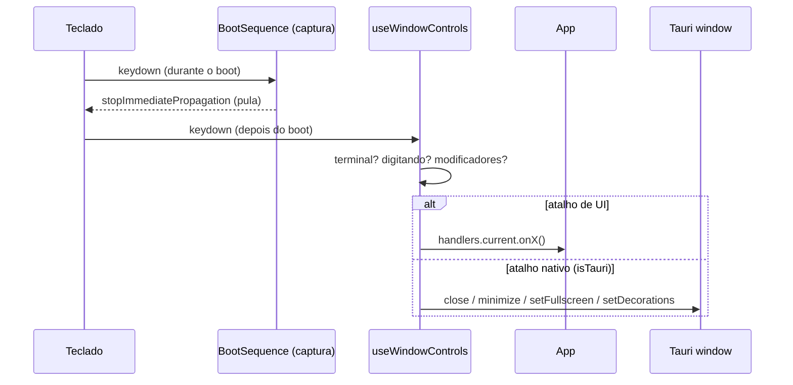

# Atalhos de teclado

O mapa único dos atalhos globais do jvOS e das regras que os impedem de atrapalhar quem digita.

| | |
|---|---|
| **ID** | `feature/keyboard-shortcuts` |
| **Status** | Implementado |
| **Origem** | `42e671a` (2026-10-23) · evoluída em `c4ccc57` |

## Visão geral

O jvOS dá para usar inteiro sem mouse:
- `/` busca;
- `M` fala;
- `Ctrl+,` abre as Configurações e `Ctrl+Shift+,` o Menu avançado;
- `Ctrl+Shift+Q` troca a qualidade gráfica;
- no app desktop, `Ctrl+Q`, `Ctrl+M`, `F11` e `Ctrl+Shift+D` controlam a janela nativa.

Os atalhos globais respeitam o contexto. Não disparam enquanto o usuário digita, e um terminal fica com o teclado inteiro. Este documento é o mapa único dos atalhos globais e aponta para as teclas próprias de cada janela, sem repeti-las.

## Dados

Os atalhos não guardam estado próprio: a qualidade salva em `jarvis.quality` é efeito do `cycle`.

- `$segurandoM`: se o `M` está segurado no modo "Segurar para falar". Só em memória.
- `$moldura`: se a moldura nativa está ligada (`Ctrl+Shift+D`). Só em memória; começa desligada.
- **Atalho global**: tecla tratada em `useWindowControls`. Ver [glossário](../../domain/glossary.md).
- **`[data-plain-keys]` / `[data-terminal]`**: marcadores de áreas que ficam com o teclado.

## Componentes

### Listener global (`useWindowControls`)

Um único listener de `keydown`, `keyup` e `blur` no `window`, registrado uma vez, que lê os callbacks atuais por uma ref (`handlers.current`).

- **Comportamento:**
  - **RF-001**: Os atalhos globais DEVEM ser tratados num único listener de `keydown` em `useWindowControls`, na ordem: (1) terminal → sai, salvo `F11`; (2) `Ctrl+Shift+Q`; (3) `Ctrl+Shift+,`; (4) `Ctrl+,`; (5) `/`; (6) `M`; (7) `Esc` com `M` segurado; (8) só no Tauri: `Ctrl+Q`, `Ctrl+M`, `F11`, `Ctrl+Shift+D`.
  - **RF-002**: `/` e `M` NÃO DEVEM disparar com Ctrl, Alt ou digitando (`isTyping`).
  - **RF-003**: No segurar-para-falar, `M` DEVE iniciar no `keydown` e enviar no `keyup` ou no `blur` da janela. `Esc` cancela.
    - Nos modos "Hey Jarvis" e "Sempre ouvindo", `M` alterna a escuta.
  - `Meta` conta como `Ctrl` nos atalhos globais.
  - `Ctrl+Shift+,` casa a tecla física (`event.code === "Comma"`), porque com Shift a tecla vira `<` no US e no ABNT2.
  - Se o `M` vier de auto-repetição (`event.repeat`), então ignore-o.
  - Se a janela perder o foco com `M` segurado, então envie a gravação, como se `M` tivesse sido solto.
  - Fora do Tauri, `Ctrl+Q`, `Ctrl+M`, `F11` e `Ctrl+Shift+D` são ignorados: o hook retorna antes deles.
  - `Ctrl+Shift+D` é a saída de emergência: liga ou desliga a moldura nativa ($moldura), porque a janela não tem moldura (`decorations: false`).

### Áreas que ficam com o teclado

Os campos e as janelas que recebem as teclas antes dos atalhos.

- **Comportamento:**
  - `isTyping` cobre `INPUT`, `TEXTAREA`, `SELECT`, `contenteditable` e `[data-plain-keys]`: ali, `/` e `M` entram no texto e a escuta segue `idle`.
  - O jv_ide marca a área dele com `data-plain-keys` (`IdeApp.tsx`).
  - O terminal marca a área dele com `data-terminal` (`TerminalView.tsx`). Com o foco ali, nenhum atalho global dispara (nem `Ctrl+Q`, `Ctrl+M` ou `Ctrl+W`), exceto `F11`, porque essas teclas querem dizer algo para o shell.

### Boot (`BootSequence`)

Durante o boot, as teclas só servem para pular a abertura.

- **Comportamento:**
  - O boot registra um listener próprio em fase de captura, que bloqueia os outros (`stopImmediatePropagation`).
  - Uma tecla sem modificador só pula o boot: `M` não abre o microfone. `Delete` pula e abre as Configurações.
  - Teclas com Ctrl, Meta ou Alt passam para os atalhos.
  - A dica na tela diz "Inicializando o sistema. Qualquer tecla pula; Delete abre as configurações.".

### Teclas de contexto (diálogos e janelas)

Cada diálogo e cada janela trata as próprias teclas, e as mesmas teclas fazem a mesma coisa em todos.

- **Comportamento:**
  - `Esc` fecha só o diálogo do sistema aberto: Busca (com `stopPropagation`), Configurações, Menu avançado, lançador da dock e menu de opções.
  - `Ctrl+W` fecha a janela focada (`Window.tsx`), a menos que o conteúdo trate o atalho antes (`defaultPrevented`: o jv_ide fecha abas) ou que o foco esteja num terminal.
  - Num widget focado, a tecla Menu ou `Shift+F10` abrem o menu de opções (`contextmenu`) no canto dele; dentro do menu valem `↑` `↓` `Home` `End`, `←` `→` (barra de menus) e `Esc` (`WidgetMenu.tsx`).
  - No item Voice focado da dock, `Espaço` e `Enter` segurados falam (`HOLD_KEYS`) e `Esc` cancela (`QuickDock.tsx`).
  - No núcleo focado, `Enter` e `Espaço` pressionam e soltam como o clique (`CoreButton.tsx`).
  - Se o núcleo estiver ativo, então `Esc` cancela a pergunta ou dispensa a resposta. O histórico do JARVIS só fecha com `Esc` se o núcleo não estiver ativo (`useAssistant.ts`, `AssistantDrawer.tsx`).

### Dicas de atalho (busca e aba Dock)

Onde o usuário vê as teclas.

- **Comportamento:**
  - **RF-004**: Os atalhos que aparecem na busca DEVEM mostrar a tecla à direita: `Ctrl ,`, `Ctrl Shift ,`, `Ctrl W`, `M`, `Ctrl Shift Q`, `F11`, `Ctrl M`, `Ctrl Q`.
  - **RF-005**: A aba Dock do Menu avançado DEVE lembrar os atalhos para quem esconde a dock: M, `/`, Ctrl , e Ctrl Shift ,.
- **Layout:**
  - Na busca, a tecla fica na ponta direita de cada resultado (ver [search](../../features/search/spec.md)).
  - Na aba Dock, a seção "Sem a dock" diz "Tecle M para falar, / para abrir widgets, apps e programas, Ctrl , para as Configurações e Ctrl Shift , para voltar aqui. Os avisos continuam aparecendo na base da tela."
- **Estilo:**
  - Na busca, um `kbd` mono de 10 px, maiúsculo, em `text-hud-text/40`.
  - Na aba Dock, cada tecla é um `kbd` mono de 11 px com borda `hud-cyan/20` e texto `text-hud-light/85`, dentro de um parágrafo `text-xs` `text-hud-text/55`.

## Voz e teclado

- `/`: `onOpenSearch()`.
- `M` (alternar): `onToggleVoice()`.
- `M` segurado / solto / `Esc` / `blur`: `onHoldVoice("start" | "send" | "cancel" | "send")`.
- `Ctrl+,`: `onOpenSettings()`.
- `Ctrl+Shift+,` (`code === "Comma"`): `onOpenAdvanced()`.
- `Ctrl+Shift+Q`: `onCycleQuality()` (low → medium → high, salva).
- `Ctrl+Q` / `Ctrl+M` / `F11` / `Ctrl+Shift+D`: `appWindow.close()` / `.minimize()` / `.setFullscreen(!x)` / `.setDecorations(toggle)`.

### Mapa dos atalhos globais

| Tecla | Ação | Condição | Teste |
|---|---|---|---|
| `/` | Abre a busca | fora de campos e terminais | `search.spec.ts` |
| `M` | Liga/desliga a escuta | modos "Hey Jarvis" e "Sempre ouvindo" | `voice.spec.ts` |
| `M` (segurar) | Fala enquanto segura | "Segurar para falar" | `voice.spec.ts` "push-to-talk (the default) listens only while Voice or M is held" |
| `Esc` (com `M` segurado) | Cancela a gravação | idem | `voice.spec.ts` "push-to-talk is cancelled by sliding left or by Esc" |
| `Ctrl+,` | Configurações | fora de terminais | `settings.spec.ts` |
| `Ctrl+Shift+,` | Menu avançado | fora de terminais | `boot`, `core`, `desktop`, `dock`, `taskbar`, `tui`, `voicetab` specs |
| `Ctrl+Shift+Q` | Gira a qualidade gráfica | fora de terminais | — |
| `Ctrl+Q` | Fecha o JARVIS | só Tauri | — |
| `Ctrl+M` | Minimiza | só Tauri | — |
| `F11` | Tela cheia | só Tauri, também em terminais | — |
| `Ctrl+Shift+D` | Liga/desliga a moldura nativa | só Tauri | — |
| Qualquer tecla / `Delete` | Pula o boot / pula e abre as Configurações | durante o boot | `boot.spec.ts` |

### Teclas de contexto do sistema

| Onde | Teclas | Spec |
|---|---|---|
| Busca | `↑` `↓` `Enter` `Esc` | [search](../../features/search/spec.md) |
| Configurações / Menu avançado | `Esc` | [settings](../../features/settings/spec.md) |
| Janela | `Ctrl+W`; duplo clique na barra (apps) | [desktop-windows](../../features/desktop-windows/spec.md) |
| Menu de opções de widget | Menu, `Shift+F10`, `↑` `↓` `Home` `End`, `←` `→` (barra de menus), `Esc` | [desktop-windows](../../features/desktop-windows/spec.md) |
| Lançador da dock | `Esc` | [desktop-windows](../../features/desktop-windows/spec.md) |
| Item Voice focado | `Espaço`/`Enter` segurados, `Esc` | [voice-engine](../../features/voice-engine/spec.md) |
| Núcleo focado / ativo | `Enter`/`Espaço` (falar), `Esc` (cancelar, dispensar) | [assistant](../../features/assistant/spec.md) |

### Teclas próprias de janelas (só referência)

| Janela | Onde estão especificadas |
|---|---|
| jv_ide (Ctrl+P, Ctrl+O, Ctrl+W nas abas, F2…) | [apps/jv_ide](../../apps/jv_ide/spec.md) |
| jv_sh (Ctrl+Tab, Ctrl+Shift+W…) | [apps/jv_sh](../../apps/jv_sh/spec.md) |
| Jarvis Mark (Ctrl+B…) | [apps/jarvis-mark](../../apps/jarvis-mark/spec.md) |
| jv_T4p3 | [apps/jv_t4p3](../../apps/jv_t4p3/spec.md) |
| jv_lab | [apps/jv_lab](../../apps/jv_lab/spec.md) |
| Pomodoro | [widgets/pomodoro](../../widgets/pomodoro/spec.md) |
| Calculadora | [widgets/calculator](../../widgets/calculator/spec.md) |
| Fita | [widgets/tape](../../widgets/tape/spec.md) |
| Mini player | [widgets/miniplayer](../../widgets/miniplayer/spec.md) |
| Agenda e Tarefas (edição em linha: `Enter` salva, `Esc` cancela) | [widgets/agenda](../../widgets/agenda/spec.md), [widgets/tasks](../../widgets/tasks/spec.md) |

## Restrições

- **RNF-001**: Os atalhos são fixos, não configuráveis.
- Listener único, sem re-registro por render.

## Histórias de usuário

### US1 — Atalhos globais (P1)

Abro a busca, falo e chego aos menus pelo teclado, de qualquer lugar do desktop.

**Por que P1:** é o caminho rápido e o único com a dock oculta.
**Teste independente:** `tests/search.spec.ts` — "/ opens the search; typing finds a widget and Enter opens it"; `tests/settings.spec.ts` — "opens from the dock and the keyboard, closes with Escape"; `tests/voice.spec.ts` — "keyboard shortcut M toggles the microphone".

**Aceite**

1. **Dado** o desktop sem foco num campo, **quando** aperto `/`, **então** a busca abre.
2. **Dado** o modo "Hey Jarvis" ou "Sempre ouvindo", **quando** aperto `M`, **então** a escuta liga. Outro `M` desliga.
3. **Dado** o modo "Segurar para falar" (padrão), **quando** seguro `M`, **então** o JARVIS ouve até eu soltar. `Esc` antes de soltar cancela a gravação.
4. **Quando** aperto `Ctrl+,`, **então** as Configurações abrem. `Ctrl+Shift+,` abre o Menu avançado, tanto no teclado US quanto no ABNT2.
5. **Quando** aperto `Ctrl+Shift+Q`, **então** a qualidade gira (low → medium → high) e fica salva.

### US2 — Não atrapalhar quem digita (P1)

Digitar `/` ou `m` num campo, editor ou terminal nunca dispara atalho.

**Por que P1:** um atalho que rouba tecla quebra a digitação.
**Teste independente:** "settings and layout actions run from the search; / inside a text field just types"; "keywords can be added and removed per program" (o `m` em "música"); `tests/ide.spec.ts` — "the tree goes by keyboard and mouse; / and m stay in the IDE"; `tests/shell.spec.ts` — "the terminal keeps the keyboard; the × closes the window and every shell".

**Aceite**

1. **Dado** o foco num `input`, `textarea`, `select`, `contenteditable` ou numa área `[data-plain-keys]` (jv_ide), **quando** aperto `/` ou `M`, **então** o caractere vai para o campo e a escuta segue `idle`.
2. **Dado** o foco num terminal (`[data-terminal]`), **então** nenhum atalho global dispara (nem `Ctrl+Q`, `Ctrl+M` ou `Ctrl+W`), exceto `F11`.
3. **Dado** o boot na tela, **quando** aperto uma tecla sem modificador, **então** ela só pula o boot: `M` não abre o microfone.

### US3 — Controles da janela nativa (P2)

No app desktop, o teclado fecha, minimiza, põe em tela cheia e traz a moldura do Windows de volta.

**Por que P2:** a janela não tem moldura (`decorations: false`).
**Teste independente:** não há teste: o Playwright roda no modo web, onde esses atalhos não fazem nada.

**Aceite**

1. **Dado** o app desktop, **quando** aperto `Ctrl+Q`, **então** a janela fecha. `Ctrl+M` minimiza.
2. **Quando** aperto `F11`, **então** a tela cheia alterna, até dentro de um terminal.
3. **Quando** aperto `Ctrl+Shift+D`, **então** a moldura nativa liga ou desliga (saída de emergência).
4. **Dado** o navegador, **então** esses quatro atalhos não fazem nada.

### US4 — Teclas de contexto comuns (P2)

As mesmas teclas fazem a mesma coisa em todos os diálogos e janelas.

**Por que P2:** previsibilidade.
**Teste independente:** `tests/search.spec.ts` — "arrow keys move the selection; menus open at the right place"; `tests/widgets.spec.ts` — "keys pressed in a widget's menu stay in the menu"; `tests/ide.spec.ts` — "tabs cycle and close; with no tab left Ctrl+W closes the window".

**Aceite**

1. **Dado** um diálogo do sistema aberto (Busca, Configurações, Menu avançado, lançador, menu de opções), **quando** aperto `Esc`, **então** só ele fecha.
2. **Dado** uma janela focada, **quando** aperto `Ctrl+W`, **então** ela fecha, a menos que o conteúdo trate o atalho antes (o jv_ide fecha abas) ou que o foco esteja num terminal.
3. **Dado** um widget focado, **quando** aperto a tecla Menu ou `Shift+F10`, **então** o menu de opções abre no canto dele.

## Critérios de sucesso

- **SC-001**: Nenhum atalho global dispara enquanto o usuário digita num campo, editor ou terminal.
- **SC-002**: Com a dock oculta, toda função principal continua alcançável pelo teclado.

## Fora de escopo e limitações

- Não há como remapear teclas.
- Os atalhos da janela nativa só existem no app desktop.

## Código

Os atalhos globais ficam num só lugar: o `useEffect` de `useWindowControls`, que registra `keydown`, `keyup` e `blur` no `window` uma única vez e lê os callbacks atuais por uma ref (`handlers.current`). As regras de contexto também ficam ali:
- `isTyping` cobre campos, `contenteditable` e `[data-plain-keys]`;
- `[data-terminal]` deixa o terminal com todas as teclas, menos `F11`;
- `isTauri()` liga os atalhos da janela nativa.

O boot registra um listener próprio em fase de captura, que bloqueia os outros durante a abertura. Cada diálogo e cada janela trata as próprias teclas de contexto (`Esc`, setas, `Ctrl+W`).

| | |
|---|---|
| **Camadas** | hook (`useWindowControls`) · UI (`BootSequence`, `Spotlight`, `SettingsPanel`, `AdvancedMenu`, `Launcher`, `WidgetMenu`, `Window`, `QuickDock`, `CoreButton`, `AssistantDrawer`) · `App.tsx` (liga os callbacks) |
| **Dependências** | `@tauri-apps/api/window` (`close`, `minimize`, `setFullscreen`, `setDecorations`), `@tauri-apps/api/core` (`isTauri`) |
| **Testes** | `search.spec`, `settings.spec`, `voice.spec`, `boot.spec`, `ide.spec`, `shell.spec`, `widgets.spec`, e os specs que usam `Control+Shift+,` |
| **Plataforma** | Fora do Tauri, `Ctrl+Q`, `Ctrl+M`, `F11` e `Ctrl+Shift+D` são ignorados (o hook retorna antes) |

### Arquivos

| Arquivo | Papel |
|---|---|
| `src/hooks/useWindowControls.ts` | `isTyping`, listener global (`/`, `M`, `Esc`, `Ctrl+,`, `Ctrl+Shift+,`, `Ctrl+Shift+Q`, `Ctrl+Q`, `Ctrl+M`, `F11`, `Ctrl+Shift+D`), `keyup`/`blur` do `M`, `reveal`, `paused` |
| `src/App.tsx` | `useWindowControls({onToggleVoice, pushToTalk, onHoldVoice, onCycleQuality, onOpenSettings, onOpenAdvanced, onOpenSearch})` |
| `src/components/BootSequence.tsx` | Listener em captura que pula o boot |
| `src/components/Spotlight.tsx` | `↑` `↓` `Enter` `Esc` (com `stopPropagation`) |
| `src/components/SettingsPanel.tsx`, `src/components/desktop/AdvancedMenu.tsx`, `src/components/desktop/Launcher.tsx` | `Esc` fecha |
| `src/components/desktop/Window.tsx` | `Ctrl+W` (respeita `defaultPrevented` e `[data-terminal]`) |
| `src/components/desktop/widgets/WidgetMenu.tsx` | Abrir pelo `contextmenu` (tecla Menu, `Shift+F10`), `↑` `↓` `Home` `End` `←` `→` `Esc` |
| `src/components/QuickDock.tsx` | `HOLD_KEYS` (`Espaço`, `Enter`) e `Esc` no item Voice |
| `src/components/CoreButton.tsx` | `Enter`/`Espaço` pressionam e soltam |
| `src/hooks/useAssistant.ts`, `src/components/AssistantDrawer.tsx` | `Esc` do núcleo e do histórico |
| `src/components/desktop/apps/ide/IdeApp.tsx` | Marca `data-plain-keys` |
| `src/components/desktop/apps/terminal/TerminalView.tsx` | Marca `data-terminal` |

### Regras de contexto

| Marcador / condição | Efeito |
|---|---|
| `INPUT`, `TEXTAREA`, `SELECT`, `contenteditable`, `[data-plain-keys]` | `/` e `M` não disparam |
| `[data-terminal]` | nenhum atalho global, exceto `F11`; `Ctrl+W` da janela também não |
| Boot visível | teclas sem modificador só pulam o boot |
| `event.repeat` em `M` | ignorado |

### Fluxo

### Constituição

- [x] P2 Rust é dono do nativo — fechar, minimizar, tela cheia e moldura passam pela API de janela do Tauri.
- [x] P6 Funciona fora do Tauri — os atalhos nativos são ignorados no navegador, e os demais funcionam.
- [x] P7 PT-BR — dicas visíveis ("Pressione DEL…", "Tecle M para falar…") em PT-BR.
- [ ] P11 Coberto por teste — `Ctrl+Shift+Q` e os atalhos só-Tauri não têm teste (ver [Pendências](#pendências)).

### Decisões relacionadas

- [ADR-0001 — Tauri 2 + Rust como shell desktop](../../arch/adr/0001-tauri-rust-desktop.md)
- [ADR-0011 — fakes de dev e E2E no modo web](../../arch/adr/0011-fakes-de-dev-e-e2e-modo-web.md)
- [ADR-0017 — UI PT-BR, código EN](../../arch/adr/0017-ui-pt-br-codigo-en.md)

## Tarefas

Legenda: `[x]` feito · `[ ]` pendente · `[P]` pode rodar em paralelo (arquivos diferentes) · `[USn]` história desta spec. As tarefas foram reconstruídas do código e dos commits `42e671a` e `c4ccc57`.

### Fase 1 — Base

- [x] T001 Listener global único com handlers por ref — `src/hooks/useWindowControls.ts`
- [x] T002 `isTyping` (campos, `contenteditable`, `[data-plain-keys]`) — `src/hooks/useWindowControls.ts`
- [x] T003 Saída para terminais (`[data-terminal]`), exceto `F11` — `src/hooks/useWindowControls.ts`

### Fase 2 — US1 Atalhos globais (P1)

- [x] T004 [US1] `/` → busca — `src/hooks/useWindowControls.ts`, `src/App.tsx`
- [x] T005 [US1] `M` alterna ou segura, `Esc` cancela, `keyup`/`blur` enviam — `src/hooks/useWindowControls.ts`
- [x] T006 [US1] `Ctrl+,` e `Ctrl+Shift+,` pela tecla física — `src/hooks/useWindowControls.ts`
- [x] T007 [US1] `Ctrl+Shift+Q` → `cycle()` — `src/hooks/useWindowControls.ts`, `src/lib/quality.ts`

### Fase 3 — US2 Não atrapalhar quem digita (P1)

- [x] T008 [P] [US2] `data-plain-keys` no jv_ide — `src/components/desktop/apps/ide/IdeApp.tsx`
- [x] T009 [P] [US2] `data-terminal` no terminal — `src/components/desktop/apps/terminal/TerminalView.tsx`
- [x] T010 [P] [US2] Boot captura as teclas sem modificador — `src/components/BootSequence.tsx`

### Fase 4 — US3 Janela nativa (P2)

- [x] T011 [US3] `Ctrl+Q`, `Ctrl+M`, `F11` e `Ctrl+Shift+D` (só `isTauri()`) — `src/hooks/useWindowControls.ts`

### Fase 5 — US4 Teclas de contexto (P2)

- [x] T012 [P] [US4] `Esc` nos diálogos e no lançador — `src/components/Spotlight.tsx`, `src/components/SettingsPanel.tsx`, `src/components/desktop/AdvancedMenu.tsx`, `src/components/desktop/Launcher.tsx`
- [x] T013 [P] [US4] `Ctrl+W` da janela — `src/components/desktop/Window.tsx`
- [x] T014 [P] [US4] Teclado do menu de opções — `src/components/desktop/widgets/WidgetMenu.tsx`
- [x] T015 [P] [US4] Dica dos atalhos na aba Dock e "Ctrl Shift ," etc. nos resultados da busca — `src/components/desktop/AdvancedMenu.tsx`, `src/lib/commands.ts`

### Fase 6 — Testes

- [x] T016 Playwright `tests/search.spec.ts` — "/ opens the search; typing finds a widget and Enter opens it"
- [x] T017 Playwright `tests/search.spec.ts` — "settings and layout actions run from the search; / inside a text field just types"
- [x] T018 Playwright `tests/settings.spec.ts` — "opens from the dock and the keyboard, closes with Escape"
- [x] T019 Playwright `tests/voice.spec.ts` — "keyboard shortcut M toggles the microphone"
- [x] T020 Playwright `tests/voice.spec.ts` — "push-to-talk (the default) listens only while Voice or M is held"
- [x] T021 Playwright `tests/voice.spec.ts` — "push-to-talk is cancelled by sliding left or by Esc"
- [x] T022 Playwright `tests/boot.spec.ts` — "any key skips without leaking into shortcuts; DEL goes to the settings"
- [x] T023 Playwright `tests/ide.spec.ts` — "the tree goes by keyboard and mouse; / and m stay in the IDE"
- [x] T024 Playwright `tests/ide.spec.ts` — "tabs cycle and close; with no tab left Ctrl+W closes the window"
- [x] T025 Playwright `tests/shell.spec.ts` — "the terminal keeps the keyboard; the × closes the window and every shell"
- [x] T026 Playwright `tests/widgets.spec.ts` — "keys pressed in a widget's menu stay in the menu"

## Pendências

- [ ] Nenhum teste Playwright pressiona `Ctrl+Shift+Q`.
- [ ] `Ctrl+Q`, `Ctrl+M`, `F11` e `Ctrl+Shift+D` dependem de `isTauri()` e não são exercitados por nenhum teste, porque o Playwright roda no modo web.
- [ ] Os testes só abrem o menu de opções com o botão direito: a tecla Menu e `Shift+F10` não são exercitados.
