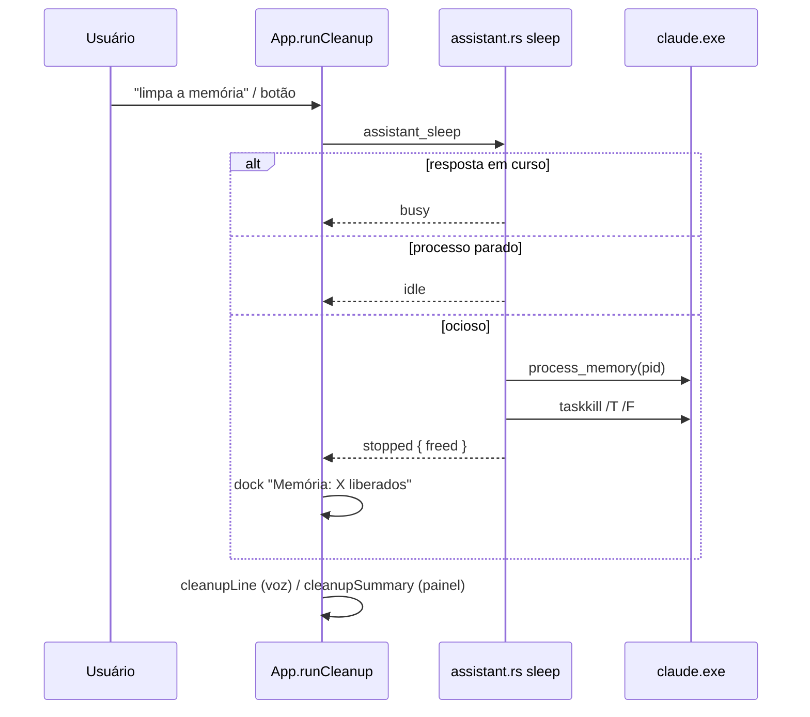

# Limpeza de memória (garbage collector)

Encerra o Claude Code parado do JARVIS e devolve a RAM dele ao sistema, sem perder a conversa.

| | |
|---|---|
| **ID** | `feature/memory-cleanup` |
| **Status** | Implementado · não commitado |
| **Origem** | não commitado (27/10) |
| **Voz** | `shortcut:cleanup` |

## Visão geral

O Claude Code que responde como JARVIS fica rodando entre as perguntas para responder rápido, e por isso ocupa RAM o tempo todo. A limpeza de memória ("Jarvis, limpa a memória", "ativa o garbage collector", ou o botão "Limpar memória" nas Configurações) encerra esse processo quando ele está parado e devolve a RAM ao sistema. A conversa não se perde: a próxima pergunta inicia o processo de novo, na mesma sessão. Isso **não** tem relação com a memória de longo prazo do JARVIS (`Memória.md`), que continua intacta. A [persona](../../domain/jarvis-persona.md) instrui o Claude a nunca apagar `Memória.md` por causa desse pedido.

## Dados

A limpeza não guarda nada. A sessão continua em memória no Rust e em `jarvis.assistant` ([assistant](../assistant/spec.md)).

- `$resultado`: o **Cleanup / Sleep** `{ outcome: "stopped", freed } | { outcome: "busy" } | { outcome: "idle" }`, com `freed` em bytes (0 quando não deu para ler). Só em memória. Ver [glossário](../../domain/glossary.md).

## Componentes

### Parar o processo (`Assistant::sleep`)

No Rust, decide pelo estado do `claude.exe`: ocupado, parado ou ocioso.

- **Comportamento:**
  - **RF-001**: `assistant_sleep` DEVE devolver `busy` sem tocar no processo quando há uma resposta em curso.
  - **RF-002**: DEVE devolver `idle` quando o processo não está rodando (e recolher um que já terminou).
  - **RF-003**: Com o processo ocioso, DEVE medir a RAM dele (working set), encerrá-lo e devolver `stopped { freed }` em bytes.
    - `process_memory(pid)` lê o working set por `K32GetProcessMemoryInfo`, e `kill_tree` encerra a árvore com `taskkill /T /F`.
    - Se a RAM do processo não puder ser lida, encerre-o mesmo assim e devolva `freed` = 0.
  - **RF-004**: A sessão do Claude Code DEVE ser preservada para a próxima pergunta.
    - Se vier uma pergunta logo depois, o processo sobe de novo com `--resume` na mesma sessão.

### Ponto de entrada na UI (`cleanMemory`, `runCleanup`)

Uma só porta de entrada para a voz e para o botão.

- **Comportamento:**
  - **RF-006**: Voz e botão DEVEM usar a mesma função (`runCleanup` → `cleanMemory`).
  - `cleanMemory` chama `assistant_sleep`. Fora do Tauri, devolve `null`; em DEV, o fake `window.__JARVIS_CLEANUP__` define o resultado.
  - Com `stopped`, `runCleanup` avisa na dock "Memória: <tamanho> liberados" ou, com `freed` = 0, "Memória liberada".
  - **RF-005**: A fala e o resumo DEVEM formatar bytes como "215 MB" / "1,3 GB" (e, falado, "megabytes"/"gigabytes").
    - `formatBytes` escreve o tamanho e `spokenBytes` o fala por extenso.

### Resposta falada (`cleanupLine`)

O que o JARVIS diz depois da limpeza pedida por voz.

- **Comportamento:**
  - Com `stopped`, diga uma fala `cleanupDone` com o tamanho falado (ex.: "Memória liberada, Tony: 215 megabytes devolvidos ao sistema. O Claude volta na próxima pergunta."). Com `freed` = 0, diga `cleanupStopped`.
  - Com `busy`, diga `cleanupBusy`. Com `idle`, diga `cleanupIdle` ("Nada a recolher…").
  - Fora do Tauri, diga "Receio que isso só funcione no app desktop." (`desktopOnly`).
  - Se o comando der erro, mostre a mensagem na dock como erro.

### `CleanupRow` (Configurações → Cérebro do JARVIS)

O botão "Limpar memória", para quem não usa a voz.

- **Comportamento:**
  - Quando o usuário clicar em "Limpar memória", o botão vira "Limpando…" e fica desabilitado até o resultado chegar.
  - O resultado vem de `cleanupSummary` (por `onCleanMemory`):
    - `stopped`: "<tamanho> de RAM liberados. Ele volta na próxima pergunta, na mesma conversa.". Com `freed` = 0, a frase começa por "Claude Code encerrado".
    - `busy`: "O Claude Code está respondendo agora. Tente de novo quando ele terminar.".
    - `idle`: "Nada a liberar: o Claude Code já estava parado.".
  - Fora do Tauri, mostre "Disponível no app desktop.". Se o comando der erro, mostre a mensagem no lugar do resultado.
- **Layout:**
  - Um cartão com o título "Limpeza de memória" e a descrição à esquerda ("Garbage collector: encerra o Claude Code parado e devolve a RAM dele. Ele volta na próxima pergunta, na mesma conversa. Por voz: “limpa a memória”.") e o botão à direita.
  - O resultado aparece embaixo, num `role="status"` (`cleanup-result`).
- **Estilo:**
  - Cartão `rounded-xl border border-hud-cyan/12 bg-white/[0.02] px-4 py-3`.
  - Título em `text-sm text-hud-text`; descrição em `text-xs text-hud-text/50`.
  - Botão `ActionButton`: `rounded-xl border border-hud-cyan/20`, `text-xs` maiúsculas `tracking-[0.14em] text-hud-text/80`, com opacidade 35% desabilitado.
  - Resultado em `text-xs text-hud-light/85`.

### Separação da memória de longo prazo

- **Comportamento:**
  - As frases de `shortcut:cleanup` ficam separadas das de `shortcut:memory`: "Guarda na memória que eu moro em Curitiba" é o atalho `memory`, não a limpeza.
  - A persona diz ao Claude que "limpar a memória" nunca esvazia `Memória.md`.

## Voz e teclado

- "limpa a memória", "faz uma limpeza de memória", "libera memória", "ativa o garbage collector", "garbage collection", "coleta de lixo"… (`shortcut:cleanup`, 22 frases): `runCleanup` + fala.
  - No modo "Sempre ouvindo", a frase só vale com o nome do JARVIS.
- Configurações → Cérebro do JARVIS → "Limpar memória": `runCleanup` + resumo.

## Restrições

- **RNF-001**: A limpeza nunca usa o Claude Code nem a rede.
- **RNF-002**: Nunca altera `Memória.md`.
- Só com o JARVIS ocioso.

## Histórias de usuário

### US1 — Liberar a RAM pela voz (P1)

Como usuário, digo "limpa a memória" e o JARVIS diz quanto liberou.

**Por que P1:** o processo do Claude pesa num notebook com pouca memória.
**Teste independente:** `tests/shortcuts.spec.ts` — "the memory cleanup: Claude Code's RAM given back, said by JARVIS or shown in the settings".

**Aceite**

1. **Dado** o Claude Code parado usando 215 MB, **quando** digo "Ativa o garbage collector", **então** o processo é encerrado, a dock mostra "Memória: 215 MB liberados" e o JARVIS diz uma fala `cleanupDone` (ex.: "Memória liberada, Tony: 215 megabytes devolvidos ao sistema. O Claude volta na próxima pergunta.").
2. **Dado** a limpeza, **quando** acontece, **então** nada é perguntado ao Claude Code.

### US2 — Nunca no meio de uma resposta (P1)

**Teste independente:** `tests/shortcuts.spec.ts` (mesmo teste, com `outcome: "busy"`).

**Aceite**

1. **Dado** o JARVIS respondendo, **quando** peço a limpeza, **então** o processo continua e ele diz uma fala `cleanupBusy` (ex.: "Agora não, receio: o Claude está trabalhando. Peça de novo em instantes.").
2. **Dado** o Claude Code ainda não iniciado (ou já encerrado), **quando** peço, **então** ele diz uma fala `cleanupIdle` ("Nada a recolher…").

### US3 — Botão nas Configurações (P2)

Como usuário, clico em "Limpar memória" em Configurações → Cérebro do JARVIS.

**Por que P2:** quem não usa a voz também precisa do recurso.
**Teste independente:** `tests/shortcuts.spec.ts` (parte final do mesmo teste).

**Aceite**

1. **Dado** 180 MB em uso, **quando** clico, **então** o botão mostra "Limpando…" e depois aparece "180 MB de RAM liberados. Ele volta na próxima pergunta, na mesma conversa.".
2. **Dado** o Claude ocupado, **quando** clico, **então** aparece "O Claude Code está respondendo agora. Tente de novo quando ele terminar.".
3. **Dado** o Claude parado, **quando** clico, **então** aparece "Nada a liberar: o Claude Code já estava parado.".

### US4 — Não confundir com "lembrar" (P2)

**Teste independente:** Rust `the_memory_cleanup_is_not_the_long_term_memory` (`src-tauri/src/voice/matcher.rs`).

**Aceite**

1. **Dado** "Guarda na memória que eu moro em Curitiba", **quando** dito, **então** é o atalho `memory` (gravar em `Memória.md`), não a limpeza.
2. **Dado** o modo "Sempre ouvindo", **quando** digo "limpa a memória" sem o nome do JARVIS, **então** nada acontece.

## Critérios de sucesso

- **SC-001**: Depois da limpeza não sobra nenhum `claude.exe` do JARVIS rodando até a próxima pergunta.
- **SC-002**: A conversa continua de onde parou depois da limpeza.

## Fora de escopo e limitações

- Liberar memória de outros programas ou do próprio jvOS.
- Esquecer coisas da memória de longo prazo: isso é pedido ao JARVIS em linguagem natural ([assistant](../assistant/spec.md)).
- `freed` conta só o processo `claude.exe` principal.

## Código

`Assistant::sleep` no Rust decide pelo estado do processo `claude.exe`: ocupado, parado ou ocioso. No caso ocioso, lê o working set do processo, encerra a árvore (`kill_tree`) e preserva o id da sessão. A UI tem uma só porta de entrada (`cleanMemory` em `src/lib/cleanup.ts`), usada pelo atalho de voz `cleanup` e pelo botão das Configurações. O resultado vira fala (`cleanupLine`), aviso na dock e resumo no painel (`cleanupSummary`).

| | |
|---|---|
| **Camadas** | `SettingsPanel` (`CleanupRow`) · `App.tsx` (`runCleanup`, caso `cleanup`) · `src/lib/cleanup.ts` · comando `assistant_sleep` · `assistant.rs` (`sleep`) · `system.rs` (`process_memory`) |
| **Dependências** | `K32GetProcessMemoryInfo` (Win32); `taskkill /T /F` via `kill_tree` |
| **Testes** | `tests/shortcuts.spec.ts`; Rust em `assistant.rs` e `matcher.rs` |
| **Plataforma** | Windows 11 · WebView2. Fora do Tauri: `null` ("Disponível no app desktop") ou o fake `__JARVIS_CLEANUP__` em DEV |

### Arquivos

| Arquivo | Papel |
|---|---|
| `src-tauri/src/assistant.rs` | `Sleep` (`Stopped { freed }`, `Busy`, `Idle`) e `Assistant::sleep` |
| `src-tauri/src/system.rs` | `process_memory(pid)` → working set em bytes |
| `src-tauri/src/lib.rs` | comando `assistant_sleep` |
| `src/lib/cleanup.ts` | `Cleanup`, `cleanMemory`, `formatBytes`, `spokenBytes`, `cleanupLine`, `cleanupSummary`, fake `__JARVIS_CLEANUP__` |
| `src/lib/jarvisLines.ts` | falas `cleanupDone`, `cleanupStopped`, `cleanupIdle`, `cleanupBusy` |
| `src/App.tsx` | `runCleanup` (aviso "Memória: … liberados" / "Memória liberada"), caso `cleanup`, `onCleanMemory` |
| `src/components/SettingsPanel.tsx` | `CleanupRow`: "Limpeza de memória", "Limpar memória" / "Limpando…", resultado (`cleanup-result`) |
| `src-tauri/assistant-persona.md` | regra: "limpar a memória" não apaga `Memória.md` |

### Contratos

#### Comandos Tauri

| Comando | Entrada | Saída | Notas |
|---|---|---|---|
| `assistant_sleep` | — | `{ outcome: "stopped", freed } \| { outcome: "busy" } \| { outcome: "idle" }` | `freed` em bytes; 0 quando não deu para ler |

#### Eventos e Channels

| Nome | Payload | Emissor → consumidor |
|---|---|---|
| `voice:shortcut` | `{ action: "cleanup", text, said }` | matcher → `shortcutHandler` |

### Fluxo

### Constituição

- [x] P1 Offline-first — local, sem Claude e sem rede.
- [x] P2 Rust é dono do nativo — medir e encerrar o processo é do Rust.
- [x] P3 Comandos finos — `assistant_sleep` em `lib.rs` chama `assistant.sleep()` via `blocking()`.
- [x] P4 Contratos espelhados — `Cleanup` com "Mirrors `Sleep` in `src-tauri/src/assistant.rs`"; enum com tag `outcome` vira união discriminada.
- [x] P6 Fora do Tauri — fake de DEV `window.__JARVIS_CLEANUP__`; sem ele, mensagem de app desktop.
- [x] P7 PT-BR — falas e resumos em PT-BR.
- [x] P11 Testes — Playwright para voz e botão; Rust para o caso sem processo e a serialização.

### Decisões relacionadas

- [ADR-0006 — JARVIS via claude.exe (processo pré-aquecido)](../../arch/adr/0006-jarvis-via-claude-cli.md)
- [ADR-0011 — fakes de dev e E2E modo web](../../arch/adr/0011-fakes-de-dev-e-e2e-modo-web.md)

## Tarefas

Legenda: `[x]` feito · `[ ]` pendente · `[P]` pode rodar em paralelo (arquivos diferentes) · `[USn]` história desta spec. As tarefas foram reconstruídas do código e do commit de origem.

### Fase 1 — Base

- [x] T001 [P] `Sleep` e `Assistant::sleep` (busy / idle / stopped com `freed`; sessão preservada) — `src-tauri/src/assistant.rs`
- [x] T002 [P] `process_memory` (working set) — `src-tauri/src/system.rs`
- [x] T003 Comando `assistant_sleep` — `src-tauri/src/lib.rs`
- [x] T004 [P] `Cleanup`, `cleanMemory`, `formatBytes`, `spokenBytes`, `cleanupLine`, `cleanupSummary`, fake `__JARVIS_CLEANUP__` — `src/lib/cleanup.ts`
- [x] T005 [P] Falas `cleanupDone`, `cleanupStopped`, `cleanupIdle`, `cleanupBusy` — `src/lib/jarvisLines.ts`
- [x] T006 Entrada `shortcut:cleanup` (22 frases) e `cleanup` em `SHORTCUT_TARGETS` — `src-tauri/voice-commands.json`, `src-tauri/src/settings.rs`

### Fase 2 — US1 e US2 Pela voz (P1)

- [x] T007 [US1] `runCleanup` com aviso na dock e caso `cleanup` falando `cleanupLine` (ou `desktopOnly`) — `src/App.tsx`
- [x] T008 [US2] Ocupado e parado respondidos sem tocar no processo — `src-tauri/src/assistant.rs`

### Fase 3 — US3 Botão nas Configurações (P2)

- [x] T009 [US3] `CleanupRow` em "Cérebro do JARVIS" com "Limpando…" e resultado — `src/components/SettingsPanel.tsx`
- [x] T010 [US3] `onCleanMemory` → `cleanupSummary` ou "Disponível no app desktop." — `src/App.tsx`

### Fase 4 — US4 Não é a memória de longo prazo (P2)

- [x] T011 [US4] Frases de limpeza separadas das de `shortcut:memory` — `src-tauri/voice-commands.json`
- [x] T012 [US4] Regra da persona: nunca esvaziar `Memória.md` por esse pedido — `src-tauri/assistant-persona.md`

### Fase 5 — Testes

- [x] T013 Playwright `tests/shortcuts.spec.ts` — "the memory cleanup: Claude Code's RAM given back, said by JARVIS or shown in the settings"
- [x] T014 Rust `src-tauri/src/assistant.rs` — `the_cleanup_has_nothing_to_stop_before_the_first_question`
- [x] T015 Rust `src-tauri/src/voice/matcher.rs` — `the_memory_cleanup_is_not_the_long_term_memory`

## Pendências

- [ ] `freed` mede só o working set do `claude.exe` principal (`process_memory(running.child.id())` em `src-tauri/src/assistant.rs`), embora `kill_tree` encerre a árvore inteira com `taskkill /T /F`; a RAM de processos filhos não entra na conta.
- [ ] O caminho `Stopped` contra um processo real não tem teste: o teste Rust cobre só `Idle` e a serialização, e o Playwright usa o fake `__JARVIS_CLEANUP__`.
