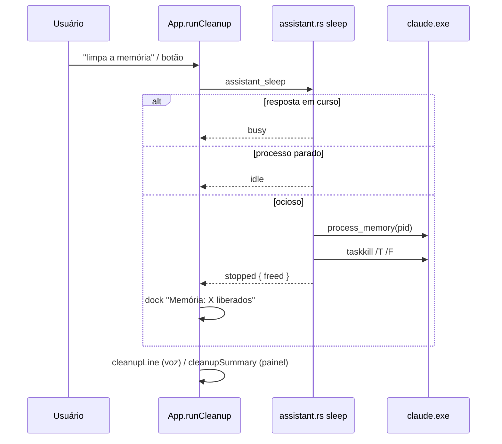

# Feature Specification: Memory Cleanup

## Metadata

| Field | Value |
|---|---|
| Feature ID | `feature/memory-cleanup` |
| Product | JARVIS OS (jvOS) |
| Feature Status | Implementado |
| Document Status | Reescrita em 2026-11-05 no formato Feature Specification; sem decisões de produto em aberto |
| Source Commit | `e7151cf` (2026-11-05) |
| Uncommitted Changes | Nenhuma |
| Voice Shortcut | `shortcut:cleanup` |
| Assistant Tool | — |
| Target Platforms | Windows 11 com WebView2 (app desktop). No navegador (modo web) não há processo para encerrar: a voz responde `desktopOnly` e o painel "Disponível no app desktop."; em DEV, o fake `window.__JARVIS_CLEANUP__` define o resultado |
| Language | PT-BR no conteúdo e nas falas; inglês nos títulos das seções e em Given / When / Then |
| Last Editorial Revision | 2026-11-05 |
| Verification Scope | Conferida com o código em 2026-11-05: `src/lib/cleanup.ts`, `src/lib/jarvisLines.ts`, `src/App.tsx`, `src/components/SettingsPanel.tsx`, `src/components/hud.tsx`, `src/hooks/useAssistant.ts`, `src-tauri/src/assistant.rs`, `src-tauri/src/system.rs`, `src-tauri/src/git/mod.rs`, `src-tauri/src/lib.rs`, `src-tauri/src/voice/matcher.rs`, `src-tauri/src/settings.rs`, `src-tauri/voice-commands.json`, `src-tauri/assistant-persona.md` e `tests/shortcuts.spec.ts`. Os testes não foram executados nesta revisão |

Especificação no formato inspirado no GitHub Spec Kit, com seções de desenho técnico ([ADR-0025](../../arch/adr/0025-features-formato-feature-specification.md)). Os identificadores US1–US4, RF-001–RF-006, RNF-001–RNF-002, SC-001–SC-002 e T001–T015 são os mesmos da versão anterior. Os critérios de aceite AC-001–AC-009 são os antigos "Critério 1" a "Critério 9", na mesma ordem. KL-* registra limitações conhecidas; OQ-*, decisões de produto em aberto. Nenhum dos dois acrescenta escopo.

## Overview

O Claude Code que responde como JARVIS fica rodando entre as perguntas para responder rápido, e por isso ocupa RAM o tempo todo. A limpeza de memória ("Jarvis, limpa a memória", "ativa o garbage collector", ou o botão "Limpar memória" nas Configurações) encerra esse processo quando ele está parado e devolve a RAM ao sistema.

A conversa não se perde: o processo volta na mesma sessão, com `--resume`, na próxima pergunta. A limpeza **não** tem relação com a memória de longo prazo do JARVIS (`Memória.md`), que continua intacta; a [persona](../../domain/jarvis-persona.md) instrui o Claude a nunca apagar `Memória.md` por causa desse pedido.

| Input | Expected Behavior | Execution Path |
|---|---|---|
| "Jarvis, limpa a memória" com o Claude Code parado | O processo é encerrado; a dock mostra "Memória: 215 MB liberados" e o JARVIS diz quanto liberou | Rust (`assistant_sleep`) → fala local |
| "Ativa o garbage collector" durante uma resposta | Nada é encerrado; o JARVIS pede para tentar depois | Rust (`busy`) |
| Botão "Limpar memória" (Configurações › Cérebro do JARVIS) | "Limpando…" e, embaixo, o resumo do que foi feito | Rust (`assistant_sleep`) |
| "Guarda na memória que eu moro em Curitiba" | Não é a limpeza: é o atalho `memory` | Claude Code ([assistant](../assistant/spec.md)) |

## Goals and Success Criteria

### Goals

- Devolver ao sistema a RAM do Claude Code parado, a pedido do usuário.
- Nunca interromper uma resposta.
- Não perder a conversa.
- Ter o mesmo recurso pela voz e por um botão.
- Nunca confundir "limpar a memória" com esquecer o que o JARVIS sabe.

### Success Criteria

| ID | Criterion | Verification |
|---|---|---|
| SC-001 | Depois da limpeza não sobra nenhum `claude.exe` do JARVIS rodando até a próxima pergunta (ou até o usuário começar a falar com o núcleo, que já aquece o processo). | `kill_tree` (`taskkill /T /F`) e `wait` em `Assistant::stop`; conferir no Gerenciador de Tarefas. Sem teste contra um processo real (KL-002). |
| SC-002 | A conversa continua de onde parou depois da limpeza. | `stop` não apaga `shared.session`; a próxima pergunta sobe o processo com `--resume` na mesma sessão. |

## Scope and Non-Goals

### In Scope

- Encerrar o `claude.exe` do JARVIS quando ocioso, medir a RAM dele e dizer quanto foi devolvido.
- Recusar a limpeza com uma resposta em curso; responder "nada a recolher" sem processo.
- O atalho de voz `shortcut:cleanup`, o botão "Limpar memória" e as falas `cleanup*`.
- Manter a sessão do Claude Code para a próxima pergunta.
- Separar as frases da limpeza das de `shortcut:memory`.

### Out of Scope

- Liberar memória de outros programas ou do próprio jvOS.
- Esquecer coisas da memória de longo prazo: isso é pedido ao JARVIS em linguagem natural ([assistant](../assistant/spec.md)).
- Contar a RAM dos processos filhos: `freed` conta só o processo `claude.exe` principal (KL-001).

## User Stories

### US1 — Free the RAM by Voice

**Priority:** P1.

**User Story:** Como usuário, digo "limpa a memória" e o JARVIS diz quanto liberou.

**Why This Priority:** o processo do Claude pesa num notebook com pouca memória.

**Independent Test:** `tests/shortcuts.spec.ts` — "the memory cleanup: Claude Code's RAM given back, said by JARVIS or shown in the settings".

**Acceptance Criteria:** AC-001 e AC-002.

### US2 — Never in the Middle of an Answer

**Priority:** P1.

**User Story:** Como usuário, peço a limpeza a qualquer momento sem medo de cortar uma resposta.

**Why This Priority:** perder uma resposta pela metade é pior que esperar a RAM.

**Independent Test:** `tests/shortcuts.spec.ts` — "the memory cleanup: Claude Code's RAM given back, said by JARVIS or shown in the settings" (com `outcome: "busy"`).

**Acceptance Criteria:** AC-003 e AC-004.

### US3 — Button in the Settings

**Priority:** P2.

**User Story:** Como usuário, clico em "Limpar memória" em Configurações › Cérebro do JARVIS.

**Why This Priority:** quem não usa a voz também precisa do recurso.

**Independent Test:** `tests/shortcuts.spec.ts` — "the memory cleanup: Claude Code's RAM given back, said by JARVIS or shown in the settings" (parte final).

**Acceptance Criteria:** AC-005, AC-006 e AC-007.

### US4 — Not to Be Confused With "Remember"

**Priority:** P2.

**User Story:** Como usuário, peço para guardar algo na memória do JARVIS sem disparar a limpeza, e vice-versa.

**Why This Priority:** as duas coisas usam a palavra "memória", e uma apagaria o que a outra guarda.

**Independent Test:** `src-tauri/src/voice/matcher.rs` — `the_memory_cleanup_is_not_the_long_term_memory`.

**Acceptance Criteria:** AC-008 e AC-009.

## Requirements

### Functional Requirements

| ID | Requirement | Related Stories |
|---|---|---|
| RF-001 | `assistant_sleep` DEVE devolver `busy` sem tocar no processo quando há uma resposta em curso. | US2 |
| RF-002 | `assistant_sleep` DEVE devolver `idle` quando o processo não está rodando, e recolher um que já terminou. | US2 |
| RF-003 | Com o processo ocioso, `assistant_sleep` DEVE medir a RAM dele (working set), encerrá-lo e devolver `stopped { freed }` em bytes; se a RAM não puder ser lida, encerra mesmo assim com `freed` = 0. | US1, US3 |
| RF-004 | A sessão do Claude Code DEVE ser preservada para a próxima pergunta. | US1, US3 |
| RF-005 | A fala e o resumo DEVEM formatar bytes como "215 MB" / "1,3 GB" (e, falado, "megabytes"/"gigabytes"). | US1, US3 |
| RF-006 | Voz e botão DEVEM usar a mesma função (`runCleanup` → `cleanMemory`). | US1, US3 |

### Non-Functional Requirements

| ID | Requirement | Scope |
|---|---|---|
| RNF-001 | A limpeza nunca usa o Claude Code nem a rede. | Todo o fluxo |
| RNF-002 | A limpeza nunca altera `Memória.md`. | Rust, UI e a persona |

### Operational Constraints

- Só com o JARVIS ocioso (sem turno em curso no Rust).
- A limpeza não grava nada: a sessão continua em memória no Rust e em `jarvis.assistant`.
- `taskkill /T /F` atinge só a árvore do `claude.exe` do JARVIS.
- Abaixo de 1 MB, o tamanho aparece como "1 MB"; a partir de 1 GiB, em GB com uma casa e vírgula.

## Acceptance Criteria

### AC-001 — Stop the Idle Process by Voice

**Related Story:** US1.

- **Given** o Claude Code parado usando 215 MB
- **When** digo "Ativa o garbage collector"
- **Then** o processo é encerrado, a dock mostra "Memória: 215 MB liberados" e o JARVIS diz uma fala `cleanupDone` (ex.: "Memória liberada, Tony: 215 megabytes devolvidos ao sistema. O Claude volta na próxima pergunta.").

### AC-002 — No Question to Claude Code

**Related Story:** US1.

- **Given** a limpeza pedida por voz
- **When** ela acontece
- **Then** nada é perguntado ao Claude Code.

### AC-003 — Refuse While Answering

**Related Story:** US2.

- **Given** o JARVIS respondendo
- **When** peço a limpeza
- **Then** o processo continua e ele diz uma fala `cleanupBusy` (ex.: "Agora não, receio: o Claude está trabalhando. Peça de novo em instantes.").

### AC-004 — Nothing to Collect

**Related Story:** US2.

- **Given** o Claude Code ainda não iniciado (ou já encerrado)
- **When** peço a limpeza por voz
- **Then** ele diz uma fala `cleanupIdle` (ex.: "Nada a recolher. O Claude já estava em repouso.").

**Coverage Status:** o `idle` é testado no Rust; a fala, não (KL-003).

### AC-005 — Button: Freed

**Related Story:** US3.

- **Given** 180 MB em uso
- **When** clico em "Limpar memória"
- **Then** o botão mostra "Limpando…" e depois aparece "180 MB de RAM liberados. Ele volta na próxima pergunta, na mesma conversa.".

### AC-006 — Button: Busy

**Related Story:** US3.

- **Given** o Claude ocupado
- **When** clico em "Limpar memória"
- **Then** aparece "O Claude Code está respondendo agora. Tente de novo quando ele terminar.".

**Coverage Status:** sem teste automatizado (KL-003).

### AC-007 — Button: Already Stopped

**Related Story:** US3.

- **Given** o Claude parado
- **When** clico em "Limpar memória"
- **Then** aparece "Nada a liberar: o Claude Code já estava parado.".

### AC-008 — "Guarda na memória" Is Not the Cleanup

**Related Story:** US4.

- **Given** o segurar-para-falar
- **When** digo "Guarda na memória que eu moro em Curitiba"
- **Then** é o atalho `memory` (gravar em `Memória.md`), não a limpeza.

### AC-009 — Needs the Name in "Sempre ouvindo"

**Related Story:** US4.

- **Given** o modo "Sempre ouvindo"
- **When** digo "limpa a memória" sem o nome do JARVIS
- **Then** nada acontece.

## Behavior and Flows

### Stop the Process (`Assistant::sleep`)

No Rust, decide pelo estado do `claude.exe`: ocupado, parado ou ocioso (RF-001 a RF-004).

- **Behavior:**
  - Com um turno em curso (`shared.turn`), devolve `Busy` e não toca no processo.
  - Sem processo, ou com um que já terminou (`try_wait` diferente de `Ok(None)`), recolhe o que houver e devolve `Idle`.
  - Ocioso: lê o working set com `process_memory(pid)` (`K32GetProcessMemoryInfo`), encerra a árvore com `kill_tree` (`taskkill /T /F`, depois `kill`) e espera o fim (`wait`). Devolve `Stopped { freed }`, com 0 se a leitura falhou.
  - `stop` incrementa a geração do processo e não mexe em `shared.session`: a sessão fica para a próxima pergunta, que sobe o processo com `--resume`.

### UI Entry Point (`cleanMemory`, `runCleanup`)

Uma só porta de entrada para a voz e para o botão (RF-006).

- **Behavior:**
  - `cleanMemory` chama `assistant_sleep`. Fora do Tauri, devolve o fake `window.__JARVIS_CLEANUP__` em DEV, ou `null`.
  - Com `stopped`, `runCleanup` avisa na dock (item Voice) "Memória: <tamanho> liberados" ou, com `freed` = 0, "Memória liberada".
  - `formatBytes` escreve o tamanho ("215 MB", "1,3 GB") e `spokenBytes` o fala por extenso ("215 megabytes") (RF-005).

### Spoken Answer (`cleanupLine`)

O que o JARVIS diz depois da limpeza pedida por voz.

- **Behavior:**
  - `stopped` com `freed` acima de 0: uma fala `cleanupDone` com o tamanho falado. Com `freed` = 0: `cleanupStopped`.
  - `busy`: `cleanupBusy`. `idle`: `cleanupIdle`.
  - Fora do Tauri (sem fake): `desktopOnly`, "Receio que isso só funcione no app desktop.".
  - Se o comando der erro, a mensagem vai para a dock como erro.
  - A fala vai por `reply`: no núcleo e no histórico, ou na dock com o JARVIS ocupado.

### `CleanupRow` (Settings › Cérebro do JARVIS)

O botão "Limpar memória", para quem não usa a voz.

- **Behavior:**
  - Ao clicar em "Limpar memória", o botão vira "Limpando…" e fica desabilitado até o resultado chegar.
  - O resultado vem de `cleanupSummary` (por `onCleanMemory`):
    - `stopped`: "<tamanho> de RAM liberados. Ele volta na próxima pergunta, na mesma conversa."; com `freed` = 0, "Claude Code encerrado. Ele volta na próxima pergunta, na mesma conversa.".
    - `busy`: "O Claude Code está respondendo agora. Tente de novo quando ele terminar.".
    - `idle`: "Nada a liberar: o Claude Code já estava parado.".
  - Fora do Tauri (sem fake), mostra "Disponível no app desktop.". Se o comando der erro, mostra a mensagem no lugar do resultado.
- **Layout:**
  - Um cartão com o título "Limpeza de memória" e a descrição à esquerda ("Garbage collector: encerra o Claude Code parado e devolve a RAM dele. Ele volta na próxima pergunta, na mesma conversa. Por voz: “limpa a memória”.") e o botão à direita.
  - O resultado aparece embaixo, num `role="status"` (`data-testid="cleanup-result"`).
  - O cartão fica no fim da seção "Cérebro do JARVIS", depois de "Como ele te chama".
- **Style:**
  - Cartão `rounded-xl border border-hud-cyan/12 bg-white/[0.02] px-4 py-3`.
  - Título em `text-sm text-hud-text`; descrição em `text-xs leading-relaxed text-hud-text/50`.
  - Botão `ActionButton`: `rounded-xl border border-hud-cyan/20`, `text-xs` maiúsculas `tracking-[0.14em] text-hud-text/80`, com opacidade 35% desabilitado.
  - Resultado em `text-xs text-hud-light/85`.

### Separation From the Long-Term Memory

- **Behavior:**
  - As frases de `shortcut:cleanup` ficam separadas das de `shortcut:memory`: "Guarda na memória que eu moro em Curitiba" é o atalho `memory`.
  - `src-tauri/assistant-persona.md` diz ao Claude que "limpar a memória", "garbage collector" ou "liberar RAM" é a limpeza do jvOS: ele indica a frase ou o botão e nunca apaga nem esvazia `Memória.md` por isso.

### Interaction Flow



### User Feedback

| Moment | Persona Key | Output |
|---|---|---|
| Encerrado, RAM lida | `cleanupDone` | Dock "Memória: <tamanho> liberados"; fala com o tamanho por extenso |
| Encerrado, RAM não lida | `cleanupStopped` | Dock "Memória liberada"; fala sem tamanho |
| Resposta em curso | `cleanupBusy` | Só a fala; o processo continua |
| Nada rodando | `cleanupIdle` | Só a fala |
| Fora do app desktop | `desktopOnly` | "Receio que isso só funcione no app desktop." |
| Erro do comando | — | A mensagem na dock, como erro (voz) ou no lugar do resultado (botão) |

As variantes de cada fala estão em `src/lib/jarvisLines.ts`.

### Voice and Keyboard

- `shortcut:cleanup` tem 22 frases (`src-tauri/voice-commands.json`): "limpa a memória", "limpar a memória", "limpe a memória", "limpa memória", "limpar memória", "limpeza de memória", "faz uma limpeza de memória", "faça uma limpeza de memória", "fazer limpeza de memória", "libera memória", "libera a memória", "liberar memória", "ativa o garbage collector", "ativar o garbage collector", "ativa garbage collector", "ativar garbage collector", "roda o garbage collector", "garbage collector", "garbage collection", "limpa o garbage collection", "limpar garbage collection" e "coleta de lixo". Elas levam a `runCleanup` e à fala.
- No modo "Sempre ouvindo", a frase só vale com o nome do JARVIS; na ativação por voz, depois de "Jarvis".
- Configurações › Cérebro do JARVIS › "Limpar memória": `runCleanup` e o resumo.
- Não há tecla de atalho.

## Data Model and Persistence

### Cleanup Result

```ts
// Espelha Sleep em src-tauri/src/assistant.rs
type Cleanup =
  | { outcome: "stopped"; freed: number } // bytes; 0 quando não deu para ler
  | { outcome: "busy" }
  | { outcome: "idle" };
```

```rust
#[serde(tag = "outcome", rename_all = "camelCase", rename_all_fields = "camelCase")]
pub enum Sleep {
    Stopped { freed: u64 },
    Busy,
    Idle,
}
```

Ver o [glossário](../../domain/glossary.md).

### Storage Rules

| Property | Value |
|---|---|
| State | `$resultado` (`Cleanup`), só em memória |
| Storage | Nenhum: a limpeza não grava nada |
| Session | Continua em memória no Rust (`shared.session`) e em `jarvis.assistant` ([assistant](../assistant/spec.md)) |
| Missing or Invalid Storage | Não se aplica |

## Technical Design

### Component Responsibilities

| File or Component | Responsibility |
|---|---|
| `src-tauri/src/assistant.rs` | `Sleep` (`Stopped { freed }`, `Busy`, `Idle`) e `Assistant::sleep` |
| `src-tauri/src/system.rs` | `process_memory(pid)` → working set em bytes (`None` fora do Windows ou sem acesso) |
| `src-tauri/src/git/mod.rs` | `kill_tree`: `taskkill /T /F /PID` sem janela, depois `kill` |
| `src-tauri/src/lib.rs` | Comando `assistant_sleep` (por `blocking()`) |
| `src/lib/cleanup.ts` | `Cleanup`, `cleanMemory`, `formatBytes`, `spokenBytes`, `cleanupLine`, `cleanupSummary`, fake `__JARVIS_CLEANUP__` |
| `src/lib/jarvisLines.ts` | Falas `cleanupDone`, `cleanupStopped`, `cleanupIdle`, `cleanupBusy`, `desktopOnly` |
| `src/App.tsx` | `runCleanup` (aviso na dock), caso `cleanup` do `shortcutHandler`, `onCleanMemory` |
| `src/components/SettingsPanel.tsx` | `CleanupRow`: "Limpeza de memória", "Limpar memória" / "Limpando…", resultado (`cleanup-result`) |
| `src-tauri/voice-commands.json` | `shortcut:cleanup` e as 22 frases |
| `src-tauri/src/settings.rs` | `cleanup` em `SHORTCUT_TARGETS` |
| `src-tauri/assistant-persona.md` | Regra: "limpar a memória" não apaga `Memória.md` |

### When the Process Comes Back

Depois da limpeza, o `claude.exe` sobe de novo (com `--resume` na mesma sessão) quando:

1. Uma pergunta chega (`assistant_ask` → `ensure`).
2. O usuário começa a falar com o núcleo: `useAssistant.listen` já aquece o processo (`assistant_warm`).
3. O usuário pede "Nova conversa" ou limpa o histórico (aí sem sessão).

### Related Architecture Decisions

- [ADR-0006 — o cérebro do JARVIS é o `claude.exe` local](../../arch/adr/0006-jarvis-via-claude-cli.md)
- [ADR-0011 — fakes de dev e E2E no modo web](../../arch/adr/0011-fakes-de-dev-e-e2e-modo-web.md)

## Interfaces and Contracts

### Tauri Commands

| Command | Input | Output | Notes |
|---|---|---|---|
| `assistant_sleep` | — | `{ outcome: "stopped", freed } \| { outcome: "busy" } \| { outcome: "idle" }` | `freed` em bytes; 0 quando não deu para ler |

### Events and Channels

| Event | Payload | Producer → Consumer |
|---|---|---|
| `voice:shortcut` | `{ action: "cleanup", text, said }` | matcher → `shortcutHandler` |

### Development Fake

| Field | Usage |
|---|---|
| `window.__JARVIS_CLEANUP__` | Só em DEV e fora do Tauri: o `Cleanup` que `cleanMemory` devolve |

## Edge Cases and Error Handling

| Case | Behavior | Reference |
|---|---|---|
| Nenhum `claude.exe` rodando (antes da primeira pergunta) | `idle`: `cleanupIdle` na voz e "Nada a liberar: o Claude Code já estava parado." no painel | AC-004, AC-007 |
| Um `claude.exe` que já terminou | Só é recolhido; `idle` | RF-002 |
| A RAM do processo não pode ser lida | Encerrado mesmo assim, com `freed` = 0: dock "Memória liberada", fala `cleanupStopped`, painel "Claude Code encerrado…" | RF-003 |
| Menos de 1 MB lido | Aparece como "1 MB" | Operational Constraints |
| Limpeza pedida duas vezes seguidas | A segunda encontra o processo parado e devolve `idle`, sem efeito | RF-002 |
| Duplo clique no botão | Desabilitado em "Limpando…" até o resultado chegar | `CleanupRow` |
| Resposta em curso | `busy`; o processo continua | AC-003, AC-006 |
| Pergunta ainda no Whisper (sem turno no Rust) | Não conta como ocupado: o processo é encerrado e a pergunta o sobe de novo | Stop the Process |
| Pergunta logo depois da limpeza | O processo sobe de novo com `--resume`, na mesma sessão | SC-002 |
| Sessão que não existe mais no Claude Code | A próxima pergunta começa uma sessão nova (`session_exists`) | [assistant](../assistant/spec.md) |
| Erro do comando | Voz: a mensagem na dock como erro; botão: a mensagem no lugar do resultado | Spoken Answer |
| Fora do Tauri | `desktopOnly` na voz, "Disponível no app desktop." no painel; em DEV, o fake | Development Fake |
| "Limpa a memória" no "Sempre ouvindo" sem o nome | Ignorado | AC-009 |
| Permissões | `taskkill /T /F` só atinge a árvore do `claude.exe` do JARVIS; `OpenProcess` com `PROCESS_QUERY_LIMITED_INFORMATION`; `Memória.md` nunca é tocada | RNF-002 |

## Dependencies

### Feature Dependencies

| Dependency | Purpose |
|---|---|
| [assistant](../assistant/spec.md) | O `claude.exe` e a sessão que a limpeza encerra e preserva; `reply` no núcleo |
| [voice-shortcuts](../voice-shortcuts/spec.md) | O atalho `shortcut:cleanup` e o `shortcutHandler` |
| [voice-commands](../voice-commands/spec.md) | O matcher que separa a limpeza de `memory` |
| [settings](../settings/spec.md) | A seção "Cérebro do JARVIS" do botão |
| [tts](../tts/spec.md) | A fala do resultado |
| [dock-taskbar](../dock-taskbar/spec.md) | O aviso "Memória: … liberados" |

### Runtime Dependencies

- [Tauri](../../foundation/vendor/tauri/spec.md), [serde](../../foundation/vendor/serde/spec.md), [React](../../foundation/vendor/react/spec.md) e [Tailwind](../../foundation/vendor/tailwind/spec.md).
- [Claude Code](../../foundation/vendor/claude-code/spec.md): o processo encerrado.
- Win32 `K32GetProcessMemoryInfo` (working set) e `taskkill /T /F` (via `kill_tree`).

## Test Strategy and Coverage

### Reported Tests

| Test Reference | Coverage | Acceptance Mapping |
|---|---|---|
| `tests/shortcuts.spec.ts` — "the memory cleanup: Claude Code's RAM given back, said by JARVIS or shown in the settings" | `formatBytes` ("215 MB", "1,3 GB"); `cleanupSummary` do `idle`; voz com `cleanupDone` e o aviso "Memória: 215 MB liberados"; `busy` com `cleanupBusy`; nenhuma pergunta ao Claude Code; botão com "180 MB de RAM liberados…" | AC-001–AC-003, AC-005, AC-007 |
| `src-tauri/src/assistant.rs` — `the_cleanup_has_nothing_to_stop_before_the_first_question` | `idle` antes da primeira pergunta; serialização de `Sleep` com a tag `outcome` | AC-004 (resultado) |
| `src-tauri/src/voice/matcher.rs` — `the_memory_cleanup_is_not_the_long_term_memory` | Frases de limpeza em segurar-para-falar, ativação por voz e "Sempre ouvindo" com o nome; "Guarda na memória…" é `memory`; sem o nome no "Sempre ouvindo", nada | AC-008, AC-009 |

### Verification Commands

Na raiz do repositório:

```powershell
npx playwright test tests/shortcuts.spec.ts --project ui -g "memory cleanup"
```

Em `src-tauri`:

```powershell
cargo test --lib the_cleanup_has_nothing_to_stop_before_the_first_question
cargo test --lib the_memory_cleanup_is_not_the_long_term_memory
```

### Coverage Gaps

| Gap | Evidence Status | Suggested Verification |
|---|---|---|
| `Stopped` contra um processo real | Sem teste | Teste Rust que sobe um processo filho e chama `sleep` |
| Fala `cleanupIdle` (AC-004) | Sem teste | Fake `{ outcome: "idle" }` e conferir a fala |
| Botão com `busy` (AC-006) e o estado "Limpando…" | Sem teste | Fake `{ outcome: "busy" }`, clicar e conferir o texto |
| `freed` = 0 (`cleanupStopped`, "Memória liberada") | Sem teste | Fake `{ outcome: "stopped", freed: 0 }` |

## Implementation Plan

**Status Convention:** `[x]` feito · `[ ]` pendente · `[P]` pode rodar em paralelo (arquivos diferentes) · `[USn]` história desta spec. As tarefas foram reconstruídas do código e do commit de origem (`e7151cf`).

### Phase 1 — Foundation

- [x] T001 [P] `Sleep` e `Assistant::sleep` (busy / idle / stopped com `freed`; sessão preservada) — `src-tauri/src/assistant.rs`
- [x] T002 [P] `process_memory` (working set) — `src-tauri/src/system.rs`
- [x] T003 Comando `assistant_sleep` — `src-tauri/src/lib.rs`
- [x] T004 [P] `Cleanup`, `cleanMemory`, `formatBytes`, `spokenBytes`, `cleanupLine`, `cleanupSummary`, fake `__JARVIS_CLEANUP__` — `src/lib/cleanup.ts`
- [x] T005 [P] Falas `cleanupDone`, `cleanupStopped`, `cleanupIdle`, `cleanupBusy` — `src/lib/jarvisLines.ts`
- [x] T006 Entrada `shortcut:cleanup` (22 frases) e `cleanup` em `SHORTCUT_TARGETS` — `src-tauri/voice-commands.json`, `src-tauri/src/settings.rs`

### Phase 2 — By Voice (US1, US2)

- [x] T007 [US1] `runCleanup` com aviso na dock e caso `cleanup` falando `cleanupLine` (ou `desktopOnly`) — `src/App.tsx`
- [x] T008 [US2] Ocupado e parado respondidos sem tocar no processo — `src-tauri/src/assistant.rs`

### Phase 3 — Button in the Settings (US3)

- [x] T009 [US3] `CleanupRow` em "Cérebro do JARVIS" com "Limpando…" e resultado — `src/components/SettingsPanel.tsx`
- [x] T010 [US3] `onCleanMemory` → `cleanupSummary` ou "Disponível no app desktop." — `src/App.tsx`

### Phase 4 — Not the Long-Term Memory (US4)

- [x] T011 [US4] Frases de limpeza separadas das de `shortcut:memory` — `src-tauri/voice-commands.json`
- [x] T012 [US4] Regra da persona: nunca esvaziar `Memória.md` por esse pedido — `src-tauri/assistant-persona.md`

### Phase 5 — Verification

- [x] T013 Playwright `tests/shortcuts.spec.ts` — "the memory cleanup: Claude Code's RAM given back, said by JARVIS or shown in the settings"
- [x] T014 Rust `src-tauri/src/assistant.rs` — `the_cleanup_has_nothing_to_stop_before_the_first_question`
- [x] T015 Rust `src-tauri/src/voice/matcher.rs` — `the_memory_cleanup_is_not_the_long_term_memory`

## Rollback Plan

1. Tire a entrada `shortcut:cleanup` de `src-tauri/voice-commands.json` e `"cleanup"` de `SHORTCUT_TARGETS` (`src-tauri/src/settings.rs`, ajustando o tamanho do array) e de `ShortcutAction`/`SHORTCUT_ACTIONS` (`src/lib/shortcuts.ts`).
2. Tire o caso `cleanup`, `runCleanup` e `onCleanMemory` de `src/App.tsx`, o `CleanupRow` do `SettingsPanel`, `src/lib/cleanup.ts`, as falas `cleanup*` de `jarvisLines.ts` e o teste de `tests/shortcuts.spec.ts`.
3. No Rust, tire o comando `assistant_sleep` (e o registro no `invoke_handler`), `Sleep`, `Assistant::sleep` e o teste dele; `process_memory` só é usado por ele. A regra da persona sobre `Memória.md` pode ficar.
4. Nada fica órfão em disco: a limpeza não grava nada. Frases de `shortcut:cleanup` guardadas em `settings.json` são descartadas por `sanitize_voice_commands`, porque o id deixa de existir nos padrões.

## Constitution Compliance

| Principle | Status | Rationale |
|---|---|---|
| P1 — Offline-first | Atendido | Local, sem Claude e sem rede |
| P2 — Rust dono do nativo | Atendido | Medir e encerrar o processo é do Rust |
| P3 — Comandos finos | Atendido | `assistant_sleep` em `lib.rs` chama `assistant.sleep()` via `blocking()` |
| P4 — Contratos espelhados | Atendido | `Cleanup` traz "Mirrors `Sleep` in `src-tauri/src/assistant.rs`"; o enum com tag `outcome` vira união discriminada |
| P6 — Fora do Tauri | Atendido | Fake de DEV `window.__JARVIS_CLEANUP__`; sem ele, a mensagem de app desktop |
| P7 — PT-BR | Atendido | Falas e resumos em PT-BR |
| P11 — Testes | Atendido, com lacunas | Playwright para voz e botão; Rust para o caso sem processo, a serialização e o matcher; o `Stopped` real sem teste (KL-002) |

## Known Limitations

| ID | Limitation | Status |
|---|---|---|
| KL-001 | `freed` mede só o working set do `claude.exe` principal (`process_memory(running.child.id())` em `src-tauri/src/assistant.rs`), embora `kill_tree` encerre a árvore inteira com `taskkill /T /F`; a RAM dos processos filhos não entra na conta. | O número dito fica abaixo do real |
| KL-002 | O caminho `Stopped` contra um processo real não tem teste: o teste Rust cobre só `Idle` e a serialização, e o Playwright usa o fake `__JARVIS_CLEANUP__`. | Lacuna de verificação |
| KL-003 | A fala `cleanupIdle` (AC-004), o resumo `busy` no botão (AC-006), o estado "Limpando…" e o caminho `freed` = 0 não têm teste. | Lacuna de verificação |

## Open Questions

Nenhuma.

## References

- Versão anterior desta spec, no formato SpecLang: `git show e7151cf:.specs/features/memory-cleanup/spec.md`. A versão intermediária, no formato do spec-coding.dev ([ADR-0023](../../arch/adr/0023-specs-formato-spec-coding-dev.md)), não chegou a ser commitada.
- Modelo de formato: [reminders](../reminders/spec.md) ([ADR-0025](../../arch/adr/0025-features-formato-feature-specification.md)).
- Código conferido: listado em Metadata › Verification Scope.
