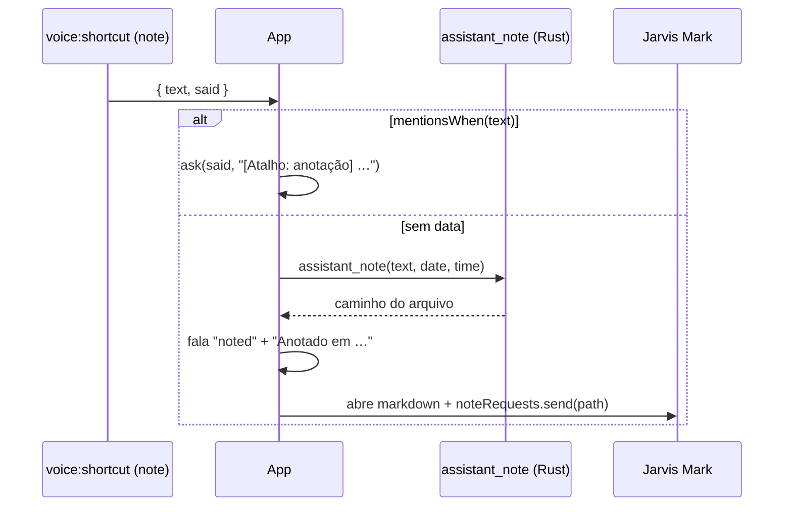

# Anotações rápidas

"Anota que …" grava uma linha com a hora nas anotações do dia, na hora e sem o Claude Code.

| | |
|---|---|
| **ID** | `feature/quick-notes` |
| **Status** | Implementado |
| **Origem** | `048a254` (2026-10-27) · evoluída não commitado |
| **Voz** | `shortcut:note` |

## Visão geral

"Anota que o João indicou o livro Duna" grava uma linha com a hora no arquivo de anotações do dia, em `Documentos\JARVIS\Notas`, na hora e sem passar pelo Claude Code. O arquivo abre no [Jarvis Mark](../../apps/jarvis-mark/spec.md) para ler e editar. Se a frase tem dia ou horário ("anota que tenho dentista sexta às 10"), é um compromisso: vai ao JARVIS, que o marca na [agenda](../../widgets/agenda/spec.md) (ou, se for algo a fazer, na [lista de tarefas](../../widgets/tasks/spec.md)). Essa regra também está na [persona](../../domain/jarvis-persona.md).

## Dados

- `$anotaçõesDoDia`: o arquivo `Documentos\JARVIS\Notas\AAAA-MM-DD Anotações.md`, com `# Anotações de DD/MM/AAAA` e as linhas `- **HH:MM** texto`. Só recebe linhas no fim (append) e é criado na primeira anotação do dia.
- `$carimbo`: a data e a hora locais de quem anotou (`localStamp`), vindas da UI.
- **Folder**: `root`, `notes`, `agents` de `Documentos\JARVIS`. **FileRequest**: `{ path, content, done }`. Ver [glossário](../../domain/glossary.md).

## Componentes

### Atalho `note` (caso `note` no `App`)

Decide entre gravar na hora e mandar ao JARVIS.

- **Comportamento:**
  - **RF-001**: Sem dia nem hora no texto (`mentionsWhen` falso), o sistema DEVE gravar a anotação localmente via `assistant_note`, sem o Claude Code.
    - A UI manda `text` com $carimbo (`date`, `time`) e recebe o caminho do arquivo.
    - Ao gravar, o JARVIS diz uma fala `noted` e a dock mostra "Anotado em <arquivo>".
  - Se estiver fora do Tauri, então o JARVIS responde "Receio que isso só funcione no app desktop." (fala `desktopOnly`).
  - Se houver um erro de disco, então a mensagem aparece na dock como erro.

### Caminho do JARVIS (`[Atalho: anotação]`)

Uma anotação com dia ou hora é um compromisso, que o Claude põe na agenda.

- **Comportamento:**
  - **RF-007**: Com dia ou hora no texto, o pedido DEVE ir ao Claude com o prompt `[Atalho: anotação]` e a hora atual.
    - O prompt (`shortcutPrompt("note")`) manda usar `agenda_add` para compromissos e `tasks_add` para coisas a fazer.
  - A persona (`src-tauri/assistant-persona.md`) repete a regra: compromissos vão para a agenda, nunca só para as notas.

### Gravação no Rust (`append_note`)

Acrescenta a linha a $anotaçõesDoDia, criando a pasta e o título se preciso.

- **Comportamento:**
  - **RF-002**: O arquivo DEVE ser `Notas\AAAA-MM-DD Anotações.md`, com a data local do usuário.
  - **RF-003**: Um arquivo novo DEVE começar com `# Anotações de DD/MM/AAAA` e uma linha vazia.
  - **RF-004**: Cada anotação DEVE ser uma linha `- **HH:MM** <texto>` acrescentada ao fim.
  - **RF-005**: `date` DEVE ter 10 caracteres (dígitos e `-`) e `time` 5 (dígitos e `:`); senão, a gravação é recusada.
  - Se a data ou a hora vierem malformadas da UI (ex.: `../../evil`), então responda "Data inválida"; nada é gravado fora de `Notas`.
  - Se o texto tiver só espaços, então responda "Nada para anotar".
  - Quebras de linha e espaços extras viram um espaço só.

### Entrega ao Jarvis Mark (`noteRequests`)

Abre o arquivo do dia para ler e editar.

- **Comportamento:**
  - **RF-006**: Depois de gravar, a UI DEVE abrir o Jarvis Mark (se fechado) e enviar o caminho por `noteRequests` (`content: null`, `done: true`).
  - O canal guarda o último pedido até a janela abrir.
  - Se o Jarvis Mark já estiver aberto, então ele recebe o arquivo pelo canal `noteRequests` sem abrir outra janela.

## Voz e teclado

- "anota que …", "anote que …", "anota aí …", "toma nota …", "faz uma anotação …": anotação local (sem data) ou `[Atalho: anotação]` (com data).
  - "anota" sozinho não é atalho (precisa de texto depois).
- "anota na lista …": tarefa (`shortcut:taskAdd`), porque a frase mais longa vence.

## Restrições

- **RNF-001**: A anotação local não usa rede nem o Claude Code; responde na hora.
- **RNF-002**: A gravação fica confinada à pasta `Notas` do JARVIS (o nome do arquivo vem só da data validada).
- Só `date` "AAAA-MM-DD" e `time` "HH:MM" válidos.

## Histórias de usuário

### US1 — Anotar na hora (P1)

Como usuário, digo "anota que …" e a frase fica guardada com a hora.

**Por que P1:** registrar uma ideia sem parar o que se está fazendo.
**Teste independente:** Rust `quick_notes_go_to_the_days_file` (`src-tauri/src/assistant.rs`). Sem teste Playwright: no navegador o caminho termina em "só funciona no app desktop".

**Aceite**

1. **Dado** "Anota comprar café" às 09:05 de 27/10/2026, **quando** dito, **então** o arquivo `Notas\2026-10-27 Anotações.md` passa a ter `# Anotações de 27/10/2026`, uma linha vazia e `- **09:05** comprar café`.
2. **Dado** uma segunda anotação no mesmo dia, **quando** dita, **então** só a linha é acrescentada, sem repetir o título.
3. **Dado** a anotação gravada, **quando** termina, **então** o JARVIS diz uma fala `noted` (ex.: "Registrado nas notas de hoje."), a dock mostra "Anotado em 2026-10-27 Anotações.md" e o Jarvis Mark abre o arquivo.

### US2 — Com data, vai para a agenda (P1)

Como usuário, digo "anota que tenho dentista sexta às 10" e o compromisso entra na agenda, não nas notas.

**Por que P1:** um compromisso esquecido nas notas não avisa ninguém.
**Teste independente:** `tests/tasks.spec.ts` — "by voice: added, ticked by number, deleted by its words, read back; a reminder without a when is a task" (parte final).

**Aceite**

1. **Dado** uma anotação com dia ou hora, **quando** dita, **então** o Claude recebe `[Atalho: anotação] O usuário disse: "Anota que tenho dentista sexta às 10". …` com a instrução de usar `agenda_add` para compromissos e `tasks_add` para coisas a fazer.
2. **Dado** "anota na lista pagar a luz", **quando** dito, **então** é o atalho de tarefa (`taskAdd`), porque a frase mais longa vence.

## Critérios de sucesso

- **SC-001**: Uma anotação sem data aparece no arquivo do dia na hora, sem nenhuma chamada ao Claude Code.
- **SC-002**: Nenhum compromisso dito como "anota…" fica só nas notas.

## Fora de escopo e limitações

- Notas longas e resumos de conversa: o Claude os escreve com `Write` em `Notas\AAAA-MM-DD Assunto.md` (ver [assistant](../assistant/spec.md)).
- Pesquisas salvas como nota: atalho `research` em [voice-shortcuts](../voice-shortcuts/spec.md).
- A hora vem da UI, não do Rust; o arquivo usa a data local de quem anotou.

## Código

O atalho `note` é tratado em `App.tsx`. Se `mentionsWhen` acha dia ou hora, o pedido vai ao Claude com o prompt `[Atalho: anotação]`. Senão, a UI chama `assistant_note` com a data e a hora locais (`localStamp`), e o Rust (`append_note`) acrescenta a linha ao arquivo do dia, criando a pasta e o título se preciso. O caminho volta para a UI, que abre o Jarvis Mark e entrega o arquivo pelo canal `noteRequests`.

| | |
|---|---|
| **Camadas** | `App.tsx` (caso `note`) · `src/lib/shortcuts.ts` (`mentionsWhen`, `localStamp`, `shortcutPrompt("note")`) · `src/lib/requests.ts` (`noteRequests`) · comando `assistant_note` · `assistant::append_note` |
| **Dependências** | Jarvis Mark (consumidor de `noteRequests`) |
| **Testes** | Rust `quick_notes_go_to_the_days_file`; `tests/tasks.spec.ts` (caminho com data); `matcher.rs` |
| **Plataforma** | Windows 11 · WebView2. Fora do Tauri: fala `desktopOnly` |

### Arquivos

| Arquivo | Papel |
|---|---|
| `src-tauri/src/assistant.rs` | `append_note(folder, text, date, time)` |
| `src-tauri/src/lib.rs` | comando `assistant_note` |
| `src/App.tsx` | caso `note`: `mentionsWhen` → Claude; senão `invoke("assistant_note")`, fala `noted`, aviso "Anotado em …", abre `markdown`, `noteRequests.send` |
| `src/lib/shortcuts.ts` | `mentionsWhen`, `localStamp`, `shortcutPrompt("note", …)` |
| `src/lib/requests.ts` | `requestChannel`, `noteRequests` |
| `src/lib/jarvisLines.ts` | falas `noted` e `desktopOnly` |
| `src-tauri/assistant-persona.md` | regra das anotações soltas e de compromissos na agenda (caminho do Claude) |

### Contratos

#### Comandos Tauri

| Comando | Entrada | Saída | Notas |
|---|---|---|---|
| `assistant_note` | `{ text, date: "AAAA-MM-DD", time: "HH:MM" }` | caminho do arquivo | Erros: "Data inválida", "Nada para anotar", erros de disco |

#### Eventos e Channels

| Nome | Payload | Emissor → consumidor |
|---|---|---|
| `voice:shortcut` | `{ action: "note", text, said }` | matcher → `shortcutHandler` |
| `noteRequests` (canal da UI) | `{ path, content: null, done: true }` | `App.tsx` → Jarvis Mark |

### Fluxo

### Constituição

- [x] P1 Offline-first — a anotação local não usa rede nem Claude.
- [x] P2 Rust é dono do nativo — a escrita do arquivo é do Rust.
- [x] P3 Comandos finos — `assistant_note` em `lib.rs` chama `append_note` via `blocking()`.
- [x] P6 Fora do Tauri — caminho 3: o JARVIS diz que só funciona no app desktop.
- [x] P7 PT-BR — título, falas e erros em PT-BR.
- [x] P10 Confinamento — data e hora validadas antes de virar nome de arquivo; sempre dentro de `Notas`.
- [ ] P11 Testes — o caminho local não tem teste Playwright (ver [Pendências](#pendências)).

### Decisões relacionadas

- [ADR-0007 — JARVIS restrito a Documentos\JARVIS](../../arch/adr/0007-jarvis-confinado-a-documentos.md)
- [ADR-0012 — apps lazy com preload](../../arch/adr/0012-apps-lazy-com-preload.md)

## Tarefas

Legenda: `[x]` feito · `[ ]` pendente · `[P]` pode rodar em paralelo (arquivos diferentes) · `[USn]` história desta spec. As tarefas foram reconstruídas do código e do commit de origem.

### Fase 1 — Base

- [x] T001 [P] `append_note`: validação de data e hora, título na criação, linha `- **HH:MM** texto` — `src-tauri/src/assistant.rs`
- [x] T002 [P] Comando `assistant_note` — `src-tauri/src/lib.rs`
- [x] T003 [P] `localStamp`, `mentionsWhen` — `src/lib/shortcuts.ts`
- [x] T004 [P] `noteRequests` (canal que guarda o último pedido até a janela abrir) — `src/lib/requests.ts`
- [x] T005 Frases de `shortcut:note` (exige texto depois) — `src-tauri/voice-commands.json`, `src-tauri/src/voice/matcher.rs`

### Fase 2 — US1 Anotar na hora (P1)

- [x] T006 [US1] Caso `note` sem data: `assistant_note`, fala `noted`, "Anotado em <arquivo>", abre o Jarvis Mark — `src/App.tsx`
- [x] T007 [US1] Fora do Tauri: fala `desktopOnly` — `src/App.tsx`, `src/lib/jarvisLines.ts`

### Fase 3 — US2 Com data, para a agenda (P1)

- [x] T008 [US2] `shortcutPrompt("note")` com `agenda_add` / `tasks_add` / notas — `src/lib/shortcuts.ts`
- [x] T009 [US2] Regra na persona: compromissos vão para a agenda, nunca só para as notas — `src-tauri/assistant-persona.md`

### Fase 4 — Testes

- [x] T010 Rust `src-tauri/src/assistant.rs` — `quick_notes_go_to_the_days_file`
- [x] T011 Rust `src-tauri/src/voice/matcher.rs` — `shortcuts_open_the_request_and_keep_the_words_as_said` ("Anota que a reunião mudou para quinta.", "Ei Jarvis, por favor, anota comprar café.")
- [x] T012 Rust `src-tauri/src/voice/matcher.rs` — `the_tasks_the_agenda_numbers_and_the_homecoming_by_voice` ("Anota na lista pagar a luz" → `taskAdd`)
- [x] T013 Playwright `tests/tasks.spec.ts` — "by voice: added, ticked by number, deleted by its words, read back; a reminder without a when is a task" (anotação com data → `[Atalho: anotação]`)

## Pendências

- [ ] O caminho local (`assistant_note` → Jarvis Mark) não tem teste Playwright: não há fake para `assistant_note`, e nenhum teste confere a resposta `desktopOnly` no navegador.
