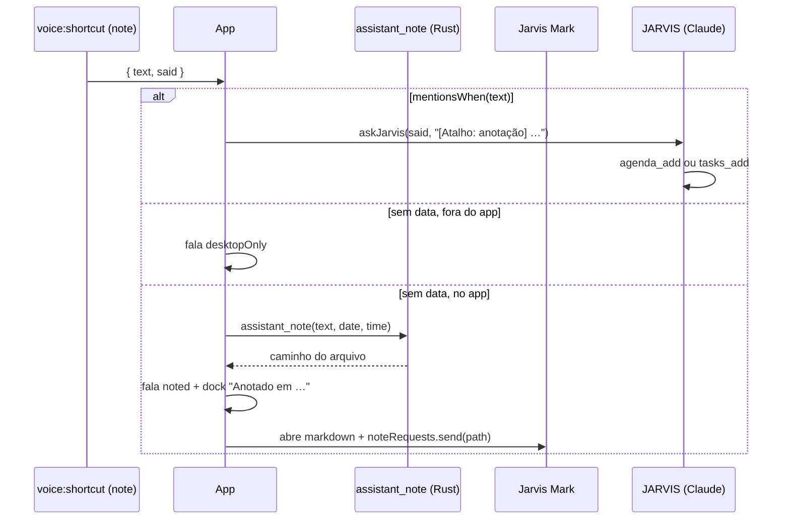

# Feature Specification: Quick Notes

## Metadata

| Field | Value |
|---|---|
| Feature ID | `feature/quick-notes` |
| Product | JARVIS OS (jvOS) |
| Feature Status | Implementado |
| Document Status | Reescrita em 2026-11-05 no formato Feature Specification; uma decisão de produto em [Open Questions](#open-questions) |
| Source Commit | `048a254` (2026-10-27); a regra "com dia ou hora vai ao JARVIS", as falas `noted` e `desktopOnly` e a abertura do Jarvis Mark entraram em `e7151cf` (2026-11-05) |
| Uncommitted Changes | Nenhuma |
| Voice Shortcut | `shortcut:note` |
| Assistant Tool | Nenhuma própria; o caminho com dia ou hora usa `agenda_add` e `tasks_add`, do [assistant-tools](../assistant-tools/spec.md) |
| Target Platforms | Windows 11 com WebView2; no navegador (modo web), a anotação local responde "Receio que isso só funcione no app desktop." e nada é gravado; o caminho com dia ou hora depende do Claude Code |
| Language | PT-BR no conteúdo e nas falas; inglês nos títulos das seções e em Given / When / Then |
| Last Editorial Revision | 2026-11-05 |
| Verification Scope | Conferida com o código em 2026-11-05: `src-tauri/src/assistant.rs` (`append_note`, `Folder`), `src-tauri/src/lib.rs` (`assistant_note`, `blocking`, a pasta `JARVIS`), `src/App.tsx`, `src/lib/shortcuts.ts`, `src/lib/requests.ts`, `src/lib/jarvisLines.ts`, `src/hooks/useEditorDocument.ts`, `src-tauri/assistant-persona.md`, `src-tauri/voice-commands.json`, `src-tauri/src/voice/matcher.rs` e `tests/tasks.spec.ts`. Os testes não foram executados nesta revisão |

Especificação no formato inspirado no GitHub Spec Kit, com seções de desenho técnico ([ADR-0025](../../arch/adr/0025-features-formato-feature-specification.md)). Os identificadores US1–US2, RF-001–RF-007, RNF-001–RNF-002, SC-001–SC-002 e T001–T013 são os mesmos da versão anterior. Os critérios de aceite AC-001–AC-007 são os antigos "Critério 1" a "Critério 7", na mesma ordem. KL-* registra limitações conhecidas; OQ-*, decisões de produto em aberto. Nenhum dos dois acrescenta escopo.

## Overview

"Anota que o João indicou o livro Duna" grava uma linha com a hora no arquivo de anotações do dia, em `Documentos\JARVIS\Notas`, na hora e sem passar pelo Claude Code. O arquivo abre no [Jarvis Mark](../../apps/jarvis-mark/spec.md) para ler e editar.

Se a frase tem dia ou horário ("anota que tenho dentista sexta às 10"), é um compromisso: vai ao JARVIS, que o marca na [agenda](../../widgets/agenda/spec.md) ou, se for algo a fazer, na [lista de tarefas](../../widgets/tasks/spec.md). Essa regra também está na [persona](../../domain/jarvis-persona.md).

| Input | Expected Behavior | Execution Path |
|---|---|---|
| "Anota que o João indicou o livro Duna" | Uma linha `- **HH:MM** o João indicou o livro Duna` no arquivo do dia, a fala `noted` e o Jarvis Mark aberto | Local (`assistant_note` → `append_note`) |
| "Anota que tenho dentista sexta às 10" | O Claude marca na agenda com `agenda_add` | Claude Code (`[Atalho: anotação]`) |
| "Anota na lista pagar a luz" | Uma tarefa nova, não uma anotação | [tasks](../../widgets/tasks/spec.md) (`shortcut:taskAdd`) |
| "Anota comprar café" no navegador | "Receio que isso só funcione no app desktop." | Local (fala `desktopOnly`) |

## Goals and Success Criteria

### Goals

- Registrar uma ideia com uma frase, sem parar o que se está fazendo.
- Gravar na hora, sem rede e sem o Claude Code.
- Guardar tudo num arquivo por dia, em Markdown comum, que o Jarvis Mark abre.
- Mandar para a agenda o que tem dia ou hora, em vez de esquecê-lo nas notas.

### Success Criteria

| ID | Criterion | Verification |
|---|---|---|
| SC-001 | Uma anotação sem data aparece no arquivo do dia na hora, sem nenhuma chamada ao Claude Code. | No app, dizer "anota que o João indicou o livro Duna" e conferir a linha em `Notas\AAAA-MM-DD Anotações.md`; o caminho local não passa por `askJarvis`. |
| SC-002 | Nenhum compromisso dito como "anota…" fica só nas notas. | "Anota que tenho dentista sexta às 10" vai ao Claude com `[Atalho: anotação]` e a instrução de `agenda_add`. Vale para o que `mentionsWhen` reconhece (KL-003, OQ-001). |

## Scope and Non-Goals

### In Scope

- O atalho `shortcut:note` e as frases dele.
- A decisão entre gravar na hora e mandar ao JARVIS (`mentionsWhen`).
- A gravação no Rust: validação, título na criação, uma linha por anotação.
- A confirmação (fala `noted` e aviso na dock) e a abertura do arquivo no Jarvis Mark.
- A resposta `desktopOnly` fora do app desktop.

### Out of Scope

- Notas longas e resumos de conversa: o Claude os escreve com `Write` em `Notas\AAAA-MM-DD Assunto.md` (ver [assistant](../assistant/spec.md)).
- Pesquisas salvas como nota: atalho `research` em [voice-shortcuts](../voice-shortcuts/spec.md).
- Editar ou apagar uma anotação por voz: o arquivo é editado à mão no Jarvis Mark.
- A hora vinda do Rust: ela vem da UI, e o arquivo usa a data local de quem anotou.

## User Stories

### US1 — Take a Note Right Away

**Priority:** P1.

**User Story:** Como usuário, digo "anota que …" e a frase fica guardada com a hora.

**Why This Priority:** registrar uma ideia sem parar o que se está fazendo.

**Independent Test:** Rust `src-tauri/src/assistant.rs` — `quick_notes_go_to_the_days_file`. Não há teste Playwright: no navegador o caminho termina em "só funciona no app desktop" (KL-001).

**Acceptance Criteria:** AC-001, AC-002, AC-003, AC-006 e AC-007.

### US2 — With a Date, It Goes to the Agenda

**Priority:** P1.

**User Story:** Como usuário, digo "anota que tenho dentista sexta às 10" e o compromisso entra na agenda, não nas notas.

**Why This Priority:** um compromisso esquecido nas notas não avisa ninguém.

**Independent Test:** `tests/tasks.spec.ts` — "by voice: added, ticked by number, deleted by its words, read back; a reminder without a when is a task" (parte final).

**Acceptance Criteria:** AC-004 e AC-005.

## Requirements

### Functional Requirements

| ID | Requirement | Related Stories |
|---|---|---|
| RF-001 | Sem dia nem hora no texto (`mentionsWhen` falso), o sistema DEVE gravar a anotação localmente via `assistant_note`, sem o Claude Code. A UI manda `text` com a data e a hora locais e recebe o caminho do arquivo; ao gravar, o JARVIS diz uma fala `noted` e a dock mostra "Anotado em <arquivo>". | US1 |
| RF-002 | O arquivo DEVE ser `Notas\AAAA-MM-DD Anotações.md`, com a data local do usuário. | US1 |
| RF-003 | Um arquivo novo DEVE começar com `# Anotações de DD/MM/AAAA` e uma linha vazia. | US1 |
| RF-004 | Cada anotação DEVE ser uma linha `- **HH:MM** <texto>` acrescentada ao fim. | US1 |
| RF-005 | `date` DEVE ter 10 caracteres (dígitos e `-`) e `time` 5 (dígitos e `:`); senão, a gravação é recusada com "Data inválida". | US1 |
| RF-006 | Depois de gravar, a UI DEVE abrir o Jarvis Mark (se fechado) e enviar o caminho por `noteRequests` (`content: null`, `done: true`). | US1 |
| RF-007 | Com dia ou hora no texto, o pedido DEVE ir ao Claude com o prompt `[Atalho: anotação]` e a hora atual, que manda usar `agenda_add` para compromissos e `tasks_add` para coisas a fazer. | US2 |

### Non-Functional Requirements

| ID | Requirement | Scope |
|---|---|---|
| RNF-001 | A anotação local não usa rede nem o Claude Code; responde na hora. | Caminho sem dia nem hora |
| RNF-002 | A gravação fica confinada à pasta `Notas` do JARVIS: o nome do arquivo vem só da data validada ([ADR-0007](../../arch/adr/0007-jarvis-confinado-a-documentos.md)). | `append_note` |

### Operational Constraints

- Só `date` com 10 caracteres de dígitos e `-`, e `time` com 5 de dígitos e `:`.
- Quebras de linha e espaços extras do texto viram um espaço só.
- Só acréscimo (append); nada é reescrito nem apagado.
- A pasta é `Documentos\JARVIS\Notas`, ou `<home>\JARVIS\Notas` se a pasta Documentos não existir; é criada se faltar.
- Falas, título e erros em PT-BR.
- Nada em `localStorage` nem em `settings.json`.

## Acceptance Criteria

### AC-001 — Write a Note to the Day's File

**Related Story:** US1.

- **Given** "Anota comprar café" dito às 09:05 de 27/10/2026, no app desktop
- **When** o atalho grava a anotação
- **Then** o arquivo `Notas\2026-10-27 Anotações.md` passa a ter `# Anotações de 27/10/2026`, uma linha vazia e `- **09:05** comprar café`.

### AC-002 — Append Without Repeating the Title

**Related Story:** US1.

- **Given** o arquivo do dia já com uma anotação
- **When** uma segunda anotação é dita
- **Then** só a linha nova é acrescentada, sem repetir o título.

### AC-003 — Confirm and Open the Note

**Related Story:** US1.

- **Given** a anotação gravada
- **When** `assistant_note` devolve o caminho
- **Then** o JARVIS diz uma fala `noted` (ex.: "Registrado nas notas de hoje."), a dock (item Voice) mostra "Anotado em 2026-10-27 Anotações.md" e o Jarvis Mark abre o arquivo.

**Coverage Status:** sem teste automatizado (KL-001).

### AC-004 — Send an Appointment to JARVIS

**Related Story:** US2.

- **Given** uma anotação com dia ou hora
- **When** o atalho a processa
- **Then** o Claude recebe `[Atalho: anotação] O usuário disse: "Anota que tenho dentista sexta às 10". …`, com a hora atual e a instrução de usar `agenda_add` para compromissos e `tasks_add` para coisas a fazer.

### AC-005 — Route "Anota na Lista" to Tasks

**Related Story:** US2.

- **Given** "anota na lista pagar a luz"
- **When** o matcher reconhece a frase
- **Then** é o atalho de tarefa (`shortcut:taskAdd`) com o texto "pagar a luz", porque a frase mais longa vence.

### AC-006 — Reject a Malformed Date

**Related Story:** US1.

- **Given** uma data malformada vinda da UI (ex.: `../../evil`)
- **When** `assistant_note` é chamado
- **Then** a resposta é o erro "Data inválida", a mensagem aparece na dock como erro e nada é gravado fora de `Notas`.

### AC-007 — Reject an Empty Note

**Related Story:** US1.

- **Given** um texto só com espaços
- **When** `assistant_note` é chamado
- **Then** a resposta é o erro "Nada para anotar", e nenhum arquivo nem pasta é criado.

## Behavior and Flows

### Request Routing

O caso `note` do `shortcutHandler` (`src/App.tsx`):

| Condition | Action | Confirmation |
|---|---|---|
| `mentionsWhen(text)` verdadeiro | `askJarvis(said, shortcutPrompt("note", said, text, { now }))` (RF-007) | A resposta do JARVIS |
| Sem dia nem hora, fora do app desktop | Nada é gravado | Fala `desktopOnly` |
| Sem dia nem hora, no app desktop | `invoke("assistant_note", { text, date, time })` com `localStamp(now)` (RF-001) | Fala `noted` e dock "Anotado em <arquivo>" |
| `assistant_note` falha | Nada é gravado | A mensagem do erro na dock (Voice), como erro |

`mentionsWhen` é conferido antes de saber se é o app desktop: no navegador, uma anotação com dia ou hora também vai ao JARVIS.

### Writing in Rust (`append_note`)

Acrescenta a linha ao arquivo do dia, criando a pasta e o título se preciso.

- **Behavior:**
  1. Confere `date` (10 caracteres, só dígitos e `-`) e `time` (5 caracteres, só dígitos e `:`); senão, "Data inválida" (RF-005).
  2. Junta o texto por espaços (`split_whitespace`); vazio, "Nada para anotar".
  3. Cria `Notas` se faltar e abre `Notas\<date> Anotações.md` em modo de acréscimo, criando o arquivo.
  4. Se o arquivo está vazio, escreve antes o título `# Anotações de DD/MM/AAAA` e uma linha vazia (RF-003).
  5. Escreve `- **<time>** <texto>` e uma quebra de linha (RF-004), e devolve o caminho.
- O comando `assistant_note` roda `append_note` fora da thread principal (`blocking`).

### Delivery to Jarvis Mark (`noteRequests`)

Abre o arquivo do dia para ler e editar.

- **Behavior:**
  - Com o Jarvis Mark fechado, a UI abre a janela (`openWindow("markdown")`) e envia `{ path, content: null, done: true }` pelo canal (RF-006). O canal guarda o último pedido até o editor montar e tomá-lo (`take`).
  - Com o Jarvis Mark aberto, o pedido chega pelo listener, sem abrir outra janela.
  - O editor lê o arquivo do disco e mostra "Nota salva pelo JARVIS · <arquivo>".
  - Com alterações não salvas no editor, o arquivo não é trocado: o editor avisa "JARVIS alterou <arquivo> · salve ou descarte suas alterações para ver" (mesmo arquivo) ou "JARVIS salvou <arquivo> · …" (outro arquivo), como erro.

### JARVIS Path (`[Atalho: anotação]`)

Uma anotação com dia ou hora é um compromisso, que o Claude põe na agenda.

- **Behavior:**
  - `mentionsWhen` reconhece dias da semana, "amanhã", "depois de amanhã", "semana que vem", "próxima semana", "mês que vem", "fim de semana", "meio dia", "meia noite", partes do dia ("de manhã", "à tarde", "à noite"), "às N", "das N", "até as N", "N h" e "N horas" com até dois dígitos, "HH:MM", "dia N" e datas "dd/mm" ou "dd/mm/aaaa". "Hoje" sozinho não conta (KL-003).
  - O prompt diz: `[Atalho: anotação] O usuário disse: "<frase>". Agora são <HH:MM> de <data por extenso>. Se for um compromisso (tem dia ou horário: consulta, reunião, evento, prazo), marque com agenda_add; se for algo a fazer, sem horário, ponha na lista com tasks_add; senão, acrescente em Notas/AAAA-MM-DD Anotações.md, como de costume. Confirme em uma frase.`
  - A persona (`src-tauri/assistant-persona.md`) repete a regra: todo compromisso com dia ou horário vai para a agenda com `agenda_add`, mesmo quando o usuário diz "anota" ou "me lembra", e nunca fica só nas Notas. Uma anotação solta pedida ao Claude vira a mesma linha `- **HH:MM** texto` no mesmo arquivo.

### Interaction Flow



### User Feedback

| Moment | Persona Key | Output |
|---|---|---|
| Anotação gravada | `noted` | Fala ("Anotado.", "Registrado nas notas de hoje.", "Feito. Está nas anotações do dia.") e dock (Voice) "Anotado em <arquivo>" |
| Fora do app desktop | `desktopOnly` | "Receio que isso só funcione no app desktop." |
| Data malformada | — | Dock (Voice) "Data inválida", como erro |
| Texto vazio | — | Dock (Voice) "Nada para anotar", como erro |
| Erro de disco | — | Dock (Voice) com a mensagem do sistema, como erro |
| Com dia ou hora | — | A resposta do JARVIS ("Marcado: sexta, às 10 horas.") |

As variantes de cada fala estão em `src/lib/jarvisLines.ts`. Com o JARVIS ocupado, a fala vai para a dock.

### Voice and Keyboard

- `shortcut:note` reconhece "anota que", "anote que", "anota aí", "anota", "anote", "anotar", "toma nota", "tome nota", "faz uma anotação" e "faça uma anotação" (`src-tauri/voice-commands.json`), no começo da frase ou logo depois do nome do JARVIS ("Ei Jarvis, por favor, anota…").
- O atalho precisa de texto depois da frase: "anota" sozinho não é atalho (`NEEDS_TEXT`).
- "Anota na lista …" e "anota na lista de tarefas …" são de `shortcut:taskAdd`: a frase mais longa vence.
- Não há tecla de atalho.

## Data Model and Persistence

### Day's Notes File

```text
Documentos\JARVIS\Notas\2026-10-27 Anotações.md

# Anotações de 27/10/2026

- **09:05** comprar café
- **14:30** ligar para a Ana
```

| Value | Meaning | Rule |
|---|---|---|
| `$anotaçõesDoDia` | O arquivo `Notas\AAAA-MM-DD Anotações.md` | Criado na primeira anotação do dia; só recebe linhas no fim |
| `$carimbo` | A data e a hora locais de quem anotou | `localStamp(now)`: `{ date: "AAAA-MM-DD", time: "HH:MM" }`, vindos da UI |

### Command Payload and Channel

```ts
// invoke("assistant_note", …)
interface NoteArgs {
  text: string; // o que veio depois da frase do atalho, como foi dito
  date: string; // "AAAA-MM-DD", local
  time: string; // "HH:MM", local
}

// noteRequests.send(…)
interface FileRequest {
  path: string;
  content: string | null; // null: o editor lê do disco
  done: boolean;          // true
}
```

A pasta do JARVIS (`Folder`: `root`, `notes`, `agents` de `Documentos\JARVIS`) e o canal Requests estão no [glossário](../../domain/glossary.md).

### Storage Rules

| Property | Value |
|---|---|
| State | `$anotaçõesDoDia` |
| Storage | Arquivo Markdown em disco |
| Key | `Documentos\JARVIS\Notas\AAAA-MM-DD Anotações.md` |
| Write Debounce | Nenhum: cada anotação é gravada na hora |
| Reader | O Jarvis Mark (`useEditorDocument`), quando recebe o pedido |
| Missing or Invalid Storage | Pasta ou arquivo ausente: criados na gravação |

## Technical Design

### Component Responsibilities

| File or Component | Responsibility |
|---|---|
| `src-tauri/src/assistant.rs` | `append_note(folder, text, date, time)`; `Folder` com `notes` = `<root>\Notas` |
| `src-tauri/src/lib.rs` | Comando `assistant_note` (via `blocking`) e a pasta `Documentos\JARVIS` |
| `src/App.tsx` | Caso `note`: `mentionsWhen` → Claude; senão `desktopOnly` ou `invoke("assistant_note")`, fala `noted`, aviso "Anotado em …", abre `markdown`, `noteRequests.send` |
| `src/lib/shortcuts.ts` | `mentionsWhen`, `localStamp`, `shortcutPrompt("note", …)` |
| `src/lib/requests.ts` | `requestChannel`, `noteRequests` |
| `src/hooks/useEditorDocument.ts` | Recebe o pedido no Jarvis Mark e lê o arquivo |
| `src/lib/jarvisLines.ts` | Falas `noted` e `desktopOnly` |
| `src-tauri/voice-commands.json` | As frases de `shortcut:note` |
| `src-tauri/src/voice/matcher.rs` | `match_shortcut` (a frase mais longa vence) e `NEEDS_TEXT` |
| `src-tauri/assistant-persona.md` | A regra das anotações soltas e dos compromissos na agenda (caminho do Claude) |

### Related Architecture Decisions

- [ADR-0007 — JARVIS restrito a Documentos\JARVIS](../../arch/adr/0007-jarvis-confinado-a-documentos.md)
- [ADR-0012 — apps lazy com preload](../../arch/adr/0012-apps-lazy-com-preload.md)

## Interfaces and Contracts

### Tauri Commands

| Command | Input | Output | Notes |
|---|---|---|---|
| `assistant_note` | `{ text, date: "AAAA-MM-DD", time: "HH:MM" }` | Caminho do arquivo (string) | Erros: "Data inválida", "Nada para anotar" e erros de disco (texto do sistema) |

### Events and Channels

| Event | Payload | Producer → Consumer |
|---|---|---|
| `voice:shortcut` | `{ action: "note", text, said }` | matcher → `shortcutHandler` |
| `noteRequests` (canal da UI) | `{ path, content: null, done: true }` | `App.tsx` → Jarvis Mark (`useEditorDocument`) |

### Assistant Prompt

Com dia ou hora, `shortcutPrompt("note", said, text, { now })` manda o texto de [JARVIS Path](#jarvis-path-atalho-anotação). As tools `agenda_add` e `tasks_add` estão em [assistant-tools](../assistant-tools/spec.md).

## Edge Cases and Error Handling

| Case | Behavior | Reference |
|---|---|---|
| "anota" sozinho | Não é atalho: a frase precisa de texto depois | `NEEDS_TEXT` |
| Texto só com espaços | "Nada para anotar"; nenhum arquivo nem pasta é criado | AC-007 |
| Primeira anotação do dia | O arquivo nasce com `# Anotações de DD/MM/AAAA` e uma linha vazia | RF-003 |
| A mesma frase dita duas vezes | Duas linhas, cada uma com a sua hora; sem deduplicação | RF-004 |
| Data ou hora malformadas | "Data inválida"; nada é gravado | AC-006 |
| Data no formato errado mas só com dígitos e `-` | Aceita; o arquivo fica dentro de `Notas` com um título estranho | KL-002 |
| Compromisso sem as palavras que `mentionsWhen` reconhece ("hoje", "depois do almoço") | Vai para as notas, não para a agenda | KL-003, OQ-001 |
| Jarvis Mark fechado | A janela abre e toma o pedido guardado no canal; na primeira vez mostra "Carregando…" enquanto o app chega | RF-006 |
| Duas anotações antes de o Jarvis Mark abrir | Só a última é entregue; as duas estão no arquivo | `requestChannel` |
| Jarvis Mark com alterações não salvas | O arquivo não é trocado; o editor avisa para salvar ou descartar | Delivery to Jarvis Mark |
| Concorrência: duas gravações ao mesmo tempo | Não há trava; cada uma abre o arquivo em modo de acréscimo. Pela voz, elas chegam uma de cada vez | `append_note` |
| Fora do Tauri, sem dia nem hora | Fala `desktopOnly`; nada é gravado | P6 |
| Fora do Tauri, com dia ou hora | Vai ao JARVIS, como no app | Request Routing |
| Erro de disco | A mensagem aparece na dock como erro | User Feedback |
| Permissões | O nome do arquivo vem só da data validada, sempre dentro de `Documentos\JARVIS\Notas` | RNF-002, [ADR-0007](../../arch/adr/0007-jarvis-confinado-a-documentos.md) |

## Dependencies

### Feature Dependencies

| Dependency | Purpose |
|---|---|
| [jarvis-mark](../../apps/jarvis-mark/spec.md) | Abre o arquivo do dia; consumidor de `noteRequests` |
| [voice-shortcuts](../voice-shortcuts/spec.md) | O atalho `shortcut:note` e o `shortcutHandler` |
| [voice-commands](../voice-commands/spec.md) | O matcher e "a frase mais longa vence" |
| [assistant](../assistant/spec.md) | O caminho com data, via Claude |
| [assistant-tools](../assistant-tools/spec.md) | `agenda_add` e `tasks_add` |
| [agenda](../../widgets/agenda/spec.md) e [tasks](../../widgets/tasks/spec.md) | Onde o Claude põe compromissos e coisas a fazer |
| [desktop-windows](../desktop-windows/spec.md) | A abertura da janela e o canal `requests` |
| [tts](../tts/spec.md) | A fala `noted` |

### Runtime Dependencies

- [Tauri](../../foundation/vendor/tauri/spec.md): o comando `assistant_note`.
- [React](../../foundation/vendor/react/spec.md).
- Disco em `Documentos\JARVIS\Notas`.
- [Claude Code](../../foundation/vendor/claude-code/spec.md) e rede, só no caminho com dia ou hora.

## Test Strategy and Coverage

### Reported Tests

| Test Reference | Coverage | Acceptance Mapping |
|---|---|---|
| `src-tauri/src/assistant.rs` — `quick_notes_go_to_the_days_file` | Arquivo do dia com o título, duas linhas `- **HH:MM** texto` (o texto com quebra de linha vira um espaço), data `../../evil` e texto vazio recusados | AC-001, AC-002, AC-006, AC-007 |
| `src-tauri/src/voice/matcher.rs` — `shortcuts_open_the_request_and_keep_the_words_as_said` | "Anota que a reunião mudou para quinta." e "Ei Jarvis, por favor, anota comprar café." viram `shortcut:note` com o texto dito | Entrada de US1 |
| `src-tauri/src/voice/matcher.rs` — `the_tasks_the_agenda_numbers_and_the_homecoming_by_voice` | "Anota na lista pagar a luz" é `taskAdd` | AC-005 |
| `tests/tasks.spec.ts` — "task helpers: numbers said, appointments spotted, words tidied, the lowest free id" | `mentionsWhen` reconhece "sexta às 10", "amanhã", "dia 12", "14:30", "à tarde", e não "hoje" | AC-004 |
| `tests/tasks.spec.ts` — "by voice: added, ticked by number, deleted by its words, read back; a reminder without a when is a task" | A anotação com data vai ao Claude com `[Atalho: anotação]` e `agenda_add` | AC-004, SC-002 |

### Verification Commands

Na raiz do repositório:

```powershell
npx playwright test tests/tasks.spec.ts --project ui -g "task helpers|by voice: added"
```

Em `src-tauri`:

```powershell
cargo test --lib quick_notes_go_to_the_days_file
cargo test --lib shortcuts_open_the_request_and_keep_the_words_as_said
cargo test --lib the_tasks_the_agenda_numbers_and_the_homecoming_by_voice
```

### Coverage Gaps

| Gap | Evidence Status | Suggested Verification |
|---|---|---|
| Fala `noted`, aviso "Anotado em …" e entrega ao Jarvis Mark (AC-003) | Sem teste | Um fake de `assistant_note` no modo web, e conferir a fala, o aviso e o editor |
| Fala `desktopOnly` no navegador | Sem teste | Dizer "anota comprar café" no modo web e conferir a resposta |
| Mensagens "Data inválida" e "Nada para anotar" | Parcial: o teste Rust só confere que há erro | `assert_eq!` com o texto do erro |
| Jarvis Mark com alterações não salvas | Sem teste | Editar o arquivo do dia sem salvar e anotar de novo |

## Implementation Plan

**Status Convention:** `[x]` feito · `[ ]` pendente · `[P]` pode rodar em paralelo (arquivos diferentes) · `[USn]` história desta spec. As tarefas foram reconstruídas do código e dos commits `048a254` e `e7151cf`.

### Phase 1 — Foundation

- [x] T001 [P] `append_note`: validação de data e hora, título na criação, linha `- **HH:MM** texto` — `src-tauri/src/assistant.rs`
- [x] T002 [P] Comando `assistant_note` — `src-tauri/src/lib.rs`
- [x] T003 [P] `localStamp`, `mentionsWhen` — `src/lib/shortcuts.ts`
- [x] T004 [P] `noteRequests` (canal que guarda o último pedido até a janela abrir) — `src/lib/requests.ts`
- [x] T005 Frases de `shortcut:note` (exige texto depois) — `src-tauri/voice-commands.json`, `src-tauri/src/voice/matcher.rs`

### Phase 2 — Take a Note Right Away (US1)

- [x] T006 [US1] Caso `note` sem data: `assistant_note`, fala `noted`, "Anotado em <arquivo>", abre o Jarvis Mark — `src/App.tsx`
- [x] T007 [US1] Fora do Tauri: fala `desktopOnly` — `src/App.tsx`, `src/lib/jarvisLines.ts`

### Phase 3 — With a Date, to the Agenda (US2)

- [x] T008 [US2] `shortcutPrompt("note")` com `agenda_add` / `tasks_add` / notas — `src/lib/shortcuts.ts`
- [x] T009 [US2] Regra na persona: compromissos vão para a agenda, nunca só para as notas — `src-tauri/assistant-persona.md`

### Phase 4 — Verification

- [x] T010 Rust `src-tauri/src/assistant.rs` — `quick_notes_go_to_the_days_file`
- [x] T011 Rust `src-tauri/src/voice/matcher.rs` — `shortcuts_open_the_request_and_keep_the_words_as_said` ("Anota que a reunião mudou para quinta.", "Ei Jarvis, por favor, anota comprar café.")
- [x] T012 Rust `src-tauri/src/voice/matcher.rs` — `the_tasks_the_agenda_numbers_and_the_homecoming_by_voice` ("Anota na lista pagar a luz" → `taskAdd`)
- [x] T013 Playwright `tests/tasks.spec.ts` — "by voice: added, ticked by number, deleted by its words, read back; a reminder without a when is a task" (anotação com data → `[Atalho: anotação]`)

## Rollback Plan

1. Tire a entrada `shortcut:note` de `src-tauri/voice-commands.json`, `"note"` de `SHORTCUT_TARGETS` (`src-tauri/src/settings.rs`) e de `ShortcutAction` e `SHORTCUT_ACTIONS` (`src/lib/shortcuts.ts`), o caso `note` de `App.tsx` e o ramo `"note"` de `shortcutPrompt`.
2. No Rust, tire o comando `assistant_note` (e o registro no `invoke_handler`) e `append_note`, junto com o teste `quick_notes_go_to_the_days_file`.
3. Mantenha `mentionsWhen` e `localStamp` (usados por lembretes, tarefas e prompts) e `noteRequests` (as notas que o Claude escreve). Sem o atalho, "anota que …" dito ao JARVIS vira pergunta, e a persona já manda o Claude acrescentar a mesma linha em `Notas/AAAA-MM-DD Anotações.md`.
4. Ficam órfãos e são ignorados: os arquivos `Documentos\JARVIS\Notas\AAAA-MM-DD Anotações.md` (Markdown comum, que o Jarvis Mark continua abrindo) e as frases de `shortcut:note` guardadas em `settings.json`, descartadas por `sanitize_voice_commands`.

## Constitution Compliance

| Principle | Status | Rationale |
|---|---|---|
| P1 — Offline-first | Atendido | A anotação local não usa rede nem o Claude Code |
| P2 — Rust é dono do nativo | Atendido | A escrita do arquivo é do Rust |
| P3 — Comandos finos | Atendido | `assistant_note` em `lib.rs` só chama `append_note` via `blocking` |
| P6 — Fora do Tauri | Atendido | Caminho 3: o JARVIS diz que só funciona no app desktop |
| P7 — PT-BR | Atendido | Título, falas e erros em PT-BR |
| P10 — Confinamento | Atendido | Data e hora validadas antes de virar nome de arquivo; sempre dentro de `Notas` |
| P11 — Testes | Parcial | O caminho local não tem teste Playwright (KL-001) |

## Known Limitations

| ID | Limitation | Status |
|---|---|---|
| KL-001 | O caminho local (`assistant_note` → fala `noted` → Jarvis Mark) não tem teste Playwright: não há fake para `assistant_note`, e nenhum teste confere a resposta `desktopOnly` no navegador. | Lacuna de verificação |
| KL-002 | `append_note` confere só o tamanho e os caracteres de `date` e `time`, não as posições. `date` = "2026102799" passa e gera o título "# Anotações de 99/02/2026". O arquivo continua dentro de `Notas`, e a UI sempre manda `localStamp`. | Validação frouxa, sem risco de escape |
| KL-003 | SC-002 depende de `mentionsWhen`. Um compromisso dito sem as palavras que ele reconhece ("anota que tenho reunião hoje", "depois do almoço") vai para as notas, não para a agenda. "Hoje" sozinho é ignorado de propósito, para as tarefas do dia. | Comportamento atual; ver OQ-001 |

## Open Questions

| ID | Question | Evidence and Impact | Suggested Resolution |
|---|---|---|---|
| OQ-001 | Uma anotação com "hoje" (ou outra referência de tempo vaga) e sem hora deve ir ao JARVIS, em vez das notas? | `mentionsWhen` ignora "hoje" de propósito: nos lembretes, a frase vira tarefa do dia. No atalho de anotação, a mesma regra manda "tenho reunião hoje" para o arquivo de notas (KL-003). | Uma checagem própria para anotações que inclua "hoje" e mande ao Claude, que decide entre agenda, tarefa e nota. |

## References

- Versão anterior desta spec, no formato SpecLang: `git show e7151cf:.specs/features/quick-notes/spec.md`. A versão intermediária, no formato do spec-coding.dev ([ADR-0023](../../arch/adr/0023-specs-formato-spec-coding-dev.md)), não chegou a ser commitada.
- Modelo de formato: [reminders](../reminders/spec.md) ([ADR-0025](../../arch/adr/0025-features-formato-feature-specification.md)).
- Código conferido: listado em Metadata › Verification Scope.
