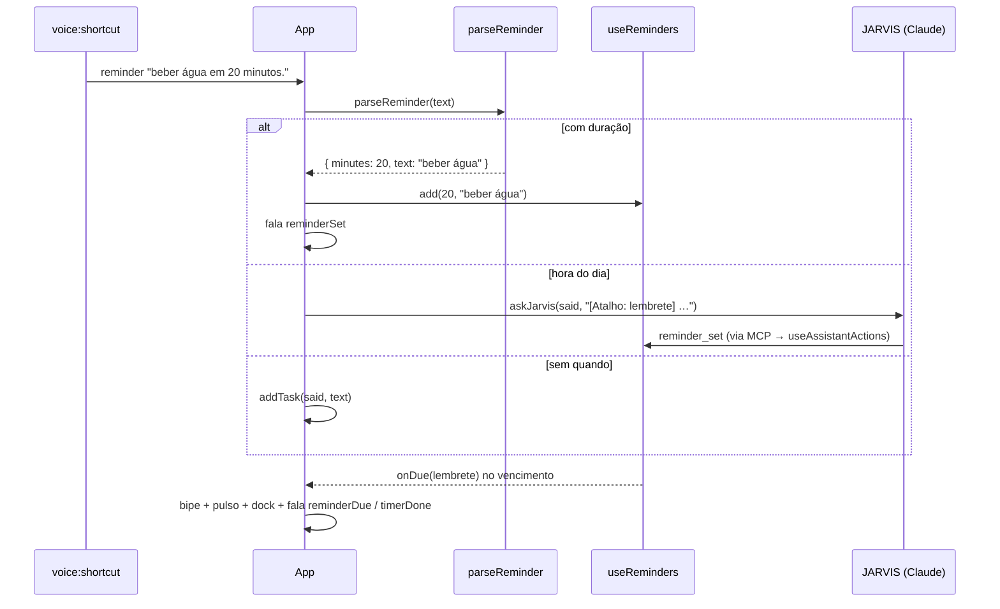

# Feature Specification: Reminders and Timers

## Metadata

| Field | Value |
|---|---|
| Feature ID | `feature/reminders` |
| Product | JARVIS OS (jvOS) |
| Feature Status | Implementado |
| Document Status | Reescrita em 2026-11-05 no formato Feature Specification; três decisões de produto em [Open Questions](#open-questions) |
| Source Commit | `048a254` (2026-10-27); a regra "sem quando vira tarefa" entrou em `e7151cf` (2026-11-05) |
| Uncommitted Changes | Nenhuma |
| Voice Shortcut | `shortcut:reminder` |
| Assistant Tool | `reminder_set` |
| Target Platforms | Windows 11 com WebView2; no navegador (modo web) tudo funciona, menos o caminho da hora do dia, que depende do Claude Code |
| Language | PT-BR no conteúdo e nas falas; inglês nos títulos das seções e em Given / When / Then |
| Last Editorial Revision | 2026-11-05 |
| Verification Scope | Conferida com o código em 2026-11-05: `src/hooks/useReminders.ts`, `src/lib/shortcuts.ts`, `src/App.tsx`, `src/hooks/useAssistantActions.ts`, `src/lib/jarvisLines.ts`, `src-tauri/src/mcp.rs`, `src-tauri/voice-commands.json` e `tests/shortcuts.spec.ts`. Os testes não foram executados nesta revisão |

Especificação no formato inspirado no GitHub Spec Kit, com seções de desenho técnico ([ADR-0025](../../arch/adr/0025-features-formato-feature-specification.md)). Os identificadores US1–US4, RF-001–RF-006, RNF-001, SC-001–SC-002 e T001–T015 são os mesmos da versão anterior. Os critérios de aceite AC-001–AC-010 são os antigos "Critério 1" a "Critério 10", na mesma ordem. KL-* registra limitações conhecidas; OQ-*, decisões de produto em aberto. Nenhum dos dois acrescenta escopo.

## Overview

O JARVIS cria lembretes e timers por voz. No vencimento, toca um bipe, pulsa o holograma, mostra um aviso na dock e diz uma fala do personagem.

O atalho `shortcut:reminder` escolhe um de três caminhos:

| Input | Expected Behavior | Execution Path |
|---|---|---|
| "Me lembra de beber água em 20 minutos" | Cria um lembrete com texto e duração | Local (`parseReminder` → `useReminders`) |
| "Timer de 5 minutos" | Cria um timer, sem texto | Local |
| "Me lembra da reunião às 15 horas" | O Claude lê o relógio, calcula os minutos e agenda | Claude Code → `reminder_set` pelo MCP |
| "Me lembra de ligar para a Ana" | Adiciona uma tarefa do dia e confirma o número dela | [tasks](../../widgets/tasks/spec.md) (`addTask`) |

Os lembretes ficam no `localStorage`. Um lembrete que vence com o app fechado dispara assim que ele abre. Não existe aviso enquanto o app está fechado.

## Goals and Success Criteria

### Goals

- Criar lembretes e timers com uma frase, sem abrir nenhuma janela.
- Entender durações localmente, sem chamar o Claude Code.
- Deixar com o Claude só o que depende do relógio (dia e hora).
- Mandar para a lista de tarefas o que não tem "quando".
- Não perder lembretes ao fechar e reabrir o app.
- Avisar pela dock, pelo bipe, pelo holograma e pela voz do JARVIS.

### Success Criteria

| ID | Criterion | Verification |
|---|---|---|
| SC-001 | Um lembrete por duração é criado sem nenhuma chamada ao Claude Code. | Dizer "me lembra de beber água em 20 minutos" no modo web, onde não há Claude Code: o lembrete entra em `jarvis.reminders` e a confirmação vem das falas locais (`reminderSet`). |
| SC-002 | Nenhum lembrete se perde ao fechar e reabrir o app. | Fechar com um lembrete pendente e reabrir: ele continua em `jarvis.reminders`; um que venceu no meio-tempo dispara na abertura. Vale até o limite de 50 lembretes (KL-002). |

## Scope and Non-Goals

### In Scope

- Lembretes por duração e timers (texto vazio).
- Durações em segundos, minutos e horas, em dígitos ou por extenso, até uma semana.
- Lembretes com dia ou hora, agendados pelo Claude com `reminder_set`.
- Frase sem nenhum "quando" convertida em tarefa do dia.
- Até 50 lembretes pendentes, guardados no `localStorage`.
- Disparo dos vencidos na abertura do app.
- Bipe, pulso do holograma, aviso na dock e fala do JARVIS no vencimento.

### Out of Scope

- Compromissos da [agenda](../../widgets/agenda/spec.md), que têm aviso próprio. O que decide entre os dois é o atalho reconhecido: "me lembra …" é lembrete; "anota que …" e "marca na agenda …" vão para a agenda.
- Repetição (lembretes diários) e soneca.
- Tela ou comando de voz para ver ou cancelar lembretes pendentes (KL-001, OQ-003).

## User Stories

### US1 — Duration Reminder

**Priority:** P1.

**User Story:** Como usuário, digo "me lembra de beber água em 20 minutos" e, 20 minutos depois, o JARVIS me lembra.

**Why This Priority:** é o uso mais comum.

**Independent Test:** `tests/shortcuts.spec.ts` — "reminders: a timer said to Voice, and one JARVIS sets that goes off".

**Acceptance Criteria:** AC-001, AC-002, AC-003 e AC-010.

### US2 — Timer

**Priority:** P1.

**User Story:** Como usuário, digo "timer de 5 minutos" para começar uma contagem sem abrir nada.

**Why This Priority:** é o cronômetro rápido do dia a dia.

**Independent Test:** `tests/shortcuts.spec.ts` — "parseReminder: durations in words or digits, what to say, and times of day left to JARVIS". Esse teste cobre a interpretação; o fim do timer não tem teste (KL-006).

**Acceptance Criteria:** AC-004 e AC-005.

### US3 — Time-of-Day Reminder

**Priority:** P2.

**User Story:** Como usuário, digo "me lembra da reunião às 15 horas" e sou lembrado nesse horário.

**Why This Priority:** exige ler o relógio e calcular a diferença, o que fica com o Claude.

**Independent Test:** `tests/shortcuts.spec.ts` — "reminders: a timer said to Voice, and one JARVIS sets that goes off".

**Acceptance Criteria:** AC-006, AC-007 e AC-009.

### US4 — Task Fallback

**Priority:** P2.

**User Story:** Como usuário, digo "me lembra de ligar para a Ana", sem dizer quando, e isso entra nas tarefas do dia.

**Why This Priority:** algo sem horário é uma coisa a fazer hoje.

**Independent Test:** `tests/tasks.spec.ts` — "by voice: added, ticked by number, deleted by its words, read back; a reminder without a when is a task".

**Acceptance Criteria:** AC-008.

## Requirements

### Functional Requirements

| ID | Requirement | Related Stories |
|---|---|---|
| RF-001 | `parseReminder` DEVE entender durações em dígitos ou por extenso ("20", "1,5", "vinte e cinco"), "meia hora", "uma hora e meia" e somas ("1 hora e 30 minutos"), em segundos, minutos e horas. | US1, US2 |
| RF-002 | `parseReminder` DEVE tirar do texto as palavras de ligação da duração ("em", "daqui a", "dentro de", "de", "por", "após") e as do começo ("de", "que", "para", "pra"), deixando só o que lembrar. | US1, US2 |
| RF-003 | Sem duração reconhecida, o atalho DEVE ir ao Claude se `mentionsWhen` encontrar dia ou hora; senão, DEVE virar tarefa. | US3, US4 |
| RF-004 | Cada lembrete DEVE ter `id`, `text` (vazio = timer) e `due` (ms desde a época Unix) e ser gravado sem debounce. | US1, US2, US3 |
| RF-005 | No vencimento, o sistema DEVE tocar o bipe, pulsar o holograma, avisar na dock e falar no núcleo. | US1, US2, US3 |
| RF-006 | `reminder_set` DEVE aceitar `0 < minutes ≤ 10 080`, frações de minuto inclusive. | US3 |

### Non-Functional Requirements

| ID | Requirement | Scope |
|---|---|---|
| RNF-001 | Funciona offline e no navegador, com o estado só no `localStorage`. | Interpretação da duração, persistência e agendamento. O caminho da hora do dia depende do Claude Code e da rede. |

### Operational Constraints

- No máximo 50 lembretes pendentes (`MAX_REMINDERS`).
- No máximo uma semana: 10 080 minutos (`MAX_REMINDER_MINUTES`).
- Um único `setTimeout`, até o próximo vencimento.
- Gravação sem debounce (0 ms).
- Falas e avisos em PT-BR.
- Nada em `settings.json`.

## Acceptance Criteria

### AC-001 — Create a Duration Reminder

**Related Story:** US1.

- **Given** o JARVIS ouvindo
- **When** o usuário diz "Me lembra de beber água em 20 minutos."
- **Then** um lembrete com texto "beber água" e vencimento em 20 minutos entra em `jarvis.reminders`.

### AC-002 — Confirm a Duration Reminder

**Related Story:** US1.

- **Given** o lembrete de AC-001 criado
- **When** o JARVIS confirma
- **Then** usa uma das falas `reminderSet` (ex.: "Pois não. Daqui a 20 minutos eu lembro você: beber água.").

### AC-003 — Deliver a Reminder

**Related Story:** US1.

- **Given** um lembrete pendente com o texto "beber água"
- **When** ele vence
- **Then** toca um bipe, a dock mostra "Lembrete: beber água" e o JARVIS diz uma fala `reminderDue` (ex.: "Lembrete, conforme combinado: beber água.").

### AC-004 — Create a Timer

**Related Story:** US2.

- **Given** "5 minutos", sem mais nada, no atalho de lembrete
- **When** a frase é interpretada
- **Then** nasce um timer (texto vazio) e o JARVIS diz uma fala `timerSet` (ex.: "Timer de 5 minutos correndo.").

### AC-005 — Complete a Timer

**Related Story:** US2.

- **Given** um timer pendente
- **When** ele vence
- **Then** a dock diz "Timer concluído" e o JARVIS diz uma fala `timerDone`.

**Coverage Status:** sem teste automatizado (KL-006).

### AC-006 — Delegate a Time-of-Day Request

**Related Story:** US3.

- **Given** uma frase com dia ou hora e sem duração reconhecida
- **When** o atalho a processa
- **Then** o Claude recebe `[Atalho: lembrete]`, a frase, a hora atual e a instrução de agendar com `reminder_set`.

### AC-007 — Schedule Through the Assistant Tool

**Related Story:** US3.

- **Given** uma chamada `reminder_set { minutes, text }` válida
- **When** a ferramenta roda
- **Then** a resposta é "Lembrete agendado para daqui a <duração>: <texto>" (ou "timer", com texto vazio), e o lembrete dispara como os outros.

### AC-008 — Create a Task Without a Time Reference

**Related Story:** US4.

- **Given** "me lembra de ligar para a Ana", sem duração e sem dia ou hora
- **When** o atalho a processa
- **Then** "Ligar para a Ana" entra na lista de tarefas e o JARVIS confirma com o número da tarefa.

### AC-009 — Reject an Out-of-Range Tool Request

**Related Story:** US3.

- **Given** uma chamada `reminder_set` com `minutes: 0` ou acima de 10 080
- **When** a ferramenta valida a entrada
- **Then** a resposta é `ok: false` com "Minutos fora do intervalo (1 a 10080)", e nenhum lembrete é criado.

### AC-010 — Reject an Excessive Local Duration

**Related Story:** US1.

- **Given** "em 9000 horas" (mais de uma semana)
- **When** `parseReminder` interpreta a frase
- **Then** devolve nulo, e nenhum lembrete é criado. Como `mentionsWhen` não reconhece "9000 horas", a frase segue para a lista de tarefas (KL-003).

## Behavior and Flows

### Request Routing

O caso `reminder` do `shortcutHandler` (`src/App.tsx`):

| Condition | Action | Confirmation |
|---|---|---|
| Duração válida, sobra texto | `reminders.add(minutes, text)` | `reminderSet` |
| Duração válida, sem texto | `reminders.add(minutes, "")` | `timerSet` |
| `parseReminder` nulo e `mentionsWhen` verdadeiro | `askJarvis` com `shortcutPrompt("reminder", …)` | A resposta do JARVIS |
| `parseReminder` nulo e `mentionsWhen` falso | `addTask(said, text)` | O número da tarefa |
| `reminders.add` devolve nulo | Nada é criado | `reminderFailed` na dock, como erro |

`parseReminder` devolve nulo tanto quando não há duração quanto quando ela é zero ou passa de uma semana. Por isso uma duração longa demais cai nas duas últimas linhas da tabela (KL-003, OQ-001). Pelo caminho de voz, `reminders.add` nunca recebe valores fora do intervalo, então o `reminderFailed` só aparece se o agendamento falhar por outro motivo.

### Duration Parsing

`parseReminder(text)` devolve `{ minutes, text }` ou nulo; a duração sai em minutos.

| Input Pattern | Interpretation |
|---|---|
| "20 minutos" | 20 |
| "1,5 horas" | 90 |
| "vinte e cinco minutos" | 25 |
| "meia hora" | 30 |
| "uma hora e meia" | 90 |
| "1 hora e 30 minutos" | 90 (soma) |
| "30 segundos" | 0,5 |
| "às 15 horas", "até as 3" | Hora do dia, não duração |
| Zero ou mais de 10 080 minutos | Nulo |

- Se sobrar só a duração ("5 minutos"), o resultado é um timer, com texto vazio.
- `mentionsWhen` reconhece dias da semana, "amanhã", partes do dia ("de manhã", "à tarde"), "às N", "N h"/"N horas" com até dois dígitos, "HH:MM", "dia N" e datas "dd/mm".
- `describeDuration` escreve a duração por extenso para as falas ("20 minutos", "30 segundos").

### Interaction Flow



### User Feedback

| Moment | Persona Key | Output |
|---|---|---|
| Lembrete criado | `reminderSet` | Fala com a duração e o texto |
| Timer criado | `timerSet` | Fala com a duração |
| Lembrete vencido | `reminderDue` | Dock "Lembrete: <texto>", fala, bipe e pulso |
| Timer vencido | `timerDone` | Dock "Timer concluído", fala, bipe e pulso |
| Falha ao criar pela voz | `reminderFailed` | Dock "Receio que não consegui agendar o lembrete." como erro |
| JARVIS ocupado no vencimento | `reminderDue` / `timerDone` | `reply` cai para a dock (`notifyVoice`) em vez do núcleo |

As variantes de cada fala estão em `src/lib/jarvisLines.ts`.

### Voice and Keyboard

- `shortcut:reminder` reconhece "me lembra de", "me lembre de", "me lembra", "me lembre", "cria um lembrete", "lembrete", "timer de", "cronômetro de", "alarme de" e "alarme para" (`src-tauri/voice-commands.json`).
- Não há tecla de atalho.

## Data Model and Persistence

### Reminder Entity

```ts
interface Reminder {
  id: number;   // Date.now() + Math.random() na criação
  text: string; // vazio = timer
  due: number;  // ms desde a época Unix
}
```

| Field | Meaning | Rule |
|---|---|---|
| `id` | Identifica o lembrete | Número único na prática; dois lembretes iguais têm `id` diferentes |
| `text` | O que lembrar | Aparado (`trim`); vazio é timer |
| `due` | Quando vence | `Date.now() + round(minutes × 60 000)` |

Ver também o [glossário](../../domain/glossary.md).

### Storage Rules

| Property | Value |
|---|---|
| State | `$lembretes`, lista de `Reminder` |
| Storage | `localStorage` |
| Key | `jarvis.reminders` |
| Write Debounce | 0 ms |
| Maximum Items | 50 |
| Reader | `parseReminders`: descarta itens sem `id` numérico, `text` texto ou `due` numérico, e fica com os 50 primeiros |
| Missing or Invalid Storage | Lista vazia |
| Capacity Overflow | `add` acrescenta no fim e fica com os 50 últimos (`slice(-50)`): sai o que foi criado primeiro, sem aviso |

### Restart Behavior

Na abertura, a lista volta do `localStorage`. O efeito do agendador calcula o próximo `due`; se ele já passou, o atraso é 0 e os vencidos disparam na hora. Os outros continuam esperando.

## Technical Design

### Component Responsibilities

| File or Component | Responsibility |
|---|---|
| `src/hooks/useReminders.ts` | `Reminder`, `parseReminders`, persistência com `useStoredState`, agendador, `add(minutes, text)`, `reminders`, `clear` |
| `src/lib/shortcuts.ts` | `parseReminder` (`readNumber`, `readDuration`, `leadingTie`), `mentionsWhen`, `describeDuration`, `MAX_REMINDER_MINUTES`, o prompt `shortcutPrompt("reminder", …)` |
| `src/App.tsx` | Caso `reminder` do `shortcutHandler`, `onReminder`, `addTask` e a ação `remind` passada a `useAssistantActions` |
| `src/hooks/useAssistantActions.ts` | O caso `reminder_set` |
| `src/lib/jarvisLines.ts` | `reminderSet`, `timerSet`, `reminderDue`, `timerDone`, `reminderFailed`, `reminderText` |
| `src-tauri/src/mcp.rs` | `reminder_set` em `TOOLS`, com descrição e `inputSchema` |
| `src-tauri/voice-commands.json` | As frases de `shortcut:reminder` |

O agendador e a persistência vivem só na UI. O Rust entra no reconhecimento da frase (matcher) e no transporte da ferramenta (MCP).

### Scheduler Algorithm

1. Com a lista vazia, não há timer.
2. Senão, há um único `setTimeout` até o menor `due`, limitado a 2³¹ − 1 ms (o máximo do `setTimeout`); acima disso, o timer acorda e reavalia.
3. No disparo, separe os vencidos (`due ≤ agora`).
4. Tire os vencidos da lista e chame `onDue` para cada um.
5. A lista nova refaz o efeito, que agenda o próximo vencimento.

Cada lembrete dispara uma vez nesta janela: ele sai da lista no mesmo passo em que `onDue` é chamado.

### Exposed Hook Operations

| Operation | Usage |
|---|---|
| `add(minutes, text)` | Cria um lembrete e o devolve, ou nulo fora do intervalo. Usado pelo atalho e por `remind` |
| `reminders` | A lista atual. Nada em `src/` a usa (KL-001) |
| `clear` | Esvazia a lista. Nada em `src/` a usa (KL-001) |

### Related Architecture Decisions

- [ADR-0010 — settings.json vs localStorage](../../arch/adr/0010-persistencia-settings-vs-localstorage.md)
- [ADR-0008 — servidor MCP dentro do app; a UI executa as tools](../../arch/adr/0008-mcp-http-in-process.md)

## Interfaces and Contracts

### Events and Channels

| Event | Payload | Producer → Consumer |
|---|---|---|
| `voice:shortcut` | `{ action: "reminder", text, said }` | matcher → `shortcutHandler` |
| `assistant:action` | `{ tool: "reminder_set", args: { minutes, text } }` | servidor MCP → `useAssistantActions` → `reminders.add` |

### Assistant Tool

| Property | Contract |
|---|---|
| Tool Name | `reminder_set` |
| Description | "Agenda um lembrete no jvOS: daqui a `minutes` minutos o JARVIS avisa (som, aviso na dock e voz) com o texto `text`. Para um horário, calcule os minutos a partir da hora local de system_status." |
| Input | `minutes` (number, obrigatório; o schema diz "1 a 10080") e `text` (string, obrigatório) |
| Accepted Range | `0 < minutes ≤ 10 080`, frações inclusive (RF-006) |
| Success | `ok: true`, "Lembrete agendado para daqui a <duração>: <texto ou timer>" |
| Out of Range | `ok: false`, "Minutos fora do intervalo (1 a 10080)" |
| Scheduling Failure | `ok: false`, "Não consegui agendar o lembrete" |

Exemplo de entrada:

```json
{ "minutes": 20, "text": "beber água" }
```

### Assistant Prompt

Com dia ou hora, `shortcutPrompt("reminder", said, text, { now })` manda: `[Atalho: lembrete] O usuário disse: "<frase>". <hora atual> Agende com reminder_set (calcule os minutos) e confirme em uma frase; se faltar quando, pergunte.`

## Edge Cases and Error Handling

| Case | Behavior | Reference |
|---|---|---|
| Só a duração ("5 minutos") | Timer com texto vazio | AC-004 |
| Nenhum "quando" na frase | Tarefa do dia | AC-008 |
| Duração zero ou acima de uma semana | Vira tarefa, ou vai ao Claude se houver dia ou hora | KL-003, OQ-001 |
| `jarvis.reminders` ausente ou com JSON inválido | Lista vazia | Storage Rules |
| Item salvo inválido | Descartado na leitura | `parseReminders` |
| A mesma frase dita duas vezes | Dois lembretes, com `id` diferentes; os dois disparam | Sem deduplicação |
| Mais de 50 lembretes | Sai o mais antigo, sem aviso | KL-002, OQ-002 |
| Vários vencidos ao mesmo tempo | Saem todos da lista; `onDue` para cada um, em sequência | Scheduler Algorithm |
| Venceu com o app fechado | Dispara na abertura | SC-002, KL-005 |
| JARVIS ocupado no vencimento | A fala vai para a dock | User Feedback |
| Atraso acima de 2³¹ − 1 ms | O timer acorda e reavalia | Scheduler Algorithm |
| `reminder_set` com `minutes: 0` ou acima de 10 080 | `ok: false`, nada é criado | AC-009 |
| `reminder_set` com fração de minuto (ex.: 0,03) | Aceito | RF-006, KL-004 |
| Sem Claude Code ou sem rede, com dia ou hora | O caminho do Claude falha como qualquer pergunta; nada é agendado | [assistant](../assistant/spec.md) |
| Permissões | Não se aplica: só `localStorage`, sem arquivos nem comandos nativos | RNF-001 |

## Dependencies

### Feature Dependencies

| Dependency | Purpose |
|---|---|
| [voice-shortcuts](../voice-shortcuts/spec.md) | Reconhece `shortcut:reminder` e entrega ao `shortcutHandler` |
| [assistant](../assistant/spec.md) | Resolve dia e hora; `useAssistant.say` |
| [assistant-tools](../assistant-tools/spec.md) | A ferramenta `reminder_set` no servidor MCP |
| [tasks](../../widgets/tasks/spec.md) | Destino da frase sem "quando" |
| [dock-taskbar](../dock-taskbar/spec.md) | Avisos por `useDockNotice` |
| [holographic-core](../holographic-core/spec.md) | O pulso `useAudioAnalyzer.pulse` |
| [tts](../tts/spec.md) | As falas do JARVIS |
| [agenda](../../widgets/agenda/spec.md) | Compromissos, com aviso próprio |

### Runtime Dependencies

- [React](../../foundation/vendor/react/spec.md) e [serde](../../foundation/vendor/serde/spec.md) (o MCP).
- `localStorage` e Web Audio (o bipe) da WebView2 ou do navegador.
- [Claude Code](../../foundation/vendor/claude-code/spec.md) e rede, só no caminho da hora do dia.
- Servidor MCP local, para levar `reminder_set` até a UI.

## Test Strategy and Coverage

### Reported Tests

| Test Reference | Coverage | Acceptance Mapping |
|---|---|---|
| `tests/shortcuts.spec.ts` — "parseReminder: durations in words or digits, what to say, and times of day left to JARVIS" | Durações, timer de texto vazio, hora do dia deixada ao JARVIS, mais de uma semana → nulo | AC-001 (interpretação), AC-004, AC-010 |
| `tests/shortcuts.spec.ts` — "spoken time, durations and the machine's status" | `describeDuration` ("20 minutos", "30 segundos") | AC-002, AC-007 |
| `tests/shortcuts.spec.ts` — "prompts carry the user's words and what the shortcut means" | O prompt `[Atalho: lembrete]` com `reminder_set` | AC-006 |
| `tests/shortcuts.spec.ts` — "reminders: a timer said to Voice, and one JARVIS sets that goes off" | Lembrete em `jarvis.reminders` com `reminderSet`; hora do dia indo ao Claude; `reminder_set` com 0,03 min disparando "Lembrete: alongar" com `reminderDue`; `minutes: 0` recusado | AC-001–AC-003, AC-006, AC-007, AC-009 |
| `tests/tasks.spec.ts` — "by voice: added, ticked by number, deleted by its words, read back; a reminder without a when is a task" | A frase sem quando vira tarefa | AC-008 |
| `src-tauri/src/voice/matcher.rs` — `shortcuts_open_the_request_and_keep_the_words_as_said` | "Me lembra de beber água em 20 minutos." e "timer de 5 minutos" viram `shortcut:reminder` | Entrada de US1 e US2 |

### Verification Commands

Na raiz do repositório:

```powershell
npx playwright test tests/shortcuts.spec.ts --project ui -g "parseReminder"
npx playwright test tests/shortcuts.spec.ts --project ui -g "spoken time, durations"
npx playwright test tests/shortcuts.spec.ts --project ui -g "prompts carry"
npx playwright test tests/shortcuts.spec.ts --project ui -g "reminders: a timer"
npx playwright test tests/tasks.spec.ts --project ui -g "by voice: added"
```

Em `src-tauri`:

```powershell
cargo test --lib shortcuts_open_the_request_and_keep_the_words_as_said
```

### Coverage Gaps

| Gap | Evidence Status | Suggested Verification |
|---|---|---|
| Fim do timer (AC-005) | Sem teste | Criar um timer curto e conferir "Timer concluído" e `timerDone` |
| `reminder_set` acima de 10 080 | Só o zero é testado | Chamar com 10 081 e conferir `ok: false` |
| Reabertura com lembretes futuros e vencidos | Sem teste | Gravar `jarvis.reminders` antes de abrir e conferir os disparos |
| Limite de 50 | Sem teste | Criar 51 e conferir qual saiu |
| Vários vencidos de uma vez | Sem teste | Dois lembretes com o mesmo `due` e dois `onDue` |
| Duração acima de uma semana pela voz | Só o parser é testado | Conferir que vira tarefa (KL-003) |

## Implementation Plan

**Status Convention:** `[x]` feito · `[ ]` pendente · `[P]` pode rodar em paralelo (arquivos diferentes) · `[USn]` história desta spec. As tarefas foram reconstruídas do código e do commit de origem.

### Phase 1 — Foundation

- [x] T001 [P] `Reminder`, `parseReminders`, `useStoredState` sem debounce e timer do próximo vencimento — `src/hooks/useReminders.ts`
- [x] T002 [P] `parseReminder` com números por extenso, "meia hora", somas e palavras de ligação; `MAX_REMINDER_MINUTES` — `src/lib/shortcuts.ts`
- [x] T003 [P] Falas `reminderSet`, `timerSet`, `reminderDue`, `timerDone`, `reminderFailed` — `src/lib/jarvisLines.ts`
- [x] T004 Frases de `shortcut:reminder` — `src-tauri/voice-commands.json`

### Phase 2 — Duration Reminders and Timers (US1, US2)

- [x] T005 [US1] Caso `reminder` com duração → `reminders.add` e fala de confirmação — `src/App.tsx`
- [x] T006 [US1] `onReminder`: bipe, pulso, "Lembrete: …" ou "Timer concluído" na dock, fala no núcleo — `src/App.tsx`
- [x] T007 [US2] Texto vazio = timer (`timerSet` / `timerDone`) — `src/App.tsx`

### Phase 3 — Time-of-Day Reminders (US3)

- [x] T008 [US3] `mentionsWhen` → `[Atalho: lembrete]` com a hora atual — `src/lib/shortcuts.ts`, `src/App.tsx`
- [x] T009 [US3] Ferramenta `reminder_set` (0 < minutos ≤ 10 080) — `src/hooks/useAssistantActions.ts`, `src-tauri/src/mcp.rs`

### Phase 4 — Task Fallback (US4)

- [x] T010 [US4] Sem duração e sem `mentionsWhen` → `addTask(said, text)` — `src/App.tsx`

### Phase 5 — Verification

- [x] T011 Playwright `tests/shortcuts.spec.ts` — "parseReminder: durations in words or digits, what to say, and times of day left to JARVIS"
- [x] T012 Playwright `tests/shortcuts.spec.ts` — "spoken time, durations and the machine's status" (`describeDuration`)
- [x] T013 Playwright `tests/shortcuts.spec.ts` — "reminders: a timer said to Voice, and one JARVIS sets that goes off"
- [x] T014 Playwright `tests/tasks.spec.ts` — "by voice: added, ticked by number, deleted by its words, read back; a reminder without a when is a task"
- [x] T015 Rust `src-tauri/src/voice/matcher.rs` — `shortcuts_open_the_request_and_keep_the_words_as_said`

## Rollback Plan

1. Tire `shortcut:reminder` de `src-tauri/voice-commands.json`, `"reminder"` de `SHORTCUT_TARGETS` (`src-tauri/src/settings.rs`) e de `ShortcutAction`/`SHORTCUT_ACTIONS`.
2. Tire de `src/App.tsx` o caso `reminder`, `onReminder`, `useReminders` e a ação `remind` passada a `useAssistantActions`; apague `src/hooks/useReminders.ts`.
3. Tire `reminder_set` dos dois lados de uma vez: `TOOLS` e `inputSchema` em `src-tauri/src/mcp.rs`, o caso em `src/hooks/useAssistantActions.ts` e a linha da persona. Se sobrar só no `mcp.rs`, o Claude ainda a chama e recebe "Ferramenta desconhecida: reminder_set".
4. Mantenha `mentionsWhen`, usado pelas anotações. `parseReminder`, `describeDuration` e `MAX_REMINDER_MINUTES` saem junto com os testes deles em `tests/shortcuts.spec.ts`, se ficarem sem uso.
5. A chave `jarvis.reminders` fica órfã no `localStorage` e é ignorada; os lembretes pendentes nela nunca disparam.
6. As frases de `shortcut:reminder` salvas em `settings.json` são descartadas por `sanitize_voice_commands` na próxima leitura.

## Constitution Compliance

| Principle | Status | Rationale |
|---|---|---|
| P1 — Offline-first | Atendido | Durações são locais; só dia e hora passam pelo Claude |
| P5 — Persistência tolerante | Atendido | `parseReminders` descarta itens inválidos e corta em 50 |
| P6 — Fora do Tauri | Atendido | Funciona igual no navegador |
| P7 — PT-BR | Atendido | Falas e avisos em PT-BR |
| P9 — Desktop leve | Atendido | Um único timer, só para o próximo vencimento |
| P11 — Testes | Atendido, com lacunas | Parser e fluxo no Playwright; o fim do timer sem teste (KL-006) |

## Known Limitations

| ID | Limitation | Status |
|---|---|---|
| KL-001 | Não há como ver nem cancelar lembretes pendentes: `useReminders` expõe `reminders` e `clear`, mas nada em `src/` os usa. | Fora do escopo atual; ver OQ-003 |
| KL-002 | Acima de 50, o lembrete mais antigo sai em silêncio (`slice(-50)` em `add`). | Comportamento atual; ver OQ-002 |
| KL-003 | Uma duração zero ou acima de uma semana dita por voz ("em 9000 horas") não gera erro: vira tarefa, ou vai ao Claude se a frase tiver dia ou hora. | Comportamento atual; ver OQ-001 |
| KL-004 | A mensagem e o schema de `reminder_set` dizem "1 a 10080", mas a ferramenta aceita qualquer valor acima de 0 (o próprio teste usa 0,03). | Texto impreciso; o comportamento é o do RF-006 |
| KL-005 | Um lembrete que vence com o app fechado só avisa na reabertura. | Limite do desenho: não há serviço em segundo plano |
| KL-006 | O fim do timer (AC-005) não tem teste automatizado. | Lacuna de verificação |
| KL-007 | Na leitura, `parseReminders` fica com os 50 **primeiros**; no `add`, ficam os 50 **últimos**. Só diverge se o `localStorage` tiver mais de 50 itens, o que o app sozinho não grava. | Inconsistência sem efeito hoje |

## Open Questions

| ID | Question | Evidence and Impact | Suggested Resolution |
|---|---|---|---|
| OQ-001 | Uma duração fora do intervalo dita por voz deve gerar um aviso, em vez de virar tarefa? | `parseReminder` devolve nulo tanto para "sem duração" quanto para "duração inválida", e o caso `reminder` não distingue os dois (KL-003). | Fazer `parseReminder` dizer o motivo e responder com uma fala "fora do intervalo". |
| OQ-002 | O limite de 50 deve recusar o lembrete novo ou avisar, em vez de apagar o mais antigo? | O descarte é silencioso (KL-002) e enfraquece SC-002. | Decidir a política e mostrar o aviso na dock. |
| OQ-003 | Deve existir uma forma de ouvir ou cancelar os lembretes pendentes? | `reminders` e `clear` já existem no hook, sem consumidor (KL-001). | Um atalho de voz ("quais são meus lembretes?") ou uma tool `reminder_list`. |

## References

- Versão anterior desta spec, no formato SpecLang: `git show e7151cf:.specs/features/reminders/spec.md`. A versão intermediária, no formato do spec-coding.dev ([ADR-0023](../../arch/adr/0023-specs-formato-spec-coding-dev.md)), não chegou a ser commitada.
- Modelo de formato: "Feature Specification: Reminders and Timers", enviado pelo usuário em 2026-11-05 ([ADR-0025](../../arch/adr/0025-features-formato-feature-specification.md)).
- Código conferido: listado em Metadata › Verification Scope.
