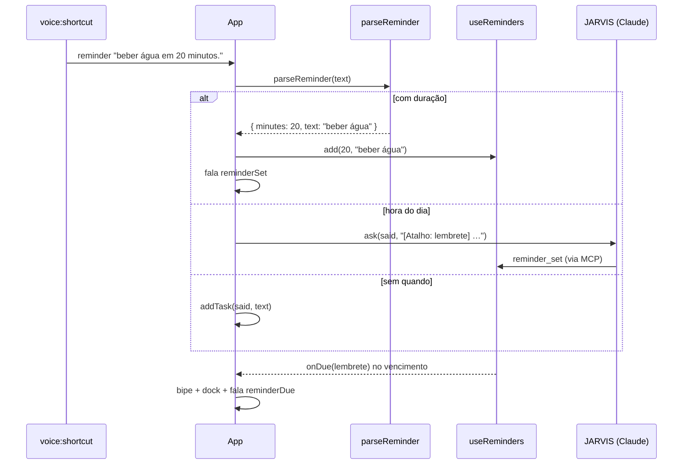

# Lembretes e timers

O JARVIS lembra o usuário de algo daqui a um tempo, com bipe, aviso na dock e fala.

| | |
|---|---|
| **ID** | `feature/reminders` |
| **Status** | Implementado |
| **Origem** | `048a254` (2026-10-27) · evoluída não commitado ("sem quando vira tarefa", em `src/App.tsx`) |
| **Voz** | `shortcut:reminder` |

## Visão geral

"Me lembra de beber água em 20 minutos" ou "timer de 5 minutos": na hora, o JARVIS toca um bipe, mostra o aviso na dock e diz o lembrete no personagem. Durações ditas são entendidas localmente, sem o Claude Code. Um horário do dia ("às 15h", "amanhã de manhã") vai para o Claude, que lê o relógio e agenda com a ferramenta `reminder_set`. Uma frase sem nenhum "quando" vira uma tarefa do dia ([widgets/tasks](../../widgets/tasks/spec.md)). Os lembretes ficam no `localStorage`, então sobrevivem a um reinício: um que venceu com o app fechado dispara quando ele abre.

## Dados

- `$lembretes`: lista de **Reminder** `{ id, text, due }`, com até 50 itens. Fica em `jarvis.reminders` (localStorage), gravada sem debounce (0 ms). `parseReminders` descarta itens sem `id`/`text`/`due` válidos e corta em 50. Ver [glossário](../../domain/glossary.md).
  - **RF-004**: Cada lembrete DEVE ter `id`, `text` (vazio = timer) e `due` (ms desde a época) e ser gravado sem debounce.
  - Se houver mais de 50 lembretes, os mais antigos saem da lista.

## Componentes

### Interpretação da frase (`parseReminder`)

Transforma o texto do atalho em `{ minutes, text }`, ou em nada quando não há duração.

- **Comportamento:**
  - **RF-001**: `parseReminder` DEVE entender durações em dígitos ou por extenso ("20", "1,5", "vinte e cinco"), "meia hora", "uma hora e meia" e somas ("1 hora e 30 minutos"), em minutos, horas e segundos.
  - **RF-002**: DEVE retirar do texto as palavras de ligação da duração ("em", "daqui a", "dentro de", "de", "por", "após") e as do começo ("de", "que", "para", "pra"…).
  - Se sobrar só a duração ("5 minutos"), o resultado é um timer, com texto vazio.
  - Se a duração passar de uma semana (10 080 min, `MAX_REMINDER_MINUTES`) ou for zero, devolva nulo.
  - Um número depois de "as" ou "ate" ("às 15 horas", "até as 3") é hora do dia, não duração.
  - `mentionsWhen` diz se a frase cita um dia ou uma hora. `describeDuration` escreve a duração por extenso para as falas.

### Agenda local (`useReminders`)

Guarda $lembretes e acorda no próximo vencimento.

- **Comportamento:**
  - Mantenha um único `setTimeout`, até o próximo `due`. Quando ele disparar, retire os vencidos de $lembretes e chame `onDue` para cada um.
  - Se um lembrete venceu com o app fechado, dispare-o assim que o app abrir.
  - Se o atraso passar do máximo do `setTimeout`, limite o timer a 2³¹−1 ms e reavalie depois.
  - `add(minutes, text)` cria um lembrete. `reminders` e `clear` também são expostos, mas nada em `src/` os usa.

### Disparo (`onReminder` no `App`)

- **Comportamento:**
  - **RF-005**: Ao vencer, o sistema DEVE tocar o bipe, pulsar o holograma, avisar na dock e falar no núcleo.
  - O aviso da dock diz "Lembrete: <texto>" ou, para um timer, "Timer concluído". A fala é `reminderDue` ou `timerDone`.
  - Se o JARVIS estiver ocupado no vencimento, a fala vai para a dock em vez do núcleo.

### Tool `reminder_set` do JARVIS

Usada pelo Claude quando o lembrete depende da hora do dia.

- **Comportamento:**
  - **RF-006**: `reminder_set` DEVE aceitar 0 < minutos ≤ 10 080.
  - Se for válido, agende `text` daqui a `minutes` e responda "Lembrete agendado para daqui a <duração>: <texto ou timer>".
  - Fora do intervalo, responda "Minutos fora do intervalo (1 a 10080)".
  - Se o agendamento falhar, a dock mostra "Receio que não consegui agendar o lembrete." (fala `reminderFailed`).

## Voz e teclado

O atalho `shortcut:reminder` passa o texto por `parseReminder` e escolhe um de três caminhos:

- "me lembra de … em 20 minutos": crie o lembrete local e confirme com uma fala `reminderSet`.
- "timer de 5 minutos", "cronômetro de…", "alarme de…": crie um timer local e confirme com `timerSet`.
- **RF-003**: Sem duração, o atalho DEVE ir ao Claude se `mentionsWhen` encontrar dia ou hora; senão, DEVE virar tarefa.
  - Com dia ou hora ("me lembra … às 15 horas", "amanhã"), mande ao Claude `[Atalho: lembrete]` com a hora atual e a instrução de usar `reminder_set`.
  - Sem nenhum quando ("me lembra de …"), adicione uma tarefa ([widgets/tasks](../../widgets/tasks/spec.md)) com `addTask(said, text)`.

## Restrições

- **RNF-001**: Funciona offline e no navegador (o estado é só do `localStorage`).

## Histórias de usuário

### US1 — Lembrete por duração (P1)

Como usuário, digo "me lembra de beber água em 20 minutos" e, 20 minutos depois, o JARVIS me lembra.

**Por que P1:** é o uso mais comum.
**Teste independente:** `tests/shortcuts.spec.ts` — "reminders: a timer said to Voice, and one JARVIS sets that goes off".

**Aceite**

1. **Dado** "Me lembra de beber água em 20 minutos.", **quando** dito, **então** um lembrete com texto "beber água" e vencimento em 20 min entra em `jarvis.reminders`.
2. **Dado** o lembrete criado, **quando** o JARVIS confirma, **então** usa uma das falas `reminderSet` (ex.: "Pois não. Daqui a 20 minutos eu lembro você: beber água.").
3. **Dado** o vencimento, **quando** chega, **então** toca um bipe, a dock mostra "Lembrete: beber água" e o JARVIS diz uma fala `reminderDue` (ex.: "Lembrete, conforme combinado: beber água.").

### US2 — Timer (P1)

Como usuário, digo "timer de 5 minutos".

**Por que P1:** cronômetro rápido sem abrir nada.
**Teste independente:** `tests/shortcuts.spec.ts` — "parseReminder: durations in words or digits, what to say, and times of day left to JARVIS".

**Aceite**

1. **Dado** "5 minutos" sem mais nada, **quando** interpretado, **então** é um timer (texto vazio) e o JARVIS diz uma fala `timerSet` (ex.: "Timer de 5 minutos correndo.").
2. **Dado** o fim, **quando** chega, **então** a dock diz "Timer concluído" e o JARVIS diz uma fala `timerDone`.

### US3 — Hora do dia (P2)

Como usuário, digo "me lembra da reunião às 15 horas".

**Por que P2:** exige ler o relógio e calcular a diferença, o que fica com o Claude.
**Teste independente:** `tests/shortcuts.spec.ts` — "reminders: a timer said to Voice, and one JARVIS sets that goes off".

**Aceite**

1. **Dado** um horário do dia, **quando** dito, **então** o Claude recebe `[Atalho: lembrete]` com a hora atual e a instrução de usar `reminder_set`.
2. **Dado** `reminder_set { minutes, text }` vindo do JARVIS, **quando** válido, **então** volta "Lembrete agendado para daqui a <duração>: <texto>" e o lembrete dispara como os outros.

### US4 — Sem quando, vira tarefa (P2)

Como usuário, digo "me lembra de ligar para a Ana" sem dizer quando.

**Por que P2:** algo sem horário é uma coisa a fazer hoje.
**Teste independente:** `tests/tasks.spec.ts` — "by voice: added, ticked by number, deleted by its words, read back; a reminder without a when is a task".

**Aceite**

1. **Dado** uma frase sem duração e sem dia ou hora, **quando** dita, **então** entra na lista de tarefas ("Ligar para a Ana") e o JARVIS confirma com o número da tarefa.

## Critérios de sucesso

- **SC-001**: Um lembrete por duração é criado sem nenhuma chamada ao Claude Code.
- **SC-002**: Nenhum lembrete se perde ao fechar e reabrir o app.

## Fora de escopo e limitações

- Compromissos com data e hora: vão para a [agenda](../../widgets/agenda/spec.md), que tem aviso próprio.
- Repetição (lembretes diários) e soneca.
- Não há tela para ver ou cancelar os lembretes pendentes.

## Código

Os lembretes vivem só na UI. O hook `useReminders` guarda a lista e mantém um único `setTimeout` até o próximo vencimento. O atalho `reminder` passa o texto por `parseReminder`: com duração, cria direto; com hora do dia, delega ao Claude (que chama `reminder_set`); sem quando, vira tarefa.

| | |
|---|---|
| **Camadas** | `App.tsx` (`onReminder`, caso `reminder` do `shortcutHandler`, `remind` das ações) · `useReminders` · `src/lib/shortcuts.ts` (`parseReminder`, `mentionsWhen`, `describeDuration`, `MAX_REMINDER_MINUTES`) · `useAssistantActions` (`reminder_set`) · `src/lib/jarvisLines.ts` |
| **Dependências** | `beep`, `useAudioAnalyzer.pulse`, `useDockNotice`, `useAssistant.say` |
| **Testes** | `tests/shortcuts.spec.ts`, `tests/tasks.spec.ts` |
| **Plataforma** | Windows 11 · WebView2 e navegador (nenhuma parte nativa) |

### Arquivos

| Arquivo | Papel |
|---|---|
| `src/hooks/useReminders.ts` | `Reminder`, `parseReminders`, timer do próximo vencimento, `add(minutes, text)`, `clear` |
| `src/lib/shortcuts.ts` | `parseReminder` (`readNumber`, `readDuration`, `leadingTie`), `mentionsWhen`, `describeDuration`, `MAX_REMINDER_MINUTES` |
| `src/App.tsx` | `onReminder` (bipe, pulso, "Lembrete: …"/"Timer concluído", fala); caso `reminder`; `addTask` |
| `src/hooks/useAssistantActions.ts` | `reminder_set` |
| `src/lib/jarvisLines.ts` | `reminderSet`, `timerSet`, `reminderDue`, `timerDone`, `reminderFailed`, `reminderText` |
| `src-tauri/src/mcp.rs` | descrição e `inputSchema` de `reminder_set` (minutos 1 a 10 080) |

### Contratos

#### Eventos e Channels

| Nome | Payload | Emissor → consumidor |
|---|---|---|
| `voice:shortcut` | `{ action: "reminder", text, said }` | matcher → `shortcutHandler` |
| `assistant:action` | `{ tool: "reminder_set", args: { minutes, text } }` | servidor MCP → `useAssistantActions` → `reminders.add` |

#### Ferramentas MCP (JARVIS)

| Tool | O que faz |
|---|---|
| `reminder_set` | Agenda `text` daqui a `minutes` (0 < m ≤ 10 080); responde "Lembrete agendado para daqui a <duração>: <texto ou timer>" |

### Fluxo

### Constituição

- [x] P1 Offline-first — lembretes por duração são locais; só a hora do dia passa pelo Claude.
- [x] P5 Persistência tolerante — `parseReminders` descarta itens sem `id`/`text`/`due` válidos e corta em 50.
- [x] P6 Fora do Tauri — funciona igual no navegador.
- [x] P7 PT-BR — falas e avisos em PT-BR.
- [x] P9 Desktop leve — um único timer, só para o próximo vencimento.
- [x] P11 Testes — `parseReminder` e o fluxo completo no Playwright.

### Decisões relacionadas

- [ADR-0010 — settings.json vs localStorage](../../arch/adr/0010-persistencia-settings-vs-localstorage.md)
- [ADR-0008 — servidor MCP in-process; a UI executa as tools](../../arch/adr/0008-mcp-http-in-process.md)

## Tarefas

Legenda: `[x]` feito · `[ ]` pendente · `[P]` pode rodar em paralelo (arquivos diferentes) · `[USn]` história desta spec. As tarefas foram reconstruídas do código e do commit de origem.

### Fase 1 — Base

- [x] T001 [P] `Reminder`, `parseReminders`, `useStoredState` sem debounce e timer do próximo vencimento — `src/hooks/useReminders.ts`
- [x] T002 [P] `parseReminder` com números por extenso, "meia hora", somas e palavras de ligação; `MAX_REMINDER_MINUTES` — `src/lib/shortcuts.ts`
- [x] T003 [P] Falas `reminderSet`, `timerSet`, `reminderDue`, `timerDone`, `reminderFailed` — `src/lib/jarvisLines.ts`
- [x] T004 Frases de `shortcut:reminder` — `src-tauri/voice-commands.json`

### Fase 2 — US1 e US2 Lembrete e timer por duração (P1)

- [x] T005 [US1] Caso `reminder` com duração → `reminders.add` e fala de confirmação — `src/App.tsx`
- [x] T006 [US1] `onReminder`: bipe, pulso, "Lembrete: …" ou "Timer concluído" na dock, fala no núcleo — `src/App.tsx`
- [x] T007 [US2] Texto vazio = timer (`timerSet` / `timerDone`) — `src/App.tsx`

### Fase 3 — US3 Hora do dia (P2)

- [x] T008 [US3] `mentionsWhen` → `[Atalho: lembrete]` com a hora atual — `src/lib/shortcuts.ts`, `src/App.tsx`
- [x] T009 [US3] Ferramenta `reminder_set` (validação 1–10 080) — `src/hooks/useAssistantActions.ts`, `src-tauri/src/mcp.rs`

### Fase 4 — US4 Sem quando vira tarefa (P2)

- [x] T010 [US4] Sem duração e sem `mentionsWhen` → `addTask(said, text)` — `src/App.tsx`

### Fase 5 — Testes

- [x] T011 Playwright `tests/shortcuts.spec.ts` — "parseReminder: durations in words or digits, what to say, and times of day left to JARVIS"
- [x] T012 Playwright `tests/shortcuts.spec.ts` — "spoken time, durations and the machine's status" (`describeDuration`)
- [x] T013 Playwright `tests/shortcuts.spec.ts` — "reminders: a timer said to Voice, and one JARVIS sets that goes off"
- [x] T014 Playwright `tests/tasks.spec.ts` — "by voice: added, ticked by number, deleted by its words, read back; a reminder without a when is a task"
- [x] T015 Rust `src-tauri/src/voice/matcher.rs` — `shortcuts_open_the_request_and_keep_the_words_as_said` ("Me lembra de beber água em 20 minutos.", "timer de 5 minutos")

## Pendências

- [ ] Não há como ver nem cancelar lembretes pendentes: `useReminders` expõe `reminders` e `clear`, mas nada em `src/` os usa (só `add`).
- [ ] O limite de 50 lembretes descarta os mais antigos em silêncio (`slice(-MAX_REMINDERS)` em `src/hooks/useReminders.ts`), sem aviso ao usuário.
