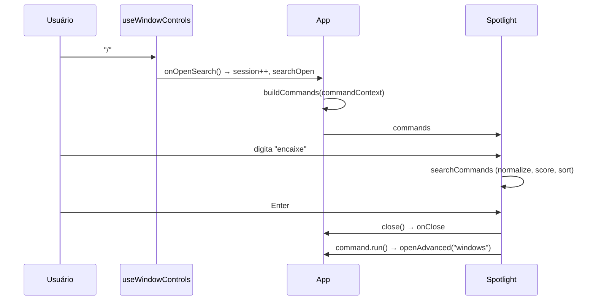

# Busca (Spotlight)

Uma barra de busca no estilo Spotlight, aberta com `/`, que encontra e executa quase tudo do jvOS.

| | |
|---|---|
| **ID** | `feature/search` |
| **Status** | Implementado |
| **Origem** | `42e671a` (2026-10-23) · evoluída em `c4ccc57`, `750ebd0`, `048a254` e não commitado (27/10) |

## Visão geral

Apertar `/` abre uma barra de busca no estilo Spotlight do macOS que encontra e executa quase tudo do jvOS:
- abrir widgets e apps, e fechar e arranjar janelas;
- abrir os programas configurados;
- ir a uma seção das Configurações ou a uma aba do Menu avançado;
- tocar uma estação ou playlist;
- trocar cor, núcleo, dock, barra, modelo do JARVIS e modo de ativação;
- ligar a escuta e a voz do JARVIS;
- alternar a qualidade, rever o boot, e pôr em tela cheia, minimizar ou sair.

A busca ignora acentos e artigos. Ela é o caminho de teclado para tudo, e a mesma lista de comandos é o que o JARVIS executa pela tool `jvos_run`.

## Dados

A busca não guarda nada próprio: os comandos alteram `jarvis.*` e settings dos outros domínios.

- `$comandos`: a lista de **Command** que a busca encontra e executa, montada por `buildCommands($contexto)`. Só em memória e recalculada a cada abertura. Ver [glossário](../../domain/glossary.md).
- `$contexto`: o **CommandContext**, tudo em que os comandos agem (janelas, música, settings, menus, núcleo, voz, sistema). O `App` monta a cada render.
- `$consulta`: o texto do campo. Começa vazio a cada abertura.
- `$selecionado`: o índice do resultado ativo. Volta a 0 sempre que $consulta muda.
- **SettingsSection / AdvancedTab**: alvos de "ir para" (`activation`, `appearance`, `voice`, `jarvis`, `apps` / `colors`, `core`, `windows`, `layout`, `tui`, `taskbar`, `dock`, `voice`).

## Componentes

### `Spotlight`

O diálogo "Busca", com fundo escurecido, que abre por cima de tudo e fecha antes de rodar o comando.

- **Comportamento:**
  - Abra com o foco no campo "Buscar no JARVIS" (placeholder "Buscar widgets, apps, programas e menus…").
  - **RF-007**: Executar um comando DEVE fechar a busca antes (e tirar o foco do campo) e só então rodar a ação.
  - **RF-008**: Esc DEVE fechar só a busca: o evento não chega ao painel de trás.
  - Um clique no fundo escurecido também fecha a busca.
  - Se a busca for reaberta durante a animação de saída, então monte um painel novo (chave `session`). O que está saindo fica fora do teclado e dos leitores de tela (`useIsPresent`, `inert`, `aria-hidden`).
- **Layout:**
  - Um fundo que cobre a tela inteira e, por cima, o painel `role="dialog"` centralizado na horizontal, a 16vh do topo.
  - No topo do painel, uma linha com o ícone de lupa, o campo (`role="combobox"`) e a tecla "esc" à direita.
  - No meio, a lista de resultados. Embaixo, o rodapé com "↑↓ navegar", "enter abrir", "esc fechar" e, à direita, a contagem ("1 resultado", "N resultados").
- **Estilo:**
  - Fundo `bg-black/30`. Painel com 640 px de largura (no máximo `calc(100vw - 2rem)`), `rounded-2xl`, borda `hud-cyan/25`, fundo `bg-hud-panel/88` com `backdrop-blur-xl`, sombra funda e um brilho ciano interno.
  - Um fio de luz no topo, em degradê `hud-light/45`.
  - Campo com 56 px de altura (`h-14`), `text-lg` em `text-hud-light`, placeholder `text-hud-text/35`. Lupa lucide de 20 px em `text-hud-light/80`. A tecla "esc" é um `kbd` mono de 10 px, maiúsculo, com borda `hud-cyan/20`.
  - O rodapé usa 10 px maiúsculos com espaçamento largo em `text-hud-text/40`, com as teclas em `text-hud-text/70`, separado por uma borda `hud-cyan/10`.
  - Entrada em 0,2 s (sobe 10 px e cresce de 98%); saída em 0,12 s.

### Lista de resultados (`SpotlightPanel`)

Mostra $comandos filtrados por $consulta e marca $selecionado.

- **Comportamento:**
  - **RF-003**: Sem consulta, a lista DEVE manter a ordem original, com cabeçalho de grupo. Com consulta, cada item mostra "grupo · subtítulo".
  - **RF-004**: O trecho que casa DEVE ser destacado no título (`matchRange`).
  - Mostre à direita o selo do comando ("aberto", "atual", "no ar") e o atalho de teclado, quando houver (ver [Atalhos exibidos nos resultados](#atalhos-exibidos-nos-resultados)).
  - Role a lista até o item selecionado (`scrollIntoView({ block: "nearest" })`).
  - Passar o mouse sobre um item o seleciona. Um clique o executa.
  - Se não houver nenhum resultado, então mostre "Nada encontrado para “<consulta>”." e Enter não faz nada.
- **Layout:**
  - `role="listbox"` "Resultados". Sem consulta, um cabeçalho com o nome do grupo antes do primeiro item de cada grupo.
  - Cada item (`role="option"`) tem um quadrado com o ícone, o título com o subtítulo embaixo, o selo e o atalho.
- **Estilo:**
  - `hud-scroll`, com altura máxima `min(52vh, 460px)`.
  - Cabeçalho de grupo em 10 px, `font-semibold`, maiúsculo, com espaçamento largo, em `text-hud-cyan/75`.
  - Item em `rounded-xl`. O ícone lucide de 16 px fica num quadrado de 32 px (`size-8`, `rounded-lg`) com borda `hud-cyan/12` e `text-hud-text/60`.
  - O item selecionado ganha fundo `hud-cyan/12` com um contorno interno ciano, borda do ícone `hud-cyan/40` e título em `text-hud-light`.
  - Título em `text-sm`, subtítulo em `text-xs` `text-hud-text/45`, os dois cortados com reticências.
  - O trecho que casa fica em `font-semibold` `text-hud-light`, sublinhado em `hud-cyan/50`.
  - Selo em pílula com borda `hud-cyan/25`, 10 px maiúsculo, `text-hud-light/80`. Atalho em `kbd` mono de 10 px maiúsculo, `text-hud-text/40`.
  - "Nada encontrado…" centralizado em `text-sm` `text-hud-text/50`.

### Pontuação (`searchCommands`)

Ordena $comandos para $consulta, sem acento e em minúsculas (`normalize`).

- **Comportamento:**
  - **RF-002**: A pontuação DEVE exigir que toda palavra relevante apareça no título, nas palavras-chave, no grupo ou no subtítulo (sem acento e em minúsculas). Depois a ordem é: título que começa com a consulta (100), título que contém (55) ou outro lugar (10); +30 se uma palavra do título começa com o primeiro termo, +10 por termo seguinte achado no título, e títulos mais curtos primeiro entre iguais.
  - Se a consulta tiver palavras de ligação ("a", "o", "de", "da", "em", "para", "pra"…, em `LINKING_WORDS`), então ignore-as, a não ser que sejam a consulta inteira.
  - Entre pontuações iguais, mantenha a ordem original.

### Catálogo de comandos (`buildCommands`)

Produz $comandos a partir de $contexto.

- **Comportamento:**
  - **RF-005**: Os comandos DEVEM ser montados por `buildCommands(CommandContext)` só enquanto a busca está aberta. Cada um tem `id`, título, subtítulo, grupo, ícone, palavras-chave, atalho e selo ("aberto", "atual", "no ar") opcionais.
  - **RF-006**: Grupos e ids:
    - **Widgets/Apps**: `window:<kind>`;
    - **Janelas**: `close:<kind>`, `arrange:tile|cascade|center`, `close-all`, `close-widgets`, `close-apps`;
    - **Programas**: `program:<id>`;
    - **Menus**: `settings`, `settings:<seção>`, `advanced`, `advanced:<aba>`, `launcher:*`;
    - **Apps**: `shell-tab:<perfil>`;
    - **Música**: `music:<estação>`, `music:toggle`, `music:next`;
    - **Aparência**: `theme:*`, `taskbar`, `core:*`, `dock`;
    - **Voz**: `jarvis-model:*`, `activation:*`, `listening`, `speaking`;
    - **Sistema**: `quality`, `boot-replay`, `boot-toggle`, `fullscreen`, `minimize`, `quit`.
  - `settings:<seção>` abre o painel rolado até a seção (`openSettingsAt`), e `advanced:<aba>` abre o menu com a aba selecionada (`openAdvancedAt`).
  - As palavras-chave incluem sinônimos em inglês ("open", "close", "theme").
  - Se a dock estiver oculta, então "Menu de widgets" e "Menu de apps" não aparecem.
  - Se estiver no navegador, então "Tela cheia", "Minimizar o JARVIS" e "Fechar o JARVIS" não aparecem (`system` = null). Programas dizem "Disponível no app desktop".
  - Se as settings ainda estiverem carregando, então os comandos de tema, barra, modelo e ativação não aparecem.
  - Se não houver janelas, então "Fechar …", arranjos e "Fechar todas as janelas" não aparecem.
  - O JARVIS recebe a mesma lista por uma referência sempre atual (`latestCommands`), para as tools `jvos_commands` e `jvos_run`.

## Voz e teclado

- **RF-001**: `/` DEVE abrir a busca quando o foco não está num campo de texto, `contenteditable`, terminal ou área `[data-plain-keys]` (jv_ide), e sem Ctrl ou Alt.
  - Dentro de um campo, o `/` entra no texto e a escuta continua `idle`.
- Botão "Buscar (/)" da barra superior: abre a busca.
- `↓` / `↑`: move a seleção, circular.
- `Enter`: executa o selecionado.
- `Esc` ou clique no fundo: fecha só a busca.
- O Launcher mostra a dica "Ou tecle / para buscar.".

## Restrições

- **RNF-001**: Tudo local, sem índice persistido. A lista é recalculada a cada abertura.
- **RNF-002**: A lista tem altura máxima de `min(52vh, 460px)` e rola até o item selecionado.
- Busca linear sobre algumas dezenas de comandos, sem índice.

## Histórias de usuário

### US1 — Encontrar e abrir (P1)

Aperto `/`, digito algumas letras e Enter abre o que eu queria.

**Por que P1:** é o atalho universal do teclado.
**Teste independente:** `tests/search.spec.ts` — "/ opens the search; typing finds a widget and Enter opens it".

**Aceite**

1. **Dado** o desktop, **quando** aperto `/`, **então** o diálogo "Busca" abre com o foco no campo "Buscar no JARVIS" ("Buscar widgets, apps, programas e menus…").
2. **Dado** o campo vazio, **então** tudo aparece agrupado, com cabeçalhos (Widgets, Apps, Janelas, Programas, Menus, Música, Aparência, Voz, Sistema).
3. **Quando** digito "calc", **então** "Calculadora" fica selecionada, e Enter fecha a busca e abre a janela.
4. **Dado** a Calculadora aberta, **quando** digito "fechar calcu", **então** "Fechar Calculadora" é o primeiro, e Enter fecha a janela.
5. **Quando** digito "relogio" (sem acento), **então** "Relógio" é encontrado. Esc fecha a busca e não sobra texto na tela.

### US2 — Navegar e ir direto a menus (P1)

Uso as setas e chego direto à aba ou seção certa dos menus.

**Por que P1:** os menus têm muitas opções, e a busca é o índice delas.
**Teste independente:** "arrow keys move the selection; menus open at the right place".

**Aceite**

1. **Dado** resultados, **quando** aperto ↓ e depois ↑, **então** a seleção desce e volta ao primeiro, circulando nas pontas.
2. **Quando** digito "encaixe", **então** "Menu avançado › Janelas" é o primeiro. Enter abre o menu com a aba Janelas selecionada.
3. **Quando** digito "palavras-chave", **então** "Configurações › Programas e atalhos" é o primeiro. Enter abre o painel rolado até "Adicionar programa".
4. **Dado** a busca sobre o painel de Configurações, **quando** aperto Esc, **então** só a busca fecha.

### US3 — Executar ações (P2)

Ações de configuração e layout rodam direto da busca.

**Por que P2:** evita abrir menus para mudanças rápidas.
**Teste independente:** "settings and layout actions run from the search; / inside a text field just types".

**Aceite**

1. **Quando** digito "verde" e Enter em "Cor do JARVIS: Verde Matrix", **então** o tema muda e é salvo.
2. **Dado** duas janelas abertas, **quando** escolho "Organizar janelas lado a lado", **então** elas se reorganizam.
3. **Dado** o foco num editor ou campo de texto, **quando** digito `/`, **então** o caractere entra no texto e a busca não abre. A escuta continua `idle`.

## Critérios de sucesso

- **SC-001**: Qualquer widget ou app abre com `/` + poucas letras + Enter.
- **SC-002**: Toda aba do Menu avançado e toda seção indexada das Configurações é alcançável pela busca.
- **SC-003**: `/` nunca é engolido quando o usuário está digitando.

## Fora de escopo e limitações

- A busca fuzzy de arquivos do jv_ide (`src/lib/fuzzy.ts`, Ctrl+P) é outra coisa: ver [jv_ide](../../apps/jv_ide/spec.md).
- O JARVIS usa os mesmos comandos pelas tools `jvos_commands`/`jvos_run`: ver [assistant-tools](../../features/assistant-tools/spec.md).
- A seção "Voz do JARVIS" das Configurações (`settings-speech`) não tem atalho `settings:<seção>`. Ela só é alcançada pelo painel ou pelo comando "Ligar a voz do JARVIS"/"Silenciar o JARVIS".

## Código

A busca são três peças:
- `src/lib/search.ts`: o tipo `Command`, a normalização sem acento e a pontuação (`scoreCommand`, `searchCommands`, `matchRange`);
- `src/lib/commands.ts`: `buildCommands(context)`, que produz a lista a partir do estado atual;
- `Spotlight.tsx`: o diálogo, um combobox com listbox.

O `App` monta o `CommandContext` a cada render e só chama `buildCommands` com a busca aberta. A mesma função alimenta `useAssistantActions` (o JARVIS) por meio de uma referência sempre atual (`latestCommands`).

| | |
|---|---|
| **Camadas** | UI React (`Spotlight`) · lib (`search.ts`, `commands.ts`) · `App.tsx` (`CommandContext`, `searchOpen`, `searchSession`) · `useWindowControls` (tecla `/`) |
| **Dependências** | `motion/react` (`useIsPresent`), `lucide-react` |
| **Testes** | `tests/search.spec.ts`; usada também em `core.spec`, `dock.spec`, `taskbar.spec`, `tui.spec`, `music.spec`, `shell.spec`, `voicetab.spec` |
| **Plataforma** | Igual dentro e fora do Tauri, exceto `system` (tela cheia, minimizar, sair), que só existe no app |

### Arquivos

| Arquivo | Papel |
|---|---|
| `src/components/Spotlight.tsx` | `Spotlight` (com `AnimatePresence` e `key={session}`) e `SpotlightPanel` (consulta, seleção, teclas, render agrupado, destaque, selo, atalho) |
| `src/lib/search.ts` | `Command`, `normalize`, `LINKING_WORDS`, `scoreCommand`, `searchCommands`, `matchRange` |
| `src/lib/commands.ts` | `SettingsSection`, `AdvancedTab`, `CommandContext`, `WINDOW_KEYWORDS`, `APP_SUBTITLES`, `SETTINGS_SECTIONS`, `ADVANCED_TABS`, `ARRANGE`, `buildCommands` |
| `src/App.tsx` | `commandContext`, `openSettingsAt`, `openAdvancedAt`, `searchOpen`/`searchSession`, `actionCommands` para o JARVIS |
| `src/hooks/useWindowControls.ts` | `/` → `onOpenSearch`, com `isTyping` |
| `src/components/Taskbar.tsx` | Botão "Buscar (/)" |
| `src/components/desktop/Launcher.tsx` | Dica "Ou tecle / para buscar." |

### Contratos

#### Ferramentas MCP (JARVIS)

| Tool | O que faz |
|---|---|
| `jvos_commands` | Lista id, título e grupo dos comandos de `buildCommands` disponíveis agora |
| `jvos_run` | Executa um comando por `id` exato ou por `query` (`findCommand`). Sem um casamento claro, devolve as opções próximas. Detalhes em [assistant-tools](../../features/assistant-tools/spec.md) |

### Atalhos exibidos nos resultados

| Comando | Atalho mostrado |
|---|---|
| Configurações | `Ctrl ,` |
| Menu avançado | `Ctrl Shift ,` |
| Fechar <janela> | `Ctrl W` |
| Ligar/Desligar a escuta | `M` |
| Alternar qualidade gráfica | `Ctrl Shift Q` |
| Tela cheia / Minimizar / Fechar o JARVIS | `F11` / `Ctrl M` / `Ctrl Q` |

### Fluxo

### Constituição

- [x] P6 Funciona fora do Tauri — os comandos do sistema somem, e os programas avisam "Disponível no app desktop".
- [x] P7 PT-BR — títulos e subtítulos em PT-BR. As palavras-chave incluem sinônimos em inglês ("open", "close", "theme").
- [x] P8 Linguagem visual — tokens `hud-*` e o mesmo fundo dos outros diálogos.
- [x] P9 Desktop leve — a lista só é construída com a busca aberta.
- [x] P11 Coberto por teste — três testes próprios e uso em vários outros specs.

### Decisões relacionadas

- [ADR-0008 — servidor MCP HTTP in-process; a UI executa as tools](../../arch/adr/0008-mcp-http-in-process.md)
- [ADR-0017 — UI PT-BR, código EN](../../arch/adr/0017-ui-pt-br-codigo-en.md)
- [ADR-0011 — fakes de dev e E2E no modo web](../../arch/adr/0011-fakes-de-dev-e-e2e-modo-web.md)

## Tarefas

Legenda: `[x]` feito · `[ ]` pendente · `[P]` pode rodar em paralelo (arquivos diferentes) · `[USn]` história desta spec. As tarefas foram reconstruídas do código e dos commits `42e671a`, `c4ccc57`, `750ebd0`, `048a254` e do working tree de 27/10.

### Fase 1 — Base

- [x] T001 `Command`, `normalize` (NFD sem diacríticos) e `LINKING_WORDS` — `src/lib/search.ts`
- [x] T002 `scoreCommand`, `searchCommands` e `matchRange` — `src/lib/search.ts`
- [x] T003 [P] `CommandContext`, `SettingsSection` e `AdvancedTab` — `src/lib/commands.ts`

### Fase 2 — US1 Encontrar e abrir (P1)

- [x] T004 [US1] `Spotlight`/`SpotlightPanel`: combobox, listbox, cabeçalhos de grupo, destaque, selo e atalho — `src/components/Spotlight.tsx`
- [x] T005 [US1] Comandos de janela (`window:*`, `close:*`, `arrange:*`, `close-*`) com `WINDOW_KEYWORDS` — `src/lib/commands.ts`
- [x] T006 [US1] `/` em `useWindowControls` com `isTyping` e `[data-plain-keys]` — `src/hooks/useWindowControls.ts`
- [x] T007 [US1] `searchOpen`/`searchSession` e lista construída só com a busca aberta — `src/App.tsx`

### Fase 3 — US2 Navegar e ir a menus (P1)

- [x] T008 [US2] Setas circulares, Enter, e Esc que não vaza — `src/components/Spotlight.tsx`
- [x] T009 [US2] `SETTINGS_SECTIONS`, `ADVANCED_TABS` e `openSettingsAt`/`openAdvancedAt`, com rolagem até a seção — `src/lib/commands.ts`, `src/App.tsx`, `src/components/SettingsPanel.tsx`

### Fase 4 — US3 Executar ações (P2)

- [x] T010 [US3] Programas (`program:*`), música (`music:*`) e abas do jv_sh (`shell-tab:*`) — `src/lib/commands.ts`
- [x] T011 [US3] Aparência e voz: tema, barra, núcleo, dock, modelo do JARVIS, ativação, escuta, voz do JARVIS — `src/lib/commands.ts` (`750ebd0`, `048a254`)
- [x] T012 [US3] Sistema: qualidade, boot, tela cheia, minimizar, sair — `src/lib/commands.ts`
- [x] T013 [P] [US3] Mesma lista para o JARVIS (`actionCommands` → `jvos_run`) — `src/App.tsx`, `src/hooks/useAssistantActions.ts`

### Fase 5 — Testes

- [x] T014 Playwright `tests/search.spec.ts` — "/ opens the search; typing finds a widget and Enter opens it"
- [x] T015 Playwright `tests/search.spec.ts` — "arrow keys move the selection; menus open at the right place"
- [x] T016 Playwright `tests/search.spec.ts` — "settings and layout actions run from the search; / inside a text field just types"
- [x] T017 Playwright `tests/core.spec.ts` — "the core switched off leaves an empty, working desktop; the search turns the 3D back on" (comando `core:3d`)
- [x] T018 Playwright `tests/dock.spec.ts` — "the advanced menu's Dock tab turns the dock off; its notices still show, and it comes back" (lançadores somem com a dock oculta)

## Pendências

- [ ] `SettingsSection` em `src/lib/commands.ts` não inclui a seção "Voz do JARVIS" (`id="settings-speech"` em `src/components/SettingsPanel.tsx`), então a busca não leva até ela.
