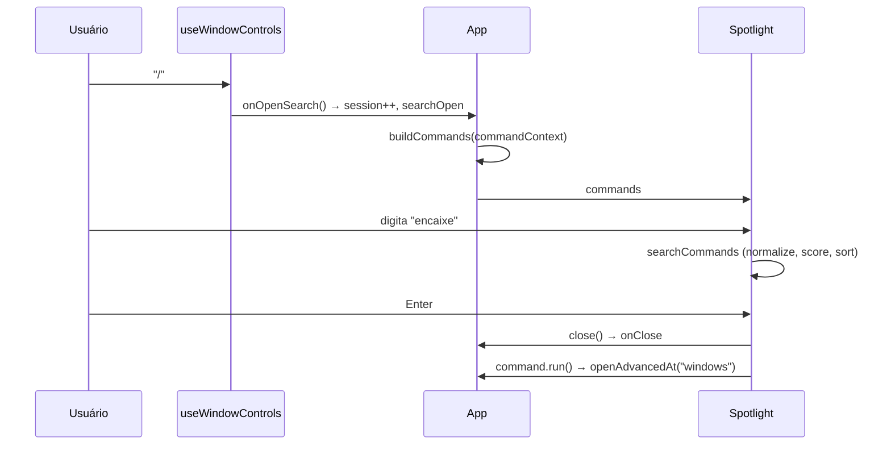

# Feature Specification: Search

## Metadata

| Field | Value |
|---|---|
| Feature ID | `feature/search` |
| Product | JARVIS OS (jvOS) |
| Feature Status | Implementado |
| Document Status | Reescrita em 2026-11-05 no formato Feature Specification; sem decisões em aberto |
| Source Commit | `42e671a` (2026-10-23); o catálogo de comandos (`commands.ts`) evoluiu em `c4ccc57`, `750ebd0`, `048a254` e `e7151cf` (2026-11-05) |
| Uncommitted Changes | Nenhuma |
| Voice Shortcut | — |
| Assistant Tool | `jvos_commands` e `jvos_run` (a mesma lista de comandos) |
| Target Platforms | Windows 11 com WebView2; no navegador (modo web) tudo funciona, menos os comandos do sistema ("Tela cheia", "Minimizar o JARVIS", "Fechar o JARVIS"), que não aparecem, e os programas, que dizem "Disponível no app desktop" |
| Language | PT-BR no conteúdo e nas falas; inglês nos títulos das seções e em Given / When / Then |
| Last Editorial Revision | 2026-11-05 |
| Verification Scope | Conferida com o código em 2026-11-05: `src/components/Spotlight.tsx`, `src/lib/search.ts`, `src/lib/commands.ts`, `src/App.tsx`, `src/hooks/useWindowControls.ts`, `src/hooks/useAssistantActions.ts`, `src/components/Taskbar.tsx`, `src/components/desktop/Launcher.tsx`, `src/components/SettingsPanel.tsx`, `src/components/desktop/AdvancedMenu.tsx`, `tests/search.spec.ts`, `tests/core.spec.ts`, `tests/dock.spec.ts`, `tests/taskbar.spec.ts`, `tests/music.spec.ts`, `tests/shell.spec.ts` e `tests/assistant.spec.ts`. Os testes não foram executados nesta revisão |

Especificação no formato inspirado no GitHub Spec Kit, com seções de desenho técnico ([ADR-0025](../../arch/adr/0025-features-formato-feature-specification.md)). Os identificadores US1–US3, RF-001–RF-008, RNF-001–RNF-002, SC-001–SC-003 e T001–T018 são os mesmos da versão anterior. Os critérios de aceite AC-001–AC-013 são os antigos "Critério 1" a "Critério 13", na mesma ordem. KL-* registra limitações conhecidas; OQ-*, decisões de produto em aberto. Nenhum dos dois acrescenta escopo.

## Overview

Apertar `/` abre uma barra de busca no estilo Spotlight do macOS, que encontra e executa quase tudo do jvOS: abrir widgets e apps, fechar e arranjar janelas, abrir os programas configurados, ir a uma seção das Configurações ou a uma aba do Menu avançado, tocar uma estação ou playlist, trocar cor, núcleo, dock, barra, modelo do JARVIS e modo de ativação, ligar a escuta e a voz do JARVIS, alternar a qualidade, rever o boot, e pôr em tela cheia, minimizar ou sair.

A busca ignora acentos, maiúsculas e palavras de ligação. Ela é o caminho de teclado para tudo, e a mesma lista de comandos é o que o JARVIS executa pela tool `jvos_run`.

| Input | Expected Behavior | Execution Path |
|---|---|---|
| `/`, "calc", Enter | A Calculadora abre | Local (`searchCommands` → `window:calculator`) |
| "fechar calcu", Enter | A Calculadora fecha | Local (`close:calculator`) |
| "encaixe", Enter | O Menu avançado abre na aba Janelas | Local (`advanced:windows` → `openAdvancedAt`) |
| "palavras-chave", Enter | As Configurações abrem roladas até "Programas e atalhos" | Local (`settings:apps` → `openSettingsAt`) |
| "verde", Enter | A cor do JARVIS vira Verde Matrix e é salva | Local (`theme:green` → `updateSettings`) |
| "abre o relógio" dito ao JARVIS | O Claude chama `jvos_run`, e o Relógio abre | Claude Code → MCP → `findCommand` |

## Goals and Success Criteria

### Goals

- Abrir qualquer widget ou app com poucas letras.
- Chegar direto à aba ou à seção certa dos menus.
- Rodar ações de aparência, voz e sistema sem abrir menus.
- Nunca engolir um `/` digitado num campo.
- Dar ao JARVIS a mesma lista de ações que o usuário vê.

### Success Criteria

| ID | Criterion | Verification |
|---|---|---|
| SC-001 | Qualquer widget ou app abre com `/` + poucas letras + Enter. | "calc" abre a Calculadora; "relogio" acha "Relógio"; "jarvis mark" abre o Jarvis Mark. |
| SC-002 | Toda aba do Menu avançado e toda seção indexada das Configurações é alcançável pela busca. | `ADVANCED_TABS` tem as 8 abas; `SETTINGS_SECTIONS` tem 5 das 6 seções (a "Voz do JARVIS" falta: KL-001). |
| SC-003 | `/` nunca é engolido quando o usuário está digitando. | `/` no Jarvis Mark entra no texto, e a busca não abre. |

## Scope and Non-Goals

### In Scope

- O diálogo "Busca" (`Spotlight`): campo, lista, teclas, rodapé.
- A pontuação sem acento e sem palavras de ligação (`searchCommands`).
- O catálogo `buildCommands`: janelas, programas, menus, abas do jv_sh, música, aparência, voz e sistema.
- A abertura por `/` e pelo botão "Buscar (/)" da barra superior.
- A mesma lista para o JARVIS (`latestCommands` → `jvos_commands` e `jvos_run`).

### Out of Scope

- A busca fuzzy de arquivos do jv_ide (`src/lib/fuzzy.ts`, `Ctrl+P`): ver [jv_ide](../../apps/jv_ide/spec.md).
- O contrato das tools `jvos_commands` e `jvos_run`: ver [assistant-tools](../assistant-tools/spec.md).
- A seção "Voz do JARVIS" das Configurações (`settings-speech`), que não tem comando `settings:<seção>`. Ela só é alcançada pelo painel ou pelos comandos "Ligar a voz do JARVIS" e "Silenciar o JARVIS" (KL-001).
- Índice persistido, histórico de buscas e resultados de arquivos ou da web.

## User Stories

### US1 — Find and Open

**Priority:** P1.

**User Story:** Como usuário, aperto `/`, digito algumas letras e Enter abre o que eu queria.

**Why This Priority:** é o atalho universal do teclado.

**Independent Test:** `tests/search.spec.ts` — "/ opens the search; typing finds a widget and Enter opens it".

**Acceptance Criteria:** AC-001 a AC-005 e AC-013.

### US2 — Navigate and Go Straight to Menus

**Priority:** P1.

**User Story:** Como usuário, uso as setas e chego direto à aba ou seção certa dos menus.

**Why This Priority:** os menus têm muitas opções, e a busca é o índice delas.

**Independent Test:** `tests/search.spec.ts` — "arrow keys move the selection; menus open at the right place".

**Acceptance Criteria:** AC-006 a AC-009.

### US3 — Run Actions

**Priority:** P2.

**User Story:** Como usuário, rodo ações de configuração e layout direto da busca.

**Why This Priority:** evita abrir menus para mudanças rápidas.

**Independent Test:** `tests/search.spec.ts` — "settings and layout actions run from the search; / inside a text field just types".

**Acceptance Criteria:** AC-010 a AC-012.

## Requirements

### Functional Requirements

| ID | Requirement | Related Stories |
|---|---|---|
| RF-001 | `/` DEVE abrir a busca quando o foco não está num campo de texto, `contenteditable`, terminal ou área `[data-plain-keys]` (jv_ide), e sem Ctrl ou Alt. Dentro de um campo, o `/` entra no texto e a escuta continua `idle`. | US1, US3 |
| RF-002 | A pontuação DEVE exigir que toda palavra relevante da consulta apareça, sem acento e em minúsculas, no título, nas palavras-chave, no grupo ou no subtítulo. A nota é 100 se o título começa com a consulta, 55 se o título a contém e 10 se ela está em outro lugar; +30 se não começou com ela e uma palavra do título começa com o primeiro termo; +10 por termo seguinte que começa uma palavra do título; −0,05 por caractere do título, para os mais curtos virem antes. | US1, US2 |
| RF-003 | Sem consulta, a lista DEVE manter a ordem original, com cabeçalho de grupo. Com consulta, cada item mostra "grupo · subtítulo". | US1 |
| RF-004 | O trecho que casa DEVE ser destacado no título (`matchRange`). | US1 |
| RF-005 | Os comandos DEVEM ser montados por `buildCommands(CommandContext)` só enquanto a busca está aberta. Cada um tem `id`, título, grupo, ícone e `run`, e opcionalmente subtítulo, palavras-chave, atalho e selo ("aberto", "atual", "no ar"). | US1, US3 |
| RF-006 | Grupos e ids: **Widgets** e **Apps**: `window:<kind>`; **Janelas**: `close:<kind>`, `arrange:tile`, `arrange:cascade`, `arrange:center`, `close-all`, `close-widgets`, `close-apps`; **Programas**: `program:<id>`; **Menus**: `settings`, `settings:<seção>`, `advanced`, `advanced:<aba>`, `launcher:widgets`, `launcher:apps`; **Apps**: `shell-tab:<perfil>`; **Música**: `music:<estação>`, `music:toggle`, `music:next`; **Aparência**: `theme:<tema>`, `taskbar`, `core:<modo>`, `dock`; **Voz**: `jarvis-model:<modelo>`, `activation:<modo>`, `listening`, `speaking`; **Sistema**: `quality`, `boot-replay`, `boot-toggle`, `fullscreen`, `minimize`, `quit`. | US1, US2, US3 |
| RF-007 | Executar um comando DEVE fechar a busca antes (e tirar o foco do campo) e só então rodar a ação. | US1, US3 |
| RF-008 | Esc DEVE fechar só a busca: o evento não chega ao painel de trás. | US2 |

### Non-Functional Requirements

| ID | Requirement | Scope |
|---|---|---|
| RNF-001 | Tudo local, sem índice persistido. A lista é montada de novo a cada render do `App` enquanto a busca está aberta, e não existe com ela fechada. | Busca e `jvos_run` |
| RNF-002 | A lista tem altura máxima de `min(52vh, 460px)` e rola até o item selecionado. | Diálogo "Busca" |

### Operational Constraints

- Busca linear sobre algumas dezenas de comandos, sem índice.
- Palavras de ligação ignoradas (`LINKING_WORDS`): "a", "o", "as", "os", "de", "da", "do", "das", "dos", "e", "em", "na", "no", "um", "uma", "para", "pra".
- Painel com 640 px de largura, no máximo `100vw − 2rem`, a 16vh do topo.
- Títulos, subtítulos e mensagens em PT-BR; palavras-chave com sinônimos em inglês.
- Nada em `localStorage` nem em `settings.json`.

## Acceptance Criteria

### AC-001 — Open the Search

**Related Story:** US1.

- **Given** o desktop
- **When** o usuário aperta `/`
- **Then** o diálogo "Busca" abre com o foco no campo "Buscar no JARVIS" (placeholder "Buscar widgets, apps, programas e menus…").

### AC-002 — List Everything by Group

**Related Story:** US1.

- **Given** o campo vazio
- **When** a busca abre
- **Then** todos os comandos aparecem na ordem original, com um cabeçalho antes de cada sequência de um mesmo grupo (Widgets, Apps, Janelas, Programas, Menus, Música, Aparência, Voz, Sistema). Com os settings carregados, Aparência e Voz aparecem duas vezes cada (KL-002).

### AC-003 — Find and Open a Widget

**Related Story:** US1.

- **Given** a busca aberta
- **When** o usuário digita "calc"
- **Then** "Calculadora" fica selecionada, e Enter fecha a busca e abre a janela.

### AC-004 — Close a Window From the Search

**Related Story:** US1.

- **Given** a Calculadora aberta
- **When** o usuário digita "fechar calcu"
- **Then** "Fechar Calculadora" é o primeiro, e Enter fecha a janela.

### AC-005 — Ignore Accents

**Related Story:** US1.

- **Given** a busca aberta
- **When** o usuário digita "relogio" (sem acento)
- **Then** "Relógio" é encontrado. Esc fecha a busca e não sobra texto na tela.

### AC-006 — Move the Selection

**Related Story:** US2.

- **Given** resultados na lista
- **When** o usuário aperta ↓ e depois ↑
- **Then** a seleção desce e volta ao primeiro. Nas pontas, ela dá a volta.

### AC-007 — Open an Advanced Menu Tab

**Related Story:** US2.

- **Given** a busca aberta
- **When** o usuário digita "encaixe"
- **Then** "Menu avançado › Janelas" é o primeiro, e Enter abre o menu com a aba Janelas selecionada.

### AC-008 — Open a Settings Section

**Related Story:** US2.

- **Given** a busca aberta
- **When** o usuário digita "palavras-chave"
- **Then** "Configurações › Programas e atalhos" é o primeiro, e Enter abre o painel rolado até "Adicionar programa".

### AC-009 — Close Only the Search

**Related Story:** US2.

- **Given** a busca aberta sobre o painel de Configurações
- **When** o usuário aperta Esc
- **Then** só a busca fecha.

### AC-010 — Change the Theme

**Related Story:** US3.

- **Given** a busca aberta
- **When** o usuário digita "verde" e dá Enter em "Cor do JARVIS: Verde Matrix"
- **Then** o tema muda e é salvo nos settings.

### AC-011 — Arrange Windows

**Related Story:** US3.

- **Given** duas janelas abertas
- **When** o usuário escolhe "Organizar janelas lado a lado"
- **Then** elas se reorganizam.

### AC-012 — Type a Slash in a Field

**Related Story:** US3.

- **Given** o foco num editor ou campo de texto
- **When** o usuário digita `/`
- **Then** o caractere entra no texto e a busca não abre. A escuta continua `idle`.

### AC-013 — Show an Empty Result

**Related Story:** US1.

- **Given** uma consulta que não casa com nenhum comando (ex.: "xyzzy")
- **When** o usuário digita
- **Then** a lista mostra "Nada encontrado para “xyzzy”.", o rodapé diz "0 resultados" e Enter não faz nada.

**Coverage Status:** sem teste automatizado (KL-003).

## Behavior and Flows

### `Spotlight`

O diálogo "Busca", com fundo escurecido, que abre por cima de tudo e fecha antes de rodar o comando.

- **Behavior:**
  - Abre com o foco no campo (`autoFocus`), que é um `combobox` "Buscar no JARVIS".
  - A consulta começa vazia a cada abertura, e a seleção volta a 0 a cada mudança da consulta.
  - Executar um comando fecha a busca, tira o foco do campo e só então roda a ação (RF-007).
  - Esc chama `preventDefault` e `stopPropagation` e fecha só a busca (RF-008).
  - Um `pointerdown` no fundo escurecido também fecha a busca.
  - Reaberta durante a animação de saída, a busca monta um painel novo (chave `session`). O que está saindo fica fora do teclado e dos leitores de tela (`useIsPresent`, `inert`, `aria-hidden`).
- **Layout:**
  - Um fundo que cobre a tela inteira e, por cima, o painel `role="dialog"` "Busca", centralizado na horizontal, a 16vh do topo, em `z-50`.
  - No topo do painel, uma linha com a lupa, o campo e a tecla "esc" à direita.
  - No meio, a lista de resultados. Embaixo, o rodapé com "↑↓ navegar", "enter abrir", "esc fechar" e, à direita, a contagem ("1 resultado", "N resultados").
- **Style:**
  - Fundo `bg-black/30`. Painel com 640 px de largura (no máximo `calc(100vw - 2rem)`), `rounded-2xl`, borda `hud-cyan/25`, fundo `bg-hud-panel/88` com `backdrop-blur-xl`, sombra funda e um brilho ciano interno.
  - Um fio de luz no topo, em degradê `hud-light/45`.
  - Campo com 56 px de altura (`h-14`), `text-lg` em `text-hud-light`, placeholder `text-hud-text/35`. Lupa de 20 px em `text-hud-light/80`. A tecla "esc" é um `kbd` mono de 10 px, maiúsculo, com borda `hud-cyan/20`.
  - O rodapé usa 10 px maiúsculos com espaçamento largo em `text-hud-text/40`, as teclas em `text-hud-text/70`, separado por uma borda `hud-cyan/10`.
  - Entrada em 0,2 s (desce 10 px e cresce de 98%); saída em 0,12 s.

### Results List (`SpotlightPanel`)

Mostra `$comandos` filtrados por `$consulta` e marca `$selecionado`.

- **Behavior:**
  - Sem consulta, mantém a ordem original e põe um cabeçalho antes do primeiro item de cada sequência de um mesmo grupo. Com consulta, sem cabeçalhos, e cada item mostra "grupo · subtítulo" (RF-003).
  - O trecho do título igual à consulta inteira (sem acento) fica destacado; se a consulta não aparece inteira e contígua no título, nada é destacado (RF-004).
  - À direita, o selo do comando ("aberto", "atual", "no ar") e o atalho de teclado, quando houver (ver [Shortcuts Shown in the Results](#shortcuts-shown-in-the-results)).
  - A lista rola até o item selecionado (`scrollIntoView({ block: "nearest" })`).
  - Mover o ponteiro sobre um item o seleciona; um clique o executa.
  - ↓ e ↑ circulam pela lista; Enter executa o selecionado.
  - Sem nenhum resultado, mostra "Nada encontrado para “<consulta>”." e Enter não faz nada.
- **Layout:**
  - `role="listbox"` "Resultados"; o campo aponta o item ativo por `aria-activedescendant`.
  - Cada item (`role="option"`, `aria-selected`) tem um quadrado com o ícone, o título com o subtítulo embaixo, o selo e o atalho.
- **Style:**
  - `hud-scroll`, com altura máxima `min(52vh, 460px)` (RNF-002).
  - Cabeçalho de grupo em 10 px, `font-semibold`, maiúsculo, `tracking-[0.28em]`, em `text-hud-cyan/75`.
  - Item em `rounded-xl`. O ícone de 16 px fica num quadrado de 32 px (`size-8`, `rounded-lg`) com borda `hud-cyan/12` e `text-hud-text/60`.
  - O item selecionado ganha fundo `hud-cyan/[0.12]` com um contorno interno ciano, borda do ícone `hud-cyan/40` e título em `text-hud-light`.
  - Título em `text-sm`, subtítulo em `text-xs text-hud-text/45`, os dois cortados com reticências.
  - O trecho que casa fica em `font-semibold text-hud-light`, sublinhado em `hud-cyan/50`.
  - Selo em pílula com borda `hud-cyan/25`, 10 px maiúsculo, `text-hud-light/80`. Atalho em `kbd` mono de 10 px maiúsculo, `text-hud-text/40`.
  - "Nada encontrado…" centralizado em `text-sm text-hud-text/50`.

### Scoring (`searchCommands`)

Ordena `$comandos` para `$consulta`.

- **Behavior:**
  - `normalize` decompõe (NFD), tira os diacríticos e põe em minúsculas, sem mudar o tamanho do texto (as posições do destaque continuam certas).
  - A consulta é dividida por espaços. As palavras de ligação saem, a não ser que sejam a consulta inteira ("de" sozinho continua valendo).
  - Toda palavra restante precisa aparecer, como trecho, no título, nas palavras-chave, no grupo ou no subtítulo; senão o comando sai (RF-002).
  - A nota segue RF-002. Entre notas iguais, vale a ordem original, então a mesma consulta dá sempre a mesma ordem.

### Command Catalog (`buildCommands`)

Produz `$comandos` a partir de `$contexto`, na ordem de RF-006.

- **Behavior:**
  - `window:<kind>` para os 17 kinds: subtítulo "Widget" ou o do app (ex.: "App · editor de Markdown"), palavras-chave de `WINDOW_KEYWORDS` mais "abrir" e "open", selo "aberto" se a janela está aberta.
  - Com janelas abertas: "Fechar <título>" (`close:<kind>`, atalho `Ctrl W`), "Organizar janelas lado a lado", "Organizar janelas em cascata", "Centralizar janelas", "Fechar todas as janelas" e, conforme o que está aberto, "Fechar todos os widgets" e "Fechar todas as aplicações".
  - `program:<id>` para cada programa de `settings.apps`, com o subtítulo "Programa · <comando>".
  - "Configurações" (`Ctrl ,`), as 5 seções de `SETTINGS_SECTIONS` ("Configurações › Ativação", "Aparência", "Reconhecimento de voz", "Cérebro do JARVIS", "Programas e atalhos"), "Menu avançado" (`Ctrl Shift ,`) e as 8 abas de `ADVANCED_TABS` ("Menu avançado › Cores", "Núcleo", "Janelas", "Layout", "TUI", "Barra superior", "Dock", "Voz").
  - `settings:<seção>` abre o painel rolado até a seção (`openSettingsAt`); `advanced:<aba>` abre o menu com a aba selecionada (`openAdvancedAt`).
  - "Nova aba: <perfil>" (`shell-tab:<perfil>`, grupo Apps) para cada perfil do jv_sh: abre o jv_sh e pede a aba.
  - "Menu de widgets" e "Menu de apps" só com a dock visível.
  - "Tocar <estação>" para cada estação ou playlist com músicas (selo "no ar" na que toca); com algo carregado, "Pausar a música" ou "Retomar a música" e "Próxima música".
  - Com os settings carregados: "Cor do JARVIS: Azul", "Verde Matrix", "Amarelo digital" e "Personalizada"; "Ocultar a barra superior" ou "Mostrar a barra superior"; "Modelo do JARVIS: <modelo>"; "Modo de ativação: Segurar para falar", "Hey Jarvis" e "Sempre ouvindo". O selo "atual" marca o valor em uso.
  - Sempre: "Núcleo: <modo>", "Ocultar a dock" ou "Mostrar a dock", "Ligar a escuta" ou "Desligar a escuta" (`M`), "Ligar a voz do JARVIS" ou "Silenciar o JARVIS", "Alternar qualidade gráfica" (`Ctrl Shift Q`, subtítulo "Atual: <NÍVEL>"), "Ver a tela de inicialização", "Ativar a tela de inicialização" ou "Desativar a tela de inicialização".
  - Só no app (`system` presente): "Tela cheia" (`F11`), "Minimizar o JARVIS" (`Ctrl M`) e "Fechar o JARVIS" (`Ctrl Q`).
  - As palavras-chave incluem sinônimos em inglês ("open", "close", "theme").
  - O JARVIS recebe a mesma lista por uma referência sempre atual (`latestCommands`), para `jvos_commands` e `jvos_run`, mesmo com a busca fechada.

### Shortcuts Shown in the Results

| Command | Shortcut Shown |
|---|---|
| Configurações | `Ctrl ,` |
| Menu avançado | `Ctrl Shift ,` |
| Fechar <janela> | `Ctrl W` |
| Ligar a escuta / Desligar a escuta | `M` |
| Alternar qualidade gráfica | `Ctrl Shift Q` |
| Tela cheia / Minimizar o JARVIS / Fechar o JARVIS | `F11` / `Ctrl M` / `Ctrl Q` |

### Interaction Flow



### User Feedback

| Moment | Persona Key | Output |
|---|---|---|
| Programa escolhido no navegador | — | Dock "Disponível no app desktop" no item do programa (ou Voice) |
| Programa escolhido no app | — | Dock "Abrindo…" ou o erro de `launch_app` |
| Comando rodado pelo JARVIS (`jvos_run`) | — | Dock (Voice) "JARVIS: <título>" |
| Nenhum resultado | — | "Nada encontrado para “<consulta>”." na lista |

### Voice and Keyboard

- `/` fora de campos: abre a busca (RF-001).
- Botão "Buscar (/)" da barra superior: abre a busca.
- `↓` / `↑`: move a seleção, circular.
- `Enter`: executa o selecionado.
- `Esc` ou clique no fundo: fecha só a busca.
- O lançador da dock lembra: "Ou tecle / para buscar.".

## Data Model and Persistence

### Command

```ts
interface Command {
  id: string;          // "window:clock", "advanced:windows"…
  title: string;
  subtitle?: string;
  group: string;       // "Widgets", "Apps", "Janelas", "Programas", "Menus", "Música", "Aparência", "Voz", "Sistema"
  icon: LucideIcon;
  keywords?: string[]; // sinônimos, inglês
  shortcut?: string;   // "Ctrl ,"
  badge?: string;      // "aberto", "atual", "no ar"
  run: () => void;
}

type SettingsSection = "activation" | "appearance" | "voice" | "jarvis" | "apps";
type AdvancedTab = "colors" | "core" | "windows" | "layout" | "tui" | "taskbar" | "dock" | "voice";
```

`CommandContext` é tudo em que os comandos agem: janelas e suas ações, música, perfis do jv_sh, settings, programas, menus, dock, núcleo, escuta, voz do JARVIS, qualidade, boot e, no app, `system` (tela cheia, minimizar, sair). O `App` o monta a cada render. Ver o [glossário](../../domain/glossary.md).

| Value | Meaning | Rule |
|---|---|---|
| `$comandos` | A lista de `Command` | Só em memória; montada por `buildCommands` |
| `$contexto` | O `CommandContext` | Montado pelo `App` a cada render |
| `$consulta` | O texto do campo | Começa vazio a cada abertura |
| `$selecionado` | O índice do resultado ativo | Volta a 0 quando `$consulta` muda |

### Storage Rules

| Property | Value |
|---|---|
| State | `$comandos`, `$consulta`, `$selecionado`, só em memória |
| Storage | Nenhum próprio: os comandos mudam `jarvis.*` e settings de outros domínios |
| Key | — |
| Missing or Invalid Storage | Não se aplica |

## Technical Design

### Component Responsibilities

| File or Component | Responsibility |
|---|---|
| `src/components/Spotlight.tsx` | `Spotlight` (com `AnimatePresence` e `key={session}`) e `SpotlightPanel` (consulta, seleção, teclas, render agrupado, destaque, selo, atalho) |
| `src/lib/search.ts` | `Command`, `normalize`, `LINKING_WORDS`, `scoreCommand`, `searchCommands`, `matchRange` |
| `src/lib/commands.ts` | `SettingsSection`, `AdvancedTab`, `CommandContext`, `WINDOW_KEYWORDS`, `APP_SUBTITLES`, `THEMES`, `ACTIVATIONS`, `SETTINGS_SECTIONS`, `ADVANCED_TABS`, `ARRANGE`, `buildCommands` |
| `src/App.tsx` | `commandContext`, `openSettingsAt`, `openAdvancedAt`, `searchOpen` e `searchSession`, `latestCommands` e `actionCommands` para o JARVIS |
| `src/hooks/useWindowControls.ts` | `/` → `onOpenSearch`, com `isTyping` |
| `src/hooks/useAssistantActions.ts` | `jvos_commands`, `jvos_run` e `findCommand` sobre a mesma lista |
| `src/components/Taskbar.tsx` | Botão "Buscar (/)" |
| `src/components/desktop/Launcher.tsx` | Dica "Ou tecle / para buscar." |

A busca são três peças: a pontuação (`search.ts`), o catálogo (`commands.ts`) e o diálogo (`Spotlight.tsx`). `normalize` também é usado por `shortcuts.ts`, `tasks.ts` e `useAssistantActions`.

### Related Architecture Decisions

- [ADR-0008 — servidor MCP HTTP in-process; a UI executa as tools](../../arch/adr/0008-mcp-http-in-process.md)
- [ADR-0017 — UI PT-BR, código EN](../../arch/adr/0017-ui-pt-br-codigo-en.md)
- [ADR-0011 — fakes de dev e E2E no modo web](../../arch/adr/0011-fakes-de-dev-e-e2e-modo-web.md)

## Interfaces and Contracts

### Assistant Tools

| Tool | Contract |
|---|---|
| `jvos_commands` | Lista os comandos disponíveis agora, um por linha: `<id> — <título> (<grupo>)` |
| `jvos_run` | Executa por `id` exato ou por `query`. `findCommand` tenta a consulta inteira e depois sem as primeiras palavras (verbos falados); sem casamento, devolve `ok: false` com até 5 opções próximas, ou "Nenhuma ação do jvOS para …". Com sucesso, `ok: true`, "Feito: <título>". Detalhes em [assistant-tools](../assistant-tools/spec.md) |

### Events and Channels

A busca não escuta eventos próprios. Ela abre por `onOpenSearch` (`/`) e pelo `onSearch` da barra superior, os dois no `App`.

## Edge Cases and Error Handling

| Case | Behavior | Reference |
|---|---|---|
| Campo vazio | Todos os comandos na ordem original, com os cabeçalhos de grupo | AC-002 |
| Nenhum resultado | "Nada encontrado para “<consulta>”." e Enter não faz nada | AC-013 |
| Consulta só com palavras de ligação ("de") | Elas valem, porque são a consulta inteira | RF-002 |
| Settings ainda carregando | Sem comandos de tema, barra, modelo, ativação e programas | `buildCommands` |
| Sem janelas abertas | Sem "Fechar …", arranjos e "Fechar todas as janelas" | `buildCommands` |
| `/` com a busca aberta | O foco está no campo, então o `/` entra na consulta | `isTyping` |
| Pontuações iguais | Mantêm a ordem original | RF-002 |
| Busca reaberta durante a animação de saída | Um painel novo monta (chave `session`); o que sai fica `inert` e `aria-hidden` | `Spotlight` |
| Enter com um comando que abre outro diálogo | A busca fecha e solta o foco antes de rodar a ação | RF-007 |
| JARVIS chama `jvos_run` com a busca fechada | A lista vem de `latestCommands`, sempre do render atual | RNF-001 |
| No navegador (`system` nulo) | Sem "Tela cheia", "Minimizar o JARVIS" e "Fechar o JARVIS"; programas dizem "Disponível no app desktop" | P6 |
| Dock oculta | Sem "Menu de widgets" e "Menu de apps" | [dock-taskbar](../dock-taskbar/spec.md) |
| Seção "Voz do JARVIS" | Sem comando `settings:<seção>` | KL-001 |
| Perfis do jv_sh carregados | "Apps" e "Menus" ganham um segundo cabeçalho na lista sem consulta | KL-002 |
| Permissões | Não se aplica: a busca só chama ações que já existem na UI | — |

## Dependencies

### Feature Dependencies

| Dependency | Purpose |
|---|---|
| [desktop-windows](../desktop-windows/spec.md) | `WINDOW_SPECS`, `WINDOW_KINDS` e os arranjos |
| [settings](../settings/spec.md) | `openSettingsAt`, `openAdvancedAt` e os settings que os comandos mudam |
| [keyboard-shortcuts](../keyboard-shortcuts/spec.md) | A tecla `/` e os atalhos exibidos |
| [app-launcher](../app-launcher/spec.md) | Os comandos `program:*` |
| [dock-taskbar](../dock-taskbar/spec.md) | `dock`, `taskbar`, `launcher:*` e o botão "Buscar (/)" |
| [holographic-core](../holographic-core/spec.md) | `core:*` e `quality` |
| [boot](../boot/spec.md) | `boot-replay` e `boot-toggle` |
| [jv_t4p3](../../apps/jv_t4p3/spec.md) | `music:*` |
| [jv_sh](../../apps/jv_sh/spec.md) | `shell-tab:*` |
| [assistant-tools](../assistant-tools/spec.md) | `jvos_commands` e `jvos_run` sobre a mesma lista |

### Runtime Dependencies

- [React](../../foundation/vendor/react/spec.md).
- [motion](../../foundation/vendor/motion/spec.md): `AnimatePresence` e `useIsPresent`.
- [lucide](../../foundation/vendor/lucide/spec.md): os ícones dos comandos.
- [Tailwind](../../foundation/vendor/tailwind/spec.md).
- [Tauri](../../foundation/vendor/tauri/spec.md): tela cheia, minimizar e sair, só no app.

## Test Strategy and Coverage

### Reported Tests

| Test Reference | Coverage | Acceptance Mapping |
|---|---|---|
| `tests/search.spec.ts` — "/ opens the search; typing finds a widget and Enter opens it" | Foco no campo, cabeçalhos "Widgets" e "Menus", "calc", "fechar calcu", "relogio", Esc sem texto na tela | AC-001 a AC-005, SC-001 |
| `tests/search.spec.ts` — "arrow keys move the selection; menus open at the right place" | ↓ e ↑, "encaixe" na aba Janelas, "palavras-chave" até "Adicionar programa", Esc só na busca | AC-006 a AC-009 |
| `tests/search.spec.ts` — "settings and layout actions run from the search; / inside a text field just types" | "Verde Matrix" aplicado, "lado a lado", `/` no Jarvis Mark, escuta `idle` | AC-010 a AC-012, SC-003 |
| `tests/core.spec.ts` — "the core switched off leaves an empty, working desktop; the search turns the 3D back on" | `core:3d` pela busca ("nucleo 3d") | US3 |
| `tests/dock.spec.ts` — "the advanced menu's Dock tab turns the dock off; its notices still show, and it comes back" | Sem lançadores com a dock oculta; "Mostrar a dock" | RF-006 |
| `tests/taskbar.spec.ts` — "the top bar is on by default, turns off and on in the settings and drives the windows" | "ocultar barra" → "Ocultar a barra superior" | RF-006 |
| `tests/taskbar.spec.ts` — "the advanced menu has a tab of its own for the top bar and its modules" | "modulos" → "Menu avançado › Barra superior" | SC-002 |
| `tests/music.spec.ts` — "the search plays a station and opens the player" | "tocar emotion", "pausar a musica", "proxima musica" | RF-006 |
| `tests/shell.spec.ts` — "voice and the search open it; the search opens a tab with any profile" | "nova aba git bash" → "Nova aba: Git Bash" | RF-006 |
| `tests/assistant.spec.ts` — "JARVIS runs jvOS actions: windows, menus, and says what it could not find" | `jvos_run` por consulta e por id, falha, `jvos_commands` | RF-005 |

### Verification Commands

Na raiz do repositório:

```powershell
npx playwright test tests/search.spec.ts --project ui
npx playwright test tests/core.spec.ts --project ui -g "the core switched off"
npx playwright test tests/dock.spec.ts --project ui -g "Dock tab turns the dock off"
npx playwright test tests/taskbar.spec.ts --project ui -g "drives the windows|tab of its own"
npx playwright test tests/music.spec.ts --project ui -g "the search plays a station"
npx playwright test tests/shell.spec.ts --project ui -g "the search opens a tab"
npx playwright test tests/assistant.spec.ts --project ui -g "JARVIS runs jvOS actions"
```

### Coverage Gaps

| Gap | Evidence Status | Suggested Verification |
|---|---|---|
| "Nada encontrado" (AC-013) | Sem teste | Digitar "xyzzy" e conferir a mensagem, "0 resultados" e que Enter não fecha a busca |
| Seleção que dá a volta nas pontas (AC-006) | Parcial: só ↓ e ↑ a partir do primeiro | ↑ no primeiro e conferir o último selecionado |
| Ordem dos cabeçalhos sem consulta (AC-002) | Parcial: só "Widgets" e "Menus" | Conferir a sequência completa dos cabeçalhos |
| Comandos do sistema (`fullscreen`, `minimize`, `quit`) | Sem teste: só existem no app | Verificação manual no app |

## Implementation Plan

**Status Convention:** `[x]` feito · `[ ]` pendente · `[P]` pode rodar em paralelo (arquivos diferentes) · `[USn]` história desta spec. As tarefas foram reconstruídas do código e dos commits `42e671a`, `c4ccc57`, `750ebd0`, `048a254` e `e7151cf`.

### Phase 1 — Foundation

- [x] T001 `Command`, `normalize` (NFD sem diacríticos) e `LINKING_WORDS` — `src/lib/search.ts`
- [x] T002 `scoreCommand`, `searchCommands` e `matchRange` — `src/lib/search.ts`
- [x] T003 [P] `CommandContext`, `SettingsSection` e `AdvancedTab` — `src/lib/commands.ts`

### Phase 2 — Find and Open (US1)

- [x] T004 [US1] `Spotlight`/`SpotlightPanel`: combobox, listbox, cabeçalhos de grupo, destaque, selo e atalho — `src/components/Spotlight.tsx`
- [x] T005 [US1] Comandos de janela (`window:*`, `close:*`, `arrange:*`, `close-*`) com `WINDOW_KEYWORDS` — `src/lib/commands.ts`
- [x] T006 [US1] `/` em `useWindowControls` com `isTyping` e `[data-plain-keys]` — `src/hooks/useWindowControls.ts`
- [x] T007 [US1] `searchOpen`/`searchSession` e lista construída só com a busca aberta — `src/App.tsx`

### Phase 3 — Navigate and Go to Menus (US2)

- [x] T008 [US2] Setas circulares, Enter, e Esc que não vaza — `src/components/Spotlight.tsx`
- [x] T009 [US2] `SETTINGS_SECTIONS`, `ADVANCED_TABS` e `openSettingsAt`/`openAdvancedAt`, com rolagem até a seção — `src/lib/commands.ts`, `src/App.tsx`, `src/components/SettingsPanel.tsx`

### Phase 4 — Run Actions (US3)

- [x] T010 [US3] Programas (`program:*`), música (`music:*`) e abas do jv_sh (`shell-tab:*`) — `src/lib/commands.ts`
- [x] T011 [US3] Aparência e voz: tema, barra, núcleo, dock, modelo do JARVIS, ativação, escuta, voz do JARVIS — `src/lib/commands.ts` (`750ebd0`, `048a254`)
- [x] T012 [US3] Sistema: qualidade, boot, tela cheia, minimizar, sair — `src/lib/commands.ts`
- [x] T013 [P] [US3] Mesma lista para o JARVIS (`actionCommands` → `jvos_run`) — `src/App.tsx`, `src/hooks/useAssistantActions.ts`

### Phase 5 — Verification

- [x] T014 Playwright `tests/search.spec.ts` — "/ opens the search; typing finds a widget and Enter opens it"
- [x] T015 Playwright `tests/search.spec.ts` — "arrow keys move the selection; menus open at the right place"
- [x] T016 Playwright `tests/search.spec.ts` — "settings and layout actions run from the search; / inside a text field just types"
- [x] T017 Playwright `tests/core.spec.ts` — "the core switched off leaves an empty, working desktop; the search turns the 3D back on" (comando `core:3d`)
- [x] T018 Playwright `tests/dock.spec.ts` — "the advanced menu's Dock tab turns the dock off; its notices still show, and it comes back" (lançadores somem com a dock oculta)

## Rollback Plan

1. Tire o `Spotlight` e `searchOpen`, `searchSession` e `closeSearch` de `App.tsx`, a tecla `/` de `useWindowControls`, o botão "Buscar (/)" da `Taskbar` e a dica "Ou tecle / para buscar." do `Launcher`; depois, apague `src/components/Spotlight.tsx`.
2. Mantenha `src/lib/search.ts` e `buildCommands` (`src/lib/commands.ts`): o JARVIS usa a mesma lista em `jvos_commands` e `jvos_run` (`latestCommands`), e `normalize` é usado por `shortcuts.ts`, `tasks.ts` e `useAssistantActions`.
3. Tire `tests/search.spec.ts` e `search` do `testMatch` do projeto `ui`, e o uso da busca nos outros specs (`core`, `dock`, `taskbar`, `tui`, `music`, `shell`, `voicetab`, `ide`).
4. Nada fica órfão: a busca não guarda nenhuma chave `jarvis.*` nem campo de `settings.json`.

## Constitution Compliance

| Principle | Status | Rationale |
|---|---|---|
| P6 — Fora do Tauri | Atendido | Os comandos do sistema somem, e os programas avisam "Disponível no app desktop" |
| P7 — PT-BR | Atendido | Títulos e subtítulos em PT-BR; as palavras-chave incluem sinônimos em inglês ("open", "close", "theme") |
| P8 — Linguagem visual | Atendido | Tokens `hud-*` e o mesmo fundo dos outros diálogos |
| P9 — Desktop leve | Atendido | A lista só é montada com a busca aberta |
| P11 — Testes | Atendido, com lacunas | Três testes próprios e uso em vários outros specs; "Nada encontrado" sem teste (KL-003) |

## Known Limitations

| ID | Limitation | Status |
|---|---|---|
| KL-001 | `SettingsSection` em `src/lib/commands.ts` não inclui a seção "Voz do JARVIS" (`id="settings-speech"` em `src/components/SettingsPanel.tsx`), então a busca não leva até ela. | Lacuna conhecida |
| KL-002 | Sem consulta, o cabeçalho sai antes de cada sequência de um mesmo grupo, e alguns grupos são intercalados em `buildCommands`: "Aparência" e "Voz" aparecem duas vezes cada (tema e barra; modelo e ativação; núcleo e dock; escuta e voz do JARVIS). Com perfis do jv_sh, "Apps" e "Menus" também se repetem (`shell-tab:*` fica entre as abas do Menu avançado e os lançadores). | Comportamento atual |
| KL-003 | "Nada encontrado para …" (AC-013) não tem teste automatizado. | Lacuna de verificação |

## Open Questions

Nenhuma.

## References

- Versão anterior desta spec, no formato SpecLang: `git show e7151cf:.specs/features/search/spec.md`. A versão intermediária, no formato do spec-coding.dev ([ADR-0023](../../arch/adr/0023-specs-formato-spec-coding-dev.md)), não chegou a ser commitada.
- Modelo de formato: [reminders](../reminders/spec.md) ([ADR-0025](../../arch/adr/0025-features-formato-feature-specification.md)).
- Código conferido: listado em Metadata › Verification Scope.
