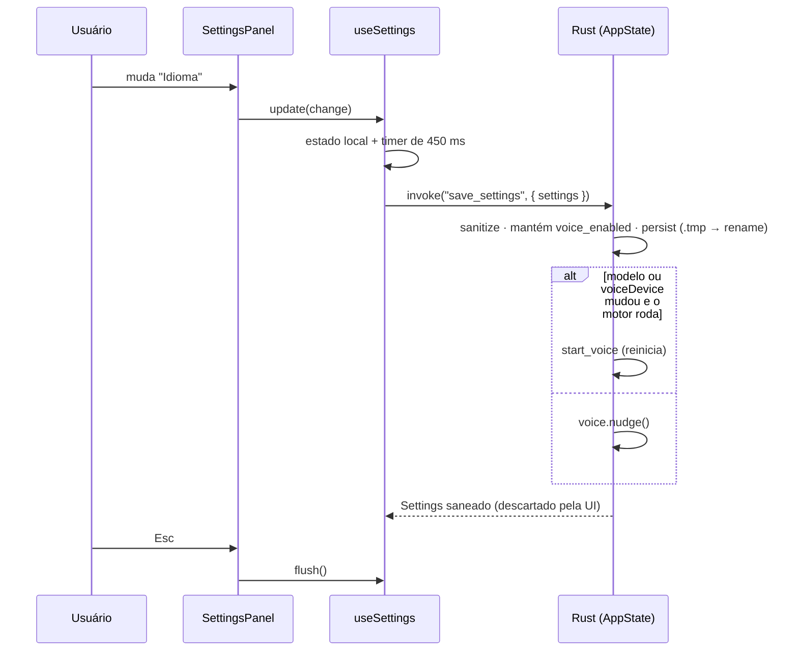

# Feature Specification: Settings and Advanced Menu

## Metadata

| Field | Value |
|---|---|
| Feature ID | `feature/settings` |
| Product | JARVIS OS (jvOS) |
| Feature Status | Implementado |
| Document Status | Reescrita em 2026-11-05 no formato Feature Specification; sem decisões em aberto |
| Source Commit | `42e671a` (2026-10-23); evoluída em `c4ccc57`, `750ebd0` e `048a254`; o fim do `background`, `assistantName` e `voiceDevice` entraram em `e7151cf` (2026-11-05) |
| Uncommitted Changes | Nenhuma |
| Voice Shortcut | Nenhum. A busca (`/`) abre `settings:<seção>` e `advanced:<aba>` |
| Assistant Tool | Nenhuma própria. O JARVIS abre os menus por `jvos_run` com `settings`, `settings:<seção>`, `advanced` e `advanced:<aba>` |
| Target Platforms | Windows 11 com WebView2; no navegador (modo web) o objeto vai para `localStorage["jarvis.settings"]` sem o saneamento do Rust, e "Baixar", os diálogos de pasta e arquivo e "Testar" ficam desabilitados |
| Language | PT-BR no conteúdo e nas falas; inglês nos títulos das seções e em Given / When / Then |
| Last Editorial Revision | 2026-11-05 |
| Verification Scope | Conferida com o código em 2026-11-05: `src/lib/settings.ts`, `src/hooks/useSettings.ts`, `src/components/SettingsPanel.tsx`, `src/components/desktop/AdvancedMenu.tsx`, `src/components/hud.tsx`, `src/components/desktop/VoiceTab.tsx` (seção "Programas"), `src/App.tsx` (abrir, fechar, `flush`, migração da barra), `src/hooks/useWindowControls.ts`, `src/lib/commands.ts`, `src-tauri/src/settings.rs`, `src-tauri/src/lib.rs` (`get_settings`, `save_settings`, `models_status`, `download_model`, `voice_devices`, `setup`), `src-tauri/src/models.rs`, `tests/settings.spec.ts`, `tests/shortcuts.spec.ts`, `tests/desktop.spec.ts`, `tests/search.spec.ts` e `tests/tui.spec.ts`. Os testes não foram executados nesta revisão |

Especificação no formato inspirado no GitHub Spec Kit, com seções de desenho técnico ([ADR-0025](../../arch/adr/0025-features-formato-feature-specification.md)). Os identificadores US1–US5, RF-001–RF-008, RF-010, RNF-001–RNF-003, SC-001–SC-003 e T001–T026 são os mesmos da versão anterior; a numeração dos RF pula do 8 para o 10, como antes. Os critérios de aceite AC-001–AC-016 são os antigos "Critério 1" a "Critério 16", na mesma ordem. KL-* registra limitações conhecidas; OQ-*, decisões de produto em aberto. Nenhum dos dois acrescenta escopo.

## Overview

As preferências do JARVIS ficam em dois lugares. O painel "Configurações" é uma gaveta à direita com o essencial: Ativação, Aparência, Reconhecimento de voz, Cérebro do JARVIS, Voz do JARVIS e Programas e atalhos. O "Menu avançado" é um diálogo central, com oito abas de ajuste fino: Cores, Núcleo, Janelas, Layout, TUI, Barra superior, Dock e Voz.

| Input | Expected Behavior | Execution Path |
|---|---|---|
| Clique em Settings na dock, `Ctrl+,` ou "Configurações" na barra superior | Abre a gaveta "Configurações" | UI (`App.tsx`) |
| `Ctrl+Shift+,` ou "Menu avançado" no rodapé do painel | Abre o "Menu avançado" na última aba usada na sessão | UI |
| "palavras-chave" na busca (`/`) | Abre o painel rolado até "Programas e atalhos" | Busca → `openSettingsAt("apps")` |
| "encaixe" na busca | Abre o menu na aba Janelas | Busca → `openAdvancedAt("windows")` |
| Escolher "English" em "Idioma" | Vale na hora e é gravado 450 ms depois da última edição | `useSettings` → `save_settings` (Rust) ou `localStorage` |
| "Baixar" num modelo Whisper | Mostra o percentual até o fim do download | `download_model` (Rust, thread própria) |

O que o Rust precisa saber vive em `settings.json`, saneado e gravado de forma atômica pelo Rust. O que é só visual vive nas chaves `jarvis.*` do `localStorage` de cada domínio. Toda mudança vale na hora e é salva sozinha ("Alterações salvas automaticamente").

## Goals and Success Criteria

### Goals

- Reunir o essencial num painel e o ajuste fino num menu.
- Aplicar cada mudança na hora, sem botão de salvar.
- Nunca perder uma edição ao fechar o painel, o menu ou o app.
- Abrir o app mesmo com um `settings.json` ausente ou corrompido.
- Chegar a qualquer seção do painel ou aba do menu pela busca.

### Success Criteria

| ID | Criterion | Verification |
|---|---|---|
| SC-001 | Nenhuma mudança se perde ao fechar o painel ou o app logo após editar. | Editar e apertar Esc antes de 450 ms: `closeSettings` chama `flush`. Recarregar e conferir o valor em `jarvis.settings` (no app, em `settings.json`). |
| SC-002 | Um `settings.json` corrompido nunca impede o app de abrir. | `settings::load` devolve o padrão quando a leitura ou o JSON falham. `missing_fields_fall_back_to_defaults` cobre os campos ausentes; o arquivo corrompido não tem teste (Coverage Gaps). |
| SC-003 | Toda seção do painel e toda aba do menu têm um teste que as exercita. | Reported Tests: as seis seções e as oito abas aparecem em `tests/settings.spec.ts`, `shortcuts`, `speech`, `desktop`, `boot`, `core`, `tui`, `taskbar`, `dock` e `voicetab`. |

## Scope and Non-Goals

### In Scope

- A gaveta "Configurações", seu rodapé e a âncora de cada seção.
- O diálogo "Menu avançado", suas abas e a aba inicial.
- Os controles compartilhados de `hud.tsx`.
- A carga, a edição otimista e a gravação com debounce (`useSettings`).
- O catálogo e o download dos modelos Whisper (`useModels`).
- A escolha de onde o Whisper roda ("Processamento da voz").
- A persistência no Rust: padrões, saneamento e gravação atômica.

### Out of Scope

- O que cada seção ou aba ajusta é especificado no domínio dela:
  - modo, escuta e modelos: [voice-engine](../voice-engine/spec.md), que tem o catálogo `models.rs`;
  - aba Voz: [voice-commands](../voice-commands/spec.md);
  - cor e TUI: [appearance](../appearance/spec.md);
  - Núcleo: [holographic-core](../holographic-core/spec.md);
  - Janelas e Layout: [desktop-windows](../desktop-windows/spec.md);
  - Barra superior e Dock: [dock-taskbar](../dock-taskbar/spec.md);
  - Inicialização (aba Cores): [boot](../boot/spec.md);
  - Programas e atalhos: [app-launcher](../app-launcher/spec.md);
  - Voz do JARVIS: [tts](../tts/spec.md);
  - Limpeza de memória: [memory-cleanup](../memory-cleanup/spec.md).
- A escolha de fundo (grid/matrix), que não existe mais ([ADR-0015](../../arch/adr/0015-remocao-do-fundo-shader.md)).
- Um comando de voz para abrir as configurações.

## User Stories

### US1 — Open and Close the Settings

**Priority:** P1.

**User Story:** Como usuário, abro as configurações pelo mouse ou pelo teclado e fecho com Esc.

**Why This Priority:** é a porta de todas as preferências.

**Independent Test:** `tests/settings.spec.ts` — "opens from the dock and the keyboard, closes with Escape".

**Acceptance Criteria:** AC-001, AC-002, AC-003 e AC-004.

### US2 — Activation and Language Persist

**Priority:** P1.

**User Story:** Como usuário, escolho como o JARVIS me ouve e em que idioma, e a escolha sobrevive a um recarregamento.

**Why This Priority:** muda o comportamento principal da voz.

**Independent Test:** `tests/settings.spec.ts` — "activation mode and language persist".

**Acceptance Criteria:** AC-005, AC-006 e AC-007.

### US3 — JARVIS's Name and Brain

**Priority:** P2.

**User Story:** Como usuário, digo como o JARVIS deve me chamar e qual modelo do Claude ele usa.

**Why This Priority:** personaliza as respostas.

**Independent Test:** `tests/settings.spec.ts` — "the name JARVIS calls the user by persists" e `tests/shortcuts.spec.ts` — "JARVIS's model is chosen in the settings, next to the Whisper models".

**Acceptance Criteria:** AC-008 e AC-009.

### US4 — Download and Choose the Whisper Model

**Priority:** P2.

**User Story:** Como usuário, vejo os modelos de reconhecimento, baixo o que quero e acompanho o progresso.

**Why This Priority:** sem modelo baixado não há escuta no app.

**Independent Test:** `tests/shortcuts.spec.ts` — "JARVIS's model is chosen in the settings, next to the Whisper models" (a lista no modo navegador). O download em si não tem teste (KL-005).

**Acceptance Criteria:** AC-010, AC-011, AC-012 e AC-013.

### US5 — Advanced Menu

**Priority:** P2.

**User Story:** Como usuário, ajusto cores, núcleo, janelas, layout, efeitos TUI, barra, dock e frases de voz num só lugar.

**Why This Priority:** concentra o ajuste fino sem poluir o painel.

**Independent Test:** `tests/desktop.spec.ts` — "the advanced menu tunes snapping, arranges windows and sets a custom hue".

**Acceptance Criteria:** AC-014, AC-015 e AC-016.

## Requirements

### Functional Requirements

| ID | Requirement | Related Stories |
|---|---|---|
| RF-001 | O sistema DEVE carregar os settings por `get_settings` no app e por `localStorage["jarvis.settings"]` no navegador, mesclado sobre o padrão e com os comandos de voz built-in restaurados (`withBuiltinCommands`). | US1–US5 |
| RF-002 | Toda edição DEVE ser otimista (estado local na hora) e salva após 450 ms sem novas edições, por `save_settings` no app ou no `localStorage` no navegador. | US2, US3, US5 |
| RF-003 | O Rust DEVE sanear na leitura e na gravação: até 12 palavras-chave por programa, 300 caracteres por campo de programa, sem duplicatas (ignorando maiúsculas); os programas da dock sempre presentes, no topo e com nome fixo; comandos de voz com até 30 frases de até 60 caracteres e até 100 comandos `custom-*`. | US2, US3 |
| RF-004 | O Rust DEVE gravar de forma atômica: escreve `settings.json.tmp` e renomeia. | US2, US3 |
| RF-005 | Os padrões DEVEM ser `activation: pushToTalk`, `model: small`, `voiceDevice: auto`, `assistantModel: sonnet`, `assistantName: ""`, `language: pt`, `theme: blue`, `accentHue: 224`, `taskbar: true`, `voiceEnabled: false`, os 4 programas da dock e o catálogo de `voice-commands.json`. | US2, US3, US4 |
| RF-006 | As seções do painel DEVEM ter âncoras `settings-<seção>`, para a busca rolar até elas. | US1 |
| RF-007 | O Menu avançado DEVE abrir na última aba usada na sessão ou na aba pedida. O painel e o menu põem o foco no botão de fechar ao abrir, e o menu tira o foco dos próprios campos ao fechar, para que o próximo `/` não caia neles. | US1, US5 |
| RF-008 | Abrir o Menu avançado DEVE fechar o painel, e vice-versa pela busca. | US1, US5 |
| RF-010 | O grupo "Processamento da voz" (`VoiceDeviceRow`) DEVE oferecer "Automático", "Processador" e uma opção por GPU de `voice_devices` ("<nome> · <VRAM>"), gravando `voiceDevice` (`auto`, `cpu` ou o nome da GPU). | US4 |

### Non-Functional Requirements

| ID | Requirement | Scope |
|---|---|---|
| RNF-001 | `settings.json` fica em `%APPDATA%\dev.jarvis.os\` (`app_config_dir`), fora de `Documentos\JARVIS`. | App desktop. No navegador, a chave `jarvis.settings`. |
| RNF-002 | Os tipos `Settings`, `AppEntry`, `VoiceCommand`, `Activation`, `ASSISTANT_MODELS`, `MAX_NAME` e `VoiceDevices` são espelhados entre TS e Rust, com o comentário "Mirrors". | `src/lib/settings.ts` ↔ `src-tauri/src/settings.rs` e `lib.rs` |
| RNF-003 | O painel tem 440 px de largura e o menu 720 × 480 px, ambos limitados à tela. | `SettingsPanel`, `AdvancedMenu` |

### Operational Constraints

- Debounce de gravação: 450 ms (`SAVE_DELAY_MS`).
- Nome do usuário: até 40 caracteres (`MAX_NAME`), numa linha só.
- `voiceDevice`: até 128 caracteres (`MAX_DEVICE`); vazio vira `auto`.
- Salvar nunca muda `voiceEnabled`; isso é de `voice_start` e `voice_stop`.
- Trocar o modelo ou `voiceDevice` com o motor rodando reinicia o motor.
- `VoiceDeviceRow` relê os dispositivos 2,5 s depois de cada troca.
- O resultado de "Testar" fica 2,6 s na tela ([app-launcher](../app-launcher/spec.md)).

## Acceptance Criteria

### AC-001 — Open From the Dock

**Related Story:** US1.

- **Given** o desktop
- **When** o usuário clica em Settings na dock
- **Then** o diálogo "Configurações" abre e o item fica `aria-pressed="true"`.

### AC-002 — Close and Reopen With the Keyboard

**Related Story:** US1.

- **Given** o painel aberto
- **When** o usuário aperta Esc
- **Then** ele fecha. `Ctrl+,` o reabre, e o botão "Fechar configurações" o fecha.

### AC-003 — Switch to the Advanced Menu

**Related Story:** US1.

- **Given** o painel aberto
- **When** o usuário clica "Menu avançado" no rodapé
- **Then** o painel fecha e o "Menu avançado" abre.

### AC-004 — Close the Advanced Menu and Reopen at a Tab

**Related Story:** US1.

- **Given** o Menu avançado aberto
- **When** o usuário aperta Esc ou clica no fundo
- **Then** ele fecha. Reaberto pela busca ("Menu avançado › Janelas"), a aba pedida já vem com `aria-selected="true"`.

### AC-005 — Default Activation Mode

**Related Story:** US2.

- **Given** uma instalação nova
- **When** o usuário abre o painel
- **Then** "Segurar para falar" está marcado, com a dica "Segure o botão Voice (ou a tecla M) enquanto fala…".

### AC-006 — Activation Hint Follows the Mode

**Related Story:** US2.

- **Given** o painel aberto
- **When** o usuário escolhe "Sempre ouvindo"
- **Then** a dica muda para "Qualquer frase com uma palavra-chave abre o programa; perguntas e atalhos começam com “Jarvis”.".

### AC-007 — Activation and Language Persist

**Related Story:** US2.

- **Given** "Sempre ouvindo" escolhido
- **When** o usuário escolhe "English", espera o salvamento (450 ms) e recarrega
- **Then** "Sempre ouvindo" e "English" continuam marcados.

### AC-008 — The User's Name Persists

**Related Story:** US3.

- **Given** o campo "Como ele te chama" vazio
- **When** o usuário digita "Tony" e recarrega depois do salvamento
- **Then** `assistantName` vale "Tony" e o campo volta preenchido.

### AC-009 — JARVIS Model Options

**Related Story:** US3.

- **Given** o grupo "Modelo do JARVIS"
- **When** o painel abre
- **Then** as opções são Haiku ("O mais rápido"), Sonnet ("Rápido e capaz, recomendado"), Opus ("O mais inteligente, responde mais devagar") e Padrão ("O modelo e o esforço do seu Claude Code"), com Sonnet marcado. Escolher Haiku grava `assistantModel: "haiku"`.

### AC-010 — Whisper Model List

**Related Story:** US4.

- **Given** o grupo "Modelo Whisper"
- **When** o painel abre
- **Then** cada modelo mostra o rótulo, o tamanho (MB, ou GB com uma casa) e a descrição, um rádio e "Baixar" ou "Baixado". O primeiro rádio é "Modelo Small", o padrão.

### AC-011 — Download a Whisper Model

**Related Story:** US4.

- **Given** o app desktop e um modelo não baixado
- **When** o usuário clica "Baixar"
- **Then** um percentual e uma barra avançam com `model:progress`. Em `model:done`, a lista se atualiza e mostra "Baixado", ou o erro aparece no lugar da descrição.

**Coverage Status:** sem teste automatizado (KL-005).

### AC-012 — Warn About a Missing Model

**Related Story:** US4.

- **Given** o modelo escolhido ainda não baixado
- **When** o painel abre
- **Then** aparece "Baixe o modelo selecionado para ativar a escuta.".

**Coverage Status:** sem teste automatizado (KL-005).

### AC-013 — Browser Limits

**Related Story:** US4.

- **Given** o navegador (modo web)
- **When** o painel abre
- **Then** "Baixar" fica desabilitado e o topo do painel diz "Reconhecimento de voz e abertura de programas funcionam no app desktop.".

**Coverage Status:** sem teste automatizado (KL-005).

### AC-014 — Advanced Menu Tabs

**Related Story:** US5.

- **Given** o Menu avançado aberto
- **When** o usuário olha a coluna de abas
- **Then** há 8 abas verticais, nesta ordem: Cores, Núcleo, Janelas, Layout, TUI, Barra superior, Dock e Voz.

**Coverage Status:** cada aba é clicada por algum teste, mas nenhum confere a lista e a ordem (KL-005).

### AC-015 — Colors Tab

**Related Story:** US5.

- **Given** a aba Cores
- **When** o usuário move o "Matiz" para 120
- **Then** a aba mostra "Inicialização" e "Aparência" (cor, "Matiz" de 0 a 359° e a faixa de cores), o tema passa para "Personalizada" e `jarvis.settings` guarda `theme: "custom"` e `accentHue: 120`.

### AC-016 — Live Changes in Every Tab

**Related Story:** US5.

- **Given** qualquer aba do menu
- **When** o usuário muda um controle
- **Then** a mudança vale ao vivo e persiste (detalhes nas specs de cada domínio).

## Behavior and Flows

### `SettingsPanel`

A gaveta "Configurações", à direita, com as seções do essencial.

- **Behavior:**
  - Ao abrir, o foco vai para "Fechar configurações". Esc, esse botão ou um clique no fundo fecham o painel, e fechar força o salvamento (`flush`).
  - Cada seção tem a âncora `settings-<seção>` (RF-006). Aberto com uma seção pedida, o painel rola até ela (`scrollIntoView({ block: "start" })`) no quadro seguinte à montagem.
  - "Menu avançado", no rodapé, fecha o painel e abre o [`AdvancedMenu`](#advancedmenu) (RF-008).
  - Com `$settings` ainda carregando, o corpo mostra "Carregando…".
  - No navegador, o topo mostra "Reconhecimento de voz e abertura de programas funcionam no app desktop.".
  - O texto do painel é selecionável.
- **Layout:**
  - Um fundo que cobre a tela e, por cima, a gaveta `role="dialog"` ("Configurações"), presa às bordas de cima, da direita e de baixo.
  - Cabeçalho com o título "Configurações" à esquerda e o botão de fechar (X) à direita.
  - Corpo rolável com as seções nesta ordem: Ativação, Aparência, Reconhecimento de voz, Cérebro do JARVIS, Voz do JARVIS, Programas e atalhos.
  - Rodapé com "Alterações salvas automaticamente" à esquerda e o botão "Menu avançado" (ícone de controles) à direita.
- **Style:**
  - Fundo `bg-black/25`. Gaveta a 16 px das bordas (`top-4 right-4 bottom-4`), com 440 px de largura (no máximo `calc(100vw - 2rem)`), `rounded-2xl`, borda `hud-cyan/20`, fundo `bg-hud-panel/82` com `backdrop-blur-xl`, sombra funda e brilho ciano interno. Um fio de luz no topo, em degradê `hud-light/40`.
  - Título em 11 px `font-semibold`, maiúsculo, com espaçamento largo, em `text-hud-light`. Botão de fechar quadrado de 32 px, `text-hud-text/60`, com fundo `hud-cyan/10` no hover.
  - Corpo `hud-scroll`, com 32 px entre as seções (`space-y-8`).
  - Rodapé em 10 px maiúsculos, `text-hud-text/40`, separado por uma borda `hud-cyan/10`. O botão "Menu avançado" fica em `text-hud-text/70`.
  - O aviso do navegador é uma caixa `rounded-lg` com borda `hud-cyan/15`, fundo `hud-cyan/4` e `text-xs` `text-hud-text/70`.
  - Entra deslizando 32 px da direita em 0,35 s e sai em 0,18 s.

### Section "Ativação"

Como o JARVIS ouve e se a escuta está ligada.

- **Behavior:**
  - O seletor "Modo de ativação" tem "Segurar para falar", "Hey Jarvis" e "Sempre ouvindo". Embaixo, a dica do modo escolhido:
    - "Segurar para falar": "Segure o botão Voice (ou a tecla M) enquanto fala, ex.: “abre o terminal” ou “pesquisa sobre fusão nuclear”, e solte para enviar, como no WhatsApp. O que não for comando vai para o JARVIS. Para cancelar, deslize para a esquerda ou aperte Esc.";
    - "Hey Jarvis": "Diga “Hey Jarvis” e o comando ou a pergunta, ex.: “Hey Jarvis, abre o navegador”, “Jarvis, que horas são?”.";
    - "Sempre ouvindo": "Qualquer frase com uma palavra-chave abre o programa; perguntas e atalhos começam com “Jarvis”.".
  - A linha "Escuta" mostra o estado do motor e o interruptor "Escuta ligada". No navegador, o estado é "Microfone ativo (somente visual no navegador)" ou "Desligada". O modo e a escuta são do [voice-engine](../voice-engine/spec.md).
- **Layout:** `Segmented` "Modo de ativação", a dica e a linha "Escuta" com o `Switch` à direita.
- **Style:** dica em `text-xs` `text-hud-text/60`. A linha "Escuta" é um cartão `rounded-xl` com borda `hud-cyan/12` e fundo `white/2`; título em `text-sm` e estado em `text-xs` `text-hud-text/50`.

### Section "Aparência"

A cor do JARVIS e a barra superior.

- **Behavior:**
  - "Cor do JARVIS" escolhe entre Azul, Verde Matrix, Amarelo digital e Personalizada. O tema em si é do [appearance](../appearance/spec.md).
  - "Barra superior" liga ou desliga a barra do topo ("Atalhos das janelas, status, pomodoro, bateria e relógio no topo, estilo Waybar").
- **Layout:** `CardPicker` em 2 colunas e um `SwitchRow`.
- **Style:** os controles de [`hud.tsx`](#shared-controls-hudtsx).

### Section "Reconhecimento de voz"

O modelo Whisper (`ModelCard`), onde ele roda (`VoiceDeviceRow`), o idioma e o último texto reconhecido.

- **Behavior:**
  - O grupo "Modelo Whisper" lista `$modelos` como rádios ("Modelo <rótulo>"). Cada `ModelCard` mostra o rótulo, o tamanho (MB arredondado, ou GB com uma casa) e a descrição.
    - À direita: "Baixado" quando o arquivo existe com o tamanho certo; durante o download, o percentual de `$progresso` e uma barra ("Baixando <rótulo>"); senão, o botão "Baixar" ("Baixar modelo <rótulo>").
    - Se o download falhar, o erro aparece no lugar da descrição.
    - No navegador, "Baixar" fica desabilitado.
  - Se o modelo escolhido não estiver baixado, aparece "Baixe o modelo selecionado para ativar a escuta.".
  - O grupo "Processamento da voz" (RF-010):
    - as opções são "Automático", "Processador" e uma por GPU ("<nome> · <VRAM>", em GB arredondado a partir de 1024 MB);
    - a dica é "Agora: <processador | nome da GPU>." quando o motor está carregado; senão, "Na GPU o comando é reconhecido em uma fração do tempo e o processador fica livre.";
    - num build sem Vulkan, as GPUs ficam desabilitadas e a dica é "Este build não tem a GPU (Vulkan SDK ausente na compilação): a voz roda no processador.";
    - uma GPU salva que não está mais na lista aparece como "Automático";
    - a lista é relida 2,5 s depois de cada troca, quando o motor já recarregou;
    - no navegador, o fake lista as GPUs da máquina de desenvolvimento ("NVIDIA GeForce MX570 A · 2 GB" e "Intel(R) Graphics · 16 GB"); `window.__JARVIS_GPUS__` troca a lista.
  - O seletor "Idioma" tem "Português", "English" e "Automático".
  - "Último reconhecimento:" mostra o último texto entre aspas, ou "—".
- **Layout:** a lista de `ModelCard`, o aviso de modelo não baixado, o grupo "Processamento da voz" (rádios em 2 colunas) com a dica, o `Segmented` "Idioma" e a linha do último reconhecimento.
- **Style:**
  - `ModelCard` em `rounded-xl`: selecionado com borda `hud-cyan/40` e fundo `hud-cyan/6`; os outros com borda `hud-cyan/12` e fundo `white/2`.
  - O rádio é um círculo de 16 px; o ponto marcado é `bg-hud-light` com brilho.
  - Rótulo em `text-sm`, tamanho em `text-hud-text/45`, descrição em `text-xs` `text-hud-text/50`.
  - "Baixado" em 10 px maiúsculo `text-hud-light/80`, com um ícone de check. O progresso tem 80 px de largura, um spinner e uma barra de 2 px (`bg-hud-light` sobre `hud-cyan/15`).
  - "Baixar" tem borda `hud-cyan/25`, 10 px maiúsculo, `text-hud-text/80` e opacidade 40% quando desabilitado.
  - As opções de "Processamento da voz" seguem o mesmo cartão, em `text-xs`, com opacidade 40% quando desabilitadas.

### Section "Cérebro do JARVIS"

O modelo do Claude, o nome do usuário e a limpeza de memória.

- **Behavior:**
  - O seletor "Modelo do JARVIS" usa `ASSISTANT_MODELS`: Haiku, Sonnet, Opus e Padrão. Embaixo, a dica do escolhido seguida de ". O Claude Code que responde ao clicar no núcleo, às perguntas por voz e aos atalhos (“pesquisa sobre…”, “bom dia”).".
  - O campo "Como ele te chama" (placeholder "seu nome") aceita até 40 caracteres (`maxLength={MAX_NAME}`). A dica diz "O JARVIS usa esse nome nas respostas e nas saudações, de vez em quando, como nos filmes. Em branco, ele fala sem vocativo.".
  - A linha "Limpeza de memória" é do [memory-cleanup](../memory-cleanup/spec.md).
- **Layout:** `Segmented`, a dica, o campo com o rótulo em cima, a dica do nome e a linha da limpeza.
- **Style:** campo `hud-input` em largura total; rótulo e dicas em `text-xs` `text-hud-text/60`.

### Sections "Voz do JARVIS" and "Programas e atalhos"

- **Behavior:**
  - "Voz do JARVIS" (`SpeechSection`, âncora `settings-speech`) é especificada no [tts](../tts/spec.md).
  - "Programas e atalhos" (`AppRow` e os botões "Adicionar") é especificada no [app-launcher](../app-launcher/spec.md).

### `AdvancedMenu`

O diálogo central "Menu avançado", com as abas do ajuste fino.

- **Behavior:**
  - Abre na última aba usada na sessão (começa em Cores) ou na aba pedida pela busca (RF-007). Ao abrir, o foco vai para "Fechar menu avançado"; ao fechar, um campo do menu que tinha o foco o perde.
  - Abrir o menu fecha o painel (RF-008).
  - Esc, "Fechar menu avançado" ou um clique no fundo fecham o menu, e fechar força o salvamento (`flush`).
  - Cada aba vale ao vivo. O que cada uma ajusta é do domínio dela (ver [Out of Scope](#out-of-scope)):
    - **Cores**: "Inicialização" ("Tela de inicialização", "Sons da inicialização", "Ver agora") e "Aparência" ("Cor do JARVIS", "Matiz" de 0 a 359° e a faixa de cores). Mexer no "Matiz" passa o tema para "Personalizada".
    - **Núcleo**: "Visual do núcleo", com a dica do modo, e a nota "Memória".
    - **Janelas**: "Estilo das janelas" (TUI ou Holográfico), "Encaixe" ("Encaixar nas bordas", "Encaixar no centro" e "Distância de encaixe": Curta, Média ou Longa) e "Opacidade das janelas" (60 a 100%).
    - **Layout**: "Lado a lado", "Cascata", "Centralizar", a contagem de janelas, "Alinhar à grade" e "Fechar todas as janelas". Sem janelas, os botões ficam desabilitados e a nota diz "Abra janelas pelos itens Widgets e Apps da dock.".
    - **TUI**: "Aberração cromática", "Brilho (glow)", "Cor dos apps de terminal" e a "Prévia" (`TuiPreview`).
    - **Barra superior**: "Mostrar a barra superior" e os "Módulos".
    - **Dock**: "Mostrar a dock", "Ampliar ícones" e a nota "Sem a dock" com as teclas.
    - **Voz**: o `VoiceTab`, do [voice-commands](../voice-commands/spec.md).
  - Com `$settings` ainda carregando, a parte "Aparência" da aba Cores, a aba Barra superior e a aba Voz mostram "Carregando…".
- **Layout:**
  - Um fundo que cobre a tela e, centralizado, o painel `role="dialog"` ("Menu avançado") em grade de duas colunas: o cabeçalho ocupa as duas; embaixo, a coluna de abas (`role="tablist"`, vertical, "Seções") e o painel da aba (`role="tabpanel"`).
  - Cabeçalho com o título "Menu avançado" e o botão de fechar (X).
- **Style:**
  - O mesmo vidro da gaveta: `rounded-2xl`, borda `hud-cyan/20`, `bg-hud-panel/82`, `backdrop-blur-xl`, sombra funda e o fio de luz no topo. Fundo `bg-black/25`.
  - 720 × 480 px, limitado à tela; a coluna de abas tem 180 px e uma borda direita `hud-cyan/10`.
  - Abas em `text-xs` maiúsculo com espaçamento largo. A ativa fica em `text-hud-light`, com um destaque que desliza entre as abas (`layoutId="advanced-tab"`), borda `hud-cyan/30`, fundo `hud-cyan/9` e brilho; as outras em `text-hud-text/55`.
  - Painel da aba `hud-scroll`, com 28 px entre as seções (`space-y-7`). As notas ficam em `text-xs` `text-hud-text/55`; as teclas da nota "Sem a dock" são `kbd` mono de 11 px com borda `hud-cyan/20`.
  - Entra subindo 12 px e crescendo de 98% em 0,3 s; sai em 0,18 s.

### Shared Controls (`hud.tsx`)

As peças com que o painel e o menu são montados.

- **Behavior:**
  - `Segmented` é um `radiogroup`: uma opção marcada, com o destaque deslizando até ela.
  - `CardPicker` é um `radiogroup` de cartões com uma amostra visual (`ThemeSwatch`, `CoreSwatch`…), em 2 ou 3 colunas.
  - `Switch` é um `role="switch"`; `SwitchRow` é uma linha com rótulo, dica e o `Switch` à direita.
  - `ChipInput`: Enter ou vírgula adicionam o texto (aparado e sem vírgulas no fim) como chip, sem duplicatas (ignorando maiúsculas); Backspace no campo vazio remove o último; o × remove qualquer um; sair do campo também adiciona.
  - `Range` mostra o rótulo à esquerda e o valor formatado à direita; aceita uma faixa de fundo própria (o arco-íris do "Matiz").
  - `IconButton` e `ActionButton` são os botões secundários.
- **Layout:** `Section` é um título pequeno com os controles empilhados embaixo (12 px entre eles) e `scroll-mt-4` para a âncora.
- **Style:**
  - Título de `Section` em 10 px `font-semibold`, maiúsculo, com espaçamento largo, em `text-hud-cyan/80`.
  - Cartões e linhas em `rounded-xl`, borda `hud-cyan/12` e fundo `white/2`; o marcado ganha borda `hud-cyan/40`, fundo `hud-cyan/6` e `text-hud-light`.
  - `Segmented` em `text-xs` maiúsculo; destaque com borda `hud-cyan/30`, fundo `hud-cyan/9` e brilho.
  - `Switch` de 44 × 24 px; ligado, borda `hud-cyan/50`, fundo `hud-cyan/25` e a bolinha `bg-hud-light` com brilho; desligado, bolinha `bg-hud-text/40`. A bolinha anda com mola.
  - Chips com borda `hud-cyan/25`, fundo `hud-cyan/8` e `text-xs` `text-hud-light/90`.
  - `IconButton` quadrado de 28 px, `text-hud-text/55`, opacidade 30% quando desabilitado. `ActionButton` em `text-xs` maiúsculo, borda `hud-cyan/20`, opacidade 35% quando desabilitado.
  - O foco por teclado aparece como um anel `hud-light/50`.

### `useSettings` and `useModels`

- **Behavior:**
  - `useSettings` carrega `$settings` uma vez (RF-001). Até lá, `update` não faz nada.
  - `update(change)` aplica a mudança no estado local na hora e reinicia um timer de 450 ms até `flush` (RF-002).
  - `flush` cancela o timer e grava o último estado. Fechar o painel ou o menu chama `flush`; o `beforeunload` também, se houver gravação pendente.
  - Se gravar falhar, o erro fica em `saveError`, que nada na UI mostra (KL-001). A versão saneada que `save_settings` devolve é descartada (KL-003).
  - `useModels` lista os modelos (`models_status`, ou `BROWSER_MODELS` no navegador) e escuta `model:progress` e `model:done` só no app.
  - `download(id)` zera o erro do modelo, marca 0%, chama `download_model` e relê a lista. No navegador, não faz nada.
  - Em `model:progress`, o percentual é `received / total` (0 se `total` for 0). Em `model:done`, o progresso sai, o erro (se houver) fica guardado e a lista é relida.

### Rust Persistence (`settings.rs` and `save_settings`)

O Rust guarda `$settings` num `RwLock`, saneia e grava.

- **Behavior:**
  - `sanitize` roda na leitura (`load`) e em cada `save_settings` (RF-003). As regras estão em [Sanitization Rules](#sanitization-rules).
  - `save` grava de forma atômica: `settings.json.tmp` e depois `rename` (RF-004).
  - `load` devolve o padrão se o arquivo faltar ou o JSON for inválido. Campos ausentes recebem o padrão campo a campo (`#[serde(default)]`).
  - `save_settings` mantém `voice_enabled` do estado atual, troca o resto, grava e devolve o snapshot saneado.
  - Se o modelo ou `voiceDevice` mudaram e o motor está rodando, o motor reinicia; se o reinício falhar, ele para e o erro volta. Senão, `nudge` acorda o motor para um modo de ativação novo valer na hora.

### Interaction Flow



### User Feedback

| Moment | Output |
|---|---|
| Qualquer edição | Vale na hora; o rodapé diz "Alterações salvas automaticamente" |
| `$settings` carregando | "Carregando…" no painel e nas abas Cores ("Aparência"), Barra superior e Voz |
| Modo web | "Reconhecimento de voz e abertura de programas funcionam no app desktop." no topo do painel |
| Download em curso | Percentual, spinner e barra no `ModelCard` |
| Download falhou | O erro no lugar da descrição do modelo |
| Modelo escolhido não baixado | "Baixe o modelo selecionado para ativar a escuta." |
| Falha ao gravar | Nada visível; o erro fica em `saveError` (KL-001) |

### Voice and Keyboard

- `Ctrl+,`: abre as Configurações. O item Settings da dock também (e fica `aria-pressed="true"`), assim como o botão "Configurações" da barra superior.
- `Ctrl+Shift+,` (tecla física `Comma`, que com Shift vira "<" nos layouts US e ABNT2): abre o Menu avançado.
- Dentro de um terminal (`[data-terminal]`), `Ctrl+,` e `Ctrl+Shift+,` ficam com o shell.
- `Esc`: fecha o painel ou o menu. Com a busca aberta por cima, fecha só a busca.
- Busca "Configurações › <seção>" e "Menu avançado › <aba>": abre no lugar certo.
- Não há comando de voz para as configurações.

## Data Model and Persistence

### Settings Entity

```ts
interface Settings {
  voiceEnabled: boolean;          // de voice_start/voice_stop; save_settings não muda
  activation: "wakeWord" | "always" | "pushToTalk";
  model: string;                  // id de models::MODELS
  voiceDevice: string;            // "auto", "cpu" ou o nome da GPU
  assistantModel: "haiku" | "sonnet" | "opus" | "default";
  assistantName: string;          // até 40 caracteres, uma linha
  language: "pt" | "en" | "auto";
  theme: "blue" | "green" | "yellow" | "custom";
  accentHue: number;              // matiz OKLCH do tema "custom"
  taskbar: boolean;
  apps: AppEntry[];               // ver app-launcher
  voiceCommands: VoiceCommand[];  // ver voice-commands
}
```

No Rust, o mesmo `Settings` usa `#[serde(rename_all = "camelCase", default)]` e é gravado como JSON indentado. Ver também o [glossário](../../domain/glossary.md) e a [persistência](../../domain/persistence.md).

### Defaults (RF-005)

| Field | Default |
|---|---|
| `voiceEnabled` | `false` |
| `activation` | `pushToTalk` |
| `model` | `small` |
| `voiceDevice` | `auto` |
| `assistantModel` | `sonnet` |
| `assistantName` | `""` |
| `language` | `pt` |
| `theme` | `blue` |
| `accentHue` | 224 |
| `taskbar` | `true` |
| `apps` | Browser, VS Code, Windows Terminal e Claude Code ([app-launcher](../app-launcher/spec.md)) |
| `voiceCommands` | O catálogo de `src-tauri/voice-commands.json`, lido pelos dois lados |

### Sanitization Rules

| Field | Rule |
|---|---|
| `language` | Fora de `pt`, `en`, `auto` → `pt` |
| `theme` | Fora de `blue`, `green`, `yellow`, `custom` → `blue` |
| `accentHue` | Dá a volta no círculo (`rem_euclid(360)`: 400 → 40, −30 → 330); NaN ou infinito → 224 |
| `model` | Fora de `models::MODELS` → `small` (o `medium` aposentado vira `small`) |
| `voiceDevice` | Aparado e cortado em 128 caracteres; vazio → `auto`. Uma GPU que sumiu cai em `auto` quando o motor liga |
| `assistantModel` | Fora de `haiku`, `sonnet`, `opus`, `default` → `sonnet` |
| `assistantName` | Espaços e caracteres de controle viram um espaço só; cortado em 40 caracteres e aparado no fim |
| `apps` | Ver [app-launcher](../app-launcher/spec.md): ids únicos, dock no topo com nome fixo, até 12 palavras-chave, campos até 300 caracteres |
| `voiceCommands` | Built-ins mantêm a ação e voltam se faltarem; `custom-*` só com ação válida, até 100; até 30 frases de até 60 caracteres, sem repetição. Ver [voice-commands](../voice-commands/spec.md) |

### Storage Rules

| Property | Value |
|---|---|
| State | `$settings` |
| Storage | App: `settings.json` em `%APPDATA%\dev.jarvis.os\` (`app_config_dir`), com `settings.json.tmp` durante a gravação. Navegador: `localStorage` |
| Key | `jarvis.settings` (navegador) |
| Write Debounce | 450 ms; `flush` imediato ao fechar o painel ou o menu e no `beforeunload` |
| Reader | App: `settings::load` + `sanitize`. Navegador: `loadSettings` mescla o salvo sobre o padrão e roda `withBuiltinCommands`, sem outro saneamento (KL-002) |
| Missing or Invalid Storage | O padrão, nos dois lados |
| Migrations | No Rust: `RETIRED_PHRASES`, `OLD_CODE_PHRASES` (`window:code` → `window:ide`), `OLD_TERMINAL_KEYWORDS` e o modelo `medium`. Na UI: `jarvis.migrations.taskbarOn` liga a barra superior uma vez numa instalação desktop antiga |

### In-Memory State

| State | Meaning |
|---|---|
| `$modelos` | A lista de `ModelStatus` (`id`, `label`, `description`, `size`, `downloaded`, `downloading`) de `models_status`, ou `BROWSER_MODELS` no navegador |
| `$progresso` | O percentual de cada download (`model:progress`) |
| `$errosDoModelo` | O erro de cada download (`model:done`) |
| `$aba` | A última aba do Menu avançado na sessão; começa em Cores |
| `$seção` | A seção pedida pela busca ao abrir o painel; zerada ao fechar |
| `SettingsSection` | `activation`, `appearance`, `voice`, `jarvis`, `apps` |
| `AdvancedTab` | `colors`, `core`, `windows`, `layout`, `tui`, `taskbar`, `dock`, `voice` |

## Technical Design

### Component Responsibilities

| File or Component | Responsibility |
|---|---|
| `src/components/SettingsPanel.tsx` | Gaveta "Configurações": seções, `ModelCard`, `VoiceDeviceRow`, `CleanupRow`, `SpeechSection`, `AppRow`, rodapé com "Menu avançado" |
| `src/components/desktop/AdvancedMenu.tsx` | Diálogo "Menu avançado" com 8 abas, `TuiPreview`, `PaletteStrip`, `accentOptions` |
| `src/components/hud.tsx` | `ChipInput`, `Section`, `Segmented`, `CardPicker`, `ThemeSwatch`, `CORE_OPTIONS`, `CoreSwatch`, `Switch`, `SwitchRow`, `IconButton`, `Range`, `ActionButton`, `themeOptions`, `Mono` |
| `src/lib/settings.ts` | Tipos espelhados, `ASSISTANT_MODELS`, `MAX_NAME`, `DEFAULT_VOICE_COMMANDS`, `withBuiltinCommands`, `DEFAULT_SETTINGS`, `BROWSER_MODELS`, `BROWSER_DEVICES`, `loadSettings`, `saveSettings`, `loadModels`, `loadVoiceDevices`, `createAppId` |
| `src/hooks/useSettings.ts` | `useSettings` (`update`, `flush`, `saveError`) e `useModels` (`download`, `progress`, `errors`, `refresh`) |
| `src/App.tsx` | `settingsOpen`/`advancedOpen`, `closeSettings`/`closeAdvanced` com `flush`, `openSettingsAt`/`openAdvancedAt`, `applyTheme`, a migração `jarvis.migrations.taskbarOn` |
| `src/hooks/useWindowControls.ts` | `Ctrl+,` e `Ctrl+Shift+,` |
| `src/lib/commands.ts` | `SETTINGS_SECTIONS`, `ADVANCED_TABS` e os comandos `settings`, `settings:<seção>`, `advanced`, `advanced:<aba>` |
| `src-tauri/src/settings.rs` | `Settings`, `AppEntry`, `VoiceCommand`, `Activation`, `Default`, `sanitize`, `sanitize_voice_commands`, `load`, `save` (atômico) |
| `src-tauri/src/lib.rs` | `get_settings`, `save_settings` (preserva `voice_enabled`, reinicia o motor ou chama `nudge`), `models_status`, `download_model`, `voice_devices`, `AppState::persist` |
| `src-tauri/src/models.rs` | `MODELS` (Small, Base, Large V3 Turbo), `is_downloaded` pelo tamanho, `download` com SHA-256 |

### Save Algorithm

1. `update(change)` calcula o novo `Settings`, guarda em `latest` e no estado do React.
2. O timer de 450 ms reinicia a cada edição.
3. No fim do timer (ou no `flush`), `saveSettings(latest)` vai para `save_settings` no app ou para o `localStorage` no navegador.
4. No Rust: `sanitize`, troca do `RwLock` mantendo `voice_enabled`, `persist` (`.tmp` + `rename`), e reinício do motor ou `nudge`.
5. A UI guarda só o erro, se houver; o retorno saneado é ignorado (KL-003).

### Related Architecture Decisions

- [ADR-0010 — settings.json (Rust) vs localStorage](../../arch/adr/0010-persistencia-settings-vs-localstorage.md)
- [ADR-0009 — tipos espelhados TS ↔ Rust](../../arch/adr/0009-tipos-espelhados-ts-rust.md)
- [ADR-0021 — reconhecimento de voz na GPU via Vulkan (`voiceDevice`)](../../arch/adr/0021-reconhecimento-voz-gpu-via-vulkan-porteiro.md)
- [ADR-0002 — STT whisper.cpp na CPU, Small padrão](../../arch/adr/0002-stt-whisper-offline-cpu.md)
- [ADR-0004 — catálogo de voz compartilhado](../../arch/adr/0004-catalogo-de-voz-compartilhado-e-fallback.md)
- [ADR-0015 — remoção do fundo shader](../../arch/adr/0015-remocao-do-fundo-shader.md)

## Interfaces and Contracts

### Tauri Commands

| Command | Input | Output | Notes |
|---|---|---|---|
| `get_settings` | — | `Settings` | Snapshot do `RwLock` |
| `save_settings` | `{ settings: Settings }` | `Settings` saneado | Mantém `voice_enabled`. Erros: "Falha ao salvar: …" ou o erro do reinício do motor (ex.: `model-missing`) |
| `models_status` | — | `ModelStatus[]` | `downloaded` pelo arquivo em `%LOCALAPPDATA%\dev.jarvis.os\models\` com o tamanho esperado; `downloading` pelo conjunto em memória |
| `download_model` | `{ id }` | `()` | Thread própria. "Modelo desconhecido" se o id não existir. Uma segunda chamada durante o download é ignorada |
| `voice_devices` | — | `{ gpus, accelerated, active }` | GPUs do Vulkan (vazio sem a feature `vulkan`), se o build tem Vulkan e onde o modelo roda agora |

### Events and Channels

| Event | Payload | Producer → Consumer |
|---|---|---|
| `model:progress` | `{ id, received, total }` | `download_model` → `useModels` (percentual) |
| `model:done` | `{ id, error: string \| null }` | `download_model` → `useModels` (limpa o progresso, guarda o erro, relê a lista) |

### Search and Assistant Commands

| Command ID | Title | Action |
|---|---|---|
| `settings` | "Configurações" (atalho `Ctrl ,`) | `openSettings()` |
| `settings:<seção>` | "Configurações › Ativação", "› Aparência", "› Reconhecimento de voz", "› Cérebro do JARVIS", "› Programas e atalhos" | `openSettings(seção)`: fecha o menu e rola até a âncora |
| `advanced` | "Menu avançado" (atalho `Ctrl Shift ,`) | `openAdvanced()` |
| `advanced:<aba>` | "Menu avançado › Cores", "› Núcleo", "› Janelas", "› Layout", "› TUI", "› Barra superior", "› Dock", "› Voz" | `openAdvanced(aba)`: fecha o painel e abre na aba |

Os mesmos ids valem para `jvos_run` ([assistant-tools](../assistant-tools/spec.md)).

## Edge Cases and Error Handling

| Case | Behavior | Reference |
|---|---|---|
| `settings.json` ausente ou com JSON inválido | O Rust usa o padrão; o arquivo só é regravado na próxima edição | SC-002 |
| Campo ausente no `settings.json` | Recebe o padrão campo a campo | `#[serde(default)]` |
| Idioma, tema, modelo Whisper ou modelo do JARVIS desconhecidos | Voltam ao padrão | Sanitization Rules |
| Matiz fora de 0..360, NaN ou infinito | Dá a volta no círculo; NaN ou infinito → 224 | Sanitization Rules |
| `$settings` ainda carregando | "Carregando…"; `update` é ignorado | `useSettings` |
| Nome em branco | O JARVIS fala sem vocativo | [assistant](../assistant/spec.md) |
| Nenhum reconhecimento ainda | "Último reconhecimento:" mostra "—" | Section "Reconhecimento de voz" |
| GPU salva que sumiu da lista | Aparece como "Automático"; o motor usa `auto` | RF-010 |
| Palavra-chave repetida (ignorando maiúsculas) | Descartada no `ChipInput` e no `sanitize` | RF-003 |
| Programa da dock apagado do arquivo | Volta no topo, com o nome fixo | RF-003 |
| Segunda chamada de `download_model` durante o download | Ignorada | Interfaces |
| Edições rápidas | Cada uma reinicia o debounce de 450 ms | RF-002 |
| Queda no meio da gravação | O `settings.json` anterior continua inteiro (`.tmp` + `rename`) | RF-004 |
| Falha ao gravar o arquivo | O Rust já trocou o estado em memória; o app usa os valores novos até fechar, e o arquivo fica com os antigos | KL-007 |
| Salvar enquanto o motor liga ou desliga | `save_settings` nunca muda `voiceEnabled` | Operational Constraints |
| Trocar para um modelo não baixado com a escuta ligada | A escolha é gravada, o motor para e o erro `model-missing` volta só em `saveError` | KL-001 |
| `Ctrl+,` com o Menu avançado aberto | Os dois diálogos ficam abertos; Esc fecha os dois | KL-004 |
| Busca aberta sobre o painel | Esc fecha só a busca | AC-004 |
| `Ctrl+,` dentro de um terminal | Vai para o shell, não abre o painel | Voice and Keyboard |
| Navegador | `jarvis.settings` sem saneamento; "Baixar", "Testar" e os diálogos de pasta e arquivo desabilitados; aviso no topo | AC-013, KL-002 |
| Build sem Vulkan | As GPUs aparecem desabilitadas; a dica diz que a voz roda no processador | RF-010 |
| Permissões | `settings.json` fica em `%APPDATA%\dev.jarvis.os\`, fora de `Documentos\JARVIS`; o JARVIS (Claude Code) não o lê | RNF-001 |

## Dependencies

### Feature Dependencies

| Dependency | Purpose |
|---|---|
| [voice-engine](../voice-engine/spec.md) | Modo, escuta, modelos Whisper, `voice_devices` e o reinício do motor |
| [voice-commands](../voice-commands/spec.md) | A aba Voz e `voice-commands.json`, importado pelos dois lados |
| [appearance](../appearance/spec.md) | Tema, matiz e efeitos TUI |
| [holographic-core](../holographic-core/spec.md) | A aba Núcleo |
| [desktop-windows](../desktop-windows/spec.md) | As abas Janelas e Layout |
| [dock-taskbar](../dock-taskbar/spec.md) | As abas Barra superior e Dock; o item Settings |
| [boot](../boot/spec.md) | "Inicialização" na aba Cores |
| [app-launcher](../app-launcher/spec.md) | "Programas e atalhos" e `Settings.apps` |
| [tts](../tts/spec.md) | "Voz do JARVIS" |
| [memory-cleanup](../memory-cleanup/spec.md) | "Limpeza de memória" |
| [assistant](../assistant/spec.md) | Usa `assistantModel` e `assistantName` |
| [search](../search/spec.md) | `openSettingsAt` e `openAdvancedAt` |
| [keyboard-shortcuts](../keyboard-shortcuts/spec.md) | `Ctrl+,` e `Ctrl+Shift+,` |

### Runtime Dependencies

- [Tauri](../../foundation/vendor/tauri/spec.md), [React](../../foundation/vendor/react/spec.md), [motion](../../foundation/vendor/motion/spec.md), [lucide](../../foundation/vendor/lucide/spec.md), [Tailwind](../../foundation/vendor/tailwind/spec.md) e [serde](../../foundation/vendor/serde/spec.md).
- [Modelos Whisper](../../foundation/vendor/whisper-models/spec.md), baixados do repositório do whisper.cpp.
- Disco em `%APPDATA%\dev.jarvis.os\` (`settings.json`) e em `%LOCALAPPDATA%\dev.jarvis.os\models\`.
- Rede só para baixar os modelos Whisper.
- Uma GPU com Vulkan, opcional, para "Processamento da voz".

## Test Strategy and Coverage

### Reported Tests

| Test Reference | Coverage | Acceptance Mapping |
|---|---|---|
| `tests/settings.spec.ts` — "opens from the dock and the keyboard, closes with Escape" | Abre pela dock com `aria-pressed="true"`, fecha com Esc, reabre com `Ctrl+,` e fecha pelo botão | AC-001, AC-002 |
| `tests/settings.spec.ts` — "activation mode and language persist" | "Segurar para falar" por padrão, as dicas, "Sempre ouvindo" e "English" depois de recarregar | AC-005, AC-006, AC-007 |
| `tests/settings.spec.ts` — "speech recognition runs on the CPU or a GPU, automatic by default, and the choice persists" | "Automático" por padrão, as GPUs do fake, a dica com "GPU" e `voiceDevice` gravado | RF-010 |
| `tests/settings.spec.ts` — "the JARVIS color recolours the hologram and the interface, and persists" | A seção "Aparência" recolore e grava `theme` | SC-003 (seção "Aparência") |
| `tests/settings.spec.ts` — "the backdrop is always black: there is no background to pick" | Não há "Fundo" nem "Matrix" | Out of Scope |
| `tests/settings.spec.ts` — "the name JARVIS calls the user by persists" | `assistantName` gravado e de volta depois de recarregar | AC-008 |
| `tests/shortcuts.spec.ts` — "JARVIS's model is chosen in the settings, next to the Whisper models" | Sonnet por padrão, Haiku com a dica e gravado em `assistantModel`, "Modelo Small" primeiro | AC-009, AC-010 |
| `tests/desktop.spec.ts` — "the advanced menu tunes snapping, arranges windows and sets a custom hue" | O rodapé troca o painel pelo menu, Esc o fecha, `Ctrl+Shift+,` o reabre; Janelas, Layout e Cores (Matiz 120 → "Personalizada") valem ao vivo e persistem | AC-003, AC-004, AC-015, AC-016 |
| `tests/search.spec.ts` — "arrow keys move the selection; menus open at the right place" | "Menu avançado › Janelas" abre na aba; "Programas e atalhos" rola até a seção; Esc na busca não fecha o painel | AC-004, RF-006 |
| `tests/tui.spec.ts` — "the TUI tab switches the editors' glow and aberration and sets their accent" | A aba TUI vale ao vivo | AC-016 |
| `tests/boot.spec.ts` — "the advanced menu turns the boot off and replays it"; `tests/core.spec.ts` — "the core opens as the 2D rings, the Núcleo tab swaps the 3D hologram in and out live, and a restart never loads the 3D"; `tests/taskbar.spec.ts` — "the advanced menu has a tab of its own for the top bar and its modules"; `tests/dock.spec.ts` — "the advanced menu's Dock tab turns the dock off; its notices still show, and it comes back"; `tests/voicetab.spec.ts` — "the Voz tab gathers every voice interaction, and its phrases can be edited and restored" | As outras abas, cada uma na spec do seu domínio | AC-016, SC-003 |
| `tests/speech.spec.ts` — "Settings › Voz do JARVIS: the voice, its pace, a sample, on and off" | A seção "Voz do JARVIS" | SC-003 |
| `src-tauri/src/settings.rs` — `missing_fields_fall_back_to_defaults`, `invalid_language_model_and_theme_are_reset`, `jarvis_models_are_checked`, `the_name_is_one_short_line`, `save_and_load_round_trip` | Padrões campo a campo, valores desconhecidos, matiz que dá a volta, `voiceDevice`, nome numa linha de 40 caracteres, ida e volta de `save`/`load` | RF-003, RF-004, RF-005, AC-008, AC-009 |
| `src-tauri/src/settings.rs` — `sanitize_cleans_keywords_and_restores_dock_apps`, `voice_commands_keep_their_actions_and_take_the_users`, `default_voice_commands_are_valid`, `untouched_builtin_phrases_follow_the_new_defaults`, `jarvis_code_moves_to_the_ide`, `the_terminal_program_hands_its_old_words_to_jv_sh` | Saneamento de programas e comandos de voz, e as migrações | RF-003 |
| `src-tauri/src/models.rs` — `catalog_is_consistent`, `partial_files_do_not_count_as_downloaded` | Catálogo válido; arquivo parcial não conta como "Baixado" | AC-010 |

### Verification Commands

Na raiz do repositório:

```powershell
npx playwright test tests/settings.spec.ts --project ui
npx playwright test tests/shortcuts.spec.ts --project ui -g "JARVIS's model is chosen"
npx playwright test tests/desktop.spec.ts --project ui -g "advanced menu tunes snapping"
npx playwright test tests/search.spec.ts --project ui -g "arrow keys"
npx playwright test tests/tui.spec.ts --project ui -g "TUI tab"
```

Em `src-tauri`:

```powershell
cargo test --lib settings::tests
cargo test --lib models::tests
```

### Coverage Gaps

| Gap | Evidence Status | Suggested Verification |
|---|---|---|
| Download no app com `model:progress`/`model:done` e o erro no lugar da descrição (AC-011) | Sem teste | Teste via CDP no app real, ou um fake de `download_model` |
| Aviso "Baixe o modelo selecionado…" (AC-012) | Sem teste, embora apareça no modo web | Conferir o texto no painel do modo web |
| Aviso do navegador e "Baixar" desabilitado (AC-013) | Sem teste | Conferir o texto do topo e `toBeDisabled()` em "Baixar modelo Small" |
| Lista e ordem das 8 abas (AC-014) | Parcial: cada aba é clicada, a ordem não é conferida | Ler os `role="tab"` e comparar a lista |
| Fechar o menu com clique no fundo (AC-004) | Sem teste | Clicar fora do diálogo e conferir que ele some |
| `settings.json` com JSON inválido (SC-002) | Sem teste | `load` de um arquivo com lixo deve devolver `Settings::default()` |
| `save_settings` reiniciando o motor ou chamando `nudge` | Sem teste | Teste via CDP com a escuta ligada |

## Implementation Plan

**Status Convention:** `[x]` feito · `[ ]` pendente · `[P]` pode rodar em paralelo (arquivos diferentes) · `[USn]` história desta spec. As tarefas foram reconstruídas do código e dos commits `42e671a`, `c4ccc57`, `750ebd0`, `048a254` e `e7151cf`.

### Phase 1 — Foundation

- [x] T001 `Settings`, `AppEntry`, `VoiceCommand`, `Activation`, `Default`, `sanitize`, `load`/`save` atômico — `src-tauri/src/settings.rs`
- [x] T002 [P] Tipos espelhados, padrões e fallback de navegador — `src/lib/settings.ts`
- [x] T003 Comandos `get_settings`, `save_settings`, `models_status` e `download_model`, com eventos `model:*` — `src-tauri/src/lib.rs`
- [x] T004 `useSettings` (otimista, 450 ms, `flush`, `beforeunload`) e `useModels` — `src/hooks/useSettings.ts`
- [x] T005 [P] Controles compartilhados — `src/components/hud.tsx`

### Phase 2 — Open and Close (US1)

- [x] T006 [US1] Gaveta `SettingsPanel` com Esc, foco no fechar e rodapé "Menu avançado" — `src/components/SettingsPanel.tsx`
- [x] T007 [US1] Diálogo `AdvancedMenu` com abas, Esc, clique no fundo e aba inicial — `src/components/desktop/AdvancedMenu.tsx`
- [x] T008 [US1] `Ctrl+,` e `Ctrl+Shift+,` — `src/hooks/useWindowControls.ts`
- [x] T009 [US1] Abrir um fecha o outro, e `flush` ao fechar — `src/App.tsx`

### Phase 3 — Activation and Language (US2)

- [x] T010 [US2] Seção "Ativação" (modo, dica, escuta) e "Idioma" — `src/components/SettingsPanel.tsx`

### Phase 4 — Name and Brain (US3)

- [x] T011 [US3] `assistantModel` e `ASSISTANT_MODELS` nos dois lados — `src-tauri/src/settings.rs`, `src/lib/settings.ts` (`048a254`)
- [x] T012 [US3] `assistantName` com `MAX_NAME` = 40 e saneamento para uma linha — `src-tauri/src/settings.rs`, `src/lib/settings.ts` (`e7151cf`)
- [x] T013 [US3] Seção "Cérebro do JARVIS" — `src/components/SettingsPanel.tsx`

### Phase 5 — Whisper Models (US4)

- [x] T014 [US4] `ModelCard` com progresso, erro e "Baixado" — `src/components/SettingsPanel.tsx`

### Phase 6 — Advanced Menu (US5)

- [x] T015 [US5] Abas Cores, Núcleo, Janelas, Layout, TUI, Barra superior, Dock e Voz — `src/components/desktop/AdvancedMenu.tsx`
- [x] T016 [US5] Remoção do campo `background` (TS, Rust, boot e testes) — `e7151cf`

### Phase 7 — Verification

- [x] T017 Playwright `tests/settings.spec.ts` — "opens from the dock and the keyboard, closes with Escape"
- [x] T018 Playwright `tests/settings.spec.ts` — "activation mode and language persist"
- [x] T019 Playwright `tests/settings.spec.ts` — "the JARVIS color recolours the hologram and the interface, and persists"
- [x] T020 Playwright `tests/settings.spec.ts` — "the backdrop is always black: there is no background to pick"
- [x] T021 Playwright `tests/settings.spec.ts` — "the name JARVIS calls the user by persists"
- [x] T022 Playwright `tests/settings.spec.ts` — "keywords can be added and removed per program", "custom programs can be added, edited and removed", "shortcuts: sites, folders and files open by voice like programs"
- [x] T023 Playwright `tests/shortcuts.spec.ts` — "JARVIS's model is chosen in the settings, next to the Whisper models"
- [x] T024 Playwright `tests/desktop.spec.ts` — "the advanced menu tunes snapping, arranges windows and sets a custom hue"
- [x] T025 Rust `src-tauri/src/settings.rs` — `missing_fields_fall_back_to_defaults`, `invalid_language_model_and_theme_are_reset`, `jarvis_models_are_checked`, `the_name_is_one_short_line`, `save_and_load_round_trip`
- [x] T026 Rust `src-tauri/src/settings.rs` — `sanitize_cleans_keywords_and_restores_dock_apps`, `voice_commands_keep_their_actions_and_take_the_users`, `default_voice_commands_are_valid`, `untouched_builtin_phrases_follow_the_new_defaults`, `jarvis_code_moves_to_the_ide`, `the_terminal_program_hands_its_old_words_to_jv_sh`

## Rollback Plan

1. A persistência não sai sem quebrar o resto: `settings.rs`, `get_settings`/`save_settings`, `useSettings` e `src/lib/settings.ts` alimentam o motor de voz, o matcher, o lançador e o JARVIS (`speech.rs`, `voice/*` e `lib.rs` leem `Settings`).
2. O que dá para tirar sem quebrar é o `AdvancedMenu`: `advancedOpen`, `Ctrl+Shift+,`, os comandos `advanced` e `advanced:<aba>` da busca e o botão do rodapé. Os domínios das abas perdem a tela, mas as chaves `jarvis.*` deles continuam valendo com o último valor salvo.
3. Um campo que sai de `Settings` sai dos dois lados (TS e Rust), como o `background` (T016). No `settings.json` antigo ele é ignorado pelo serde (sem `deny_unknown_fields`) e some na próxima gravação; no navegador, `jarvis.settings` o carrega e o regrava sem saneamento (KL-002).
4. Os modelos baixados em `%LOCALAPPDATA%\dev.jarvis.os\models\` ficam no disco se a seção "Reconhecimento de voz" sair; eles são do [voice-engine](../voice-engine/spec.md).

## Constitution Compliance

| Principle | Status | Rationale |
|---|---|---|
| P2 — Rust dono do nativo | Atendido | Persistência, saneamento e download de modelos ficam no Rust |
| P3 — Comandos finos | Atendido | `get_settings`, `save_settings`, `models_status`, `download_model` e `voice_devices` em `lib.rs`; o trabalho fica em `settings.rs` e `models.rs`; eventos `model:*` |
| P4 — Contratos espelhados | Atendido | `Settings`, `AppEntry`, `VoiceCommand`, `Activation`, `ASSISTANT_MODELS`, `MAX_NAME` e `VoiceDevices` com "Mirrors" e `rename_all = "camelCase"` |
| P5 — Persistência tolerante | Atendido | `#[serde(default)]`, `sanitize`, `load` → padrão em caso de erro, gravação atômica e as migrações |
| P6 — Fora do Tauri | Atendido, com ressalva | Fallback em `localStorage`, `BROWSER_MODELS` e `BROWSER_DEVICES`; sem o saneamento do Rust (KL-002) |
| P7 — PT-BR | Atendido | Rótulos, dicas e erros ("Falha ao salvar: …", "Modelo desconhecido") em PT-BR |
| P11 — Testes | Atendido, com lacunas | 9 testes Playwright em `settings.spec.ts`, os das abas nos domínios e 11 testes Rust em `settings.rs`; download e avisos sem teste (KL-005) |

## Known Limitations

| ID | Limitation | Status |
|---|---|---|
| KL-001 | `useSettings` expõe `saveError`, mas `src/App.tsx` não o usa. Uma falha de `save_settings` ("Falha ao salvar: …" ou `model-missing` ao trocar para um modelo não baixado com a escuta ligada) não aparece na interface. | Lacuna real |
| KL-002 | No navegador, `loadSettings` mescla o objeto salvo sem saneá-lo. Um `background` gravado por versões antigas continua em `jarvis.settings` e é regravado. | Comportamento atual do modo web |
| KL-003 | `flush` descarta o `Settings` saneado que `save_settings` devolve. A UI mostra o que foi digitado (ex.: "Tony   Stark" com os espaços) até recarregar. Isso evita que um espaço no fim do nome suma enquanto se digita. | Comportamento atual |
| KL-004 | `Ctrl+,` (e o botão "Configurações" da barra superior) só chamam `setSettingsOpen(true)`: com o Menu avançado aberto, os dois diálogos ficam na tela, contrariando RF-008. Esc fecha os dois. | Defeito pequeno |
| KL-005 | O download no app (AC-011), o aviso de modelo não baixado (AC-012), o aviso do navegador com "Baixar" desabilitado (AC-013) e a lista das 8 abas (AC-014) não têm teste automatizado. | Lacuna de verificação |
| KL-006 | A busca não tem "Configurações › Voz do JARVIS": `SettingsSection` não inclui `speech`, embora a âncora `settings-speech` exista. | Lacuna de navegação |
| KL-007 | `save_settings` troca o estado em memória antes de gravar. Se a gravação falhar, o app segue com os valores novos até fechar, e o `settings.json` fica com os antigos. | Comportamento atual |

## Open Questions

Nenhuma.

## References

- Versão anterior desta spec, no formato SpecLang: `git show e7151cf:.specs/features/settings/spec.md`. A versão intermediária, no formato do spec-coding.dev ([ADR-0023](../../arch/adr/0023-specs-formato-spec-coding-dev.md)), não chegou a ser commitada.
- Modelo de formato: [reminders](../reminders/spec.md) ([ADR-0025](../../arch/adr/0025-features-formato-feature-specification.md)).
- Código conferido: listado em Metadata › Verification Scope.
