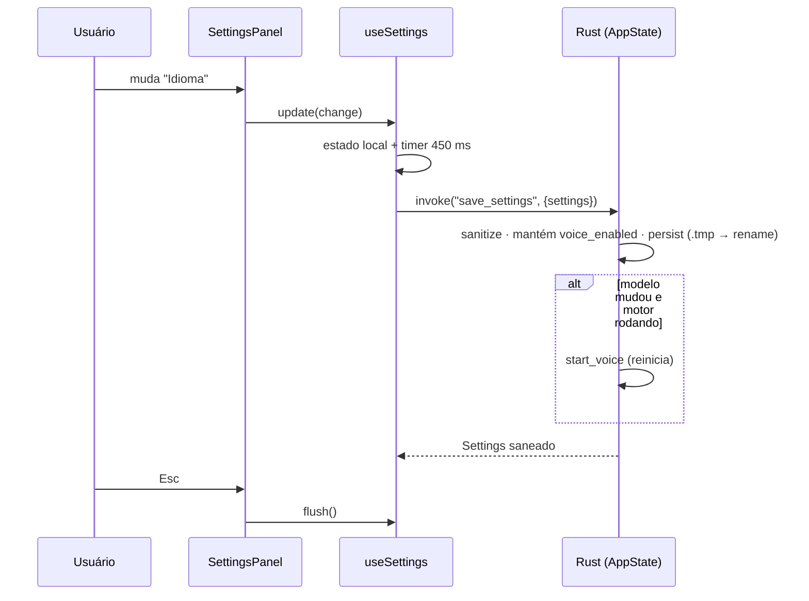

# Configurações e Menu avançado

As preferências do JARVIS: uma gaveta de Configurações com o essencial e um Menu avançado com o ajuste fino, tudo salvo sozinho.

| | |
|---|---|
| **ID** | `feature/settings` |
| **Status** | Implementado |
| **Origem** | `42e671a` (2026-10-23) · evoluída em `c4ccc57`, `750ebd0`, `048a254` e não commitado (27/10: fim do `background`) |

## Visão geral

As preferências do JARVIS ficam em dois lugares.

O **painel de Configurações** é uma gaveta à direita, aberta por Ctrl+, ou pelo item Settings da dock. Ele reúne o essencial, em seções:
- **Ativação**: modo e escuta;
- **Aparência**: cor e barra superior;
- **Reconhecimento de voz**: modelo Whisper e idioma;
- **Cérebro do JARVIS**: modelo do Claude, nome do usuário e limpeza de memória;
- **Voz do JARVIS**;
- **Programas e atalhos**.

O **Menu avançado** é um diálogo central com abas, aberto por Ctrl+Shift+, ou pelo rodapé do painel. Ele traz o ajuste fino: Cores, Núcleo, Janelas, Layout, TUI, Barra superior, Dock e Voz.

O que o Rust precisa saber vive em `settings.json`, gravado de forma atômica e saneado no Rust. O que é só visual vive em chaves `jarvis.*` do localStorage. Toda mudança vale na hora e é salva sozinha ("Alterações salvas automaticamente").

## Dados

- `$settings`: o objeto **Settings** (com **AppEntry** e **VoiceCommand**). Ver [glossário](../../domain/glossary.md) e [persistência](../../domain/persistence.md).
  - No app, fica em `%APPDATA%\dev.jarvis.os\settings.json` (+ `.json.tmp` durante a gravação), em camelCase (pretty JSON). A UI grava após 450 ms sem edições; o Rust grava de forma atômica via `.json.tmp` e roda `sanitize` na leitura e na gravação.
  - No navegador, o mesmo objeto fica em `jarvis.settings`, com o mesmo debounce de 450 ms e `withBuiltinCommands` ao ler.
  - **RF-005**: Os padrões DEVEM ser:
    - `activation: pushToTalk`, `model: small`, `assistantModel: sonnet`, `assistantName: ""`;
    - `language: pt`, `theme: blue`, `accentHue: 224`, `taskbar: true`, `voiceEnabled: false`;
    - os 4 programas da dock e o catálogo de `voice-commands.json`.
- `$modelos`: a lista de **ModelStatus** (Whisper), vinda de `models_status`. No navegador, os modelos de exemplo `BROWSER_MODELS`. Só em memória.
- `$progresso` e `$errosDoModelo`: o percentual e o erro de cada download, vindos de `model:progress` e `model:done`. Só em memória.
- `$aba`: a última aba do Menu avançado usada na sessão. Só em memória (começa em Cores).
- **SettingsSection**: `activation`, `appearance`, `voice`, `jarvis`, `apps`.
- **AdvancedTab**: `colors`, `core`, `windows`, `layout`, `tui`, `taskbar`, `dock`, `voice`.

## Componentes

### `SettingsPanel`

A gaveta "Configurações", à direita, com as seções do essencial.

- **Comportamento:**
  - Ao abrir, ponha o foco no botão "Fechar configurações". Esc, o botão ou um clique no fundo fecham o painel, e fechar força o salvamento (`flush`).
  - **RF-006**: As seções do painel DEVEM ter âncoras `settings-<seção>`, para a busca rolar até elas.
    - Quando o painel abre com uma seção pedida, role até ela (`scrollIntoView({ block: "start" })`) depois de montar.
  - O botão "Menu avançado" do rodapé fecha o painel e abre o [`AdvancedMenu`](#advancedmenu).
  - Se $settings ainda estiver carregando, então o corpo mostra "Carregando…".
  - No navegador, mostre no topo "Reconhecimento de voz e abertura de programas funcionam no app desktop.".
  - O texto do painel é selecionável.
- **Layout:**
  - Um fundo que cobre a tela e, por cima, a gaveta `role="dialog"` presa às bordas de cima, da direita e de baixo.
  - Cabeçalho com o título "Configurações" à esquerda e o botão de fechar (X) à direita.
  - Corpo rolável com as seções na ordem: Ativação, Aparência, Reconhecimento de voz, Cérebro do JARVIS, Voz do JARVIS, Programas e atalhos.
  - Rodapé com "Alterações salvas automaticamente" à esquerda e o botão "Menu avançado" (ícone de controles) à direita.
- **Estilo:**
  - Fundo `bg-black/25`. Gaveta a 16 px das bordas (`top-4 right-4 bottom-4`), com 440 px de largura (no máximo `calc(100vw - 2rem)`), `rounded-2xl`, borda `hud-cyan/20`, fundo `bg-hud-panel/82` com `backdrop-blur-xl`, sombra funda e brilho ciano interno. Um fio de luz no topo, em degradê `hud-light/40`.
  - Título em 11 px `font-semibold`, maiúsculo, com espaçamento largo, em `text-hud-light`. Botão de fechar quadrado de 32 px, `text-hud-text/60`, com fundo `hud-cyan/10` no hover.
  - Corpo `hud-scroll`, com 32 px entre as seções (`space-y-8`).
  - Rodapé em 10 px maiúsculos, `text-hud-text/40`, separado por uma borda `hud-cyan/10`. O botão "Menu avançado" fica em `text-hud-text/70`.
  - O aviso do navegador é uma caixa `rounded-lg` com borda `hud-cyan/15`, fundo `hud-cyan/4` e `text-xs` `text-hud-text/70`.
  - Entra deslizando 32 px da direita em 0,35 s e sai em 0,18 s.

### Seção "Ativação"

Como o JARVIS ouve e se a escuta está ligada.

- **Comportamento:**
  - O seletor "Modo de ativação" tem "Segurar para falar", "Hey Jarvis" e "Sempre ouvindo". Embaixo, a dica do modo escolhido:
    - "Segurar para falar": "Segure o botão Voice (ou a tecla M) enquanto fala…";
    - "Hey Jarvis": "Diga “Hey Jarvis” e o comando ou a pergunta…";
    - "Sempre ouvindo": "Qualquer frase com uma palavra-chave abre o programa; perguntas e atalhos começam com “Jarvis”.".
  - A linha "Escuta" mostra o estado da escuta e um interruptor "Escuta ligada" que liga ou desliga o motor. O modo e a escuta são do [voice-engine](../../features/voice-engine/spec.md).
- **Layout:** `Segmented` "Modo de ativação", a dica e a linha "Escuta" com o `Switch` à direita.
- **Estilo:** dica em `text-xs` `text-hud-text/60`. A linha "Escuta" é um cartão `rounded-xl` com borda `hud-cyan/12` e fundo `white/2`, título em `text-sm` e estado em `text-xs` `text-hud-text/50`.

### Seção "Aparência"

A cor do JARVIS e a barra superior.

- **Comportamento:**
  - "Cor do JARVIS" escolhe entre Azul, Verde Matrix, Amarelo digital e Personalizada. O tema em si é do [appearance](../../features/appearance/spec.md).
  - "Barra superior" liga ou desliga a barra do topo ("Atalhos das janelas, status, pomodoro, bateria e relógio no topo, estilo Waybar").
- **Layout:** `CardPicker` em 2 colunas e um `SwitchRow`.
- **Estilo:** os controles de [`hud.tsx`](#controles-compartilhados-hudtsx).

### Seção "Reconhecimento de voz" (`ModelCard`)

O modelo Whisper, o idioma e o último texto reconhecido.

- **Comportamento:**
  - O grupo "Modelo Whisper" lista $modelos como rádios. Cada `ModelCard` mostra o rótulo, o tamanho (MB, ou GB com uma casa) e a descrição.
    - À direita, "Baixado" quando o arquivo existe; durante o download, o percentual de $progresso e uma barra; senão, o botão "Baixar".
    - Se o download falhar, então o erro aparece no lugar da descrição.
    - No navegador, "Baixar" fica desabilitado.
  - Se o modelo escolhido não estiver baixado, então mostre "Baixe o modelo selecionado para ativar a escuta.".
  - **RF-010**: O grupo "Processamento da voz" (`VoiceDeviceRow`) DEVE oferecer "Automático", "Processador" e uma opção por GPU de `voice_devices` ("<nome> · <VRAM>"), gravando `voiceDevice` (`auto`, `cpu` ou o nome).
    - Embaixo: "Agora: <processador | nome da GPU>." com a escuta ligada. Sem ela, uma dica do ganho da GPU. Num build sem Vulkan, as GPUs ficam desabilitadas e a dica diz que a voz roda no processador.
    - Uma GPU salva que não está mais na lista aparece como "Automático".
    - No navegador, o fake lista as GPUs da máquina de desenvolvimento (NVIDIA GeForce MX570 A · 2 GB e Intel(R) Graphics); `window.__JARVIS_GPUS__` troca a lista.
  - O seletor "Idioma" tem "Português", "English" e "Automático".
  - "Último reconhecimento:" mostra o último texto entre aspas, ou "—".
- **Layout:** a lista de `ModelCard`, o aviso, o grupo "Processamento da voz" (rádios em 2 colunas, como as vozes do JARVIS) com a dica, o `Segmented` "Idioma" e a linha do último reconhecimento.
- **Estilo:**
  - `ModelCard` em `rounded-xl`: selecionado com borda `hud-cyan/40` e fundo `hud-cyan/6`; os outros com borda `hud-cyan/12` e fundo `white/2`.
  - O rádio é um círculo de 16 px; o ponto marcado é `bg-hud-light` com brilho.
  - Rótulo em `text-sm`, tamanho em `text-hud-text/45`, descrição em `text-xs` `text-hud-text/50`.
  - "Baixado" em 10 px maiúsculo `text-hud-light/80`, com um ícone de check. O progresso tem 80 px de largura, um spinner e uma barra de 2 px (`bg-hud-light` sobre `hud-cyan/15`).
  - "Baixar" é um botão com borda `hud-cyan/25`, 10 px maiúsculo, `text-hud-text/80`, com opacidade 40% quando desabilitado.

### Seção "Cérebro do JARVIS"

O modelo do Claude, o nome do usuário e a limpeza de memória.

- **Comportamento:**
  - O seletor "Modelo do JARVIS" usa `ASSISTANT_MODELS`: Haiku, Sonnet, Opus e Padrão. Embaixo, a dica do escolhido, seguida de "O Claude Code que responde ao clicar no núcleo, às perguntas por voz e aos atalhos (“pesquisa sobre…”, “bom dia”)."
  - O campo "Como ele te chama" (placeholder "seu nome") aceita até 40 caracteres (`MAX_NAME`). A dica diz "O JARVIS usa esse nome nas respostas e nas saudações, de vez em quando, como nos filmes. Em branco, ele fala sem vocativo."
  - A linha "Limpeza de memória" é do [memory-cleanup](../../features/memory-cleanup/spec.md).
- **Layout:** `Segmented`, a dica, o campo com o rótulo em cima, a dica do nome e a linha da limpeza.
- **Estilo:** campo `hud-input` em largura total, rótulo e dicas em `text-xs` `text-hud-text/60`.

### Seções "Voz do JARVIS" e "Programas e atalhos"

- **Comportamento:**
  - "Voz do JARVIS" (`SpeechSection`, âncora `settings-speech`) é especificada no [tts](../../features/tts/spec.md).
  - "Programas e atalhos" (`AppRow` e os botões "Adicionar") é especificada no [app-launcher](../../features/app-launcher/spec.md).

### `AdvancedMenu`

O diálogo central "Menu avançado", com as abas do ajuste fino.

- **Comportamento:**
  - **RF-007**: O Menu avançado DEVE abrir na última aba usada na sessão ou na aba pedida. O painel e o menu põem o foco no botão de fechar ao abrir, e o menu tira o foco dos próprios campos ao fechar, para que o próximo `/` não caia neles.
  - **RF-008**: Abrir o Menu avançado DEVE fechar o painel, e vice-versa pela busca.
  - Esc, o botão "Fechar menu avançado" ou um clique no fundo fecham o menu, e fechar força o salvamento (`flush`).
  - Cada aba vale ao vivo. O que cada uma ajusta é do domínio dela (ver [Fora de escopo](#fora-de-escopo-e-limitações)):
    - **Cores**: "Inicialização" ("Tela de inicialização", "Sons da inicialização", "Ver agora") e "Aparência" ("Cor do JARVIS", "Matiz" de 0 a 359° e a faixa de cores). Mexer no Matiz passa o tema para Personalizada.
    - **Núcleo**: "Visual do núcleo" e a nota "Memória".
    - **Janelas**: "Estilo das janelas" (TUI ou Holográfico), "Encaixe" (bordas, centro, distância Curta/Média/Longa) e "Opacidade das janelas" (60 a 100%).
    - **Layout**: "Lado a lado", "Cascata", "Centralizar", a contagem de janelas, "Alinhar à grade" e "Fechar todas as janelas". Sem janelas, os botões ficam desabilitados.
    - **TUI**: "Aberração cromática", "Brilho (glow)", "Cor dos apps de terminal" e a "Prévia" (`TuiPreview`).
    - **Barra superior**: "Mostrar a barra superior" e os "Módulos".
    - **Dock**: "Mostrar a dock", "Ampliar ícones" e a nota "Sem a dock" com as teclas.
    - **Voz**: o `VoiceTab`, do [voice-commands](../../features/voice-commands/spec.md).
  - Se $settings ainda estiver carregando, então as abas Cores (parte "Aparência"), Barra superior e Voz mostram "Carregando…".
- **Layout:**
  - Um fundo que cobre a tela e, centralizado, o painel `role="dialog"` em grade de duas colunas: o cabeçalho ocupa as duas; embaixo, a coluna de abas (`role="tablist"`, vertical) e o painel da aba (`role="tabpanel"`).
  - Cabeçalho com o título "Menu avançado" e o botão de fechar (X).
- **Estilo:**
  - Mesmo vidro da gaveta: `rounded-2xl`, borda `hud-cyan/20`, `bg-hud-panel/82`, `backdrop-blur-xl`, sombra funda e o fio de luz no topo. Fundo `bg-black/25`.
  - 720 × 480 px, limitado à tela; a coluna de abas tem 180 px e uma borda direita `hud-cyan/10`.
  - Abas em `text-xs` maiúsculo com espaçamento largo. A ativa fica em `text-hud-light` com um destaque que desliza entre as abas (`layoutId="advanced-tab"`), borda `hud-cyan/30`, fundo `hud-cyan/9` e brilho; as outras em `text-hud-text/55`.
  - Painel da aba `hud-scroll`, com 28 px entre as seções (`space-y-7`). As notas ficam em `text-xs` `text-hud-text/55`; as teclas da nota "Sem a dock" são `kbd` mono de 11 px com borda `hud-cyan/20`.
  - Entra subindo 12 px e crescendo de 98% em 0,3 s; sai em 0,18 s.

### Controles compartilhados (`hud.tsx`)

As peças com que o painel e o menu são montados.

- **Comportamento:**
  - `Segmented` é um `radiogroup`: uma opção marcada, com o destaque deslizando até ela.
  - `CardPicker` é um `radiogroup` de cartões com uma amostra visual (`ThemeSwatch`, `CoreSwatch`…), em 2 ou 3 colunas.
  - `Switch` é um `role="switch"`; `SwitchRow` é uma linha com rótulo, dica e o `Switch` à direita.
  - `ChipInput`: Enter ou vírgula adicionam o texto como chip, sem duplicatas (ignorando maiúsculas); Backspace no campo vazio remove o último; o × remove qualquer um; sair do campo também adiciona.
  - `Range` mostra o rótulo à esquerda e o valor formatado à direita; aceita uma faixa de fundo própria (o arco-íris do Matiz).
  - `IconButton` e `ActionButton` são os botões secundários.
- **Layout:** `Section` é um título pequeno com os controles empilhados embaixo (12 px entre eles) e `scroll-mt-4` para a âncora.
- **Estilo:**
  - Título de `Section` em 10 px `font-semibold`, maiúsculo, com espaçamento largo, em `text-hud-cyan/80`.
  - Cartões e linhas em `rounded-xl`, borda `hud-cyan/12` e fundo `white/2`; o marcado ganha borda `hud-cyan/40`, fundo `hud-cyan/6` e `text-hud-light`.
  - `Segmented` em `text-xs` maiúsculo; destaque com borda `hud-cyan/30`, fundo `hud-cyan/9` e brilho.
  - `Switch` de 44 × 24 px; ligado, borda `hud-cyan/50`, fundo `hud-cyan/25` e a bolinha `bg-hud-light` com brilho; desligado, bolinha `bg-hud-text/40`. A bolinha anda com mola.
  - Chips com borda `hud-cyan/25`, fundo `hud-cyan/8` e `text-xs` `text-hud-light/90`.
  - `IconButton` quadrado de 28 px, `text-hud-text/55`, opacidade 30% quando desabilitado. `ActionButton` em `text-xs` maiúsculo, borda `hud-cyan/20`, opacidade 35% quando desabilitado.
  - O foco por teclado aparece como um anel `hud-light/50`.

### `useSettings`

Carrega $settings uma vez e salva cada edição depois de uma pausa.

- **Comportamento:**
  - **RF-001**: O sistema DEVE carregar os settings por `get_settings` no app e por `localStorage["jarvis.settings"]` no navegador (mesclado sobre o padrão, com os comandos de voz built-in restaurados).
  - **RF-002**: Toda edição DEVE ser otimista (estado local na hora) e salva após 450 ms sem novas edições, por `save_settings` (que devolve a versão saneada) ou no localStorage.
  - Se as edições forem rápidas, então cada uma reinicia o debounce de 450 ms. Fechar o painel ou o menu força o salvamento (`flush`), e o `beforeunload` também.
  - Se salvar falhar, então guarde o erro em `saveError`.

### `useModels`

A lista de modelos Whisper com o progresso dos downloads (só no app).

- **Comportamento:**
  - `download(id)` zera o erro do modelo, marca 0% e chama `download_model`.
  - Em `model:progress`, atualize o percentual (`received / total`).
  - Em `model:done`, limpe o progresso, guarde o erro (se houver) e recarregue a lista.
  - No navegador, não há download.

### Persistência no Rust (`settings.rs` e `save_settings`)

O Rust guarda $settings num `RwLock`, saneia e grava.

- **Comportamento:**
  - **RF-003**: O Rust DEVE sanear na leitura e na gravação:
    - até 12 palavras-chave por programa, 300 caracteres por campo de programa, sem duplicatas (ignorando maiúsculas);
    - os programas da dock sempre presentes, no topo, com nome fixo;
    - comandos de voz: até 30 frases de até 60 caracteres, até 100 comandos `custom-*`.
  - **RF-004**: O Rust DEVE gravar de forma atômica: escreve `settings.json.tmp` e renomeia.
  - Se o arquivo estiver corrompido ou ausente, então o Rust usa o padrão. Campos ausentes recebem o padrão campo a campo (`#[serde(default)]`).
  - Se idioma, tema, modelo Whisper ou modelo do JARVIS forem desconhecidos, então voltam ao padrão. O matiz é reduzido a 0..360 (NaN → 224).
  - No nome, espaços e quebras viram um espaço só, e o texto é cortado em 40 caracteres.
  - Salvar nunca muda `voiceEnabled` (isso é de `voice_start`/`voice_stop`).
  - Se o modelo mudar com o motor rodando, então reinicie o motor; se falhar, ele para e o erro volta.

## Casos de borda

- **Busca aberta:** Esc fecha só a busca, não o painel de trás.

## Voz e teclado

- `Ctrl+,`: abre as Configurações. O item Settings da dock também (e fica `aria-pressed="true"`).
- `Ctrl+Shift+,` (tecla física `Comma`): abre o Menu avançado.
- `Esc`: fecha o painel ou o menu.
- Busca "Configurações › <seção>" / "Menu avançado › <aba>": abre no lugar certo.

## Restrições

- **RNF-001**: `settings.json` fica em `%APPDATA%\dev.jarvis.os\` (`app_config_dir`).
- **RNF-002**: Tipos espelhados: `Settings`, `AppEntry`, `VoiceCommand`, `Activation`, `ASSISTANT_MODELS`, `MAX_NAME` (TS ↔ Rust).
- **RNF-003**: O painel tem 440 px de largura, e o menu 720 × 480 px, ambos limitados à tela.
- Debounce de 450 ms. Salvar não mexe em `voiceEnabled`. Trocar o modelo reinicia o motor se ele estiver rodando.

## Histórias de usuário

### US1 — Abrir e fechar as configurações (P1)

Abro as configurações pelo mouse ou pelo teclado e fecho com Esc.

**Por que P1:** é a porta de todas as preferências.
**Teste independente:** `tests/settings.spec.ts` — "opens from the dock and the keyboard, closes with Escape".

**Aceite**

1. **Dado** o desktop, **quando** clico em Settings na dock, **então** o diálogo "Configurações" abre e o item fica `aria-pressed="true"`.
2. **Quando** aperto Esc, **então** ele fecha. Ctrl+, reabre, e "Fechar configurações" fecha.
3. **Dado** o painel, **quando** clico "Menu avançado" no rodapé, **então** o painel fecha e o "Menu avançado" abre.
4. **Dado** o Menu avançado, **quando** aperto Esc ou clico no fundo, **então** ele fecha. Ao reabrir pela busca, a aba pedida já vem selecionada.

### US2 — Ativação e idioma persistem (P1)

Escolho como o JARVIS me ouve e em que idioma, e a escolha sobrevive a um recarregamento.

**Por que P1:** muda o comportamento principal da voz.
**Teste independente:** "activation mode and language persist".

**Aceite**

1. **Dado** uma instalação nova, **então** "Segurar para falar" está marcado, com a dica "Segure o botão Voice (ou a tecla M)…".
2. **Quando** escolho "Sempre ouvindo", **então** a dica muda para "Qualquer frase com uma palavra-chave abre o programa; perguntas e atalhos começam com “Jarvis”.".
3. **Quando** escolho "English" e espero o salvamento (450 ms), **então** ao recarregar continuam "Sempre ouvindo" e "English".

### US3 — Nome e cérebro do JARVIS (P2)

Digo como o JARVIS deve me chamar e qual modelo do Claude ele usa.

**Por que P2:** personaliza as respostas.
**Teste independente:** "the name JARVIS calls the user by persists" e, em `tests/shortcuts.spec.ts`, "JARVIS's model is chosen in the settings, next to the Whisper models".

**Aceite**

1. **Dado** o campo "Como ele te chama" vazio, **quando** digito "Tony", **então** `assistantName` é salvo e volta depois de recarregar.
2. **Dado** "Modelo do JARVIS", **então** as opções são Haiku ("O mais rápido"), Sonnet ("Rápido e capaz, recomendado"), Opus ("O mais inteligente, responde mais devagar") e Padrão ("O modelo e o esforço do seu Claude Code"). O padrão é Sonnet.

### US4 — Baixar e escolher o modelo Whisper (P2)

Vejo os modelos de reconhecimento, baixo o que quero e acompanho o progresso.

**Por que P2:** sem modelo baixado não há escuta no app.
**Teste independente:** "JARVIS's model is chosen in the settings, next to the Whisper models" (lista de modelos no modo navegador).

**Aceite**

1. **Dado** o grupo "Modelo Whisper", **então** cada modelo mostra o rótulo, o tamanho (MB ou GB) e a descrição, um rádio de seleção e "Baixar" ou "Baixado". O primeiro é "Modelo Small", o padrão.
2. **Dado** o app desktop, **quando** clico "Baixar", **então** um percentual avança (`model:progress`). Ao terminar (`model:done`), a lista se atualiza, ou o erro aparece no lugar da descrição.
3. **Dado** o modelo escolhido não baixado, **então** aparece "Baixe o modelo selecionado para ativar a escuta.".
4. **Dado** o navegador, **então** "Baixar" fica desabilitado e um aviso diz "Reconhecimento de voz e abertura de programas funcionam no app desktop.".

### US5 — Menu avançado (P2)

Ajusto cores, núcleo, janelas, layout, efeitos TUI, barra, dock e frases de voz num só lugar.

**Por que P2:** concentra o ajuste fino sem poluir o painel.
**Teste independente:** `tests/desktop.spec.ts` — "the advanced menu tunes snapping, arranges windows and sets a custom hue".

**Aceite**

1. **Dado** o menu, **então** há 8 abas verticais: Cores, Núcleo, Janelas, Layout, TUI, Barra superior, Dock e Voz.
2. **Dado** a aba Cores, **então** há "Inicialização" (boot) e "Aparência" (cor, Matiz de 0 a 359° e a faixa de cores).
3. **Dado** cada aba, **então** as mudanças valem ao vivo e persistem (ver as specs de cada domínio).

## Critérios de sucesso

- **SC-001**: Nenhuma mudança se perde ao fechar o painel ou o app logo após editar.
- **SC-002**: Um `settings.json` corrompido nunca impede o app de abrir.
- **SC-003**: Toda seção do painel e toda aba do menu têm um teste que as exercita.

## Fora de escopo e limitações

- Cada seção ou aba é especificada no domínio dela:
  - Ativação e modelos: [voice-engine](../../features/voice-engine/spec.md), que tem o catálogo `models.rs`;
  - aba Voz: [voice-commands](../../features/voice-commands/spec.md);
  - cor e TUI: [appearance](../../features/appearance/spec.md);
  - núcleo: [holographic-core](../../features/holographic-core/spec.md);
  - Janelas e Layout: [desktop-windows](../../features/desktop-windows/spec.md);
  - Barra e Dock: [dock-taskbar](../../features/dock-taskbar/spec.md);
  - Programas e atalhos: [app-launcher](../../features/app-launcher/spec.md);
  - Voz do JARVIS: [tts](../../features/tts/spec.md);
  - limpeza de memória: [memory-cleanup](../../features/memory-cleanup/spec.md).
- A escolha de fundo (grid/matrix) não existe mais. Ver [ADR-0015](../../arch/adr/0015-remocao-do-fundo-shader.md).

## Código

O `useSettings` carrega o objeto `Settings` uma vez e aplica edições otimistas por `update(change)`, com debounce de 450 ms até `saveSettings`. O `flush` grava na hora (ao fechar o painel ou o menu, e no `beforeunload`). No app, `get_settings`/`save_settings` falam com o `AppState` do Rust, que guarda `RwLock<Settings>`, saneia e persiste em `settings.json` de forma atômica. No navegador, o mesmo objeto vai para `localStorage["jarvis.settings"]`. O `useModels` lista os modelos Whisper e escuta `model:progress`/`model:done`. `SettingsPanel` e `AdvancedMenu` são diálogos de apresentação, montados com controles compartilhados de `hud.tsx`.

| | |
|---|---|
| **Camadas** | UI React (`SettingsPanel`, `AdvancedMenu`, `hud.tsx`, `VoiceTab`) · hook (`useSettings`, `useModels`) · lib (`settings.ts`) · comandos Tauri (`get_settings`, `save_settings`, `models_status`, `download_model`) · Rust (`settings.rs`, `lib.rs`, `models.rs`) |
| **Dependências** | `serde`/`serde_json`, `motion/react`, `lucide-react`, `voice-commands.json` (importado pelos dois lados) |
| **Testes** | `tests/settings.spec.ts`, `tests/desktop.spec.ts`, `tests/tui.spec.ts`, `tests/shortcuts.spec.ts`; Rust `mod tests` em `settings.rs` |
| **Plataforma** | Fora do Tauri: fallback em localStorage, modelos de exemplo (`BROWSER_MODELS`), botões de download, pasta e arquivo desabilitados, e o aviso "…funcionam no app desktop." |

### Arquivos

| Arquivo | Papel |
|---|---|
| `src/components/SettingsPanel.tsx` | Gaveta "Configurações": seções, `ModelCard`, `CleanupRow`, `SpeechSection`, `AppRow`, rodapé com "Menu avançado" |
| `src/components/desktop/AdvancedMenu.tsx` | Diálogo "Menu avançado" com 8 abas, `TuiPreview`, `PaletteStrip`, `accentOptions` |
| `src/components/hud.tsx` | `ChipInput`, `Section`, `Segmented`, `CardPicker`, `ThemeSwatch`, `CORE_OPTIONS`, `CoreSwatch`, `Switch`, `SwitchRow`, `IconButton`, `Range`, `ActionButton`, `themeOptions`, `Mono` |
| `src/lib/settings.ts` | Tipos espelhados, `ASSISTANT_MODELS`, `MAX_NAME`, `DEFAULT_VOICE_COMMANDS`, `withBuiltinCommands`, `DEFAULT_SETTINGS`, `BROWSER_MODELS`, `loadSettings`, `saveSettings`, `loadModels`, `createAppId` |
| `src/hooks/useSettings.ts` | `useSettings` (`update`, `flush`, `saveError`) e `useModels` (`download`, `progress`, `errors`) |
| `src-tauri/src/settings.rs` | `Settings`, `AppEntry`, `VoiceCommand`, `Activation`, `Default`, `sanitize`, `sanitize_voice_commands`, `load`, `save` (atômico) |
| `src-tauri/src/lib.rs` | `get_settings`, `save_settings` (preserva `voice_enabled`, reinicia o motor ao trocar de modelo), `models_status`, `download_model`, `AppState::persist` |
| `src/App.tsx` | `settingsOpen`/`advancedOpen`, `closeSettings`/`closeAdvanced` com `flush`, `openSettingsAt`/`openAdvancedAt`, `applyTheme` |

### Contratos

#### Comandos Tauri

| Comando | Entrada | Saída | Notas |
|---|---|---|---|
| `get_settings` | — | `Settings` | snapshot do `RwLock` |
| `save_settings` | `{ settings: Settings }` | `Settings` saneado | mantém `voice_enabled`. Erro "Falha ao salvar: …" |
| `models_status` | — | `ModelStatus[]` | `downloaded` pelo arquivo em `models\`, `downloading` pelo conjunto em memória |
| `download_model` | `{ id }` | `()` | thread própria. "Modelo desconhecido" se o id não existir. Uma segunda chamada durante o download é ignorada |

#### Eventos e Channels

| Nome | Payload | Emissor → consumidor |
|---|---|---|
| `model:progress` | `{ id, received, total }` | `download_model` → `useModels` (percentual) |
| `model:done` | `{ id, error: string \| null }` | `download_model` → `useModels` (limpa o progresso, guarda o erro, recarrega) |

### Fluxo

### Constituição

- [x] P2 Rust é dono do nativo — persistência, saneamento e download de modelos no Rust.
- [x] P3 Comandos finos — `get_settings`, `save_settings`, `models_status` e `download_model` em `lib.rs`. O trabalho fica em `settings.rs`/`models.rs`, e os eventos seguem `model:*`.
- [x] P4 Contratos espelhados — `Settings`, `AppEntry`, `VoiceCommand`, `Activation` com comentário "Mirrors" e `rename_all = "camelCase"`.
- [x] P5 Persistência tolerante — `#[serde(default)]`, `sanitize`, `load` → padrão em caso de erro. Migrações: `RETIRED_PHRASES`, `OLD_CODE_PHRASES` (`window:code` → `window:ide`), `OLD_TERMINAL_KEYWORDS`, modelo `medium` aposentado → `small`.
- [x] P6 Funciona fora do Tauri — fallback de navegador (caminho 1).
- [x] P7 PT-BR — rótulos, dicas e erros ("Falha ao salvar: …", "Modelo desconhecido").
- [x] P11 Coberto por teste — 8 testes Playwright em `settings.spec.ts` e 11 testes Rust em `settings.rs`.

### Decisões relacionadas

- [ADR-0010 — settings.json (Rust) vs localStorage](../../arch/adr/0010-persistencia-settings-vs-localstorage.md)
- [ADR-0009 — tipos espelhados TS ↔ Rust](../../arch/adr/0009-tipos-espelhados-ts-rust.md)
- [ADR-0021 — reconhecimento de voz na GPU via Vulkan (`voiceDevice`)](../../arch/adr/0021-reconhecimento-voz-gpu-via-vulkan-porteiro.md)
- [ADR-0002 — STT whisper.cpp na CPU, Small padrão](../../arch/adr/0002-stt-whisper-offline-cpu.md)
- [ADR-0004 — catálogo de voz compartilhado](../../arch/adr/0004-catalogo-de-voz-compartilhado-e-fallback.md)
- [ADR-0015 — remoção do fundo shader](../../arch/adr/0015-remocao-do-fundo-shader.md)

## Tarefas

Legenda: `[x]` feito · `[ ]` pendente · `[P]` pode rodar em paralelo (arquivos diferentes) · `[USn]` história desta spec. As tarefas foram reconstruídas do código e dos commits `42e671a`, `c4ccc57`, `750ebd0`, `048a254` e do working tree de 27/10.

### Fase 1 — Base

- [x] T001 `Settings`, `AppEntry`, `VoiceCommand`, `Activation`, `Default`, `sanitize`, `load`/`save` atômico — `src-tauri/src/settings.rs`
- [x] T002 [P] Tipos espelhados, padrões e fallback de navegador — `src/lib/settings.ts`
- [x] T003 Comandos `get_settings`, `save_settings`, `models_status` e `download_model`, com eventos `model:*` — `src-tauri/src/lib.rs`
- [x] T004 `useSettings` (otimista, 450 ms, `flush`, `beforeunload`) e `useModels` — `src/hooks/useSettings.ts`
- [x] T005 [P] Controles compartilhados — `src/components/hud.tsx`

### Fase 2 — US1 Abrir e fechar (P1)

- [x] T006 [US1] Gaveta `SettingsPanel` com Esc, foco no fechar e rodapé "Menu avançado" — `src/components/SettingsPanel.tsx`
- [x] T007 [US1] Diálogo `AdvancedMenu` com abas, Esc, clique no fundo e aba inicial — `src/components/desktop/AdvancedMenu.tsx`
- [x] T008 [US1] `Ctrl+,` e `Ctrl+Shift+,` — `src/hooks/useWindowControls.ts`
- [x] T009 [US1] Abrir um fecha o outro, e `flush` ao fechar — `src/App.tsx`

### Fase 3 — US2 Ativação e idioma (P1)

- [x] T010 [US2] Seção "Ativação" (modo, dica, escuta) e "Idioma" — `src/components/SettingsPanel.tsx`

### Fase 4 — US3 Nome e cérebro (P2)

- [x] T011 [US3] `assistantModel` e `ASSISTANT_MODELS` nos dois lados — `src-tauri/src/settings.rs`, `src/lib/settings.ts` (`048a254`)
- [x] T012 [US3] `assistantName` com `MAX_NAME` = 40 e saneamento para uma linha — `src-tauri/src/settings.rs`, `src/lib/settings.ts` (não commitado)
- [x] T013 [US3] Seção "Cérebro do JARVIS" — `src/components/SettingsPanel.tsx`

### Fase 5 — US4 Modelos Whisper (P2)

- [x] T014 [US4] `ModelCard` com progresso, erro e "Baixado" — `src/components/SettingsPanel.tsx`

### Fase 6 — US5 Menu avançado (P2)

- [x] T015 [US5] Abas Cores, Núcleo, Janelas, Layout, TUI, Barra superior, Dock e Voz — `src/components/desktop/AdvancedMenu.tsx`
- [x] T016 [US5] Remoção do campo `background` (TS, Rust, boot e testes) — working tree (27/10)

### Fase 7 — Testes

- [x] T017 Playwright `tests/settings.spec.ts` — "opens from the dock and the keyboard, closes with Escape"
- [x] T018 Playwright `tests/settings.spec.ts` — "activation mode and language persist"
- [x] T019 Playwright `tests/settings.spec.ts` — "the JARVIS color recolours the hologram and the interface, and persists"
- [x] T020 Playwright `tests/settings.spec.ts` — "the backdrop is always black: there is no background to pick"
- [x] T021 Playwright `tests/settings.spec.ts` — "the name JARVIS calls the user by persists"
- [x] T022 Playwright `tests/settings.spec.ts` — "keywords can be added and removed per program", "custom programs can be added, edited and removed", "shortcuts: sites, folders and files open by voice like programs"
- [x] T023 Playwright `tests/shortcuts.spec.ts` — "JARVIS's model is chosen in the settings, next to the Whisper models"
- [x] T024 Playwright `tests/desktop.spec.ts` — "the advanced menu tunes snapping, arranges windows and sets a custom hue"
- [x] T025 Rust `src-tauri/src/settings.rs` — `missing_fields_fall_back_to_defaults`, `invalid_language_model_and_theme_are_reset`, `jarvis_models_are_checked`, `the_name_is_one_short_line`, `save_and_load_round_trip`
- [x] T026 Rust `src-tauri/src/settings.rs` — `sanitize_cleans_keywords_and_restores_dock_apps`, `voice_commands_keep_their_actions_and_take_the_users`, `default_voice_commands_are_valid`, `untouched_builtin_phrases_follow_the_new_defaults`, `jarvis_code_moves_to_the_ide`, `the_terminal_program_hands_its_old_words_to_jv_sh`

## Pendências

- [ ] `useSettings` expõe `saveError`, mas `src/App.tsx` não o usa. Uma falha de `save_settings` (ex.: "Falha ao salvar: …") não aparece na interface.
- [ ] No navegador, `loadSettings` mescla o objeto salvo sem saneá-lo. Um `background` gravado por versões antigas continua em `jarvis.settings` e é regravado.
