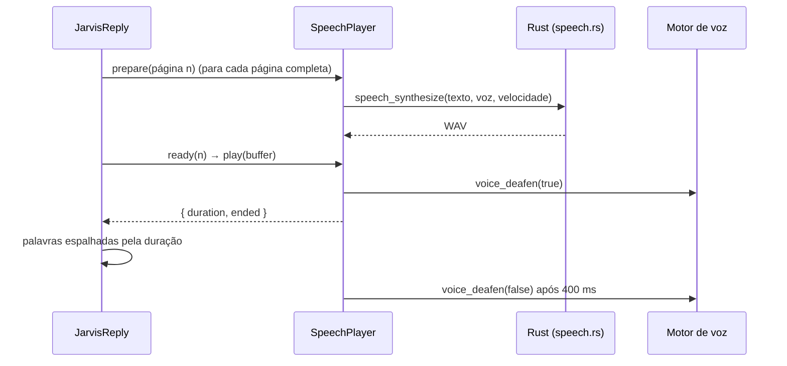

# Voz do JARVIS (síntese de fala)

O JARVIS fala as próprias respostas com uma voz neural local, frase por frase, com o texto aparecendo no ritmo da fala.

| | |
|---|---|
| **ID** | `feature/tts` |
| **Status** | Implementado |
| **Origem** | `750ebd0` (2026-10-27) |

## Visão geral

O JARVIS fala as próprias respostas com uma voz neural que roda na máquina, sem nuvem. A síntese usa o sherpa-onnx com vozes Piper (pt-BR) ou com o Kokoro multilíngue. O usuário escolhe a voz e a velocidade em Configurações → Voz do JARVIS e baixa o modelo uma vez, como no Whisper. A resposta é falada frase por frase: enquanto uma toca, a próxima já está sendo sintetizada, e o texto em letras grandes aparece no ritmo da fala. Enquanto ele fala, os modos de escuta ficam surdos para não tomar a voz dele por comando. A exibição das respostas é da spec [assistant](../assistant/spec.md); a persona, de [jarvis-persona](../../domain/jarvis-persona.md).

## Dados

- `$prefs`: as **SpeechPrefs** `{ enabled, voice, speed }`, com padrão `{ true, "miro", 1 }`. Ficam em `jarvis.speech` (localStorage), gravadas com debounce de 250 ms (`useStoredState`). `parseSpeech` valida campo a campo e limita a velocidade. Ver [persistência](../../domain/persistence.md).
- `$modelos`: os **VoiceModel** do catálogo: id, rótulo, arquivo, tamanho, SHA-256 e tipo (`Piper { onnx }` ou `Kokoro { lang: "pt-br" }`).
- `$vozes`: as **Voice**: id, rótulo, modelo e `sid` (falante). Ver [glossário](../../domain/glossary.md).
- `$arquivos`: cada modelo extraído fica em `%LOCALAPPDATA%\dev.jarvis.os\tts\<pasta>\`, com o marcador vazio `tts\<pasta>\.ready`, gravado só depois de extrair.

## Componentes

### Catálogo e download (`speech.rs`)

As vozes que existem e o download verificado de cada modelo.

- **Comportamento:**
  - **RF-001**: O sistema DEVE oferecer 5 modelos fixos (Piper Miro, Cadu, Jeff, Dii e Kokoro int8 multi-lang v1.0) e 8 vozes; a padrão é `miro`.
  - **RF-002**: O download DEVE conferir tamanho e SHA-256, extrair o `.tar.bz2` em `tts\<pasta>` e só então gravar o marcador `.ready`.
    - `fetch_verified` é o mesmo do Whisper. O progresso sai em `speech:progress` e o fim em `speech:done`, que faz `useSpeechStatus` recarregar o status.
  - **RF-003**: Um modelo DEVE contar como baixado somente com `.ready` presente.
  - `speech_download` roda em segundo plano, e um download repetido é ignorado. Se o id não existir, responda "Voz desconhecida".

### Síntese (`Speaker`)

Mantém um `OfflineTts` carregado e transforma uma frase num WAV.

- **Comportamento:**
  - **RF-004**: `speech_synthesize` DEVE devolver um WAV PCM 16-bit mono como resposta binária.
    - A resposta é uma `ipc::Response` binária, e a síntese roda via `blocking()`.
  - Mantenha só um modelo em memória. Se a voz escolhida for de outro modelo, troque o modelo carregado.
  - Se o modelo não estiver baixado, devolva `voice-missing`, e as respostas ficam só em texto.
  - Se o texto vier vazio, responda "Nada para falar". Se a voz não existir, responda "Voz desconhecida". As outras falhas são "Não consegui carregar a voz" e "A voz falhou".
  - Os parâmetros de cada tipo de modelo estão em [Configuração do sherpa-onnx](#configuração-do-sherpa-onnx).

### `SpeechPlayer`

Na UI, pede as frases ao Rust, toca o áudio e controla a surdez do motor de voz.

- **Comportamento:**
  - **RF-005**: A UI DEVE sintetizar as frases em ordem, uma por vez, preparando as próximas enquanto a atual toca.
  - Decodifique o WAV com Web Audio e toque-o.
  - **RF-007**: A voz DEVE alimentar um `AnalyserNode` para o holograma seguir a fala do JARVIS.
    - O `App` passa o analisador ao holograma por `setVoiceSource` do `useAudioAnalyzer`.
  - **RF-006**: Durante a fala, o sistema DEVE chamar `voice_deafen(true)` e, 400 ms após o fim, `voice_deafen(false)`.
    - A cauda de 400 ms é `DEAF_TAIL_MS`.
  - Se a WebView bloquear o áudio (sem gesto do usuário), `play` devolve nulo e a página segue no ritmo do texto.
  - Se o áudio travar, uma guarda encerra a frase em duração + 1,5 s.
  - `close` para o áudio na hora e devolve a escuta (`deafen(false)`). É chamado ao cancelar ou desmontar a resposta.

### Fala no `JarvisReply`

Decide o que falar de uma resposta e sincroniza as palavras com o áudio. O layout da resposta é da spec [assistant](../assistant/spec.md).

- **Comportamento:**
  - Só fale quando `replyVoice` existir: com $prefs.enabled ligado e a voz pronta (`voiceReady`). Senão, as respostas ficam só em texto.
  - Prepare cada página completa adiante (`prepare`) e comece a falar a página atual quando a voz dela estiver pronta (`ready`).
  - Espalhe as palavras da página pela duração da fala: o passo é 85% da duração dividido pelas palavras, entre 90 e 400 ms.
  - Mantenha a página na tela até ele terminar de falar + 250 ms (`SPOKEN_GAP_MS`).
  - Sem voz, as palavras entram no ritmo do texto, uma a cada 170 ms (`WORD_MS`).
  - Se a síntese ou o áudio de uma página falharem, a página fica `silent` e volta ao ritmo do texto, sem travar.

### `SpeechSection` (Configurações → Voz do JARVIS)

A voz, a velocidade, o modelo e um exemplo para ouvir.

- **Comportamento:**
  - "Falar as respostas" liga ou desliga $prefs.enabled. A dica é "Voz neural local: as frases aparecem no ritmo da fala" no app e "Disponível no app desktop" fora dele.
  - Quando o usuário clicar numa voz, ela vira $prefs.voice. Numa instalação nova, "Miro · masculina, grave" está marcada.
  - Mostre só o cartão do modelo da voz escolhida, o mesmo `ModelCard` do Whisper, com o download e o progresso.
  - **RF-008**: A velocidade DEVE ficar entre 0,8 e 1,3 na UI (o Rust aceita 0,5–2,0).
    - O controle "Velocidade da voz" anda em passos de 0,05 e mostra o valor com duas casas ("1.00×").
  - "Ouvir exemplo" diz "Às suas ordens. É assim que eu soo agora." (`previewVoice`).
    - Se o modelo da voz não estiver baixado, o botão fica desabilitado, com a dica "Baixe a voz primeiro".
- **Layout:**
  - De cima para baixo: o `SwitchRow` "Falar as respostas"; um `radiogroup` "Voz do JARVIS" com as vozes em duas colunas; o cartão do modelo; o rótulo "Velocidade" com o valor à direita e o controle deslizante; e o botão "Ouvir exemplo" na largura toda.
- **Estilo:**
  - Cada voz é um botão `rounded-xl border px-3 py-2 text-xs`. A escolhida fica em `border-hud-cyan/40 bg-hud-cyan/[0.06] text-hud-light`; as outras em `border-hud-cyan/12 bg-white/[0.02] text-hud-text/75`.
  - O rótulo "Velocidade" fica em `text-xs text-hud-text/60`, o valor em `text-hud-text/80` e o controle usa `hud-range`.
  - "Ouvir exemplo" tem borda `hud-cyan/25`, texto em maiúsculas `tracking-[0.16em]` com o ícone `Volume2`, e fica com opacidade 40% quando desabilitado.

## Casos de borda

- **Fora do Tauri:** sem voz. Com `window.__JARVIS_SPEECH__` em DEV, uma voz falsa e silenciosa grava em `__JARVIS_SPEECH_LOG__` os textos e as chamadas de `deafen`.
  - O fake devolve um WAV de silêncio proporcional às palavras.

## Voz e teclado

- `Esc` com resposta na tela: silencia (`SpeechPlayer.close`).
- Busca `/` → "Silenciar o JARVIS" / "Ligar a voz do JARVIS": `toggleSpeaking` inverte `enabled` (comando `speaking` em `src/lib/commands.ts`).

## Restrições

- **RNF-001**: Offline; só o download do modelo usa a rede (releases `tts-models` do k2-fsa/sherpa-onnx).
- **RNF-002**: Desempenho medido no Core 7 150U: Piper com RTF ~0,25–0,3; Kokoro ~1,1–1,2 (cerca de 1 s por segundo de fala).
- **RNF-003**: Síntese com metade dos núcleos, limitada a 1–4 threads.
- 1 modelo em memória; threads = metade dos núcleos (1–4); velocidade 0,8–1,3 na UI.

## Histórias de usuário

### US1 — Ouvir a resposta (P1)

Como usuário, ouço o JARVIS dizer a resposta enquanto as palavras aparecem no núcleo.

**Por que P1:** é o que faz dele um assistente de voz.
**Teste independente:** `tests/speech.spec.ts` — "each sentence is spoken, and stays on screen as long as JARVIS says it".

**Aceite**

1. **Dado** uma resposta com duas frases, **quando** ela chega, **então** cada frase é sintetizada em ordem, uma de cada vez.
2. **Dado** uma frase sendo falada, **quando** olho o núcleo, **então** as palavras surgem espalhadas pela duração da fala, e a página fica até ele terminar de falar + 250 ms.
3. **Dado** que ele começou a falar, **quando** o microfone de escuta está aberto, **então** o motor fica surdo (`voice_deafen(true)`) e volta a ouvir 400 ms depois da última palavra.

### US2 — Calar o JARVIS (P1)

Como usuário, aperto Esc e ele para de falar na hora.

**Por que P1:** uma voz que não para é intolerável.
**Teste independente:** `tests/speech.spec.ts` — "Esc silences him at once".

**Aceite**

1. **Dado** o JARVIS falando, **quando** aperto Esc, **então** o áudio para, a resposta some em até 2 s e a escuta volta (`deafen(false)`).

### US3 — Sem voz (P2)

Como usuário, desligo "Falar as respostas" e leio o texto no ritmo próprio.

**Por que P2:** em reunião ou à noite, a voz atrapalha.
**Teste independente:** `tests/speech.spec.ts` — "with the voice off nothing is spoken and the text keeps its own pace".

**Aceite**

1. **Dado** a voz desligada, **quando** chega uma resposta, **então** nada é sintetizado e as palavras entram no ritmo do texto (uma a cada 170 ms).
2. **Dado** uma frase que falhou ao sintetizar ou tocar, **quando** chega a vez dela, **então** a página segue o ritmo do texto, sem travar.

### US4 — Escolher a voz (P2)

Como usuário, escolho entre oito vozes, ajusto a velocidade e ouço um exemplo.

**Por que P2:** a voz é a identidade do JARVIS.
**Teste independente:** `tests/speech.spec.ts` — "Settings › Voz do JARVIS: the voice, its pace, a sample, on and off".

**Aceite**

1. **Dado** uma instalação nova, **quando** abro Voz do JARVIS, **então** "Miro · masculina, grave" está marcada.
2. **Dado** outra voz escolhida, **quando** clico "Ouvir exemplo", **então** ele diz "Às suas ordens. É assim que eu soo agora.".
3. **Dado** a voz cujo modelo não foi baixado, **quando** olho "Ouvir exemplo", **então** o botão está desabilitado ("Baixe a voz primeiro") e o cartão do modelo oferece o download.
4. **Dado** uma mudança, **quando** recarrego, **então** voz, velocidade e liga/desliga persistem em `jarvis.speech`.

## Critérios de sucesso

- **SC-001**: Com uma voz Piper, sintetizar uma frase leva cerca de um quarto da duração dela na CPU de referência, então a próxima frase fica pronta antes de a atual terminar.
- **SC-002**: O JARVIS nunca dispara um comando com a própria voz.
- **SC-003**: Esc silencia na hora e devolve a escuta.

## Fora de escopo e limitações

- Vozes de outros idiomas além das listadas; Kokoro só com `lang = "pt-br"` (e a voz `bm_george`, com sotaque britânico).
- sherpa-onnx fixado em `=1.13.8`: a 2.x perdeu o espeak-ng e, com ele, o pt-BR.
- O Windows 11 traz um `onnxruntime.dll` 1.17 em System32; sem as DLLs do sherpa ao lado do executável, o processo carrega a errada e quebra.

## Código

O Rust (`speech.rs`) mantém um `OfflineTts` do sherpa-onnx carregado (um modelo por vez) e transforma uma frase num WAV, devolvido como `ipc::Response` binária. A UI (`SpeechPlayer`) pede uma frase de cada vez, decodifica com Web Audio, toca por um `AnalyserNode` (para o holograma) e controla a surdez do motor de voz. O `JarvisReply` decide quais frases falar e sincroniza as palavras com a duração do áudio.

| | |
|---|---|
| **Camadas** | `SettingsPanel` (`SpeechSection`) · `JarvisReply` · `src/lib/speech.ts` (`SpeechPlayer`, `useSpeechPrefs`, `useSpeechStatus`) · comandos `speech_*`, `voice_deafen` · `src-tauri/src/speech.rs` |
| **Dependências** | `sherpa-onnx = "=1.13.8"` (feature `shared`), `tar`, `bzip2`, espeak-ng-data de cada modelo |
| **Testes** | `tests/speech.spec.ts`; Rust `mod tests` em `speech.rs` (`speech_samples` ignorado) |
| **Plataforma** | Windows 11 · WebView2. Fora do Tauri: fake `__JARVIS_SPEECH__` em DEV; senão, sem voz |

### Arquivos

| Arquivo | Papel |
|---|---|
| `src-tauri/src/speech.rs` | `MODELS`, `VOICES`, `download`/`extract`, `Speaker::synthesize`, `config`, `wav`, `MISSING` |
| `src-tauri/src/download.rs` | `fetch_verified` (compartilhado com o Whisper) |
| `src-tauri/src/lib.rs` | `speech_status`, `speech_download`, `speech_synthesize`, `voice_deafen`; `speaker` e `speech_dir` no `AppState` |
| `src/lib/speech.ts` | backends (Tauri/fake), `useSpeechPrefs`, `useSpeechStatus`, `voiceReady`, `SpeechPlayer`, `createSpeechPlayer` |
| `src/components/JarvisReply.tsx` | prepara as páginas completas, `speak(page)`, palavras sobre a duração (passo de 90–400 ms), espera de 250 ms |
| `src/components/SettingsPanel.tsx` | `SpeechSection`: "Falar as respostas", vozes, cartão do modelo, "Velocidade da voz", "Ouvir exemplo" |
| `src/App.tsx` | `replyVoice`, `previewVoice`, `setVoiceSource` do `useAudioAnalyzer` |

### Contratos

#### Comandos Tauri

| Comando | Entrada | Saída | Notas |
|---|---|---|---|
| `speech_status` | — | `{ models: SpeechModel[], voices: SpeechVoice[] }` | `downloaded` = `.ready` presente |
| `speech_download` | `{ id }` | — | Em segundo plano; repetido é ignorado; erro "Voz desconhecida" |
| `speech_synthesize` | `{ text, voice, speed }` | WAV (`ArrayBuffer`) | `voice-missing`, "Nada para falar", "Não consegui carregar a voz", "A voz falhou" |
| `voice_deafen` | `{ on }` | — | Liga/desliga a surdez do [motor de voz](../voice-engine/spec.md) |

#### Eventos e Channels

| Nome | Payload | Emissor → consumidor |
|---|---|---|
| `speech:progress` | `{ id, received, total }` | thread de download → `useSpeechStatus` |
| `speech:done` | `{ id, error }` | thread de download → `useSpeechStatus` (recarrega o status) |

### Configuração do sherpa-onnx

- Piper (VITS): `model` = arquivo `.onnx`, `tokens.txt`, `espeak-ng-data`, `noise_scale` 0,667, `noise_scale_w` 0,8.
- Kokoro: `model.int8.onnx`, `voices.bin`, `tokens.txt`, `espeak-ng-data`, `lang` "pt-br"; falantes `pm_alex` 43, `pm_santa` 44, `pf_dora` 42, `bm_george` 26.
- `max_num_sentences` 1 e `silence_scale` 0,2; velocidade limitada a 0,5–2,0.

### Fluxo

### Constituição

- [x] P1 Offline-first — síntese local; download único verificado.
- [x] P2 Rust é dono do nativo — modelos, extração e síntese no Rust.
- [x] P3 Comandos finos — `speech_*` em `lib.rs`; síntese via `blocking()`; downloads em thread própria; eventos `speech:*`.
- [x] P4 Contratos espelhados — `SpeechModel` espelha `speech::ModelStatus`; sentinela `voice-missing`.
- [x] P5 Persistência tolerante — `parseSpeech` valida campo a campo e limita a velocidade.
- [x] P6 Fora do Tauri — fake de DEV `window.__JARVIS_SPEECH__` (WAV de silêncio proporcional às palavras).
- [x] P7 PT-BR — vozes, rótulos e erros em PT-BR.
- [x] P11 Testes — Playwright com a voz falsa; Rust para catálogo, WAV e extração.

### Decisões relacionadas

- [ADR-0005 — TTS sherpa-onnx fixado em 1.13.8](../../arch/adr/0005-tts-sherpa-onnx-1-13-8.md)
- [ADR-0011 — fakes de dev e E2E modo web](../../arch/adr/0011-fakes-de-dev-e-e2e-modo-web.md)
- [ADR-0010 — settings.json vs localStorage](../../arch/adr/0010-persistencia-settings-vs-localstorage.md)

## Tarefas

Legenda: `[x]` feito · `[ ]` pendente · `[P]` pode rodar em paralelo (arquivos diferentes) · `[USn]` história desta spec. As tarefas foram reconstruídas do código e do commit de origem.

### Fase 1 — Base

- [x] T001 [P] Dependência `sherpa-onnx = "=1.13.8"` com a feature `shared`, `tar` e `bzip2` — `src-tauri/Cargo.toml`
- [x] T002 [P] Catálogo de 5 modelos (tamanho e SHA-256) e 8 vozes; `find_model`, `find_voice` — `src-tauri/src/speech.rs`
- [x] T003 [P] Download verificado, extração em `tts\<pasta>` e marcador `.ready` — `src-tauri/src/speech.rs`
- [x] T004 `Speaker` (um modelo em memória, 1–4 threads), `config` Piper/Kokoro, `wav` 16-bit mono, `MISSING` — `src-tauri/src/speech.rs`
- [x] T005 Comandos `speech_status`, `speech_download`, `speech_synthesize` (`ipc::Response`), `voice_deafen`; eventos `speech:*` — `src-tauri/src/lib.rs`

### Fase 2 — US1 Ouvir a resposta (P1)

- [x] T006 [US1] Backends Tauri e fake (`__JARVIS_SPEECH__`, `__JARVIS_SPEECH_LOG__`) — `src/lib/speech.ts`
- [x] T007 [US1] `SpeechPlayer`: fila de síntese em ordem, `AnalyserNode`, `play` com guarda e `deafen` (cauda de 400 ms) — `src/lib/speech.ts`
- [x] T008 [US1] Páginas completas preparadas adiante; palavras sobre a duração; espera de 250 ms — `src/components/JarvisReply.tsx`
- [x] T009 [US1] `replyVoice` (só com voz pronta) e `setVoiceSource` para o holograma — `src/App.tsx`
- [x] T010 [US1] Surdez do motor (`deaf` zera a VAD) — `src-tauri/src/voice/mod.rs`

### Fase 3 — US2 Calar (P1)

- [x] T011 [US2] `SpeechPlayer.close` ao cancelar ou desmontar a resposta, devolvendo a escuta — `src/lib/speech.ts`, `src/components/JarvisReply.tsx`

### Fase 4 — US3 Sem voz (P2)

- [x] T012 [US3] Página `silent` volta ao ritmo do texto quando a síntese ou o áudio falham — `src/components/JarvisReply.tsx`

### Fase 5 — US4 Escolher a voz (P2)

- [x] T013 [US4] `useSpeechPrefs` (`jarvis.speech`, `parseSpeech`, `SPEEDS` 0,8–1,3) e `useSpeechStatus` — `src/lib/speech.ts`
- [x] T014 [US4] `SpeechSection`: "Falar as respostas", vozes, cartão do modelo, "Velocidade da voz", "Ouvir exemplo" — `src/components/SettingsPanel.tsx`
- [x] T015 [US4] `previewVoice` ("Às suas ordens. É assim que eu soo agora.") — `src/App.tsx`

### Fase 6 — Testes

- [x] T016 Playwright `tests/speech.spec.ts` — "each sentence is spoken, and stays on screen as long as JARVIS says it"
- [x] T017 Playwright `tests/speech.spec.ts` — "Esc silences him at once"
- [x] T018 Playwright `tests/speech.spec.ts` — "with the voice off nothing is spoken and the text keeps its own pace"
- [x] T019 Playwright `tests/speech.spec.ts` — "Settings › Voz do JARVIS: the voice, its pace, a sample, on and off"
- [x] T020 Rust `src-tauri/src/speech.rs` — `catalog_is_consistent`, `writes_a_playable_wav`, `extracts_an_archive_and_counts_it_once_ready`
- [x] T021 Rust ignorado `src-tauri/src/speech.rs` — `speech_samples` (precisa dos modelos; mede RTF e tom e transcreve com Whisper)

## Pendências

- [ ] O build do instalador não foi verificado com as DLLs do sherpa (`sherpa-onnx-c-api.dll`, `onnxruntime.dll`, `onnxruntime_providers_shared.dll`) ao lado de `jarvis.exe`: nem `src-tauri/build.rs` nem `tauri.conf.json` (`bundle`) as copiam, e sem elas o Windows carrega o `onnxruntime.dll` 1.17 de System32 e o app quebra.
- [ ] Os binários de teste rodam de `t/debug/deps` (a pasta de build, ver [build-and-env](../../arch/build-and-env.md)), onde o build não copia as DLLs; `speech_samples` só roda depois de copiá-las à mão.
