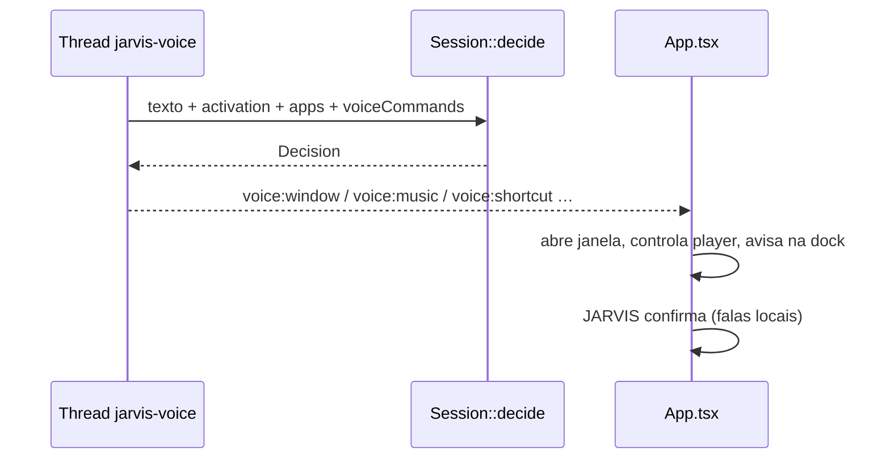

# Comandos de voz (matcher, catálogo e aba Voz)

Transforma a frase transcrita numa decisão (abrir uma janela, tocar música, um atalho do JARVIS ou uma pergunta) e deixa o usuário editar as frases em Menu avançado → Voz.

| | |
|---|---|
| **ID** | `feature/voice-commands` |
| **Status** | Implementado |
| **Origem** | `42e671a` (2026-10-23) · evoluída em `c4ccc57`, `048a254` e não commitado |
| **Voz** | `window:*` (17), `verbs:open`, `verbs:close`, `group:*` (3), `music:*` (7, incluindo `music:play` do tipo `playVerbs`), `pomodoro:*` (6), `shortcut:*` (18) e os do usuário `custom-*` |

## Visão geral

Os comandos de voz transformam a frase transcrita numa decisão: abrir ou fechar uma janela, fechar um grupo, controlar a música ou o Pomodoro, disparar um atalho do JARVIS ou, quando nada disso se aplica, mandar a frase como pergunta ao JARVIS. O catálogo de frases é um único arquivo (`voice-commands.json`), embutido no binário Rust e importado pela UI. O usuário pode trocar as frases de cada comando embutido e criar interações próprias em Menu avançado → Voz. Esta spec cobre o matcher, o catálogo, a sanitização e a aba Voz. O catálogo completo, frase por frase, está em [voice-intents](../../domain/voice-intents.md). Os atalhos estão em [voice-shortcuts](../voice-shortcuts/spec.md), e as palavras-chave dos programas externos em [app-launcher](../app-launcher/spec.md).

## Dados

- `$catálogo`: os 53 comandos embutidos de `src-tauri/voice-commands.json`, cada um `{ id, kind, target, label, phrases }`. Entra no Rust por `include_str!` e na UI por `import`.
- `$comandos`: a lista de **VoiceCommand** `{ id, kind, target, label, phrases, builtin }` em `Settings.voiceCommands`. Fica em `settings.json` (ou em `localStorage["jarvis.settings"]` fora do Tauri), gravada com debounce de 450 ms na UI. As migrações são `RETIRED_PHRASES` (`shortcut:agenda`) e `window:code` → `window:ide` (`OLD_CODE_PHRASES`). Ver [glossário](../../domain/glossary.md) e [persistência](../../domain/persistence.md).
- `$palavras_chave`: `Settings.apps[].keywords`, `string[]` com até 12 itens por programa. As `OLD_TERMINAL_KEYWORDS` passam ao jv_sh.
- `$sessão`: a **Session** do matcher: janela acordada + hora da última execução de cada decisão. Só em memória, no Rust.
- `$decisão`: a **Decision** que o matcher devolve: `Ignore`, `Wake`, `Launch`, `Window`, `CannotClose`, `CloseGroup`, `Music`, `Pomodoro`, `Shortcut`, `Ask`.

## Componentes

### Normalização e nome (`normalize`, `find_wake`)

Prepara a frase do Whisper e acha o nome do JARVIS nela.

- **Comportamento:**
  - **RF-001**: O matcher DEVE normalizar a frase (minúsculas, sem acentos, pontuação vira espaço).
  - **RF-002**: DEVE reconhecer o nome "jarvis" com 1 edição e os apelidos `jarbas`, `jarvas`, `djarvis`, `jarviz`, `javis`, `javiz`, `jarves`, inclusive grudados em "hey".
  - **RF-005**: Palavras de 5 letras ou mais DEVEM aceitar 1 edição de Levenshtein. Frases de música e Pomodoro exigem as palavras exatas.
    - A distância é própria (`similar`), sem dependência externa.
  - Se o nome do JARVIS fizer parte do nome da janela ("Jarvis Code", "Jarvis Mark"), ele continua dentro do escopo.

### Decisão (`Session::decide`)

Recebe o texto, o modo de ativação, os programas e $comandos e devolve $decisão.

- **Comportamento:**
  - **RF-004**: A ordem de decisão DEVE ser: atalho sem endereçamento (`homecoming`) → atalho no início do pedido → ação de música/Pomodoro (se não houver verbo de abrir/fechar com alvo) → alvo (janela, grupo ou programa) → pergunta → `Wake`/`Ignore`.
    - O passo a passo está em [Algoritmo de decisão (resumo)](#algoritmo-de-decisão-resumo).
  - **RF-003**: No modo `wakeWord`, o nome sozinho DEVE abrir uma janela acordada de 8 s. Qualquer decisão a fecha.
  - `match_target` procura janela, depois grupo, depois programa. Vence a palavra-chave mais longa e, depois, a que vem antes. Num empate exato, a janela do JARVIS vence o programa.
  - `wants_close` usa o verbo mais próximo antes da palavra-chave: em "fecha o pomodoro e abre o relógio", vale "fecha".
  - Uma palavra de janela sozinha ("bateria") abre a janela. Um grupo só vale com verbo de fechar.
  - `match_action` exige a frase exata e prefere a mais longa: "pausa o pomodoro" é Pomodoro, não música. Um verbo de tocar seguido de um nome vira `Music { action: "play", target }` (`named_after`, `PLAY_FILLER`).
  - **RF-006**: Uma frase endereçada com 2 palavras ou mais, que não seja alucinação conhecida do Whisper, DEVE virar `Ask` com o texto inteiro.
    - As alucinações ficam em `HALLUCINATIONS` ("Obrigado.", "Legendas pela comunidade Amara.org"…) e viram `Ignore`.
    - Uma palavra-chave sem verbo numa frase de 4 palavras ou mais (`QUESTION_WITH_KEYWORD`) é pergunta.
    - No modo `always`, sem o nome do JARVIS, atalhos e perguntas são ignorados.
  - Se a mesma decisão se repetir em menos de 4 s, ignore-a (`fire`). Abrir logo depois de fechar não conta como repetição.
  - Se o pedido for fechar um programa externo, decida `CannotClose` ("Fechar programas pela voz ainda não é possível").
  - Se uma frase de atalho que exige texto for dita sozinha ("pesquisa"), ela não é atalho.

### Vocabulário do Whisper (`command_vocabulary`)

As palavras que o motor põe no prompt do Whisper ([voice-engine](../voice-engine/spec.md)).

- **Comportamento:**
  - **RF-011**: O prompt do Whisper DEVE incluir as palavras-chave dos programas, as duas primeiras frases de cada janela, a primeira de cada comando de música/Pomodoro/grupo e os nomes das estações, sem repetir.
    - Os nomes das estações vêm de `STATION_NAMES`.

### Sanitização (`sanitize_voice_commands`)

Mescla $catálogo com o que o usuário salvou, sempre que as settings são lidas ou gravadas.

- **Comportamento:**
  - **RF-007**: Comandos embutidos DEVEM manter `kind`, `target` e `label` do catálogo. Só as frases mudam.
  - **RF-008**: Comandos do usuário DEVEM ter id `custom-*`, uma ação válida e no máximo 100 por usuário.
    - `valid_custom` confere a ação. Ids e labels têm até 60 caracteres; o `target` de um comando do usuário, até 40.
  - **RF-009**: Frases DEVEM ser aparadas, sem duplicatas (ignorando maiúsculas), com no máximo 30 por comando e 60 caracteres cada.
  - **RF-010**: Um embutido cujas frases salvas são exatamente uma lista de `RETIRED_PHRASES` DEVE receber as frases atuais.
  - Se um comando embutido ficar sem frases, ele fica desligado, mas não é apagado.
  - Se um comando embutido for apagado do `settings.json`, ele volta na próxima carga, na posição do catálogo.
  - Fora do Tauri, `withBuiltinCommands` faz a mesma mescla, de forma mais simples (ver [Fora de escopo e limitações](#fora-de-escopo-e-limitações)).

### Execução na UI (`App.tsx`)

Os handlers que recebem os eventos `voice:*` e fazem a ação no desktop.

- **Comportamento:**
  - `onWindowCommand` abre ou fecha a janela, pulsa o holograma, avisa na dock do grupo da janela ("Abrindo <título>", "Fechando <título>") e confirma com uma fala curta.
    - Se o pedido for fechar uma janela que não está aberta, a dock diz "<título> não está aberto" e o JARVIS diz uma fala `notOpen` ("Receio que <título> não esteja na tela…").
  - `onCloseGroup` fecha `widgets`, `apps` ou `all`. Sem nada aberto, avise "Nenhum widget aberto" (ou app, ou "Nenhuma janela aberta") e diga `nothingOpen`.
  - `onMusic` controla o player ([jv_t4p3](../../apps/jv_t4p3/spec.md)) e `onPomodoro` o [pomodoro](../../widgets/pomodoro/spec.md); os dois avisam na dock e confirmam por fala.
  - `onCommand` avisa na dock "Abrindo <programa>" ou o erro (como o de `CannotClose`) e confirma com a fala `launch`, `cannotClose` ou `launchFailed`.
  - `voice:shortcut` vai para o `shortcutHandler` ([voice-shortcuts](../voice-shortcuts/spec.md)), inclusive o `Ask`.
  - Fora do Tauri não há matcher. Os testes usam `window.__JARVIS__.voiceWindow`, `voiceCloseGroup`, `voiceMusic`, `voicePomodoro` e `voiceShortcut` no lugar dos eventos.

### `VoiceTab` (Menu avançado → Voz)

Tudo o que a voz entende, num só lugar: as frases dos embutidos, as palavras-chave dos programas e as interações do usuário.

- **Comportamento:**
  - A seção "Como falar" explica o modo atual ("Segurar para falar: segure Voice (ou M) e diga a frase.", "Hey Jarvis: comece com “Jarvis” (“Jarvis, próxima música”).", "Sempre ouvindo: basta dizer a frase.") e diz que acentos e maiúsculas não importam e que as mudanças valem na próxima frase.
  - As seções dos embutidos são, nesta ordem: "Janelas", "Verbos", "Fechar em grupo", "Música · jv_T4p3", "Pomodoro" e "JARVIS". Cada uma tem uma dica e uma linha por comando, com as frases como chips.
    - Quando o usuário clicar no × de um chip, a frase sai. Quando digitar e apertar Enter (ou vírgula), a frase entra, se ainda não existir.
    - Um comando sem frases mostra o placeholder "Sem frases: desligado".
    - "Restaurar <comando>" volta as frases ao padrão do catálogo e fica desabilitado enquanto não houver mudança.
  - A seção "Programas" mostra $palavras_chave de cada programa, com os mesmos chips das Configurações.
  - A seção "Suas interações" lista os comandos `custom-*`.
    - "Nova interação" cria um comando com a ação de retomar a música e sem frases. O id vem de `createVoiceCommandId`.
    - Cada interação tem um nome (placeholder "Interação N"), a ação num `select` agrupado ("Abrir ou fechar", "Fechar em grupo", "Música", "Pomodoro", "JARVIS") e as frases (placeholder "O que você vai dizer (Enter para adicionar)").
    - Se a ação for "Tocar uma playlist…", um segundo `select` escolhe a playlist, e a interação é gravada com `kind: "playlist"`. Uma ação de playlist sempre nomeia uma, porque o backend descarta a que não nomeia.
    - A lixeira "Remover <nome>" apaga a interação.
- **Layout:**
  - Uma `Section` por grupo, com o título, a dica e as linhas.
  - Cada linha (`Row`) é uma grade `130px | 1fr | auto`: o rótulo, o `ChipInput` e o botão de restaurar (ou um espaço vazio de `w-7`, nos programas).
  - Cada interação é um cartão com três linhas: nome e lixeira; o `select` da ação (e o da playlist, ao lado); e os chips das frases.
  - O botão "Nova interação" ocupa a largura toda, no fim da seção.
- **Estilo:**
  - Títulos das seções em 10 px, maiúsculas, `tracking-[0.28em] text-hud-cyan/80`. Dicas em `text-xs text-hud-text/50` (a de "Como falar" em `/60`).
  - Rótulo da linha em `text-xs text-hud-text/80`.
  - Chips `rounded-md border border-hud-cyan/25 bg-hud-cyan/[0.08] text-xs text-hud-light/90`, com o × em `text-hud-text/50`. O campo usa `hud-input`, com placeholder em `text-hud-text/35`.
  - Restaurar e lixeira são `IconButton` (`size-7`, `text-hud-text/55`); o restaurar desabilitado fica com opacidade 30%.
  - Cartão da interação `rounded-xl border border-hud-cyan/12 bg-white/[0.02] p-3`.
  - "Nova interação" tem borda tracejada `border-hud-cyan/25` e `text-xs text-hud-text/70`, que acende em `hud-light` no hover.

## Voz e teclado

- `Ctrl+Shift+,` → aba "Voz": abre Menu avançado → Voz.
- `/` "comandos de voz": a busca leva a "Menu avançado › Voz".
- As frases de [voice-intents](../../domain/voice-intents.md) disparam as decisões acima.
- Nos chips: `Enter` ou `,` acrescenta a frase digitada; `Backspace` com o campo vazio tira a última.

## Restrições

- **RNF-001**: Mudanças na aba Voz valem na frase seguinte, sem reiniciar o motor (o matcher lê as settings a cada frase).
- **RNF-002**: O catálogo é uma fonte única: `include_str!` no Rust e `import` no TypeScript.
- Janela acordada de 8 s; repetição de 4 s; ≤ 30 frases × 60 caracteres; ≤ 100 comandos custom; ids e labels ≤ 60; target custom ≤ 40.

## Histórias de usuário

### US1 — Abrir e fechar janelas pela voz (P1)

Como usuário, digo "abre o relógio" ou "fecha a calculadora" e a janela abre ou fecha.

**Por que P1:** é o comando mais usado e o que mostra que a voz funciona.
**Teste independente:** Rust `opens_and_closes_jarvis_windows`; Playwright `tests/desktop.spec.ts` — "voice commands open and close windows (engine event stand-in)".

**Aceite**

1. **Dado** o push-to-talk, **quando** digo "abre o relógio", **então** o matcher decide `Window { kind: "clock", open: true }`.
2. **Dado** "fecha o pomodoro e abre o relógio", **quando** o matcher decide, **então** vale o verbo mais próximo antes da palavra-chave (fecha o pomodoro).
3. **Dado** só a palavra ("bateria"), **quando** falo, **então** a janela abre.
4. **Dado** "fecha o relógio" com ele fechado, **quando** a UI recebe, **então** o JARVIS diz que o Relógio não está na tela.

### US2 — Fechar grupos, música e Pomodoro (P1)

Como usuário, digo "fecha tudo", "próxima música" ou "pula a fase".

**Por que P1:** controla o desktop sem tirar a mão do que está fazendo.
**Teste independente:** Rust `closes_every_widget_every_app_or_everything`, `controls_the_music`, `controls_the_pomodoro`; Playwright `tests/desktop.spec.ts` — "voice closes every widget, every app or everything (engine event stand-in)", `tests/voicetab.spec.ts` — "the Pomodoro answers to voice (engine event stand-in)".

**Aceite**

1. **Dado** "fecha todos os widgets", **quando** decidido, **então** `CloseGroup { group: "widgets" }`. Um grupo sem verbo de fechar ("abre os widgets") não é comando.
2. **Dado** "toca a Flash FM", **quando** decidido, **então** `Music { action: "play", target: "flash fm" }`.
3. **Dado** "pausa o pomodoro", **quando** decidido, **então** ganha a frase mais longa: é o Pomodoro, não a música.

### US3 — O que não é comando vai para o JARVIS (P1)

Como usuário, faço uma pergunta qualquer e ela chega ao JARVIS.

**Por que P1:** a voz nunca "engole" uma frase; ou age, ou pergunta.
**Teste independente:** Rust `what_is_no_command_goes_to_jarvis`, `questions_are_not_asked_twice`.

**Aceite**

1. **Dado** "como está a bateria do notebook?", **quando** decidido, **então** é `Ask`: uma palavra-chave sem verbo numa frase de 4 palavras ou mais é pergunta.
2. **Dado** "Obrigado." ou "Legendas pela comunidade Amara.org", **quando** decidido, **então** é `Ignore`.
3. **Dado** o modo `always`, **quando** a frase não tem o nome do JARVIS, **então** atalhos e perguntas são ignorados.

### US4 — Editar frases e criar interações (P2)

Como usuário, troco as frases de um comando e crio "hora de treinar" → tocar minha playlist.

**Por que P2:** adapta a voz ao jeito de falar de cada um.
**Teste independente:** `tests/voicetab.spec.ts` — "the Voz tab gathers every voice interaction, and its phrases can be edited and restored" e "new interactions pick any action, are kept and can be removed".

**Aceite**

1. **Dado** a aba Voz, **quando** abro, **então** vejo as seções Como falar, Janelas, Verbos, Fechar em grupo, Música · jv_T4p3, Pomodoro, JARVIS, Programas e Suas interações.
2. **Dado** uma frase removida (×) ou adicionada (Enter), **quando** salvo, **então** a mudança vale na próxima frase. "Restaurar <comando>" volta ao padrão e fica desabilitado sem mudança.
3. **Dado** "Nova interação", **quando** escolho a ação "Tocar uma playlist…" e uma playlist, **então** a interação é gravada com `kind: "playlist"` e sobrevive a um reload.

## Critérios de sucesso

- **SC-001**: Todas as frases de exemplo dos testes do matcher decidem o esperado nos três modos.
- **SC-002**: Um usuário que nunca editou um comando recebe as frases novas de uma versão nova (via `RETIRED_PHRASES`).

## Fora de escopo e limitações

- Fechar programas externos pela voz.
- A transcrição em si: ver [voice-engine](../voice-engine/spec.md).
- O que cada atalho faz: ver [voice-shortcuts](../voice-shortcuts/spec.md).
- O gêmeo de navegador (`withBuiltinCommands`) é mais simples que o Rust: não aplica limites, `RETIRED_PHRASES` nem validação de ação.

## Código

Um matcher determinístico em Rust (`Session::decide`) recebe o texto do Whisper, o modo de ativação, os programas e os comandos de voz das settings e devolve uma `Decision`. A thread do motor emite essa decisão como evento `voice:*`, e a UI executa (janelas, player, Pomodoro, JARVIS). O catálogo `voice-commands.json` é a fonte única dos comandos embutidos. `sanitize_voice_commands` mescla o catálogo com o que o usuário salvou, preservando a ação dos embutidos.

| | |
|---|---|
| **Camadas** | `VoiceTab` · `useSettings` · `src/lib/settings.ts` · `App.tsx` (handlers) · `voice/matcher.rs` · `settings.rs` · `voice-commands.json` |
| **Dependências** | nenhuma externa: normalização, tokens e Levenshtein próprios |
| **Testes** | `tests/voicetab.spec.ts`, `tests/desktop.spec.ts`, `tests/personality.spec.ts`; Rust `mod tests` em `matcher.rs` e `settings.rs`; `speech_window_commands` (ignorado) em `voice/mod.rs` |
| **Plataforma** | Windows 11 · WebView2. Fora do Tauri não há matcher: o probe `window.__JARVIS__` emite os eventos no lugar do motor |

### Arquivos

| Arquivo | Papel |
|---|---|
| `src-tauri/voice-commands.json` | 53 comandos embutidos `{ id, kind, target, label, phrases }` |
| `src-tauri/src/voice/matcher.rs` | `normalize`, `tokenize`, `find_wake`, `match_shortcut`, `match_action`, `match_target`, `wants_close`, `Session::decide`, `command_vocabulary` |
| `src-tauri/src/settings.rs` | `VoiceCommand`, `default_voice_commands`, `valid_custom`, `sanitize_voice_commands`, `RETIRED_PHRASES`, `SHORTCUT_TARGETS` |
| `src-tauri/src/voice/mod.rs` | `handle_utterance`: decisão → evento; `CANNOT_CLOSE` |
| `src/lib/settings.ts` | `DEFAULT_VOICE_COMMANDS`, `withBuiltinCommands`, `createVoiceCommandId` |
| `src/components/desktop/VoiceTab.tsx` | Menu avançado → Voz |
| `src/hooks/useVoiceAssistant.ts` | tipos dos eventos (`WindowCommandEvent`, `MusicAction`, `PomodoroAction`…) |
| `src/App.tsx` | `onWindowCommand`, `onCloseGroup`, `onMusic`, `onPomodoro`, `onCommand`, `shortcutHandler` |

### Contratos

#### Comandos Tauri

| Comando | Entrada | Saída | Notas |
|---|---|---|---|
| `save_settings` | `{ settings }` | `Settings` sanitizadas | Edição da aba Voz |
| `get_settings` | — | `Settings` | Carga inicial |

#### Eventos e Channels

| Nome | Payload | Emissor → consumidor |
|---|---|---|
| `voice:command` | `{ appId, name, error }` | `Launch`/`CannotClose` → aviso da dock + fala |
| `voice:window` | `{ kind, open }` | `Window` → `onWindowCommand` |
| `voice:windows` | `{ group }` (`widgets`/`apps`/`all`) | `CloseGroup` → `onCloseGroup` |
| `voice:music` | `{ action, target }` | `Music` → player ([jv_t4p3](../../apps/jv_t4p3/spec.md)) |
| `voice:pomodoro` | `{ action }` | `Pomodoro` → [pomodoro](../../widgets/pomodoro/spec.md) |
| `voice:shortcut` | `{ action, text, said }` | `Shortcut`/`Ask` → [voice-shortcuts](../voice-shortcuts/spec.md) |

### Algoritmo de decisão (resumo)

1. `tokenize` e `find_wake`.
2. Atalho `UNADDRESSED` (`homecoming`) no início da frase → `Shortcut`, em qualquer modo.
3. Escopo por modo: `always`/`pushToTalk` usam a frase toda. `wakeWord` usa a partir do nome, ou a frase toda se acordado, ou devolve `Ignore`.
4. `addressed` (não é `always`, ou o nome foi dito). Atalho no começo ou depois do nome e de palavras de preenchimento (`LEAD_FILLER`) → `Shortcut`.
5. Alvo (`match_target`); grupos só com verbo de fechar. Sem alvo+verbo, tenta ação de música/Pomodoro ou verbo de tocar no início do pedido.
6. Sem alvo: pergunta → `Ask`; senão `Wake` (modo `wakeWord` com nome) ou `Ignore`.
7. Alvo numa pergunta de 4 palavras ou mais sem verbo → `Ask`. Senão `Window`/`CloseGroup`/`Launch`/`CannotClose`.
8. `fire` ignora a mesma chave em menos de 4 s.

### Fluxo

### Constituição

- [x] P1 Offline-first — decisão local, sem rede.
- [x] P3 Comandos finos — a edição usa `save_settings`; a decisão vive em `matcher.rs`; eventos `voice:*`.
- [x] P4 Contratos espelhados — `VoiceCommand`/`VoiceCommandKind` com "Mirrors `VoiceCommand`"; `SHORTCUT_TARGETS` ↔ `ShortcutAction`; `WINDOW_KINDS` ↔ `WindowKind`.
- [x] P5 Persistência tolerante — `sanitize_voice_commands`, `RETIRED_PHRASES`, migração `window:code` → `window:ide` (`OLD_CODE_PHRASES`).
- [x] P6 Fora do Tauri — `withBuiltinCommands` (gêmeo do sanitizador) e probe `__JARVIS__`.
- [x] P7 PT-BR — frases, rótulos e dicas da aba em PT-BR.
- [x] P10 Confinamento — a voz só lança programas cadastrados (`Launch`) e nunca fecha programas externos (`CannotClose`).
- [x] P11 Testes — matcher coberto por testes Rust; aba Voz e handlers por Playwright.

### Decisões relacionadas

- [ADR-0004 — catálogo de voz compartilhado + fallback + RETIRED_PHRASES](../../arch/adr/0004-catalogo-de-voz-compartilhado-e-fallback.md)
- [ADR-0009 — tipos espelhados](../../arch/adr/0009-tipos-espelhados-ts-rust.md)
- [ADR-0010 — settings.json vs localStorage](../../arch/adr/0010-persistencia-settings-vs-localstorage.md)

## Tarefas

Legenda: `[x]` feito · `[ ]` pendente · `[P]` pode rodar em paralelo (arquivos diferentes) · `[USn]` história desta spec. As tarefas foram reconstruídas do código e do commit de origem.

### Fase 1 — Base

- [x] T001 [P] Catálogo de comandos embutidos (53 entradas) — `src-tauri/voice-commands.json`
- [x] T002 [P] `VoiceCommand`, `default_voice_commands` (`include_str!`), `valid_custom`, limites — `src-tauri/src/settings.rs`
- [x] T003 [P] Tipos espelhados, `DEFAULT_VOICE_COMMANDS`, `withBuiltinCommands`, `createVoiceCommandId` — `src/lib/settings.ts`
- [x] T004 `normalize`, `tokenize`, Levenshtein (`similar`), `find_wake` com apelidos — `src-tauri/src/voice/matcher.rs`

### Fase 2 — US1 Janelas (P1)

- [x] T005 [US1] `match_target` (janela > grupo > programa; mais longa, depois mais cedo) e `wants_close` — `src-tauri/src/voice/matcher.rs`
- [x] T006 [US1] `Session` com janela acordada de 8 s e repetição de 4 s (`fire`) — `src-tauri/src/voice/matcher.rs`
- [x] T007 [US1] `handle_utterance` → `voice:window`, `voice:command` (`CANNOT_CLOSE`) — `src-tauri/src/voice/mod.rs`
- [x] T008 [US1] `onWindowCommand` e `onCommand` com aviso da dock e confirmação falada — `src/App.tsx`

### Fase 3 — US2 Grupos, música e Pomodoro (P1)

- [x] T009 [US2] `match_action` (frase exata, mais longa) e verbo de tocar + nome da playlist (`named_after`, `PLAY_FILLER`) — `src-tauri/src/voice/matcher.rs`
- [x] T010 [US2] `onCloseGroup`, `onMusic`, `onPomodoro` — `src/App.tsx`
- [x] T011 [US2] `command_vocabulary` com nomes das estações (`STATION_NAMES`) para o prompt do Whisper — `src-tauri/src/voice/matcher.rs`

### Fase 4 — US3 Fallback para o JARVIS (P1)

- [x] T012 [US3] `Ask` com ≥ 2 palavras, `HALLUCINATIONS`, `QUESTION_WITH_KEYWORD` = 4, `always` só com o nome — `src-tauri/src/voice/matcher.rs`
- [x] T013 [US3] `Ask` → `voice:shortcut` com `action: "ask"` — `src-tauri/src/voice/mod.rs`

### Fase 5 — US4 Aba Voz (P2)

- [x] T014 [US4] `sanitize_voice_commands`: ação dos embutidos fixa, embutidos ausentes voltam, `custom-*` válidos, frases únicas — `src-tauri/src/settings.rs`
- [x] T015 [US4] `RETIRED_PHRASES` para `shortcut:agenda` e migração `window:code` → `window:ide` — `src-tauri/src/settings.rs`
- [x] T016 [US4] Seções, chips de frases, "Restaurar", "Programas" e "Suas interações" com ação e playlist — `src/components/desktop/VoiceTab.tsx`

### Fase 6 — Testes

- [x] T017 Playwright `tests/voicetab.spec.ts` — "the Voz tab gathers every voice interaction, and its phrases can be edited and restored"
- [x] T018 Playwright `tests/voicetab.spec.ts` — "new interactions pick any action, are kept and can be removed"
- [x] T019 Playwright `tests/voicetab.spec.ts` — "the Pomodoro answers to voice (engine event stand-in)"
- [x] T020 Playwright `tests/desktop.spec.ts` — "voice commands open and close windows (engine event stand-in)"
- [x] T021 Playwright `tests/desktop.spec.ts` — "voice closes every widget, every app or everything (engine event stand-in)"
- [x] T022 Playwright `tests/personality.spec.ts` — "voice commands get a short spoken confirmation, under what was said, and the dock still says it"
- [x] T023 Rust `src-tauri/src/voice/matcher.rs` — `normalizes_accents_and_punctuation`, `detects_wake_word_variants`, `matches_keywords_tolerantly`, `longest_keyword_wins`
- [x] T024 Rust `src-tauri/src/voice/matcher.rs` — `wake_word_mode_requires_the_wake_word`, `wake_word_then_keyword_within_the_window`, `awake_window_expires`, `push_to_talk_needs_no_wake_word`, `always_mode_and_cooldown`
- [x] T025 Rust `src-tauri/src/voice/matcher.rs` — `opens_and_closes_jarvis_windows`, `programs_win_their_longer_keywords_and_are_never_closed`, `window_commands_follow_the_wake_word`, `app_names_that_start_with_the_wake_word`, `window_cooldown_only_stops_repeats`
- [x] T026 Rust `src-tauri/src/voice/matcher.rs` — `closes_every_widget_every_app_or_everything`, `group_words_do_not_swallow_the_wake_word`, `controls_the_music`, `plays_pauses_and_goes_back_in_few_words`, `controls_the_pomodoro`, `music_follows_the_wake_word_and_ignores_repeats`
- [x] T027 Rust `src-tauri/src/voice/matcher.rs` — `follows_the_commands_in_the_settings`, `what_is_no_command_goes_to_jarvis`, `questions_are_not_asked_twice`, `words_from_keeps_the_original_text`, `vocabulary_includes_windows`
- [x] T028 Rust `src-tauri/src/settings.rs` — `voice_commands_keep_their_actions_and_take_the_users`, `default_voice_commands_are_valid`, `untouched_builtin_phrases_follow_the_new_defaults`, `jarvis_code_moves_to_the_ide`, `the_terminal_program_hands_its_old_words_to_jv_sh`
- [x] T029 Rust ignorado `src-tauri/src/voice/mod.rs` — `speech_window_commands` (fixtures `window_open.wav` e `window_close.wav` em `src-tauri/tests/fixtures/`)

## Pendências

- [ ] `withBuiltinCommands` (`src/lib/settings.ts`), o gêmeo de navegador, não aplica `RETIRED_PHRASES`, os limites (30 × 60, 100 custom) nem `valid_custom`; no modo web um comando custom inválido é mantido.
- [ ] O Vite ignora `**/src-tauri/**` (`vite.config.ts`), então uma edição em `src-tauri/voice-commands.json` só chega à UI em dev depois de forçar o reload (por exemplo, `touch vite.config.ts`).
