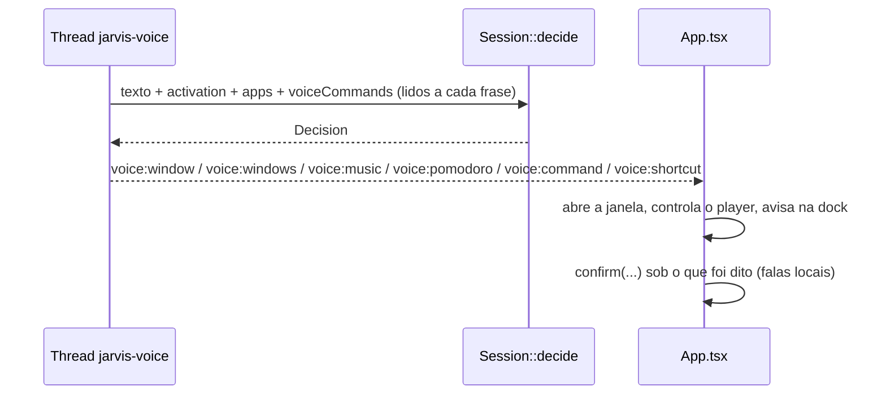

# Feature Specification: Voice Commands

## Metadata

| Field | Value |
|---|---|
| Feature ID | `feature/voice-commands` |
| Product | JARVIS OS (jvOS) |
| Feature Status | Implementado |
| Document Status | Reescrita em 2026-11-05 no formato Feature Specification; sem decisões em aberto |
| Source Commit | `42e671a` (2026-10-23); evoluída em `c4ccc57` (2026-10-26), `048a254` (2026-10-27) e `e7151cf` (2026-11-05) |
| Uncommitted Changes | Nenhuma |
| Voice Shortcut | `window:*` (17), `verbs:open`, `verbs:close`, `group:*` (3), `music:*` (7, incluindo `music:play` do tipo `playVerbs`), `pomodoro:*` (6) e os do usuário `custom-*`; os `shortcut:*` (18) são reconhecidos aqui e tratados em [voice-shortcuts](../voice-shortcuts/spec.md) |
| Assistant Tool | — |
| Target Platforms | Windows 11 com WebView2; no navegador (modo web) não há matcher: a aba Voz funciona e grava no `localStorage`, e os testes disparam os eventos pelo probe `window.__JARVIS__` |
| Language | PT-BR no conteúdo e nas falas; inglês nos títulos das seções e em Given / When / Then |
| Last Editorial Revision | 2026-11-05 |
| Verification Scope | Conferida com o código em 2026-11-05: `src-tauri/src/voice/matcher.rs`, `src-tauri/src/voice/mod.rs`, `src-tauri/src/settings.rs`, `src-tauri/voice-commands.json`, `src/lib/settings.ts`, `src/components/desktop/VoiceTab.tsx`, `src/components/desktop/AdvancedMenu.tsx`, `src/components/hud.tsx` (`ChipInput`), `src/hooks/useVoiceAssistant.ts`, `src/hooks/useSettings.ts`, `src/hooks/useWindowControls.ts`, `src/lib/commands.ts`, `src/lib/jarvisLines.ts`, `src/App.tsx`, `vite.config.ts`, `tests/voicetab.spec.ts`, `tests/desktop.spec.ts`, `tests/personality.spec.ts` e `tests/music.spec.ts`. Os testes não foram executados nesta revisão |

Especificação no formato inspirado no GitHub Spec Kit, com seções de desenho técnico ([ADR-0025](../../arch/adr/0025-features-formato-feature-specification.md)). Os identificadores US1–US4, RF-001–RF-011, RNF-001–RNF-002, SC-001–SC-002 e T001–T029 são os mesmos da versão anterior. Os critérios de aceite AC-001–AC-013 são os antigos "Critério 1" a "Critério 13", na mesma ordem. KL-* registra limitações conhecidas; OQ-*, decisões de produto em aberto. Nenhum dos dois acrescenta escopo.

## Overview

Os comandos de voz transformam a frase transcrita numa decisão: abrir ou fechar uma janela, fechar um grupo, controlar a música ou o Pomodoro, lançar um programa, disparar um atalho do JARVIS ou, quando nada disso se aplica, mandar a frase como pergunta ao JARVIS. O matcher é determinístico, em Rust, e roda sem rede.

O catálogo de frases é um único arquivo (`src-tauri/voice-commands.json`, 53 comandos), embutido no binário Rust e importado pela UI. O usuário troca as frases de cada comando embutido e cria interações próprias em Menu avançado → Voz. O catálogo completo, frase por frase, está em [voice-intents](../../domain/voice-intents.md). O que cada atalho faz está em [voice-shortcuts](../voice-shortcuts/spec.md); as palavras-chave dos programas, em [app-launcher](../app-launcher/spec.md).

| Input | Expected Behavior | Execution Path |
|---|---|---|
| "abre o relógio" | Abre o Relógio, dock "Abrindo Relógio", fala `openWindow` | `Session::decide` → `voice:window` → `onWindowCommand` |
| "fecha todos os widgets" | Fecha os widgets abertos, dock "Fechando N widgets" | `voice:windows` → `onCloseGroup` |
| "toca a Flash FM" | Toca a estação pelo nome | `voice:music` → `onMusic` ([jv_t4p3](../../apps/jv_t4p3/spec.md)) |
| "pausa o pomodoro" | Pausa o Pomodoro, não a música | `voice:pomodoro` → `onPomodoro` ([pomodoro](../../widgets/pomodoro/spec.md)) |
| "abre o vs code" | O Rust lança o programa cadastrado | `launcher::launch` → `voice:command` → `onCommand` |
| "fecha o vs code" | Não fecha: "Fechar programas pela voz ainda não é possível" | `voice:command` com `error` |
| "pesquisa sobre fusão nuclear" | Atalho `research` com o resto da frase | `voice:shortcut` ([voice-shortcuts](../voice-shortcuts/spec.md)) |
| "qual a capital da França?" | Pergunta ao JARVIS, o texto inteiro | `voice:shortcut { action: "ask" }` |

## Goals and Success Criteria

### Goals

- Abrir e fechar as janelas do JARVIS pela voz, com ou sem verbo.
- Controlar música e Pomodoro em poucas palavras.
- Nunca "engolir" uma frase dirigida ao JARVIS: ou age, ou pergunta.
- Deixar o usuário trocar as frases e criar as suas, sem reiniciar nada.
- Entregar ao usuário as frases novas de uma versão nova, se ele nunca editou as antigas.

### Success Criteria

| ID | Criterion | Verification |
|---|---|---|
| SC-001 | Todas as frases de exemplo dos testes do matcher decidem o esperado nos três modos. | `cargo test --lib matcher::tests` (`src-tauri`). |
| SC-002 | Um usuário que nunca editou um comando recebe as frases novas de uma versão nova (via `RETIRED_PHRASES`). | `untouched_builtin_phrases_follow_the_new_defaults` em `src-tauri/src/settings.rs`. |

## Scope and Non-Goals

### In Scope

- Normalização da frase, reconhecimento do nome "Jarvis" e tolerância a uma letra trocada.
- Ordem de decisão entre atalho, ação, alvo, pergunta e nome sozinho, nos três modos de ativação.
- Janela acordada de 8 s e proteção contra repetição de 4 s.
- Catálogo único, sanitização das frases salvas e migrações.
- O vocabulário que vai no prompt do Whisper.
- Os handlers da UI para janelas, grupos, música, Pomodoro e programas.
- A aba Voz do Menu avançado.

### Out of Scope

- Fechar programas externos pela voz (`CannotClose`).
- A transcrição em si: ver [voice-engine](../voice-engine/spec.md).
- O que cada atalho faz: ver [voice-shortcuts](../voice-shortcuts/spec.md).
- Comandos com parâmetros livres além do nome de uma playlist (o resto vai ao JARVIS como pergunta).

## User Stories

### US1 — Open and Close Windows by Voice

**Priority:** P1.

**User Story:** Como usuário, digo "abre o relógio" ou "fecha a calculadora" e a janela abre ou fecha.

**Why This Priority:** é o comando mais usado e o que mostra que a voz funciona.

**Independent Test:** Rust `opens_and_closes_jarvis_windows`; Playwright `tests/desktop.spec.ts` — "voice commands open and close windows (engine event stand-in)".

**Acceptance Criteria:** AC-001, AC-002, AC-003 e AC-004.

### US2 — Groups, Music and Pomodoro

**Priority:** P1.

**User Story:** Como usuário, digo "fecha tudo", "próxima música" ou "pula a fase".

**Why This Priority:** controla o desktop sem tirar a mão do que está fazendo.

**Independent Test:** Rust `closes_every_widget_every_app_or_everything`, `controls_the_music`, `controls_the_pomodoro`; Playwright `tests/desktop.spec.ts` — "voice closes every widget, every app or everything (engine event stand-in)" e `tests/voicetab.spec.ts` — "the Pomodoro answers to voice (engine event stand-in)".

**Acceptance Criteria:** AC-005, AC-006 e AC-007.

### US3 — Anything Else Goes to JARVIS

**Priority:** P1.

**User Story:** Como usuário, faço uma pergunta qualquer e ela chega ao JARVIS.

**Why This Priority:** a voz nunca "engole" uma frase; ou age, ou pergunta.

**Independent Test:** Rust `what_is_no_command_goes_to_jarvis`, `questions_are_not_asked_twice`.

**Acceptance Criteria:** AC-008, AC-009 e AC-010.

### US4 — Edit Phrases and Create Interactions

**Priority:** P2.

**User Story:** Como usuário, troco as frases de um comando e crio "hora de treinar" → tocar minha playlist.

**Why This Priority:** adapta a voz ao jeito de falar de cada um.

**Independent Test:** `tests/voicetab.spec.ts` — "the Voz tab gathers every voice interaction, and its phrases can be edited and restored" e "new interactions pick any action, are kept and can be removed".

**Acceptance Criteria:** AC-011, AC-012 e AC-013.

## Requirements

### Functional Requirements

| ID | Requirement | Related Stories |
|---|---|---|
| RF-001 | O matcher DEVE normalizar a frase: minúsculas, sem acentos, pontuação vira espaço. | US1, US2, US3 |
| RF-002 | O matcher DEVE reconhecer o nome "jarvis" com 1 edição e os apelidos `jarbas`, `jarvas`, `djarvis`, `jarviz`, `javis`, `javiz`, `jarves`, inclusive grudados em "hey" ("heyjarvis", "redjarvis"). | US1, US3 |
| RF-003 | No modo `wakeWord`, o nome sozinho DEVE abrir uma janela acordada de 8 s. Qualquer decisão disparada (comando, atalho ou pergunta) a fecha. | US1, US3 |
| RF-004 | A ordem de decisão DEVE ser: atalho sem endereçamento (`homecoming`) → atalho no início do pedido → ação de música, Pomodoro ou playlist (se não houver alvo com verbo de abrir ou fechar) → alvo (janela, grupo ou programa) → pergunta → `Wake`/`Ignore`. | US1, US2, US3 |
| RF-005 | Palavras de 5 letras ou mais DEVEM aceitar 1 edição de Levenshtein nas palavras-chave de janelas, grupos e programas. Frases de música, Pomodoro, playlist e atalhos exigem as palavras exatas. | US1, US2 |
| RF-006 | Uma frase endereçada com 2 palavras ou mais depois do nome, que não seja alucinação conhecida do Whisper, DEVE virar `Ask` com o texto inteiro. | US3 |
| RF-007 | Comandos embutidos DEVEM manter `kind`, `target` e `label` do catálogo. Só as frases mudam. | US4 |
| RF-008 | Comandos do usuário DEVEM ter id `custom-*`, uma ação válida (`valid_custom`) e no máximo 100 por usuário. | US4 |
| RF-009 | Frases DEVEM ser aparadas, sem duplicatas (ignorando maiúsculas), com no máximo 30 por comando e 60 caracteres cada. | US4 |
| RF-010 | Um embutido cujas frases salvas são exatamente uma lista de `RETIRED_PHRASES` DEVE receber as frases atuais. | US4 |
| RF-011 | O prompt do Whisper DEVE incluir as palavras-chave dos programas, as duas primeiras frases de cada janela, a primeira de cada comando de grupo, música, Pomodoro ou playlist e os nomes das estações, sem repetir. | US1, US2 |

### Non-Functional Requirements

| ID | Requirement | Scope |
|---|---|---|
| RNF-001 | Mudanças na aba Voz valem na frase seguinte, sem reiniciar o motor: o matcher lê as settings a cada frase. | Depois do salvamento (debounce de 450 ms). |
| RNF-002 | O catálogo é uma fonte única: `include_str!` no Rust e `import` no TypeScript. | `src-tauri/voice-commands.json`. |

### Operational Constraints

- Janela acordada: 8 s (`AWAKE_WINDOW`).
- Repetição ignorada: a mesma decisão em menos de 4 s (`RELAUNCH_COOLDOWN`).
- Frases: até 30 por comando, 60 caracteres cada.
- Comandos do usuário: até 100; ids e labels até 60 caracteres; `target` até 40.
- Palavras-chave de um programa: até 12.
- Pergunta: 2 palavras ou mais depois do nome (`MIN_QUESTION_WORDS`).
- Palavra-chave sem verbo numa frase de 4 palavras ou mais vira pergunta (`QUESTION_WITH_KEYWORD`).
- Levenshtein de 1 só entre palavras com 5 letras ou mais; uma palavra-chave composta também vale escrita junta, em até 3 palavras ("vscode").
- Settings salvas com debounce de 450 ms.

## Acceptance Criteria

### AC-001 — Open a Window

**Related Story:** US1.

- **Given** o push-to-talk
- **When** digo "abre o relógio"
- **Then** o matcher decide `Window { kind: "clock", open: true }`.

### AC-002 — Closest Verb Wins

**Related Story:** US1.

- **Given** "fecha o pomodoro e abre o relógio"
- **When** o matcher decide
- **Then** vale o verbo mais próximo antes da palavra-chave: `Window { kind: "pomodoro", open: false }`.

### AC-003 — Keyword Alone Opens

**Related Story:** US1.

- **Given** só a palavra ("bateria")
- **When** falo
- **Then** a janela abre (`Window { kind: "battery", open: true }`).

### AC-004 — Closing a Window That Is Not Open

**Related Story:** US1.

- **Given** "fecha o relógio" com ele fechado
- **When** a UI recebe `voice:window { kind: "clock", open: false }`
- **Then** a dock diz "Relógio não está aberto" e o JARVIS diz uma fala `notOpen` ("Receio que Relógio não esteja na tela…").

### AC-005 — Close a Group

**Related Story:** US2.

- **Given** "fecha todos os widgets"
- **When** o matcher decide
- **Then** a decisão é `CloseGroup { group: "widgets" }`. Um grupo sem verbo de fechar ("abre os widgets") não fecha nada: vira pergunta ao JARVIS.

### AC-006 — Play a Station by Name

**Related Story:** US2.

- **Given** "toca a Flash FM"
- **When** o matcher decide
- **Then** a decisão é `Music { action: "play", target: "flash fm" }`.

### AC-007 — Longest Phrase Wins

**Related Story:** US2.

- **Given** "pausa o pomodoro"
- **When** o matcher decide
- **Then** ganha a frase mais longa: é `Pomodoro { action: "pause" }`, não a música.

### AC-008 — Keyword Inside a Question

**Related Story:** US3.

- **Given** "como está a bateria do notebook?"
- **When** o matcher decide
- **Then** é `Ask`: uma palavra-chave sem verbo numa frase de 4 palavras ou mais é pergunta.

### AC-009 — Noise Is Ignored

**Related Story:** US3.

- **Given** "Obrigado." ou "Legendas pela comunidade Amara.org"
- **When** o matcher decide
- **Then** é `Ignore`: a primeira tem uma palavra só (menos de 2); a segunda é uma alucinação conhecida do Whisper (`HALLUCINATIONS`).

### AC-010 — Always Listening Needs the Name

**Related Story:** US3.

- **Given** o modo `always`
- **When** a frase não tem o nome do JARVIS
- **Then** atalhos e perguntas são ignorados (comandos de janela, música e programa continuam valendo).

### AC-011 — Voz Tab Sections

**Related Story:** US4.

- **Given** a aba Voz
- **When** abro
- **Then** vejo as seções Como falar, Janelas, Verbos, Fechar em grupo, Música · jv_T4p3, Pomodoro, JARVIS, Programas e Suas interações.

### AC-012 — Edit and Restore Phrases

**Related Story:** US4.

- **Given** uma frase removida (×) ou adicionada (Enter)
- **When** a mudança é salva
- **Then** ela vale na próxima frase. "Restaurar <comando>" volta ao padrão e fica desabilitado sem mudança.

### AC-013 — New Interaction with a Playlist

**Related Story:** US4.

- **Given** "Nova interação"
- **When** escolho a ação "Tocar uma playlist…" e uma playlist
- **Then** a interação é gravada com `kind: "playlist"` e o nome da playlist em `target`, e sobrevive a um reload.

## Behavior and Flows

### Normalization and Wake Word (`normalize`, `find_wake`)

- `normalize` faz RF-001; `tokenize` separa as palavras.
- `find_wake` acha o nome em qualquer palavra (RF-002): um pedaço de 5 a 7 letras que seja "jarvis" com 1 edição, ou um dos apelidos. "java", "javascript" e "jardins" não contam.
- A distância é própria (`levenshtein`, `similar`), sem dependência externa.
- No modo `wakeWord`, o escopo do pedido começa no próprio nome, que fica dentro dele: "Jarvis Code" (jv_ide) e "Jarvis Mark" continuam sendo nomes de janelas.

### Decision Order (`Session::decide`)

1. `tokenize` e `find_wake`.
2. Atalho `UNADDRESSED` (`homecoming`) logo no início da frase → `Shortcut`, em qualquer modo.
3. Escopo por modo: `always` e `pushToTalk` usam a frase toda. `wakeWord` usa a partir do nome, ou a frase toda se acordado; sem nome e dormindo, `Ignore`.
4. `addressed` é verdadeiro fora do `always`, ou quando o nome foi dito. Endereçada, um atalho no começo da frase ou depois do nome e de palavras de preenchimento (`LEAD_FILLER`: "por", "favor", "agora", "então", "ok", "okay", "oi", "olá", "e") → `Shortcut` ([voice-shortcuts](../voice-shortcuts/spec.md)).
5. Alvo (`match_target`): um grupo só vale com verbo de fechar. Se não houver alvo dito com verbo de abrir ou fechar, tenta uma ação (`match_action`) ou um verbo de tocar no início do pedido.
6. Sem alvo: pergunta → `Ask`; senão `Wake` (modo `wakeWord` com o nome) ou `Ignore`.
7. Alvo numa pergunta de 4 palavras ou mais, sem verbo de abrir ou fechar → `Ask`. Senão `Window`, `CloseGroup`, `Launch` ou `CannotClose`.
8. `fire` ignora a mesma chave em menos de 4 s.

### Target Matching (`match_target`, `wants_close`)

- Procura janelas, grupos e programas. Vence a palavra-chave mais longa (em letras) e, depois, a que vem antes. Num empate exato, a janela do JARVIS vence o programa.
- Uma palavra de janela sozinha ("bateria") abre a janela.
- `wants_close` usa o verbo mais próximo antes da palavra-chave; sem verbo antes, o primeiro depois dela ("o código, pode fechar"). Sem verbo nenhum, abre.
- Os verbos são os do catálogo (`verbs:open`, `verbs:close`) mais os que o usuário acrescentou.
- Programa com verbo de fechar → `CannotClose` ("Fechar programas pela voz ainda não é possível"), sem passar pela proteção de repetição.
- "terminal" é o jv_sh (`window:shell`); o Windows Terminal só responde a "windows terminal".

### Actions (`match_action`, play verbs)

- `match_action` procura em qualquer ponto do escopo uma frase exata de música, Pomodoro ou playlist do usuário; vence a mais longa, depois a mais cedo. "pausa o pomodoro" é Pomodoro; "volta a tocar" é `resume`, não `previous`.
- "muda a playlist para a V-Rock" vai direto à playlist nomeada (`play`, "v rock").
- Sem frase de ação, um verbo de tocar (`playVerbs`: "toca", "coloca", "bota"…) na primeira palavra ou no início do pedido vira `Music { action: "play", target }`, com o nome sem as palavras de preenchimento (`PLAY_FILLER`). Sem nome, `target` é nulo e a música retoma. Em "qual música está tocando?", o verbo não abre o pedido, e a frase vira pergunta.
- Uma interação `playlist` do usuário vira `Music { action: "play", target: <nome salvo> }`.

### Questions and Noise

- Pergunta (RF-006): endereçada, com 2 palavras ou mais depois do nome e das palavras de preenchimento, e sem alucinação.
- `HALLUCINATIONS` ("amara org", "inscreva se", "legendas pela", "obrigado por assistir") são o que o Whisper escreve sobre ruído; uma frase que as contém nunca vira pergunta.
- `Ask` leva a transcrição inteira, aparada; a mesma pergunta duas vezes em 4 s é uma só.

### Repeat Guard and Awake Window (`Session`)

- `Session` guarda `awake_until` e a hora da última execução de cada chave de decisão. Só em memória, no Rust; zerada quando o modo de ativação muda.
- Chaves: `window:<kind>:<fecha>`, `group:<grupo>`, o id do programa, `music:<ação>`, `music:play:<nome>`, `pomodoro:<ação>`, `shortcut:<ação>:<resto>` (sem resto para `homecoming`) e `ask:<palavras>`.
- Abrir uma janela logo depois de fechá-la (ou o contrário) não é repetição: `fire` apaga a chave oposta.
- O nome sozinho no `wakeWord` abre a janela acordada de 8 s; qualquer decisão disparada, e o `CannotClose`, a fecham. Quando ela expira, o motor volta a `standby`.

### Whisper Vocabulary (`command_vocabulary`)

- RF-011, nesta ordem: as palavras-chave dos programas, as duas primeiras frases de cada janela (embutida ou do usuário), a primeira de cada comando de grupo, música, Pomodoro ou playlist e os nomes das estações (`STATION_NAMES`: Flash FM, Wave 103, V-Rock, Fever 105, Emotion 98.3, Radio Espantoso, Wildstyle).
- Os atalhos ficam de fora: são palavras comuns que o Whisper acerta, e o prompt guarda espaço para os nomes.
- Sem repetição (comparação normalizada). O motor monta "Hey Jarvis. <vocabulário>." ([voice-engine](../voice-engine/spec.md)).

### Sanitization (`sanitize_voice_commands`)

Mescla o catálogo com o que o usuário salvou, sempre que as settings são lidas ou gravadas (`sanitize`).

- Ids são aparados e cortados em 60 caracteres; um id vazio ou repetido é descartado (fica a primeira ocorrência).
- Embutido: `kind`, `target`, `label` e `builtin` vêm do catálogo (RF-007); só as frases são do usuário. Se as frases salvas forem exatamente a lista retirada de `RETIRED_PHRASES` (hoje só `shortcut:agenda`), recebem as atuais (RF-010).
- Do usuário: `target` cortado em 40; precisa de id `custom-*`, de ação válida e de caber nos 100 (RF-008); `label` cortado em 60.
- Ações válidas para o usuário (`valid_custom`): `window` com um dos 17 `WINDOW_KINDS`, `group` (`widgets`, `apps`, `all`), `music` (`resume`, `pause`, `next`, `previous`, `nextPlaylist`, `previousPlaylist`), `pomodoro` (`start`, `pause`, `reset`, `skip`, `longer`, `shorter`), `shortcut` (os 18 de `SHORTCUT_TARGETS`) e `playlist` com nome. Verbos não.
- Frases (RF-009): aparadas, cortadas em 60, sem vazias, sem duplicatas sem diferença de maiúsculas, até 30.
- Um embutido sem frases fica desligado, mas não é apagado. Um embutido ausente volta na próxima carga, na posição do catálogo.
- Migrações: `window:code` vira `window:ide` (e, se as frases eram exatamente as antigas, `OLD_CODE_PHRASES`, recebe as do jv_ide); um `window` do usuário com alvo `code` passa a `ide`; as palavras antigas do programa Terminal (`OLD_TERMINAL_KEYWORDS`) passam ao jv_sh.
- Fora do Tauri, `withBuiltinCommands` faz uma mescla mais simples (KL-001).

### UI Execution (`App.tsx`)

| Event | Handler | Dock Item | Dock Text | Persona Key |
|---|---|---|---|---|
| `voice:window` (abrir) | `onWindowCommand` | Widgets ou Apps (o grupo da janela) | "Abrindo <título>" | `openWindow` |
| `voice:window` (fechar, aberta) | `onWindowCommand` | idem | "Fechando <título>" | `closeWindow` |
| `voice:window` (fechar, não aberta) | `onWindowCommand` | idem | "<título> não está aberto" | `notOpen` |
| `voice:windows` | `onCloseGroup` | Widgets (ou Apps para `apps`) | "Fechando 3 widgets", "Fechando 1 widget", "Fechando 2 apps", "Fechando 2 janelas" | `closeGroup` |
| `voice:windows` sem nada aberto | `onCloseGroup` | idem | "Nenhum widget aberto", "Nenhum app aberto", "Nenhuma janela aberta" | `nothingOpen` |
| `voice:music` | `onMusic` | Apps | "Próxima música", "Música anterior", "Música pausada", "Tocando", "Tocando <playlist>"; erro "Nenhuma playlist com músicas" ou "Não achei a playlist “<nome>”" | `musicNext`, `musicPrevious`, `musicPause`, `musicResume`, `musicStation`, `musicEmpty`, `musicNotFound` |
| `voice:pomodoro` | `onPomodoro` | Widgets | "Pomodoro: <fase> em andamento", "Pomodoro: pausado", "Pomodoro: <fase> reiniciado", "Pomodoro: fase pulada", "Pomodoro: +5 min de <fase>" / "−5 min" | `pomodoroStart`, `pomodoroPause`, `pomodoroReset`, `pomodoroSkip`, `pomodoroLonger`, `pomodoroShorter` |
| `voice:command` | `onCommand` | Browser, VS Code ou Claude Code (os outros em Voice) | "Abrindo <programa>" ou o erro | `launch`, `cannotClose`, `launchFailed` |
| `voice:shortcut` | `shortcutHandler` | — | — | [voice-shortcuts](../voice-shortcuts/spec.md) |

- Todos pulsam o holograma. Um `kind` que não é janela conhecida é ignorado.
- A confirmação (`confirm`) é dita no núcleo, sob o que foi ouvido (`said`, ou "Comando de voz"), e entra no histórico. Com o JARVIS ocupado (respondendo, gravando ou transcrevendo), só o aviso da dock aparece.
- Fora do Tauri não há matcher: os testes usam `window.__JARVIS__.voiceWindow`, `voiceCloseGroup`, `voiceMusic`, `voicePomodoro` e `voiceShortcut` no lugar dos eventos. `voice:command` não tem probe.

### `VoiceTab` (Menu avançado → Voz)

Tudo o que a voz entende, num só lugar: as frases dos embutidos, as palavras-chave dos programas e as interações do usuário.

- **Behavior:**
  - "Como falar" explica o modo atual ("Segurar para falar: segure Voice (ou M) e diga a frase.", "Hey Jarvis: comece com “Jarvis” (“Jarvis, próxima música”).", "Sempre ouvindo: basta dizer a frase.") e diz que acentos e maiúsculas não importam, que as mudanças valem na próxima frase e como tirar e acrescentar frases.
  - As seções dos embutidos são, nesta ordem: "Janelas", "Verbos" (abrir, fechar e os de tocar), "Fechar em grupo", "Música · jv_T4p3", "Pomodoro" e "JARVIS". Cada uma tem uma dica e uma linha por comando, com as frases como chips.
    - O × de um chip tira a frase ("Remover frase “<frase>” de <comando>"). Digitar e apertar Enter (ou vírgula) acrescenta, se a frase ainda não existir sem diferença de maiúsculas. Backspace com o campo vazio tira a última.
    - Um comando sem frases mostra o placeholder "Sem frases: desligado".
    - "Restaurar <comando>" volta as frases ao padrão do catálogo e fica desabilitado enquanto não houver mudança.
  - "Programas" mostra as palavras-chave de cada programa, com os mesmos chips das Configurações (placeholder "Sem palavras-chave").
  - "Suas interações" lista os comandos que não são embutidos.
    - "Nova interação" cria um comando com a ação de retomar a música, sem nome e sem frases. O id vem de `createVoiceCommandId` (`custom-<base36>-<4 letras>`).
    - Cada interação tem um nome ("Nome da interação", placeholder "Interação N"), a ação num `select` agrupado ("Abrir ou fechar", "Fechar em grupo", "Música", "Pomodoro", "JARVIS") e as frases (placeholder "O que você vai dizer (Enter para adicionar)").
    - Com "Tocar uma playlist…", um segundo `select` ("Playlist de <nome>") escolhe a playlist entre as estações e as do usuário, e a interação vira `kind: "playlist"`. A troca para playlist mantém o nome atual se ele existir, senão a primeira; uma ação de playlist sempre nomeia uma, porque o backend descarta a que não nomeia.
    - A lixeira "Remover <nome>" apaga a interação.
- **Layout:**
  - Uma `Section` por grupo, com o título, a dica e as linhas.
  - Cada linha (`Row`) é uma grade `130px | 1fr | auto`: o rótulo, o `ChipInput` e o botão de restaurar (ou um espaço vazio de `w-7`, nos programas).
  - Cada interação é um cartão com três linhas: nome e lixeira; o `select` da ação (e o da playlist, ao lado); e os chips das frases.
  - O botão "Nova interação" ocupa a largura toda, no fim da seção.
- **Style:**
  - Títulos das seções em 10 px, maiúsculas, `tracking-[0.28em] text-hud-cyan/80`. Dicas em `text-xs text-hud-text/50` (a de "Como falar" em `/60`).
  - Rótulo da linha em `text-xs text-hud-text/80`.
  - Chips `rounded-md border border-hud-cyan/25 bg-hud-cyan/[0.08] text-xs text-hud-light/90`, com o × em `text-hud-text/50`. O campo usa `hud-input`.
  - Restaurar e lixeira são `IconButton` (`size-7`, `text-hud-text/55`); o restaurar desabilitado fica com opacidade 30%.
  - Cartão da interação `rounded-xl border border-hud-cyan/12 bg-white/[0.02] p-3`.
  - "Nova interação" tem borda tracejada `border-hud-cyan/25` e `text-xs text-hud-text/70`, que acende em `hud-light` no hover.

### Interaction Flow



### User Feedback

| Moment | Persona Key | Output |
|---|---|---|
| Janela aberta ou fechada | `openWindow`, `closeWindow` | Dock "Abrindo <título>" / "Fechando <título>" e fala no núcleo |
| Fechar janela que não está aberta | `notOpen` | Dock "<título> não está aberto" e fala |
| Grupo fechado ou nada aberto | `closeGroup`, `nothingOpen` | Dock "Fechando N …" / "Nenhum …" e fala |
| Música e Pomodoro | `music*`, `pomodoro*` | Dock acima de Apps ou Widgets e fala |
| Programa lançado, recusado ou com erro | `launch`, `cannotClose`, `launchFailed` | Dock e fala |
| JARVIS ocupado | — | Só a dock |

As variantes de cada fala estão em `src/lib/jarvisLines.ts`.

### Voice and Keyboard

- `Ctrl+Shift+,` abre o Menu avançado (na aba Cores, ou na última aberta); a aba "Voz" fica a um clique.
- `/` "comandos de voz": a busca leva direto a "Menu avançado › Voz".
- As frases de [voice-intents](../../domain/voice-intents.md) disparam as decisões acima.
- Nos chips: `Enter` ou `,` acrescenta a frase digitada; `Backspace` com o campo vazio tira a última.

## Data Model and Persistence

### Voice Command

```ts
/** Mirrors `VoiceCommand` in src-tauri/src/settings.rs. */
type VoiceCommandKind = "window" | "group" | "music" | "pomodoro" | "playlist" | "shortcut" | "verbs" | "playVerbs";

interface VoiceCommand {
  id: string;        // "window:clock", "custom-…"
  kind: VoiceCommandKind;
  target: string;    // a janela, o grupo, a ação ou (playlist) o nome da playlist
  label: string;
  phrases: string[]; // vazio = desligado
  builtin: boolean;
}
```

| Field | Meaning | Rule |
|---|---|---|
| `id` | Identifica o comando | Único; embutidos `<kind>:<target>`; do usuário `custom-*`; até 60 caracteres |
| `kind`, `target`, `label` | A ação | Embutidos: sempre os do catálogo; do usuário: `valid_custom` |
| `phrases` | O que se diz | Aparadas, únicas sem diferença de maiúsculas, ≤ 30 × 60 |
| `builtin` | Veio do catálogo | Recalculado pelo sanitizador |

### Decision

```rust
enum Decision {
    Ignore,
    Wake,                                        // nome sozinho: janela acordada
    Launch { app_id: String },
    Window { kind: String, open: bool },
    CannotClose { app_id: String },
    CloseGroup { group: String },                // "widgets", "apps", "all"
    Music { action: String, target: Option<String> },
    Pomodoro { action: String },
    Shortcut { action: String, text: String },   // ver voice-shortcuts
    Ask { text: String },
}
```

Ver o [glossário](../../domain/glossary.md).

### Storage Rules

| Property | Value |
|---|---|
| State | `$comandos` (`Settings.voiceCommands`); `$palavras_chave` (`Settings.apps[].keywords`); `$catálogo` (53 comandos de `voice-commands.json`); `$sessão` só em memória |
| Storage | `%APPDATA%\dev.jarvis.os\settings.json`; no navegador, `localStorage["jarvis.settings"]` |
| Write Debounce | 450 ms (`useSettings`) |
| Reader | `sanitize_voice_commands` (Rust), a cada leitura e gravação; no navegador, `withBuiltinCommands` |
| Missing or Invalid Storage | O catálogo inteiro, com as frases padrão |
| Migrations | `RETIRED_PHRASES` (`shortcut:agenda`), `window:code` → `window:ide` (`OLD_CODE_PHRASES`), `OLD_TERMINAL_KEYWORDS` → jv_sh |

Ver [persistência](../../domain/persistence.md).

## Technical Design

### Component Responsibilities

| File or Component | Responsibility |
|---|---|
| `src-tauri/voice-commands.json` | 53 comandos embutidos `{ id, kind, target, label, phrases }`: 17 `window`, 2 `verbs`, 3 `group`, 6 `music` + `music:play` (`playVerbs`), 6 `pomodoro`, 18 `shortcut` |
| `src-tauri/src/voice/matcher.rs` | `normalize`, `tokenize`, `find_wake`, `match_shortcut`, `match_action`, `match_target`, `wants_close`, `Session::decide`, `command_vocabulary`, `words_from` |
| `src-tauri/src/settings.rs` | `VoiceCommand`, `default_voice_commands`, `valid_custom`, `sanitize_voice_commands`, `RETIRED_PHRASES`, `WINDOW_KINDS`, `SHORTCUT_TARGETS`, migrações |
| `src-tauri/src/voice/mod.rs` | `handle_utterance`: decisão → evento; `launcher::launch`; `CANNOT_CLOSE` |
| `src/lib/settings.ts` | `VoiceCommand`, `DEFAULT_VOICE_COMMANDS`, `withBuiltinCommands`, `createVoiceCommandId` |
| `src/components/desktop/VoiceTab.tsx` | Menu avançado → Voz |
| `src/hooks/useVoiceAssistant.ts` | Tipos dos eventos (`WindowCommandEvent`, `WindowGroup`, `MusicAction`, `PomodoroAction`, `CommandEvent`) e as assinaturas |
| `src/App.tsx` | `onWindowCommand`, `onCloseGroup`, `onMusic`, `onPomodoro`, `onCommand`, `confirm`, `shortcutHandler`, probe `__JARVIS__` |

O matcher roda inteiro no Rust, dentro da thread do motor; a UI só executa a decisão.

### Related Architecture Decisions

- [ADR-0004 — catálogo de voz compartilhado + fallback + RETIRED_PHRASES](../../arch/adr/0004-catalogo-de-voz-compartilhado-e-fallback.md)
- [ADR-0009 — tipos espelhados](../../arch/adr/0009-tipos-espelhados-ts-rust.md)
- [ADR-0010 — settings.json vs localStorage](../../arch/adr/0010-persistencia-settings-vs-localstorage.md)
- [ADR-0011 — fakes de dev e E2E modo web](../../arch/adr/0011-fakes-de-dev-e-e2e-modo-web.md)

## Interfaces and Contracts

### Tauri Commands

| Command | Input | Output | Notes |
|---|---|---|---|
| `get_settings` | — | `Settings` | Carga inicial |
| `save_settings` | `{ settings }` | `Settings` sanitizadas | Edição da aba Voz; acorda o motor (`nudge`) |

### Events and Channels

| Event | Payload | Producer → Consumer |
|---|---|---|
| `voice:command` | `{ appId, name, error }` | `Launch` / `CannotClose` → `onCommand` (dock + fala) |
| `voice:window` | `{ kind, open }` | `Window` → `onWindowCommand` |
| `voice:windows` | `{ group }` (`widgets`, `apps`, `all`) | `CloseGroup` → `onCloseGroup` |
| `voice:music` | `{ action, target }` | `Music` → `onMusic` ([jv_t4p3](../../apps/jv_t4p3/spec.md)) |
| `voice:pomodoro` | `{ action }` | `Pomodoro` → `onPomodoro` ([pomodoro](../../widgets/pomodoro/spec.md)) |
| `voice:shortcut` | `{ action, text, said }` | `Shortcut` / `Ask` → `shortcutHandler` ([voice-shortcuts](../voice-shortcuts/spec.md)) |
| `voice:wake` | — | `Wake` → pulso do holograma |

### Development Probe

Só em DEV, `window.__JARVIS__` expõe `voiceWindow`, `voiceCloseGroup`, `voiceMusic`, `voicePomodoro` e `voiceShortcut`, que chamam os mesmos handlers dos eventos, e `hear`, que simula uma transcrição ([ADR-0011](../../arch/adr/0011-fakes-de-dev-e-e2e-modo-web.md)).

## Edge Cases and Error Handling

| Case | Behavior | Reference |
|---|---|---|
| Embutido sem frases | Fica desligado ("Sem frases: desligado"), mas não é apagado | Sanitization |
| Embutido apagado do `settings.json` | Volta na próxima carga, na posição do catálogo | Sanitization |
| Atalho que exige texto, dito sozinho ("pesquisa") | Não é atalho; uma palavra só vira `Ignore` | [voice-shortcuts](../voice-shortcuts/spec.md) |
| Só o nome no modo `wakeWord` | `Wake` e a janela acordada de 8 s | RF-003 |
| Sem alvo e sem pergunta | `Ignore` | Decision Order |
| Fechar um grupo sem nada aberto | "Nenhum widget aberto" (ou app, ou "Nenhuma janela aberta") e a fala `nothingOpen` | UI Execution |
| A mesma decisão em menos de 4 s | Ignorada (`fire`); abrir logo depois de fechar não conta | Repeat Guard |
| Fechar uma janela já fechada | "<título> não está aberto" e a fala `notOpen` | AC-004 |
| Frases repetidas (sem diferença de maiúsculas) | Ficam uma vez só; um chip que já existe não entra de novo | RF-009 |
| Id repetido no `settings.json` | Só a primeira ocorrência fica | Sanitization |
| "Restaurar <comando>" sem mudança | Desabilitado | AC-012 |
| Edição na aba Voz durante a escuta | Vale na frase seguinte, sem reiniciar o motor; uma frase dita antes do salvamento (450 ms) ainda usa as frases antigas | RNF-001 |
| Dois verbos na frase | Vale o mais próximo antes da palavra-chave | AC-002 |
| Frases de música e Pomodoro que se sobrepõem | Vence a mais longa | AC-007 |
| Janela acordada | Expira em 8 s; uma decisão disparada a fecha; um `Ignore` não | RF-003 |
| Grupo sem verbo de fechar ("abre os widgets", "Jarvis, tudo bem?") | Não fecha nada; endereçada, vira pergunta | AC-005 |
| Permissões | A voz só lança programas cadastrados (`Launch`) e nunca fecha um programa externo (`CannotClose`) | P10 |
| Modo `always` sem o nome | Atalhos e perguntas ignorados | AC-010 |
| Comando do usuário inválido ou além de 100 | Descartado pelo sanitizador no app; mantido no modo web | RF-008, KL-001 |
| `kind` desconhecido em `voice:window` | Ignorado pela UI | UI Execution |

## Dependencies

### Feature Dependencies

| Dependency | Purpose |
|---|---|
| [voice-engine](../voice-engine/spec.md) | O texto do Whisper, o modo de ativação e o prompt com `command_vocabulary` |
| [voice-shortcuts](../voice-shortcuts/spec.md) | Os `shortcut:*` e o `Ask` |
| [settings](../settings/spec.md) | `Settings.voiceCommands`, `save_settings` e o Menu avançado |
| [desktop-windows](../desktop-windows/spec.md) | `WINDOW_KINDS` e as janelas abertas ou fechadas |
| [app-launcher](../app-launcher/spec.md) | Programas e palavras-chave |
| [jv_t4p3](../../apps/jv_t4p3/spec.md) | A música e `STATION_NAMES` |
| [pomodoro](../../widgets/pomodoro/spec.md) | As ações do Pomodoro |
| [dock-taskbar](../dock-taskbar/spec.md) | Os avisos acima de Widgets, Apps e Voice |
| [tts](../tts/spec.md) | As falas de confirmação |
| [search](../search/spec.md) | "comandos de voz" → Menu avançado › Voz |

### Runtime Dependencies

- [serde](../../foundation/vendor/serde/spec.md) (`VoiceCommand` e o catálogo por `include_str!`), [Tauri](../../foundation/vendor/tauri/spec.md) (eventos `voice:*`).
- [React](../../foundation/vendor/react/spec.md), [lucide](../../foundation/vendor/lucide/spec.md), [Tailwind](../../foundation/vendor/tailwind/spec.md).
- Normalização, tokens e Levenshtein são próprios, sem biblioteca. Nada usa a rede.

## Test Strategy and Coverage

### Reported Tests

| Test Reference | Coverage | Acceptance Mapping |
|---|---|---|
| `src-tauri/src/voice/matcher.rs` — `normalizes_accents_and_punctuation`, `detects_wake_word_variants`, `matches_keywords_tolerantly`, `longest_keyword_wins` | Normalização, apelidos do nome, Levenshtein, a palavra-chave mais longa | RF-001, RF-002, RF-005 |
| `src-tauri/src/voice/matcher.rs` — `wake_word_mode_requires_the_wake_word`, `wake_word_then_keyword_within_the_window`, `awake_window_expires`, `push_to_talk_needs_no_wake_word`, `always_mode_and_cooldown` | Os três modos, a janela acordada e a repetição de 4 s | RF-003, SC-001 |
| `src-tauri/src/voice/matcher.rs` — `opens_and_closes_jarvis_windows`, `programs_win_their_longer_keywords_and_are_never_closed`, `window_commands_follow_the_wake_word`, `app_names_that_start_with_the_wake_word`, `window_cooldown_only_stops_repeats` | Janelas, verbo mais próximo, programas e `CannotClose` | AC-001–AC-003 |
| `src-tauri/src/voice/matcher.rs` — `closes_every_widget_every_app_or_everything`, `group_words_do_not_swallow_the_wake_word`, `controls_the_music`, `plays_pauses_and_goes_back_in_few_words`, `controls_the_pomodoro`, `music_follows_the_wake_word_and_ignores_repeats` | Grupos, música, Pomodoro e a frase mais longa | AC-005–AC-007 |
| `src-tauri/src/voice/matcher.rs` — `follows_the_commands_in_the_settings`, `what_is_no_command_goes_to_jarvis`, `questions_are_not_asked_twice`, `words_from_keeps_the_original_text`, `vocabulary_includes_windows` | Frases do usuário, perguntas, ruído, modo `always` e o vocabulário do Whisper | AC-008–AC-010, RF-011 |
| `src-tauri/src/settings.rs` — `voice_commands_keep_their_actions_and_take_the_users`, `default_voice_commands_are_valid`, `untouched_builtin_phrases_follow_the_new_defaults`, `jarvis_code_moves_to_the_ide`, `the_terminal_program_hands_its_old_words_to_jv_sh` | Embutidos mantêm a ação, catálogo válido, `RETIRED_PHRASES` e as migrações | RF-007–RF-010, SC-002 |
| `tests/desktop.spec.ts` — "voice commands open and close windows (engine event stand-in)" | "Abrindo Relógio", "Fechando Relógio" e "Relógio não está aberto" pelo evento simulado | AC-001, AC-004 |
| `tests/desktop.spec.ts` — "voice closes every widget, every app or everything (engine event stand-in)" | "Fechando 3 widgets", "Nenhum widget aberto", "Fechando 2 apps", "Fechando 2 janelas" | AC-005 |
| `tests/voicetab.spec.ts` — "the Pomodoro answers to voice (engine event stand-in)" | O Pomodoro obedece ao `voice:pomodoro` (a decisão de AC-007 é provada no Rust) | US2 |
| `tests/music.spec.ts` — "voice plays playlists, skips, pauses and opens or closes the player and its widgets" | "Tocando Fever 105", "Música pausada", "Não achei a playlist “samba de raiz”" pelo `voice:music` simulado | AC-006 |
| `tests/voicetab.spec.ts` — "the Voz tab gathers every voice interaction, and its phrases can be edited and restored" | As seções, chips, "Restaurar" e a busca "comandos de voz" | AC-011, AC-012 |
| `tests/voicetab.spec.ts` — "new interactions pick any action, are kept and can be removed" | A interação com playlist gravada, trocada para Pomodoro, mantida e removida | AC-013 |
| `tests/personality.spec.ts` — "voice commands get a short spoken confirmation, under what was said, and the dock still says it" | Abrir, fechar um grupo e pausar o Pomodoro ganham fala sob o que foi dito; a dock continua | US1, US2 |
| `src-tauri/src/voice/mod.rs` (ignorado) — `speech_window_commands` | Whisper de verdade: `window_open.wav` e `window_close.wav` abrem a Bateria e fecham a Calculadora; no `wakeWord` sem o nome nada acontece | AC-001, AC-010 |

### Verification Commands

Na raiz do repositório:

```powershell
npx playwright test tests/desktop.spec.ts --project ui -g "voice commands open and close windows"
npx playwright test tests/desktop.spec.ts --project ui -g "voice closes every widget"
npx playwright test tests/voicetab.spec.ts --project ui -g "Pomodoro answers to voice"
npx playwright test tests/voicetab.spec.ts --project ui -g "Voz tab gathers|new interactions"
npx playwright test tests/music.spec.ts --project ui -g "voice plays playlists"
npx playwright test tests/personality.spec.ts --project ui -g "short spoken confirmation"
```

Em `src-tauri`:

```powershell
cargo test --lib matcher::tests
cargo test --lib settings::tests
cargo test --lib -- --ignored speech_window_commands --nocapture
```

O último é opt-in: baixa o Small (~190 MB) na primeira vez.

### Coverage Gaps

| Gap | Evidence Status | Suggested Verification |
|---|---|---|
| `onCommand` (programa lançado, recusado ou com erro) na UI | Sem teste: não há probe para `voice:command` | Probe `voiceCommand` e conferir o aviso e a fala `cannotClose` |
| `withBuiltinCommands` no modo web | Sem teste dos limites (KL-001) | Gravar um comando inválido no `localStorage` e conferir o que sobra |
| Limite de 100 comandos do usuário e de 30 frases | Sem teste | `sanitize` com 101 comandos e 31 frases |

## Implementation Plan

**Status Convention:** `[x]` feito · `[ ]` pendente · `[P]` pode rodar em paralelo (arquivos diferentes) · `[USn]` história desta spec. As tarefas foram reconstruídas do código e do commit de origem.

### Phase 1 — Foundation

- [x] T001 [P] Catálogo de comandos embutidos (53 entradas) — `src-tauri/voice-commands.json`
- [x] T002 [P] `VoiceCommand`, `default_voice_commands` (`include_str!`), `valid_custom`, limites — `src-tauri/src/settings.rs`
- [x] T003 [P] Tipos espelhados, `DEFAULT_VOICE_COMMANDS`, `withBuiltinCommands`, `createVoiceCommandId` — `src/lib/settings.ts`
- [x] T004 `normalize`, `tokenize`, Levenshtein (`similar`), `find_wake` com apelidos — `src-tauri/src/voice/matcher.rs`

### Phase 2 — Windows (US1)

- [x] T005 [US1] `match_target` (janela > grupo > programa; mais longa, depois mais cedo) e `wants_close` — `src-tauri/src/voice/matcher.rs`
- [x] T006 [US1] `Session` com janela acordada de 8 s e repetição de 4 s (`fire`) — `src-tauri/src/voice/matcher.rs`
- [x] T007 [US1] `handle_utterance` → `voice:window`, `voice:command` (`CANNOT_CLOSE`) — `src-tauri/src/voice/mod.rs`
- [x] T008 [US1] `onWindowCommand` e `onCommand` com aviso da dock e confirmação falada — `src/App.tsx`

### Phase 3 — Groups, Music and Pomodoro (US2)

- [x] T009 [US2] `match_action` (frase exata, mais longa) e verbo de tocar + nome da playlist (`named_after`, `PLAY_FILLER`) — `src-tauri/src/voice/matcher.rs`
- [x] T010 [US2] `onCloseGroup`, `onMusic`, `onPomodoro` — `src/App.tsx`
- [x] T011 [US2] `command_vocabulary` com nomes das estações (`STATION_NAMES`) para o prompt do Whisper — `src-tauri/src/voice/matcher.rs`

### Phase 4 — Fallback to JARVIS (US3)

- [x] T012 [US3] `Ask` com ≥ 2 palavras, `HALLUCINATIONS`, `QUESTION_WITH_KEYWORD` = 4, `always` só com o nome — `src-tauri/src/voice/matcher.rs`
- [x] T013 [US3] `Ask` → `voice:shortcut` com `action: "ask"` — `src-tauri/src/voice/mod.rs`

### Phase 5 — Voz Tab (US4)

- [x] T014 [US4] `sanitize_voice_commands`: ação dos embutidos fixa, embutidos ausentes voltam, `custom-*` válidos, frases únicas — `src-tauri/src/settings.rs`
- [x] T015 [US4] `RETIRED_PHRASES` para `shortcut:agenda` e migração `window:code` → `window:ide` — `src-tauri/src/settings.rs`
- [x] T016 [US4] Seções, chips de frases, "Restaurar", "Programas" e "Suas interações" com ação e playlist — `src/components/desktop/VoiceTab.tsx`

### Phase 6 — Verification

- [x] T017 Playwright `tests/voicetab.spec.ts` — "the Voz tab gathers every voice interaction, and its phrases can be edited and restored"
- [x] T018 Playwright `tests/voicetab.spec.ts` — "new interactions pick any action, are kept and can be removed"
- [x] T019 Playwright `tests/voicetab.spec.ts` — "the Pomodoro answers to voice (engine event stand-in)"
- [x] T020 Playwright `tests/desktop.spec.ts` — "voice commands open and close windows (engine event stand-in)"
- [x] T021 Playwright `tests/desktop.spec.ts` — "voice closes every widget, every app or everything (engine event stand-in)"
- [x] T022 Playwright `tests/personality.spec.ts` — "voice commands get a short spoken confirmation, under what was said, and the dock still says it"
- [x] T023 Rust `src-tauri/src/voice/matcher.rs` — `normalizes_accents_and_punctuation`, `detects_wake_word_variants`, `matches_keywords_tolerantly`, `longest_keyword_wins`
- [x] T024 Rust `src-tauri/src/voice/matcher.rs` — `wake_word_mode_requires_the_wake_word`, `wake_word_then_keyword_within_the_window`, `awake_window_expires`, `push_to_talk_needs_no_wake_word`, `always_mode_and_cooldown`
- [x] T025 Rust `src-tauri/src/voice/matcher.rs` — `opens_and_closes_jarvis_windows`, `programs_win_their_longer_keywords_and_are_never_closed`, `window_commands_follow_the_wake_word`, `app_names_that_start_with_the_wake_word`, `window_cooldown_only_stops_repeats`
- [x] T026 Rust `src-tauri/src/voice/matcher.rs` — `closes_every_widget_every_app_or_everything`, `group_words_do_not_swallow_the_wake_word`, `controls_the_music`, `plays_pauses_and_goes_back_in_few_words`, `controls_the_pomodoro`, `music_follows_the_wake_word_and_ignores_repeats`
- [x] T027 Rust `src-tauri/src/voice/matcher.rs` — `follows_the_commands_in_the_settings`, `what_is_no_command_goes_to_jarvis`, `questions_are_not_asked_twice`, `words_from_keeps_the_original_text`, `vocabulary_includes_windows`
- [x] T028 Rust `src-tauri/src/settings.rs` — `voice_commands_keep_their_actions_and_take_the_users`, `default_voice_commands_are_valid`, `untouched_builtin_phrases_follow_the_new_defaults`, `jarvis_code_moves_to_the_ide`, `the_terminal_program_hands_its_old_words_to_jv_sh`
- [x] T029 Rust ignorado `src-tauri/src/voice/mod.rs` — `speech_window_commands` (fixtures `window_open.wav` e `window_close.wav` em `src-tauri/tests/fixtures/`)

## Rollback Plan

1. O matcher e o catálogo não saem sem tirar a voz inteira: `handle_utterance` ([voice-engine](../voice-engine/spec.md)) chama `Session::decide`, e atalhos, lembretes, anotações e a limpeza chegam por `voice:shortcut`.
2. Para tirar um comando embutido, tire-o de `src-tauri/voice-commands.json` (e a ação dele de `WINDOW_KINDS` ou `SHORTCUT_TARGETS` e dos tipos TS, se ela também sair). As frases dele guardadas em `settings.json` são descartadas por `sanitize_voice_commands`, e uma interação `custom-*` com essa ação cai em `valid_custom` na próxima carga.
3. Para desfazer uma troca de frases de um embutido, ponha a lista nova em `RETIRED_PHRASES`: só quem nunca editou o comando recebe a lista restaurada ([ADR-0004](../../arch/adr/0004-catalogo-de-voz-compartilhado-e-fallback.md)).
4. Tirar só a aba Voz (`VoiceTab`, a aba `voice` do `AdvancedMenu` e o comando da busca) não quebra a voz: o matcher continua com as frases salvas.

## Constitution Compliance

| Principle | Status | Rationale |
|---|---|---|
| P1 — Offline-first | Atendido | Decisão local, sem rede |
| P3 — Comandos finos | Atendido | A edição usa `save_settings`; a decisão vive em `matcher.rs`; eventos `voice:*` |
| P4 — Contratos espelhados | Atendido | `VoiceCommand`/`VoiceCommandKind` com "Mirrors `VoiceCommand`"; `SHORTCUT_TARGETS` ↔ `ShortcutAction`; `WINDOW_KINDS` ↔ `WindowKind` |
| P5 — Persistência tolerante | Atendido | `sanitize_voice_commands`, `RETIRED_PHRASES`, migração `window:code` → `window:ide` (`OLD_CODE_PHRASES`) |
| P6 — Fora do Tauri | Atendido, com lacuna | `withBuiltinCommands` (gêmeo simplificado do sanitizador, KL-001) e probe `__JARVIS__` |
| P7 — PT-BR | Atendido | Frases, rótulos e dicas da aba em PT-BR |
| P10 — Confinamento | Atendido | A voz só lança programas cadastrados (`Launch`) e nunca fecha programas externos (`CannotClose`) |
| P11 — Testes | Atendido | Matcher coberto por testes Rust; aba Voz e handlers por Playwright |

## Known Limitations

| ID | Limitation | Status |
|---|---|---|
| KL-001 | `withBuiltinCommands` (`src/lib/settings.ts`), o gêmeo de navegador, não aplica `RETIRED_PHRASES`, as migrações, os limites (30 × 60, 100 do usuário) nem `valid_custom`: no modo web um comando do usuário inválido é mantido. | Comportamento atual; só o modo web |
| KL-002 | O Vite ignora `**/src-tauri/**` (`vite.config.ts`), então uma edição em `src-tauri/voice-commands.json` só chega à UI em dev depois de forçar o reload (por exemplo, `touch vite.config.ts`). | Limite do ambiente de dev |
| KL-003 | O caminho `voice:command` → `onCommand` (aviso e fala de `launch`, `cannotClose`, `launchFailed`) não tem teste de UI: o probe `__JARVIS__` não o expõe. | Lacuna de verificação |

## Open Questions

Nenhuma.

## References

- Versão anterior desta spec, no formato SpecLang: `git show e7151cf:.specs/features/voice-commands/spec.md`. A versão intermediária, no formato do spec-coding.dev ([ADR-0023](../../arch/adr/0023-specs-formato-spec-coding-dev.md)), não chegou a ser commitada.
- Modelo de formato: [reminders](../reminders/spec.md) ([ADR-0025](../../arch/adr/0025-features-formato-feature-specification.md)).
- Catálogo frase por frase: [voice-intents](../../domain/voice-intents.md).
- Código conferido: listado em Metadata › Verification Scope.
