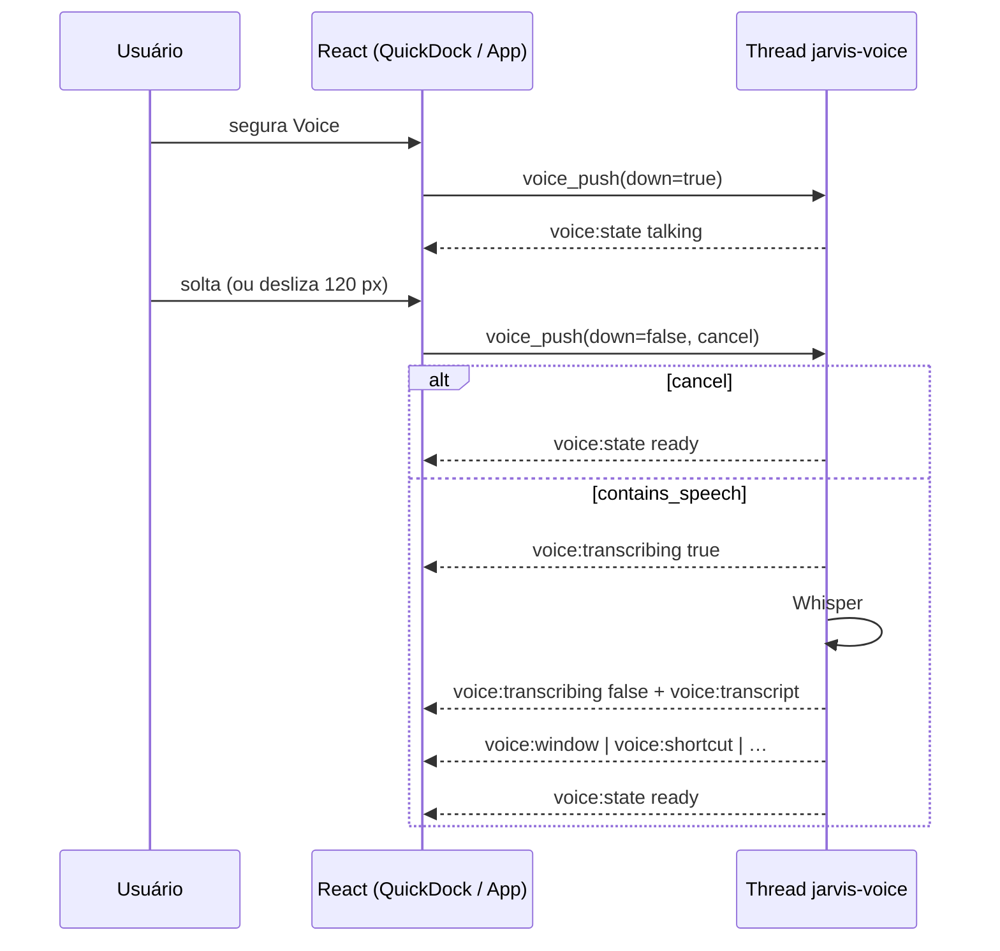

# Feature Specification: Voice Engine

## Metadata

| Field | Value |
|---|---|
| Feature ID | `feature/voice-engine` |
| Product | JARVIS OS (jvOS) |
| Feature Status | Implementado |
| Document Status | Reescrita em 2026-11-05 no formato Feature Specification; sem decisões em aberto |
| Source Commit | `42e671a` (2026-10-23); evoluída em `750ebd0` e `048a254` (2026-10-27) e em `e7151cf` (2026-11-05: porteiro Silero, Whisper na GPU via Vulkan e loop sem polling) |
| Uncommitted Changes | Nenhuma |
| Voice Shortcut | — (o motor não tem frase própria: liga pelo botão Voice, pela tecla M e pelas Configurações) |
| Assistant Tool | — |
| Target Platforms | Windows 11 com WebView2; no navegador (modo web) não há Whisper: Voice só abre o `getUserMedia` para animar o holograma |
| Language | PT-BR no conteúdo e nas falas; inglês nos títulos das seções e em Given / When / Then |
| Last Editorial Revision | 2026-11-05 |
| Verification Scope | Conferida com o código em 2026-11-05: `src-tauri/src/voice/mod.rs`, `src-tauri/src/voice/audio.rs`, `src-tauri/src/voice/vad.rs`, `src-tauri/src/voice/silero.rs`, `src-tauri/src/voice/transcriber.rs`, `src-tauri/src/models.rs`, `src-tauri/src/download.rs`, `src-tauri/src/settings.rs`, `src-tauri/src/lib.rs`, `src/hooks/useVoiceAssistant.ts`, `src/hooks/useWindowControls.ts`, `src/hooks/useAudioAnalyzer.ts`, `src/hooks/useSettings.ts`, `src/lib/settings.ts`, `src/components/QuickDock.tsx`, `src/components/VoiceCaption.tsx`, `src/components/SettingsPanel.tsx`, `src/App.tsx`, `tests/voice.spec.ts`, `tests/voice-denied.spec.ts`, `tests/settings.spec.ts`, `tests/shortcuts.spec.ts`, `playwright.config.ts` e o ADR-0021. Os testes não foram executados nesta revisão |

Especificação no formato inspirado no GitHub Spec Kit, com seções de desenho técnico ([ADR-0025](../../arch/adr/0025-features-formato-feature-specification.md)). Os identificadores US1–US6, RF-001–RF-013, RNF-001–RNF-005, SC-001–SC-003 e T001–T047 são os mesmos da versão anterior. Os critérios de aceite AC-001–AC-016 são os antigos "Critério 1" a "Critério 16", na mesma ordem. KL-* registra limitações conhecidas; OQ-*, decisões de produto em aberto. Nenhum dos dois acrescenta escopo.

## Overview

O motor de voz é o ouvido do JARVIS. Ele capta o microfone padrão do Windows, percebe quando alguém fala e transcreve a frase com o Whisper na própria máquina, sem rede e sem chave de API. O texto segue para o matcher ([voice-commands](../voice-commands/spec.md)), para o ditado ([dictation](../dictation/spec.md)) ou para a conversa ([assistant](../assistant/spec.md)).

O motor roda numa thread Rust própria (`jarvis-voice`), então os comandos continuam funcionando com a janela minimizada. A UI só acompanha o estado por eventos. Esta spec cobre a captura, a detecção de fala, o porteiro Silero, a transcrição, os modelos Whisper, onde o Whisper roda (CPU ou GPU), os três modos de ativação, o botão Voice da dock e a legenda no núcleo.

| Input | Expected Behavior | Execution Path |
|---|---|---|
| Segurar Voice (ou M) e dizer "abre o relógio" | Grava enquanto segura; ao soltar, transcreve e entrega ao matcher | `holdVoice` → `voice_push` → thread `jarvis-voice` → Whisper → `Session::decide` |
| Deslizar 120 px para a esquerda, ou Esc com M segurada | Descarta a gravação, que nunca chega ao Whisper | `holdVoice("cancel")` → `voice_push { cancel: true }` |
| "Hey Jarvis, abre o navegador" no modo `wakeWord` | Microfone aberto; a VAD corta a frase, o Silero confere que é fala, o Whisper transcreve | Rust (`Vad` → `SpeechGate` → `Transcriber`) |
| Clique em "Baixar" num cartão de modelo | Download verificado em segundo plano, com progresso | `download_model` → `fetch_verified` |
| Voice no navegador | Só a captura visual para o holograma | `useAudioAnalyzer` (`getUserMedia`) |

## Goals and Success Criteria

### Goals

- Ouvir comandos sem rede e sem chave de API.
- Não deixar o microfone aberto à toa: o padrão é segurar para falar.
- Permitir desistir de uma gravação antes de ela virar ação.
- Não gastar um Whisper inteiro com ruído nos modos de escuta.
- Usar a GPU quando houver, sem quebrar quem não tem.
- Mostrar no núcleo o que foi entendido.

### Success Criteria

| ID | Criterion | Verification |
|---|---|---|
| SC-001 | Um comando curto dito ao Voice é transcrito em ~1 s com o modelo padrão (Small) numa GPU integrada com Vulkan (o `auto`) e em 2,6 a 8,9 s numa CPU de notebook. | Medição do [ADR-0021](../../arch/adr/0021-reconhecimento-voz-gpu-via-vulkan-porteiro.md) nas fixtures de `speech_wake_word_mode` (Intel 0,74–1,4 s; CPU 2,6–8,9 s), repetível com `JARVIS_TEST_DEVICE`. |
| SC-002 | Nenhuma gravação cancelada ou sem fala chega ao Whisper. | Rust `push_to_talk_recordings_need_speech` e o ramo `discard` do loop; Playwright "push-to-talk is cancelled by sliding left or by Esc". |
| SC-003 | O microfone nunca abre sozinho no navegador e libera trilhas e `AudioContext` ao desligar. | `tests/voice.spec.ts` — "listens, reacts to audio and releases resources" confere 0 streams antes do clique e trilhas e contextos fechados depois. |

## Scope and Non-Goals

### In Scope

- Captura do microfone padrão em mono, reamostrada para 16 kHz.
- VAD por energia, porteiro Silero e `contains_speech` para o push-to-talk.
- Whisper in-process (whisper-rs), na CPU ou numa GPU via Vulkan, com aquecimento e volta para a CPU.
- Três modos de ativação: `pushToTalk` (padrão), `wakeWord` e `always`.
- Catálogo de três modelos Whisper, download verificado e cartões nas Configurações.
- Botão Voice, faixa de gravação, legenda no núcleo e captura visual no navegador.
- Surdez enquanto o JARVIS fala (`voice_deafen`) e aviso de microfone mudo.

### Out of Scope

- Decidir o que a frase quer dizer: ver [voice-commands](../voice-commands/spec.md).
- Escolher o microfone: o motor usa sempre o dispositivo de entrada padrão do Windows. O `voiceDevice` escolhe onde o Whisper roda, não o microfone.
- O ditado e a pergunta ao núcleo, que usam o mesmo motor: ver [dictation](../dictation/spec.md) e [assistant](../assistant/spec.md).
- Detector dedicado de palavra de ativação (KWS): descartado no [ADR-0021](../../arch/adr/0021-reconhecimento-voz-gpu-via-vulkan-porteiro.md).

## User Stories

### US1 — Push-to-Talk

**Priority:** P1.

**User Story:** Como usuário, seguro Voice (ou a tecla M), falo um comando e solto para enviar, como num áudio do WhatsApp.

**Why This Priority:** é o modo padrão (`pushToTalk`) e o único que não deixa o microfone aberto o tempo todo.

**Independent Test:** `tests/voice.spec.ts` — "push-to-talk (the default) listens only while Voice or M is held".

**Acceptance Criteria:** AC-001, AC-002, AC-003, AC-004 e AC-005.

### US2 — Cancel a Recording

**Priority:** P1.

**User Story:** Como usuário, desisto de um comando no meio da fala.

**Why This Priority:** um áudio enviado por engano dispara uma ação.

**Independent Test:** `tests/voice.spec.ts` — "push-to-talk is cancelled by sliding left or by Esc".

**Acceptance Criteria:** AC-006 e AC-007.

### US3 — "Hey Jarvis" and Always Listening

**Priority:** P2.

**User Story:** Como usuário, deixo o microfone aberto e falo sem tocar em nada.

**Why This Priority:** permite usar o computador sem as mãos.

**Independent Test:** `tests/voice.spec.ts` — "keyboard shortcut M toggles the microphone" (no navegador); no app real, via CDP ([testing](../../arch/testing.md)).

**Acceptance Criteria:** AC-008, AC-009 e AC-010.

### US4 — See What Was Heard

**Priority:** P2.

**User Story:** Como usuário, vejo dentro do núcleo a frase que o JARVIS entendeu.

**Why This Priority:** confirma que a transcrição saiu certa.

**Independent Test:** `tests/voice.spec.ts` — "a transcript materialises inside the core, then fades away".

**Acceptance Criteria:** AC-011 e AC-012.

### US5 — Choose and Download the Whisper Model

**Priority:** P2.

**User Story:** Como usuário, escolho entre Small, Base e Large V3 Turbo e baixo o modelo pelas Configurações.

**Why This Priority:** sem modelo baixado a escuta não liga.

**Independent Test:** `tests/shortcuts.spec.ts` — "JARVIS's model is chosen in the settings, next to the Whisper models" (o Small aparece primeiro). O download real não tem teste Playwright.

**Acceptance Criteria:** AC-013 e AC-014.

### US6 — Muted or Denied Microphone

**Priority:** P3.

**User Story:** Como usuário com o microfone mudo ou sem permissão, sou avisado do problema e o app continua funcionando.

**Why This Priority:** o laptop de desenvolvimento entrega silêncio digital com a tecla de mudo, e o Windows não o informa como mudo.

**Independent Test:** `tests/voice-denied.spec.ts` — "denied microphone shows a discreet error and keeps rendering".

**Acceptance Criteria:** AC-015 e AC-016.

## Requirements

### Functional Requirements

| ID | Requirement | Related Stories |
|---|---|---|
| RF-001 | O motor DEVE capturar o dispositivo de entrada padrão, misturar os canais em mono e reamostrar para 16 kHz (`Resampler`, box-filter que também sobe taxas baixas). | US1, US3 |
| RF-002 | Nos modos `wakeWord` e `always`, o microfone DEVE ficar aberto. Em `pushToTalk`, no ditado e na pergunta ao núcleo, ele só abre enquanto o botão está pressionado. | US1, US3 |
| RF-003 | A VAD DEVE cortar o áudio em frases por energia: quadros de 30 ms, início com 3 de 5 quadros com voz, fim após ~660 ms (22 quadros) de silêncio, corte em 10 s e descarte de rajadas com menos de 8 quadros com voz. | US1, US3 |
| RF-004 | Uma liberação com `cancel` DEVE descartar a gravação sem transcrevê-la. | US2 |
| RF-005 | Enquanto `deaf` estiver ligado (o JARVIS falando), o motor DEVE zerar a VAD em vez de procurar comandos. Botões pressionados continuam gravando. | US3 |
| RF-006 | O Whisper DEVE ser guiado pelo prompt "Hey Jarvis. <palavras-chave>." e DEVE descartar a saída que apenas repete o prompt (3 palavras ou mais). | US1, US3 |
| RF-007 | Segmentos com probabilidade de não-fala ≥ 0,6 DEVEM ser descartados. | US1, US3 |
| RF-008 | A escuta ligada DEVE ser lembrada (`voiceEnabled`) e restaurada quando o app abre. | US1, US3 |
| RF-009 | Um modelo só DEVE contar como baixado quando o arquivo tem exatamente o tamanho do catálogo. | US5 |
| RF-010 | Cada mudança de estado DEVE ser emitida em `voice:state`, e cada frase transcrita em `voice:transcript`. | US4 |
| RF-011 | Nos modos `wakeWord` e `always`, uma frase DEVE ter pelo menos 0,25 s de fala pelo Silero (limiar 0,5, janelas de 512 amostras, 1 thread) para chegar ao Whisper. | US3 |
| RF-012 | O Whisper DEVE rodar onde `voiceDevice` pede: `auto`, `cpu` ou uma GPU pelo nome que o Vulkan dá. Uma GPU que sumiu vale como `auto`; uma GPU que falha ao carregar o modelo cai para a CPU sem erro. Builds sem a feature `vulkan` sempre usam a CPU. | US1, US3 |
| RF-013 | Com o microfone fechado (push-to-talk `ready`), o loop DEVE dormir até 1 s; cada botão, o `stop` e o `save_settings` o acordam na hora com um chunk vazio (`VoiceEngine::nudge`). | US1 |

### Non-Functional Requirements

| ID | Requirement | Scope |
|---|---|---|
| RNF-001 | Offline. Só o download dos modelos usa a rede (huggingface `ggerganov/whisper.cpp` e o release `asr-models` do k2-fsa/sherpa-onnx, para o Silero). | Captura, VAD, porteiro e transcrição. |
| RNF-002 | Tempo por comando com o Small, medido em 2026-11-04 nas fixtures de fala: CPU 2,6–8,9 s (10 threads), Intel Graphics 0,74–1,4 s (o `auto`), NVIDIA MX570 0,09–0,27 s. A carga com aquecimento leva ~1,6 s na Intel e ~1,7 s na NVIDIA. O Turbo não acertou mais que o Small, então o padrão continua o Small. | Core 7 150U + Intel Graphics + MX570 ([ADR-0021](../../arch/adr/0021-reconhecimento-voz-gpu-via-vulkan-porteiro.md)). |
| RNF-003 | A janela do encoder se ajusta à duração do áudio (384 a 1500 quadros) e os tokens são limitados a 10 por segundo + 24, para cortar laços de repetição. | Toda transcrição. |
| RNF-004 | CPU do `jarvis.exe` de release (`npm run perf`, 2026-11-04): antes, esperando o "Hey Jarvis" com som ambiente, 9,2 s de CPU por segundo (77% da máquina); em push-to-talk ocioso, ~0,3 ms/s. Depois, sem fala no ambiente: 2 ms/s na CPU e 4 ms/s na Intel esperando o "Hey Jarvis", sem nenhuma frase mandada ao Whisper. | Modos de escuta, build de release. |
| RNF-005 | Memória do `jarvis.exe` com o Small (release, 2D ocioso): ~857 MB de RAM privada na CPU; ~1.007 MB mais ~500 MB de memória compartilhada da GPU na Intel (o `auto`); ~1.030 MB mais 443 MB de VRAM na NVIDIA. "Processador" é a opção mais leve em memória. | [ADR-0021](../../arch/adr/0021-reconhecimento-voz-gpu-via-vulkan-porteiro.md#custo-no-app-release-npm-run-perf-2d-ocioso-mesma-sessão). |

### Operational Constraints

- Áudio em 16 kHz mono.
- Push-to-talk e ditado: no máximo 30 s por gravação (`MAX_PUSH_SAMPLES`); o resto é cortado.
- A VAD corta uma frase em 10 s.
- Whisper: até 10 threads na CPU (`available_parallelism`, limitado a 1–10); 4 numa GPU.
- Entradas com menos de 1,1 s são completadas com silêncio antes do Whisper.
- Segurar Voice exige 350 ms (`MIN_HOLD_MS`); deslizar 120 px cancela (`CANCEL_DISTANCE`).
- Microfone mudo: aviso após 4 s de zeros digitais (`SILENT_MIC_AFTER`); numa gravação segurada, só com 0,3 s ou mais (`MIN_PUSH_SAMPLES`).
- Loop: espera chunks por 20 ms com o microfone aberto (`POLL`) e até 1 s com ele fechado (`IDLE_POLL`).
- Silero: a pasta é olhada de novo a cada 10 s enquanto o modelo falta.
- Progresso de download a cada 200 ms.
- Settings gravadas pela UI com debounce de 450 ms.
- Large V3 Turbo na CPU: 17–48 s por comando.

## Acceptance Criteria

### AC-001 — Push-to-Talk Label

**Related Story:** US1.

- **Given** o modo "Segurar para falar"
- **When** olho a dock
- **Then** o botão se chama "Voice · segure para falar".

### AC-002 — Recording Strip While Held

**Related Story:** US1.

- **Given** Voice pressionado
- **When** falo
- **Then** aparece a faixa de gravação (luz, relógio "0:01" e "Deslize para cancelar"), e o rótulo vira "Voice · solte para enviar" no app (no navegador, "Voice · solte para parar").

### AC-003 — Pointer Capture Keeps Recording

**Related Story:** US1.

- **Given** que estou segurando
- **When** arrasto o ponteiro para cima ou para a direita
- **Then** a gravação continua até eu soltar, por causa da captura de ponteiro.

### AC-004 — Quick Tap

**Related Story:** US1.

- **Given** um clique rápido (menos de 350 ms)
- **When** solto
- **Then** a liberação vai como `cancel`, nada chega ao Whisper e a dock mostra "Segure para falar".

### AC-005 — Release Sends Speech to Whisper

**Related Story:** US1.

- **Given** que soltei
- **When** a gravação tem fala
- **Then** ela vai para o Whisper e o resultado segue para o matcher. Gravações sem fala (cliques, silêncio) são descartadas antes do Whisper (`contains_speech`).

### AC-006 — Cancel by Sliding Left

**Related Story:** US2.

- **Given** Voice pressionado
- **When** deslizo 120 px para a esquerda
- **Then** a gravação é descartada antes mesmo de soltar e a dock diz "Gravação cancelada".

### AC-007 — Cancel with Esc

**Related Story:** US2.

- **Given** M pressionado
- **When** aperto Esc
- **Then** a gravação é descartada, nunca chega ao Whisper, e a dock diz "Gravação cancelada".

### AC-008 — Toggle Listening

**Related Story:** US3.

- **Given** o modo `wakeWord` ou `always`
- **When** aperto M ou clico em Voice
- **Then** a escuta liga ou desliga.

### AC-009 — Wake Word Labels

**Related Story:** US3.

- **Given** o modo `wakeWord`
- **When** a escuta está ligada
- **Then** o rótulo diz "Voice · diga “Hey Jarvis”". Depois do nome, diz "Voice · ouvindo comando".

**Coverage Status:** só no app real, via CDP; sem teste automatizado (KL-004).

### AC-010 — Deaf While JARVIS Speaks

**Related Story:** US3.

- **Given** o JARVIS falando uma resposta
- **When** o microfone está aberto num modo de escuta
- **Then** a fala dele não é tomada como comando: a VAD é zerada a cada chunk enquanto `deaf` está ligado.

**Coverage Status:** só no app real, via CDP; sem teste automatizado (KL-004).

### AC-011 — Caption in the Core

**Related Story:** US4.

- **Given** uma transcrição
- **When** ela chega
- **Then** as palavras surgem uma a uma no centro do núcleo e somem depois de 3,2 s + 220 ms por palavra (até 18 palavras).

### AC-012 — Thinking Dots

**Related Story:** US4.

- **Given** que o Whisper ainda está trabalhando (`voice:transcribing` verdadeiro)
- **When** olho o núcleo
- **Then** vejo três pontos pulsando no lugar do texto.

**Coverage Status:** sem teste automatizado (KL-004).

### AC-013 — Missing Model

**Related Story:** US5.

- **Given** o modelo selecionado não baixado
- **When** ligo a escuta ou seguro Voice
- **Then** o comando devolve `model-missing`, as Configurações abrem e a dock diz "Baixe um modelo de voz" (tom de erro).

**Coverage Status:** sem teste automatizado (KL-004).

### AC-014 — Verified Download

**Related Story:** US5.

- **Given** um download
- **When** ele termina
- **Then** o arquivo só ganha o nome final (e só conta como baixado) se o SHA-256 e o tamanho conferem; senão o `.part` é apagado e o cartão mostra "Arquivo corrompido (verificação SHA-256 falhou)".

### AC-015 — Muted Microphone Warning

**Related Story:** US6.

- **Given** o microfone entregando zeros digitais por 4 s
- **When** a escuta está aberta
- **Then** a dock avisa "O microfone não está captando som. Verifique a tecla de mudo do microfone.".

**Coverage Status:** sem teste automatizado (KL-004).

### AC-016 — Denied Permission in the Browser

**Related Story:** US6.

- **Given** a permissão negada no navegador
- **When** clico em Voice
- **Then** aparece "Acesso ao microfone negado" e o holograma continua animando.

## Behavior and Flows

### Activation Modes

| Mode | Microphone | Resting State | Dock Label | What Reaches Whisper |
|---|---|---|---|---|
| `pushToTalk` (padrão, "Segurar para falar") | Só enquanto Voice ou M está pressionado | `ready` | "Voice · segure para falar" | A gravação inteira, se `contains_speech` |
| `wakeWord` ("Hey Jarvis") | Sempre aberto | `standby`; `awake` depois do nome | "Voice · diga “Hey Jarvis”" / "Voice · ouvindo comando" | Frases cortadas pela VAD que passam no Silero |
| `always` ("Sempre ouvindo") | Sempre aberto | `listening` | "Voice · ouvindo" | Frases cortadas pela VAD que passam no Silero |

`resting_state` dá o estado de repouso de cada modo. O modo trocado nas Configurações vale na próxima volta do loop; um ditado em andamento é preservado. A janela acordada de 8 s do `wakeWord` é do matcher ([voice-commands](../voice-commands/spec.md)); quando ela expira, o motor volta a `standby`.

### Engine States

| State | Dock Label (`DOCK_LABEL`) | Settings › Escuta (`ENGINE_LABEL`) | Indicator |
|---|---|---|---|
| `off` | "Voice" | "Desligada" | apagada |
| `loading` | "Voice · carregando" | "Carregando o modelo de voz…" | pulsa a cada 0,9 s |
| `standby` | "Voice · diga “Hey Jarvis”" | "Aguardando “Hey Jarvis”" | fixa (armada) |
| `awake` | "Voice · ouvindo comando" | "Ouvindo o comando" | pulsa a cada 1,8 s |
| `listening` | "Voice · ouvindo" | "Ouvindo" | pulsa a cada 1,8 s |
| `ready` | "Voice · segure para falar" | "Segure Voice ou M para falar" | fixa (armada) |
| `talking` | "Voice · solte para enviar" | "Ouvindo · solte para enviar" | pulsa a cada 1,8 s |
| `dictating` | "Voice · ditando no Markdown" | "Ditando no editor de Markdown" | pulsa a cada 1,8 s |
| `asking` | "Voice · ouvindo para o JARVIS" | "Ouvindo para o JARVIS · clique no núcleo para enviar" | pulsa a cada 1,8 s |
| `error` | "Voice" (ícone `MicOff`) | a mensagem do erro, ou "Erro" | vermelha |

Nas Configurações, a linha "Escuta" mostra `status.message` quando há uma, senão o `ENGINE_LABEL`.

### Capture (`voice/audio.rs`)

- `open` pega o dispositivo de entrada padrão do `cpal` e a configuração padrão dele (RF-001). Formatos aceitos: F32, I16, I32, U16 e U8.
- Cada callback manda um buffer mono (média dos canais) na taxa nativa; o loop reamostra para 16 kHz.
- Erros não recuperáveis do stream (`DeviceNotAvailable`, `HostUnavailable`, `PermissionDenied`, `StreamInvalidated`) ligam `device_lost`, e o estado vira `error` com "O microfone parou de responder". Engasgos (xruns) e trocas do dispositivo padrão são ignorados.
- Sem microfone: "Nenhum microfone encontrado". Falha ao abrir: "Microfone indisponível: <detalhe>". Formato estranho: "Formato de áudio não suportado: <formato>".

### Speech Detection (`Vad`)

- Corta o áudio contínuo dos modos de escuta em frases (RF-003).
- Um quadro tem voz quando o RMS passa de 3 vezes o ruído de fundo, com piso de 0,006. O ruído de fundo é medido só enquanto ninguém fala (limitado a 0,0015–0,05).
- Guarda 10 quadros antes do início (a primeira sílaba costuma ser fraca) e 8 quadros de silêncio no fim.
- `contains_speech` decide se uma gravação segurada vai ao Whisper: precisa de 8 quadros ou mais com RMS acima de 0,006. Cliques e silêncio não passam.

### Speech Gate (`SpeechGate`, `voice/silero.rs`)

- O Silero VAD (sherpa-onnx) confere se uma frase cortada pela VAD de energia é fala antes de ela ir ao Whisper (RF-011). Porta, teclado, música sem voz e ventilador são energia, não fala, e custavam um Whisper inteiro cada (~2,4 s de dez núcleos com o Small).
- Roda só sobre as frases candidatas (~5 ms por segundo de áudio), nunca o tempo todo.
- O push-to-talk, o ditado e as perguntas ao núcleo não passam pelo porteiro: quem segurou o botão quer ser ouvido.
- O modelo `silero_vad.onnx` (643.854 bytes, `models::SILERO`, SHA-256 fixo) é baixado sozinho, em segundo plano, na primeira frase de um modo de escuta. Até ele chegar, ou sem internet, só a VAD de energia decide. Enquanto falta, a pasta é olhada de novo (e o download tentado de novo) a cada 10 s.

### Transcription (`Transcriber`)

- Whisper in-process (whisper-rs), com flash attention, decodificação greedy, temperatura 0, um segmento e sem timestamps.
- Idioma de `Settings.language`: `pt`, `en`, ou `auto` (detecção do Whisper).
- O prompt é `build_prompt(command_vocabulary(...))`: "Hey Jarvis. <palavras-chave separadas por vírgula>." (RF-006). `is_prompt_echo` descarta uma saída de 3 palavras ou mais contida no prompt.
- Segmentos com `no_speech_probability` ≥ 0,6 são descartados (RF-007).
- A janela do encoder e o limite de tokens seguem a duração do áudio (RNF-003).
- Onde roda (RF-012): `pick_device` lê `voiceDevice`. `cpu` não usa GPU; um nome escolhe aquela GPU se ela ainda existir; `auto` (ou um nome que sumiu) usa `auto_device`: a GPU integrada quando existe (Intel, menos as Arc dedicadas, e as "Radeon(TM) Graphics" da AMD), senão a primeira outra GPU.
- Numa GPU, o modelo é aquecido com 2 s de silêncio ao carregar (compila os pipelines Vulkan: 34,7 s na MX570 e 6,6 s na Intel na primeiríssima vez). Se a GPU falhar ao carregar ou aquecer, o Whisper carrega na CPU, e o erro vai só para o stderr.
- O backend Vulkan do ggml inicia sem trava: listar as GPUs e carregar o modelo se revezam num `Mutex` (`VULKAN`).

### Engine Loop (`VoiceEngine::run`)

A thread `jarvis-voice` é dona do microfone, da VAD, do porteiro e do Whisper. Os botões da UI viram flags atômicas compartilhadas (`talking`, `discard`, `dictating`, `asking`, `deaf`, `exit_after_dictation`), lidas a cada volta.

- `set_talking(down, cancel)` grava `discard` antes de `talking`, para o loop ver o cancelamento junto com a liberação (RF-004).
- Com o microfone aberto e nada segurado, cada chunk vai à VAD, e cada frase cortada passa pelo porteiro antes do Whisper. Com `deaf` ligado, a VAD é zerada no lugar (RF-005).
- Com algo segurado, o áudio vai para a gravação (até 30 s), e a VAD não roda.
- `handle_utterance` emite `voice:transcribing` (verdadeiro, depois falso) em volta do Whisper, emite `voice:transcript { text, millis }` quando há texto e entrega o texto a `Session::decide`. O evento da decisão (`voice:window`, `voice:shortcut`…) está em [voice-commands](../voice-commands/spec.md).
- Um erro do Whisper só vai para o stderr: a frase é perdida, sem aviso na UI.
- O modo de ativação lido a cada volta: trocado, a sessão do matcher é zerada e o estado volta ao repouso do modo novo (um ditado em andamento continua).

### `useVoiceAssistant`

- Escuta `voice:state`, `voice:transcribing`, `voice:transcript`, `voice:wake` e os eventos de decisão, e expõe o estado, a mensagem e a última frase ouvida (`heard`, com `id` novo a cada frase).
- Enfileira pressionar e soltar em `pushQueue`, para que push-to-talk, ditado e pergunta cheguem ao Rust em ordem.
- `start`, `push`, `dictate` e `ask` devolvem o erro como texto; `model-missing` não vira estado `error` (o `App` abre as Configurações).
- Fora do Tauri, `available` é falso: o hook não escuta os eventos, e o `App` usa a captura visual no lugar dos comandos `voice_*`.

### Whisper Models (`ModelCard` em "Reconhecimento de voz")

O catálogo, o download verificado e os cartões de modelo das Configurações.

- **Behavior:**
  - O catálogo `MODELS` fixa tamanho e SHA-256 de cada modelo, na ordem Small, Base, Large V3 Turbo (RF-009).
  - Clicar num cartão muda `$modelo`. Clicar em "Baixar" começa o download em segundo plano; um download repetido do mesmo modelo é ignorado.
  - O progresso chega por `model:progress` e o fim (ou o erro) por `model:done`. `useModels` guarda o progresso e os erros por modelo e recarrega a lista no fim.
  - Com o modelo selecionado não baixado, mostre "Baixe o modelo selecionado para ativar a escuta.".
  - Abaixo dos cartões: o seletor "Processamento da voz" (`VoiceDeviceRow`), o seletor "Idioma" (Português, English, Automático) e "Último reconhecimento: “<frase>”" (ou "—").
  - "Processamento da voz" oferece "Automático", "Processador" e as GPUs que o Vulkan vê ("<nome> · <VRAM>"). Sem a feature `vulkan`, as GPUs ficam desabilitadas e a dica diz "Este build não tem a GPU (Vulkan SDK ausente na compilação): a voz roda no processador.". Com o motor ligado, a dica diz onde ele roda ("Agora: processador." ou o nome da GPU). Uma GPU salva que não existe aparece como "Automático". A lista é lida de novo 2,5 s depois de uma troca, porque o motor reinicia.
  - Fora do app, o botão "Baixar" fica desabilitado e a lista vem fixa (`BROWSER_MODELS`; GPUs do fake `BROWSER_DEVICES` ou de `window.__JARVIS_GPUS__`).
- **Layout:**
  - Um `radiogroup` "Modelo Whisper" com um cartão por modelo.
  - Cada cartão tem, à esquerda, o rádio ("Modelo <nome>"), o nome com o tamanho ("Small · 190 MB") e a descrição, que dá lugar ao erro do download quando há um.
  - À direita, um de três: "Baixado" com um `Check`; o progresso em % com um `Loader2` girando e uma barra fina embaixo; ou o botão "Baixar" com o ícone `Download`.
  - "Processamento da voz" é uma grade de duas colunas de botões de rádio, com a dica embaixo.
- **Style:**
  - Cartão `rounded-xl border px-4 py-3`. O selecionado fica em `border-hud-cyan/40 bg-hud-cyan/[0.06]`; os outros em `border-hud-cyan/12 bg-white/[0.02]`.
  - O rádio é um círculo `size-4`, com o ponto `bg-hud-light` brilhando quando selecionado.
  - Nome em `text-sm text-hud-text`, tamanho em `text-hud-text/45`, descrição em `text-xs text-hud-text/50`.
  - "Baixado" e "Baixar" em 10 px, maiúsculas, `tracking-[0.16em]`. "Baixado" em `text-hud-light/80`.
  - A barra de progresso tem `h-0.5`, com `bg-hud-light` sobre `bg-hud-cyan/15`.
  - O botão "Baixar" tem borda `hud-cyan/25`, que acende em `hud-cyan/60` no hover. Desabilitado, fica com opacidade 40%.

### Voice Button and Recording Strip (`QuickDock`)

O primeiro botão da dock: liga a escuta ou, no push-to-talk, grava enquanto está pressionado.

- **Behavior:**
  - O rótulo segue o estado (`DOCK_LABEL`, tabela acima). No navegador, o rótulo é "Voice · segure para falar" e, segurando, "Voice · solte para parar"; nos outros modos, "Voice" ou "Voice · ouvindo".
  - No `pushToTalk`, o botão é segurado em vez de clicado: "start" ao pressionar, depois "send" ou "cancel".
    - A captura de ponteiro mantém a gravação mesmo se o ponteiro sair do botão para cima ou para a direita.
    - Deslizar 120 px para a esquerda cancela antes de soltar. O ícone acompanha o ponteiro (30% do deslocamento).
    - Espaço ou Enter com foco no botão seguram como o ponteiro; Esc com o botão segurado cancela; perder o foco envia.
  - `holdVoice` no `App` exige 350 ms. Num clique mais rápido, a liberação vai como `cancel` e a dock mostra "Segure para falar". Um cancelamento mostra "Gravação cancelada".
  - Enquanto o botão está pressionado e não há erro, mostre a faixa de gravação. Antes de o microfone abrir (o modelo pode estar carregando), o relógio mostra "…" e o rótulo acessível é "Preparando o microfone"; gravando, "Gravando 0:01".
  - Nos modos `wakeWord` e `always`, o clique liga ou desliga a escuta (`toggleVoice`).
  - As mensagens do motor (erros e o aviso de microfone mudo) aparecem como aviso de erro acima de Voice.
- **Layout:**
  - Botão `h-14 w-14` com o ícone `Mic` (ou `MicOff` em erro) de 30 px e o reflexo dele embaixo. O rótulo ou o aviso da dock aparece acima do botão.
  - Uma luz pequena (`Indicator`) fica embaixo do ícone.
  - A faixa de gravação (`RecordingBar`) fica à esquerda da dock (`right-full mr-3`). Com a dock oculta, ela aparece dentro do aviso flutuante (`DockToast`), ao lado do texto.
  - Na faixa, da esquerda para a direita: a luz, o relógio e a dica "Deslize para cancelar" com `ChevronLeft`. A dica desliza para uma borda esmaecida, não por cima do relógio.
- **Style:**
  - Ícone em `text-hud-alert/80` no erro, `text-hud-light` com brilho quando ativo e `text-hud-text/65` (ou `/85` armado ou carregando) em repouso.
  - A luz do `Indicator` tem `h-1 w-1`: `bg-hud-light` pulsando a cada 1,8 s com o microfone vivo e a cada 0,9 s carregando; `bg-hud-alert` no erro.
  - Faixa `h-11 rounded-full border border-hud-cyan/18 bg-hud-panel/70 backdrop-blur-md`, com sombra.
  - A luz da faixa é `size-2 bg-hud-alert` e pisca a cada 1,2 s durante a gravação.
  - O relógio é `text-sm tabular-nums`, em `text-hud-light` gravando e `text-hud-text/50` preparando.
  - A dica fica em 10 px, maiúsculas, `tracking-[0.22em] text-hud-text/70`, e esmaece até 0,15 de opacidade perto do ponto de cancelamento.
  - Os avisos da dock ficam em 10 px maiúsculas, `tracking-[0.22em]`, sobre `bg-hud-panel/80`; os de erro em `border-hud-alert/30 text-hud-alert/90`.

### `VoiceCaption`

A frase que o JARVIS entendeu, dentro do núcleo do holograma.

- **Behavior:**
  - Quando uma transcrição chegar, as palavras surgem uma a uma e somem depois de 3,2 s + 220 ms por palavra (`HOLD_MS`, `HOLD_PER_WORD_MS`; no máximo 18 palavras contadas).
  - Frases longas guardam só as últimas 18 palavras (`MAX_WORDS`), precedidas de "…".
  - Enquanto o Whisper trabalha (`voice:transcribing`, ou o núcleo em `transcribing`), mostre três pontos pulsando (`Thinking`) no lugar do texto.
  - A legenda é `aria-live="polite"` e não recebe cliques.
- **Layout:**
  - Fixa no centro do núcleo (`CORE_CENTER_Y_CSS`), num quadrado de 62% da composição, com o texto centralizado.
  - Atrás do texto, um fundo radial escuro e translúcido (`BACKDROP`), para o holograma continuar visível.
- **Style:**
  - Fonte `clamp(14px, composição × 0,042, 30px)`, `font-light`, `leading-snug`, `text-hud-glow` com brilho ciano (`text-shadow`).
  - Cada palavra entra 70 ms depois da anterior, subindo e saindo do desfoque em 0,45 s, até opacidade 0,92. A frase sai com desfoque de 6 px em 0,6 s.
  - Os três pontos são `bg-hud-glow`, pulsam em 1,1 s e ficam defasados 0,18 s.

### Browser Visual Capture (`useAudioAnalyzer`)

- Fora do Tauri não há Whisper: Voice só usa `getUserMedia` para animar o holograma, e as Configurações dizem "Reconhecimento de voz e abertura de programas funcionam no app desktop.".
- No app, a captura visual só abre com o microfone do motor aberto, fora do `standby` e com o núcleo ligado (`visualCapture`). Esperando o "Hey Jarvis", ela fica fechada.
- Erros do `getUserMedia` em PT-BR: "Acesso ao microfone negado" (`NotAllowedError`, `SecurityError`), "Nenhum microfone encontrado", "Microfone indisponível", "Falha ao abrir o microfone", "Microfone não suportado" e "Microfone desconectado". O holograma continua animando.
- Ao desligar, as trilhas e o `AudioContext` são liberados (SC-003).
- A WebView do app recebe permissão automática de microfone (`on_permission_request`), só para essa captura.

### Interaction Flow



### User Feedback

| Moment | Persona Key | Output |
|---|---|---|
| Clique rápido em Voice | — | Dock "Segure para falar" |
| Gravação cancelada | — | Dock "Gravação cancelada" |
| Modelo não baixado | — | Configurações abertas e dock "Baixe um modelo de voz" (erro) |
| Microfone mudo | — | Dock "O microfone não está captando som. Verifique a tecla de mudo do microfone." (erro) |
| Microfone desconectado | — | Estado `error` e dock "O microfone parou de responder" |
| Permissão negada no navegador | — | Dock "Acesso ao microfone negado" (erro) |
| Whisper trabalhando | — | Três pontos no núcleo |
| Frase transcrita | — | Legenda no núcleo e "Último reconhecimento" nas Configurações |
| "Hey Jarvis" sozinho | — | Pulso do holograma (`voice:wake`) |

As confirmações faladas dos comandos são de [voice-commands](../voice-commands/spec.md).

### Voice and Keyboard

- Segurar Voice ou M (push-to-talk): grava; soltar envia.
- Deslizar 120 px à esquerda, ou Esc com Voice ou M segurados: cancela (`hold("cancel")`).
- Clique em Voice ou M (outros modos): liga ou desliga a escuta.
- Espaço ou Enter com foco em Voice: segura como o ponteiro.
- A tecla M é ignorada com o foco num campo de texto ou num terminal; tirar o foco da janela solta a gravação (envia).
- A busca `/` tem "Ligar a escuta" / "Desligar a escuta" (atalho M).

A tecla M e o Esc ficam em `useWindowControls`.

## Data Model and Persistence

### Settings Fields

```ts
type Activation = "wakeWord" | "always" | "pushToTalk";
type Language = "pt" | "en" | "auto";

interface Settings {
  voiceEnabled: boolean;   // a escuta estava ligada (restaurada no setup)
  activation: Activation;  // padrão "pushToTalk"
  model: string;           // id de MODELS; padrão "small"
  voiceDevice: string;     // "auto" (padrão), "cpu" ou o nome Vulkan de uma GPU
  language: Language;      // padrão "pt"
  // …os outros campos são de outras specs
}
```

### Engine State and Recording

```ts
/** Mirrors `VoiceState` in src-tauri/src/voice/mod.rs. */
type EngineState = "off" | "loading" | "standby" | "awake" | "listening" | "ready" | "talking" | "dictating" | "asking" | "error";
interface EngineStatus { state: EngineState; message: string | null }
interface Heard { id: number; text: string } // id muda mesmo com as mesmas palavras
```

```rust
enum Recording {
    Command(Vec<f32>),                     // Voice: Whisper, depois o matcher
    Dictation(DictationTarget, Vec<f32>),  // editor ou núcleo: só Whisper
}
```

O estado, a gravação e a sessão do matcher ficam só em memória. Ver o [glossário](../../domain/glossary.md).

### Storage Rules

| Property | Value |
|---|---|
| State | `$ativação`, `$escuta`, `$modelo`, `$idioma`, `voiceDevice` |
| Storage | `%APPDATA%\dev.jarvis.os\settings.json`; no navegador, `localStorage["jarvis.settings"]` |
| Write Debounce | 450 ms na UI (`useSettings`); `voice_start`, `voice_stop` e `voice_push` gravam `voiceEnabled` na hora |
| Writer | `save_settings` ignora o `voiceEnabled` que vem da UI e mantém o do backend |
| Reader | `sanitize`: idioma fora de `pt`/`en`/`auto` vira `pt`; modelo fora do catálogo vira `small`; `voiceDevice` é aparado, cortado em 128 caracteres e, vazio, vira `auto` |
| Missing or Invalid Storage | Os padrões: `pushToTalk`, `small`, `auto`, `pt`, escuta desligada |

### Model Files

| File | Location | Rule |
|---|---|---|
| `ggml-small-q5_1.bin` (190.085.487 bytes), `ggml-base-q5_1.bin` (59.707.625), `ggml-large-v3-turbo-q5_0.bin` (574.041.195) | `%LOCALAPPDATA%\dev.jarvis.os\models\` | Baixado = tamanho exato do catálogo |
| `silero_vad.onnx` (643.854 bytes) | a mesma pasta | Idem; não aparece nos cartões |
| `<nome>.part` | a mesma pasta | Arquivo em download; renomeado só depois do SHA-256; apagado se falhar |

Ver [persistência](../../domain/persistence.md).

## Technical Design

### Component Responsibilities

| File or Component | Responsibility |
|---|---|
| `src-tauri/src/voice/mod.rs` | `VoiceEngine`, flags dos botões, `nudge`, loop `run`, `Recording`, `handle_utterance`, `dictate`, aviso de microfone mudo, eventos |
| `src-tauri/src/voice/audio.rs` | `open` (dispositivo padrão, mono), `Resampler` box-filter para 16 kHz, `device_lost` |
| `src-tauri/src/voice/vad.rs` | `Vad::push` e `contains_speech` |
| `src-tauri/src/voice/silero.rs` | `SpeechGate`: Silero VAD sobre as frases dos modos de escuta, download do modelo em segundo plano |
| `src-tauri/src/voice/transcriber.rs` | `Transcriber` (flash attention, greedy, CPU ou GPU, aquecimento), `gpu_devices`, `pick_device`, `auto_device`, `is_integrated`, `build_prompt`, `is_prompt_echo` |
| `src-tauri/src/models.rs` | Catálogo `MODELS`, `SILERO`, `is_downloaded`, `download` |
| `src-tauri/src/download.rs` | `fetch_verified` (`.part` → rename após SHA-256 e tamanho; limite de corpo) |
| `src-tauri/src/settings.rs` | `Activation`, `model`, `language`, `voiceEnabled`, `voiceDevice` e `sanitize` |
| `src-tauri/src/lib.rs` | Comandos `voice_*`, `models_status`, `download_model`, `voice_devices`; `save_settings` reinicia o motor ou o acorda; restauração no `setup` |
| `src/hooks/useVoiceAssistant.ts` | Estado, eventos, fila `pushQueue` para push, ditado e pergunta |
| `src/hooks/useSettings.ts` | `useSettings` (debounce de 450 ms) e `useModels` (progresso e erros de download) |
| `src/lib/settings.ts` | Tipos espelhados, `loadModels`, `loadVoiceDevices` e os fakes de navegador |
| `src/components/VoiceCaption.tsx` | Legenda palavra por palavra e `Thinking` |
| `src/components/QuickDock.tsx` | Segurar Voice, deslizar 120 px para cancelar, faixa de gravação, `Indicator` |
| `src/components/SettingsPanel.tsx` | Linha "Escuta", `ModelCard`, `VoiceDeviceRow`, "Idioma", "Último reconhecimento" |
| `src/hooks/useWindowControls.ts` | Tecla M (segurar ou alternar) e Esc |
| `src/hooks/useAudioAnalyzer.ts` | Captura visual e erros do `getUserMedia` |
| `src/App.tsx` | `holdVoice` (350 ms mínimo), `toggleVoice`, `showModelMissing`, `visualCapture`, `ENGINE_LABEL`, `DOCK_LABEL` |

### Engine Loop Algorithm

1. Carregue o Whisper no dispositivo de `voiceDevice` (com volta para a CPU). Falhou: estado `error` com a mensagem, e a thread termina.
2. Emita o estado de repouso do modo.
3. A cada volta, veja quem quer o microfone: um ditado ou pergunta pressionados, qualquer modo de escuta, ou Voice segurado no push-to-talk.
4. Precisa e está fechado: abra. Com ditado ou pergunta, comece uma `Recording::Dictation` (e zere a sessão); no push-to-talk, uma `Recording::Command` e o estado `talking`.
5. Já aberto e um ditado ou pergunta começa: ele assume o microfone, e a VAD e a sessão são zeradas.
6. Não precisa mais e está aberto: feche, junte o que sobrou no canal e leia `discard`. Uma `Command` cancelada volta a `ready`; uma `Command` com fala vai a `handle_utterance`; uma `Dictation` vai a `dictate` (se não cancelada).
7. Espere um chunk (20 ms com o microfone aberto, até 1 s fechado). Um chunk vazio é só um `nudge`.
8. Microfone desconectado: `error`. Quatro segundos de zeros com o microfone aberto: aviso de microfone mudo.
9. Releia o modo de ativação e expire a janela acordada do matcher; mudou algo, volte ao repouso.
10. `stop`: solte o microfone, esqueça o dispositivo e emita `off`.

### Model Download Algorithm

1. `download_model` acha o modelo ("Modelo desconhecido" se não existe) e ignora um download que já está rodando.
2. Uma thread chama `fetch_verified`, que grava em `<nome>.part`, com o corpo limitado a tamanho + 1 byte, e emite o progresso a cada 200 ms.
3. No fim, confere o tamanho e o SHA-256. Conferiu: renomeia. Não conferiu: apaga o `.part` e devolve "Arquivo corrompido (verificação SHA-256 falhou)".
4. `model:done` leva o erro, se houver; a UI recarrega `models_status`.

### Related Architecture Decisions

- [ADR-0002 — STT offline whisper.cpp na CPU, Small padrão](../../arch/adr/0002-stt-whisper-offline-cpu.md) (substituído pelo ADR-0021)
- [ADR-0003 — motor de voz numa thread Rust](../../arch/adr/0003-motor-de-voz-thread-rust.md)
- [ADR-0011 — fakes de dev e E2E modo web](../../arch/adr/0011-fakes-de-dev-e-e2e-modo-web.md)
- [ADR-0021 — Reconhecimento de voz na GPU via Vulkan, com porteiro Silero e volta para a CPU](../../arch/adr/0021-reconhecimento-voz-gpu-via-vulkan-porteiro.md)
- [Contrato IPC](../../arch/ipc-contract.md)

## Interfaces and Contracts

### Tauri Commands

| Command | Input | Output | Notes |
|---|---|---|---|
| `voice_start` | — | `VoiceStatus` | Liga (ou reinicia) e grava `voiceEnabled = true`; erro `model-missing` |
| `voice_stop` | — | `VoiceStatus` | Solta o push-to-talk como cancelado, para o motor e grava `voiceEnabled = false` |
| `voice_status` | — | `VoiceStatus` | |
| `voice_push` | `{ down, cancel }` | `VoiceStatus` | O primeiro `down` com o motor parado liga o motor e grava `voiceEnabled = true`; erro `model-missing` |
| `voice_deafen` | `{ on }` | — | Chamado por [tts](../tts/spec.md) |
| `voice_devices` | — | `{ gpus: { name, vramMb }[], accelerated, active }` | Lista as GPUs fora da thread da UI; `active` = "CPU", o nome da GPU ou null |
| `models_status` | — | `ModelStatus[]` (`id`, `label`, `description`, `size`, `downloaded`, `downloading`) | `downloaded` = tamanho exato |
| `download_model` | `{ id }` | — | Em segundo plano; repetido é ignorado; "Modelo desconhecido" |
| `save_settings` | `{ settings }` | `Settings` sanitizadas | Modelo ou `voiceDevice` trocados com o motor rodando: reinicia; senão, `nudge` |

`voice_dictate` está em [dictation](../dictation/spec.md) e `voice_ask` em [assistant](../assistant/spec.md).

### Events and Channels

| Event | Payload | Producer → Consumer |
|---|---|---|
| `voice:state` | `{ state, message }` | `Reporter` → `useVoiceAssistant` |
| `voice:transcribing` | `boolean` | `handle_utterance` → `VoiceCaption` |
| `voice:transcript` | `{ text, millis }` | `handle_utterance` → `heard` → `VoiceCaption` e "Último reconhecimento" |
| `voice:wake` | — | matcher `Wake` → pulso do holograma |
| `model:progress` | `{ id, received, total }` | thread de download → `useModels` (a cada 200 ms) |
| `model:done` | `{ id, error }` | thread de download → `useModels` |

Os eventos de decisão (`voice:command`, `voice:window`…) estão em [voice-commands](../voice-commands/spec.md); `voice:dictation` em [dictation](../dictation/spec.md).

### Error Messages

| Message | Where |
|---|---|
| `model-missing` | `voice_start`, `voice_push`, `voice_dictate`, `voice_ask`, `save_settings` (sentinela compartilhada com a UI) |
| "Nenhum microfone encontrado", "Microfone indisponível: …", "Formato de áudio não suportado: …" | Abertura do microfone (estado `error`) |
| "O microfone parou de responder" | Microfone perdido (estado `error`) |
| "Falha ao carregar o modelo de voz: …", "Falha ao iniciar o Whisper: …" | Carga do Whisper (estado `error`) |
| "Falha no download: …", "Arquivo corrompido (verificação SHA-256 falhou)", "Não foi possível criar a pasta …" | `model:done` |

## Edge Cases and Error Handling

| Case | Behavior | Reference |
|---|---|---|
| Nenhum modelo baixado | `voice_start` e `voice_push` devolvem `model-missing`: as Configurações abrem e a dock diz "Baixe um modelo de voz" | AC-013 |
| Gravação sem fala (cliques, silêncio) | Descartada antes do Whisper | AC-005, SC-002 |
| Clique com menos de 350 ms | Liberação como `cancel`; dock "Segure para falar". Com o motor parado, o toque já liga o motor e grava `voiceEnabled = true` | AC-004 |
| Saída do Whisper que só repete o prompt (3 palavras ou mais), ou segmentos com não-fala ≥ 0,6 | Descartados; uma única palavra-chave não é eco | RF-006, RF-007 |
| Erro do Whisper numa frase | Só no stderr; a frase se perde sem aviso | Engine Loop |
| `silero_vad.onnx` ainda não baixado, ou sem internet | Só a VAD de energia decide; novo download a cada 10 s, sem aviso na UI | RF-011, KL-006 |
| Modelo ou idioma inválidos em `settings.json` | `sanitize` volta a `small` e `pt` | Storage Rules |
| Download repetido do mesmo modelo | Ignorado | RF-009 |
| Um `.part` ou um arquivo de tamanho diferente | Nunca conta como baixado | AC-014 |
| M segurada | O `event.repeat` é ignorado | Voice and Keyboard |
| Soltar com `cancel` | `discard` é gravado antes de `talking`; o loop vê os dois juntos | RF-004 |
| Pressionar e soltar em sequência rápida | `pushQueue` entrega push-to-talk, ditado e pergunta ao Rust em ordem | `useVoiceAssistant` |
| O JARVIS falando (`deaf`) | A VAD é zerada; botões pressionados continuam gravando | RF-005, AC-010 |
| `deaf` que ficou ligado (fim de "Ouvir exemplo", Esc entre duas frases) | Os modos de escuta seguem surdos até a próxima fala do JARVIS; a flag vive no `VoiceEngine` e sobrevive a reiniciar o motor | [tts](../tts/spec.md#known-limitations) KL-003 |
| Modo de ativação trocado durante a escuta | Vale na próxima volta do loop; um ditado em andamento é preservado | Engine Loop |
| Modelo ou `voiceDevice` trocados | O motor reinicia se estiver rodando; falhou ao reiniciar, ele para e o `save_settings` devolve o erro | `save_settings` |
| Listar as GPUs e carregar o modelo ao mesmo tempo | Revezam num `Mutex` (`VULKAN`) | RF-012 |
| GPU escolhida falha ao carregar | O Whisper carrega na CPU, sem erro na UI | RF-012 |
| GPU salva que não existe mais | Vale como `auto`; o seletor mostra "Automático" | RF-012 |
| Microfone fechado | O loop dorme até 1 s; botões, `stop` e `save_settings` o acordam na hora | RF-013 |
| Permissões | Sempre o microfone padrão do Windows; no app a WebView recebe a permissão de microfone sem pergunta, e as configurações de privacidade do Windows continuam valendo | Out of Scope |
| Permissão negada no navegador | "Acesso ao microfone negado"; o holograma continua animando | AC-016 |
| Microfone entregando zeros por 4 s (tecla de mudo) | O motor só consegue avisar | AC-015, KL-003 |
| Fora do Tauri | Não há Whisper: Voice só abre o `getUserMedia` para animar o holograma, e nunca sozinho (0 streams antes do clique) | SC-003 |
| Build com `vulkan` numa máquina sem `vulkan-1.dll` | O app não abre | KL-002 |

## Dependencies

### Feature Dependencies

| Dependency | Purpose |
|---|---|
| [voice-commands](../voice-commands/spec.md) | O matcher que recebe o texto, a janela acordada e o `command_vocabulary` do prompt |
| [settings](../settings/spec.md) | Modo, modelo, idioma, `voiceDevice`, a linha "Escuta" e os cartões de modelo |
| [tts](../tts/spec.md) | Liga a surdez por `voice_deafen` |
| [dictation](../dictation/spec.md) | A gravação `Dictation(editor)` |
| [assistant](../assistant/spec.md) | A gravação `asking` (pergunta ao núcleo) |
| [dock-taskbar](../dock-taskbar/spec.md) | O botão Voice e os avisos |
| [holographic-core](../holographic-core/spec.md) | A legenda no núcleo, o pulso e a captura visual |
| [keyboard-shortcuts](../keyboard-shortcuts/spec.md) | M e Esc |

### Runtime Dependencies

- [cpal](../../foundation/vendor/cpal/spec.md) (0.18), [whisper-rs](../../foundation/vendor/whisper-rs/spec.md) (0.16, feature `vulkan` opcional) e os [modelos Whisper](../../foundation/vendor/whisper-models/spec.md).
- [sherpa-onnx](../../foundation/vendor/sherpa-onnx/spec.md) (1.13.8, o runtime do Silero, o mesmo do TTS) e o [Silero VAD](../../foundation/vendor/silero-vad/spec.md).
- [HTTP](../../foundation/vendor/http/spec.md) (`ureq` 3), [archives](../../foundation/vendor/archives/spec.md) (`sha2`), [serde](../../foundation/vendor/serde/spec.md), [Tauri](../../foundation/vendor/tauri/spec.md).
- [React](../../foundation/vendor/react/spec.md), [motion](../../foundation/vendor/motion/spec.md), [lucide](../../foundation/vendor/lucide/spec.md), [Tailwind](../../foundation/vendor/tailwind/spec.md).
- O microfone padrão do Windows; a rede só para baixar os modelos.
- Uma GPU com driver Vulkan (`vulkan-1.dll`) nos builds com `vulkan`, e o Vulkan SDK para compilá-los (`scripts/tauri.mjs` liga a feature quando acha o SDK); CMake e LLVM (`LIBCLANG_PATH`) para compilar o whisper.cpp ([build-and-env](../../arch/build-and-env.md)).

## Test Strategy and Coverage

### Reported Tests

| Test Reference | Coverage | Acceptance Mapping |
|---|---|---|
| `tests/voice.spec.ts` — "push-to-talk (the default) listens only while Voice or M is held" | "Voice · segure para falar", a faixa com "0:01" e "Deslize para cancelar", "Voice · solte para parar", a captura de ponteiro, o clique rápido com "Segure para falar" e a tecla M segurada | AC-001–AC-004 |
| `tests/voice.spec.ts` — "push-to-talk is cancelled by sliding left or by Esc" | Deslizar 120 px e Esc com M descartam e mostram "Gravação cancelada" | AC-006, AC-007 |
| `tests/voice.spec.ts` — "keyboard shortcut M toggles the microphone" | M liga e desliga a escuta fora do push-to-talk | AC-008 |
| `tests/voice.spec.ts` — "a transcript materialises inside the core, then fades away" | A legenda no centro do núcleo, palavra por palavra, opacidade 0,92, e o sumiço | AC-011 |
| `tests/voice.spec.ts` — "listens, reacts to audio and releases resources" | Nenhum stream antes do clique, o holograma reage ao microfone, trilhas e contextos liberados | SC-003 |
| `tests/voice.spec.ts` — "particles and rings align on the core's equator while listening, then scatter" | O holograma alinha enquanto grava | US1 ([holographic-core](../holographic-core/spec.md)) |
| `tests/voice-denied.spec.ts` — "denied microphone shows a discreet error and keeps rendering" | "Acesso ao microfone negado" e o holograma continua | AC-016 |
| `tests/settings.spec.ts` — "activation mode and language persist" | `$ativação` e `$idioma` gravados e de volta depois de recarregar | US3 |
| `tests/settings.spec.ts` — "speech recognition runs on the CPU or a GPU, automatic by default, and the choice persists" | "Processamento da voz": "Automático" por padrão, GPUs do fake, a escolha persiste | RF-012 |
| `tests/shortcuts.spec.ts` — "JARVIS's model is chosen in the settings, next to the Whisper models" | O "Modelo Small" vem primeiro | US5 |
| `src-tauri/src/voice/audio.rs` — `downsamples_to_16k`, `upsamples_low_rates` | Mono e reamostragem para 16 kHz, também de taxas baixas | RF-001 |
| `src-tauri/src/voice/vad.rs` — `silence_and_background_noise_produce_nothing`, `one_utterance_between_silences`, `fed_in_small_chunks_gives_the_same_result`, `short_clicks_are_dropped`, `push_to_talk_recordings_need_speech`, `long_speech_is_cut_at_the_maximum` | Silêncio e ruído não viram frase, cliques curtos caem, corte em 10 s, push-to-talk sem fala não vai ao Whisper | AC-005, RF-003 |
| `src-tauri/src/voice/transcriber.rs` — `detects_prompt_echo`, `auto_prefers_the_integrated_gpu_and_names_win` | O eco do prompt; o `auto` preferindo a integrada, o nome escolhido, o nome sumido e o `cpu` | RF-006, RF-012 |
| `src-tauri/src/models.rs` — `catalog_is_consistent`, `partial_files_do_not_count_as_downloaded`; `src-tauri/src/download.rs` — `hex_is_lowercase_and_padded` | Catálogo, arquivo parcial não conta, hash em hex minúsculo | AC-014, RF-009 |
| `src-tauri/src/settings.rs` — `invalid_language_model_and_theme_are_reset`, `save_and_load_round_trip` | Modelo e idioma inválidos voltam ao padrão, `voiceDevice` vazio vira `auto`, `voiceEnabled` e `activation` sobrevivem a salvar e ler | Storage Rules, RF-008 |
| `src-tauri/src/voice/mod.rs` (ignorados) — `speech_wake_word_mode`, `speech_window_commands`, `speech_always_listening_mode`, `speech_lists_gpus`; `src-tauri/src/voice/silero.rs` (ignorado) — `speech_gate_tells_speech_from_noise` | Whisper e Silero de verdade sobre as fixtures de `src-tauri/tests/fixtures/` | AC-005, AC-009, RF-011 |
| App real via CDP (manual) | Modos de escuta e surdez | AC-009, AC-010 |

### Verification Commands

Na raiz do repositório:

```powershell
npx playwright test tests/voice.spec.ts --project voice -g "listens only while Voice or M is held"
npx playwright test tests/voice.spec.ts --project voice -g "cancelled by sliding left"
npx playwright test tests/voice.spec.ts --project voice -g "M toggles the microphone"
npx playwright test tests/voice.spec.ts --project voice -g "transcript materialises"
npx playwright test tests/voice.spec.ts --project voice -g "listens, reacts to audio|particles and rings"
npx playwright test tests/voice-denied.spec.ts --project voice-denied
npx playwright test tests/settings.spec.ts --project ui -g "activation mode and language persist|CPU or a GPU"
npx playwright test tests/shortcuts.spec.ts --project ui -g "JARVIS's model is chosen"
```

Em `src-tauri` (com `CMAKE` e `LIBCLANG_PATH` exportados, ver [build-and-env](../../arch/build-and-env.md)):

```powershell
cargo test --lib voice::audio
cargo test --lib voice::vad
cargo test --lib voice::transcriber
cargo test --lib -- models:: download::
cargo test --lib settings::tests::invalid_language_model_and_theme_are_reset
cargo test --lib -- --ignored voice:: --nocapture
```

O último é opt-in: usa o Whisper e o Silero de verdade (baixa o Small, ~190 MB, na primeira vez); `JARVIS_TEST_MODEL` e `JARVIS_TEST_DEVICE` escolhem modelo e dispositivo, e o porteiro precisa das DLLs do sherpa em `t/debug/deps`.

### Coverage Gaps

| Gap | Evidence Status | Suggested Verification |
|---|---|---|
| Rótulos do `wakeWord` e surdez (AC-009, AC-010) | Só manual, via CDP | Teste CDP no app real com o fake de fala |
| Três pontos no núcleo (AC-012) | Sem teste | Emitir `transcribing` no modo web e conferir os três pontos |
| `model-missing` (AC-013) | Sem teste | Fake de `voice_push` devolvendo `model-missing` e conferir as Configurações abertas |
| SHA-256 errado no download (AC-014) | Só o arquivo parcial é testado | `fetch_verified` contra um servidor local com um hash errado |
| Aviso de microfone mudo (AC-015) | Sem teste | `muted_message` com uma gravação de zeros |
| Volta para a CPU quando a GPU falha | Sem teste | `Transcriber::load` com uma GPU inválida |
| Restauração da escuta no `setup` (RF-008) | Sem teste | Abrir o app com `voiceEnabled = true` e conferir `loading` |

## Implementation Plan

**Status Convention:** `[x]` feito · `[ ]` pendente · `[P]` pode rodar em paralelo (arquivos diferentes) · `[USn]` história desta spec. As tarefas foram reconstruídas do código e do commit de origem.

### Phase 1 — Foundation

- [x] T001 [P] Captura do microfone padrão em mono, `Resampler` para 16 kHz e `device_lost` — `src-tauri/src/voice/audio.rs`
- [x] T002 [P] VAD por energia (30 ms, 3 de 5, 22 quadros de silêncio, 10 s, 8 quadros com voz) e `contains_speech` — `src-tauri/src/voice/vad.rs`
- [x] T003 [P] `Transcriber`: flash attention, greedy, janela do encoder 384–1500, limite de tokens, ≤ 10 threads, `no_speech` ≥ 0,6, eco do prompt — `src-tauri/src/voice/transcriber.rs`
- [x] T004 [P] Catálogo de modelos com tamanho e SHA-256 fixos, `is_downloaded` por tamanho exato — `src-tauri/src/models.rs`
- [x] T005 [P] `fetch_verified` com arquivo `.part`, limite de corpo e progresso a cada 200 ms — `src-tauri/src/download.rs`
- [x] T006 `Activation`, `model`, `language`, `voiceEnabled` e sanitização — `src-tauri/src/settings.rs`

### Phase 2 — Push-to-Talk (US1)

- [x] T007 [US1] `VoiceEngine` com thread `jarvis-voice`, flags atômicas e loop `run` (microfone só enquanto pressionado) — `src-tauri/src/voice/mod.rs`
- [x] T008 [US1] Comandos `voice_start`, `voice_stop`, `voice_status`, `voice_push` e restauração no `setup` — `src-tauri/src/lib.rs`
- [x] T009 [US1] Hook com eventos e fila `pushQueue` (pressionar/soltar em ordem) — `src/hooks/useVoiceAssistant.ts`
- [x] T010 [US1] Segurar Voice, faixa de gravação e teclas Espaço/Enter — `src/components/QuickDock.tsx`
- [x] T011 [US1] `holdVoice` (mínimo de 350 ms, "Segure para falar"), `DOCK_LABEL` e `ENGINE_LABEL` — `src/App.tsx`
- [x] T012 [US1] Tecla M segurada no push-to-talk e alternada nos outros modos — `src/hooks/useWindowControls.ts`

### Phase 3 — Cancel (US2)

- [x] T013 [US2] `discard` gravado antes de `talking`, para o loop ver o cancelamento junto com a liberação — `src-tauri/src/voice/mod.rs`
- [x] T014 [US2] Deslizar 120 px (`CANCEL_DISTANCE`) e Esc → `hold("cancel")` — `src/components/QuickDock.tsx`, `src/hooks/useWindowControls.ts`

### Phase 4 — "Hey Jarvis" and Always Listening (US3)

- [x] T015 [US3] Microfone sempre aberto, VAD contínua e `resting_state` por modo — `src-tauri/src/voice/mod.rs`
- [x] T016 [US3] `deaf` zera a VAD enquanto o JARVIS fala; `voice_deafen` — `src-tauri/src/voice/mod.rs`, `src-tauri/src/lib.rs`
- [x] T017 [US3] Modo trocado em tempo real e expiração da janela acordada — `src-tauri/src/voice/mod.rs`

### Phase 5 — Caption in the Core (US4)

- [x] T018 [US4] `VoiceCaption` (18 palavras no máximo, 3,2 s + 220 ms/palavra) e `Thinking` — `src/components/VoiceCaption.tsx`

### Phase 6 — Models (US5)

- [x] T019 [US5] `models_status`, `download_model`, eventos `model:progress` e `model:done` — `src-tauri/src/lib.rs`
- [x] T020 [US5] `useModels` e cartões de modelo em "Reconhecimento de voz" — `src/hooks/useSettings.ts`, `src/components/SettingsPanel.tsx`
- [x] T021 [US5] `model-missing` abre as Configurações com "Baixe um modelo de voz" — `src/App.tsx`

### Phase 7 — Muted or Denied Microphone (US6)

- [x] T022 [US6] Aviso de microfone mudo após 4 s de zeros (0,3 s mínimo no push-to-talk) — `src-tauri/src/voice/mod.rs`
- [x] T023 [US6] Erros do `getUserMedia` em PT-BR na captura visual — `src/hooks/useAudioAnalyzer.ts`

### Phase 8 — Verification

- [x] T024 Playwright `tests/voice.spec.ts` — "listens, reacts to audio and releases resources"
- [x] T025 Playwright `tests/voice.spec.ts` — "a transcript materialises inside the core, then fades away"
- [x] T026 Playwright `tests/voice.spec.ts` — "push-to-talk (the default) listens only while Voice or M is held"
- [x] T027 Playwright `tests/voice.spec.ts` — "push-to-talk is cancelled by sliding left or by Esc"
- [x] T028 Playwright `tests/voice.spec.ts` — "particles and rings align on the core's equator while listening, then scatter"
- [x] T029 Playwright `tests/voice.spec.ts` — "keyboard shortcut M toggles the microphone"
- [x] T030 Playwright `tests/voice-denied.spec.ts` — "denied microphone shows a discreet error and keeps rendering"
- [x] T031 Playwright `tests/settings.spec.ts` — "activation mode and language persist"
- [x] T032 Rust `src-tauri/src/voice/audio.rs` — `downsamples_to_16k`, `upsamples_low_rates`
- [x] T033 Rust `src-tauri/src/voice/vad.rs` — `silence_and_background_noise_produce_nothing`, `one_utterance_between_silences`, `fed_in_small_chunks_gives_the_same_result`, `short_clicks_are_dropped`, `push_to_talk_recordings_need_speech`, `long_speech_is_cut_at_the_maximum`
- [x] T034 Rust `src-tauri/src/voice/transcriber.rs` — `detects_prompt_echo`
- [x] T035 Rust `src-tauri/src/models.rs` — `catalog_is_consistent`, `partial_files_do_not_count_as_downloaded`; `src-tauri/src/download.rs` — `hex_is_lowercase_and_padded`
- [x] T036 Rust ignorados `src-tauri/src/voice/mod.rs` — `speech_wake_word_mode`, `speech_window_commands`, `speech_always_listening_mode` (fixtures em `src-tauri/tests/fixtures/`)
- [x] T037 E2E no app real via CDP (manual) — ver [testing](../../arch/testing.md)

### Phase 9 — Performance (2026-11-04)

- [x] T038 Loop dorme até 1 s com o microfone fechado; `nudge` nos botões, no `stop` e no `save_settings` — `src-tauri/src/voice/mod.rs`, `src-tauri/src/lib.rs`
- [x] T039 Porteiro Silero nos modos de escuta, modelo baixado em segundo plano — `src-tauri/src/voice/silero.rs`, `src-tauri/src/models.rs`
- [x] T040 `voiceDevice` (`auto`/`cpu`/GPU), `gpu_devices`, `pick_device`, volta para a CPU, 4 threads na GPU — `src-tauri/src/voice/transcriber.rs`, `src-tauri/src/settings.rs`
- [x] T041 Feature `vulkan` e `--features vulkan` automático com o SDK — `src-tauri/Cargo.toml`, `scripts/tauri.mjs`
- [x] T042 `voice_devices` e o seletor "Processamento da voz" (fake de dev com as GPUs da máquina) — `src-tauri/src/lib.rs`, `src/lib/settings.ts`, `src/components/SettingsPanel.tsx`
- [x] T043 Rust ignorado `speech_gate_tells_speech_from_noise`; `speech_lists_gpus`; `JARVIS_TEST_DEVICE` nos testes de fala
- [x] T044 Playwright `tests/settings.spec.ts` — "speech recognition runs on the CPU or a GPU, automatic by default, and the choice persists"
- [x] T045 Medir Small/Base/Turbo × CPU/Intel/NVIDIA e fixar o `auto` na GPU integrada (`auto_device`, `is_integrated`) — [ADR-0021](../../arch/adr/0021-reconhecimento-voz-gpu-via-vulkan-porteiro.md)
- [x] T046 Aquecimento na GPU (2 s de silêncio ao carregar) — `src-tauri/src/voice/transcriber.rs`
- [x] T047 Rust `auto_prefers_the_integrated_gpu_and_names_win` — `src-tauri/src/voice/transcriber.rs`

## Rollback Plan

1. O motor não sai sem levar a voz inteira: comandos, atalhos, ditado e perguntas pelo Voice dependem de `VoiceEngine` e dos eventos `voice:*`. Tirá-lo é remover os comandos `voice_*` (e o registro no `invoke_handler`), a restauração no `setup`, `src-tauri/src/voice/`, `useVoiceAssistant` e os projetos `voice` e `voice-denied` do `playwright.config.ts`.
2. O porteiro Silero sai sozinho: tire `SpeechGate` (`voice/silero.rs`) e `models::SILERO`, e a VAD de energia volta a decidir sozinha. Mantenha a dependência `sherpa-onnx`, que o [tts](../tts/spec.md) usa.
3. A GPU sai compilando sem `--features vulkan`: o Whisper sempre usa a CPU, e o `voiceDevice` salvo é ignorado.
4. Ficam órfãos e são ignorados: `activation`, `model`, `language`, `voiceEnabled` e `voiceDevice` em `settings.json`, e os arquivos `ggml-*.bin` e `silero_vad.onnx` em `%LOCALAPPDATA%\dev.jarvis.os\models\`. Um modelo tirado do catálogo volta a `small` pelo `sanitize`.

## Constitution Compliance

| Principle | Status | Rationale |
|---|---|---|
| P1 — Offline-first | Atendido | Whisper e Silero locais; a rede só é usada no download verificado dos modelos |
| P2 — Rust é dono do nativo | Atendido | Microfone, VAD, Whisper e download só no Rust; a WebView só recebe a permissão de microfone para a captura visual |
| P3 — Comandos finos | Atendido | `voice_*`, `models_status` e `download_model` repassam para `VoiceEngine` e `models`; downloads em thread própria; eventos `voice:*` e `model:*` |
| P4 — Contratos espelhados | Atendido | `EngineState` leva "Mirrors `VoiceState`"; `model-missing` é sentinela compartilhada; `VoiceDevices` espelha o Rust |
| P5 — Persistência tolerante | Atendido | `sanitize` volta modelo e idioma inválidos ao padrão e `voiceDevice` vazio a `auto` |
| P6 — Fora do Tauri | Atendido | Captura só visual (`useAudioAnalyzer`), modelos e GPUs falsos |
| P7 — PT-BR | Atendido | Mensagens de erro e rótulos em PT-BR |
| P9 — Desktop leve | Atendido | Loop sem polling com o microfone fechado, porteiro antes do Whisper, captura visual fechada em `standby` |
| P11 — Testes | Atendido, com lacunas | UI no Playwright; Rust com `mod tests`; testes com modelo real levam `#[ignore]`; ver KL-004 |

## Known Limitations

| ID | Limitation | Status |
|---|---|---|
| KL-001 | Os testes ignorados de fala real usam fixtures geradas pela voz TTS do Windows, que o Whisper às vezes deturpa ("relógio" e "pomodoro" ficam irreconhecíveis; `speech_window_commands` evita essas palavras por isso). | Lacuna de verificação |
| KL-002 | Um build com a feature `vulkan` linka o `vulkan-1.dll` e não abre numa máquina sem nenhum driver Vulkan. Sem o Vulkan SDK na compilação, o Whisper roda só na CPU. | Limite do desenho ([ADR-0021](../../arch/adr/0021-reconhecimento-voz-gpu-via-vulkan-porteiro.md)) |
| KL-003 | O laptop de desenvolvimento entrega silêncio digital com a tecla de mudo, e o Windows não o informa como mudo; o motor só consegue avisar (AC-015). | Limite do hardware |
| KL-004 | AC-009, AC-010, AC-012, AC-013 e AC-015 não têm teste automatizado; AC-009 e AC-010 são conferidos à mão no app real via CDP. | Lacuna de verificação |
| KL-005 | O Large V3 Turbo é impraticável na CPU (17–48 s por comando) e entra em laços de repetição na Intel e na CPU. | Comportamento atual; o padrão continua o Small |
| KL-006 | O download do Silero não aparece na UI: uma falha só vai para o stderr, e sem rede ele é tentado de novo a cada 10 s enquanto chegam frases. | Comportamento atual |
| KL-007 | Um erro do Whisper numa frase só vai para o stderr: a frase se perde sem aviso ao usuário. | Comportamento atual |

## Open Questions

Nenhuma.

## References

- Versão anterior desta spec, no formato SpecLang: `git show e7151cf:.specs/features/voice-engine/spec.md`. A versão intermediária, no formato do spec-coding.dev ([ADR-0023](../../arch/adr/0023-specs-formato-spec-coding-dev.md)), não chegou a ser commitada.
- Modelo de formato: [reminders](../reminders/spec.md) ([ADR-0025](../../arch/adr/0025-features-formato-feature-specification.md)).
- Medições: [ADR-0021](../../arch/adr/0021-reconhecimento-voz-gpu-via-vulkan-porteiro.md).
- Código conferido: listado em Metadata › Verification Scope.
