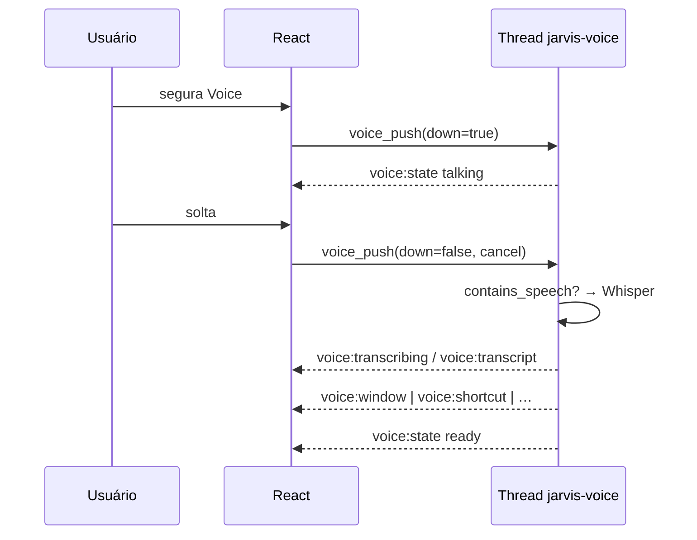

# Motor de voz (reconhecimento de fala)

O ouvido do JARVIS: capta o microfone, percebe quando alguém fala e transcreve a frase com o Whisper na própria CPU.

| | |
|---|---|
| **ID** | `feature/voice-engine` |
| **Status** | Implementado |
| **Origem** | `42e671a` (2026-10-23) · evoluída em `750ebd0`, `048a254` e não commitado |

## Visão geral

O motor de voz é o ouvido do JARVIS. Ele capta o microfone padrão do Windows, detecta quando alguém fala e transcreve a frase com o Whisper rodando na própria CPU, sem rede e sem chave de API. O texto segue para o matcher ([voice-commands](../voice-commands/spec.md)), para o ditado ([dictation](../dictation/spec.md)) ou para a conversa ([assistant](../assistant/spec.md)). O motor roda numa thread Rust própria, então os comandos continuam funcionando com a janela minimizada. A UI só acompanha o estado por eventos. Esta spec cobre a captura, a detecção de fala, a transcrição, os modelos Whisper, os três modos de ativação, o botão Voice da dock e a legenda no núcleo.

## Dados

- `$ativação`: **Ativação (Activation)**: `wakeWord`, `always` ou `pushToTalk` (padrão). Fica em `Settings.activation`. Ver [glossário](../../domain/glossary.md).
- `$escuta`: `Settings.voiceEnabled`, se a escuta estava ligada.
- `$modelo`: o **Modelo Whisper**: `small` (padrão), `base`, `large-v3-turbo`. Fica em `Settings.model`. O arquivo fica em `%LOCALAPPDATA%\dev.jarvis.os\models\` como `models\ggml-*.bin` (GGML quantizado), com `.part` até o hash conferir.
- `$idioma`: `Settings.language` (padrão `pt`).
- `$estado`: o **Estado do motor (VoiceState / EngineState)**: `off`, `loading`, `standby`, `awake`, `listening`, `ready`, `talking`, `dictating`, `asking`, `error`. Só em memória, vindo de `voice:state`.
- `$gravação`: a **Gravação (Recording)**: `Command` (Voice) ou `Dictation(target)` (editor ou núcleo).

Os quatro valores de `Settings` ficam em `%APPDATA%\dev.jarvis.os\settings.json`. A UI grava com `save_settings`, com debounce de 450 ms. Ver [persistência](../../domain/persistence.md).

- `sanitize` volta modelo e idioma inválidos ao padrão (`small`, `pt`): um modelo removido do catálogo volta para `small`.

## Componentes

### Captura (`voice/audio.rs`)

Abre o microfone e entrega áudio pronto para a VAD e o Whisper.

- **Comportamento:**
  - **RF-001**: O motor DEVE capturar o dispositivo de entrada padrão, misturar os canais em mono e reamostrar para 16 kHz.
    - O `Resampler` é um box-filter que também sobe taxas baixas para 16 kHz.
  - Se o microfone for desconectado (`device_lost`), o estado vira `error` com "O microfone parou de responder".

### Detecção de fala (`Vad`)

Corta o áudio contínuo em frases e diz se uma gravação tem fala.

- **Comportamento:**
  - **RF-003**: A VAD DEVE cortar o áudio em frases por energia: quadros de 30 ms, início com 3 de 5 quadros com voz, fim após ~660 ms de silêncio, corte em 10 s e descarte de rajadas com menos de 8 quadros com voz.
  - `contains_speech` decide se uma gravação do push-to-talk vai ao Whisper. Gravações sem fala (cliques, silêncio) são descartadas antes.
  - Se a frase for longa, a VAD corta em 10 s, e o push-to-talk para de crescer em 30 s.

### Porteiro de fala (`SpeechGate`, `voice/silero.rs`)

O Silero VAD (sherpa-onnx) confere se uma frase cortada pela VAD de energia é fala antes de ela ir ao Whisper.

- **Comportamento:**
  - **RF-011**: Nos modos `wakeWord` e `always`, uma frase DEVE ter pelo menos 0,25 s de fala pelo Silero (limiar 0,5, janelas de 512 amostras, 1 thread) para chegar ao Whisper. Porta, teclado, música sem voz e ventilador são energia, não fala, e custavam um Whisper inteiro cada (~2,4 s de dez núcleos com o Small).
  - Ele roda só sobre as frases candidatas (~5 ms por segundo de áudio), nunca o tempo todo.
  - O push-to-talk, o ditado e as perguntas ao núcleo não passam pelo porteiro: quem segurou o botão quer ser ouvido.
  - O modelo `silero_vad.onnx` (~0,6 MB, `models::SILERO`, tamanho e SHA-256 fixos) é baixado sozinho, em segundo plano, na primeira frase de um modo de escuta. Até ele chegar, ou sem internet, só a VAD de energia decide, como antes. A pasta é olhada de novo a cada 10 s.

### Transcrição (`Transcriber`)

Roda o Whisper (whisper-rs, in-process) sobre uma frase de 16 kHz.

- **Comportamento:**
  - Use flash attention, decodificação greedy e no máximo 10 threads (4 numa GPU, onde a CPU só alimenta a placa).
  - **RF-012**: O Whisper DEVE rodar onde `voiceDevice` pede: `auto`, `cpu` ou uma GPU pelo nome que o Vulkan dá (`gpu_devices()`, `pick_device`). Uma GPU que sumiu vale como `auto`; uma GPU que falha ao carregar o modelo cai para a CPU sem erro. Builds sem a feature `vulkan` sempre usam a CPU ([ADR-0021](../../arch/adr/0021-reconhecimento-voz-gpu-via-vulkan-porteiro.md)).
    - O backend Vulkan do ggml inicia sem trava: listar as GPUs e carregar o modelo se revezam num `Mutex`.
  - **RF-006**: O Whisper DEVE ser guiado pelo prompt "Hey Jarvis. <palavras-chave>." e DEVE descartar a saída que apenas repete o prompt (3 palavras ou mais).
    - `build_prompt` monta o prompt e `is_prompt_echo` detecta o eco.
  - **RF-007**: Segmentos com probabilidade de não-fala ≥ 0,6 DEVEM ser descartados.
  - Ajuste a janela do encoder e limite os tokens conforme a duração do áudio (ver RNF-003 em [Restrições](#restrições)).

### Thread do motor (`VoiceEngine`)

A thread `jarvis-voice` é dona do microfone, da VAD e do Whisper, e publica o que acontece por eventos.

- **Comportamento:**
  - Os botões pressionados na UI viram flags atômicas (`talking`, `discard`, `dictating`, `asking`, `deaf`, `exit_after_dictation`). O loop `run` lê as flags a cada volta.
    - Com o microfone aberto, ele espera chunks com timeout de 20 ms.
    - **RF-013**: Com o microfone fechado (push-to-talk `ready`), o loop DEVE dormir até 1 s: cada botão, o `stop` e o `save_settings` o acordam na hora com um chunk vazio (`VoiceEngine::nudge`). Antes eram 50 voltas por segundo o dia todo.
  - **RF-002**: Nos modos `wakeWord` e `always`, o microfone DEVE ficar aberto. Em `pushToTalk`, ditado e pergunta ao núcleo, ele só abre enquanto o botão está pressionado.
    - `resting_state` dá o estado de repouso de cada modo (`standby`, `listening` ou `ready`).
  - **RF-004**: Uma liberação com `cancel` DEVE descartar a gravação sem transcrevê-la.
    - `discard` é gravado antes de `talking`, para o loop ver o cancelamento junto com a liberação.
  - **RF-005**: Enquanto `deaf` estiver ligado (o JARVIS falando), o motor DEVE zerar a VAD em vez de procurar comandos. Botões pressionados continuam gravando.
  - **RF-010**: Cada mudança de estado DEVE ser emitida em `voice:state`, e cada frase transcrita em `voice:transcript`.
    - `handle_utterance` emite `voice:transcribing` enquanto o Whisper trabalha e depois entrega o texto ao matcher.
  - **RF-008**: A escuta ligada DEVE ser lembrada (`voiceEnabled`) e restaurada quando o app abre.
    - `voice_start` grava `voiceEnabled = true`, `voice_stop` grava `false`, e o `setup` de `lib.rs` liga o motor se estava ligado.
  - Se não houver modelo baixado, `voice_start` e `voice_push` devolvem o código `model-missing`, que a UI trata abrindo as Configurações.
  - Se o modo de ativação mudar durante a escuta, a mudança vale na próxima volta do loop. Um ditado em andamento é preservado.
  - Se o modelo ou o `voiceDevice` mudar nas Configurações, reinicie o motor se ele estiver rodando. `voice_devices` informa onde o modelo carregado roda (`active`).
  - Se o microfone entregar zeros digitais por 4 s com a escuta aberta, avise "O microfone não está captando som. Verifique a tecla de mudo do microfone.".
    - Um clique curto com silêncio puro não conta como microfone mudo: o aviso só aparece com 0,3 s ou mais de gravação.
  - No modo `wakeWord`, a janela acordada depois do nome expira e o motor volta a `standby`.

### `useVoiceAssistant`

O hook que espelha $estado na UI e manda os botões para o Rust.

- **Comportamento:**
  - Escute `voice:state`, `voice:transcribing`, `voice:transcript` e `voice:wake`, e exponha $estado, a mensagem e a última frase ouvida (`heard`).
  - Enfileire pressionar e soltar em `pushQueue`, para que push-to-talk, ditado e pergunta cheguem ao Rust em ordem.
  - Fora do Tauri, `available` é falso: o hook não escuta os eventos, e o `App` usa a captura visual no lugar dos comandos `voice_*`.

### Modelos Whisper (`models.rs`, `download.rs`, `ModelCard`)

O catálogo, o download verificado e os cartões de modelo em "Reconhecimento de voz" das Configurações.

- **Comportamento:**
  - O catálogo `MODELS` fixa tamanho e SHA-256 de cada modelo. O Small aparece primeiro.
  - **RF-009**: Um modelo só conta como baixado quando o arquivo tem exatamente o tamanho do catálogo.
  - `download_model` roda em segundo plano. Um download repetido do mesmo modelo é ignorado.
    - `fetch_verified` grava em `.part`, limita o corpo e só renomeia o arquivo depois de conferir o SHA-256.
    - O progresso sai em `model:progress` a cada 200 ms, e o fim (ou o erro) em `model:done`. `useModels` guarda o progresso e os erros.
  - Quando o usuário clicar num cartão, $modelo muda para ele. Quando clicar em "Baixar", o download começa.
  - Se o modelo selecionado não estiver baixado, mostre "Baixe o modelo selecionado para ativar a escuta.".
  - Se o usuário ligar a escuta sem o modelo, as Configurações abrem e a dock diz "Baixe um modelo de voz" (tom de erro).
  - Abaixo dos cartões, mostre o seletor "Idioma" e "Último reconhecimento: “<frase>”" (ou "—").
- **Layout:**
  - Um `radiogroup` "Modelo Whisper" com um cartão por modelo.
  - Cada cartão tem, à esquerda, o rádio, o nome com o tamanho ("Small · …") e a descrição, que dá lugar ao erro do download quando há um.
  - À direita, um de três: "Baixado" com um `Check`; o progresso em % com um `Loader2` girando e uma barra fina embaixo; ou o botão "Baixar" com o ícone `Download`.
- **Estilo:**
  - Cartão `rounded-xl border px-4 py-3`. O selecionado fica em `border-hud-cyan/40 bg-hud-cyan/[0.06]`; os outros em `border-hud-cyan/12 bg-white/[0.02]`.
  - O rádio é um círculo `size-4`, com o ponto `bg-hud-light` brilhando quando selecionado.
  - Nome em `text-sm text-hud-text`, tamanho em `text-hud-text/45`, descrição em `text-xs text-hud-text/50`.
  - "Baixado" e "Baixar" em 10 px, maiúsculas, `tracking-[0.16em]`. "Baixado" em `text-hud-light/80`.
  - A barra de progresso tem `h-0.5`, com `bg-hud-light` sobre `bg-hud-cyan/15`.
  - O botão "Baixar" tem borda `hud-cyan/25`, que acende em `hud-cyan/60` no hover. Fora do app ele fica desabilitado, com opacidade 40%.

### Botão Voice e faixa de gravação (`QuickDock`)

O primeiro botão da dock: liga a escuta ou, no push-to-talk, grava enquanto está pressionado.

- **Comportamento:**
  - O rótulo do botão segue $estado (`DOCK_LABEL`): "Voice", "Voice · carregando", "Voice · diga “Hey Jarvis”", "Voice · ouvindo comando", "Voice · ouvindo", "Voice · segure para falar", "Voice · solte para enviar", "Voice · ditando no Markdown", "Voice · ouvindo para o JARVIS". No navegador, segurando, o rótulo é "Voice · solte para parar".
  - Nas Configurações, a linha "Escuta" mostra o texto longo do mesmo estado (`ENGINE_LABEL`), como "Segure Voice ou M para falar" ou "Aguardando “Hey Jarvis”".
  - No `pushToTalk`, o botão é segurado em vez de clicado: "start" ao pressionar, depois "send" ou "cancel".
    - A captura de ponteiro mantém a gravação mesmo se o ponteiro sair do botão para cima ou para a direita.
    - Deslizar 120 px para a esquerda (`CANCEL_DISTANCE`) cancela antes de soltar. O ícone acompanha o ponteiro um pouco enquanto desliza.
    - Espaço ou Enter com foco no botão seguram como o ponteiro.
  - `holdVoice` no `App` exige 350 ms (`MIN_HOLD_MS`). Num clique mais rápido, nada é gravado e a dock mostra "Segure para falar".
  - Se a gravação for cancelada, a dock diz "Gravação cancelada".
  - Enquanto a gravação está pressionada, mostre a faixa de gravação: a luz, o relógio ("0:01") e "Deslize para cancelar". Antes do microfone abrir (o modelo pode estar carregando), o relógio mostra "…" e o rótulo acessível é "Preparando o microfone".
  - Nos modos `wakeWord` e `always`, o clique liga ou desliga a escuta (`toggleVoice`).
- **Layout:**
  - Botão `h-14 w-14` com o ícone `Mic` (ou `MicOff` em erro) de 30 px e o reflexo dele embaixo. O rótulo ou o aviso da dock aparece acima do botão.
  - Uma luz pequena (`Indicator`) fica embaixo do ícone: microfone vivo, esperando o nome, carregando ou erro.
  - A faixa de gravação (`RecordingBar`) fica à esquerda da dock (`right-full mr-3`). Com a dock oculta, ela aparece dentro do aviso flutuante (`DockToast`), ao lado do texto.
  - Na faixa, da esquerda para a direita: a luz, o relógio e a dica com `ChevronLeft`. A dica desliza para uma borda esmaecida, não por cima do relógio.
- **Estilo:**
  - Ícone em `text-hud-alert/80` no erro, `text-hud-light` com brilho quando ativo e `text-hud-text/65` (ou `/85` armado ou carregando) em repouso.
  - A luz do `Indicator` tem `h-1 w-1`: `bg-hud-light` pulsando a cada 1,8 s com o microfone vivo e a cada 0,9 s carregando; `bg-hud-alert` no erro.
  - Faixa `h-11 rounded-full border border-hud-cyan/18 bg-hud-panel/70 backdrop-blur-md`, com sombra.
  - A luz da faixa é `size-2 bg-hud-alert` e pisca a cada 1,2 s durante a gravação.
  - O relógio é `text-sm tabular-nums`, em `text-hud-light` gravando e `text-hud-text/50` preparando.
  - A dica fica em 10 px, maiúsculas, `tracking-[0.22em] text-hud-text/70`, e esmaece até 0,15 de opacidade perto do ponto de cancelamento.
  - Os avisos da dock ficam em 10 px maiúsculas sobre `bg-hud-panel/80`; os de erro em `border-hud-alert/30 text-hud-alert/90`.

### `VoiceCaption`

A frase que o JARVIS entendeu, dentro do núcleo do holograma.

- **Comportamento:**
  - Quando uma transcrição chegar, faça as palavras surgirem uma a uma e some-as depois de 3,2 s + 220 ms por palavra (`HOLD_MS`, `HOLD_PER_WORD_MS`).
  - Frases longas guardam só as últimas 18 palavras (`MAX_WORDS`), precedidas de "…".
  - Enquanto o Whisper trabalha (`voice:transcribing`), mostre três pontos pulsando (`Thinking`) no lugar do texto.
  - A legenda é `aria-live="polite"` e não recebe cliques.
- **Layout:**
  - Fixa no centro do núcleo (`CORE_CENTER_Y_CSS`), num quadrado de 62% da composição, com o texto centralizado.
  - Atrás do texto, um fundo radial escuro e translúcido (`BACKDROP`), para o holograma continuar visível.
- **Estilo:**
  - Fonte `clamp(14px, composição × 0,042, 30px)`, `font-light`, `leading-snug`, `text-hud-glow` com brilho ciano (`text-shadow`).
  - Cada palavra entra com 70 ms de atraso em relação à anterior, subindo e saindo do desfoque em 0,45 s. A frase sai com desfoque de 6 px em 0,6 s.
  - Os três pontos são `bg-hud-glow`, pulsam em 1,1 s e ficam defasados 0,18 s.

### Captura visual no navegador (`useAudioAnalyzer`)

Fora do Tauri não há Whisper: Voice só abre o microfone para animar o holograma.

- **Comportamento:**
  - Fora do Tauri, Voice usa só `getUserMedia` para animar o holograma, e as Configurações dizem "Reconhecimento de voz e abertura de programas funcionam no app desktop.".
  - No app, a captura visual só abre com o microfone do motor aberto e o núcleo ligado (`visualCapture`).
  - Se a permissão for negada, mostre "Acesso ao microfone negado" e mantenha o holograma animando. Os outros erros do `getUserMedia` também saem em PT-BR.
  - Ao desligar, libere as trilhas e o `AudioContext`.

## Voz e teclado

- Segurar Voice ou M (push-to-talk): grava; soltar envia.
- Deslizar 120 px à esquerda ou Esc: cancela a gravação (`hold("cancel")`).
- Clique em Voice ou M (outros modos): liga ou desliga a escuta.
- Espaço ou Enter com foco em Voice: segura como o ponteiro.

A tecla M e o Esc ficam em `useWindowControls`.

## Restrições

- **RNF-001**: Offline. Só o download de modelos usa a rede (huggingface `ggerganov/whisper.cpp`).
- **RNF-002**: Tempo por comando com o Small (padrão), medido em 2026-11-04 nas fixtures de fala ([ADR-0021](../../arch/adr/0021-reconhecimento-voz-gpu-via-vulkan-porteiro.md)): CPU 2,6–8,9 s (10 threads), Intel Graphics 0,74–1,4 s (o `auto`), NVIDIA MX570 0,09–0,27 s. A carga com aquecimento leva ~1,6 s na GPU. O Turbo não acertou mais que o Small, então o padrão continua o Small.
- **RNF-004**: Medido no build de release (2026-11-04, `npm run perf`): esperando o "Hey Jarvis" com som ambiente, o `jarvis.exe` gastava **9,2 s de CPU por segundo (77% da máquina)** transcrevendo cada ruído; é o caso que o porteiro e a GPU atacam. Em push-to-talk, ocioso, ~0,3 ms/s. Depois (mesma sessão, sem fala no ambiente): 2 ms/s na CPU e 4 ms/s na Intel esperando o "Hey Jarvis", sem nenhuma frase mandada ao Whisper.
- **RNF-005**: Memória do `jarvis.exe` com o Small (release, 2D ocioso): ~857 MB de RAM privada na CPU; ~1.007 MB de RAM privada mais ~500 MB de memória compartilhada da GPU na Intel (o `auto`); ~1.030 MB mais 443 MB de VRAM na NVIDIA. "Processador" é a opção mais leve em memória ([ADR-0021](../../arch/adr/0021-reconhecimento-voz-gpu-via-vulkan-porteiro.md#custo-no-app-release-npm-run-perf-2d-ocioso-mesma-sessão)).
- **RNF-003**: A janela do encoder se ajusta à duração do áudio (384 a 1500 quadros) e os tokens são limitados a 10 por segundo + 24, para cortar laços de repetição.
- Áudio em 16 kHz mono; push-to-talk ≤ 30 s; a VAD corta em 10 s; Whisper ≤ 10 threads; ~20 s por comando com o Turbo na CPU.

## Histórias de usuário

### US1 — Segurar para falar (P1)

Como usuário, seguro Voice (ou a tecla M), falo um comando e solto para enviar, como num áudio do WhatsApp.

**Por que P1:** é o modo padrão (`pushToTalk`) e o único que não deixa o microfone aberto o tempo todo.
**Teste independente:** `tests/voice.spec.ts` — "push-to-talk (the default) listens only while Voice or M is held".

**Aceite**

1. **Dado** o modo "Segurar para falar", **quando** olho a dock, **então** o botão se chama "Voice · segure para falar".
2. **Dado** Voice pressionado, **quando** falo, **então** aparece a faixa de gravação (luz, relógio "0:01" e "Deslize para cancelar"), e o rótulo vira "Voice · solte para enviar" no app (no navegador, "Voice · solte para parar").
3. **Dado** que estou segurando, **quando** arrasto o ponteiro para cima ou para a direita, **então** a gravação continua até eu soltar, por causa da captura de ponteiro.
4. **Dado** um clique rápido (menos de 350 ms), **quando** solto, **então** nada é gravado e a dock mostra "Segure para falar".
5. **Dado** que soltei, **quando** a gravação tem fala, **então** ela vai para o Whisper e o resultado segue para o matcher. Gravações sem fala (cliques, silêncio) são descartadas antes do Whisper.

### US2 — Cancelar a gravação (P1)

Como usuário, desisto de um comando no meio da fala.

**Por que P1:** um áudio enviado por engano dispara uma ação.
**Teste independente:** `tests/voice.spec.ts` — "push-to-talk is cancelled by sliding left or by Esc".

**Aceite**

1. **Dado** Voice pressionado, **quando** deslizo 120 px para a esquerda, **então** a gravação é descartada antes mesmo de soltar e a dock diz "Gravação cancelada".
2. **Dado** M pressionado, **quando** aperto Esc, **então** a gravação é descartada e nunca chega ao Whisper.

### US3 — "Hey Jarvis" e "Sempre ouvindo" (P2)

Como usuário, deixo o microfone aberto e falo sem tocar em nada.

**Por que P2:** permite usar o computador sem as mãos.
**Teste independente:** `tests/voice.spec.ts` — "keyboard shortcut M toggles the microphone" (no navegador); no app real, via CDP ([testing](../../arch/testing.md)).

**Aceite**

1. **Dado** o modo `wakeWord` ou `always`, **quando** aperto M ou clico em Voice, **então** a escuta liga ou desliga.
2. **Dado** o modo `wakeWord`, **quando** a escuta está ligada, **então** o rótulo diz "Voice · diga “Hey Jarvis”". Depois do nome, diz "Voice · ouvindo comando".
3. **Dado** o JARVIS falando uma resposta, **quando** o microfone está aberto, **então** a fala dele não é tomada como comando.

### US4 — Ver o que foi ouvido (P2)

Como usuário, vejo dentro do núcleo a frase que o JARVIS entendeu.

**Por que P2:** confirma que a transcrição saiu certa.
**Teste independente:** `tests/voice.spec.ts` — "a transcript materialises inside the core, then fades away".

**Aceite**

1. **Dado** uma transcrição, **quando** ela chega, **então** as palavras surgem uma a uma no centro do núcleo e somem depois de 3,2 s + 220 ms por palavra.
2. **Dado** que o Whisper ainda está trabalhando, **quando** olho o núcleo, **então** vejo três pontos pulsando no lugar do texto.

### US5 — Escolher e baixar o modelo Whisper (P2)

Como usuário, escolho entre Small, Base e Large V3 Turbo e baixo o modelo pelas Configurações.

**Por que P2:** sem modelo baixado a escuta não liga.
**Teste independente:** `tests/shortcuts.spec.ts` — "JARVIS's model is chosen in the settings, next to the Whisper models" (o Small aparece primeiro). O download real não tem teste Playwright.

**Aceite**

1. **Dado** um modelo não baixado, **quando** ligo a escuta, **então** as Configurações abrem e a dock diz "Baixe um modelo de voz".
2. **Dado** um download, **quando** ele termina, **então** o arquivo só é usado se o SHA-256 e o tamanho conferem.

### US6 — Microfone mudo ou negado (P3)

**Teste independente:** `tests/voice-denied.spec.ts` — "denied microphone shows a discreet error and keeps rendering".

**Aceite**

1. **Dado** o microfone entregando zeros digitais por 4 s, **quando** a escuta está aberta, **então** a dock avisa "O microfone não está captando som. Verifique a tecla de mudo do microfone.".
2. **Dado** a permissão negada no navegador, **quando** clico em Voice, **então** aparece "Acesso ao microfone negado" e o holograma continua animando.

## Critérios de sucesso

- **SC-001**: Um comando curto dito ao Voice é transcrito em ~1 s com o modelo padrão numa GPU integrada com Vulkan (o `auto`), e em 3 a 9 s numa CPU de notebook.
- **SC-002**: Nenhuma gravação cancelada ou sem fala chega ao Whisper.
- **SC-003**: O microfone nunca abre sozinho no navegador (`voice.spec` confere 0 streams antes do clique) e libera trilhas e `AudioContext` ao desligar.

## Fora de escopo e limitações

- Decidir o que a frase quer dizer: ver [voice-commands](../voice-commands/spec.md).
- Sem o Vulkan SDK na compilação, ou sem GPU com Vulkan, o Whisper roda na CPU, e o Large V3 Turbo fica impraticável. Um build com a feature `vulkan` não abre numa máquina sem nenhum driver Vulkan (`vulkan-1.dll`).
- O laptop de desenvolvimento entrega silêncio digital quando a tecla de mudo está ativa; o motor só consegue avisar.
- A seleção de dispositivo não existe: sempre o microfone padrão do Windows.

## Código

Uma thread Rust `jarvis-voice` é dona do microfone (cpal), da VAD por energia, do porteiro Silero e do Whisper (whisper-rs, in-process, na CPU ou numa GPU via Vulkan). Ela publica estados e textos por eventos Tauri. Botões pressionados na UI viram flags atômicas (`talking`, `discard`, `dictating`, `asking`, `deaf`, `exit_after_dictation`) lidas a cada volta do loop, que espera chunks com timeout de 20 ms com o microfone aberto e de até 1 s com ele fechado (os botões o acordam com `nudge`). A UI (`useVoiceAssistant`) só espelha o estado e enfileira pressionar/soltar em ordem.

| | |
|---|---|
| **Camadas** | `QuickDock` (Voice) · `VoiceCaption` · `useVoiceAssistant` · `useWindowControls` (M/Esc) · comandos `voice_*` · `voice/{mod,audio,vad,silero,transcriber}.rs`, `models.rs`, `download.rs` |
| **Dependências** | `cpal` 0.18, `whisper-rs` 0.16 (feature `vulkan` opcional), `sherpa-onnx` 1.13.8 (Silero VAD, o mesmo do TTS), `ureq` 3, `sha2` |
| **Testes** | `tests/voice.spec.ts`, `tests/voice-denied.spec.ts` (projetos `voice` e `voice-denied`, microfone falso do Chromium); Rust em `voice/audio.rs`, `vad.rs`, `transcriber.rs`, `models.rs`, `download.rs`; `speech_tests` ignorados em `voice/mod.rs` |
| **Plataforma** | Windows 11 · WebView2. Fora do Tauri, `available` é falso e Voice usa só `getUserMedia` para animar o holograma |

### Arquivos

| Arquivo | Papel |
|---|---|
| `src-tauri/src/voice/mod.rs` | `VoiceEngine`, loop `run`, `Recording`, `handle_utterance`, `dictate`, eventos |
| `src-tauri/src/voice/audio.rs` | `open` (dispositivo padrão, mono), `Resampler` box-filter para 16 kHz, `device_lost` |
| `src-tauri/src/voice/vad.rs` | `Vad::push` e `contains_speech` |
| `src-tauri/src/voice/transcriber.rs` | `Transcriber` (flash attention, greedy, CPU ou GPU), `gpu_devices`, `pick_device`, `build_prompt`, `is_prompt_echo` |
| `src-tauri/src/voice/silero.rs` | `SpeechGate`: Silero VAD sobre as frases dos modos de escuta, download do modelo em segundo plano |
| `src-tauri/src/models.rs` | catálogo `MODELS`, `is_downloaded`, `download` |
| `src-tauri/src/download.rs` | `fetch_verified` (`.part` → rename após SHA-256) |
| `src-tauri/src/lib.rs` | comandos `voice_*`, `models_status`, `download_model`; restauração no `setup` |
| `src/hooks/useVoiceAssistant.ts` | estado, eventos, fila `pushQueue` para push/dictate/ask |
| `src/hooks/useSettings.ts` | `useModels` (progresso e erros de download) |
| `src/components/VoiceCaption.tsx` | legenda palavra por palavra e `Thinking` |
| `src/components/QuickDock.tsx` | segurar Voice, deslizar 120 px para cancelar, faixa de gravação |
| `src/App.tsx` | `holdVoice` (350 ms mínimo), `toggleVoice`, `ENGINE_LABEL`, `DOCK_LABEL` |

### Contratos

#### Comandos Tauri

| Comando | Entrada | Saída | Notas |
|---|---|---|---|
| `voice_start` | — | `VoiceStatus` | Liga e grava `voiceEnabled = true`; erro `model-missing` |
| `voice_stop` | — | `VoiceStatus` | Para e grava `voiceEnabled = false` |
| `voice_status` | — | `VoiceStatus` | |
| `voice_push` | `{ down, cancel }` | `VoiceStatus` | O primeiro `down` liga o motor |
| `voice_deafen` | `{ on }` | — | Chamado por [tts](../tts/spec.md) |
| `models_status` | — | `ModelStatus[]` | `downloaded` = tamanho exato |
| `download_model` | `{ id }` | — | Em segundo plano; repetido é ignorado |

`voice_dictate` está em [dictation](../dictation/spec.md) e `voice_ask` em [assistant](../assistant/spec.md).

#### Eventos e Channels

| Nome | Payload | Emissor → consumidor |
|---|---|---|
| `voice:state` | `{ state, message }` | `Reporter` → `useVoiceAssistant` |
| `voice:transcribing` | `boolean` | `handle_utterance` → `VoiceCaption` |
| `voice:transcript` | `{ text, millis }` | `handle_utterance` → `heard` |
| `voice:wake` | — | matcher `Wake` → pulso do holograma |
| `model:progress` | `{ id, received, total }` | thread de download → `useModels` (a cada 200 ms) |
| `model:done` | `{ id, error }` | thread de download → `useModels` |

Os eventos de decisão (`voice:command`, `voice:window`…) estão em [voice-commands](../voice-commands/spec.md).

### Fluxo

### Constituição

- [x] P1 Offline-first — Whisper local; a rede só é usada no download verificado do modelo.
- [x] P2 Rust é dono do nativo — áudio e download só no Rust. A WebView recebe permissão automática de microfone apenas para a captura visual.
- [x] P3 Comandos finos — `voice_*`, `models_status` e `download_model` em `lib.rs` repassam para `VoiceEngine`/`models`. Downloads rodam em thread própria e os eventos são `voice:*` e `model:*`.
- [x] P4 Contratos espelhados — `EngineState` leva "Mirrors `VoiceState`"; `model-missing` é sentinela compartilhada.
- [x] P5 Persistência tolerante — `sanitize` volta modelo/idioma inválidos ao padrão (`small`, `pt`).
- [x] P6 Fora do Tauri — fallback de navegador (`useAudioAnalyzer`, captura só visual).
- [x] P7 PT-BR — mensagens de erro e rótulos em PT-BR.
- [x] P9 Desktop leve — a captura visual só abre com o microfone do motor aberto e o núcleo ligado (`visualCapture`).
- [x] P11 Testes — UI no Playwright; Rust com `mod tests`; testes com modelo real levam `#[ignore]`.

### Decisões relacionadas

- [ADR-0002 — STT offline whisper.cpp na CPU, Small padrão](../../arch/adr/0002-stt-whisper-offline-cpu.md)
- [ADR-0021 — Reconhecimento de voz na GPU via Vulkan, com porteiro Silero e volta para a CPU](../../arch/adr/0021-reconhecimento-voz-gpu-via-vulkan-porteiro.md)
- [ADR-0003 — motor de voz numa thread Rust](../../arch/adr/0003-motor-de-voz-thread-rust.md)
- [ADR-0011 — fakes de dev e E2E modo web](../../arch/adr/0011-fakes-de-dev-e-e2e-modo-web.md)
- [Contrato IPC](../../arch/ipc-contract.md)

## Tarefas

Legenda: `[x]` feito · `[ ]` pendente · `[P]` pode rodar em paralelo (arquivos diferentes) · `[USn]` história desta spec. As tarefas foram reconstruídas do código e do commit de origem.

### Fase 1 — Base

- [x] T001 [P] Captura do microfone padrão em mono, `Resampler` para 16 kHz e `device_lost` — `src-tauri/src/voice/audio.rs`
- [x] T002 [P] VAD por energia (30 ms, 3 de 5, 22 quadros de silêncio, 10 s, 8 quadros com voz) e `contains_speech` — `src-tauri/src/voice/vad.rs`
- [x] T003 [P] `Transcriber`: flash attention, greedy, janela do encoder 384–1500, limite de tokens, ≤ 10 threads, `no_speech` ≥ 0,6, eco do prompt — `src-tauri/src/voice/transcriber.rs`
- [x] T004 [P] Catálogo de modelos com tamanho e SHA-256 fixos, `is_downloaded` por tamanho exato — `src-tauri/src/models.rs`
- [x] T005 [P] `fetch_verified` com arquivo `.part`, limite de corpo e progresso a cada 200 ms — `src-tauri/src/download.rs`
- [x] T006 `Activation`, `model`, `language`, `voiceEnabled` e sanitização — `src-tauri/src/settings.rs`

### Fase 2 — US1 Segurar para falar (P1)

- [x] T007 [US1] `VoiceEngine` com thread `jarvis-voice`, flags atômicas e loop `run` (microfone só enquanto pressionado) — `src-tauri/src/voice/mod.rs`
- [x] T008 [US1] Comandos `voice_start`, `voice_stop`, `voice_status`, `voice_push` e restauração no `setup` — `src-tauri/src/lib.rs`
- [x] T009 [US1] Hook com eventos e fila `pushQueue` (pressionar/soltar em ordem) — `src/hooks/useVoiceAssistant.ts`
- [x] T010 [US1] Segurar Voice, faixa de gravação e teclas Espaço/Enter — `src/components/QuickDock.tsx`
- [x] T011 [US1] `holdVoice` (mínimo de 350 ms, "Segure para falar"), `DOCK_LABEL` e `ENGINE_LABEL` — `src/App.tsx`
- [x] T012 [US1] Tecla M segurada no push-to-talk e alternada nos outros modos — `src/hooks/useWindowControls.ts`

### Fase 3 — US2 Cancelar (P1)

- [x] T013 [US2] `discard` gravado antes de `talking`, para o loop ver o cancelamento junto com a liberação — `src-tauri/src/voice/mod.rs`
- [x] T014 [US2] Deslizar 120 px (`CANCEL_DISTANCE`) e Esc → `hold("cancel")` — `src/components/QuickDock.tsx`, `src/hooks/useWindowControls.ts`

### Fase 4 — US3 Hey Jarvis e Sempre ouvindo (P2)

- [x] T015 [US3] Microfone sempre aberto, VAD contínua e `resting_state` por modo — `src-tauri/src/voice/mod.rs`
- [x] T016 [US3] `deaf` zera a VAD enquanto o JARVIS fala; `voice_deafen` — `src-tauri/src/voice/mod.rs`, `src-tauri/src/lib.rs`
- [x] T017 [US3] Modo trocado em tempo real e expiração da janela acordada — `src-tauri/src/voice/mod.rs`

### Fase 5 — US4 Legenda no núcleo (P2)

- [x] T018 [US4] `VoiceCaption` (18 palavras no máximo, 3,2 s + 220 ms/palavra) e `Thinking` — `src/components/VoiceCaption.tsx`

### Fase 6 — US5 Modelos (P2)

- [x] T019 [US5] `models_status`, `download_model`, eventos `model:progress` e `model:done` — `src-tauri/src/lib.rs`
- [x] T020 [US5] `useModels` e cartões de modelo em "Reconhecimento de voz" — `src/hooks/useSettings.ts`, `src/components/SettingsPanel.tsx`
- [x] T021 [US5] `model-missing` abre as Configurações com "Baixe um modelo de voz" — `src/App.tsx`

### Fase 7 — US6 Microfone mudo ou negado (P3)

- [x] T022 [US6] Aviso de microfone mudo após 4 s de zeros (0,3 s mínimo no push-to-talk) — `src-tauri/src/voice/mod.rs`
- [x] T023 [US6] Erros do `getUserMedia` em PT-BR na captura visual — `src/hooks/useAudioAnalyzer.ts`

### Fase 8 — Testes

- [x] T024 Playwright `tests/voice.spec.ts` — "listens, reacts to audio and releases resources"
- [x] T025 Playwright `tests/voice.spec.ts` — "a transcript materialises inside the core, then fades away"
- [x] T026 Playwright `tests/voice.spec.ts` — "push-to-talk (the default) listens only while Voice or M is held"
- [x] T027 Playwright `tests/voice.spec.ts` — "push-to-talk is cancelled by sliding left or by Esc"
- [x] T028 Playwright `tests/voice.spec.ts` — "particles and rings align on the core's equator while listening, then scatter"
- [x] T029 Playwright `tests/voice.spec.ts` — "keyboard shortcut M toggles the microphone"
- [x] T030 Playwright `tests/voice-denied.spec.ts` — "denied microphone shows a discreet error and keeps rendering"
- [x] T031 Playwright `tests/settings.spec.ts` — "activation mode and language persist"
- [x] T032 Rust `src-tauri/src/voice/audio.rs` — `downsamples_to_16k`, `upsamples_low_rates`
- [x] T033 Rust `src-tauri/src/voice/vad.rs` — `silence_and_background_noise_produce_nothing`, `one_utterance_between_silences`, `fed_in_small_chunks_gives_the_same_result`, `short_clicks_are_dropped`, `push_to_talk_recordings_need_speech`, `long_speech_is_cut_at_the_maximum`
- [x] T034 Rust `src-tauri/src/voice/transcriber.rs` — `detects_prompt_echo`
- [x] T035 Rust `src-tauri/src/models.rs` — `catalog_is_consistent`, `partial_files_do_not_count_as_downloaded`; `src-tauri/src/download.rs` — `hex_is_lowercase_and_padded`
- [x] T036 Rust ignorados `src-tauri/src/voice/mod.rs` — `speech_wake_word_mode`, `speech_window_commands`, `speech_always_listening_mode` (fixtures em `src-tauri/tests/fixtures/`)
- [x] T037 E2E no app real via CDP (manual) — ver [testing](../../arch/testing.md)

### Fase 9 — Desempenho (2026-11-04)

- [x] T038 Loop dorme até 1 s com o microfone fechado; `nudge` nos botões, no `stop` e no `save_settings` — `src-tauri/src/voice/mod.rs`, `src-tauri/src/lib.rs`
- [x] T039 Porteiro Silero nos modos de escuta, modelo baixado em segundo plano — `src-tauri/src/voice/silero.rs`, `src-tauri/src/models.rs`
- [x] T040 `voiceDevice` (`auto`/`cpu`/GPU), `gpu_devices`, `pick_device`, volta para a CPU, 4 threads na GPU — `src-tauri/src/voice/transcriber.rs`, `src-tauri/src/settings.rs`
- [x] T041 Feature `vulkan` e `--features vulkan` automático com o SDK — `src-tauri/Cargo.toml`, `scripts/tauri.mjs`
- [x] T042 `voice_devices` e o seletor "Processamento da voz" (fake de dev com as GPUs da máquina) — `src-tauri/src/lib.rs`, `src/lib/settings.ts`, `src/components/SettingsPanel.tsx`
- [x] T043 Rust ignorado `speech_gate_tells_speech_from_noise`; `speech_lists_gpus`; `JARVIS_TEST_DEVICE` nos testes de fala
- [x] T044 Playwright `tests/settings.spec.ts` — "speech recognition runs on the CPU or a GPU, automatic by default, and the choice persists"
- [x] T045 Medir Small/Base/Turbo × CPU/Intel/NVIDIA e fixar o `auto` na GPU integrada (`auto_device`, `is_integrated`) — [ADR-0021](../../arch/adr/0021-reconhecimento-voz-gpu-via-vulkan-porteiro.md)
- [x] T046 Aquecimento na GPU (2 s de silêncio ao carregar) — `src-tauri/src/voice/transcriber.rs`
- [x] T047 Rust `auto_prefers_the_integrated_gpu_and_names_win` — `src-tauri/src/voice/transcriber.rs`

## Pendências
- [ ] Os testes ignorados de fala real usam fixtures geradas pela voz TTS do Windows, que o Whisper às vezes deturpa ("relógio" e "pomodoro" ficam irreconhecíveis; `speech_window_commands` evita essas palavras por isso).
