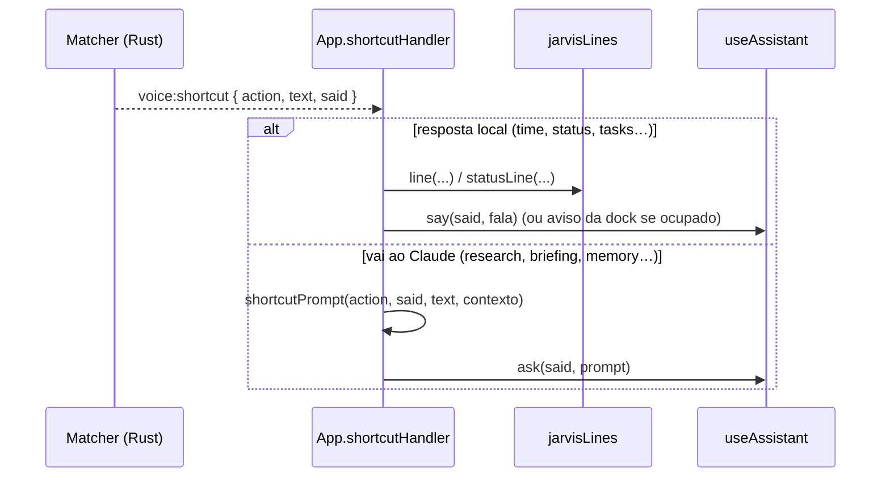

# Atalhos de voz do JARVIS

Frases fixas no começo de um pedido falado ("pesquisa sobre…", "que horas são", "bom dia") que o JARVIS responde na hora ou leva ao Claude Code com instruções.

| | |
|---|---|
| **ID** | `feature/voice-shortcuts` |
| **Status** | Implementado |
| **Origem** | `048a254` (2026-10-27) · evoluída não commitado (9 dos 18 atalhos) |
| **Voz** | `shortcut:research`, `shortcut:note`, `shortcut:reminder`, `shortcut:time`, `shortcut:date`, `shortcut:status`, `shortcut:briefing`, `shortcut:focus`, `shortcut:memory`, `shortcut:weather`, `shortcut:agenda`, `shortcut:agendaRemove`, `shortcut:tasks`, `shortcut:taskAdd`, `shortcut:taskDone`, `shortcut:taskRemove`, `shortcut:cleanup`, `shortcut:homecoming` |

## Visão geral

Os atalhos são frases fixas que o JARVIS reconhece no começo de um pedido falado: "pesquisa sobre…", "que horas são", "bom dia", "me lembra de…". Cada um vira uma ação nomeada (`ShortcutAction`) com as palavras ditas depois. Parte deles é respondida na hora, sem o Claude Code, com falas locais no personagem (hora, data, status, tarefas, agenda, clima). A outra parte vai ao Claude Code com instruções (`[Atalho: …]`) em volta das palavras do usuário (pesquisa, briefing, memória, lembretes com hora do dia, anotações com data). O que não é atalho nem comando chega como pergunta (`ask`). Esta spec cobre o reconhecimento, o despacho em `App.tsx`, os prompts e as falas locais. Os atalhos de lembrete, anotação, limpeza, agenda, tarefas, clima e "papai chegou" têm specs donas, listadas abaixo. As frases completas estão em [voice-intents](../../domain/voice-intents.md).

## Dados

Os atalhos não guardam estado próprio. As frases ficam em `Settings.voiceCommands` ([voice-commands](../voice-commands/spec.md)).

- `$evento`: o **ShortcutEvent** `{ action, text, said }` que chega por `voice:shortcut`. `action` é uma **ShortcutAction** ou `"ask"`.
- `$máquina`: o **MachineState** `{ stats, battery, music }` lido por `readMachine` na hora do pedido. Só em memória.
- `$falas`: os pools **LINES**, indexados por **LineKey**, em `src/lib/jarvisLines.ts`. Ver [glossário](../../domain/glossary.md).

## Os 18 atalhos

| Ação | Exemplo | Precisa de texto | O que faz | Resposta | Spec dona |
|---|---|---|---|---|---|
| `research` | "pesquisa sobre fusão nuclear" | sim | O JARVIS pesquisa na web e salva `Notas/AAAA-MM-DD Pesquisa - <assunto>.md` com "Fontes" | Claude | esta |
| `note` | "anota que…" | sim | Linha no arquivo de anotações do dia; com data, vai para a agenda | local / Claude | [quick-notes](../quick-notes/spec.md) |
| `reminder` | "me lembra de beber água em 20 minutos" | sim | Lembrete ou timer; hora do dia vai ao Claude; sem quando vira tarefa | local / Claude | [reminders](../reminders/spec.md) |
| `time` | "que horas são" | não | Hora falada (com comentário entre 0 h e 5 h) | local | esta |
| `date` | "que dia é hoje" | não | Data por extenso | local | esta |
| `status` | "status do sistema" | não | CPU, memória, disco, bateria, Wi-Fi; avisos primeiro | local | esta |
| `briefing` | "bom dia" | não | Cumprimento, clima, agenda, tarefas e notícias em ≤ 6 frases | Claude | esta |
| `focus` | "protocolo foco" | não | Fecha todas as janelas, abre o Pomodoro e inicia o foco | local | esta / [pomodoro](../../widgets/pomodoro/spec.md) |
| `memory` | "lembre-se que eu moro em Curitiba" | sim | O JARVIS grava em `Memória.md` | Claude | esta / [assistant](../assistant/spec.md) |
| `weather` | "como está o tempo em Curitiba amanhã" | não | Previsão de hoje ou de amanhã; outra cidade é respondida, não guardada | local | [widgets/weather](../../widgets/weather/spec.md) |
| `agenda` | "repassa minha agenda" | não | Compromissos de hoje e tarefas pendentes, ou os de amanhã | local | [widgets/agenda](../../widgets/agenda/spec.md) |
| `agendaRemove` | "apaga o compromisso dois" | sim | Desmarca pelo número; sem número, vai ao Claude | local / Claude | [widgets/agenda](../../widgets/agenda/spec.md) |
| `tasks` | "quais são minhas tarefas" | não | Lê as pendentes e abre o widget | local | [widgets/tasks](../../widgets/tasks/spec.md) |
| `taskAdd` | "adiciona tarefa comprar pão" | sim | Põe na lista | local | [widgets/tasks](../../widgets/tasks/spec.md) |
| `taskDone` | "conclui a tarefa dois" | sim | Marca feita, por número ou por texto | local | [widgets/tasks](../../widgets/tasks/spec.md) |
| `taskRemove` | "apaga a tarefa de comprar pão" | sim | Apaga, por número ou por texto | local | [widgets/tasks](../../widgets/tasks/spec.md) |
| `cleanup` | "limpa a memória" | não | Encerra o Claude Code ocioso e devolve a RAM | local | [memory-cleanup](../memory-cleanup/spec.md) |
| `homecoming` | "acorda, querido, papai chegou" | não | Cena das luzes, widgets e boas-vindas; vale sem o nome do JARVIS | local | [greeting-homecoming](../greeting-homecoming/spec.md) |

## Componentes

### Reconhecimento (`match_shortcut`)

O matcher Rust acha a frase do atalho e separa as palavras que vêm depois.

- **Comportamento:**
  - **RF-001**: O matcher DEVE reconhecer a frase de um atalho no início da transcrição ou logo depois do nome do JARVIS e de palavras de preenchimento ("por favor", "ok", "então"…); vence a frase mais longa.
    - As palavras de preenchimento ficam em `LEAD_FILLER`, e `request_start` acha onde o pedido começa.
  - **RF-002**: Os atalhos `research`, `note`, `reminder`, `memory`, `agendaRemove`, `taskAdd`, `taskDone` e `taskRemove` DEVEM exigir palavras depois da frase.
    - Se um desses for dito sozinho ("pesquisa"), não é atalho (`NEEDS_TEXT`).
  - **RF-003**: O evento `voice:shortcut` DEVE levar `action`, `text` (as palavras depois da frase, como o Whisper escreveu) e `said` (a transcrição inteira).
    - `words_from` recorta `text` da transcrição original, com acentos e pontuação.
  - Se a frase do atalho estiver no meio da frase, ela não conta ("o papai chegou cedo hoje" é ignorado).
  - No modo "Sempre ouvindo", um atalho só vale com o nome do JARVIS, exceto `homecoming` (`UNADDRESSED`).
  - Se o mesmo atalho vier com as mesmas palavras em menos de 4 s, ignore-o.
  - `Decision::Shortcut` e `Decision::Ask` saem como `voice:shortcut`; o `Ask` leva `action: "ask"`.

### Despacho (`shortcutHandler`)

Em `App.tsx`, recebe $evento, pulsa o holograma e faz a ação.

- **Comportamento:**
  - **RF-005**: `time`, `date`, `status`, `focus`, `weather`, `agenda`, `tasks`, `taskAdd`, `taskDone`, `taskRemove` e `cleanup` DEVEM ser respondidos sem o Claude Code.
  - Uma resposta local sai por `reply(said, fala)`: no núcleo, por `say`, com a pergunta e a resposta no histórico.
    - Se o JARVIS estiver ocupado respondendo, a fala local vai para o aviso da dock em vez do núcleo.
  - `ask` manda `said` como está ao JARVIS (`askJarvis(said)`).
  - `research` e `memory` mandam `askJarvis(said, prompt)`, com o prompt de `shortcutPrompt`. O histórico guarda `said`, não as instruções.
  - `briefing` lê $máquina e, se houver cidade, a previsão; junta a agenda de hoje e as tarefas pendentes e manda tudo ao Claude.
    - O contexto usa `spokenStatus`, `weatherReport`, `agendaReport` e `tasksReport`. Sem cidade, o prompt diz "cidade desconhecida".
  - `focus` fecha todas as janelas (`closeAll`), abre o Pomodoro, chama `pomodoro.focus()` e diz a fala `focus` com os minutos da fase.
  - Os demais atalhos seguem as specs donas, em [Os 18 atalhos](#os-18-atalhos): `weather` usa `placeIn`; `agendaRemove`, `taskDone` e `taskRemove` usam `leadingNumber`; `taskAdd` usa `cleanTask`; `reminder` vai para [reminders](../reminders/spec.md), `note` para [quick-notes](../quick-notes/spec.md), `cleanup` para `runCleanup` e `homecoming` para `comeHome`.
  - Um comando de voz comum (janela, música, Pomodoro) é confirmado por `confirm`, com a fala sob o que foi dito; com o JARVIS ocupado, só a dock diz.

### Falas locais (`jarvisLines.ts`)

O que o JARVIS diz sem o Claude, no personagem.

- **Comportamento:**
  - **RF-006**: As falas locais DEVEM vir de pools em `LINES`, sorteadas sem repetir a anterior.
    - `line(key, …)` lembra o último índice de cada `LineKey`. Um pool de uma fala só repete essa fala.
  - O nome do usuário (Configurações) entra pelo marcador `{n}` como vocativo, só antes de pontuação (", Tony."). Sem nome, a frase continua correta (`fill`, `vocative`).
  - `timeLine` fala a hora (`clockPhrase`). Entre 0 h e 5 h, usa o pool `lateTime`, com um comentário de madrugada.
  - `dateLine` fala a data por extenso (`longDate`).
  - `weatherLine`, `agendaLine`, `tasksLine` e `dayLine` montam as falas dos atalhos com specs donas.
  - Se um atalho só funcionar no app e o pedido vier do navegador, diga `desktopOnly` ("Receio que isso só funcione no app desktop…").

### Status da máquina (`readMachine`, `statusLine`)

A resposta de "status do sistema".

- **Comportamento:**
  - `readMachine` lê `system_stats` (ou o fake `__JARVIS_SYSTEM__` em DEV), a bateria (`readBattery`) e o que o player está tocando.
  - `machineReadings` devolve os avisos e as leituras: processador, memória, gigabytes livres no disco do sistema, bateria e Wi-Fi.
  - **RF-007**: O status DEVE alertar sobre CPU > 85%, RAM > 90%, disco do sistema com < 10% livre e bateria < 15% sem carregar.
  - `statusLine` começa por um cabeçalho de alerta (`statusWarning`, com os avisos) ou de "tudo bem" (`statusOk`) e depois lê as leituras.
  - Se não houver nenhuma leitura, diga `statusUnknown`.

### Prompts ao Claude (`shortcutPrompt`)

Monta a mensagem `[Atalho: …]` para os atalhos que o Claude resolve.

- **Comportamento:**
  - **RF-004**: As mensagens ao Claude DEVEM começar com `[Atalho: pesquisa]`, `[Atalho: briefing]`, `[Atalho: anotação]`, `[Atalho: memória]` ou `[Atalho: lembrete]`, com as palavras do usuário entre aspas.
  - Cada prompt leva a hora atual ("Agora são … de …") e as instruções da tabela [Prompts ao Claude (`shortcutPrompt`)](#prompts-ao-claude-shortcutprompt).
  - A persona tem uma regra para as mensagens `[Atalho: …]` (`src-tauri/assistant-persona.md`).

## Casos de borda

- **Fora do Tauri:** os testes disparam `window.__JARVIS__.voiceShortcut({ action, text, said })`; o Claude é o fake `__JARVIS_ASSISTANT__` e o sistema, `__JARVIS_SYSTEM__`.

## Voz e teclado

- As frases `shortcut:*` (ver [voice-intents](../../domain/voice-intents.md)) disparam `voice:shortcut`.
- Menu avançado → Voz → seção "JARVIS": edita as frases. "Suas interações" associa frases novas a uma ação `shortcut`.

## Restrições

- **RNF-001**: As listas de ações em Rust (`SHORTCUT_TARGETS`) e TypeScript (`ShortcutAction`) DEVEM ser iguais.
- Lembretes de até 7 dias (10 080 min); repetição ignorada em 4 s.

## Histórias de usuário

### US1 — Respostas na hora, sem o Claude (P1)

Como usuário, pergunto as horas, a data ou o status e ouço a resposta imediatamente.

**Por que P1:** perguntas simples não devem esperar o Claude Code.
**Teste independente:** `tests/shortcuts.spec.ts` — "the time, the date and the status are answered at once, without Claude Code".

**Aceite**

1. **Dado** "Que horas são?", **quando** dito, **então** o JARVIS responde com uma fala local (ex.: "São 14 horas e 5 minutos, Tony.") e nenhuma pergunta vai ao Claude.
2. **Dado** "Status do sistema", **quando** dito, **então** a resposta traz as leituras ("Processador em 12 por cento, memória em 50 por cento, 375 gigabytes livres no disco C.") depois de um cabeçalho de "tudo bem" ou de alerta.
3. **Dado** as respostas locais, **quando** termino, **então** elas estão no histórico como qualquer resposta.

### US2 — Atalhos que viram instruções ao Claude (P1)

Como usuário, digo "pesquisa sobre a fusão nuclear" e o JARVIS pesquisa e salva uma nota.

**Por que P1:** dá ao Claude a tarefa completa sem o usuário ditar instruções.
**Teste independente:** `tests/shortcuts.spec.ts` — "a question said to Voice goes to JARVIS; a research goes with its instructions, the words stay in the history".

**Aceite**

1. **Dado** uma pesquisa, **quando** enviada, **então** o Claude recebe "[Atalho: pesquisa] O usuário disse: "…". Assunto: …" com as instruções da nota.
2. **Dado** o histórico, **quando** olho, **então** ele guarda o que foi dito ("Pesquisa sobre a fusão nuclear"), não as instruções.
3. **Dado** uma frase que não é comando nem atalho, **quando** dita ao Voice, **então** vai ao JARVIS como está (`action: "ask"`).

### US3 — Bom dia (P2)

**Teste independente:** `tests/feeds.spec.ts` — "the briefing hands JARVIS the weather, the day's agenda and what is left on the list".

**Aceite**

1. **Dado** "Bom dia, Jarvis", **quando** dito, **então** o prompt leva a hora, o estado do computador, o clima (ou "cidade desconhecida"), a agenda de hoje e as tarefas pendentes, e pede até seis frases curtas, com no máximo duas buscas, só para notícias.

### US4 — Protocolo foco (P2)

**Teste independente:** `tests/shortcuts.spec.ts` — "Protocolo foco closes the windows and starts a focus phase".

**Aceite**

1. **Dado** janelas abertas, **quando** digo "protocolo foco", **então** todas fecham, o Pomodoro abre numa fase de foco e o JARVIS diz quantos minutos (ex.: 25).

### US5 — Falas no personagem (P2)

**Teste independente:** `tests/personality.spec.ts` — "every line reads cleanly with and without the name, which only ever comes before punctuation", "he varies his words: never the same line twice in a row", "the time comes with a remark in the small hours, the status with what needs attention first".

**Aceite**

1. **Dado** um nome em Configurações, **quando** o JARVIS fala, **então** o nome só aparece como vocativo antes de pontuação (", Tony."); sem nome, a frase continua correta.
2. **Dado** a mesma situação duas vezes seguidas, **quando** ele responde, **então** a fala não se repete (quando há mais de uma).

## Critérios de sucesso

- **SC-001**: Hora, data e status chegam sem nenhuma chamada ao Claude Code.
- **SC-002**: Toda frase dirigida ao JARVIS vira atalho, comando ou pergunta; nada é perdido em silêncio.

## Fora de escopo e limitações

- Criar atalhos novos de JARVIS pela UI: a aba Voz só associa frases novas às 18 ações existentes.
- A cena do "papai chegou" e as saudações: [greeting-homecoming](../greeting-homecoming/spec.md).
- O que o Claude faz com cada prompt depende da [persona](../../domain/jarvis-persona.md).

## Código

Os atalhos são comandos `kind: "shortcut"` no catálogo de voz. O matcher (`match_shortcut`) os reconhece e emite `voice:shortcut { action, text, said }`. Na UI, `shortcutHandler` em `App.tsx` despacha cada ação: responde localmente com `reply()` (núcleo ou dock) usando as falas de `jarvisLines.ts`, ou chama `askJarvis(said, prompt)`, em que `prompt` é montado por `shortcutPrompt` e `said` é o que fica no histórico. Helpers puros de `shortcuts.ts` interpretam durações, números, datas, lugares e o estado da máquina.

| | |
|---|---|
| **Camadas** | `App.tsx` (`shortcutHandler`, `reply`, `readMachine`) · `src/lib/shortcuts.ts` · `src/lib/jarvisLines.ts` · `useAssistant` (`ask`, `say`) · `voice/matcher.rs` · `settings.rs` (`SHORTCUT_TARGETS`) |
| **Dependências** | hooks dos widgets (`useAgenda`, `useTasks`, `useWeather`, `usePomodoro`, `useReminders`), `system_stats`, `readBattery`, player de música |
| **Testes** | `tests/shortcuts.spec.ts`, `tests/personality.spec.ts`, `tests/feeds.spec.ts`, `tests/tasks.spec.ts`; Rust em `matcher.rs` |
| **Plataforma** | Windows 11 · WebView2. Fora do Tauri: probe `voiceShortcut` + fakes `__JARVIS_ASSISTANT__`, `__JARVIS_SYSTEM__`, `__JARVIS_CLEANUP__` |

### Arquivos

| Arquivo | Papel |
|---|---|
| `src-tauri/voice-commands.json` | 18 entradas `shortcut:*` com rótulo e frases |
| `src-tauri/src/voice/matcher.rs` | `match_shortcut`, `NEEDS_TEXT`, `UNADDRESSED`, `LEAD_FILLER`, `request_start`, `words_from` |
| `src-tauri/src/settings.rs` | `SHORTCUT_TARGETS` (18) e validação de comandos custom do tipo `shortcut` |
| `src/lib/shortcuts.ts` | `ShortcutAction`, `ShortcutEvent`, `parseReminder`, `leadingNumber`, `mentionsWhen`, `cleanTask`, `placeIn`, `describeDuration`, `clockPhrase`, `longDate`, `localStamp`, `machineReadings`, `spokenStatus`, `statusReport`, `shortcutPrompt` |
| `src/lib/jarvisLines.ts` | `LINES`, `line`, `fill`, `vocative`, `timeLine`, `dateLine`, `statusLine`, `weatherLine`, `agendaLine`, `tasksLine`, `dayLine` |
| `src/App.tsx` | `shortcutHandler`, `reply`, `addTask`, `comeHome`, `runCleanup`, `readMachine` |

### Contratos

#### Eventos e Channels

| Nome | Payload | Emissor → consumidor |
|---|---|---|
| `voice:shortcut` | `{ action: ShortcutAction \| "ask", text, said }` | `handle_utterance` (`Shortcut`/`Ask`) → `onShortcut` → `shortcutHandler` |

#### Prompts ao Claude (`shortcutPrompt`)

| Ação | Cabeçalho | Instrução |
|---|---|---|
| `research` | `[Atalho: pesquisa]` + assunto | Pesquisar e salvar `Notas/AAAA-MM-DD Pesquisa - <assunto curto>.md` (título, resumo de 3–5 linhas, tópicos, números, "Fontes"); dizer o achado em até duas frases |
| `briefing` | `[Atalho: briefing]` + hora + máquina | Clima, agenda, tarefas; até seis frases, sem listas, ≤ 2 buscas só para notícias; sem cidade, perguntar no fim |
| `note` | `[Atalho: anotação]` + hora | Compromisso → `agenda_add`; a fazer → `tasks_add`; senão o arquivo de anotações do dia |
| `memory` | `[Atalho: memória]` | Guardar em `Memória.md` e confirmar |
| `reminder` | `[Atalho: lembrete]` + hora | `reminder_set` calculando os minutos; perguntar se faltar quando |

### Fluxo

### Constituição

- [x] P1 Offline-first — a maioria responde localmente; só pesquisa, briefing, memória e os casos com data ou sem número (lembrete com hora do dia, anotação com data, compromisso sem número) vão ao Claude.
- [x] P3 Comandos finos — reconhecimento no Rust, execução na UI; evento `voice:shortcut`.
- [x] P4 Contratos espelhados — `ShortcutAction` com "Mirrors `SHORTCUT_TARGETS`"; `ShortcutEvent` espelha o `ShortcutEvent` de `voice/mod.rs`.
- [x] P6 Fora do Tauri — probe `window.__JARVIS__.voiceShortcut` e fakes de DEV.
- [x] P7 PT-BR — frases, prompts e falas em PT-BR.
- [x] P11 Testes — helpers e falas testados em Playwright puro; matcher em Rust.

### Decisões relacionadas

- [ADR-0004 — catálogo de voz compartilhado + fallback para o JARVIS](../../arch/adr/0004-catalogo-de-voz-compartilhado-e-fallback.md)
- [ADR-0006 — JARVIS via claude.exe](../../arch/adr/0006-jarvis-via-claude-cli.md)
- [ADR-0017 — UI PT-BR, código EN](../../arch/adr/0017-ui-pt-br-codigo-en.md)

## Tarefas

Legenda: `[x]` feito · `[ ]` pendente · `[P]` pode rodar em paralelo (arquivos diferentes) · `[USn]` história desta spec. As tarefas foram reconstruídas do código e do commit de origem.

### Fase 1 — Base

- [x] T001 [P] Entradas `shortcut:*` no catálogo (9 em `048a254`, mais 9 não commitadas) — `src-tauri/voice-commands.json`
- [x] T002 [P] `SHORTCUT_TARGETS` (18) e `valid_custom` para `shortcut` — `src-tauri/src/settings.rs`
- [x] T003 `match_shortcut` no início ou depois do nome e do preenchimento; `NEEDS_TEXT`; `words_from` — `src-tauri/src/voice/matcher.rs`
- [x] T004 `Decision::Shortcut`/`Ask` → `voice:shortcut` — `src-tauri/src/voice/mod.rs`
- [x] T005 [P] `ShortcutAction`, `ShortcutEvent` e helpers de texto, tempo e máquina — `src/lib/shortcuts.ts`
- [x] T006 [P] Pools `LINES`, `line` sem repetição, vocativo `{n}` — `src/lib/jarvisLines.ts`

### Fase 2 — US1 Respostas locais (P1)

- [x] T007 [US1] `time` (`timeLine`, comentário de madrugada), `date`, `status` (`readMachine` + `statusLine`) — `src/App.tsx`, `src/lib/jarvisLines.ts`
- [x] T008 [US1] `reply()`: núcleo via `say`, dock se ocupado — `src/App.tsx`

### Fase 3 — US2 Instruções ao Claude (P1)

- [x] T009 [US2] `shortcutPrompt` para `research`, `briefing`, `note`, `memory`, `reminder` — `src/lib/shortcuts.ts`
- [x] T010 [US2] `ask` e `research`/`memory` → `askJarvis(said, prompt)`; histórico guarda `said` — `src/App.tsx`, `src/hooks/useAssistant.ts`
- [x] T011 [US2] Regra da persona para mensagens `[Atalho: …]` — `src-tauri/assistant-persona.md`

### Fase 4 — US3 Bom dia (P2)

- [x] T012 [US3] `briefing` com `spokenStatus`, `weatherReport`, `agendaReport`, `tasksReport` — `src/App.tsx`

### Fase 5 — US4 Protocolo foco (P2)

- [x] T013 [US4] `focus`: `closeAll`, abre o Pomodoro, `pomodoro.focus()`, fala `focus` — `src/App.tsx`

### Fase 6 — Atalhos com specs donas

- [x] T014 [P] `weather` (`placeIn`, hoje/amanhã), `agenda`, `agendaRemove` (`leadingNumber`), `tasks`, `taskAdd` (`cleanTask`), `taskDone`, `taskRemove` — `src/App.tsx`
- [x] T015 [P] `reminder` → [reminders](../reminders/spec.md); `note` → [quick-notes](../quick-notes/spec.md); `cleanup` → [memory-cleanup](../memory-cleanup/spec.md); `homecoming` → [greeting-homecoming](../greeting-homecoming/spec.md) — `src/App.tsx`

### Fase 7 — US5 Falas no personagem (P2)

- [x] T016 [US5] Confirmações dos comandos de voz (`confirm`) sob o que foi dito — `src/App.tsx`

### Fase 8 — Testes

- [x] T017 Playwright `tests/shortcuts.spec.ts` — "parseReminder: durations in words or digits, what to say, and times of day left to JARVIS"
- [x] T018 Playwright `tests/shortcuts.spec.ts` — "spoken time, durations and the machine's status"
- [x] T019 Playwright `tests/shortcuts.spec.ts` — "prompts carry the user's words and what the shortcut means"
- [x] T020 Playwright `tests/shortcuts.spec.ts` — "a question said to Voice goes to JARVIS; a research goes with its instructions, the words stay in the history"
- [x] T021 Playwright `tests/shortcuts.spec.ts` — "the time, the date and the status are answered at once, without Claude Code"
- [x] T022 Playwright `tests/shortcuts.spec.ts` — "Protocolo foco closes the windows and starts a focus phase"
- [x] T023 Playwright `tests/personality.spec.ts` — "every line reads cleanly with and without the name, which only ever comes before punctuation"
- [x] T024 Playwright `tests/personality.spec.ts` — "he varies his words: never the same line twice in a row"
- [x] T025 Playwright `tests/personality.spec.ts` — "the time comes with a remark in the small hours, the status with what needs attention first"
- [x] T026 Playwright `tests/feeds.spec.ts` — "the briefing hands JARVIS the weather, the day's agenda and what is left on the list"
- [x] T027 Playwright `tests/tasks.spec.ts` — "\"repassa minha agenda\": today's events and what is left on the list"
- [x] T028 Rust `src-tauri/src/voice/matcher.rs` — `shortcuts_open_the_request_and_keep_the_words_as_said`, `the_weather_the_agenda_and_the_stocks_by_voice`, `the_tasks_the_agenda_numbers_and_the_homecoming_by_voice`, `the_memory_cleanup_is_not_the_long_term_memory`
- [x] T029 Rust `src-tauri/src/settings.rs` — `default_voice_commands_are_valid`

## Pendências

- [ ] O atalho `memory` não tem teste de ponta a ponta: só o texto do prompt é conferido em `tests/shortcuts.spec.ts` ("prompts carry the user's words…"); nenhum teste dispara `voiceShortcut` com `action: "memory"`.
