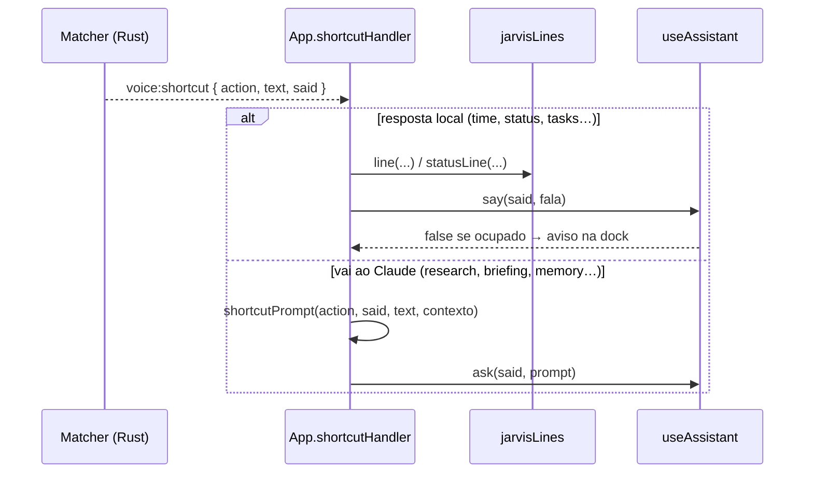

# Feature Specification: JARVIS Voice Shortcuts

## Metadata

| Field | Value |
|---|---|
| Feature ID | `feature/voice-shortcuts` |
| Product | JARVIS OS (jvOS) |
| Feature Status | Implementado |
| Document Status | Reescrita em 2026-11-05 no formato Feature Specification; sem decisões em aberto |
| Source Commit | `048a254` (2026-10-27) com 9 atalhos; os outros 9 (`weather`, `agenda`, `agendaRemove`, `tasks`, `taskAdd`, `taskDone`, `taskRemove`, `cleanup`, `homecoming`) entraram em `e7151cf` (2026-11-05) |
| Uncommitted Changes | Nenhuma |
| Voice Shortcut | `shortcut:research`, `shortcut:note`, `shortcut:reminder`, `shortcut:time`, `shortcut:date`, `shortcut:status`, `shortcut:briefing`, `shortcut:focus`, `shortcut:memory`, `shortcut:weather`, `shortcut:agenda`, `shortcut:agendaRemove`, `shortcut:tasks`, `shortcut:taskAdd`, `shortcut:taskDone`, `shortcut:taskRemove`, `shortcut:cleanup`, `shortcut:homecoming` |
| Assistant Tool | — (os prompts pedem `reminder_set`, `agenda_add` e `tasks_add`, de [assistant-tools](../assistant-tools/spec.md)) |
| Target Platforms | Windows 11 com WebView2; no navegador (modo web) os testes disparam `window.__JARVIS__.voiceShortcut`, o Claude Code e o sistema são fakes de DEV, e `note` e `cleanup` respondem `desktopOnly` |
| Language | PT-BR no conteúdo e nas falas; inglês nos títulos das seções e em Given / When / Then |
| Last Editorial Revision | 2026-11-05 |
| Verification Scope | Conferida com o código em 2026-11-05: `src-tauri/src/voice/matcher.rs`, `src-tauri/src/voice/mod.rs`, `src-tauri/src/settings.rs`, `src-tauri/voice-commands.json`, `src/lib/shortcuts.ts`, `src/lib/jarvisLines.ts`, `src/App.tsx`, `src/hooks/useAssistant.ts`, `tests/shortcuts.spec.ts`, `tests/personality.spec.ts`, `tests/feeds.spec.ts` e `tests/tasks.spec.ts`. Os testes não foram executados nesta revisão |

Especificação no formato inspirado no GitHub Spec Kit, com seções de desenho técnico ([ADR-0025](../../arch/adr/0025-features-formato-feature-specification.md)). Os identificadores US1–US5, RF-001–RF-007, RNF-001, SC-001–SC-002 e T001–T029 são os mesmos da versão anterior. Os critérios de aceite AC-001–AC-012 são os antigos "Critério 1" a "Critério 12", na mesma ordem. KL-* registra limitações conhecidas; OQ-*, decisões de produto em aberto. Nenhum dos dois acrescenta escopo.

## Overview

Os atalhos são frases fixas que o JARVIS reconhece no começo de um pedido falado: "pesquisa sobre…", "que horas são", "bom dia", "me lembra de…". Cada um vira uma ação nomeada (`ShortcutAction`) com as palavras ditas depois.

Parte deles é respondida na hora, sem o Claude Code, com falas locais no personagem (hora, data, status, foco, tarefas, agenda, clima). A outra parte vai ao Claude Code com instruções (`[Atalho: …]`) em volta das palavras do usuário (pesquisa, briefing, memória, lembretes com hora do dia, anotações com data). O que não é atalho nem comando chega como pergunta (`ask`).

Esta spec cobre o reconhecimento, o despacho em `App.tsx`, os prompts e as falas locais. Os atalhos de lembrete, anotação, limpeza, agenda, tarefas, clima e "papai chegou" têm specs donas, listadas no catálogo abaixo. As frases completas estão em [voice-intents](../../domain/voice-intents.md).

| Input | Expected Behavior | Execution Path |
|---|---|---|
| "Que horas são?" | Hora falada na hora, no histórico | Local (`timeLine` → `reply`) |
| "Status do sistema" | Avisos primeiro, depois as leituras | Local (`readMachine` → `statusLine`) |
| "Protocolo foco" | Fecha as janelas e inicia uma fase de foco | Local (`closeAll`, `pomodoro.focus()`) |
| "Pesquisa sobre a fusão nuclear" | O Claude pesquisa, salva uma nota e diz o achado | Claude Code (`[Atalho: pesquisa]`) |
| "Bom dia, Jarvis" | Briefing com clima, agenda, tarefas e notícias | Claude Code (`[Atalho: briefing]`) |
| "Qual a capital da França?" | Vai ao JARVIS como foi dito | Claude Code (`ask`) |

## Goals and Success Criteria

### Goals

- Responder perguntas simples (hora, data, status) sem esperar o Claude Code.
- Dar ao Claude a tarefa completa, sem o usuário ditar instruções.
- Guardar no histórico o que foi dito, não as instruções.
- Falar no personagem, com o nome do usuário e sem repetir a mesma fala.
- Nunca perder em silêncio uma frase dirigida ao JARVIS.

### Success Criteria

| ID | Criterion | Verification |
|---|---|---|
| SC-001 | Hora, data e status chegam sem nenhuma chamada ao Claude Code. | `tests/shortcuts.spec.ts` — "the time, the date and the status are answered at once, without Claude Code" confere `asks` vazio no log do fake. |
| SC-002 | Toda frase dirigida ao JARVIS vira atalho, comando ou pergunta; nada é perdido em silêncio. | Rust `what_is_no_command_goes_to_jarvis`; uma frase de uma palavra só, ou ruído conhecido do Whisper, é `Ignore` de propósito ([voice-commands](../voice-commands/spec.md)). |

## Scope and Non-Goals

### In Scope

- Reconhecer a frase do atalho no início do pedido, ou logo depois do nome e de palavras de preenchimento.
- Exigir texto nos atalhos que agem sobre o que vem depois.
- Despachar as 18 ações e o `ask` em `App.tsx`.
- Respostas locais: hora, data, status, foco e as falas no personagem.
- Prompts `[Atalho: …]` para pesquisa, briefing, anotação, memória e lembrete.

### Out of Scope

- Criar atalhos novos de JARVIS pela UI: a aba Voz só associa frases novas às 18 ações existentes ([voice-commands](../voice-commands/spec.md)).
- A cena do "papai chegou" e as saudações: [greeting-homecoming](../greeting-homecoming/spec.md).
- O que o Claude faz com cada prompt: depende da [persona](../../domain/jarvis-persona.md).
- O detalhe de lembretes, anotações, limpeza, agenda, tarefas e clima: as specs donas, no catálogo abaixo.

## User Stories

### US1 — Instant Answers Without Claude

**Priority:** P1.

**User Story:** Como usuário, pergunto as horas, a data ou o status e ouço a resposta imediatamente.

**Why This Priority:** perguntas simples não devem esperar o Claude Code.

**Independent Test:** `tests/shortcuts.spec.ts` — "the time, the date and the status are answered at once, without Claude Code".

**Acceptance Criteria:** AC-001, AC-002, AC-003 e AC-011.

### US2 — Shortcuts That Become Instructions for Claude

**Priority:** P1.

**User Story:** Como usuário, digo "pesquisa sobre a fusão nuclear" e o JARVIS pesquisa e salva uma nota.

**Why This Priority:** dá ao Claude a tarefa completa sem o usuário ditar instruções.

**Independent Test:** `tests/shortcuts.spec.ts` — "a question said to Voice goes to JARVIS; a research goes with its instructions, the words stay in the history".

**Acceptance Criteria:** AC-004, AC-005, AC-006 e AC-012.

### US3 — Morning Briefing

**Priority:** P2.

**User Story:** Como usuário, digo "bom dia" e o JARVIS me cumprimenta com o clima, os compromissos, as tarefas e as notícias do dia.

**Why This Priority:** começa o dia com um resumo falado, sem abrir nada.

**Independent Test:** `tests/feeds.spec.ts` — "the briefing hands JARVIS the weather, the day's agenda and what is left on the list".

**Acceptance Criteria:** AC-007.

### US4 — Focus Protocol

**Priority:** P2.

**User Story:** Como usuário, digo "protocolo foco" e as janelas fecham e uma fase de foco do Pomodoro começa.

**Why This Priority:** um único comando tira as distrações da tela.

**Independent Test:** `tests/shortcuts.spec.ts` — "Protocolo foco closes the windows and starts a focus phase".

**Acceptance Criteria:** AC-008.

### US5 — In-Character Lines

**Priority:** P2.

**User Story:** Como usuário, ouço as respostas locais no tom do JARVIS, com o meu nome de vez em quando e sem a mesma frase duas vezes seguidas.

**Why This Priority:** a personalidade é parte do produto.

**Independent Test:** `tests/personality.spec.ts` — "every line reads cleanly with and without the name, which only ever comes before punctuation", "he varies his words: never the same line twice in a row" e "the time comes with a remark in the small hours, the status with what needs attention first".

**Acceptance Criteria:** AC-009 e AC-010.

## Requirements

### Functional Requirements

| ID | Requirement | Related Stories |
|---|---|---|
| RF-001 | O matcher DEVE reconhecer a frase de um atalho no início da transcrição ou logo depois do nome do JARVIS e de palavras de preenchimento ("por favor", "ok", "então"…); vence a frase mais longa. | US1, US2, US3, US4 |
| RF-002 | Os atalhos `research`, `note`, `reminder`, `memory`, `agendaRemove`, `taskAdd`, `taskDone` e `taskRemove` DEVEM exigir palavras depois da frase. | US2 |
| RF-003 | O evento `voice:shortcut` DEVE levar `action`, `text` (as palavras depois da frase, como o Whisper escreveu) e `said` (a transcrição inteira). | US2 |
| RF-004 | As mensagens ao Claude DEVEM começar com `[Atalho: pesquisa]`, `[Atalho: briefing]`, `[Atalho: anotação]`, `[Atalho: memória]` ou `[Atalho: lembrete]`, com as palavras do usuário entre aspas. | US2, US3 |
| RF-005 | `time`, `date`, `status`, `focus`, `weather`, `agenda`, `tasks`, `taskAdd`, `taskDone`, `taskRemove` e `cleanup` DEVEM ser respondidos sem o Claude Code. | US1, US4 |
| RF-006 | As falas locais DEVEM vir de pools em `LINES`, sorteadas sem repetir a anterior. | US5 |
| RF-007 | O status DEVE alertar sobre CPU > 85%, RAM > 90%, disco do sistema com < 10% livre e bateria < 15% sem carregar. | US1 |

### Non-Functional Requirements

| ID | Requirement | Scope |
|---|---|---|
| RNF-001 | As listas de ações em Rust (`SHORTCUT_TARGETS`) e TypeScript (`ShortcutAction`, `SHORTCUT_ACTIONS`) DEVEM ser iguais. | `src-tauri/src/settings.rs`, `src/lib/shortcuts.ts`. |

### Operational Constraints

- Repetição ignorada: o mesmo atalho com as mesmas palavras em menos de 4 s.
- Lembretes de até 7 dias (10 080 min, `MAX_REMINDER_MINUTES`).
- Briefing: até seis frases curtas e no máximo duas buscas, só para notícias.
- Comentário de madrugada na hora: das 0 h às 4 h 59.
- Limiares do status: CPU 85%, RAM 90%, disco 10% livre, bateria 15%.
- As falas e os prompts são em PT-BR; nada é gravado em `jarvis.*` pelos atalhos em si.

## Acceptance Criteria

### AC-001 — Time Answered Locally

**Related Story:** US1.

- **Given** "Que horas são?"
- **When** dito
- **Then** o JARVIS responde com uma fala local (ex.: "São 14 horas e 5 minutos, Tony.") e nenhuma pergunta vai ao Claude.

### AC-002 — System Status

**Related Story:** US1.

- **Given** "Status do sistema"
- **When** dito
- **Then** a resposta traz as leituras ("Processador em 12 por cento, memória em 50 por cento, 375 gigabytes livres no disco C.") depois de um cabeçalho de "tudo bem" (`statusOk`) ou de alerta (`statusWarning`).

### AC-003 — Local Answers in the History

**Related Story:** US1.

- **Given** as respostas locais
- **When** terminam
- **Then** elas estão no histórico (`jarvis.assistant`) como qualquer resposta.

### AC-004 — Research Prompt

**Related Story:** US2.

- **Given** uma pesquisa
- **When** enviada
- **Then** o Claude recebe "[Atalho: pesquisa] O usuário disse: "…". Assunto: …." com as instruções da nota.

### AC-005 — History Keeps What Was Said

**Related Story:** US2.

- **Given** o histórico
- **When** olho
- **Then** ele guarda o que foi dito ("Pesquisa sobre a fusão nuclear"), não as instruções.

### AC-006 — Anything Else Is Asked As Is

**Related Story:** US2.

- **Given** uma frase que não é comando nem atalho
- **When** dita ao Voice
- **Then** vai ao JARVIS como está (`action: "ask"`).

### AC-007 — Morning Briefing Prompt

**Related Story:** US3.

- **Given** "Bom dia, Jarvis"
- **When** dito
- **Then** o prompt leva a hora, o estado do computador, o clima (ou "cidade desconhecida"), a agenda de hoje e as tarefas pendentes, e pede até seis frases curtas, com no máximo duas buscas, só para notícias.

### AC-008 — Focus Protocol

**Related Story:** US4.

- **Given** janelas abertas
- **When** digo "protocolo foco"
- **Then** todas fecham, o Pomodoro abre numa fase de foco e o JARVIS diz quantos minutos (ex.: 25).

### AC-009 — Name Only Before Punctuation

**Related Story:** US5.

- **Given** um nome em Configurações
- **When** o JARVIS fala
- **Then** o nome só aparece como vocativo antes de pontuação (", Tony."); sem nome, a frase continua correta.

### AC-010 — No Line Twice in a Row

**Related Story:** US5.

- **Given** a mesma situação duas vezes seguidas
- **When** ele responde
- **Then** a fala não se repete (quando o pool tem mais de uma).

### AC-011 — No Readings

**Related Story:** US1.

- **Given** nenhuma leitura do sistema (sem estatísticas e sem bateria)
- **When** digo "Status do sistema"
- **Then** o JARVIS diz uma fala `statusUnknown` (ex.: "Receio que os sensores não estejam respondendo agora.").

### AC-012 — Shortcut Without Its Text

**Related Story:** US2.

- **Given** "pesquisa" dito sozinho, sem assunto
- **When** o matcher decide
- **Then** não é atalho (`NEEDS_TEXT`): a frase é ignorada e nada vai ao Claude.

## Behavior and Flows

### Shortcut Catalog

| Action | Example | Needs Text | What It Does | Answer | Owner Spec |
|---|---|---|---|---|---|
| `research` | "pesquisa sobre fusão nuclear" | sim | O JARVIS pesquisa na web e salva `Notas/AAAA-MM-DD Pesquisa - <assunto>.md` com "Fontes" | Claude | esta |
| `note` | "anota que…" | sim | Linha no arquivo de anotações do dia; com dia ou hora, vai ao Claude (agenda ou tarefa) | local / Claude | [quick-notes](../quick-notes/spec.md) |
| `reminder` | "me lembra de beber água em 20 minutos" | sim | Lembrete ou timer; hora do dia vai ao Claude; sem quando vira tarefa | local / Claude | [reminders](../reminders/spec.md) |
| `time` | "que horas são" | não | Hora falada (com comentário entre 0 h e 5 h) | local | esta |
| `date` | "que dia é hoje" | não | Data por extenso | local | esta |
| `status` | "status do sistema" | não | CPU, memória, disco, bateria, Wi-Fi; avisos primeiro | local | esta |
| `briefing` | "bom dia" | não | Cumprimento, clima, agenda, tarefas e notícias em ≤ 6 frases | Claude | esta |
| `focus` | "protocolo foco" | não | Fecha todas as janelas, abre o Pomodoro e inicia o foco | local | esta / [pomodoro](../../widgets/pomodoro/spec.md) |
| `memory` | "lembre-se que eu moro em Curitiba" | sim | O JARVIS grava em `Memória.md` | Claude | esta / [assistant](../assistant/spec.md) |
| `weather` | "como está o tempo em Curitiba amanhã" | não | Previsão de hoje ou de amanhã; outra cidade é respondida, não guardada | local | [weather](../../widgets/weather/spec.md) |
| `agenda` | "repassa minha agenda" | não | Compromissos de hoje e tarefas pendentes, ou os de amanhã | local | [agenda](../../widgets/agenda/spec.md) |
| `agendaRemove` | "apaga o compromisso dois" | sim | Desmarca pelo número; sem número, vai ao Claude | local / Claude | [agenda](../../widgets/agenda/spec.md) |
| `tasks` | "quais são minhas tarefas" | não | Lê as pendentes e abre o widget | local | [tasks](../../widgets/tasks/spec.md) |
| `taskAdd` | "adiciona tarefa comprar pão" | sim | Põe na lista | local | [tasks](../../widgets/tasks/spec.md) |
| `taskDone` | "conclui a tarefa dois" | sim | Marca feita, por número ou por texto | local | [tasks](../../widgets/tasks/spec.md) |
| `taskRemove` | "apaga a tarefa de comprar pão" | sim | Apaga, por número ou por texto | local | [tasks](../../widgets/tasks/spec.md) |
| `cleanup` | "limpa a memória" | não | Encerra o Claude Code ocioso e devolve a RAM | local | [memory-cleanup](../memory-cleanup/spec.md) |
| `homecoming` | "acorda, querido, papai chegou" | não | Cena das luzes, widgets e boas-vindas; vale sem o nome do JARVIS | local | [greeting-homecoming](../greeting-homecoming/spec.md) |

### Recognition (`match_shortcut`)

O matcher Rust acha a frase do atalho e separa as palavras que vêm depois.

- RF-001: a frase vale na posição 0 da transcrição ou onde o pedido começa (`request_start`: depois do nome e de `LEAD_FILLER`: "por", "favor", "agora", "então", "ok", "okay", "oi", "olá", "e"). A comparação é palavra por palavra, sem tolerância a letras trocadas; vence a frase que termina mais longe.
- RF-002: um atalho de `NEEDS_TEXT` dito sem nada depois ("pesquisa") não é atalho. A frase segue o resto da decisão; uma palavra só vira `Ignore`.
- RF-003: `words_from` recorta `text` da transcrição original, com acentos, maiúsculas e pontuação ("a Revolução Francesa.").
- A frase do atalho no meio da frase não conta ("o papai chegou cedo hoje" é ignorado).
- No modo "Sempre ouvindo", um atalho só vale com o nome do JARVIS. A exceção é `homecoming` (`UNADDRESSED`): abrindo a frase, ele vale em qualquer modo, mesmo sem o nome; depois do nome, vale como os outros.
- O mesmo atalho com as mesmas palavras em menos de 4 s é ignorado.
- `Decision::Shortcut` e `Decision::Ask` saem como `voice:shortcut`; o `Ask` leva `action: "ask"` e a frase inteira em `text`.
- O atalho vence a janela e a música das palavras dele: "pesquise sobre o relógio atômico" é pesquisa, não o Relógio.

### Dispatch (`shortcutHandler`)

Em `App.tsx`, recebe `$evento`, pulsa o holograma e faz a ação.

| Action | Condition | Behavior | Answer |
|---|---|---|---|
| `ask` | — | `askJarvis(said)` | Claude |
| `research`, `memory` | — | `askJarvis(said, shortcutPrompt(action, said, text, { now }))` | Claude |
| `briefing` | — | Lê a máquina e, se o Clima tiver cidade, a previsão; junta a agenda de hoje e as tarefas pendentes; `askJarvis(said, prompt)` | Claude |
| `time`, `date` | — | `reply(said, timeLine(now))` / `dateLine(now)` | local |
| `status` | — | `readMachine()` → `reply(said, statusLine(machine))` | local |
| `focus` | — | `closeAll()`, abre o Pomodoro, `pomodoro.focus()`, fala `focus` com os minutos da fase | local |
| `weather` | — | `placeIn(text)`; "amanh" na frase escolhe amanhã; sem lugar e sem cidade, `weatherNoCity` | local ([weather](../../widgets/weather/spec.md)) |
| `agenda` | — | Abre a Agenda; hoje com as tarefas (`dayLine`) ou amanhã (`agendaLine`) | local |
| `agendaRemove` | com número (`leadingNumber`) / sem número | Desmarca / `askJarvis(said)` sem instruções | local / Claude |
| `tasks`, `taskAdd`, `taskDone`, `taskRemove` | — | Abre a lista e lê; `addTask` (`cleanTask`); por número ou por texto | local ([tasks](../../widgets/tasks/spec.md)) |
| `reminder` | duração / dia ou hora / nenhum | `reminders.add` / `[Atalho: lembrete]` / `addTask` | local / Claude ([reminders](../reminders/spec.md)) |
| `note` | dia ou hora / no app / no navegador | `[Atalho: anotação]` / `assistant_note` / `desktopOnly` | Claude / local ([quick-notes](../quick-notes/spec.md)) |
| `cleanup` | — | `runCleanup()`; sem resultado (navegador), `desktopOnly` | local ([memory-cleanup](../memory-cleanup/spec.md)) |
| `homecoming` | — | `comeHome(said)` | local ([greeting-homecoming](../greeting-homecoming/spec.md)) |

- Uma resposta local sai por `reply(said, fala)`: no núcleo, por `say`, com a pergunta e a resposta no histórico (RF-005). Se o JARVIS estiver ocupado (respondendo, gravando ou transcrevendo), `say` recusa e a fala vai para o aviso da dock, acima de Voice.
- Um pedido ao Claude com o JARVIS ainda respondendo não entra: a dock diz "Ainda estou respondendo" (erro) e ele se perde (KL-002).
- Um comando de voz comum (janela, música, Pomodoro) é confirmado por `confirm`, com a fala sob o que foi dito; com o JARVIS ocupado, só a dock diz ([voice-commands](../voice-commands/spec.md)).

### Local Lines (`jarvisLines.ts`)

O que o JARVIS diz sem o Claude, no personagem.

- RF-006: `line(key, nome, valores)` sorteia uma fala do pool `LINES[key]` e lembra o último índice de cada `LineKey`, para não repetir. Um pool de uma fala só repete essa fala.
- O nome do usuário (Configurações) entra pelo marcador `{n}` como vocativo (", Tony"), sempre antes de pontuação. Sem nome, o marcador some e a frase continua correta (`fill`, `vocative`). `{Chave}` capitaliza o valor de `{chave}`.
- `timeLine` fala a hora (`clockPhrase`: "São 14 horas e 5 minutos", "É 1 hora", "É meia-noite", "É meio-dia", "… em ponto"). Antes das 5 h, usa o pool `lateTime`, com um comentário de madrugada.
- `dateLine` fala a data por extenso (`longDate`, "terça-feira, 27 de outubro de 2026").
- `weatherLine`, `agendaLine`, `tasksLine` e `dayLine` montam as falas dos atalhos com specs donas.
- `desktopOnly` ("Receio que isso só funcione no app desktop.") responde `note` e `cleanup` quando não há app.

### Machine Status (`readMachine`, `statusLine`)

- `readMachine` lê `system_stats` (ou o fake `__JARVIS_SYSTEM__` em DEV), a bateria (`readBattery`) e o que o jv_T4p3 está tocando, na hora do pedido.
- `machineReadings` devolve os avisos e as leituras: processador, memória, gigabytes livres no disco do sistema (o primeiro cujo nome começa com "C", senão o primeiro), bateria (", carregando") e Wi-Fi (rede e sinal).
- RF-007: avisos "o processador está sob carga pesada", "a memória está quase cheia", "o disco C está quase cheio" e "a bateria está baixa, convém ligar na tomada".
- `statusLine` começa por um cabeçalho de alerta (`statusWarning`, com os avisos) ou de "tudo bem" (`statusOk`) e depois lê as leituras. Sem nenhuma leitura, `statusUnknown`.
- O briefing usa a versão neutra, `spokenStatus` ("Todos os sistemas operando normalmente." ou "Atenção: …"; sem leituras, "Não consigo ler os sensores do sistema agora.").

### Prompts to Claude (`shortcutPrompt`)

| Action | Header | Current Time | Instruction |
|---|---|---|---|
| `research` | `[Atalho: pesquisa] O usuário disse: "<frase>". Assunto: <texto>.` | não | Pesquisar e salvar `Notas/AAAA-MM-DD Pesquisa - <assunto curto>.md` (título, resumo de 3–5 linhas, tópicos, números e datas, "Fontes"); dizer o achado em até duas frases |
| `briefing` | `[Atalho: briefing] O usuário disse: "<frase>".` + hora + "Estado do computador: …" | sim | Linhas "Clima:", "Agenda de hoje:" e "Tarefas pendentes:"; até seis frases, sem listas, ≤ 2 buscas só para notícias; sem cidade, perguntar no fim e não pesquisar o clima; o computador só se algo pedir atenção |
| `note` | `[Atalho: anotação] O usuário disse: "<frase>".` | sim | Compromisso → `agenda_add`; a fazer, sem horário → `tasks_add`; senão `Notas/AAAA-MM-DD Anotações.md`; confirmar em uma frase |
| `memory` | `[Atalho: memória] O usuário disse: "<frase>".` | não | Guardar em `Memória.md` e confirmar em uma frase |
| `reminder` | `[Atalho: lembrete] O usuário disse: "<frase>".` | sim | `reminder_set` calculando os minutos; perguntar se faltar quando |

- A hora vai como "Agora são HH:MM de <data por extenso>.". Aspas duplas na frase do usuário viram simples.
- Sem cidade, a linha do clima é "cidade desconhecida (o widget Clima não tem cidade)"; sem compromissos, "nada marcado"; sem tarefas, "nenhuma".
- A persona tem uma regra para as mensagens `[Atalho: …]` (`src-tauri/assistant-persona.md`).

### Interaction Flow



### User Feedback

| Moment | Persona Key | Output |
|---|---|---|
| Hora | `time`, `lateTime` | Fala no núcleo e no histórico |
| Data | `date` | Idem |
| Status | `statusOk`, `statusWarning`, `statusUnknown` | Idem |
| Protocolo foco | `focus` | Idem, com os minutos |
| Atalho só do app, no navegador | `desktopOnly` | Idem |
| JARVIS ocupado, resposta local | — | Aviso da dock acima de Voice |
| JARVIS ocupado, pedido ao Claude | — | Dock "Ainda estou respondendo" (erro) |

As variantes de cada fala estão em `src/lib/jarvisLines.ts`; as dos atalhos com spec dona, nas specs delas.

### Voice and Keyboard

- As frases `shortcut:*` (ver [voice-intents](../../domain/voice-intents.md)) disparam `voice:shortcut`.
- Menu avançado → Voz → seção "JARVIS": edita as frases. "Suas interações" associa frases novas a uma ação `shortcut` ("JARVIS: <ação>").
- Não há tecla de atalho.

## Data Model and Persistence

### Shortcut Event

```ts
/** Mirrors `SHORTCUT_TARGETS` in src-tauri/src/settings.rs. */
type ShortcutAction =
  | "research" | "note" | "reminder" | "time" | "date" | "status" | "briefing" | "focus" | "memory"
  | "weather" | "agenda" | "agendaRemove" | "tasks" | "taskAdd" | "taskDone" | "taskRemove" | "cleanup" | "homecoming";

interface ShortcutEvent {
  action: ShortcutAction | "ask";
  text: string; // as palavras depois da frase; numa pergunta, todas
  said: string; // a transcrição inteira
}
```

### Machine State

```ts
interface MachineState {
  stats: SystemStats | null;                               // system_stats
  battery: { level: number; charging: boolean } | null;    // readBattery
  music: { title: string; artist: string; station: string; playing: boolean } | null;
}
```

Lido na hora do pedido, só em memória. `$falas` são os pools `LINES`, indexados por `LineKey`. Ver o [glossário](../../domain/glossary.md).

### Storage Rules

| Property | Value |
|---|---|
| State | Nenhum próprio; o último índice de cada `LineKey` fica só em memória |
| Phrases | `Settings.voiceCommands` ([voice-commands](../voice-commands/spec.md)) |
| Answers | No histórico do [assistant](../assistant/spec.md) (`jarvis.assistant`), com a frase dita como pergunta |
| Missing or Invalid Storage | Não se aplica |

## Technical Design

### Component Responsibilities

| File or Component | Responsibility |
|---|---|
| `src-tauri/voice-commands.json` | 18 entradas `shortcut:*` com rótulo e frases |
| `src-tauri/src/voice/matcher.rs` | `match_shortcut`, `NEEDS_TEXT`, `UNADDRESSED`, `LEAD_FILLER`, `request_start`, `words_from` |
| `src-tauri/src/voice/mod.rs` | `Shortcut` e `Ask` → `voice:shortcut` |
| `src-tauri/src/settings.rs` | `SHORTCUT_TARGETS` (18) e validação de comandos do usuário do tipo `shortcut` |
| `src/lib/shortcuts.ts` | `ShortcutAction`, `ShortcutEvent`, `parseReminder`, `leadingNumber`, `mentionsWhen`, `cleanTask`, `placeIn`, `describeDuration`, `clockPhrase`, `longDate`, `localStamp`, `machineReadings`, `spokenStatus`, `statusReport`, `shortcutPrompt` |
| `src/lib/jarvisLines.ts` | `LINES`, `line`, `fill`, `vocative`, `timeLine`, `dateLine`, `statusLine`, `weatherLine`, `agendaLine`, `tasksLine`, `dayLine` |
| `src/App.tsx` | `shortcutHandler`, `reply`, `confirm`, `addTask`, `comeHome`, `runCleanup`, `readMachine` |
| `src/hooks/useAssistant.ts` | `ask(question, prompt?)` (o histórico guarda `question`) e `say(question, answer)` (falso quando ocupado) |

O reconhecimento é do Rust; a execução, da UI. Helpers puros de `shortcuts.ts` interpretam durações, números, datas, lugares e o estado da máquina.

### Related Architecture Decisions

- [ADR-0004 — catálogo de voz compartilhado + fallback para o JARVIS](../../arch/adr/0004-catalogo-de-voz-compartilhado-e-fallback.md)
- [ADR-0006 — JARVIS via claude.exe](../../arch/adr/0006-jarvis-via-claude-cli.md)
- [ADR-0011 — fakes de dev e E2E modo web](../../arch/adr/0011-fakes-de-dev-e-e2e-modo-web.md)
- [ADR-0017 — UI PT-BR, código EN](../../arch/adr/0017-ui-pt-br-codigo-en.md)

## Interfaces and Contracts

### Events and Channels

| Event | Payload | Producer → Consumer |
|---|---|---|
| `voice:shortcut` | `{ action: ShortcutAction \| "ask", text, said }` | `handle_utterance` (`Shortcut`/`Ask`) → `onShortcut` → `shortcutHandler` |

### Assistant Prompt

Os cabeçalhos estão em Prompts to Claude. O `said` vai como pergunta para o histórico; o prompt, só ao Claude Code.

Exemplo (pesquisa):

```text
[Atalho: pesquisa] O usuário disse: "Pesquisa sobre a fusão nuclear". Assunto: a fusão nuclear.
Pesquise na web e salve o resultado como nota em Notas/AAAA-MM-DD Pesquisa - <assunto curto>.md (data de hoje): …
Depois diga, em até duas frases, o principal achado e que a nota está salva.
```

### Development Fakes

Só em DEV: `window.__JARVIS__.voiceShortcut({ action, text, said })` no lugar do evento; `__JARVIS_ASSISTANT__` (Claude falso) com `__JARVIS_ASSISTANT_LOG__`; `__JARVIS_SYSTEM__` (estatísticas); `__JARVIS_CLEANUP__` (limpeza) ([ADR-0011](../../arch/adr/0011-fakes-de-dev-e-e2e-modo-web.md)).

## Edge Cases and Error Handling

| Case | Behavior | Reference |
|---|---|---|
| Atalho que exige texto, dito sozinho ("pesquisa") | Não é atalho (`NEEDS_TEXT`); uma palavra só vira `Ignore` | AC-012 |
| Nenhuma leitura do sistema | `statusUnknown` | AC-011 |
| Sem nome nas Configurações | A fala sai sem vocativo e continua correta | AC-009 |
| "Bom dia" sem cidade | O prompt diz "cidade desconhecida", e o Claude pergunta no fim, sem pesquisar o clima | AC-007 |
| `agendaRemove` sem número | Vai ao Claude como pergunta comum | Dispatch |
| O mesmo atalho com as mesmas palavras em menos de 4 s | Ignorado | Recognition |
| A mesma situação duas vezes seguidas | `line` não repete a fala; um pool de uma fala só repete essa fala | AC-010 |
| JARVIS ocupado, resposta local | A fala vai para o aviso da dock em vez do núcleo; não entra no histórico | Dispatch |
| JARVIS ocupado, pedido ao Claude | Dock "Ainda estou respondendo" (erro); o pedido se perde | KL-002 |
| "Status do sistema" e "bom dia" | `readMachine` lê CPU, memória, disco, bateria e música na hora do pedido | Machine Status |
| Modo "Sempre ouvindo" sem o nome | O atalho é ignorado, exceto `homecoming` | Recognition |
| A frase do atalho no meio da frase | Não conta ("o papai chegou cedo hoje" é ignorado) | Recognition |
| Atalho só do app (`note`, `cleanup`), pedido no navegador | `desktopOnly` | Local Lines |
| Permissões | A aba Voz só associa frases às 18 ações de `SHORTCUT_TARGETS`; uma interação com outra ação é descartada por `valid_custom` | RNF-001 |
| Fora do Tauri | Os testes disparam `voiceShortcut`; Claude, sistema e limpeza são fakes | Development Fakes |

## Dependencies

### Feature Dependencies

| Dependency | Purpose |
|---|---|
| [voice-commands](../voice-commands/spec.md) | O matcher, o catálogo e a aba Voz |
| [voice-engine](../voice-engine/spec.md) | A transcrição que emite o evento |
| [assistant](../assistant/spec.md) | `ask`, `say`, o histórico e a persona |
| [tts](../tts/spec.md) | As falas |
| [dock-taskbar](../dock-taskbar/spec.md) | O aviso quando o JARVIS está ocupado |
| [reminders](../reminders/spec.md), [quick-notes](../quick-notes/spec.md), [memory-cleanup](../memory-cleanup/spec.md), [greeting-homecoming](../greeting-homecoming/spec.md) | Specs donas de `reminder`, `note`, `cleanup` e `homecoming` |
| [weather](../../widgets/weather/spec.md), [agenda](../../widgets/agenda/spec.md), [tasks](../../widgets/tasks/spec.md), [pomodoro](../../widgets/pomodoro/spec.md) | `useWeather`, `useAgenda`, `useTasks`, `usePomodoro` |
| [system](../../widgets/system/spec.md), [battery](../../widgets/battery/spec.md) | `system_stats` e `readBattery` no status |
| [jv_t4p3](../../apps/jv_t4p3/spec.md) | A música no estado da máquina |
| [assistant-tools](../assistant-tools/spec.md) | `reminder_set`, `agenda_add`, `tasks_add` pedidos pelos prompts |

### Runtime Dependencies

- [Tauri](../../foundation/vendor/tauri/spec.md) (o evento `voice:shortcut` e `system_stats`), [React](../../foundation/vendor/react/spec.md), [serde](../../foundation/vendor/serde/spec.md) (o catálogo lido por `serde_json`).
- [Claude Code](../../foundation/vendor/claude-code/spec.md) e a rede, nos atalhos que vão a ele (pesquisa, "bom dia", memória e os desvios de lembrete, anotação e compromisso).
- A Battery API da WebView2 (`navigator.getBattery`).

## Test Strategy and Coverage

### Reported Tests

| Test Reference | Coverage | Acceptance Mapping |
|---|---|---|
| `tests/shortcuts.spec.ts` — "the time, the date and the status are answered at once, without Claude Code" | Hora, status com `statusOk` e as leituras, e data, sem pergunta ao Claude, e as três no histórico | AC-001–AC-003, SC-001 |
| `tests/shortcuts.spec.ts` — "a question said to Voice goes to JARVIS; a research goes with its instructions, the words stay in the history" | O `ask` vai como está, a pesquisa vai com `[Atalho: pesquisa]`, o histórico guarda o que foi dito | AC-004–AC-006 |
| `tests/shortcuts.spec.ts` — "prompts carry the user's words and what the shortcut means" | Os cabeçalhos `[Atalho: …]` com as palavras do usuário, a hora no briefing, `reminder_set` e `Memória.md` | AC-004, AC-007 |
| `tests/shortcuts.spec.ts` — "spoken time, durations and the machine's status" | A hora falada e o status com os avisos primeiro | AC-001, AC-002 |
| `tests/shortcuts.spec.ts` — "parseReminder: durations in words or digits, what to say, and times of day left to JARVIS" | O parser do atalho `reminder` | [reminders](../reminders/spec.md) |
| `tests/shortcuts.spec.ts` — "Protocolo foco closes the windows and starts a focus phase" | As janelas fecham, o Pomodoro entra em foco e a fala diz 25 minutos | AC-008 |
| `tests/personality.spec.ts` — "every line reads cleanly with and without the name, which only ever comes before punctuation" | O vocativo só antes de pontuação, com e sem nome | AC-009 |
| `tests/personality.spec.ts` — "he varies his words: never the same line twice in a row" | A fala não se repete | AC-010 |
| `tests/personality.spec.ts` — "the time comes with a remark in the small hours, the status with what needs attention first" | Comentário de madrugada, avisos primeiro e `statusUnknown` sem leituras | AC-002, AC-011 |
| `tests/feeds.spec.ts` — "the briefing hands JARVIS the weather, the day's agenda and what is left on the list" | O "bom dia" leva clima, agenda e tarefas ao Claude | AC-007 |
| `tests/tasks.spec.ts` — "\"repassa minha agenda\": today's events and what is left on the list" | O atalho `agenda` sem o Claude | US1 ([agenda](../../widgets/agenda/spec.md)) |
| `src-tauri/src/voice/matcher.rs` — `shortcuts_open_the_request_and_keep_the_words_as_said` | A frase no início ou depois do nome e do preenchimento, `text` como foi dito, "Sempre ouvindo" só com o nome, "pesquisa" sozinho ignorado | AC-004, AC-007, AC-012 |
| `src-tauri/src/voice/matcher.rs` — `the_weather_the_agenda_and_the_stocks_by_voice`, `the_tasks_the_agenda_numbers_and_the_homecoming_by_voice`, `the_memory_cleanup_is_not_the_long_term_memory` | Os atalhos das specs donas e o `homecoming` sem o nome | RF-001, RF-002 |
| `src-tauri/src/settings.rs` — `default_voice_commands_are_valid` | As 18 entradas `shortcut:*` apontam para ações de `SHORTCUT_TARGETS` | RNF-001 |

### Verification Commands

Na raiz do repositório:

```powershell
npx playwright test tests/shortcuts.spec.ts --project ui -g "answered at once"
npx playwright test tests/shortcuts.spec.ts --project ui -g "a question said to Voice"
npx playwright test tests/shortcuts.spec.ts --project ui -g "prompts carry|spoken time, durations"
npx playwright test tests/shortcuts.spec.ts --project ui -g "Protocolo foco"
npx playwright test tests/personality.spec.ts --project ui -g "reads cleanly|varies his words|small hours"
npx playwright test tests/feeds.spec.ts --project ui -g "the briefing hands JARVIS"
npx playwright test tests/tasks.spec.ts --project ui -g "repassa minha agenda"
```

Em `src-tauri`:

```powershell
cargo test --lib shortcuts_open_the_request_and_keep_the_words_as_said
cargo test --lib -- the_weather_the_agenda_and_the_stocks_by_voice the_tasks_the_agenda_numbers_and_the_homecoming_by_voice the_memory_cleanup_is_not_the_long_term_memory
cargo test --lib default_voice_commands_are_valid
```

### Coverage Gaps

| Gap | Evidence Status | Suggested Verification |
|---|---|---|
| Atalho `memory` de ponta a ponta | Só o texto do prompt é conferido (KL-001) | `voiceShortcut` com `action: "memory"` e conferir `[Atalho: memória]` no log do fake |
| `desktopOnly` no navegador | Sem teste | `voiceShortcut` com `action: "note"` no modo web |
| JARVIS ocupado: fala local na dock e "Ainda estou respondendo" | Sem teste | Disparar um atalho local durante uma resposta lenta do fake |

## Implementation Plan

**Status Convention:** `[x]` feito · `[ ]` pendente · `[P]` pode rodar em paralelo (arquivos diferentes) · `[USn]` história desta spec. As tarefas foram reconstruídas do código e do commit de origem.

### Phase 1 — Foundation

- [x] T001 [P] Entradas `shortcut:*` no catálogo (9 em `048a254`, mais 9 em `e7151cf`) — `src-tauri/voice-commands.json`
- [x] T002 [P] `SHORTCUT_TARGETS` (18) e `valid_custom` para `shortcut` — `src-tauri/src/settings.rs`
- [x] T003 `match_shortcut` no início ou depois do nome e do preenchimento; `NEEDS_TEXT`; `words_from` — `src-tauri/src/voice/matcher.rs`
- [x] T004 `Decision::Shortcut`/`Ask` → `voice:shortcut` — `src-tauri/src/voice/mod.rs`
- [x] T005 [P] `ShortcutAction`, `ShortcutEvent` e helpers de texto, tempo e máquina — `src/lib/shortcuts.ts`
- [x] T006 [P] Pools `LINES`, `line` sem repetição, vocativo `{n}` — `src/lib/jarvisLines.ts`

### Phase 2 — Instant Answers (US1)

- [x] T007 [US1] `time` (`timeLine`, comentário de madrugada), `date`, `status` (`readMachine` + `statusLine`) — `src/App.tsx`, `src/lib/jarvisLines.ts`
- [x] T008 [US1] `reply()`: núcleo via `say`, dock se ocupado — `src/App.tsx`

### Phase 3 — Instructions for Claude (US2)

- [x] T009 [US2] `shortcutPrompt` para `research`, `briefing`, `note`, `memory`, `reminder` — `src/lib/shortcuts.ts`
- [x] T010 [US2] `ask` e `research`/`memory` → `askJarvis(said, prompt)`; histórico guarda `said` — `src/App.tsx`, `src/hooks/useAssistant.ts`
- [x] T011 [US2] Regra da persona para mensagens `[Atalho: …]` — `src-tauri/assistant-persona.md`

### Phase 4 — Morning Briefing (US3)

- [x] T012 [US3] `briefing` com `spokenStatus`, `weatherReport`, `agendaReport`, `tasksReport` — `src/App.tsx`

### Phase 5 — Focus Protocol (US4)

- [x] T013 [US4] `focus`: `closeAll`, abre o Pomodoro, `pomodoro.focus()`, fala `focus` — `src/App.tsx`

### Phase 6 — Shortcuts with Owner Specs

- [x] T014 [P] `weather` (`placeIn`, hoje/amanhã), `agenda`, `agendaRemove` (`leadingNumber`), `tasks`, `taskAdd` (`cleanTask`), `taskDone`, `taskRemove` — `src/App.tsx`
- [x] T015 [P] `reminder` → [reminders](../reminders/spec.md); `note` → [quick-notes](../quick-notes/spec.md); `cleanup` → [memory-cleanup](../memory-cleanup/spec.md); `homecoming` → [greeting-homecoming](../greeting-homecoming/spec.md) — `src/App.tsx`

### Phase 7 — In-Character Lines (US5)

- [x] T016 [US5] Confirmações dos comandos de voz (`confirm`) sob o que foi dito — `src/App.tsx`

### Phase 8 — Verification

- [x] T017 Playwright `tests/shortcuts.spec.ts` — "parseReminder: durations in words or digits, what to say, and times of day left to JARVIS"
- [x] T018 Playwright `tests/shortcuts.spec.ts` — "spoken time, durations and the machine's status"
- [x] T019 Playwright `tests/shortcuts.spec.ts` — "prompts carry the user's words and what the shortcut means"
- [x] T020 Playwright `tests/shortcuts.spec.ts` — "a question said to Voice goes to JARVIS; a research goes with its instructions, the words stay in the history"
- [x] T021 Playwright `tests/shortcuts.spec.ts` — "the time, the date and the status are answered at once, without Claude Code"
- [x] T022 Playwright `tests/shortcuts.spec.ts` — "Protocolo foco closes the windows and starts a focus phase"
- [x] T023 Playwright `tests/personality.spec.ts` — "every line reads cleanly with and without the name, which only ever comes before punctuation"
- [x] T024 Playwright `tests/personality.spec.ts` — "he varies his words: never the same line twice in a row"
- [x] T025 Playwright `tests/personality.spec.ts` — "the time comes with a remark in the small hours, the status with what needs attention first"
- [x] T026 Playwright `tests/feeds.spec.ts` — "the briefing hands JARVIS the weather, the day's agenda and what is left on the list"
- [x] T027 Playwright `tests/tasks.spec.ts` — "\"repassa minha agenda\": today's events and what is left on the list"
- [x] T028 Rust `src-tauri/src/voice/matcher.rs` — `shortcuts_open_the_request_and_keep_the_words_as_said`, `the_weather_the_agenda_and_the_stocks_by_voice`, `the_tasks_the_agenda_numbers_and_the_homecoming_by_voice`, `the_memory_cleanup_is_not_the_long_term_memory`
- [x] T029 Rust `src-tauri/src/settings.rs` — `default_voice_commands_are_valid`

## Rollback Plan

1. Para tirar um atalho, tire juntas a entrada `shortcut:<ação>` de `src-tauri/voice-commands.json`, a ação de `SHORTCUT_TARGETS` (ajustando o tamanho do array) e de `ShortcutAction`/`SHORTCUT_ACTIONS` (RNF-001), o caso no `shortcutHandler`, a entrada em `NEEDS_TEXT` (se houver, também ajustando o tamanho), o `shortcutPrompt` (se houver) e as falas dele. Os atalhos com spec dona seguem a reversão dela.
2. As frases do atalho guardadas em `settings.json` são descartadas por `sanitize_voice_commands`, e uma interação `custom-*` que aponta para ele cai em `valid_custom` na próxima carga.
3. Mantenha o evento `voice:shortcut` e o caso `ask` do `shortcutHandler` mesmo sem atalhos: as perguntas ditas ao Voice (`Decision::Ask`) chegam por ele.
4. A regra da persona para `[Atalho: …]` pode ficar; sem mensagens com esse cabeçalho, ela não tem efeito. Nada fica gravado em `jarvis.*` pelos atalhos em si.

## Constitution Compliance

| Principle | Status | Rationale |
|---|---|---|
| P1 — Offline-first | Atendido | A maioria responde localmente; só pesquisa, briefing, memória e os desvios com data ou sem número (lembrete com hora do dia, anotação com data, compromisso sem número) vão ao Claude |
| P3 — Comandos finos | Atendido | Reconhecimento no Rust, execução na UI; evento `voice:shortcut` |
| P4 — Contratos espelhados | Atendido | `ShortcutAction` com "Mirrors `SHORTCUT_TARGETS`"; `ShortcutEvent` espelha o `ShortcutEvent` de `voice/mod.rs` |
| P6 — Fora do Tauri | Atendido | Probe `window.__JARVIS__.voiceShortcut` e fakes de DEV |
| P7 — PT-BR | Atendido | Frases, prompts e falas em PT-BR |
| P11 — Testes | Atendido, com lacunas | Helpers e falas testados em Playwright puro; matcher em Rust; ver KL-001 e KL-003 |

## Known Limitations

| ID | Limitation | Status |
|---|---|---|
| KL-001 | O atalho `memory` não tem teste de ponta a ponta: só o texto do prompt é conferido em `tests/shortcuts.spec.ts` ("prompts carry the user's words…"); nenhum teste dispara `voiceShortcut` com `action: "memory"`. | Lacuna de verificação |
| KL-002 | Um atalho que vai ao Claude (ou uma pergunta) com o JARVIS ainda respondendo não entra numa fila: `useAssistant.ask` mostra "Ainda estou respondendo" na dock e o pedido se perde. | Comportamento atual |
| KL-003 | `desktopOnly` e o desvio das falas locais para a dock com o JARVIS ocupado não têm teste. | Lacuna de verificação |

## Open Questions

Nenhuma.

## References

- Versão anterior desta spec, no formato SpecLang: `git show e7151cf:.specs/features/voice-shortcuts/spec.md`. A versão intermediária, no formato do spec-coding.dev ([ADR-0023](../../arch/adr/0023-specs-formato-spec-coding-dev.md)), não chegou a ser commitada.
- Modelo de formato: [reminders](../reminders/spec.md) ([ADR-0025](../../arch/adr/0025-features-formato-feature-specification.md)).
- Frases completas: [voice-intents](../../domain/voice-intents.md); persona: [jarvis-persona](../../domain/jarvis-persona.md).
- Código conferido: listado em Metadata › Verification Scope.
