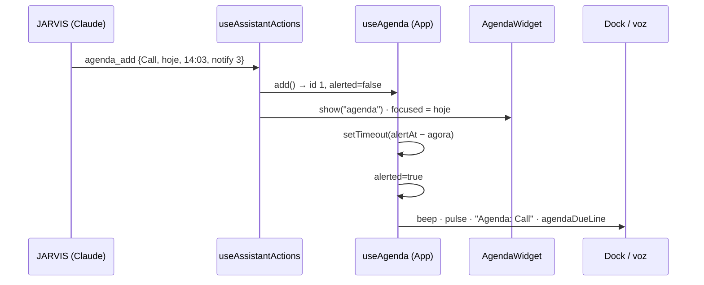

# Widget: Agenda

Widget com o calendário do mês e os compromissos numerados do dia, que o JARVIS marca, lê, desmarca e avisa antes de começar.

| | |
|---|---|
| **ID** | `widget/agenda` |
| **Status** | Implementado |
| **Origem** | `e7151cf` (2026-11-05), escrito em 27/10 |
| **Window kind** | `agenda` em `src/lib/desktop.ts` (340 × 420, mínimo 300 × 340, grupo `widgets`) |
| **Voz** | `window:agenda` ("agenda", "calendário", "compromissos"), `shortcut:agenda`, `shortcut:agendaRemove`; `shortcut:note` e a fala livre vão ao JARVIS, que usa `agenda_add`, `agenda_list` e `agenda_remove` |

## Objetivo

A Agenda guarda os compromissos do usuário: um calendário do mês e, embaixo, os compromissos do dia escolhido, cada um com um número curto para ser dito ("desmarca o compromisso 3"). Os compromissos entram à mão no widget ou pelo JARVIS, que entende datas faladas ("anota que tenho dentista sexta às 10"). Quem tem horário é avisado `notify` minutos antes (10 por padrão) com bipe, aviso no dock e fala do JARVIS, mesmo com o widget fechado. Pela voz, o usuário também ouve a agenda de hoje ou de amanhã e desmarca pelo número.

## Não-objetivos

- Sem recorrência, convidados ou sincronização com Google/Outlook.
- O widget edita só horário e título. Para mudar a data (ou o `notify`), é preciso apagar e marcar de novo, ou pedir ao JARVIS.
- Lembretes por tempo ("daqui a 20 minutos") são de [reminders](../../features/reminders/spec.md). Notas sem data, de [quick-notes](../../features/quick-notes/spec.md). O roteiro da chegada e o briefing, de [voice-shortcuts](../../features/voice-shortcuts/spec.md).

## Histórias de usuário

### US1 — Marcar e ver compromissos no widget (P1)

Como usuário, quero ver o mês, escolher um dia e anotar um compromisso com horário.

**Por que P1:** é a base da agenda.
**Teste independente:** `tests/feeds.spec.ts` — `the agenda: marked by JARVIS or by hand, numbered, edited, read back, said before it starts`.

**Aceite:** [critérios 1 a 4](#critérios-de-aceite).

### US2 — O JARVIS marca por mim (P1)

Como usuário, quero dizer o compromisso com dia e hora e deixar o JARVIS calcular a data.

**Por que P1:** é o jeito natural de marcar por voz.
**Teste independente:** `tests/feeds.spec.ts` — `the agenda: marked by JARVIS or by hand, numbered, edited, read back, said before it starts`; `tests/tasks.spec.ts` — `by voice: added, ticked by number, deleted by its words, read back; a reminder without a when is a task`.

**Aceite:** [critérios 5 a 8](#critérios-de-aceite).

### US3 — Ser avisado antes de começar (P1)

Como usuário, quero que o JARVIS me lembre do compromisso alguns minutos antes.

**Por que P1:** é o que torna a agenda útil no dia a dia.
**Teste independente:** `tests/feeds.spec.ts` — `the agenda: marked by JARVIS or by hand, numbered, edited, read back, said before it starts`.

**Aceite:** [critérios 9 a 10](#critérios-de-aceite).

### US4 — Ouvir a agenda (P2)

Como usuário, quero perguntar o que tenho hoje ou amanhã.

**Teste independente:** `tests/tasks.spec.ts` — `"repassa minha agenda": today's events and what is left on the list`; `tests/feeds.spec.ts` — `the agenda: marked by JARVIS or by hand, numbered, edited, read back, said before it starts` (o trecho "O que eu tenho amanhã?").

**Aceite:** [critérios 11 a 12](#critérios-de-aceite).

### US5 — Editar e desmarcar (P2)

**Teste independente:** `tests/feeds.spec.ts` — `the agenda: marked by JARVIS or by hand, numbered, edited, read back, said before it starts`.

**Aceite:** [critérios 13 a 17](#critérios-de-aceite).

### US6 — Ids antigos (P3)

**Teste independente:** `tests/feeds.spec.ts` — `events saved with the old ids get short numbers`.

**Aceite:** [critério 18](#critérios-de-aceite).

## Critérios de aceite

### Critério 1 (US1)

- **Dado** o widget aberto
- **Então** vejo o mês por extenso no cabeçalho, com "Mês anterior", "hoje" e "Próximo mês", e uma grade de domingo a sábado (`D S T Q Q S S`). Hoje vem contornado e o dia escolhido, em vídeo reverso.

### Critério 2 (US1)

- **Dado** um dia sem nada
- **Então** a lista "Compromissos do dia" diz "Nada marcado.".

### Critério 3 (US1)

- **Dado** o dia escolhido
- **Quando** preencho "Horário" (opcional) e "Novo compromisso" e aperto Enter
- **Então** aparece a linha `#N`, horário (ou `dia`, sem horário) e título. N é o menor número livre: no teste, `#2 dia Ligar para o banco`, depois do `#1` do JARVIS.

### Critério 4 (US1)

- **Dado** dias com compromisso
- **Então** eles ganham um ponto na grade, e o nome acessível diz ", com compromissos".

### Critério 5 (US2)

- **Dado** a tool `agenda_add { title: "Dentista", date: <amanhã>, time: "10:00" }`
- **Então** a resposta é `Marcado: 1: <amanhã> 10:00 · Dentista (aviso 10 min antes)`, o widget abre já no dia marcado e o dock mostra "Agenda: Dentista".

### Critério 6 (US2)

- **Dado** `agenda_add` com `date: "amanhã"`
- **Então** a tool responde `ok: false` ("Data inválida (use AAAA-MM-DD)").

### Critério 7 (US2)

- **Dado** "Anota que tenho dentista sexta às 10" (há dia/horário na frase)
- **Então** o pedido vai ao JARVIS com o prompt `[Atalho: anotação] …`, que manda usar `agenda_add` para compromissos.

### Critério 8 (US2)

- **Dado** "Marca na agenda dentista sexta às 10"
- **Então** a frase vai ao JARVIS como pergunta livre.

### Critério 9 (US3)

- **Dado** um compromisso daqui a 3 minutos com `notify: 3`
- **Quando** chega a hora do aviso (aqui, já)
- **Então** soa o bipe, o núcleo pulsa, o dock mostra "Agenda: Call com o time" e o JARVIS diz, por exemplo, "Com licença, Tony: Call com o time, em 3 minutos.".

### Critério 10 (US3)

- **Dado** um compromisso que já começou há menos de 1 h quando o aviso dispara
- **Então** o JARVIS diz "agora" no lugar do "em N minutos".

### Critério 11 (US4)

- **Dado** um compromisso hoje às 23:59 e uma tarefa pendente
- **Quando** digo "repassa minha agenda do dia"
- **Então** o widget abre e o JARVIS diz os compromissos ("às 23 e 59, Reunião com a Ana") e, em seguida, as tarefas pendentes, citando o nome do usuário no máximo uma vez.

### Critério 12 (US4)

- **Dado** "o que eu tenho amanhã?"
- **Então** ele lista só amanhã ("às 11 e 15, Dentista (retorno)"). Sem nada, usa uma das falas `agendaEmpty` ("Agenda livre amanhã…").

### Critério 13 (US5)

- **Dado** um compromisso
- **Quando** dou dois cliques no título (ou clico no lápis "Editar <título>")
- **Então** aparecem os campos "Horário do compromisso N" e "Editar compromisso N". Enter, ou sair da linha, salva. Esc cancela.

### Critério 14 (US5)

- **Dado** o "X" ("Apagar <título>")
- **Então** o compromisso some.

### Critério 15 (US5)

- **Dado** "apaga o compromisso dois"
- **Então** ele é removido, o dock mostra "Agenda: <título> desmarcado" e o JARVIS confirma (falas `agendaRemoved`). Com um número que não existe, ele diz "Receio que não haja compromisso número 7…".

### Critério 16 (US5)

- **Dado** "desmarca o compromisso do dentista" (sem número)
- **Então** o pedido vai ao JARVIS, que acha pelo nome.

### Critério 17 (US5)

- **Dado** `agenda_list {}`
- **Então** vêm os compromissos de hoje a 7 dias, como `N: AAAA-MM-DD HH:MM · título (aviso N min antes)` ou `dia todo`. Vazio: "Nenhum compromisso nesse período.". `agenda_remove { id }` responde "Apagado: <título>".

### Critério 18 (US6)

- **Dado** eventos salvos com ids `ev-…`
- **Quando** o app carrega
- **Então** eles recebem 1, 2… na ordem em que estão.

## Casos de borda

- **Vazio/nulo:**
  - Dia sem compromisso → "Nada marcado.". `agenda_list` vazio → "Nenhum compromisso nesse período.". A agenda falada sem nada → uma fala `agendaEmpty`.
  - Título vazio no formulário → nada é enviado; pela tool, "Falta o compromisso".
  - Horário vazio → compromisso de dia todo, que nasce `alerted` e nunca avisa. No `EventEditor`, apagar o horário também vira dia todo.
  - Data ou horário fora do formato → "Data inválida (use AAAA-MM-DD)" ou "Horário inválido (use HH:MM)", embaixo da lista ou como `ok: false` da tool.
  - `jarvis.agenda` corrompido → `parseAgenda` descarta itens sem título ou com data/horário inválidos e corta em 500; um `notify` que não é número vira 10. Um `notify` numérico fora de 0–1440 passa (ver [Pendências](#pendências)).
- **Duplicidade/idempotência:**
  - Ids antigos (`ev-…`) ou repetidos → ganham o menor número livre, em ordem, e os números que já existiam ficam.
  - Um número que não existe ("apaga o compromisso 7", `agenda_remove`) → `agendaNotFound` ou "Nenhum compromisso com esse número (veja agenda_list)", e nada muda.
  - Cada aviso é dito uma vez: ao disparar, o compromisso vira `alerted`.
  - 500 compromissos → "A agenda está cheia".
- **Concorrência/corrida:**
  - Duas `agenda_add` seguidas do JARVIS → cada uma vê a lista nova (`latest.current`) e ganha um número diferente.
  - `update` de um compromisso que acabou de ser apagado → "Esse compromisso não existe mais".
  - Aviso perdido com o app fechado → é dito ao abrir se o compromisso começou há menos de 1 h; se há mais, é marcado sem fala.
  - Próximo aviso a mais de 2³¹−1 ms (cerca de 24,8 dias) → o `setTimeout` dispara sem nada a dizer e só volta a ser agendado quando a agenda muda ou o app recarrega (ver [Pendências](#pendências)).
  - Um compromisso marcado ou movido de dia com o widget fechado → se ele abrir nos 5 s seguintes (`FOCUS_MS`), pula para esse dia.
  - No `EventEditor`, `Enter`, sair da linha e `Esc` → só um dos três responde, e a edição não é salva duas vezes.
- **Permissões/visibilidade:**
  - Não há comando Tauri: tudo fica no `localStorage` (`jarvis.agenda`), fora do `settings.json` e de `Documentos\JARVIS`.
  - O JARVIS só mexe na agenda pelas tools `agenda_*` do servidor MCP local, que usam as mesmas funções e a mesma validação do widget.
  - Com o `EventEditor` aberto, as teclas da janela (Ctrl+W) esperam.

## Dados

- `$compromissos`: a lista de **AgendaEvent**, `{ id, title, date, time, notify, alerted }`. Fica em `jarvis.agenda`, gravada sem debounce (`delay = 0`). Ver [glossário](../../domain/glossary.md) e [persistência](../../domain/persistence.md).
  - **RF-001**: Cada compromisso DEVE ter id numérico (o menor livre), título, data `AAAA-MM-DD`, horário `HH:MM` ou nulo, `notify` e `alerted`.
  - **RF-002**: A lista DEVE ficar ordenada por data, horário (dia todo primeiro) e título.
  - **RF-007**: Ids antigos não numéricos ou repetidos DEVEM ganhar o menor número livre, em ordem.
    - Por exemplo, eventos salvos com ids `ev-…` recebem 1, 2… na ordem em que estão.
  - `parseAgenda` descarta itens sem título ou com data/horário inválidos e corta a lista em 500.
- `$foco`: `focused { date, at }`, o dia do último compromisso marcado ou que mudou de dia. Só em memória.
- `$mês` e `$dia`: o mês mostrado e o dia escolhido no widget. Só em memória; começam em hoje.

## Componentes

### `useAgenda`

O hook que guarda $compromissos e valida cada mudança. Ele vive no `App`, então voz, tools e widget usam as mesmas funções.

- **Comportamento:**
  - `add({ title, date, time?, notify? })` marca um compromisso e devolve o evento, ou o que está errado.
    - O título é cortado em 120 caracteres e o `notify` fica entre 0 e 1440 min (padrão 10, `DEFAULT_NOTIFY`).
    - Se faltar o título, responda "Falta o compromisso". Se a data for inválida, "Data inválida (use AAAA-MM-DD)". Se o horário for inválido, "Horário inválido (use HH:MM)".
    - Se já houver 500 compromissos, então responda "A agenda está cheia".
    - O id é o menor número livre (`smallestFreeId`).
    - Se o compromisso for de dia todo (sem horário), então ele nunca avisa, porque já nasce `alerted`. Também nasce `alerted` quem tem a hora do aviso vencida há mais de 1 h (`alreadySaid`).
    - Grave em `latest.current` antes do React, para que duas chamadas seguidas (duas tools do JARVIS) vejam a lista nova e ganhem dois números.
    - Ponha o dia em $foco.
  - `update(id, { title?, date?, time? })` muda um compromisso, com a mesma validação.
    - Se ele não existir mais, então responda "Esse compromisso não existe mais".
    - Se a data ou o horário mudarem, então recalcule se ainda há aviso pendente. Se a data mudar, ponha o novo dia em $foco.
  - `remove(id)` apaga e devolve o compromisso, ou `null` se não havia.
  - `between(from, to)` devolve os compromissos entre as duas datas, incluídas, em ordem.

### Avisos

Um único `setTimeout` no `useAgenda`, até o próximo aviso, e o `onDue` do `App`.

- **Comportamento:**
  - **RF-003**: O app DEVE avisar cada compromisso com horário em `início − notify` e marcá-lo `alerted`, sem dizer os que começaram há mais de 1 h.
    - O timer aponta para o menor `alertAt` entre os compromissos com horário ainda não avisados. Sem nenhum, não há timer.
    - Quando ele dispara, marque os vencidos como `alerted` e chame `onDue` para os que começaram há menos de 1 h (`STALE_MS`).
    - O timer continua com o app oculto de propósito, para avisar.
  - Se o aviso foi perdido com o app fechado e o compromisso começou há mais de 1 h, então ele é marcado como avisado sem fala. Se começou há menos, então é dito ao abrir.
  - Se o próximo aviso estiver a mais de 2³¹−1 ms (cerca de 24,8 dias), então o `setTimeout` é limitado a isso. O timer dispara sem nada a dizer e só volta a ser agendado quando a agenda mudar ou o app recarregar (ver [Pendências](#pendências)).
  - `onDue` toca o bipe, pulsa o núcleo, mostra "Agenda: <título>" no item Widgets do dock e faz o JARVIS dizer `agendaDueLine` ("Com licença, Tony: Call com o time, em 3 minutos.").
    - Se o compromisso já começou, então a fala diz "agora" no lugar do "em N minutos".

### Calendário do mês

O topo do `AgendaWidget`: o mês com a navegação e a grade dos dias.

- **Comportamento:**
  - O cabeçalho mostra $mês por extenso ("novembro de 2026"). "Mês anterior" e "Próximo mês" trocam só $mês. "hoje" volta $mês e $dia para hoje.
  - Um clique num dia o torna $dia.
  - Um dia com compromisso ganha um ponto, e o nome acessível do dia (por exemplo "terça-feira, 3 de novembro") ganha ", com compromissos".
  - Se um compromisso for marcado ou mudar de dia, então o widget, se estiver aberto ou abrir nos 5 s seguintes (`FOCUS_MS`), pula para esse dia e esse mês ($foco).
- **Layout:**
  - `ReverseRow` com o mês à esquerda e, à direita, `‹` "hoje" `›`.
  - Embaixo, o grupo "Calendário": uma grade de 7 colunas, com a linha `D S T Q Q S S` e os dias do mês, que começam na coluna do dia da semana do dia 1.
  - O ponto fica embaixo do número, no centro.
- **Estilo:**
  - O `ReverseRow` é `bg-hud-light/80`, 11 px, `font-semibold`, `text-hud-void`, com os chevrons de 12 px.
  - As letras dos dias da semana ficam em 10 px, `text-hud-text/40`.
  - Os dias usam números tabulares e cantos levemente arredondados. Os comuns ficam em `text-hud-text/80`, com fundo `hud-cyan/10` no hover.
  - Hoje vem contornado (`ring-1 ring-hud-cyan/40`, texto `text-hud-light`). O dia escolhido fica em vídeo reverso (`bg-hud-light/85`, `text-hud-void`).
  - O ponto tem 4 px, em `bg-hud-cyan`, ou `bg-hud-void` no dia escolhido.

### Lista "Compromissos do dia"

Os compromissos de $dia, cada um com o número que se diz por voz.

- **Comportamento:**
  - Acima da lista, mostre $dia por extenso.
  - Cada linha mostra `#N`, o horário (ou `dia`, sem horário) e o título.
  - Se $dia não tiver compromisso, então a lista diz "Nada marcado.".
  - Um duplo clique no título, ou o lápis "Editar <título>", abre o `EventEditor` na linha.
  - O "X" ("Apagar <título>") apaga o compromisso.
  - Se uma mudança der erro, então a mensagem aparece embaixo da lista.
- **Layout:**
  - O dia por extenso numa linha, separada da grade por uma borda.
  - A lista rola quando não cabe. Cada linha tem o número (3 caracteres, alinhado à direita), o horário (5 caracteres), o título, o lápis e o X.
- **Estilo:**
  - Tudo em `font-mono` 12 px, com o texto selecionável. O dia por extenso fica em 11 px, `text-hud-text/60`, com borda superior `hud-cyan/10`.
  - O `#N` fica em `text-hud-text/45`, o horário em `text-hud-cyan` e o título em `text-hud-text`, cortado com reticências. Números tabulares.
  - O lápis (10 px) e o X (11 px) ficam invisíveis até o hover da linha ou o foco, em `text-hud-text/40`. No hover, o lápis fica `text-hud-light` e o X `text-hud-alert`.
  - "Nada marcado." fica em `text-hud-text/40`. O erro fica em 11 px, `text-hud-alert/85`.

### `EventEditor`

Edita o horário e o título de um compromisso, na própria linha.

- **Comportamento:**
  - Ao abrir, o título ganha foco e fica selecionado.
  - `Enter`, ou sair da linha, salva (`update`). `Esc` cancela. Só uma das três responde.
  - Enquanto digita, as teclas da janela (Ctrl+W) esperam.
  - O título aceita até 120 caracteres. Um horário vazio vira dia todo.
- **Layout:** no lugar do horário e do título, os campos "Horário do compromisso N" e "Editar compromisso N", lado a lado.
- **Estilo:**
  - O campo de horário é transparente, com 9 caracteres de largura, em `text-hud-cyan` e `[color-scheme:dark]`.
  - O campo do título tem borda `hud-light/50` e texto `text-hud-text`.

### Formulário "Novo compromisso"

Marca um compromisso em $dia.

- **Comportamento:**
  - Quando o usuário preencher "Horário" (opcional) e "Novo compromisso" e apertar `Enter`, chame `add` com $dia e limpe os dois campos.
  - Um título vazio não é enviado.
  - Se `add` devolver um erro, então mostre-o acima do formulário.
- **Layout:** embaixo do widget, separado por uma borda: o campo "Horário" e o campo "Novo compromisso" (placeholder "Novo compromisso").
- **Estilo:**
  - Borda superior `hud-cyan/10`.
  - O campo "Horário" é como o do `EventEditor`: transparente, 9 caracteres, `text-hud-cyan`, `[color-scheme:dark]`.
  - O título é transparente, com o placeholder em `text-hud-text/30`.

### Tools `agenda_*` do JARVIS

- **Comportamento:**
  - **RF-006**: As tools `agenda_add`, `agenda_list` e `agenda_remove` DEVEM agir sobre o mesmo estado, e `agenda_add` abre o widget no dia marcado.
  - `agenda_add` recebe `title`, `date` (AAAA-MM-DD), `time` (HH:MM, opcional) e `notify` (0–1440, padrão 10). Ela mostra "Agenda: <título>" no dock e responde `Marcado: <agendaReport>`.
    - Se a data não estiver no formato, como `"amanhã"`, então responda `ok: false` ("Data inválida (use AAAA-MM-DD)").
  - `agenda_list` lista de `from` (padrão hoje) a `to` (padrão `from` + 7 dias), com os ids, como `N: AAAA-MM-DD HH:MM · título (aviso N min antes)` ou `dia todo`. Vazio: "Nenhum compromisso nesse período.".
  - `agenda_remove` apaga pelo `id` e responde "Apagado: <título>". Se o número não existir, então responda "Nenhum compromisso com esse número (veja agenda_list)".

## Voz e teclado

- **RF-004**: O atalho `agenda` DEVE abrir o widget e responder para amanhã quando a frase tiver "amanh", e para hoje (agenda + tarefas) caso contrário.
  - `shortcut:agenda` ("minha agenda", "o que eu tenho hoje/amanhã", "repassa minha agenda", "como está meu dia"…): com "amanh", `agendaLine(amanhã)`; senão, `dayLine(hoje, tarefas)`.
  - Hoje, o JARVIS diz os compromissos ("às 23 e 59, Reunião com a Ana") e depois as tarefas pendentes, citando o nome do usuário no máximo uma vez. Sem nada, usa uma das falas `agendaEmpty`.
- **RF-005**: O atalho `agendaRemove` DEVE remover pelo número dito e, sem número, encaminhar ao JARVIS.
  - `shortcut:agendaRemove` ("apaga o compromisso", "desmarca o compromisso", "cancela o compromisso"…) + número: `remove(id)`, dock "Agenda: <título> desmarcado", fala `agendaRemoved` / `agendaNotFound` ("Receio que não haja compromisso número 7…").
  - Sem número ("desmarca o compromisso do dentista"), o pedido vai ao JARVIS, que acha pelo nome.
- `shortcut:note` com dia ou horário (`mentionsWhen`): JARVIS com `shortcutPrompt("note")` → `agenda_add`.
- Uma frase como "Marca na agenda dentista sexta às 10" não é atalho e vai ao JARVIS como pergunta livre.
- `window:agenda` ("agenda", "calendário", "compromissos"): abre ou fecha o widget.
- Duplo clique / lápis: edita horário e título (`Enter` ou blur salva, `Esc` cancela).
- `Enter` no formulário: marca o compromisso.

## Restrições

- **RNF-001**: O estado fica em `jarvis.agenda` e é gravado sem debounce.
- **RNF-002**: Os avisos funcionam com o widget fechado, porque o hook vive no `App`.
- 500 eventos; título com até 120 caracteres; `notify` de 0 a 1440 (padrão 10); avisos atrasados mais de 1 h não são ditos.

## Critérios de sucesso

- **SC-001**: Um compromisso com horário é dito pelo JARVIS no minuto do aviso, com o app aberto.
- **SC-002**: O número dito de um compromisso não muda enquanto ele existir.

## Entregáveis

`useAgenda(onDue)` vive no `App` e guarda a lista em `jarvis.agenda` (sem debounce). Um único `setTimeout` aponta para o próximo `alertAt` (início − `notify`) entre os eventos com horário ainda não avisados. Quando dispara, marca os vencidos como `alerted` e chama `onDue` para os que começaram há menos de 1 h. As mutações (`add`, `update`, `remove`) validam a entrada, devolvem o evento ou uma mensagem de erro e gravam em `latest.current` antes do React, para que duas chamadas seguidas (duas tools do JARVIS) vejam a lista nova. O widget é só apresentação: grade do mês, lista do dia, edição inline e formulário. Voz e tools usam as mesmas funções.

| | |
|---|---|
| **Camadas** | UI React (`AgendaWidget.tsx`) · hook (`useAgenda`) · lib (`agenda.ts`, `tasks.ts` para ids, `jarvisLines.ts`, `shortcuts.ts`) · integração no `App` · tools MCP |
| **Dependências** | ver [Dependências](#dependências) |
| **Testes** | `tests/feeds.spec.ts`, `tests/tasks.spec.ts`; Rust `src-tauri/src/voice/matcher.rs` |
| **Plataforma** | Windows 11 · WebView2; no modo web funciona igual (só `localStorage`); as tools entram pela sonda `__JARVIS__.action` |

### Arquivos

| Arquivo | Papel |
|---|---|
| `src/lib/agenda.ts` | `AgendaEvent`, `DEFAULT_NOTIFY`, `isDate`, `isTime`, `startOf`, `alertAt`, `byStart`, `dateKey`, `addDays`, `agendaReport` |
| `src/hooks/useAgenda.ts` | `parseAgenda`, `alreadySaid`, timer de avisos, `add`, `update`, `remove`, `between`, `focused` |
| `src/lib/tasks.ts` | `smallestFreeId`, `idOf` (compartilhados com Tarefas) |
| `src/components/desktop/widgets/AgendaWidget.tsx` | cabeçalho do mês, grade, lista do dia, `EventEditor` (horário + título), formulário |
| `src/lib/jarvisLines.ts` | `agendaList`, `agendaEmpty`, `agendaDue`, `agendaRemoved`, `agendaNotFound`, `spokenClock`, `agendaLine`, `dayLine`, `agendaDueLine` |
| `src/lib/shortcuts.ts` | `leadingNumber`, `mentionsWhen`, `shortcutPrompt("note")` |
| `src/App.tsx` | `useAgenda(onDue)` (bipe, pulso, dock, fala); atalhos `agenda`, `agendaRemove`, `note`; briefing; chegada em casa |
| `src/hooks/useAssistantActions.ts` · `src-tauri/src/mcp.rs` | tools `agenda_add`, `agenda_list`, `agenda_remove` |

### Contratos

#### Ferramentas MCP (JARVIS)

| Tool | O que faz |
|---|---|
| `agenda_add` | `title`, `date` (AAAA-MM-DD), `time` (HH:MM, opcional), `notify` (0–1440, padrão 10); abre o widget no dia; dock "Agenda: <título>"; responde `Marcado: <agendaReport>` |
| `agenda_list` | de `from` (padrão hoje) a `to` (padrão `from` + 7 dias), com os ids |
| `agenda_remove` | apaga pelo `id`; "Apagado: <título>" ou erro "Nenhum compromisso com esse número (veja agenda_list)" |

### Fluxo

### Testes

- `npx playwright test tests/feeds.spec.ts --project ui -g "the agenda: marked by JARVIS"`: `agenda_add` abre o widget no dia com `#1`, `date: "amanhã"` dá `ok: false`, a edição por duplo clique, "O que eu tenho amanhã?", "Nada marcado." e `#2` à mão hoje, `agenda_list` e `agenda_remove`, "apaga o compromisso dois" e o número 7 que não existe, e o aviso de "Call com o time" no dock (critérios 2, 3, 5, 6, 9, 12, 13, 15 e 17).
- `npx playwright test tests/feeds.spec.ts --project ui -g "events saved with the old ids"`: ids `ev-…` viram 1 e 2 (critério 18).
- `npx playwright test tests/feeds.spec.ts --project ui -g "lines for the weather"`: `agendaLine` com dia todo e horário, e `agendaEmpty` (critério 12).
- `npx playwright test tests/feeds.spec.ts --project ui -g "the briefing hands JARVIS"`: o briefing leva os compromissos do dia ao prompt.
- `npx playwright test tests/tasks.spec.ts --project ui -g "repassa minha agenda"`: os compromissos de hoje e as tarefas, com o nome dito no máximo uma vez, e o widget aberto (critério 11).
- `npx playwright test tests/tasks.spec.ts --project ui -g "task helpers"`: `leadingNumber`, `mentionsWhen` e `smallestFreeId` (critérios 3, 7 e 15).
- `npx playwright test tests/tasks.spec.ts --project ui -g "a reminder without a when is a task"`: "Anota que tenho dentista sexta às 10" vai ao JARVIS com o prompt `[Atalho: anotação]` e `agenda_add` (critério 7).
- `npx playwright test tests/tasks.spec.ts --project ui -g "papai chegou"`: a cena de chegada acende a Agenda.
- `cargo test --lib the_weather_the_agenda_and_the_stocks_by_voice` (em `src-tauri`): "O que eu tenho amanhã?" e "minha agenda" viram `shortcut:agenda`, "Marca na agenda dentista sexta às 10" vai ao JARVIS, e "abre/fecha a agenda" é `window:agenda` (critério 8).
- `cargo test --lib the_tasks_the_agenda_numbers_and_the_homecoming_by_voice` (em `src-tauri`): "Apaga o compromisso 3" vira `shortcut:agendaRemove`, e "Repassa minha agenda do dia." e "como está meu dia?" viram `shortcut:agenda` (critérios 11 e 15).
- `cargo test --lib lists_every_tool_with_a_schema` (em `src-tauri`): as tools `agenda_*` estão em `TOOLS`, com schema e descrição.
- `cargo test --lib default_voice_commands_are_valid` (em `src-tauri`): o catálogo tem frases para o kind `agenda` e alvos válidos para os atalhos.
- Sem teste automatizado: critérios 1, 4, 10, 14 e 16.

### Reversão

- Tirar `agenda` do union `WindowKind`, de `WINDOW_KINDS` e de `WINDOW_SPECS` (`src/lib/desktop.ts`), do `WINDOW_KINDS` do Rust (`src-tauri/src/settings.rs`) e a entrada `window:agenda` de `src-tauri/voice-commands.json`, juntos (o `default_voice_commands_are_valid` confere os três).
- Na UI: o `case "agenda"` e o campo `agenda` de `feeds` em `Desktop.tsx`, as palavras de busca, `AgendaWidget.tsx`, `useAgenda.ts` e o `useAgenda(onDue)` do `App`, os `case "agenda"` e `"agendaRemove"` do atalho, a agenda no briefing e no `comeHome`, o trecho do prompt `note` que manda usar `agenda_add`, os `case "agenda_*"` de `useAssistantActions.ts` e as falas `agenda*` de `jarvisLines.ts`.
- Ficam `src/lib/agenda.ts` (o `useTasks` usa `dateKey` e `isDate`) e `src/lib/tasks.ts` (`smallestFreeId` e `idOf` são das Tarefas).
- Na voz e no Rust: as entradas `shortcut:agenda` e `shortcut:agendaRemove`, os alvos `agenda` e `agendaRemove` de `SHORTCUT_TARGETS` (com o espelho `ShortcutAction` em `src/lib/shortcuts.ts`) e as três tools em `TOOLS` e `tools()` (`mcp.rs`). Tire as tools dos dois lados juntos: declaradas no MCP sem o `case`, elas recebem "Ferramenta desconhecida: …". O `RETIRED_PHRASES` de `shortcut:agenda` em `settings.rs` fica sem efeito.
- Fica órfão e é ignorado: `jarvis.agenda` (os avisos pendentes nunca disparam); `agenda` em `jarvis.desktop` (o `parseDesktop` descarta); `window:agenda`, `shortcut:agenda` e `shortcut:agendaRemove` no `settings.json` (o `sanitize_voice_commands` descarta ids embutidos que saíram do catálogo).

### Constituição

- [x] P1 Offline-first: tudo local. Só o "anota que…" passa pelo Claude.
- [ ] P2/P3/P4: não se aplicam, porque não há comando Tauri próprio. As tools chegam pelo MCP (ver [assistant-tools](../../features/assistant-tools/spec.md)).
- [x] P5 Persistência tolerante: `parseAgenda` descarta itens sem título ou com data/horário inválidos, corta em 500 e migra ids antigos (`ev-…`) e repetidos para o menor número livre. Lacuna: o `notify` lido do disco não passa pelo limite de 0 a 1440 (ver tarefas).
- [x] P6 Funciona fora do Tauri: só UI e `localStorage`.
- [x] P7 PT-BR: datas por extenso, "Nada marcado.", "Novo compromisso", mensagens de validação e falas.
- [x] P8 Linguagem visual: `ReverseRow`, grade em tokens `hud-*`, `color-scheme: dark` nos campos de hora.
- [x] P9 Desktop leve: um só `setTimeout`, e só existe com avisos pendentes. Ele continua com o app oculto de propósito, para avisar.
- [x] P11 Coberto por teste: marcar, editar, ler, desmarcar, avisar e migrar ids.

### Decisões relacionadas

- [ADR-0004 — catálogo de voz e fallback para o JARVIS](../../arch/adr/0004-catalogo-de-voz-compartilhado-e-fallback.md)
- [ADR-0006 — JARVIS via Claude CLI](../../arch/adr/0006-jarvis-via-claude-cli.md)
- [ADR-0008 — MCP HTTP in-process](../../arch/adr/0008-mcp-http-in-process.md)
- [ADR-0010 — settings.json vs localStorage](../../arch/adr/0010-persistencia-settings-vs-localstorage.md)

## Dependências

- **Vendor:** [React](../../foundation/vendor/react/spec.md), [Tailwind](../../foundation/vendor/tailwind/spec.md), [lucide](../../foundation/vendor/lucide/spec.md) (chevrons, lápis e X), [Tauri](../../foundation/vendor/tauri/spec.md) (evento `assistant:action`, ouvido em `useAssistantActions.ts`)
- **Specs:** [assistant-tools](../../features/assistant-tools/spec.md) (tools `agenda_add`, `agenda_list` e `agenda_remove`), [assistant](../../features/assistant/spec.md) (o JARVIS que entende datas faladas e fala o aviso), [voice-shortcuts](../../features/voice-shortcuts/spec.md) (atalhos `agenda` e `agendaRemove`, briefing e chegada em casa), [quick-notes](../../features/quick-notes/spec.md) (o "anota que…" com dia ou horário), [voice-commands](../../features/voice-commands/spec.md) (`window:agenda` e o fallback), [tasks](../tasks/spec.md) (`smallestFreeId` e `idOf`, e as tarefas no resumo do dia), [pomodoro](../pomodoro/spec.md) (o `beep()`), [dock-taskbar](../../features/dock-taskbar/spec.md) (aviso no dock), [holographic-core](../../features/holographic-core/spec.md) (pulso do núcleo), [appearance](../../features/appearance/spec.md) (kit TUI: `ReverseRow`), [desktop-windows](../../features/desktop-windows/spec.md) (janela), [search](../../features/search/spec.md) (palavras da busca)
- **Sistema:** WebView2 com `Intl.DateTimeFormat` em `pt-BR` e o relógio do Windows; saída de áudio para o bipe, opcional.

## Tarefas

Legenda: `[x]` feito · `[ ]` pendente · `[P]` pode rodar em paralelo (arquivos diferentes) · `[USn]` história desta spec. As tarefas foram reconstruídas do código e do commit de origem.

### Fase 1 — Base

- [x] T001 Tipo `AgendaEvent` e funções de data (`isDate`, `isTime`, `startOf`, `alertAt`, `byStart`, `dateKey`, `addDays`, `agendaReport`) — `src/lib/agenda.ts`
- [x] T002 [P] `smallestFreeId` e `idOf` — `src/lib/tasks.ts`
- [x] T003 [P] `agenda` em `WINDOW_SPECS` (340 × 420, mín. 300 × 340), palavras de busca, `window:agenda`, `shortcut:agenda` e `shortcut:agendaRemove` — `src/lib/desktop.ts`, `src/lib/commands.ts`, `src-tauri/voice-commands.json`

### Fase 2 — US1 Marcar e ver no widget (P1)

- [x] T004 [US1] `useAgenda`: `jarvis.agenda`, `add` com validação e menor id livre, `between`, `focused` — `src/hooks/useAgenda.ts`
- [x] T005 [US1] Widget: cabeçalho do mês com navegação, grade com hoje, seleção e pontos, lista do dia, formulário "Horário" + "Novo compromisso" — `src/components/desktop/widgets/AgendaWidget.tsx`

### Fase 3 — US2 O JARVIS marca (P1)

- [x] T006 [US2] [P] Declarar `agenda_add`, `agenda_list` e `agenda_remove` — `src-tauri/src/mcp.rs`
- [x] T007 [US2] Executar as tools; `agenda_add` abre o widget e avisa no dock — `src/hooks/useAssistantActions.ts`
- [x] T008 [US2] `mentionsWhen` e o prompt `note` que manda usar `agenda_add` — `src/lib/shortcuts.ts`, `src/App.tsx`

### Fase 4 — US3 Aviso antes de começar (P1)

- [x] T009 [US3] Timer do próximo `alertAt`, marca `alerted`, não diz os atrasados mais de 1 h (`STALE_MS`) — `src/hooks/useAgenda.ts`
- [x] T010 [US3] `onDue` no `App`: bipe, pulso, dock "Agenda: …" e `agendaDueLine` — `src/App.tsx`, `src/lib/jarvisLines.ts`

### Fase 5 — US4 Ouvir a agenda (P2)

- [x] T011 [US4] Falas `agendaList`, `agendaEmpty`, `spokenClock`, `agendaLine`, `dayLine` — `src/lib/jarvisLines.ts`
- [x] T012 [US4] `case "agenda"` do atalho (hoje ou amanhã, abre o widget) — `src/App.tsx`

### Fase 6 — US5 Editar e desmarcar (P2)

- [x] T013 [US5] `update` (recalcula `alerted` ao mover) e `remove` — `src/hooks/useAgenda.ts`
- [x] T014 [US5] `EventEditor` inline (horário + título) e botões lápis e X — `src/components/desktop/widgets/AgendaWidget.tsx`
- [x] T015 [US5] `case "agendaRemove"` com `leadingNumber`, e sem número vai ao JARVIS — `src/App.tsx`, `src/lib/shortcuts.ts`

### Fase 7 — US6 Ids antigos (P3)

- [x] T016 [US6] Migração de ids `ev-…` e repetidos em `parseAgenda` — `src/hooks/useAgenda.ts`

### Fase 8 — Testes

- [x] T017 Playwright `tests/feeds.spec.ts` — "the agenda: marked by JARVIS or by hand, numbered, edited, read back, said before it starts"
- [x] T018 Playwright `tests/feeds.spec.ts` — "events saved with the old ids get short numbers"
- [x] T019 Playwright `tests/feeds.spec.ts` — "JARVIS's lines for the weather, the agenda and a price alert"
- [x] T020 Playwright `tests/feeds.spec.ts` — "the briefing hands JARVIS the weather, the day's agenda and what is left on the list"
- [x] T021 Playwright `tests/tasks.spec.ts` — "\"repassa minha agenda\": today's events and what is left on the list"
- [x] T022 Playwright `tests/tasks.spec.ts` — "task helpers: numbers said, appointments spotted, words tidied, the lowest free id"
- [x] T023 Playwright `tests/tasks.spec.ts` — "by voice: added, ticked by number, deleted by its words, read back; a reminder without a when is a task"
- [x] T024 Playwright `tests/tasks.spec.ts` — "\"acorda, querido, papai chegou\": the lights come on, the widgets light up, JARVIS welcomes him home"
- [x] T025 [P] Rust `src-tauri/src/voice/matcher.rs` — `the_weather_the_agenda_and_the_stocks_by_voice`
- [x] T026 [P] Rust `src-tauri/src/voice/matcher.rs` — `the_tasks_the_agenda_numbers_and_the_homecoming_by_voice`

## Pendências

- [ ] Quando o próximo aviso está a mais de 2³¹−1 ms (~24,8 dias), o timer dispara sem nada vencido e retorna sem reagendar. O aviso só volta a ser agendado se a agenda mudar ou o app recarregar — `src/hooks/useAgenda.ts`
- [ ] `parseAgenda` aceita qualquer `notify` numérico vindo do disco (negativo ou acima de 1440), enquanto `add` limita de 0 a 1440 — `src/hooks/useAgenda.ts`
