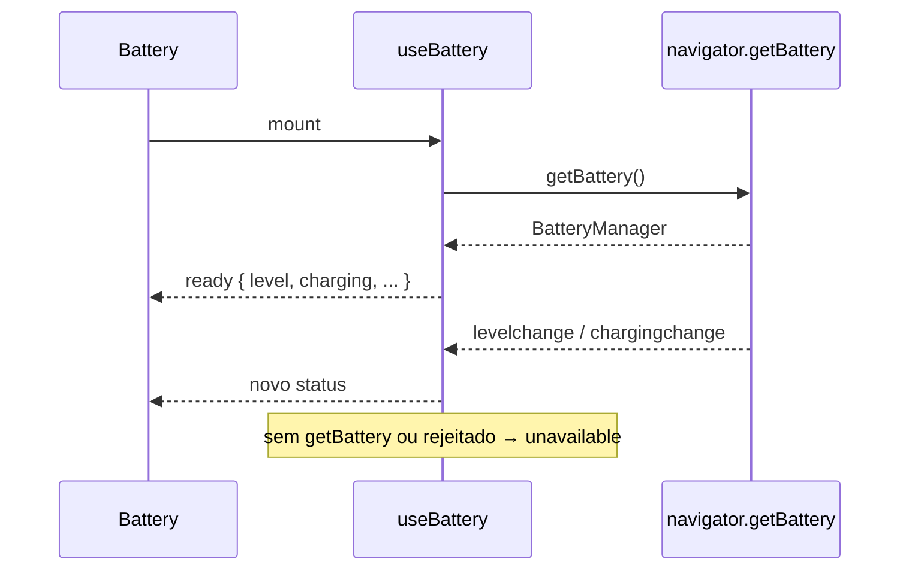

# Widget: Bateria

Widget com a carga do notebook no estilo de um status de terminal, lida da Battery Status API da WebView.

| | |
|---|---|
| **ID** | `widget/battery` |
| **Status** | Implementado |
| **Origem** | `42e671a` (2026-10-23) · evoluída em `c4ccc57` e `048a254` |
| **Window kind** | `battery` em `src/lib/desktop.ts` (300 × 150, mínimo 220 × 120, grupo `widgets`) |
| **Voz** | `window:battery` ("bateria", "battery") |

## Objetivo

O widget Bateria mostra a carga do notebook como um status de terminal: a porcentagem grande, uma barra de blocos, o estado ("na tomada", "carregando", "na bateria") e o tempo estimado para encher ou esvaziar. Quando a carga está baixa, tudo fica na cor de alerta. Os dados vêm da Battery Status API da WebView, então não há código nativo. A mesma leitura alimenta o módulo de bateria da barra superior e o que o JARVIS diz sobre a máquina.

## Não-objetivos

- Não avisa por som nem por voz quando a bateria fica baixa. Só a cor muda.
- Não lê a bateria pelo Windows (Rust). Depende do que a WebView2 expõe.
- O módulo da barra superior e o status falado pelo JARVIS usam o mesmo hook, mas são descritos nas próprias specs ([voice-shortcuts](../../features/voice-shortcuts/spec.md)).

## Histórias de usuário

### US1 — Ver a carga e o estado (P1)

Como usuário de notebook, quero ver quanto de bateria resta e se está carregando.

**Por que P1:** é todo o conteúdo do widget.
**Teste independente:** `tests/desktop.spec.ts` — `the battery widget shows a level or says it is unavailable`.

**Aceite:** [critérios 1 a 5](#critérios-de-aceite).

### US2 — Ambientes sem bateria (P1)

Como usuário de desktop ou do modo web, quero uma mensagem clara em vez de números falsos.

**Por que P1:** evita leituras enganosas.
**Teste independente:** `tests/desktop.spec.ts` — `the battery widget shows a level or says it is unavailable`.

**Aceite:** [critérios 6 a 8](#critérios-de-aceite).

### US3 — Escolher o que aparece (P2)

**Teste independente:** `tests/widgets.spec.ts` — `Bateria: right click turns parts of the widget off, and it stays so`.

**Aceite:** [critérios 9 a 10](#critérios-de-aceite).

## Critérios de aceite

### Critério 1 (US1)

- **Dado** um notebook com bateria
- **Quando** abro "Bateria"
- **Então** vejo `NN%` grande, a barra "Carga da bateria" com 18 células e `estado ~ na bateria` (ou `carregando`).

### Critério 2 (US1)

- **Dado** a máquina descarregando com tempo conhecido
- **Então** vejo `tempo ~ 2h05 restantes` ou `tempo ~ 40 min restantes`.

### Critério 3 (US1)

- **Dado** a máquina carregando com tempo conhecido
- **Então** vejo `tempo ~ <duração> para 100%`.

### Critério 4 (US1)

- **Dado** a carga em 15% ou menos e sem carregador
- **Então** a porcentagem e a barra ficam na cor de alerta e o estado diz `na bateria · baixa`.

### Critério 5 (US1)

- **Dado** a carga mudando
- **Quando** o navegador dispara `levelchange` ou `chargingchange`
- **Então** o widget atualiza sozinho.

### Critério 6 (US2)

- **Dado** um navegador sem `navigator.getBattery`, ou em que ele falha
- **Quando** abro o widget
- **Então** vejo `$ Indisponível neste ambiente`.

### Critério 7 (US2)

- **Dado** a leitura ainda em andamento
- **Então** vejo `$ Lendo a bateria…`.

### Critério 8 (US2)

- **Dado** um desktop sem bateria, que se apresenta como bateria cheia na tomada (carregando, 100%, `chargingTime` 0)
- **Então** o estado diz `na tomada`, sem linha de tempo.

### Critério 9 (US3)

- **Dado** o menu "Opções do widget Bateria"
- **Quando** desmarco "Porcentagem"
- **Então** o número grande some e continua escondido depois de recarregar. Os outros itens são "Barra de carga", "Estado" e "Tempo restante".

### Critério 10 (US3)

- **Dado** todos os itens desmarcados
- **Então** o widget mostra "Tudo oculto · botão direito para escolher".

## Casos de borda

- **Vazio/nulo:**
  - Sem `navigator.getBattery`, ou com ele rejeitado → $status é `unavailable`: o widget diz "$ Indisponível neste ambiente", o menu continua funcionando, o módulo da barra superior não aparece e `readBattery()` devolve `null`.
  - Tempo desconhecido (`Infinity` ou 0) → a linha `tempo` não aparece.
  - Todas as opções desligadas → "Tudo oculto · botão direito para escolher".
  - `jarvis.widget.battery` ausente, inválido ou com uma chave não booleana → essa chave vale `true`.
- **Duplicidade/idempotência:**
  - O mesmo evento chega duas vezes → cada evento relê o `BatteryManager` inteiro, então o resultado não muda.
  - Um desktop sem bateria (carregando, 100%, `chargingTime` 0) → o widget diz "na tomada", sem `tempo`, e `readBattery()` devolve `null`, como se não houvesse bateria.
- **Concorrência/corrida:**
  - Carga e carregador mudam quase juntos → cada evento relê o estado completo, e vale o último.
  - O widget fecha antes de `getBattery()` resolver → `disposed` impede qualquer `setStatus`. Os ouvintes registrados depois disso ficam no `BatteryManager`, mas o `read` não faz nada.
  - Bateria baixa e o carregador entra → deixa de contar como baixa no mesmo evento, porque o alerta só vale sem carregador.
- **Permissões/visibilidade:**
  - Não há comando Tauri, rede nem arquivo: a leitura é da Battery Status API da WebView, e as opções ficam no `localStorage`.
  - O módulo da barra superior só aparece com $status `ready` e o módulo ligado, então ele nunca mostra um número inventado.

## Dados

- `$status`: o **BatteryStatus**, `loading` · `unavailable` · `ready { level, charging, chargingTime, dischargingTime }`. Só em memória, renovado pelos eventos da API. Ver [glossário](../../domain/glossary.md).
  - `level` vai de 0 a 1. `chargingTime` e `dischargingTime` são segundos, com `Infinity` quando o tempo é desconhecido.
- `$opções`: as **Opções da Bateria**, `{ percent, bar, state, time }`, todas `true` por padrão. Ficam em `jarvis.widget.battery` (250 ms; sem migração). `parseToggles` troca pelo padrão cada chave que não for booleana.

## Componentes

### `useBattery`

O hook que lê a bateria ao vivo e publica $status.

- **Comportamento:**
  - **RF-001**: O widget DEVE ler `navigator.getBattery()` e ouvir `levelchange`, `chargingchange`, `chargingtimechange` e `dischargingtimechange`.
    - Comece em `loading`. Com o `BatteryManager` em mãos, publique `ready` e releia a cada evento (RNF-001).
  - Se não houver `navigator.getBattery`, ou se ele falhar (por exemplo num navegador headless, como diz o teste), então $status é `unavailable`.
  - **RF-004**: O widget DEVE tratar `charging && level >= 1 && chargingTime === 0` como "na tomada" (`isPlugged`).
    - É assim que um desktop sem bateria se apresenta: carregando, 100% e `chargingTime` 0.

### `Battery`

Mostra $status no estilo TUI, conforme $opções.

- **Comportamento:**
  - **RF-002**: O widget DEVE mostrar a carga arredondada em %, a barra de 18 células, o estado e o tempo, cada um com sua opção (`percent`, `bar`, `state`, `time`).
    - O estado é "na tomada" (`isPlugged`), "carregando" ou "na bateria".
    - O tempo é "<duração> para 100%" quando carrega e "<duração> restantes" quando descarrega. `formatDuration` escreve `2h05` a partir de uma hora e `40 min` abaixo disso.
  - Se o tempo for desconhecido (`Infinity` ou 0), ou se o estado for "na tomada", então a linha `tempo` não aparece.
  - **RF-003**: O widget DEVE marcar a bateria como baixa quando não estiver carregando e a carga for ≤ `LOW_BATTERY` (0,15).
    - Baixa, a porcentagem e a barra ficam na cor de alerta e o estado diz "na bateria · baixa".
    - Se estiver carregando e com a carga baixa, então não conta como baixa, porque o alerta só vale sem carregador.
  - **RF-005**: O widget DEVE mostrar "Indisponível neste ambiente" quando a API não existir ou falhar.
    - Enquanto $status for `loading`, mostre "Lendo a bateria…".
    - Se $status for `unavailable`, então o menu de opções continua funcionando.
  - Se todas as opções estiverem desligadas, então mostre "Tudo oculto · botão direito para escolher".
- **Layout:**
  - Sem leitura (`loading` ou `unavailable`): uma linha centralizada na vertical, com o prompt `$` e a mensagem.
  - Com leitura: uma coluna centralizada na vertical (`gap-1.5 px-4 pb-1`), com a porcentagem grande no topo, a `BlockBar` "Carga da bateria" embaixo e, por último, as linhas `KeyValue` `estado` e `tempo`.
  - O widget recebe foco (`tabIndex={0}`) para abrir o menu pelo teclado.
- **Estilo:**
  - A porcentagem fica em `font-mono`, `leading-none`, números tabulares e tamanho `clamp(26px, 15cqw, 72px)`. A cor é `text-hud-light`, ou `text-hud-alert` com a bateria baixa.
  - A `BlockBar` usa `tone="alert"` com a bateria baixa, e as células cheias ficam em `text-hud-alert` em vez de `text-hud-light`.
  - As linhas `KeyValue` são `font-mono` 12 px, com a chave em `text-hud-cyan`.
  - A mensagem sem leitura e o "Tudo oculto" ficam em `font-mono` 12 px, `text-hud-text/55`, e o `$` em `text-hud-cyan`.
  - Com leitura, o texto é selecionável (`select-text`).

### Menu "Opções do widget Bateria"

O menu de botão direito, feito com `useWidgetMenu`, `WidgetMenu` e `toggleItems`.

- **Comportamento:**
  - Cada item liga ou desliga uma chave de $opções e grava em `jarvis.widget.battery`. A escolha continua depois de recarregar.
  - Marcar um item deixa o menu aberto. `Esc`, um clique fora ou sair da janela fecham o menu.
- **Layout:** uma seção "Exibir" com as caixas "Porcentagem", "Barra de carga", "Estado" e "Tempo restante", nessa ordem.
- **Estilo:** o kit do `WidgetMenu`: `font-mono` 12 px, borda `hud-cyan/30`, fundo `hud-panel/95`, caixas `[x]` / `[ ]` em `text-hud-cyan` e o item em foco em vídeo reverso.

### `readBattery` (status do JARVIS)

Uma leitura única, para o status da máquina que o JARVIS fala (`readMachine()` no `App`).

- **Comportamento:**
  - Devolva `{ level, charging }`, ou `null` sem bateria.
  - Se não houver API, ou se ela falhar, então devolva `null`.
  - Se for um desktop na tomada (`isPlugged`), então essa leitura vale como "sem bateria" (`null`).

### Módulo da barra superior (`BatteryModule`)

- **Comportamento:**
  - Mostre o módulo só com $status `ready` e com o módulo ligado na barra. Um clique abre o widget (`onWindow("battery")`).
  - O rótulo é "Bateria <n>%" e o texto é `<n>%`.
- **Layout:** o ícone (12 px) e, ao lado, a porcentagem. O ícone é `Plug` na tomada, `BatteryCharging` carregando, `BatteryWarning` baixa e `BatteryMedium` no resto.
- **Estilo:** números tabulares. Com a bateria baixa, fica em `text-hud-alert`. No hover, o fundo fica `hud-cyan/10`.

## Voz e teclado

- `window:battery` ("bateria", "battery"): abre ou fecha o widget.
- Módulo de bateria da barra superior: `onWindow("battery")`.
- Botão direito, ou a tecla de menu com o widget em foco: menu "Opções do widget Bateria".

## Restrições

- **RNF-001**: Não usa polling, só eventos da API.
- **RNF-002**: Não depende do Tauri e roda igual no modo web.
- Baixa = ≤ 15% sem carregador; sem polling.

## Critérios de sucesso

- **SC-001**: Num notebook, a porcentagem do widget bate com a do Windows.
- **SC-002**: Sem bateria nem API, o widget nunca mostra um número inventado.

## Entregáveis

O hook `useBattery` envolve a Battery Status API (`navigator.getBattery`, ausente do `lib.dom`, por isso a interface `BatteryManager` é declarada à mão). Ele publica um `BatteryStatus` discriminado e se atualiza pelos eventos da API. O widget `Battery` formata o resultado no estilo TUI. A função `readBattery` faz uma leitura única para o JARVIS e trata o desktop "na tomada" como sem bateria.

| | |
|---|---|
| **Camadas** | UI React (`Battery.tsx`) · hook (`useBattery`) |
| **Dependências** | ver [Dependências](#dependências) |
| **Testes** | `tests/desktop.spec.ts`, `tests/widgets.spec.ts` |
| **Plataforma** | Windows 11 · WebView2; fora do Tauri usa a mesma API do navegador, ou mostra "Indisponível neste ambiente" |

### Arquivos

| Arquivo | Papel |
|---|---|
| `src/hooks/useBattery.ts` | `BatteryStatus`, `LOW_BATTERY`, `isPlugged`, `useBattery`, `readBattery` |
| `src/components/desktop/widgets/Battery.tsx` | widget, `formatDuration`, menu "Exibir" |
| `src/components/Taskbar.tsx` | `BatteryModule` (ícone e `%`, abre o widget), só com `kind === "ready"` |
| `src/App.tsx` | `readMachine()` chama `readBattery()` para o status do JARVIS |

### Fluxo

### Testes

- `npx playwright test tests/desktop.spec.ts --project ui -g "the battery widget"`: o widget mostra `NN%` ou "Indisponível neste ambiente", conforme o Edge headless tenha a API (critério 1 ou 6).
- `npx playwright test tests/widgets.spec.ts --project ui -g "Bateria"`: o menu "Opções do widget Bateria", "Porcentagem" desmarcada some e continua assim depois de recarregar (critério 9).
- `cargo test --lib default_voice_commands_are_valid` (em `src-tauri`): o catálogo tem frases para o kind `battery`.
- Sem teste automatizado: critérios 2 a 5, 7, 8 e 10. Não há fake `__JARVIS_*__` da bateria (ver [Pendências](#pendências)).

### Reversão

- Tirar `battery` do union `WindowKind`, de `WINDOW_KINDS` e de `WINDOW_SPECS` (`src/lib/desktop.ts`), do `WINDOW_KINDS` do Rust (`src-tauri/src/settings.rs`) e a entrada `window:battery` de `src-tauri/voice-commands.json`, juntos (o `default_voice_commands_are_valid` confere os três).
- Tirar o `case "battery"` de `Desktop.tsx`, as palavras de busca de `commands.ts` e apagar `Battery.tsx`. O clique do `BatteryModule` chama `onWindow("battery")`: sem o kind, o `tsc` falha até ele mudar.
- `useBattery.ts` pode ficar, porque o módulo da barra superior e o `readMachine()` do `App` também o usam. Para tirá-lo, saem o `BatteryModule` (`Taskbar.tsx`) e a chave `battery` de `TaskbarModules` (`src/lib/taskbar.ts`), e o `readMachine()` passa `battery: null`, o mesmo que um desktop sem bateria.
- Fica órfão e é ignorado: `jarvis.widget.battery`; `battery` em `jarvis.desktop` (o `parseDesktop` descarta); `battery` em `jarvis.taskbar` (o `parseModules` só lê as chaves conhecidas); `window:battery` e os `custom-*` com alvo `battery` no `settings.json` (o `sanitize_voice_commands` descarta).

### Constituição

- [x] P1 Offline-first: leitura local.
- [ ] P2 Rust é dono do nativo: exceção. A carga vem da Battery Status API da WebView, não de um comando Tauri.
  > ⚠ inferido — confirmar: a API da WebView2 basta no Windows, por isso não há módulo Rust.
- [ ] P3/P4: não se aplicam.
- [x] P5 Persistência tolerante: as opções passam por `parseToggles`, e o hook trata a falha da API como `unavailable`.
- [x] P6 Funciona fora do Tauri: caminho 1 (a própria API do navegador) ou 3 ("Indisponível neste ambiente").
- [x] P7 PT-BR: "na tomada", "carregando", "na bateria", "baixa", "restantes", "para 100%".
- [x] P8 Linguagem visual: `BlockBar` com `tone="alert"`, `KeyValue` e tokens `hud-*`.
- [x] P9 Desktop leve: só eventos, sem timer.
- [x] P11 Coberto por teste: nível ou indisponível, e o menu de opções.

### Decisões relacionadas

- [ADR-0011 — fakes de dev e E2E no modo web](../../arch/adr/0011-fakes-de-dev-e-e2e-modo-web.md)
- [ADR-0014 — linguagem visual TUI](../../arch/adr/0014-linguagem-visual-tui.md)

## Dependências

- **Vendor:** [React](../../foundation/vendor/react/spec.md), [Tailwind](../../foundation/vendor/tailwind/spec.md), [lucide](../../foundation/vendor/lucide/spec.md) (ícones do `BatteryModule`)
- **Specs:** [desktop-windows](../../features/desktop-windows/spec.md) (janela, `useWidgetOptions` e `WidgetMenu`), [appearance](../../features/appearance/spec.md) (kit TUI: `BlockBar`, `KeyValue`), [dock-taskbar](../../features/dock-taskbar/spec.md) (módulo de bateria), [voice-shortcuts](../../features/voice-shortcuts/spec.md) (status da máquina falado pelo JARVIS), [voice-commands](../../features/voice-commands/spec.md) (`window:battery`), [search](../../features/search/spec.md) (palavras da busca)
- **Sistema:** Battery Status API da WebView2 (`navigator.getBattery`); a bateria do notebook, quando há.

## Tarefas

Legenda: `[x]` feito · `[ ]` pendente · `[P]` pode rodar em paralelo (arquivos diferentes) · `[USn]` história desta spec. As tarefas foram reconstruídas do código e do commit de origem.

### Fase 1 — Base

- [x] T001 Interface `BatteryManager` e união `BatteryStatus` — `src/hooks/useBattery.ts`
- [x] T002 [P] `battery` em `WINDOW_SPECS` (300 × 150, mín. 220 × 120) e palavras de busca — `src/lib/desktop.ts`, `src/lib/commands.ts`

### Fase 2 — US1 Ver a carga e o estado (P1)

- [x] T003 [US1] `useBattery`: `getBattery()` e os quatro eventos da API — `src/hooks/useBattery.ts`
- [x] T004 [US1] Porcentagem, `BlockBar` de 18 células, estado e tempo (`formatDuration`) — `src/components/desktop/widgets/Battery.tsx`
- [x] T005 [US1] Bateria baixa (≤ `LOW_BATTERY`, sem carregador) em cor de alerta e "· baixa" — `src/components/desktop/widgets/Battery.tsx`

### Fase 3 — US2 Ambientes sem bateria (P1)

- [x] T006 [US2] Estados `loading` e `unavailable` com mensagem `$` — `src/components/desktop/widgets/Battery.tsx`
- [x] T007 [US2] `isPlugged`: o desktop "cheio na tomada" vira "na tomada" — `src/hooks/useBattery.ts`
- [x] T008 [US2] `readBattery()` para o status do JARVIS (`null` sem bateria) — `src/hooks/useBattery.ts` (`048a254`)

### Fase 4 — US3 Escolher o que aparece (P2)

- [x] T009 [US3] Opções `{ percent, bar, state, time }`, menu "Exibir" e "Tudo oculto" — `src/components/desktop/widgets/Battery.tsx` (`c4ccc57`)

### Fase 5 — Testes

- [x] T010 Playwright `tests/desktop.spec.ts` — "the battery widget shows a level or says it is unavailable"
- [x] T011 Playwright `tests/widgets.spec.ts` — "Bateria: right click turns parts of the widget off, and it stays so"

## Pendências

- [ ] Nenhum teste força um nível conhecido (não há fake `__JARVIS_*__` da bateria), então os estados "carregando", "baixa" e "na tomada" não têm cobertura determinística — `tests/desktop.spec.ts`
