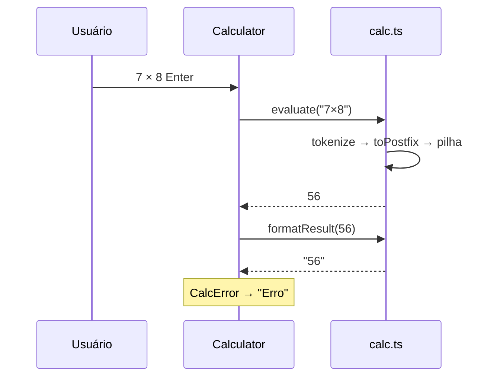

# Calculadora

Widget de calculadora no estilo REPL, com teclado na tela e no teclado físico, que calcula com um parser próprio, sem `eval`.

| | |
|---|---|
| **ID** | `widget/calculator` |
| **Status** | Implementado |
| **Origem** | `42e671a` (2026-10-23) · evoluída em `c4ccc57` |
| **Window kind** | `calculator` em `src/lib/desktop.ts` (300 × 420, mínimo 260 × 360, grupo `widgets`) |
| **Voz** | `window:calculator` ("calculadora", "calculator") |

## Visão geral

A Calculadora funciona como um REPL. Na linha `>` o usuário digita a expressão, e depois do `=` aparece o resultado em formato brasileiro (vírgula decimal). Embaixo há um teclado plano de 6 × 4 teclas. Ela aceita parênteses, potência (`^`), porcentagem pós-fixa (`%`) e sinal negativo, e calcula com um parser próprio, sem `eval`. Funciona pelo mouse e pelo teclado físico.

## Dados

- `$expressão`: a **Expressão**, o texto exibido, com os símbolos de tela (`×`, `÷`, `−`). Só em memória (RNF-001).
- `$resultado`: o resultado já formatado (por exemplo `0,3`), ou "Erro", ou nada antes do `=`. Só em memória.
- `$opções`: as **Opções da Calculadora**, `{ keypad, history, cursor }`, todas `true` por padrão. Ficam em `jarvis.widget.calculator` (250 ms; sem migração). `parseToggles` troca pelo padrão cada chave que não for booleana.
  - **RF-006**: As opções `keypad`, `history` e `cursor` DEVEM ficar em `jarvis.widget.calculator`.

## Componentes

### Avaliação (`calc.ts`)

Transforma $expressão num número, ou num `CalcError`.

- **Comportamento:**
  - **RF-005**: A calculadora NÃO DEVE usar `eval`, e sim tokenizar, converter para RPN (shunting-yard) e avaliar.
    - O tokenizador só aceita os símbolos da tabela `ALIASES` (de tela e de teclado). Ver [Gramática](#gramática).
  - **RF-001**: A calculadora DEVE avaliar `+ − × ÷ ^ %` e parênteses, com precedência `^` > `× ÷` > `+ −`. `^` e o menos unário associam à direita.
  - **RF-002**: A calculadora DEVE aceitar `,` e `.` como separador decimal na entrada e mostrar o resultado em `pt-BR`, sem agrupamento de milhar e com até 10 casas.
  - **RF-003**: A calculadora DEVE eliminar o ruído de ponto flutuante arredondando para 12 dígitos significativos.
    - `formatResult` faz `toPrecision(12)` e depois `toLocaleString("pt-BR")`, então `0,1 + 0,2` dá `0,3`.
  - Se a expressão for inválida (`(2+`, `2**`, `5%` sem número antes, símbolo desconhecido), então lance um `CalcError`, com a mensagem em PT-BR ("parêntese sem fechar", "% sem número", "símbolo desconhecido: …"…).
  - Se um número tiver dois separadores decimais (`1,2,3`), então é erro ("número inválido").
  - Se houver divisão por zero ou o resultado for infinito, então é erro ("resultado inválido").

### Display

A parte de cima, no estilo REPL: a conta anterior e a linha atual.

- **Comportamento:**
  - Antes do `=`, a linha atual mostra `>` e $expressão, ou `0` se ela estiver vazia.
  - Depois do `=`, a linha de cima mostra `> <expressão anterior>` e a atual mostra `=` e $resultado.
  - Se a avaliação lançar um `CalcError`, então o display mostra "Erro" na cor de alerta.
  - Se $opções.history estiver desligado, então a linha de cima some. Se $opções.cursor estiver desligado, então o cursor some.
  - O cursor `▌` só aparece antes do `=`.
  - Se $opções.keypad estiver desligado, então o display ocupa a janela.
- **Layout:**
  - O widget é uma coluna (`gap-2 px-3 pt-2 pb-3`) com o display no topo e o teclado embaixo. Ele recebe foco (`tabIndex={0}`), que liga o teclado físico.
  - O display alinha as linhas embaixo (`justify-end`) e tem no mínimo `min-h-16` com o teclado. Sem o teclado, ele cresce (`flex-1`).
  - A linha de cima tem o `>` e a expressão anterior, com altura mínima mesmo vazia (`min-h-5`).
  - A linha atual tem o prompt (`>` ou `=`), o valor (`data-testid="calc-display"`) e o cursor no fim.
- **Estilo:**
  - Tudo em `font-mono`. Os prompts `>` e `=` ficam em 12 px, `text-hud-cyan`.
  - A linha de cima fica em 12 px, `text-hud-text/55`, cortada com reticências.
  - O valor fica em `text-2xl`, `leading-tight`, números tabulares, `text-hud-light`, e em `text-hud-alert` quando é "Erro". Ele é cortado se não couber.
  - O cursor `▌` fica em `text-xl`, `text-hud-light/80`, e pisca com `crt-cursor` (1 s, em degraus).
  - O texto do display é selecionável (`select-text`).

### Teclado na tela

As 6 × 4 teclas embaixo do display. O teclado físico faz as mesmas ações (ver [Voz e teclado](#voz-e-teclado)).

- **Comportamento:**
  - Uma tecla de número, `(`, `)`, `%`, `^`, `,` ou operador insere o símbolo no fim de $expressão (`insert`).
  - Se houver $resultado e a tecla for um operador ou `)`, então a conta continua a partir do resultado. Qualquer outra tecla começa uma conta nova.
  - "Limpar" (C) zera $expressão e $resultado, e o display volta a `0`.
  - "Apagar" (⌫) tira o último caractere. Se houver $resultado, então ⌫ limpa tudo.
  - "Inverter sinal" (±) troca o sinal do último número da expressão, ou do resultado.
  - "Igual" (`=`) avalia $expressão. Se a expressão estiver vazia, então nada acontece.
  - Os rótulos acessíveis são "Limpar", "Apagar", "Inverter sinal" e "Igual". As outras teclas usam o próprio símbolo.
- **Layout:**
  - Uma grade de 4 colunas (`grid-cols-4 gap-px`) que ocupa o resto da altura, nesta ordem:
    - `C` `⌫` `(` `)`
    - `%` `^` `±` `÷`
    - `7` `8` `9` `×`
    - `4` `5` `6` `−`
    - `1` `2` `3` `+`
    - `0` (duas colunas) `,` `=`
  - Com o teclado desligado, a grade recebe `hidden`.
- **Estilo:**
  - As teclas são `text-sm`, sem borda, separadas por 1 px.
  - Números, `C`, `⌫`, `(`, `)`, `±` e `,` ficam em `bg-hud-text/[0.03]`, `text-hud-text`.
  - Os operadores (`+ − × ÷ ^ %`) ficam em `bg-hud-text/[0.06]`, `text-hud-cyan`.
  - O `=` fica em vídeo reverso, `bg-hud-light/80`, `font-semibold`, `text-hud-void`, e em `bg-hud-light` no hover.
  - No hover ou no foco, as outras teclas acendem em vídeo reverso (`bg-hud-light/85`, `text-hud-void`), com `transition-colors`.
  - O `⌫` é o ícone `Delete` do lucide, 15 px, centralizado.

### Menu "Opções do widget Calculadora"

O menu de botão direito, feito com `useWidgetMenu`, `WidgetMenu` e `toggleItems`.

- **Comportamento:**
  - Cada item liga ou desliga uma chave de $opções. A escolha vale depois de recarregar.
  - As teclas apertadas no menu ficam no menu e não digitam na conta.
- **Layout:** uma seção "Exibir" com as caixas "Teclado", "Conta anterior" e "Cursor", nessa ordem.
- **Estilo:** o kit do `WidgetMenu`: `font-mono` 12 px, borda `hud-cyan/30`, fundo `hud-panel/95`, caixas `[x]` / `[ ]` em `text-hud-cyan` e o item em foco em vídeo reverso.

## Voz e teclado

- **RF-004**: O teclado físico DEVE mapear `*`→`×`, `/`→`÷`, `-`→`−`, `.`→`,`, Enter ou `=` para igual, Backspace para apagar e Esc ou Delete para limpar.
  - `0`–`9`, `(`, `)`, `+`, `^`, `%`: insere o caractere.
  - `*` · `/` · `-` · `.` ou `,`: insere `×` · `÷` · `−` · `,`.
  - Enter ou `=`: calcula.
  - Backspace: apaga o último caractere (depois do `=`, limpa).
  - Esc ou Delete: limpa.
  - Se a tecla vier com Ctrl, Meta ou Alt, então ela fica para a janela e o app (ex.: Ctrl+W).
- `window:calculator` ("calculadora", "calculator"): abre ou fecha o widget.
- Botão direito, ou a tecla de menu com o widget em foco: abre "Opções do widget Calculadora".

## Restrições

- **RNF-001**: A expressão e o resultado ficam só em memória e não sobrevivem a recarregar.
- **RNF-002**: Roda igual no modo web e no Tauri.
- Sem `eval`; resultado com no máximo 12 dígitos significativos e 10 casas.

## Histórias de usuário

### US1 — Fazer uma conta pelos botões (P1)

Como usuário, quero clicar nas teclas e ver o resultado.

**Por que P1:** é a função do widget.
**Teste independente:** `tests/desktop.spec.ts` — `the calculator computes from the buttons and from the keyboard`.

**Aceite**

1. **Dado** a calculadora aberta, **quando** clico em `7`, `×`, `8` e "Igual", **então** o display mostra `56`.
2. **Dado** um resultado na tela, **quando** clico em "Limpar", **então** o display volta a `0`.
3. **Dado** um resultado, **então** a linha de cima mostra `> <expressão anterior>` e a de baixo `= <resultado>`.
4. **Dado** `0,1 + 0,2`, **quando** calculo, **então** o resultado é `0,3`, sem o ruído de ponto flutuante.

### US2 — Fazer contas pelo teclado (P1)

Como usuário, quero digitar a conta direto, com o widget em foco.

**Por que P1:** é mais rápido que o mouse.
**Teste independente:** `tests/desktop.spec.ts` — `the calculator computes from the buttons and from the keyboard`.

**Aceite**

1. **Dado** o display clicado (foco no widget), **quando** digito `12+3` e Enter, **então** vejo `12+3` enquanto digito e `15` depois.
2. **Dado** o resultado `15`, **quando** digito `*2` e Enter, **então** a conta continua do resultado e dá `30`.
3. **Dado** qualquer estado, **quando** aperto Esc (ou Delete), **então** o display volta a `0`.
4. **Dado** o foco na calculadora, **quando** digito a conta, **então** o estado da voz continua `idle`.

### US3 — Escolher o que aparece (P2)

**Teste independente:** `tests/widgets.spec.ts` — `Calculadora: right click turns parts of the widget off, and it stays so`.

**Aceite**

1. **Dado** o menu "Opções do widget Calculadora", **quando** desmarco "Teclado", **então** as teclas somem (o display ocupa a janela) e a escolha vale depois de recarregar. Os outros itens são "Conta anterior" e "Cursor".

## Critérios de sucesso

- **SC-001**: Contas do dia a dia dão o mesmo resultado de uma calculadora comum, com vírgula decimal.
- **SC-002**: Nenhuma entrada derruba o widget, e o pior caso é `Erro`.

## Fora de escopo e limitações

- Sem memória (M+), histórico de várias contas ou funções científicas além de `^` e `%`.
- O `%` é sempre "dividido por 100" no número anterior (`50%` = `0,5`), sem a semântica de "porcentagem de" das calculadoras de bolso.
- A voz só abre e fecha a calculadora (`window:calculator`). Não há frases para fazer contas nela.

## Código

O cálculo fica em `src/lib/calc.ts`. A entrada é tokenizada (aceitando os símbolos de tela e de teclado), convertida para RPN pelo algoritmo shunting-yard e avaliada numa pilha. Qualquer erro vira `CalcError`. O widget guarda `expression` e `result` em estado React, traduz teclas físicas e cliques em `insert` ou `run(action)`, e formata o resultado com `formatResult` (`toPrecision(12)` + `toLocaleString("pt-BR")`).

| | |
|---|---|
| **Camadas** | UI React (`Calculator.tsx`) · lib (`calc.ts`) |
| **Dependências** | nenhuma externa; ícone `Delete` do lucide para ⌫ |
| **Testes** | `tests/desktop.spec.ts`, `tests/widgets.spec.ts` (e a busca em `tests/search.spec.ts` abre a Calculadora) |
| **Plataforma** | Windows 11 · WebView2; no modo web funciona igual |

### Arquivos

| Arquivo | Papel |
|---|---|
| `src/lib/calc.ts` | `tokenize`, `toPostfix`, `evaluate`, `formatResult`, `CalcError` |
| `src/components/desktop/widgets/Calculator.tsx` | teclado `KEYS` (6 linhas de 4; `0` ocupa duas colunas), mapa `KEYBOARD`, `insert`/`run`, menu "Exibir" |

### Gramática

| Token | Regra |
|---|---|
| número | `[0-9.,]+`, com a primeira `,` trocada por `.`; mais de um `.` é erro |
| `%` | pós-fixo: divide por 100 o número imediatamente anterior |
| `-` / `−` sem valor antes | menos unário (`neg`, precedência 4, associa à direita) |
| `+` sem valor antes | ignorado |
| `^` | precedência 3, associa à direita |

### Fluxo

### Constituição

- [x] P1 Offline-first: tudo local.
- [ ] P2/P3/P4: não se aplicam.
- [x] P5 Persistência tolerante: só as opções são salvas, via `parseToggles`.
- [x] P6 Funciona fora do Tauri: só UI.
- [x] P7 PT-BR: rótulos acessíveis "Limpar", "Apagar", "Inverter sinal", "Igual", "Erro"; as mensagens de `CalcError` também estão em PT-BR.
- [x] P8 Linguagem visual: display como REPL (`>` e `=`), cursor `▌` (`crt-cursor`), teclas que acendem em vídeo reverso, tokens `hud-*`.
- [x] P9 Desktop leve: sem timers.
- [x] P10 Segurança: nada vira código, porque o parser recusa qualquer símbolo fora da tabela `ALIASES`.
- [x] P11 Coberto por teste: botões, teclado e opções.

### Decisões relacionadas

- [ADR-0014 — linguagem visual TUI](../../arch/adr/0014-linguagem-visual-tui.md)
- [ADR-0017 — UI PT-BR, código EN](../../arch/adr/0017-ui-pt-br-codigo-en.md)

## Tarefas

Legenda: `[x]` feito · `[ ]` pendente · `[P]` pode rodar em paralelo (arquivos diferentes) · `[USn]` história desta spec. As tarefas foram reconstruídas do código e do commit de origem.

### Fase 1 — Base

- [x] T001 Tokenizador com `ALIASES` (símbolos de tela e de teclado), `%` pós-fixo, menos e mais unários — `src/lib/calc.ts`
- [x] T002 Shunting-yard com `PRECEDENCE` e `RIGHT_ASSOCIATIVE`, e erros de parênteses — `src/lib/calc.ts`
- [x] T003 `evaluate` em pilha, que recusa resultado não finito, e `formatResult` em `pt-BR` — `src/lib/calc.ts`
- [x] T004 [P] `calculator` em `WINDOW_SPECS` (300 × 420, mín. 260 × 360) e palavras de busca — `src/lib/desktop.ts`, `src/lib/commands.ts`

### Fase 2 — US1 Conta pelos botões (P1)

- [x] T005 [US1] Teclado `KEYS` de 6 × 4, com operadores destacados e `=` em vídeo reverso — `src/components/desktop/widgets/Calculator.tsx`
- [x] T006 [US1] `insert` continua do resultado com operador ou `)`, e `run` trata `clear`, `backspace`, `negate` e `equals` — `src/components/desktop/widgets/Calculator.tsx`
- [x] T007 [US1] Display REPL: `>` e expressão anterior, `=` e resultado, `Erro` em alerta, cursor `▌` — `src/components/desktop/widgets/Calculator.tsx`

### Fase 3 — US2 Conta pelo teclado (P1)

- [x] T008 [US2] `onKeyDown` com o mapa `KEYBOARD`, Enter/`=`, Backspace, Esc/Delete, ignorando Ctrl, Meta e Alt — `src/components/desktop/widgets/Calculator.tsx`

### Fase 4 — US3 Opções (P2)

- [x] T009 [US3] Opções `{ keypad, history, cursor }` e menu "Exibir" — `src/components/desktop/widgets/Calculator.tsx` (`c4ccc57`)

### Fase 5 — Testes

- [x] T010 Playwright `tests/desktop.spec.ts` — "the calculator computes from the buttons and from the keyboard"
- [x] T011 Playwright `tests/widgets.spec.ts` — "Calculadora: right click turns parts of the widget off, and it stays so"
- [x] T012 Playwright `tests/desktop.spec.ts` — "voice commands open and close windows (engine event stand-in)"

## Pendências

- [ ] `src/lib/calc.ts` não tem teste unitário próprio: precedência, `%`, `^`, parênteses e a mensagem de cada `CalcError` só são cobertos de forma indireta, por `7×8`, `12+3` e `*2` no E2E.
