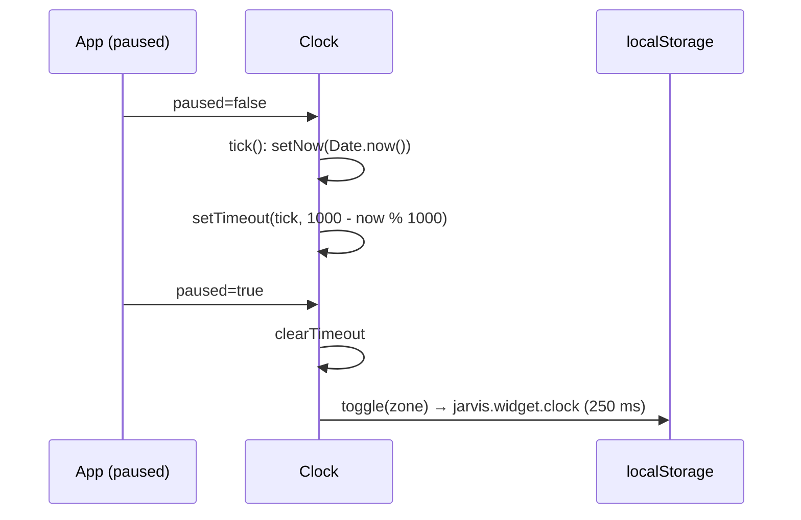

# Widget: Relógio

Widget com a hora local em destaque e, embaixo, a data por extenso e o fuso horário.

| | |
|---|---|
| **ID** | `widget/clock` |
| **Status** | Implementado |
| **Origem** | `42e671a` (2026-10-23) · evoluída em `c4ccc57` |
| **Window kind** | `clock` em `src/lib/desktop.ts` (300 × 160, mínimo 220 × 120, grupo `widgets`) |
| **Voz** | `window:clock` ("relógio", "clock") |

## Objetivo

O Relógio é o relógio de parede do desktop. Ele mostra a hora local grande e, abaixo, linhas no estilo neofetch com a data por extenso e o fuso horário. Ele abre pelo lançador de Widgets, pela busca, pela voz, pelo módulo "Data e hora" da barra superior e pela cena "acorda, querido, papai chegou". O único estado que ele guarda são as opções de exibição.

## Não-objetivos

- Não tem alarme, cronômetro nem outros fusos. Timer e lembretes são de [reminders](../../features/reminders/spec.md), e o Pomodoro tem widget próprio.
- "Que horas são" por voz é respondido pelo JARVIS ([voice-shortcuts](../../features/voice-shortcuts/spec.md)), não pelo widget.
- O chrome da janela e o menu de opções são de [desktop-windows](../../features/desktop-windows/spec.md).

## Histórias de usuário

### US1 — Ver a hora, a data e o fuso (P1)

Como usuário, quero olhar para o widget e saber a hora exata, o dia e o fuso em que estou.

**Por que P1:** é todo o conteúdo do widget.
**Teste independente:** `tests/desktop.spec.ts` — `a widget opens once, shows the time and closes`.

**Aceite:** [critérios 1 a 5](#critérios-de-aceite).

### US2 — Escolher o que aparece (P2)

Como usuário, quero esconder os segundos, a data ou o fuso pelo botão direito e que a escolha continue depois de recarregar.

**Por que P2:** deixa o widget mais limpo sem perder a função principal.
**Teste independente:** `tests/widgets.spec.ts` — `Relógio: right click turns parts of the widget off, and it stays so`.

**Aceite:** [critérios 6 a 8, 12 e 13](#critérios-de-aceite).

### US3 — Abrir o relógio por outros caminhos (P3)

Como usuário, quero abrir o relógio pela voz, pela barra superior ou na chegada em casa.

**Por que P3:** são atalhos para algo que o lançador já resolve.
**Teste independente:** `tests/desktop.spec.ts` — `voice commands open and close windows (engine event stand-in)`; `tests/taskbar.spec.ts` — `the top bar is on by default, turns off and on in the settings and drives the windows`.

**Aceite:** [critérios 9 a 11](#critérios-de-aceite).

## Critérios de aceite

### Critério 1 (US1)

- **Dado** o desktop sem janelas
- **Quando** abro "Relógio" no lançador de Widgets
- **Então** vejo a hora no formato `HH:MM` seguida de `:SS` em tom esmaecido.

### Critério 2 (US1)

- **Dado** o relógio aberto
- **Quando** o segundo vira
- **Então** o número muda junto com a virada do segundo, sem deriva.

### Critério 3 (US1)

- **Dado** o relógio aberto
- **Então** vejo `data ~ <dia da semana>, <dia> de <mês>` e `fuso ~ <fuso IANA>`, com `_` trocado por espaço (ex.: `America/Sao Paulo`).

### Critério 4 (US1)

- **Dado** o relógio já aberto
- **Quando** o escolho de novo no lançador
- **Então** ele vem para a frente e continua havendo uma só janela "Relógio".

### Critério 5 (US1)

- **Dado** o relógio aberto
- **Quando** clico em "Fechar Relógio"
- **Então** a janela some e a ordem salva fica vazia.

### Critério 6 (US2)

- **Dado** o relógio aberto
- **Quando** clico com o botão direito
- **Então** abre o menu "Opções do widget Relógio" com a seção "Exibir" e os itens "Segundos", "Data" e "Fuso horário", todos marcados.

### Critério 7 (US2)

- **Dado** o menu aberto
- **Quando** desmarco "Fuso horário"
- **Então** a linha `fuso` some na hora e `jarvis.widget.clock` passa a ter `zone: false`.

### Critério 8 (US2)

- **Dado** essa escolha salva
- **Quando** recarrego a página
- **Então** o relógio volta sem a linha `fuso` e o item continua desmarcado.

### Critério 9 (US3)

- **Dado** o motor de voz ativo
- **Quando** digo "abre o relógio"
- **Então** o Relógio abre, o dock mostra "Abrindo Relógio" e o JARVIS confirma.

### Critério 10 (US3)

- **Dado** a barra superior ligada
- **Quando** clico no módulo "Data e hora"
- **Então** o Relógio abre.

### Critério 11 (US3)

- **Dado** o atalho "acorda, querido, papai chegou"
- **Quando** a cena roda
- **Então** o Relógio é o primeiro widget a acender, antes de Agenda e Tarefas (ver [voice-shortcuts](../../features/voice-shortcuts/spec.md)).

### Critério 12 (US2)

- **Dado** `jarvis.widget.clock` salvo com `zone: "não"` (um valor que não é booleano)
- **Quando** abro o Relógio
- **Então** a linha `fuso` aparece e "Fuso horário" vem marcado, porque só essa chave volta ao padrão.

### Critério 13 (US2)

- **Dado** o menu "Opções do widget Relógio" aberto
- **Quando** desmarco "Segundos", "Data" e "Fuso horário"
- **Então** sobra só a hora `HH:MM`, e o bloco de linhas some inteiro.

## Casos de borda

- **Vazio/nulo:**
  - `jarvis.widget.clock` ausente, com JSON inválido ou com o `localStorage` indisponível → as três opções valem `true`.
  - Uma chave salva que não é booleana → só ela volta a `true` (`parseToggles`).
  - Todas as opções desligadas → sobra só `HH:MM`, que não tem opção.
- **Duplicidade/idempotência:**
  - Escolher "Relógio" com ele aberto (lançador, busca ou "abre o relógio") → ele só vem para a frente, e continua havendo uma janela.
  - "Fecha o relógio" com ele fechado → o dock diz "Relógio não está aberto" e nada muda.
- **Concorrência/corrida:**
  - O app fica oculto entre dois ticks (`paused`) → o `clearTimeout` cancela o próximo; ao reaparecer, o tick grava a hora atual e se realinha à virada do segundo.
  - Recarregar menos de 250 ms depois de mudar uma opção → o `beforeunload` grava o valor pendente.
  - O fuso do Windows muda com o app aberto → o widget segue no fuso lido ao carregar o módulo (ver [Pendências](#pendências)).
- **Permissões/visibilidade:** não se aplica: é só UI, sem comando Tauri, rede ou arquivo; as opções ficam no `localStorage` (`jarvis.widget.clock`), fora do `settings.json`.

## Dados

- `$opções`: `{ seconds, date, zone }`, todas booleanas e `true` por padrão. Fica em `jarvis.widget.clock` (`useStoredState`, 250 ms; sem migração). Ver [persistência](../../domain/persistence.md).
  - Se uma chave salva não for booleana (opção corrompida), então ela volta ao padrão (`true`). `parseToggles` valida chave por chave.
- `$agora`: `Date.now()`, só em memória, renovado a cada segundo.
- `$fuso`: o fuso IANA do sistema operacional (`Intl.DateTimeFormat().resolvedOptions().timeZone`), com `_` trocado por espaço. É lido uma vez, ao carregar o módulo (`ZONE`).
  - Se o fuso do sistema mudar com o app aberto, então o widget não acompanha a troca (ver [Pendências](#pendências)).

## Componentes

### `Clock`

Mostra $agora em `HH:MM`, os segundos e as linhas de data e fuso conforme $opções.

- **Comportamento:**
  - **RF-001**: O widget DEVE mostrar a hora local em `pt-BR` com hora e minuto de dois dígitos.
  - **RF-002**: O widget DEVE mostrar os segundos com dois dígitos quando a opção `seconds` estiver ligada.
  - **RF-003**: O widget DEVE mostrar a data (dia da semana longo, dia, mês longo) e o fuso IANA como linhas `KeyValue` com as chaves `data` e `fuso`.
    - A data usa `Intl.DateTimeFormat("pt-BR", { weekday: "long", day: "numeric", month: "long" })`, por exemplo `data ~ terça-feira, 3 de novembro`.
    - O fuso aparece como $fuso, por exemplo `fuso ~ America/Sao Paulo`.
  - Se todas as opções estiverem desligadas, então sobra só a hora `HH:MM`, porque ela não tem opção.
  - Se `date` e `zone` estiverem desligadas, então o bloco de linhas some inteiro.
- **Layout:**
  - Uma coluna centralizada na vertical (`flex h-full flex-col justify-center gap-2 px-4 pb-1`), que recebe foco (`tabIndex={0}`) para abrir o menu pelo teclado.
  - No topo, a hora, com os segundos colados (`:SS`) logo depois.
  - Embaixo, as linhas `KeyValue` `data` e `fuso`, nessa ordem.
- **Estilo:**
  - A hora fica em `font-mono`, `text-hud-light`, `leading-none` e com números tabulares (`tabular-nums`). O tamanho acompanha a largura da janela: `clamp(28px, 17cqw, 84px)` (RNF-002).
  - Os segundos ficam esmaecidos, em `text-hud-text/45`.
  - As linhas `KeyValue` são `font-mono` 12 px: a chave alinhada à direita numa coluna de 7 caracteres em `text-hud-cyan`, o `~` em `text-hud-text/50` e o valor em `text-hud-text`, cortado com reticências se não couber.
  - O texto é selecionável (`select-text`) e o foco não desenha contorno (`outline-none`).

### Tick do segundo

O temporizador que renova $agora.

- **Comportamento:**
  - **RF-004**: O widget DEVE atualizar no início de cada segundo e parar enquanto o app estiver oculto.
    - Cada tick grava `Date.now()` em $agora e agenda o próximo com `setTimeout(tick, 1000 - (agora % 1000))` (RNF-001).
  - Se o app ficar oculto ou minimizado (`paused`), então o relógio para de atualizar (`clearTimeout`) e volta a contar ao reaparecer, já na hora certa.

### Menu "Opções do widget Relógio"

O menu de botão direito do widget, feito com `useWidgetMenu`, `WidgetMenu` e `toggleItems`.

- **Comportamento:**
  - **RF-005**: O menu de botão direito DEVE ligar e desligar `seconds`, `date` e `zone` e guardar em `jarvis.widget.clock`.
    - A mudança aparece na hora no widget e é gravada em $opções.
  - Marcar ou desmarcar um item deixa o menu aberto. `Esc`, um clique fora ou sair da janela fecham o menu, e `Esc` devolve o foco ao widget.
  - Pelo teclado, sem ponteiro, o menu abre no canto do widget. Se ele não couber, abre do outro lado do ponteiro.
- **Layout:**
  - Uma seção "Exibir" com três caixas de marcar, nesta ordem: "Segundos", "Data" e "Fuso horário".
  - Abre na posição do ponteiro.
- **Estilo:**
  - O kit do `WidgetMenu`: `font-mono` 12 px, borda `hud-cyan/30`, fundo `hud-panel/95` (sem desfoque) e sombra.
  - O título "Exibir" fica em 10 px, maiúsculas e `text-hud-text/45`. As caixas aparecem como `[x]` ou `[ ]` em `text-hud-cyan`.
  - O item sob o ponteiro ou em foco fica em vídeo reverso (`bg-hud-light/85`, `text-hud-void`).

## Voz e teclado

- `window:clock` ("relógio", "clock") com um verbo de abrir ou fechar: abre ou fecha o widget (evento `voice:window`).
- Módulo "Data e hora" da barra superior: `onWindow("clock")`.
- Atalho `shortcut:homecoming`: abre `clock`, depois `agenda` e `tasks`, com 300 ms entre eles.
- Botão direito, ou a tecla de menu com o widget em foco: abre "Opções do widget Relógio".
- Setas, `Home` e `End` no menu: andam entre os itens.

## Restrições

- **RNF-001**: O temporizador reagenda a si mesmo para `1000 - (agora % 1000)` ms, sem `setInterval`.
- **RNF-002**: O tamanho da hora acompanha a largura da janela (`clamp(28px, 17cqw, 84px)`).
- **RNF-003**: O widget roda igual no modo web e no Tauri, sem backend.
- Para de atualizar com `paused` (app oculto ou minimizado).

## Critérios de sucesso

- **SC-001**: A hora mostrada nunca fica mais de um segundo atrás do relógio do sistema enquanto o app está visível.
- **SC-002**: Uma opção desligada continua desligada depois de recarregar.

## Entregáveis

Um componente React sem backend. Um `setTimeout` encadeado, alinhado à virada do segundo, atualiza `Date.now()`. Três `Intl.DateTimeFormat` em `pt-BR` formatam hora, segundos e data, e o fuso sai de `resolvedOptions().timeZone`. As opções de exibição usam `useWidgetOptions("clock", …)` e o menu `WidgetMenu`.

| | |
|---|---|
| **Camadas** | UI React (`Clock.tsx`) · hook de opções (`useWidgetOptions`) |
| **Dependências** | ver [Dependências](#dependências) |
| **Testes** | `tests/desktop.spec.ts`, `tests/widgets.spec.ts`, `tests/taskbar.spec.ts` |
| **Plataforma** | Windows 11 · WebView2; no modo web funciona igual (não depende do Tauri) |

### Arquivos

| Arquivo | Papel |
|---|---|
| `src/components/desktop/widgets/Clock.tsx` | widget: tick por segundo, formatação, menu "Exibir" |
| `src/hooks/useWidgetOptions.ts` | opções on/off em `jarvis.widget.<nome>` (de [desktop-windows](../../features/desktop-windows/spec.md)) |
| `src/components/desktop/widgets/tui.tsx` | `KeyValue` (`chave ~ valor`) |
| `src/components/desktop/widgets/WidgetMenu.tsx` | `useWidgetMenu`, `WidgetMenu`, `toggleItems` (de desktop-windows) |
| `src/components/desktop/Desktop.tsx` | `case "clock"`: `<Clock paused={paused} />` |
| `src/lib/desktop.ts` | `WINDOW_SPECS.clock` (título "Relógio", ícone `Clock`, 300 × 160, mín. 220 × 120) |
| `src/lib/commands.ts` | `WINDOW_KEYWORDS.clock` para a busca: "hora", "horas", "relogio", "clock", "time" |

### Fluxo

### Testes

- `npx playwright test tests/desktop.spec.ts --project ui -g "a widget opens once"`: abre pelo lançador com `HH:MM:SS`, escolher de novo não duplica a janela e "Fechar Relógio" esvazia a ordem salva (critérios 1, 4 e 5).
- `npx playwright test tests/desktop.spec.ts --project ui -g "voice commands open and close windows"`: `window:clock` abre e fecha o widget, com "Abrindo Relógio" no dock (critério 9).
- `npx playwright test tests/personality.spec.ts --project ui -g "short spoken confirmation"`: o JARVIS confirma a abertura em voz (critério 9).
- `npx playwright test tests/widgets.spec.ts --project ui -g "Relógio"`: o menu "Opções do widget Relógio", a linha `fuso` some ao desmarcar "Fuso horário" e continua assim depois de recarregar (critérios 3, 6 a 8).
- `npx playwright test tests/taskbar.spec.ts --project ui -g "the top bar is on by default"`: o módulo "Data e hora" abre o Relógio (critério 10).
- `npx playwright test tests/tasks.spec.ts --project ui -g "papai chegou"`: a cena de chegada acende Relógio, Agenda e Tarefas (critério 11; a ordem não é conferida).
- `cargo test --lib opens_and_closes_jarvis_windows` (em `src-tauri`): "abre o relógio" e "Fecha o relógio." viram `window:clock` (critério 9).
- `cargo test --lib default_voice_commands_are_valid` (em `src-tauri`): o catálogo tem frases para o kind `clock` (T003).
- Sem teste automatizado: critérios 2, 12 e 13.

### Reversão

- Tirar `clock` do union `WindowKind`, de `WINDOW_KINDS` e de `WINDOW_SPECS` (`src/lib/desktop.ts`), do `WINDOW_KINDS` do Rust (`src-tauri/src/settings.rs`, o tamanho do array muda junto) e a entrada `window:clock` de `src-tauri/voice-commands.json`. Os três andam juntos: o `default_voice_commands_are_valid` exige frases para cada kind do Rust e um kind válido para cada comando `window`.
- Tirar o `case "clock"` de `Desktop.tsx`, `WINDOW_KEYWORDS.clock` de `commands.ts` e apagar `Clock.tsx`. Antes, dar outro destino ao módulo "Data e hora" (`Taskbar.tsx`) e tirar `clock` do `comeHome` (`App.tsx`), senão o `tsc` falha.
- Vários testes de outras features usam o Relógio como janela de exemplo (`desktop`, `dock`, `search`, `voice`, `voicetab`, `taskbar`, `tasks`, os testes do `matcher.rs` e do `mcp.rs`). Eles precisam trocar de kind.
- Fica órfão e é ignorado: `jarvis.widget.clock`; `clock` em `jarvis.desktop` (o `parseDesktop` descarta kinds desconhecidos); `window:clock` e os comandos `custom-*` com alvo `clock` no `settings.json` (o `sanitize_voice_commands` os descarta).

### Constituição

- [x] P1 Offline-first: não usa rede.
- [ ] P2 Rust é dono do nativo: não se aplica, porque não há chamada nativa.
- [ ] P3 Comandos finos: não se aplica.
- [ ] P4 Contratos espelhados: não se aplica.
- [x] P5 Persistência tolerante: `parseToggles` valida chave por chave e usa o padrão quando o valor não é booleano.
- [x] P6 Funciona fora do Tauri: é só UI.
- [x] P7 PT-BR na UI: "data", "fuso", "Segundos", "Data", "Fuso horário", "Opções do widget Relógio".
- [x] P8 Linguagem visual única: tokens `hud-*` e o `KeyValue` do kit TUI.
- [x] P9 Desktop leve: o timer para quando `paused` é verdadeiro.
- [x] P11 Coberto por teste: abrir/fechar, menu de opções e o atalho da barra superior.

### Decisões relacionadas

- [ADR-0010 — settings.json vs localStorage](../../arch/adr/0010-persistencia-settings-vs-localstorage.md)
- [ADR-0014 — linguagem visual TUI](../../arch/adr/0014-linguagem-visual-tui.md)
- [ADR-0017 — UI PT-BR, código EN](../../arch/adr/0017-ui-pt-br-codigo-en.md)

## Dependências

- **Vendor:** [React](../../foundation/vendor/react/spec.md), [Tailwind](../../foundation/vendor/tailwind/spec.md), [lucide](../../foundation/vendor/lucide/spec.md) (ícone `Clock` em `WINDOW_SPECS`)
- **Specs:** [desktop-windows](../../features/desktop-windows/spec.md) (janela, `useWidgetOptions` e `WidgetMenu`), [appearance](../../features/appearance/spec.md) (kit TUI: `KeyValue`), [voice-commands](../../features/voice-commands/spec.md) (`window:clock`), [search](../../features/search/spec.md) (palavras da busca), [dock-taskbar](../../features/dock-taskbar/spec.md) (módulo "Data e hora"), [voice-shortcuts](../../features/voice-shortcuts/spec.md) (cena de chegada)
- **Sistema:** WebView2 com `Intl.DateTimeFormat` em `pt-BR`; a hora e o fuso do Windows.

## Tarefas

Legenda: `[x]` feito · `[ ]` pendente · `[P]` pode rodar em paralelo (arquivos diferentes) · `[USn]` história desta spec. As tarefas foram reconstruídas do código e do commit de origem.

### Fase 1 — Base

- [x] T001 Registrar `clock` em `WINDOW_KINDS` e `WINDOW_SPECS` (título "Relógio", 300 × 160, mín. 220 × 120) — `src/lib/desktop.ts`
- [x] T002 [P] Palavras de busca do relógio em `WINDOW_KEYWORDS` — `src/lib/commands.ts`
- [x] T003 [P] Frases `window:clock` no catálogo de voz — `src-tauri/voice-commands.json`

### Fase 2 — US1 Ver a hora, a data e o fuso (P1)

- [x] T004 [US1] Formatadores `Intl` (hora, segundos, data longa) e fuso com espaços — `src/components/desktop/widgets/Clock.tsx`
- [x] T005 [US1] Tick alinhado ao segundo com `setTimeout` encadeado, parado por `paused` — `src/components/desktop/widgets/Clock.tsx`
- [x] T006 [US1] Linhas `data` e `fuso` com `KeyValue` — `src/components/desktop/widgets/Clock.tsx`
- [x] T007 [US1] Renderizar `<Clock paused={paused} />` em `WindowContent` — `src/components/desktop/Desktop.tsx`

### Fase 3 — US2 Escolher o que aparece (P2)

- [x] T008 [US2] Opções `{ seconds, date, zone }` via `useWidgetOptions("clock")` e menu "Exibir" — `src/components/desktop/widgets/Clock.tsx` (`c4ccc57`)

### Fase 4 — US3 Outros caminhos (P3)

- [x] T009 [US3] Módulo "Data e hora" da barra superior abre o Relógio — `src/components/Taskbar.tsx`
- [x] T010 [US3] Cena de chegada abre `clock`, `agenda` e `tasks` em sequência — `src/App.tsx` (`comeHome`)

### Fase 5 — Testes

- [x] T011 Playwright `tests/desktop.spec.ts` — "a widget opens once, shows the time and closes"
- [x] T012 Playwright `tests/desktop.spec.ts` — "voice commands open and close windows (engine event stand-in)"
- [x] T013 Playwright `tests/widgets.spec.ts` — "Relógio: right click turns parts of the widget off, and it stays so"
- [x] T014 Playwright `tests/taskbar.spec.ts` — "the top bar is on by default, turns off and on in the settings and drives the windows"
- [x] T015 Playwright `tests/personality.spec.ts` — "voice commands get a short spoken confirmation, under what was said, and the dock still says it"
- [x] T016 Playwright `tests/tasks.spec.ts` — "\"acorda, querido, papai chegou\": the lights come on, the widgets light up, JARVIS welcomes him home"

## Pendências

- [ ] O fuso (`ZONE`) é lido uma vez, ao carregar o módulo, e não acompanha uma troca de fuso com o app aberto — `src/components/desktop/widgets/Clock.tsx`
