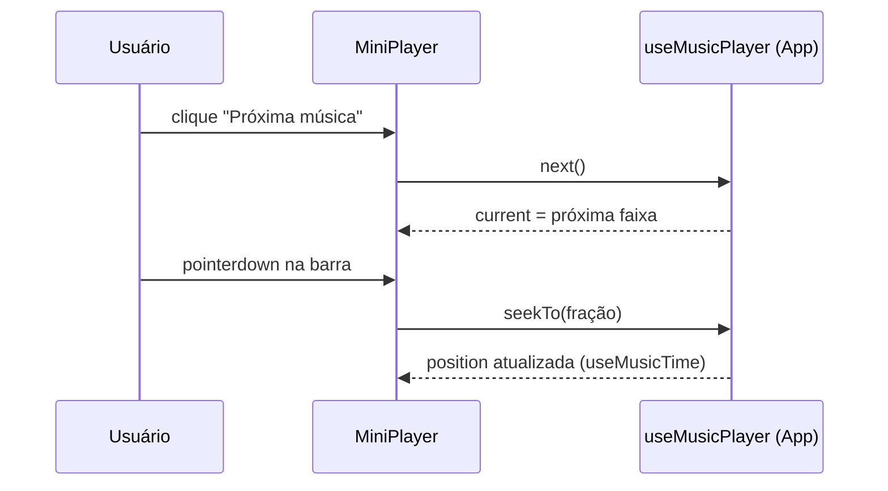

# Widget: Mini player

Widget com o controle compacto do jv_T4p3: a faixa que toca, o tempo, uma barra de progresso clicável, anterior, tocar/pausar, próxima e o volume.

| | |
|---|---|
| **ID** | `widget/miniplayer` |
| **Status** | Implementado |
| **Origem** | `42e671a` (2026-10-23) · evoluída em `c4ccc57` |
| **Window kind** | `miniplayer` em `src/lib/desktop.ts` (360 × 150, mínimo 300 × 140, grupo `widgets`) |
| **Voz** | `window:miniplayer` ("mini player", "miniplayer", "controle de música") |

## Objetivo

O Mini player é o controle compacto do jv_T4p3. Mostra a faixa que está tocando, o tempo, o artista e a playlist, uma barra de progresso clicável, os três botões que importam (anterior, tocar/pausar, próxima) e o volume. Ele não tem player próprio: comanda o player do app inteiro, descrito em [jv_T4p3](../../apps/jv_t4p3/spec.md), que continua tocando com a janela do jv_T4p3 fechada.

## Não-objetivos

- Não escolhe playlists nem edita a fila. Isso é do [jv_T4p3](../../apps/jv_t4p3/spec.md).
- A cor da barra (`TAPE_MAGENTA`) é a mesma do jv_T4p3 e não segue o tema.

## Histórias de usuário

### US1 — Ver o que está tocando (P1)

Como usuário, quero saber qual música toca, de quem é, de qual playlist e em que ponto está.

**Por que P1:** é a informação principal do widget.
**Teste independente:** `tests/music.spec.ts` — `the Fita and Mini player widgets follow the music, which goes on with the player closed`.

**Aceite:** [critérios 1 a 3](#critérios-de-aceite).

### US2 — Controlar a música (P1)

Como usuário, quero pular, pausar, tocar e mudar de ponto na música sem abrir o player.

**Por que P1:** é o motivo de ter um mini player.
**Teste independente:** `tests/music.spec.ts` — `the Fita and Mini player widgets follow the music, which goes on with the player closed` e `voice plays playlists, skips, pauses and opens or closes the player and its widgets`.

**Aceite:** [critérios 4 a 8](#critérios-de-aceite).

### US3 — Escolher o que aparece (P2)

**Teste independente:** `tests/widgets.spec.ts` — `Mini player: right click turns parts of the widget off, and it stays so`.

**Aceite:** [critério 9](#critérios-de-aceite).

## Critérios de aceite

### Critério 1 (US1)

- **Dado** uma música tocando com o jv_T4p3 fechado
- **Quando** abro "Mini player"
- **Então** vejo `♪ Out of Touch`, o tempo `m:ss / m:ss` e `Hall and Oates · Flash FM` na linha de baixo.

### Critério 2 (US1)

- **Dado** nada tocando
- **Então** vejo "Nada tocando" e "jv_T4p3 · espaço toca a playlist escolhida".

### Critério 3 (US1)

- **Dado** o player resolvendo a música
- **Então** o título diz "sintonizando…". Com erro, aparece a mensagem do player na cor de alerta.

### Critério 4 (US2)

- **Dado** uma música tocando
- **Quando** clico em "Próxima música"
- **Então** o widget e a barra superior passam a mostrar a faixa seguinte.

### Critério 5 (US2)

- **Dado** a música pausada pela barra superior
- **Então** o botão central do widget vira "Tocar".

### Critério 6 (US2)

- **Dado** a barra de progresso ("Posição na música")
- **Quando** pressiono num ponto dela
- **Então** a música salta para essa fração. Arrastar ali não move a janela.

### Critério 7 (US2)

- **Dado** o widget em foco
- **Quando** aperto Espaço, `n` ou `b`
- **Então** a música toca/pausa, avança ou volta. `-` e `+` (ou `=`) mudam o volume em 5%.

### Critério 8 (US2)

- **Dado** comandos de voz de música ("pausa a música", "próxima música", "toca a Fever")
- **Então** o widget reflete o novo estado.

### Critério 9 (US3)

- **Dado** o menu "Opções do widget Mini player"
- **Quando** desmarco "Controles"
- **Então** os botões somem, e isso vale depois de recarregar. Os outros itens são "Tempo", "Artista e playlist", "Barra de progresso" e "Volume".

## Casos de borda

- **Vazio/nulo:**
  - Nada tocando → "Nada tocando" e "jv_T4p3 · espaço toca a playlist escolhida". Espaço, "tocar" ou `n` tocam a playlist escolhida; `b` não faz nada.
  - Duração desconhecida → a barra fica em 0, o tempo mostra `0:00`, e um clique na barra não faz nada (`seekTo` ignora).
  - O player com erro → a mensagem dele aparece na cor de alerta, e tocar de novo refaz a mesma faixa.
  - "Controles" e "Volume" desligados → a linha de baixo some.
  - `jarvis.widget.miniplayer` ausente, inválido ou com uma chave não booleana → essa opção vale `true`.
- **Duplicidade/idempotência:**
  - Espaço ou Enter com um botão do widget em foco → só o clique do botão roda, e a música não alterna duas vezes.
  - `-` com o volume em 0% ou `+` em 100% → o volume não passa do limite (`setVolume` fica entre 0 e 1).
- **Concorrência/corrida:**
  - O player muda por fora (voz, barra superior, jv_T4p3, Fita) → o widget mostra o novo estado na hora, porque lê o mesmo `MusicPlayer` do `App`.
  - Arrastar a partir da barra "Posição na música" → só busca um ponto; a janela não se move.
  - O jv_T4p3 fecha com a música tocando → o widget continua controlando o player, que segue tocando.
- **Permissões/visibilidade:** o widget não chama Tauri nem rede. O stream (YouTube via `yt-dlp`) é do player do [jv_T4p3](../../apps/jv_t4p3/spec.md); no modo web, a música vem do fake `__JARVIS_MUSIC__`. As opções ficam no `localStorage`.

## Dados

- `$opções`: **Opções do Mini player**, `{ time, details, bar, controls, volume }`, todas `true` por padrão. Ficam em `jarvis.widget.miniplayer` (debounce de 250 ms, sem migração); em `parseToggles`, um campo que não for booleano volta ao padrão. Ver [persistência](../../domain/persistence.md).
  - **RF-005**: As opções DEVEM ficar em `jarvis.widget.miniplayer`.
- `$faixa`: **Faixa atual**, com título, artista e estação, vindos de `music.current`, mais `status`, `volume` e `error` do player. Só em memória. Ver [glossário](../../domain/glossary.md).
- A posição e a duração vêm de `useMusicTime`.

## Componentes

### `MiniPlayer`

A visão fina sobre o player do app: título, tempo, detalhes, barra, controles e volume.

- **Comportamento:**
  - **RF-001**: O widget DEVE mostrar título, tempo atual/total, artista · playlist, barra de progresso, controles e volume, cada um com sua opção (`time`, `details`, `bar`, `controls`, `volume`).
  - O título é o da faixa atual. Enquanto o player resolve a música, ele diz "sintonizando…". Com erro, mostra a mensagem do player na cor de alerta. Sem nada tocando, diz "Nada tocando".
  - O tempo aparece como `m:ss / m:ss` (`clock`). Se a duração for desconhecida, a barra fica em 0 e o tempo mostra `0:00`.
  - Os detalhes dizem "<artista> · <playlist>" ou, sem nada tocando, "jv_T4p3 · espaço toca a playlist escolhida".
  - O volume só é exibido (`vol NN%`) e muda pelas teclas `-` e `+`. Não há slider.
  - Qualquer mudança no player (voz, barra superior, jv_T4p3) aparece no widget na hora.
- **Layout:**
  - Uma coluna centralizada na vertical, com quatro linhas: "♪", o título e o tempo à direita; os detalhes, recuados em `2ch`; a barra de progresso; e a linha dos controles, com o volume à direita (`ml-auto`).
  - As linhas desligadas em $opções somem. A linha de baixo só existe com controles ou volume.
- **Estilo:**
  - `font-mono` 12 px, `px-3 py-2`, `gap-1.5`.
  - "♪" fica em `text-hud-light` tocando e em `text-hud-text/50` parado. O título fica semibold em `text-hud-light`, truncado; o erro em `text-hud-alert`.
  - O tempo usa números tabulares em `text-hud-text/70`; os detalhes ficam em `text-hud-text/50`; o volume em 11 px, `text-hud-text/45`.

### Barra de progresso (`ProgressBar`)

A barra magenta compartilhada com o jv_T4p3.

- **Comportamento:**
  - **RF-002**: A barra DEVE ter `role="slider"` e chamar `music.seekTo(fração)` no `pointerdown`.
    - A fração é `(x - left) / width`, e o rótulo é "Posição na música".
    - Arrastar na barra não move a janela.
- **Layout:** uma faixa na largura toda do widget.
- **Estilo:** 1,5 de altura (`h-1.5`), fundo `bg-hud-text/10` e o preenchimento na cor fixa `TAPE_MAGENTA` (`oklch(0.68 0.21 330)`), fora dos tokens `hud-*`.

### Controles (`KeyHint`)

Os três botões que importam.

- **Comportamento:**
  - **RF-003**: Os botões DEVEM ser `KeyHint` (`b` anterior, `espaço` tocar/pausar, `n` próxima) e chamar `prev`, `toggle` e `next`.
  - O botão central diz "tocar" (rótulo "Tocar") com a música parada e "pausar" (rótulo "Pausar") tocando, também quando a pausa vem de fora, como da barra superior.
- **Layout:** os três em linha, nesta ordem: anterior, tocar/pausar, próxima.
- **Estilo:** kit TUI `KeyHint`: 11 px, ação em `text-hud-text/60`, tecla em `text-hud-cyan` sobre `bg-hud-text/12`, que vira vídeo reverso (`bg-hud-light/85`, `text-hud-void`) no hover.

### Menu "Opções do widget Mini player"

O menu do clique direito, com a seção "Exibir".

- **Comportamento:**
  - O clique direito no widget abre o menu. Cada item liga ou desliga uma parte de $opções: "Tempo", "Artista e playlist", "Barra de progresso", "Controles" e "Volume".
- **Layout:** `WidgetMenu` com uma seção "Exibir" e cinco itens de marcar.
- **Estilo:** o `WidgetMenu` compartilhado: painel `bg-hud-panel/95` com borda `hud-cyan/30`, `font-mono` 12 px, título da seção em 10 px maiúsculo `text-hud-text/45` e marcas `[x]` / `[ ]` em `text-hud-cyan`.

## Voz e teclado

- **RF-004**: As teclas DEVEM seguir `musicKeys` (Espaço, `n`, `b`, `-`, `+`, `=`).
  - Espaço: `music.toggle()`. `n` / `b`: `music.next()` / `music.prev()`. `-` · `+` ou `=`: volume −5% / +5%.
  - As teclas valem com o widget em foco.
  - Se a tecla for Espaço ou Enter com um botão do widget em foco, a tecla fica para o botão, e o atalho do widget não roda.
    > ⚠ inferido — confirmar: o objetivo é não alternar a música duas vezes (o clique nativo do botão e o atalho).
  - Atalhos com Ctrl, Meta ou Alt são ignorados pelo widget.
- `window:miniplayer` ("mini player", "miniplayer", "controle de música"): abre ou fecha o widget.
- `music:*`: agem no player e o widget acompanha (ver jv_T4p3).

## Restrições

- **RNF-001**: O widget não guarda estado de música. Tudo vem do player app-wide.
- **RNF-002**: No modo web, a música vem do fake `__JARVIS_MUSIC__` (ver [jv_T4p3](../../apps/jv_t4p3/spec.md)).
- O volume anda em passos de 0,05.

## Critérios de sucesso

- **SC-001**: Qualquer mudança no player (voz, barra superior, jv_T4p3) aparece no widget sem recarregar.
- **SC-002**: Pular, pausar e buscar um ponto funcionam com o jv_T4p3 fechado.

## Entregáveis

`MiniPlayer` é uma visão fina sobre o `MusicPlayer` do `App`. Ele lê `current`, `status`, `volume` e `error`, pega posição e duração de `useMusicTime` e reaproveita de `musicParts.tsx` o relógio `m:ss` (`clock`), a barra magenta clicável (`ProgressBar`) e o mapa de teclas (`musicKeys`). Os botões são `KeyHint` do kit TUI.

| | |
|---|---|
| **Camadas** | UI React (`MiniPlayer.tsx`) · partes compartilhadas (`musicParts.tsx`) |
| **Dependências** | ver [Dependências](#dependências) |
| **Testes** | `tests/music.spec.ts`, `tests/widgets.spec.ts` |
| **Plataforma** | Windows 11 · WebView2; no modo web a música vem do fake `__JARVIS_MUSIC__` |

### Arquivos

| Arquivo | Papel |
|---|---|
| `src/components/desktop/widgets/MiniPlayer.tsx` | widget, teclas (exceto Espaço/Enter sobre botões), menu "Exibir" |
| `src/components/desktop/musicParts.tsx` | `clock`, `nowLabel`, `ProgressBar` (slider, seek no `pointerdown`), `musicKeys`, `TAPE_MAGENTA` |
| `src/components/desktop/widgets/tui.tsx` | `KeyHint` (`[tecla] ação`, também botão) |
| `src/components/desktop/Desktop.tsx` | `<MiniPlayer music={music} />` |

### Fluxo

### Testes

- `npx playwright test tests/music.spec.ts --project ui -g "Mini player widgets follow the music"`: com o jv_T4p3 fechado, o widget mostra a faixa e "Hall and Oates · Flash FM", "Próxima música" pula junto com a barra superior, e a pausa pela barra vira "Tocar" (critérios 1, 4 e 5).
- `npx playwright test tests/music.spec.ts --project ui -g "voice plays playlists"`: a voz abre e fecha o widget, e ele acompanha pular, pausar e tocar uma playlist (critério 8).
- `npx playwright test tests/widgets.spec.ts --project ui -g "Mini player"`: "Controles" desmarcado esconde os botões e continua assim depois de recarregar (critério 9).
- `npx playwright test tests/widgets.spec.ts --project ui -g "sliders inside a widget"`: arrastar a partir da barra "Posição na música" não move a janela (critério 6, sem conferir o salto).
- `cargo test --lib opens_and_closes_jarvis_windows` (em `src-tauri`): "abre o mini player" e "fecha o miniplayer" viram `window:miniplayer`.
- `cargo test --lib default_voice_commands_are_valid` (em `src-tauri`): o catálogo tem frases para o kind `miniplayer`.
- Sem teste automatizado: critérios 2, 3 e 7, e o salto da barra no critério 6.

### Reversão

- Tirar `miniplayer` do union `WindowKind`, de `WINDOW_KINDS` e de `WINDOW_SPECS` (`src/lib/desktop.ts`), do `WINDOW_KINDS` do Rust (`src-tauri/src/settings.rs`) e a entrada `window:miniplayer` de `src-tauri/voice-commands.json`, juntos (o `default_voice_commands_are_valid` confere os três).
- Tirar o `case "miniplayer"` de `Desktop.tsx`, `WINDOW_KEYWORDS.miniplayer` de `commands.ts` e apagar `MiniPlayer.tsx`. O `musicParts.tsx` fica: o jv_T4p3 e a Fita também o usam.
- O player do `App` não depende do widget e continua igual. Os testes que abrem o Mini player (`music.spec.ts`, `widgets.spec.ts` e o `matcher.rs`) precisam sair ou mudar.
- Fica órfão e é ignorado: `jarvis.widget.miniplayer`; `miniplayer` em `jarvis.desktop` (o `parseDesktop` descarta); `window:miniplayer` e os `custom-*` com alvo `miniplayer` no `settings.json` (o `sanitize_voice_commands` descarta).

### Constituição

- [x] P1 Offline-first: o widget não usa rede. O streaming é do player.
- [x] P2 Rust é dono do nativo: não chama nada nativo direto.
- [x] P5 Persistência tolerante: opções via `parseToggles`.
- [x] P6 Funciona fora do Tauri: via o fake de música.
- [x] P7 PT-BR: "Nada tocando", "sintonizando…", "anterior", "tocar", "pausar", "próxima", "Posição na música".
- [ ] P8 Linguagem visual: exceção. A barra usa `TAPE_MAGENTA` (`oklch(0.68 0.21 330)`), uma cor fixa fora dos tokens `hud-*`, copiada do youtube-music-cli (comentário em `musicParts.tsx`).
- [x] P9 Desktop leve: o widget não tem timer próprio.
- [x] P11 Coberto por teste: acompanha a música, pula, pausa e mostra opções; a barra não arrasta a janela.

### Decisões relacionadas

- [ADR-0011 — fakes de dev e E2E no modo web](../../arch/adr/0011-fakes-de-dev-e-e2e-modo-web.md)
- [ADR-0014 — linguagem visual TUI](../../arch/adr/0014-linguagem-visual-tui.md)

## Dependências

- **Vendor:** [React](../../foundation/vendor/react/spec.md), [Tailwind](../../foundation/vendor/tailwind/spec.md)
- **Specs:** [jv_t4p3](../../apps/jv_t4p3/spec.md) (o player app-wide `useMusicPlayer` / `useMusicTime`, que o widget só lê e comanda), [appearance](../../features/appearance/spec.md) (kit TUI: `KeyHint`), [desktop-windows](../../features/desktop-windows/spec.md) (janela, `useWidgetOptions` e `WidgetMenu`), [voice-commands](../../features/voice-commands/spec.md) (`window:miniplayer` e `music:*`), [search](../../features/search/spec.md) (palavras da busca)
- **Sistema:** nenhum direto; a rede e o `yt-dlp` são do player do jv_T4p3.

## Tarefas

Legenda: `[x]` feito · `[ ]` pendente · `[P]` pode rodar em paralelo (arquivos diferentes) · `[USn]` história desta spec. As tarefas foram reconstruídas do código e do commit de origem.

### Fase 1 — Base

- [x] T001 `clock`, `ProgressBar` (slider com seek) e `musicKeys` compartilhados — `src/components/desktop/musicParts.tsx`
- [x] T002 [P] `miniplayer` em `WINDOW_SPECS` (360 × 150, mín. 300 × 140), palavras de busca e `window:miniplayer` — `src/lib/desktop.ts`, `src/lib/commands.ts`, `src-tauri/voice-commands.json`

### Fase 2 — US1 Ver o que está tocando (P1)

- [x] T003 [US1] Linha do título (`♪`, "sintonizando…", erro, "Nada tocando") e tempo `m:ss / m:ss` — `src/components/desktop/widgets/MiniPlayer.tsx`
- [x] T004 [US1] Linha de detalhes "artista · playlist" ou a dica "espaço toca a playlist escolhida" — `src/components/desktop/widgets/MiniPlayer.tsx`

### Fase 3 — US2 Controlar a música (P1)

- [x] T005 [US2] `KeyHint` anterior / tocar-pausar / próxima e `vol NN%` — `src/components/desktop/widgets/MiniPlayer.tsx`
- [x] T006 [US2] Barra clicável ligada a `music.seekTo` — `src/components/desktop/widgets/MiniPlayer.tsx`
- [x] T007 [US2] Teclas de `musicKeys`, que deixam Espaço/Enter para o botão em foco — `src/components/desktop/widgets/MiniPlayer.tsx`

### Fase 4 — US3 Opções (P2)

- [x] T008 [US3] Opções `{ time, details, bar, controls, volume }` e menu "Exibir" — `src/components/desktop/widgets/MiniPlayer.tsx` (`c4ccc57`)

### Fase 5 — Testes

- [x] T009 Playwright `tests/music.spec.ts` — "the Fita and Mini player widgets follow the music, which goes on with the player closed"
- [x] T010 Playwright `tests/music.spec.ts` — "voice plays playlists, skips, pauses and opens or closes the player and its widgets"
- [x] T011 Playwright `tests/widgets.spec.ts` — "Mini player: right click turns parts of the widget off, and it stays so"
- [x] T012 Playwright `tests/widgets.spec.ts` — "sliders inside a widget, and the apps' content, keep the pointer"

## Pendências

- [ ] `TAPE_MAGENTA` é uma cor fixa no código, fora dos tokens `hud-*` do tema, o que contraria a P8 — `src/components/desktop/musicParts.tsx`
